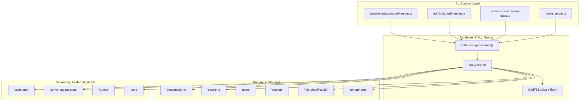
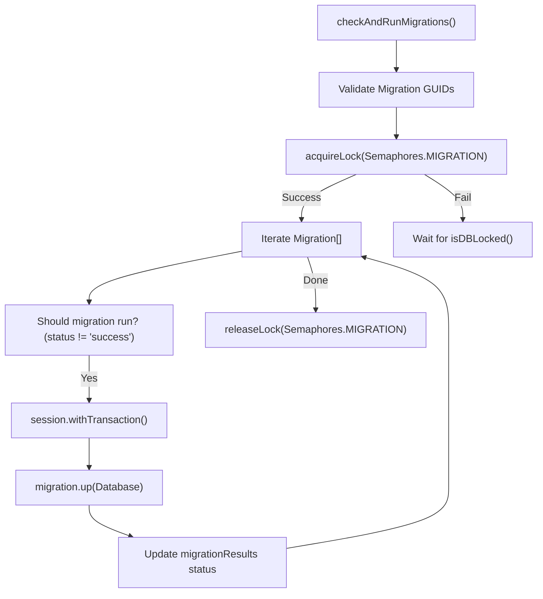

<!-- source: DeepWiki mcp.deepwiki.com · repo huggingface/chat-ui · page 8.2 Database Configuration · fetched 2026-10-26 -->

# Database Configuration

Relevant source files

The following files were used as context for generating this wiki page:

- [.devcontainer/Dockerfile](.devcontainer/Dockerfile)
- [.devcontainer/devcontainer.json](.devcontainer/devcontainer.json)
- [docker-compose.yml](docker-compose.yml)
- [docs/source/_toctree.yml](docs/source/_toctree.yml)
- [docs/source/configuration/metrics.md](docs/source/configuration/metrics.md)
- [docs/source/configuration/open-id.md](docs/source/configuration/open-id.md)
- [docs/source/configuration/theming.md](docs/source/configuration/theming.md)
- [docs/source/installation/docker.md](docs/source/installation/docker.md)
- [docs/source/installation/helm.md](docs/source/installation/helm.md)
- [docs/source/installation/local.md](docs/source/installation/local.md)
- [src/lib/components/icons/IconMoon.svelte](src/lib/components/icons/IconMoon.svelte)
- [src/lib/jobs/refresh-conversation-stats.ts](src/lib/jobs/refresh-conversation-stats.ts)
- [src/lib/migrations/migrations.spec.ts](src/lib/migrations/migrations.spec.ts)
- [src/lib/migrations/migrations.ts](src/lib/migrations/migrations.ts)
- [src/lib/migrations/routines/10-update-reports-assistantid.ts](src/lib/migrations/routines/10-update-reports-assistantid.ts)
- [src/lib/migrations/routines/index.ts](src/lib/migrations/routines/index.ts)
- [src/lib/server/database.ts](src/lib/server/database.ts)
- [src/lib/types/Assistant.ts](src/lib/types/Assistant.ts)
- [src/routes/admin/export/+server.ts](src/routes/admin/export/+server.ts)
- [src/routes/admin/stats/compute/+server.ts](src/routes/admin/stats/compute/+server.ts)

This document explains the database architecture for `chat-ui`, including connection management, collection schemas, indexing strategies, and the migration system. The application primarily uses MongoDB for persistence, with support for both external clusters and an embedded in-memory instance for development.

## MongoDB Connection Configuration

The database connection is managed via the `Database` singleton class. Configuration is driven by environment variables processed through the `config` object.

| Variable | Description | Default |
|----------|-------------|---------|
| `MONGODB_URL` | Connection string. If empty, starts an in-memory server. | `""` |
| `MONGODB_DB_NAME` | Name of the database. | `chat-ui` |
| `MONGODB_DIRECT_CONNECTION` | Forces direct connection to a single node. | `false` |
| `MONGO_STORAGE_PATH` | Disk path for in-memory DB persistence. | `<root>/db` |

### In-Memory MongoDB for Development
When `MONGODB_URL` is absent, the system initializes `MongoMemoryServer` [src/lib/server/database.ts:39-49](). This allows developers to run the application without a separate database installation while still persisting data to the local filesystem at `MONGO_STORAGE_PATH` [src/lib/server/database.ts:35-37](). The initialization logic ensures the storage directory exists before starting the server [src/lib/server/database.ts:43-47]().

Sources: [src/lib/server/database.ts:34-65](), [src/lib/server/database.ts:1-24]()

## Database Architecture and Flow

The `Database` class follows a singleton pattern, ensuring that connection pools and GridFS buckets are shared across the application [src/lib/server/database.ts:28-32](). The `init()` method handles the lifecycle of the connection, including setup and graceful teardown via `onExit` [src/lib/server/database.ts:34-84]().

**Diagram: Data Access Layer and Collection Topology**

Sources: [src/lib/server/database.ts:28-164](), [src/lib/jobs/refresh-conversation-stats.ts:2-6](), [src/routes/admin/export/+server.ts:1-10]()

## Collection Definitions

The system uses specific TypeScript interfaces to enforce structure across collections. The `getCollections()` method returns a typed map of these collections, distinguishing between those requiring strict primary reads and those that can use `SECONDARY_PREFERRED` for performance [src/lib/server/database.ts:109-164]().

| Collection | Type Interface | Consistency | Purpose |
|------------|----------------|-------------|---------|
| `conversations` | `Conversation` | Primary | Core chat history and message tree. |
| `users` | `User` | Primary | User profiles and authentication links. |
| `assistants` | `Assistant` | SecondaryPreferred | Pre-configured LLM personas and prompts [src/lib/types/Assistant.ts:6-28](). |
| `sessions` | `Session` | Primary | Auth sessions and expiration tracking. |
| `conversations.stats` | `ConversationStats` | SecondaryPreferred | Aggregated usage metrics (computed by jobs) [src/lib/server/database.ts:137-139](). |
| `semaphores` | `Semaphore` | Primary | Distributed locks for migrations and jobs [src/lib/server/database.ts:125-125](). |
| `files` | `GridFSBucket` | N/A | Large binary storage for chat attachments [src/lib/server/database.ts:130-130](). |
| `tools` | `any` | SecondaryPreferred | MCP tool definitions and configurations [src/lib/server/database.ts:143-145](). |

Sources: [src/lib/server/database.ts:119-145](), [src/lib/types/Assistant.ts:6-28](), [src/lib/server/database.ts:1-13]()

## Indexing Strategy

Indexes are initialized via `initDatabase()` during the connection phase to ensure query performance and data integrity [src/lib/server/database.ts:170]().

### Performance and Search Indexes
- **Conversations**: Optimized for user/session retrieval and message ancestry [src/lib/server/database.ts:187-210]().
- **Assistants**: Supports discovery via `searchTokens` and sorting by popularity (`userCount`) [src/lib/server/database.ts:249-257]().
- **Stats**: Unique compound index on `date.at`, `type`, `date.span`, `date.field`, and `distinct` [src/lib/server/database.ts:219-223]().

### TTL (Time-To-Live) Indexes
The application relies on MongoDB's TTL feature for automatic cleanup of ephemeral data:
- **`sessions`**: Expire at `expiresAt` [src/lib/server/database.ts:245-248]().
- **`messageEvents`**: Expire after 1 second (used for SSE buffering) [src/lib/server/database.ts:269-272]().
- **`abortedGenerations`**: Expire after 30 seconds [src/lib/server/database.ts:224-227]().
- **`semaphores`**: Expire at `deleteAt` to prevent deadlocks if a process crashes [src/lib/server/database.ts:265-268]().

Sources: [src/lib/server/database.ts:170-272]()

## Migration System

`chat-ui` includes a custom migration framework to handle schema updates across versions. Migrations are defined as `Migration` objects in `src/lib/migrations/routines/` [src/lib/migrations/routines/index.ts:5-15]().

### Migration Execution Flow
The `checkAndRunMigrations()` function orchestrates the process:
1. **Locking**: Acquires a global migration lock (`Semaphores.MIGRATION`) using the `semaphores` collection to prevent concurrent execution in multi-node deployments [src/lib/migrations/migrations.ts:27-29]().
2. **State Check**: Consults `migrationResults` to determine which routines have already succeeded [src/lib/migrations/migrations.ts:15-20]().
3. **Transaction**: Each migration `up()` function is executed within a MongoDB session transaction to ensure atomicity [src/lib/migrations/migrations.ts:89-100]().
4. **Lock Refresh**: A background interval refreshes the lock every 10 seconds while migrations are active [src/lib/migrations/migrations.ts:45-47]().

**Diagram: Migration Logic Flow**

Sources: [src/lib/migrations/migrations.ts:8-119](), [src/lib/migrations/routines/index.ts:5-13]()

## Background Jobs and Stats

Heavy analytical queries are offloaded to background jobs to maintain UI responsiveness.

### Conversation Stats Computation
The `computeAllStats` job uses complex MongoDB aggregation pipelines to calculate metrics across different spans (day, week, month) [src/lib/jobs/refresh-conversation-stats.ts:19-31](). 

Key characteristics of the pipeline:
- **Facet Aggregation**: Simultaneously calculates counts for users, sessions, and unique identifiers [src/lib/jobs/refresh-conversation-stats.ts:110-224]().
- **Merge Operator**: Results are merged into the `CONVERSATION_STATS_COLLECTION` using `$merge` with a `replace` strategy for matched records [src/lib/jobs/refresh-conversation-stats.ts:248-254]().
- **Locking**: Uses `Semaphores.CONVERSATION_STATS` and a `maintainLock` loop to ensure exclusive execution [src/lib/jobs/refresh-conversation-stats.ts:265-281]().

Sources: [src/lib/jobs/refresh-conversation-stats.ts:19-257](), [src/routes/admin/stats/compute/+server.ts:8-16](), [src/lib/server/database.ts:26-26]()

---

