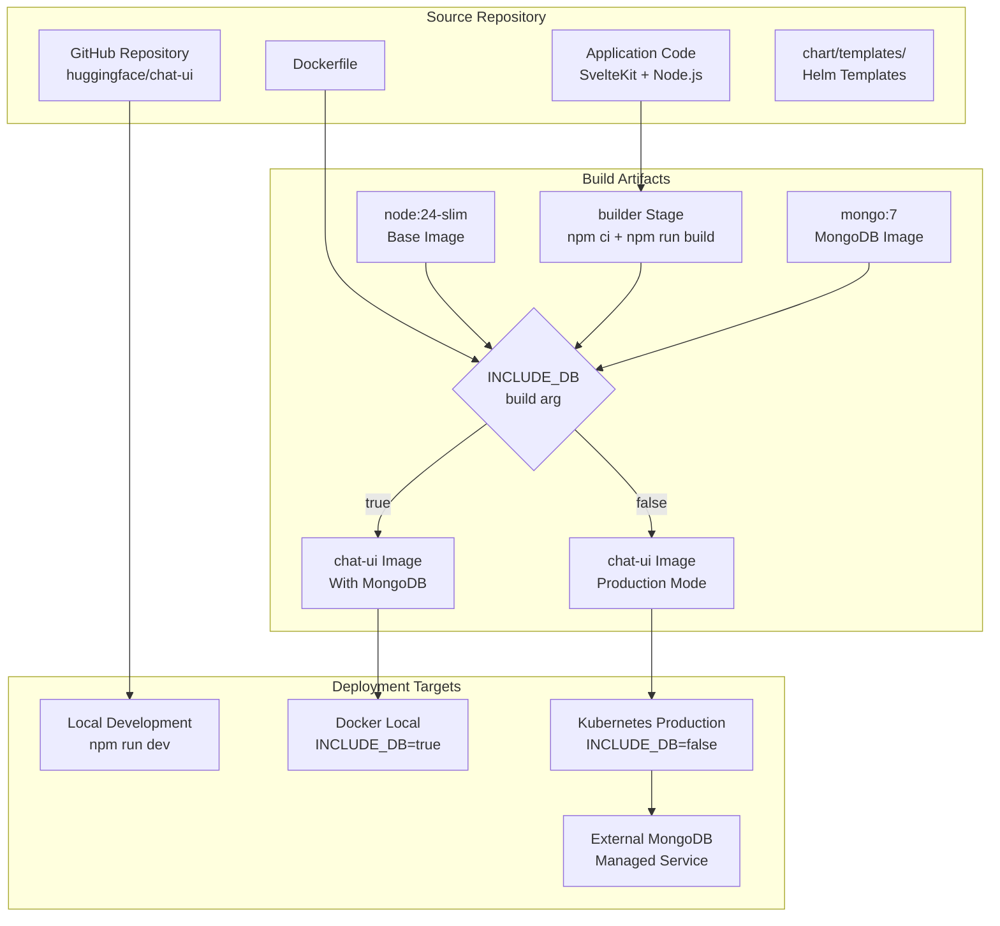
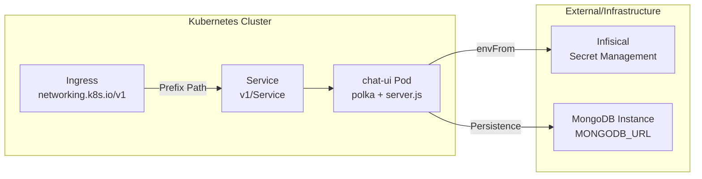

<!-- source: DeepWiki mcp.deepwiki.com · repo huggingface/chat-ui · page 9 Deployment · fetched 2026-10-26 -->

# Deployment

Relevant source files

The following files were used as context for generating this wiki page:

- [.dockerignore](.dockerignore)
- [.env.ci](.env.ci)
- [.github/workflows/deploy-prod.yml](.github/workflows/deploy-prod.yml)
- [Dockerfile](Dockerfile)
- [chart/templates/deployment.yaml](chart/templates/deployment.yaml)
- [chart/templates/infisical.yaml](chart/templates/infisical.yaml)
- [chart/templates/ingress-internal.yaml](chart/templates/ingress-internal.yaml)
- [chart/templates/ingress.yaml](chart/templates/ingress.yaml)
- [chart/templates/network-policy.yaml](chart/templates/network-policy.yaml)
- [chart/templates/service-account.yaml](chart/templates/service-account.yaml)
- [chart/templates/service-monitor.yaml](chart/templates/service-monitor.yaml)
- [chart/templates/service.yaml](chart/templates/service.yaml)
- [chart/values.yaml](chart/values.yaml)
- [entrypoint.sh](entrypoint.sh)
- [server.js](server.js)
- [src/routes/settings/(nav)/+page.svelte](src/routes/settings/(nav)/+page.svelte)
- [svelte.config.js](svelte.config.js)

This page provides an overview of deployment options for `chat-ui`. The application supports two primary deployment modes: production deployment to Kubernetes clusters and local development environments. The deployment strategy uses Docker containerization with a multi-stage build process that can optionally include an embedded MongoDB instance for testing and development scenarios.

For detailed production Kubernetes deployment configuration, see [Production Deployment](#9.1). For local development environment setup, see [Development Setup](#9.2).

## Deployment Architecture

The `chat-ui` application uses a containerized deployment strategy with flexible configuration options. The Docker build process supports two deployment modes controlled by the `INCLUDE_DB` build argument, which determines whether MongoDB is embedded in the container or expected as an external service.

**Sources:** [Dockerfile:1-94](), [.github/workflows/deploy-prod.yml:1-79](), [chart/templates/deployment.yaml:1-82]()

## Docker Build Process

The `Dockerfile` implements a multi-stage build pattern that produces optimized images for different deployment scenarios. The build process is controlled by the `INCLUDE_DB` build argument, which determines the final image composition.

### Build Stages

| Stage | Purpose | Base Image | Key Operations |
|-------|---------|------------|----------------|
| `base` | Common foundation | `node:24-slim` | Install `dotenv-cli`, create `user`, setup directories [Dockerfile:4-27]() |
| `builder` | Compile application | `node:24` | `npm ci`, `npm run build` [Dockerfile:39-56]() |
| `mongo` | MongoDB source | `mongo:7` | Copy MongoDB binaries [Dockerfile:59-68]() |
| `local_db_false` | Production variant | `base` | No MongoDB included [Dockerfile:62]() |
| `local_db_true` | Development variant | `base` | Copy MongoDB binaries, setup `/data/db` [Dockerfile:65-74]() |
| `final` | Final image | `local_db_${INCLUDE_DB}` | Import `/app/build`, `/app/node_modules`, and `server.js` [Dockerfile:76-92]() |

### Runtime Execution

The image uses `entrypoint.sh` to manage startup logic. It handles the injection of `.env.local` via the `DOTENV_LOCAL` environment variable and conditionally starts `mongod` if `INCLUDE_DB` is set to `true` [entrypoint.sh:1-15](). The final command executes `server.js` using `dotenv-cli` to ensure environment variables are loaded [entrypoint.sh:19]().

**Sources:** [Dockerfile:1-94](), [entrypoint.sh:1-19]()

## Production Deployment Overview

Production deployments target Kubernetes clusters using Helm charts. The deployment follows a GitOps workflow where image tags are updated in an infrastructure repository.

### Kubernetes Infrastructure

The production environment utilizes standard Kubernetes resources defined in the `chart/` directory. The application runs as a `Deployment` with a `RollingUpdate` strategy [chart/templates/deployment.yaml:1-23]().

### CI/CD Pipeline

The `deploy-prod.yml` workflow automates the transition from code to production:

1. **Build and Publish**: Uses `docker/build-push-action` to build the `Dockerfile` and push to Docker Hub [deploy-prod.yml:35-50]().
2. **Value Generation**: Generates a new image tag based on the Git SHA [deploy-prod.yml:59-66]().
3. **Infrastructure Update**: Dispatches a workflow to the `huggingface/infra-deployments` repository to update the `hub/chat-ui/chat-ui.yaml` configuration [deploy-prod.yml:68-78]().

For complete production deployment details, see [Production Deployment](#9.1).

**Sources:** [.github/workflows/deploy-prod.yml:1-79](), [chart/templates/deployment.yaml:1-82](), [chart/values.yaml:1-74]()

## Development Environment Overview

Local development is performed using Vite and SvelteKit. The application is configured to support both SSR (Server-Side Rendering) via `adapter-node` and static builds via `adapter-static` [svelte.config.js:1-32]().

### Application Server

The production-ready entry point is `server.js`, which uses `polka` as the web server and `@polka/compression` for response optimization [server.js:1-69](). It includes logic for graceful shutdown by listening for `SIGTERM` and `SIGINT` to drain in-flight requests [server.js:93-106]().

### Configuration

The build process reads configuration from `.env` and `.env.local` files [svelte.config.js:7-8](). It also automatically injects the current Git commit SHA into `process.env.PUBLIC_COMMIT_SHA` during the build process [svelte.config.js:12-22]().

For complete development setup instructions, see [Development Setup](#9.2).

**Sources:** [svelte.config.js:1-53](), [server.js:1-106]()

---

