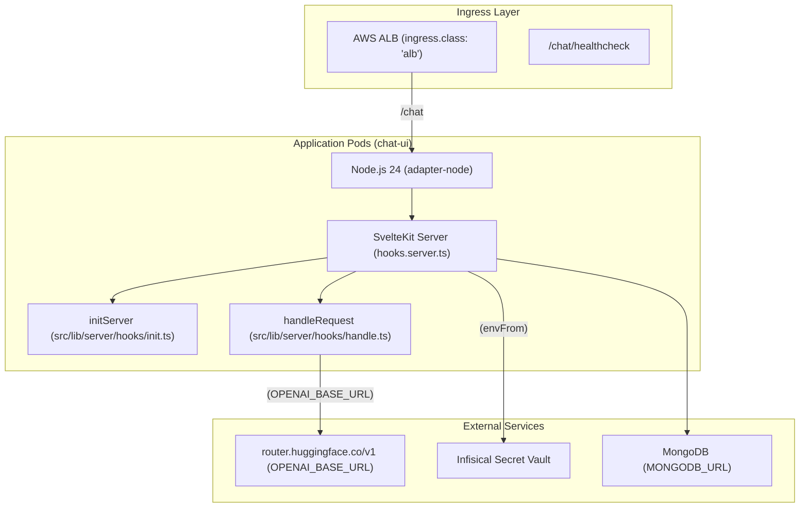
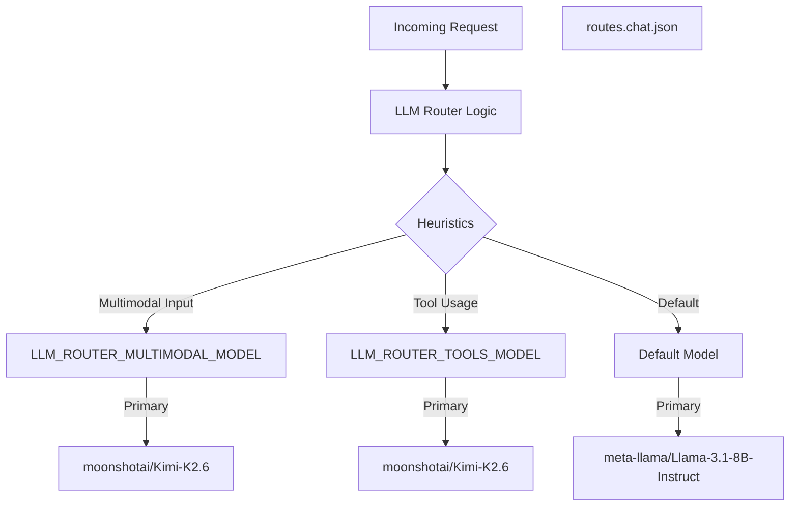

<!-- source: DeepWiki mcp.deepwiki.com · repo huggingface/chat-ui · page 9.1 Production Deployment · fetched 2026-10-26 -->

# Production Deployment

Relevant source files

The following files were used as context for generating this wiki page:

- [.env](.env)
- [.github/workflows/build-docs.yml](.github/workflows/build-docs.yml)
- [.github/workflows/build-image.yml](.github/workflows/build-image.yml)
- [.github/workflows/build-pr-docs.yml](.github/workflows/build-pr-docs.yml)
- [.github/workflows/deploy-prod.yml](.github/workflows/deploy-prod.yml)
- [.github/workflows/slugify.yaml](.github/workflows/slugify.yaml)
- [.github/workflows/trufflehog.yml](.github/workflows/trufflehog.yml)
- [.github/workflows/upload-pr-documentation.yml](.github/workflows/upload-pr-documentation.yml)
- [.prettierignore](.prettierignore)
- [Dockerfile](Dockerfile)
- [chart/Chart.yaml](chart/Chart.yaml)
- [chart/env/dev.yaml](chart/env/dev.yaml)
- [chart/env/prod.yaml](chart/env/prod.yaml)
- [chart/templates/_helpers.tpl](chart/templates/_helpers.tpl)
- [chart/templates/config.yaml](chart/templates/config.yaml)
- [chart/templates/deployment.yaml](chart/templates/deployment.yaml)
- [chart/templates/hpa.yaml](chart/templates/hpa.yaml)
- [chart/templates/infisical.yaml](chart/templates/infisical.yaml)
- [chart/templates/ingress-internal.yaml](chart/templates/ingress-internal.yaml)
- [chart/templates/ingress.yaml](chart/templates/ingress.yaml)
- [chart/templates/network-policy.yaml](chart/templates/network-policy.yaml)
- [chart/templates/service-account.yaml](chart/templates/service-account.yaml)
- [chart/templates/service-monitor.yaml](chart/templates/service-monitor.yaml)
- [chart/templates/service.yaml](chart/templates/service.yaml)
- [chart/values.yaml](chart/values.yaml)
- [src/hooks.server.ts](src/hooks.server.ts)
- [src/lib/server/auth.ts](src/lib/server/auth.ts)
- [src/lib/types/User.ts](src/lib/types/User.ts)
- [src/routes/login/callback/+server.ts](src/routes/login/callback/+server.ts)
- [src/routes/login/callback/updateUser.ts](src/routes/login/callback/updateUser.ts)
- [src/routes/settings/(nav)/+page.svelte](src/routes/settings/(nav)/+page.svelte)
- [static/huggingchat/routes.chat.json](static/huggingchat/routes.chat.json)
- [svelte.config.js](svelte.config.js)

This document details the process and configuration for deploying the `chat-ui` application to a production environment. It covers the CI/CD pipeline, Kubernetes configuration, environment variables, secrets management, and resource allocation. For local development setup information, see [Development Setup](#9.2).

## Deployment Architecture

The `chat-ui` application is deployed as a containerized SvelteKit application running on a Kubernetes cluster. The production environment leverages AWS Application Load Balancers (ALB) and integrates with external LLM providers via an OpenAI-compatible interface.

### System Interaction Diagram

This diagram maps the high-level deployment components to the specific configuration and routing entities used in the codebase.

Sources: [chart/env/prod.yaml:19-33](), [chart/templates/deployment.yaml:36-55](), [src/hooks.server.ts:8-22](), [svelte.config.js:32-37]()

## CI/CD Pipeline

The deployment process is automated using GitHub Actions. The primary production workflow is `deploy-prod.yml`.

### Build and Publish Process

The `deploy-prod.yml` workflow performs the following sequence:
1. **Docker Metadata**: Generates tags based on the short Git SHA (e.g., `sha-797d688`) and the `latest` tag [[.github/workflows/deploy-prod.yml:19-28]]().
2. **Docker Build**: Builds the image using the `Dockerfile`. It passes `INCLUDE_DB=false` and `APP_BASE=/chat` as build arguments [[.github/workflows/deploy-prod.yml:47-50]]().
3. **Publishing**: Pushes the image to `huggingface/chat-ui` on Docker Hub [[.github/workflows/deploy-prod.yml:24-24]]().
4. **Infrastructure Update**: Dispatches a workflow to the `huggingface/infra-deployments` repository to update the image tag in the production Kubernetes manifests using the `Update application single value` workflow [[.github/workflows/deploy-prod.yml:68-78]]().

### Dockerfile Implementation

The `Dockerfile` uses a multi-stage build process to minimize image size and maximize security:
- **Base Stage**: Uses `node:24-slim`, creates a non-root user (`user` with UID 1000), and installs essential system libraries like `libcurl4` and `dnsutils` [[Dockerfile:4-24]]().
- **Builder Stage**: Installs dependencies via `npm ci` and runs `npm run build` to generate the SvelteKit production build in `/app/build` [[Dockerfile:39-57]]().
- **Final Stage**: Copies only the production `build` folder and `node_modules`. It sets the entrypoint to `entrypoint.sh` [[Dockerfile:76-93]]().

Sources: [[.github/workflows/deploy-prod.yml:1-79]](), [[Dockerfile:1-93]]()

## Kubernetes Configuration

The application is managed via Helm charts located in the `/chart` directory.

### Resource Allocation and Scaling

Production resource settings are defined in the environment-specific values files and templates.

| Resource | Value | File Reference |
|----------|-------|----------------|
| **Replicas** | 3 (default) | [[chart/templates/deployment.yaml:14]]() |
| **Strategy** | RollingUpdate (25% surge/unavailable) | [[chart/templates/deployment.yaml:20-22]]() |
| **Probes** | /chat/healthcheck (Port 3000) | [[chart/templates/deployment.yaml:40-51]]() |
| **Autoscaling** | Optional HPA support | [[chart/templates/hpa.yaml:1-20]]() |

### Node Scheduling

To ensure high availability and performance, pods are scheduled on specific nodes:
- **Node Selector**: Pods are pinned to nodes with the label `role-huggingchat: "true"` [[chart/env/prod.yaml:5-6]]() to ensure they run on dedicated hardware.
- **Tolerations**: Pods tolerate the `huggingface.co/huggingchat` taint with `NoSchedule` effect [[chart/env/prod.yaml:8-12]]().

### Ingress and Networking

The application uses the `aws-alb-ingress-controller`. Key annotations include:
- `alb.ingress.kubernetes.io/scheme: "internal"` for the production load balancer [[chart/env/prod.yaml:26]]().
- `alb.ingress.kubernetes.io/healthcheck-path: "/chat/healthcheck"` for load balancer probes [[chart/env/prod.yaml:22]]().
- SSL certificates are managed via ACM ARNs provided in the ingress annotations [[chart/env/prod.yaml:31]]().
- `alb.ingress.kubernetes.io/target-type: "ip"` for direct pod routing [[chart/env/prod.yaml:30]]().

Sources: [[chart/env/prod.yaml:1-48]](), [[chart/templates/deployment.yaml:1-82]](), [[chart/templates/ingress.yaml:1-20]]()

## Secrets Management with Infisical

The production deployment integrates with **Infisical** for secret rotation and management.

- **Auto-Reload**: The deployment is annotated with `secrets.infisical.com/auto-reload: "true"`, allowing pods to restart or pick up new secrets when they change in the Infisical vault [[chart/templates/deployment.yaml:7-10]]().
- **Secret Injection**: Secrets are injected into the container via `envFrom` using a `secretRef` named after the release [[chart/templates/deployment.yaml:69-72]]().
- **Kubernetes Custom Resource**: The integration is managed via the `InfisicalSecret` custom resource definition [[chart/templates/infisical.yaml:1-20]]().

Sources: [[chart/templates/deployment.yaml:7-72]](), [[chart/templates/infisical.yaml:1-20]]()

## Environment Configuration

The production environment is heavily customized via environment variables defined in `chart/env/prod.yaml`.

### Core Production Variables

| Variable | Value | Description |
|----------|-------|-------------|
| `APP_BASE` | `/chat` | Subpath for the application [[chart/env/prod.yaml:57]]() |
| `PUBLIC_ORIGIN` | `https://huggingface.co` | Base URL for the public site [[chart/env/prod.yaml:70]]() |
| `METRICS_ENABLED` | `true` | Enables Prometheus metrics on port 5565 [[chart/env/prod.yaml:62]]() |
| `LOG_LEVEL` | `debug` | Verbosity of the application logs [[chart/env/prod.yaml:63]]() |
| `NODE_LOG_STRUCTURED_DATA` | `true` | Enables JSON logging for Elastic/Kibana [[chart/env/prod.yaml:64]]() |

### LLM Router ('Omni') Production Setup

The production environment uses a specialized routing configuration to handle multimodal and agentic requests.

- **Router Base URL**: `https://router.huggingface.co/v1` [[chart/env/prod.yaml:66]]().
- **Routing Config**: Points to a pre-built JSON file containing intent-to-model mappings at `build/client/chat/huggingchat/routes.chat.json` [[chart/env/prod.yaml:80]]().
- **Multimodal/Tools**: Enabled using `moonshotai/Kimi-K2.6` as the primary model for specialized tasks [[chart/env/prod.yaml:81-84]]().
- **Transcription**: Uses `openai/whisper-large-v3-turbo` for voice-to-text [[chart/env/prod.yaml:85]]().

Sources: [[chart/env/prod.yaml:49-90]](), [[.env:64-91]]()

## Security and Auditing

The CI/CD pipeline and application configuration include automated security measures:
- **Secret Leaks**: The `trufflehog.yml` workflow runs on every push to scan the codebase for accidentally committed credentials [[.github/workflows/trufflehog.yml:1-18]]().
- **Permissions**: Workflows are restricted; the image builder requires `packages: write` permissions [[.github/workflows/build-image.yml:3-4]]().
- **CSP**: Content Security Policy is configured in `svelte.config.js`, restricting `frame-ancestors` to `https://huggingface.co` unless `ALLOW_IFRAME` is explicitly enabled [[svelte.config.js:42-48]]().
- **Session Security**: Cookies are configured with `HttpOnly`, `Secure`, and `SameSite: lax` in production [[chart/env/prod.yaml:59-60]]().

Sources: [[.github/workflows/trufflehog.yml:1-18]](), [[.github/workflows/build-image.yml:1-20]](), [[svelte.config.js:42-48]](), [[src/lib/server/auth.ts:93-118]]()

---

