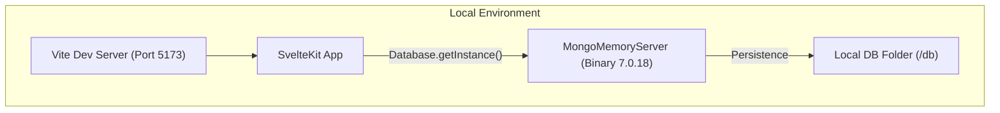
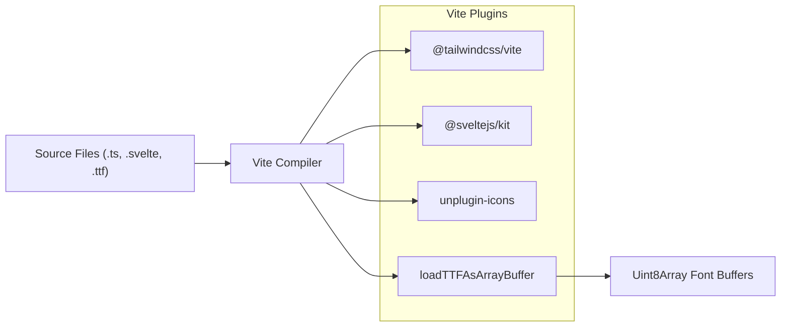

<!-- source: DeepWiki mcp.deepwiki.com · repo huggingface/chat-ui · page 9.2 Development Setup · fetched 2026-10-26 -->

# Development Setup

<details>
<summary>Relevant source files</summary>

The following files were used as context for generating this wiki page:

- [.devcontainer/Dockerfile](.devcontainer/Dockerfile)
- [.devcontainer/devcontainer.json](.devcontainer/devcontainer.json)
- [.dockerignore](.dockerignore)
- [.env.ci](.env.ci)
- [.github/workflows/lint-and-test.yml](.github/workflows/lint-and-test.yml)
- [.gitignore](.gitignore)
- [.vscode/launch.json](.vscode/launch.json)
- [.vscode/settings.json](.vscode/settings.json)
- [docker-compose.yml](docker-compose.yml)
- [entrypoint.sh](entrypoint.sh)
- [package-lock.json](package-lock.json)
- [package.json](package.json)
- [scripts/populate.ts](scripts/populate.ts)
- [scripts/samples.txt](scripts/samples.txt)
- [server.js](server.js)
- [src/lib/components/CodeBlock.svelte](src/lib/components/CodeBlock.svelte)
- [src/lib/jobs/refresh-conversation-stats.ts](src/lib/jobs/refresh-conversation-stats.ts)
- [src/lib/server/database.ts](src/lib/server/database.ts)
- [src/lib/types/Assistant.ts](src/lib/types/Assistant.ts)
- [src/routes/admin/stats/compute/+server.ts](src/routes/admin/stats/compute/+server.ts)
- [tests/fixtures.ts](tests/fixtures.ts)
- [tests/mock-openai.ts](tests/mock-openai.ts)
- [tests/smoke.spec.ts](tests/smoke.spec.ts)
- [tsconfig.json](tsconfig.json)
- [vite.config.ts](vite.config.ts)

</details>


This document explains how to set up a local development environment for chat-ui, including npm scripts, Vite configuration, testing infrastructure with Vitest and Playwright, and Docker-based development workflows. For production deployment information, see section 9.1.

## Prerequisites

| Requirement | Version/Description |
|-------------|---------------------|
| Node.js     | Version 20 or 22 (CI uses 22 for e2e) |
| npm         | Version 9.5.0+ |
| MongoDB     | Version 7.0.18 (provided via `mongodb-memory-server` in dev) |
| Playwright  | Required for client and e2e testing |

Sources: [package.json:5](), [.github/workflows/lint-and-test.yml:19-70](), [src/lib/server/database.ts:55]()

## Quick Start

### Initial Setup

```bash
# Clone repository
git clone https://github.com/huggingface/chat-ui.git
cd chat-ui

# Install dependencies
npm install

# Start development server
npm run dev
```

The development server starts on `http://localhost:5173` by default. If no `MONGODB_URL` is provided in environment variables, the system automatically spawns an in-memory MongoDB instance using `mongodb-memory-server`.

Sources: [package.json:7](), [vite.config.ts:34](), [src/lib/server/database.ts:39-57]()

### Local Data Flow



Sources: [src/lib/server/database.ts:34-57](), [vite.config.ts:33-34]()

## npm Scripts Reference

### Core Scripts

| Script | Command | Purpose |
|--------|---------|---------|
| `dev` | `vite dev` | Starts the SvelteKit dev server with HMR. |
| `build` | `vite build` | Builds the application for production using `@sveltejs/adapter-node`. |
| `check` | `svelte-kit sync && svelte-check` | Performs type checking and Svelte component validation. |
| `lint` | `prettier --check . && eslint .` | Validates code style and linting rules. |
| `format` | `prettier --write .` | Automatically formats the codebase. |

Sources: [package.json:6-14]()

### Data and Config Utilities

| Script | Command | Purpose |
|--------|---------|---------|
| `updateLocalEnv` | `vite-node scripts/updateLocalEnv.ts` | Syncs local environment variables. |
| `populate` | `vite-node scripts/populate.ts` | Seeds the database with fake data for testing. |
| `config` | `vite-node scripts/config.ts` | Manages dynamic application configuration. |

Sources: [package.json:20-22]()

## Vite Configuration

The project uses Vite 6. The configuration in `vite.config.ts` integrates Tailwind CSS, SvelteKit, and custom asset loaders.

### Build Pipeline



Sources: [vite.config.ts:23-31](), [package.json:81]()

### Key Features
*   **TTF Loading**: The `loadTTFAsArrayBuffer` function transforms `.ttf` files into `Uint8Array` buffers, enabling server-side font rendering for thumbnails without native file system dependencies at runtime. [vite.config.ts:11-22]()
*   **Allowed Hosts**: Configured to support `huggingface.ngrok.io` for external tunneling during development. [vite.config.ts:38]()

## Testing Infrastructure

The testing suite is powered by `vitest` and `playwright`, split into three distinct workspaces to handle different execution contexts.

### Vitest Workspace Architecture

| Workspace | Environment | Purpose |
|-----------|-------------|---------|
| `client` | `browser` | Tests Svelte components (e.g., `CodeBlock.svelte`) using Playwright/Chromium. [vite.config.ts:61-78]() |
| `ssr` | `node` | Validates Server-Side Rendering logic. [vite.config.ts:79-87]() |
| `server` | `node` | Tests backend utilities, database interactions, and API routes. [vite.config.ts:88-100]() |

### E2E Testing
End-to-end tests are handled by Playwright and require a running instance or a specific test harness.
*   **Command**: `npm run test:e2e` [package.json:19]()
*   **CI Behavior**: The CI pipeline installs both `chromium` and `webkit` to catch browser-specific layout regressions. [.github/workflows/lint-and-test.yml:86]()

## Database Development Workflow

### In-Memory Server
If `MONGODB_URL` is absent, the `Database` class initializes `MongoMemoryServer`. It defaults to version `7.0.18` and stores data in a local `/db` directory relative to the repository root. [src/lib/server/database.ts:34-57]()

### Seeding Data
The `scripts/populate.ts` script uses `@faker-js/faker` to generate mock data. It supports several flags:
*   `reset`: Deletes existing collections before seeding. [scripts/populate.ts:125-134]()
*   `users`: Creates 100 mock users. [scripts/populate.ts:136-150]()
*   `assistants`: Generates assistants for all users. [scripts/populate.ts:178-213]()
*   `conversations`: Creates complex message trees for users. [scripts/populate.ts:215-220]()

### Message Tree Generation
The `generateMessages` function in the populate script can create both linear and branched conversations using the `addChildren` utility. [scripts/populate.ts:43-119]()

## Docker Development Workflow

The `Dockerfile` and `entrypoint.sh` facilitate containerized development.

### Entrypoint Logic
The `entrypoint.sh` script manages the environment and internal services:
1.  **Environment**: Creates `.env.local` from the `DOTENV_LOCAL` variable if provided. [entrypoint.sh:1-10]()
2.  **Internal DB**: If `INCLUDE_DB=true`, it starts a local `mongod` instance inside the container. [entrypoint.sh:12-15]()
3.  **App Start**: Launches the Node.js server using `dotenv` to load configurations. [entrypoint.sh:19]()

### CI Integration
The GitHub Actions workflow performs a `build-check` by building the Docker image and verifying that the server responds to a health check on port 3000. [.github/workflows/lint-and-test.yml:98-136]()

## Troubleshooting

*   **Database Binary Cache**: In CI, `mongodb-memory-server` binaries are cached at `~/.cache/mongodb-binaries` to prevent race conditions during parallel test execution. [.github/workflows/lint-and-test.yml:43-48]()
*   **Port Configuration**: Use the `PORT` environment variable to override the default `5173`. [vite.config.ts:34]()
*   **Linting**: Run `npm run format` to resolve most linting issues automatically before pushing. [package.json:14]()

Sources: [.github/workflows/lint-and-test.yml:43-48](), [vite.config.ts:34](), [package.json:14]()

---

