# Page: Overview

# Overview

<details>
<summary>Relevant source files</summary>

The following files were used as context for generating this wiki page:

- [README.md](README.md)
- [docs/source/configuration/common-issues.md](docs/source/configuration/common-issues.md)
- [docs/source/configuration/llm-router.md](docs/source/configuration/llm-router.md)
- [docs/source/configuration/mcp-tools.md](docs/source/configuration/mcp-tools.md)
- [docs/source/configuration/overview.md](docs/source/configuration/overview.md)
- [docs/source/developing/architecture.md](docs/source/developing/architecture.md)
- [docs/source/index.md](docs/source/index.md)
- [package-lock.json](package-lock.json)
- [package.json](package.json)
- [src/app.html](src/app.html)
- [src/lib/components/CodeBlock.svelte](src/lib/components/CodeBlock.svelte)
- [src/lib/components/chat/ChatIntroduction.svelte](src/lib/components/chat/ChatIntroduction.svelte)
- [src/lib/server/endpoints/endpoints.ts](src/lib/server/endpoints/endpoints.ts)
- [src/lib/server/models.ts](src/lib/server/models.ts)
- [src/routes/+page.svelte](src/routes/+page.svelte)
- [src/routes/logout/+server.ts](src/routes/logout/+server.ts)
- [vite.config.ts](vite.config.ts)

</details>


Chat UI is a SvelteKit-based chat interface for Large Language Models. It is designed as a customizable, self-hostable application that supports multiple LLM providers through an OpenAI-compatible interface with intelligent routing capabilities. The codebase powers HuggingChat at [https://huggingface.co/chat](https://huggingface.co/chat).

## Purpose and Core Functionality

Chat UI provides a web interface for interacting with Large Language Models through OpenAI-compatible APIs. The system allows users to:

1.  Engage in conversations with different AI models.
2.  Switch between models or use the intelligent LLM Router ("Omni") for automatic model selection.
3.  Customize model parameters and system prompts.
4.  Upload files and images for multimodal conversations.
5.  Create and manage custom assistants with specific configurations.
6.  Use external tools via the **Model Context Protocol (MCP)**.
7.  Share conversations and manage conversation history.

The application connects to any OpenAI-compatible endpoint via `OPENAI_BASE_URL`, including Hugging Face Router, OpenAI, llama.cpp servers, Ollama, OpenRouter, and other compatible providers.

Sources: [README.md:1-6](), [README.md:14-16](), [docs/source/index.md:1-11](), [src/lib/server/models.ts:207-212]()

## High-Level Architecture

**System Architecture Diagram**

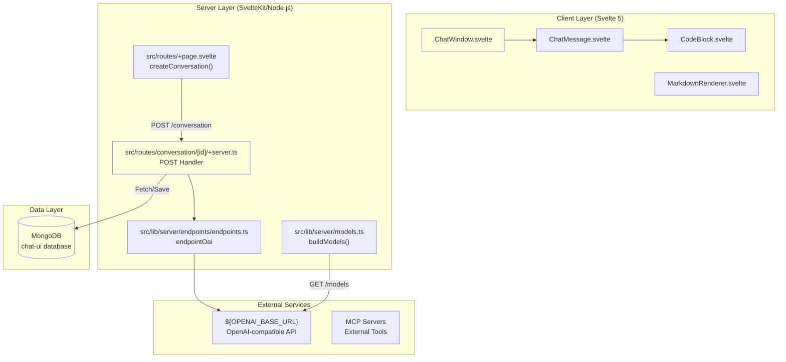

The system follows a layered architecture:

1.  **Client Layer**: SvelteKit components using Svelte 5 runes render the chat interface. `ChatWindow` manages the conversation state, while `CodeBlock` handles syntax highlighting and HTML/SVG previews. [src/lib/components/CodeBlock.svelte:1-45](), [src/routes/+page.svelte:182-189]()
2.  **Server Layer**: API routes handle message processing. `src/routes/+page.svelte` initiates conversation creation via `createConversation()`. [src/routes/+page.svelte:33-117]()
3.  **LLM Integration Layer**: Abstracts LLM providers through OpenAI-compatible endpoints. The `endpointOai` function in the endpoints system handles the actual communication with the upstream API. [src/lib/server/endpoints/endpoints.ts:40-45]()
4.  **Data Layer**: MongoDB stores conversations, user data, and settings. It falls back to an embedded MongoDB (via `mongodb-memory-server` in dev) if `MONGODB_URL` is unset. [package.json:55-55](), [README.md:58-60]()
5.  **External Services**: Connects to any service speaking the OpenAI protocol at `OPENAI_BASE_URL`. [README.md:14-16]()

Sources: [src/routes/+page.svelte:1-198](), [src/lib/server/models.ts:1-150](), [src/lib/components/CodeBlock.svelte:1-87](), [package.json:74-113]()

## Key Components

### Web UI (SvelteKit & Svelte 5)

The user interface is built with SvelteKit and Svelte 5. Key components include:

1.  **ChatWindow**: The primary interface for conversation display and interaction. [src/routes/+page.svelte:9-10]()
2.  **CodeBlock**: Renders code snippets with syntax highlighting using `highlight.js` and provides "Preview" functionality for HTML5 and SVG documents. [src/lib/components/CodeBlock.svelte:18-45]()
3.  **ChatIntroduction**: Displays the landing state of the application with the application name and description. [src/lib/components/chat/ChatIntroduction.svelte:22-45]()

Sources: [src/lib/components/CodeBlock.svelte:1-87](), [src/routes/+page.svelte:1-198](), [src/lib/components/chat/ChatIntroduction.svelte:1-86]()

### Model Discovery and Configuration

**Model Discovery Flow**

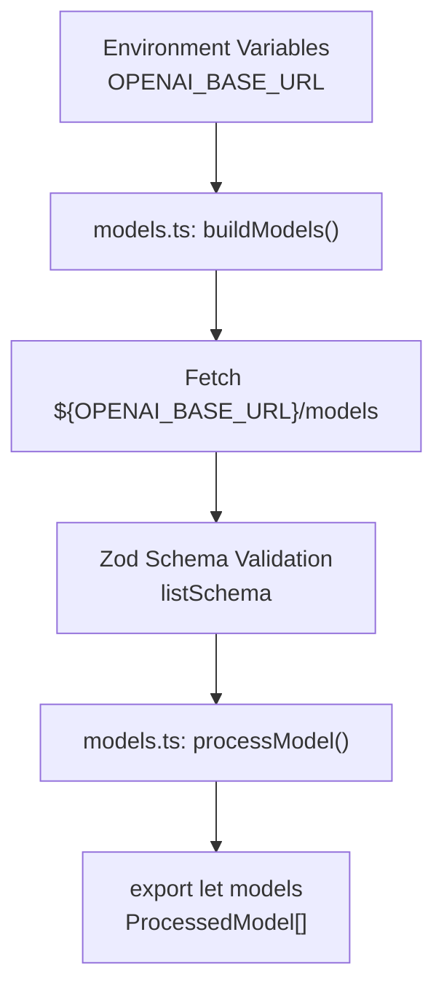

Chat UI sources models dynamically:

1.  **Model Discovery**: `buildModels()` fetches available models from the configured `OPENAI_BASE_URL`. [src/lib/server/models.ts:206-215]()
2.  **Validation**: Responses are validated against a Zod `listSchema` to ensure compatibility. [src/lib/server/models.ts:92-110]()
3.  **Metadata Enrichment**: `processModel()` handles preprompt fetching from URLs and sets up model parameters like `stop_sequences`. [src/lib/server/models.ts:127-135]()
4.  **Endpoint Assignment**: Each model is assigned a `getEndpoint` function that defaults to the OpenAI implementation. [src/lib/server/models.ts:137-150]()

Sources: [src/lib/server/models.ts:1-205](), [src/lib/server/endpoints/endpoints.ts:1-45]()

### LLM Router (Omni)

Chat UI includes an optional "Omni" router system. It selects the best model for a request based on heuristics:
*   **Multimodal**: Images trigger a multimodal route. [README.md:129-131]()
*   **Agentic**: Requests requiring MCP tools use an agentic route. [README.md:129-131]()
*   **Default**: Standard text requests use the default route. [README.md:131-131]()

Sources: [README.md:127-141](), [src/lib/server/models.ts:9-10]()

## Configuration Overview

The application is configured through environment variables and a centralized config manager.

| Category | Key Variables | Purpose |
| :--- | :--- | :--- |
| **LLM Provider** | `OPENAI_BASE_URL` | The base URL for the OpenAI-compatible API. [src/lib/server/models.ts:87-89]() |
| **LLM Auth** | `OPENAI_API_KEY` | API key for the provider (or `HF_TOKEN` as legacy alias). [README.md:28-35]() |
| **Database** | `MONGODB_URL` | MongoDB connection string. [README.md:56-60]() |
| **Theming** | `PUBLIC_APP_NAME` | The name displayed throughout the UI. [README.md:113-119]() |
| **Routing** | `LLM_ROUTER_ROUTES_PATH` | Path to the JSON configuration for the Omni router. [README.md:131-132]() |

Sources: [README.md:24-41](), [src/lib/server/models.ts:87-90](), [package.json:1-113]()

## Deployment and Environment

The project uses Vite for development and building. It supports different SvelteKit adapters, primarily `@sveltejs/adapter-node` for standard deployments. [package.json:30-31](), [vite.config.ts:1-23]()

*   **Development**: `npm run dev` starts a Vite server on port 5173. [package.json:7-7]()
*   **Production**: `npm run build` generates a production-ready Node.js application. [package.json:8-8]()
*   **Testing**: Includes Vitest for unit/integration tests and Playwright for E2E testing. [package.json:15-19](), [vite.config.ts:43-102]()

Sources: [package.json:1-24](), [vite.config.ts:1-104](), [README.md:80-90]()

---

# Page: System Architecture

# System Architecture

<details>
<summary>Relevant source files</summary>

The following files were used as context for generating this wiki page:

- [.github/workflows/deploy-prod.yml](.github/workflows/deploy-prod.yml)
- [Dockerfile](Dockerfile)
- [package-lock.json](package-lock.json)
- [package.json](package.json)
- [src/app.d.ts](src/app.d.ts)
- [src/lib/components/CodeBlock.svelte](src/lib/components/CodeBlock.svelte)
- [src/lib/server/config.ts](src/lib/server/config.ts)
- [src/lib/utils/tree/addChildren.spec.ts](src/lib/utils/tree/addChildren.spec.ts)
- [src/lib/utils/tree/addSibling.spec.ts](src/lib/utils/tree/addSibling.spec.ts)
- [src/lib/utils/tree/buildSubtree.spec.ts](src/lib/utils/tree/buildSubtree.spec.ts)
- [src/lib/utils/tree/convertLegacyConversation.spec.ts](src/lib/utils/tree/convertLegacyConversation.spec.ts)
- [src/routes/settings/(nav)/+page.svelte](src/routes/settings/(nav)/+page.svelte)
- [svelte.config.js](svelte.config.js)
- [vite.config.ts](vite.config.ts)

</details>


This document describes the high-level architecture of the chat-ui application, outlining its core components and how they interact. Chat-ui is a SvelteKit application that provides a web interface for interacting with various Large Language Models (LLMs). The architecture follows a clear layered approach with separation between the client layer, server layer, data persistence, and LLM integration.

For specific details about frontend components, see [Frontend Architecture](#2.1). For backend services and API endpoints, see [Backend Architecture](#2.2). For data persistence, see [Data Layer](#2.3).

## High-Level Architecture Overview

The chat-ui system follows a layered architecture with clear separation of concerns. The system consists of five primary layers: client layer (browser), server layer (Node.js/SvelteKit), data layer (MongoDB), LLM integration layer, and external services.

### System Architecture Diagram

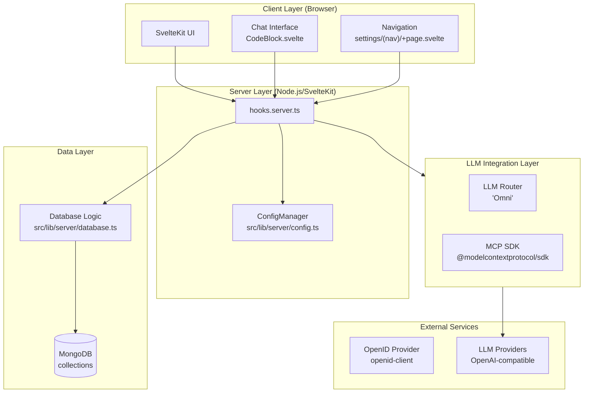

Sources:
- [src/lib/server/config.ts:13-147]()
- [package.json:74-113]()
- [src/app.d.ts:8-33]()

## Layered Architecture

The chat-ui architecture is organized into distinct layers, each with specific responsibilities. This separation enables clear interfaces between components and facilitates independent scaling and maintenance.

### Layer Overview

| Layer | Primary Components | Responsibilities |
|-------|-------------------|------------------|
| **Client Layer** | Svelte 5 components, SvelteKit UI | User interface rendering, client-side state, user interactions |
| **Server Layer** | `hooks.server.ts`, `ConfigManager` | Request authentication, routing, dynamic configuration |
| **Data Layer** | MongoDB collections, GridFS | Data persistence, conversation trees, file storage |
| **LLM Integration** | Router, OpenAI endpoints, MCP | Model selection, provider abstraction, tool execution |

### Configuration and Request Interception

All HTTP requests pass through the server-side logic in `hooks.server.ts`, which manages user context and application state.

- **Dynamic Configuration**: The `ConfigManager` class in `src/lib/server/config.ts` handles environment variables and database-backed configuration overrides [src/lib/server/config.ts:13-42](). It supports a "Config Manager" mode for runtime updates [src/lib/server/config.ts:44-46]().
- **Authentication Context**: The system maintains user information in `App.Locals`, including `sessionId`, `user` object, and `isAdmin` status [src/app.d.ts:11-18]().
- **Server Initialization**: The `ready` promise ensures that the database and configuration are initialized before the application starts serving requests [src/lib/server/config.ts:152-156]().

Sources:
- [src/lib/server/config.ts:13-191]()
- [src/app.d.ts:1-35]()

### Frontend Layer

The frontend is built with Svelte 5, utilizing its runes-based reactivity system (e.g., `$state`, `$derived`) for high-performance UI updates.

- **Navigation**: Structured using SvelteKit routes, such as settings pages located in `src/routes/settings/(nav)/` [src/routes/settings/(nav)/+page.svelte:1-1]().
- **Content Rendering**: Components like `CodeBlock.svelte` handle complex rendering tasks, including HTML sanitization via `isomorphic-dompurify` and syntax highlighting [src/lib/components/CodeBlock.svelte:3-30]().
- **Build System**: Powered by Vite with SvelteKit and Tailwind CSS integration [vite.config.ts:1-31]().

For details, see [Frontend Architecture](#2.1).

Sources:
- [src/lib/components/CodeBlock.svelte:1-87]()
- [vite.config.ts:23-31]()
- [package.json:62-63]()

### API and Backend Layer

The backend leverages SvelteKit's server-side capabilities and integrates with external services.

- **OpenAI Compatibility**: The system communicates with LLMs using the `openai` SDK [package.json:96-96]().
- **MCP Integration**: Uses the `@modelcontextprotocol/sdk` to allow LLMs to interact with external tools and data sources [package.json:78-78]().
- **LLM Router**: An "Omni" router handles intelligent model selection, particularly for multimodal requests [package.json:103-103]().

For details, see [Backend Architecture](#2.2).

Sources:
- [package.json:74-113]()
- [src/lib/server/config.ts:164-167]()

### Data Layer

Persistence is managed via MongoDB, with support for complex conversation structures.

- **Conversation Trees**: The system supports non-linear conversation histories through a message tree structure, managed by utilities like `addSibling` and `buildSubtree` [src/lib/utils/tree/addSibling.spec.ts:7-86]() [src/lib/utils/tree/buildSubtree.spec.ts:10-114]().
- **Persistence**: Data is stored in MongoDB collections. For development environments, `mongodb-memory-server` can be used [package.json:55-55]().
- **File Handling**: Supports file uploads and attachments, often stored in GridFS [package.json:94-94]().

For details, see [Data Layer](#2.3).

Sources:
- [src/lib/utils/tree/addSibling.spec.ts:1-86]()
- [src/lib/utils/tree/buildSubtree.spec.ts:1-115]()
- [package.json:55-55]()

## Request Flow: Message Generation

When a user interacts with the chat, the system orchestrates the following flow:

1.  **Client Submission**: The Svelte UI captures user input and sends it to the server.
2.  **Server Processing**: `hooks.server.ts` validates the session and retrieves the `User` object [src/app.d.ts:11-13]().
3.  **Config Check**: `ConfigManager` retrieves model settings and API keys [src/lib/server/config.ts:82-87]().
4.  **Tree Update**: The new message is added to the conversation tree in MongoDB [src/lib/utils/tree/addSibling.spec.ts:67-85]().
5.  **LLM Interaction**: The backend calls the OpenAI-compatible endpoint or uses MCP tools if required [package.json:78-96]().
6.  **Streaming**: Responses are streamed back to the client, where components like `CodeBlock.svelte` render the output in real-time [src/lib/components/CodeBlock.svelte:20-30]().

Sources:
- [src/lib/server/config.ts:13-191]()
- [src/lib/components/CodeBlock.svelte:14-30]()
- [src/lib/utils/tree/addSibling.spec.ts:67-85]()

## Summary

Chat UI's architecture is a modular gateway to LLMs, built on SvelteKit and MongoDB. It provides a robust framework for managing non-linear conversations, dynamic configurations, and tool integrations via MCP, while maintaining strict compatibility with OpenAI-style endpoints.

---

# Page: Frontend Architecture

# Frontend Architecture

<details>
<summary>Relevant source files</summary>

The following files were used as context for generating this wiki page:

- [scripts/setups/vitest-setup-server.ts](scripts/setups/vitest-setup-server.ts)
- [src/app.html](src/app.html)
- [src/lib/components/ExpandNavigation.svelte](src/lib/components/ExpandNavigation.svelte)
- [src/lib/components/MobileNav.svelte](src/lib/components/MobileNav.svelte)
- [src/lib/components/Modal.svelte](src/lib/components/Modal.svelte)
- [src/lib/components/NavConversationItem.svelte](src/lib/components/NavConversationItem.svelte)
- [src/lib/components/NavMenu.svelte](src/lib/components/NavMenu.svelte)
- [src/lib/components/WelcomeModal.svelte](src/lib/components/WelcomeModal.svelte)
- [src/lib/components/chat/ChatIntroduction.svelte](src/lib/components/chat/ChatIntroduction.svelte)
- [src/lib/components/chat/ToolCallsSummary.svelte](src/lib/components/chat/ToolCallsSummary.svelte)
- [src/lib/components/chat/ToolCallsSummary.svelte.test.ts](src/lib/components/chat/ToolCallsSummary.svelte.test.ts)
- [src/routes/+layout.svelte](src/routes/+layout.svelte)
- [src/routes/+page.svelte](src/routes/+page.svelte)
- [src/routes/settings/+layout.svelte](src/routes/settings/+layout.svelte)
- [static/huggingchat/omni-welcome.gif](static/huggingchat/omni-welcome.gif)

</details>


## Purpose and Scope

This document details the frontend architecture of chat-ui, a SvelteKit-based web application. It covers the layout system, routing structure, component hierarchy, navigation implementations, and global state management using Svelte 5 runes and stores.

For information about the chat interface components (ChatWindow, ChatMessage, etc.), see **3.1 Chat Window and Messages**. For content rendering (MarkdownRenderer, CodeBlock), see **3.2 Markdown and Code Rendering**. For backend request handling and API routes, see **2.2 Backend Architecture**.

---

## SvelteKit Application Structure

The frontend uses SvelteKit's file-based routing system with a nested layout architecture. The application shell is defined at two levels: the HTML shell and the root layout component.

### Root Layout Component

The root layout [src/routes/+layout.svelte:1-204]() establishes the application shell and coordinates global concerns using Svelte 5 runes (`$state`, `$derived`, `$effect`).

**Key Responsibilities:**
- **Public Config Context**: Provides `publicConfig` via Svelte context for child components [src/routes/+layout.svelte:31-33]().
- **Conversation State**: Manages the `convsStore` reactively, initializing it with server-side data for SSR and syncing it client-side [src/routes/+layout.svelte:36-46]().
- **Global Error Handling**: Manages a toast system for errors with a 5-second timeout and logic to wait for previous errors to clear [src/routes/+layout.svelte:53-67]().
- **Keyboard Shortcuts**: Implements `Ctrl/Cmd + Shift + O` for starting a new chat, which triggers `isAborted` to stop current generations [src/routes/+layout.svelte:107-120]().
- **MCP Initialization**: Seeds the Model Context Protocol (MCP) store with base servers during `onMount` [src/routes/+layout.svelte:145]().

### Main Page Logic

The index route [src/routes/+page.svelte:1-198]() serves as the entry point for new conversations.

- **URL Parameter Handling**: Processes `q` (query), `prompt` (draft), and `attachments` parameters from the URL on mount [src/routes/+page.svelte:119-172]().
- **Conversation Creation**: The `createConversation` function manages the POST request to `/conversation`, handles authentication redirects, and optimistically updates the sidebar before navigating to the new conversation route [src/routes/+page.svelte:33-117]().
- **Optimistic UI**: Prepends the new conversation to the sidebar immediately so it appears before streaming starts [src/routes/+page.svelte:102-107]().

**Sources:** [src/routes/+layout.svelte:1-204](), [src/routes/+page.svelte:1-198]()

---

## Component Hierarchy and Code Mapping

The following diagram maps UI regions to their implementing components and identifies key code entities.

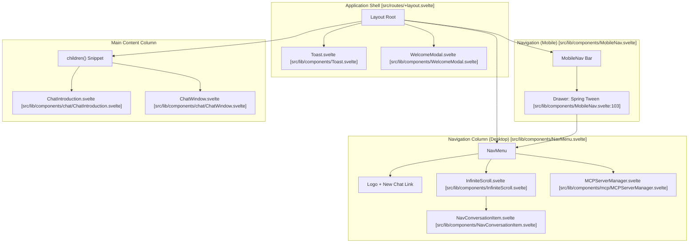

**Sources:** [src/routes/+layout.svelte:15-27](), [src/lib/components/NavMenu.svelte:20-34](), [src/lib/components/MobileNav.svelte:19-25](), [src/routes/+page.svelte:9-15]()

---

## Navigation System

### Desktop Navigation (NavMenu)

The `NavMenu` component [src/lib/components/NavMenu.svelte:10-130]() implements the persistent sidebar.

- **Conversation Grouping**: Conversations are reactively filtered into "Today", "This week", "This month", and "Older" categories using `$derived` and `dateRanges` [src/lib/components/NavMenu.svelte:71-86]().
- **Infinite Scrolling**: Uses `InfiniteScroll` to trigger `handleVisible`, which fetches more conversations from the API using `client.conversations.get` and increments the page counter `p` [src/lib/components/NavMenu.svelte:90-107]().
- **Authentication Guard**: Intercepts clicks on "New Chat" and navigation items to ensure a user is authenticated if required by the configuration [src/lib/components/NavMenu.svelte:57-69]().

### Mobile Navigation (MobileNav)

The `MobileNav` component [src/lib/components/MobileNav.svelte:13-221]() provides a touch-friendly drawer with advanced gesture support.

- **Gesture Mechanics**: Implements a custom swipe handler with `VELOCITY_THRESHOLD` (0.4 px/ms) and `DIRECTION_LOCK_THRESHOLD` (10 px) to distinguish between horizontal drawer drags and vertical content scrolling [src/lib/components/MobileNav.svelte:87-98]().
- **Animation**: Uses a `Spring` tween to follow the `dragOffset` during interaction and snap to `0` (open) or `-100` (closed) [src/lib/components/MobileNav.svelte:102-103]().
- **Inertness**: When a modal is open, touch events are ignored to prevent drawer interaction while the app is marked as `inert` [src/lib/components/MobileNav.svelte:106-107]().

**Sources:** [src/lib/components/NavMenu.svelte:1-130](), [src/lib/components/MobileNav.svelte:1-221](), [src/lib/components/NavConversationItem.svelte:58-143]()

---

## State Management and Data Flow

The application uses a mix of Svelte 5 runes for local component state and Svelte 4 stores for global shared state.

### Global Store Interactions

| Store | File | Usage in Frontend |
|-------|------|---------|
| `isAborted` | `src/lib/stores/isAborted.ts` | Set to `true` when starting a new chat or clicking "New Chat" to stop current LLM generation [src/routes/+layout.svelte:116](), [src/lib/components/NavMenu.svelte:58](). |
| `error` | `src/lib/stores/errors.ts` | Updated when API calls fail (e.g., deleting a conversation or creating one) [src/routes/+layout.svelte:83](), [src/routes/+page.svelte:112](). |
| `loading` | `src/lib/stores/loading.ts` | Controls UI states during conversation creation and file processing [src/routes/+page.svelte:35](). |
| `isPro` | `src/lib/stores/isPro.ts` | Stores the Hugging Face Pro status of the user, fetched on mount [src/routes/+layout.svelte:151](). |

### Data Flow: Conversation Creation

The following sequence describes the data flow when a user initiates a chat from the index page.

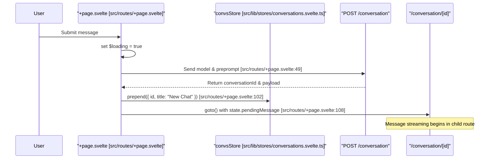

**Sources:** [src/routes/+page.svelte:33-117](), [src/routes/+layout.svelte:36-46](), [src/lib/stores/isAborted.ts:1-5]()

---

## UI Components and Patterns

### Modals and Portals
Modals are managed using a `Portal` component to ensure they render at the top level of the DOM. The base `Modal` component [src/lib/components/Modal.svelte:1-116]() handles:
- **Focus Trapping**: Sets the main `#app` element to `inert` when open [src/lib/components/Modal.svelte:50]().
- **Keyboard Navigation**: Listens for the `Escape` key to trigger `onclose` [src/lib/components/Modal.svelte:32-38]().
- **Transitions**: Uses `fade` for the backdrop and `fly` for the modal content [src/lib/components/Modal.svelte:73-100]().

### Theming
The application supports dark and light modes. Theme detection happens early in `app.html` to prevent a Flash of Unstyled Content (FOUC) [src/app.html:10-22](). The `NavMenu` subscribes to theme changes to toggle icons and styles [src/lib/components/NavMenu.svelte:121-125]().

**Sources:** [src/lib/components/Modal.svelte:1-116](), [src/app.html:10-22](), [src/lib/components/NavMenu.svelte:121-125]()

---

# Page: Backend Architecture

# Backend Architecture

<details>
<summary>Relevant source files</summary>

The following files were used as context for generating this wiki page:

- [.env](.env)
- [chart/env/dev.yaml](chart/env/dev.yaml)
- [chart/env/prod.yaml](chart/env/prod.yaml)
- [src/hooks.server.ts](src/hooks.server.ts)
- [src/lib/server/auth.ts](src/lib/server/auth.ts)
- [src/lib/server/hooks/error.ts](src/lib/server/hooks/error.ts)
- [src/lib/server/hooks/fetch.ts](src/lib/server/hooks/fetch.ts)
- [src/lib/server/hooks/init.ts](src/lib/server/hooks/init.ts)
- [src/lib/server/logger.ts](src/lib/server/logger.ts)
- [src/lib/server/metrics.ts](src/lib/server/metrics.ts)
- [src/lib/server/requestContext.ts](src/lib/server/requestContext.ts)
- [src/lib/server/shareThumbnail/shareThumbnail.ssr.test.ts](src/lib/server/shareThumbnail/shareThumbnail.ssr.test.ts)
- [src/lib/server/shareThumbnail/shareThumbnail.ts](src/lib/server/shareThumbnail/shareThumbnail.ts)
- [src/lib/server/shareThumbnail/thumbnail-background.png](src/lib/server/shareThumbnail/thumbnail-background.png)
- [src/lib/types/User.ts](src/lib/types/User.ts)
- [src/routes/login/callback/+server.ts](src/routes/login/callback/+server.ts)
- [src/routes/login/callback/updateUser.ts](src/routes/login/callback/updateUser.ts)
- [src/routes/r/[id]/thumbnail.png/+server.ts](src/routes/r/[id]/thumbnail.png/+server.ts)
- [static/huggingchat/routes.chat.json](static/huggingchat/routes.chat.json)

</details>


The backend architecture of chat-ui is organized into distinct layers that handle request processing, authentication, API routing, and data access. The architecture centers around SvelteKit server hooks for request interception, authentication middleware for identity management, and a robust configuration system.

## Architectural Layers

The backend follows a layered architecture with clear separation of concerns:

**Backend Architecture Layers**
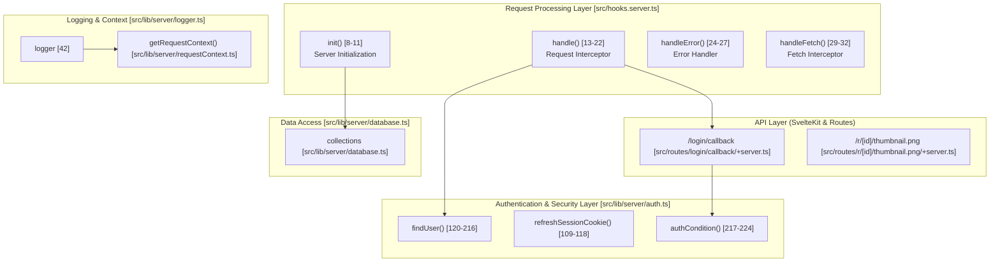

Sources: [src/hooks.server.ts](), [src/lib/server/auth.ts](), [src/lib/server/logger.ts](), [src/lib/server/requestContext.ts]()

## Request Processing Layer

The request processing layer is implemented in `src/hooks.server.ts` and provides four main lifecycle hooks that intercept server-side operations.

### Server Initialization - `init()`
The `init()` function runs once when the server starts. It skips execution during the static build phase [src/hooks.server.ts:9]() and calls `initServer()` to prepare the environment, database connections, and background tasks [src/hooks.server.ts:10]().

### Request Handler - `handle()`
The `handle()` hook is the primary entry point for all HTTP requests. 
- During static builds, it performs simple HTML transformations like clearing Google Analytics placeholders [src/hooks.server.ts:17-19]().
- In production, it delegates to `handleRequest()` [src/hooks.server.ts:21](), which manages the request lifecycle, including authentication, CSRF validation, and session persistence.

### Error and Fetch Handlers
- **`handleError()`**: Intercepts server-side errors to provide structured logging via `handleServerError()` [src/hooks.server.ts:26]().
- **`handleFetch()`**: Intercepts server-side `fetch` calls via `handleFetchRequest()`, allowing the application to inject authentication headers or modify outgoing requests to internal/external services [src/hooks.server.ts:31]().

Sources: [src/hooks.server.ts:1-32]()

## Authentication and User Management

The authentication system supports OpenID Connect (OIDC) and manages user sessions through MongoDB-backed persistence.

### Session Lifecycle and Token Refresh
The `findUser()` function [src/lib/server/auth.ts:120]() is responsible for identifying the user from a `sessionId`. It includes sophisticated logic for OAuth token maintenance:
1. **Validation**: Checks if the session exists in `collections.sessions` [src/lib/server/auth.ts:129](). If `coupledCookieHash` is enabled, it validates the hash against the session [src/lib/server/auth.ts:135]().
2. **Refresh Check**: If the OAuth token expires in less than 5 minutes, it initiates a refresh [src/lib/server/auth.ts:142]().
3. **Concurrency Control**: Uses a distributed lock (semaphore) via `acquireLock` with key `Semaphores.OAUTH_TOKEN_REFRESH` to ensure only one process refreshes the token for a given session [src/lib/server/auth.ts:143-146]().
4. **Session Update**: Updates the session in the database with the new `oauth` data and `updatedAt` values [src/lib/server/auth.ts:169-177]().

### User Update and Migration
When a user logs in via OIDC, the `updateUser()` function handles identity synchronization:
- **Identity Mapping**: It parses user data (username, email, avatar) from the OIDC `UserinfoResponse` using a configurable `NAME_CLAIM` [src/routes/login/callback/updateUser.ts:35-82]().
- **Session Rotation**: It generates a new `secretSessionId`, hashes it, and rotates the session ID to prevent session fixation [src/routes/login/callback/updateUser.ts:117-119]().
- **Data Migration**: If a user was previously using the app without an account (session-based), `updateUser()` migrates their settings and conversations to the new `userId` [src/routes/login/callback/updateUser.ts:184-214]().

Sources: [src/lib/server/auth.ts:120-216](), [src/routes/login/callback/updateUser.ts:19-215]()

## API Routing and Data Loading

API routes are primarily handled via SvelteKit `+server.ts` files, utilizing the `authCondition` helper to enforce data isolation.

### The `authCondition` Helper
The `authCondition` function [src/lib/server/auth.ts:217]() returns a MongoDB query object that restricts data access based on the current authentication state:
- If `locals.user` exists, it filters by `{ userId: locals.user._id }` [src/lib/server/auth.ts:222-223]().
- If only `locals.sessionId` exists, it filters by `{ sessionId: locals.sessionId, userId: { $exists: false } }` [src/lib/server/auth.ts:224]().

### Specialized Endpoints
- **Thumbnail Generation**: `GET /r/[id]/thumbnail.png` generates social preview images for shared conversations [src/routes/r/[id]/thumbnail.png/+server.ts:14](). It verifies the conversation is shared (7-character ID) before calling `getShareThumbnailPng` [src/routes/r/[id]/thumbnail.png/+server.ts:17-31]().
- **Login Callback**: `GET /login/callback` processes the OIDC redirect, validates the CSRF state and PKCE code verifier, and filters users based on `ALLOWED_USER_EMAILS` or `ALLOWED_USER_DOMAINS` [src/routes/login/callback/+server.ts:34-142]().

**Request Data Flow**
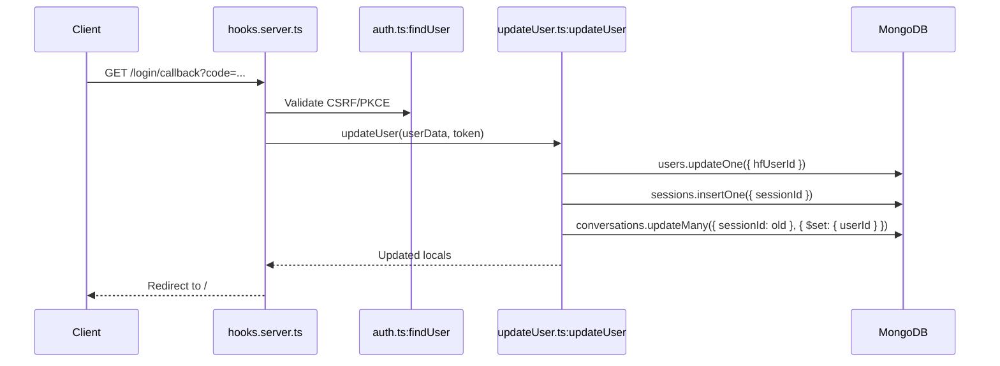

Sources: [src/lib/server/auth.ts:217-224](), [src/routes/login/callback/+server.ts:34-142](), [src/routes/login/callback/updateUser.ts:19-215]()

## Metrics and Monitoring

The backend includes a standalone Prometheus metrics server managed by the `MetricsServer` class [src/lib/server/metrics.ts:20]().

- **Metrics Collection**: It tracks model-specific performance including `conversationsTotal`, `messagesTotal`, `tokenCountTotal`, and latencies like `timeToFirstToken` [src/lib/server/metrics.ts:72-117]().
- **Standalone Server**: If `METRICS_ENABLED` is true, it starts an HTTP server on `METRICS_PORT` (default 5565) to export metrics in Prometheus format [src/lib/server/metrics.ts:120-148]().
- **Lifecycle**: The server uses an `onExit` handler to ensure clean shutdown when the Node.js process terminates [src/lib/server/metrics.ts:150-163]().

Sources: [src/lib/server/metrics.ts:1-166]()

## Logging and Request Context

Logging is handled by a `pino` instance enriched with request-specific metadata.

- **`RequestContext`**: Uses `AsyncLocalStorage` to store `requestId`, `url`, `ip`, and `user` information for the duration of an asynchronous call chain [src/lib/server/requestContext.ts]().
- **Automatic Mixin**: The logger uses a `mixin()` function [src/lib/server/logger.ts:28]() to pull data from `getRequestContext()` and append it to every log entry [src/lib/server/logger.ts:29-39]().
- **Structured Logging**: In production, logs are structured for consumption by logging aggregators, while in development, `pino-pretty` is used [src/lib/server/logger.ts:8-17]().

Sources: [src/lib/server/logger.ts:1-42](), [src/lib/server/requestContext.ts]()

---

# Page: Data Layer

# Data Layer

<details>
<summary>Relevant source files</summary>

The following files were used as context for generating this wiki page:

- [.devcontainer/Dockerfile](.devcontainer/Dockerfile)
- [.devcontainer/devcontainer.json](.devcontainer/devcontainer.json)
- [docker-compose.yml](docker-compose.yml)
- [src/lib/components/icons/IconMoon.svelte](src/lib/components/icons/IconMoon.svelte)
- [src/lib/jobs/refresh-conversation-stats.ts](src/lib/jobs/refresh-conversation-stats.ts)
- [src/lib/migrations/lock.ts](src/lib/migrations/lock.ts)
- [src/lib/migrations/migrations.spec.ts](src/lib/migrations/migrations.spec.ts)
- [src/lib/migrations/migrations.ts](src/lib/migrations/migrations.ts)
- [src/lib/migrations/routines/01-update-search-assistants.ts](src/lib/migrations/routines/01-update-search-assistants.ts)
- [src/lib/migrations/routines/10-update-reports-assistantid.ts](src/lib/migrations/routines/10-update-reports-assistantid.ts)
- [src/lib/migrations/routines/index.ts](src/lib/migrations/routines/index.ts)
- [src/lib/server/database.ts](src/lib/server/database.ts)
- [src/lib/types/Assistant.ts](src/lib/types/Assistant.ts)
- [src/lib/types/MigrationResult.ts](src/lib/types/MigrationResult.ts)
- [src/lib/types/Semaphore.ts](src/lib/types/Semaphore.ts)
- [src/routes/admin/export/+server.ts](src/routes/admin/export/+server.ts)
- [src/routes/admin/stats/compute/+server.ts](src/routes/admin/stats/compute/+server.ts)

</details>


This document describes the MongoDB data persistence layer in chat-ui, including database connection management, collection schemas, indexing strategy, and how data is stored and retrieved. The data layer provides typed collections with automatic index creation and supports both external MongoDB and an in-memory development mode.

## Database Connection Management

The data layer uses a singleton `Database` class to manage the MongoDB connection. The connection is established during server initialization and is reused throughout the application lifecycle.

### Database Class Structure

The `Database` class handles the lifecycle of the MongoDB client:
- **Singleton Pattern**: Managed via `Database.getInstance()` [src/lib/server/database.ts:86-93]().
- **Connection Logic**: Connects to an external instance via `config.MONGODB_URL` or spawns a `MongoMemoryServer` for local development [src/lib/server/database.ts:34-65]().
- **Typed Collections**: Accessors are provided via `getCollections()`, which returns a map of MongoDB `Collection` objects typed with project-specific interfaces [src/lib/server/database.ts:109-164]().
- **Initialization**: Runs `initDatabase()` to ensure all required indexes are present [src/lib/server/database.ts:170-291]().
- **Cleanup**: Uses an `onExit` handler to close the client and stop the memory server [src/lib/server/database.ts:79-83]().

Title: Database Initialization and Access
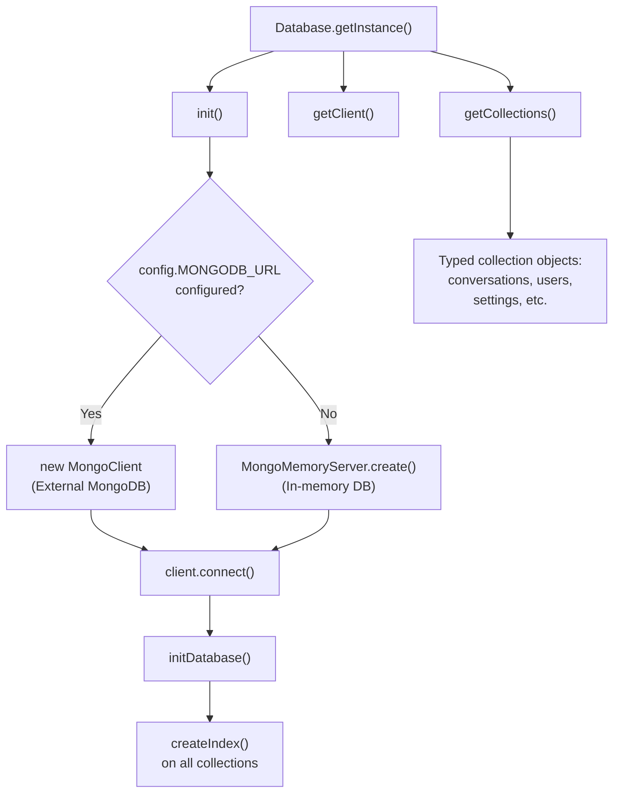

**In-Memory MongoDB for Development**

When `MONGODB_URL` is absent, the system starts a `MongoMemoryServer` (version 7.0.18) [src/lib/server/database.ts:49-57](). It persists data to a local `db/` folder or a path specified by `config.MONGO_STORAGE_PATH` [src/lib/server/database.ts:35-37]().

Sources: [src/lib/server/database.ts:28-94]()

## Collections Overview

The data layer exposes 16 collections and a GridFS bucket. Collections are configured with specific `ReadPreference` settings to balance consistency and performance [src/lib/server/database.ts:118-145]().

| Collection Name | Type | Read Preference | Purpose |
|-----------------|------|-----------------|---------|
| `conversations` | `Conversation` | Primary | Main storage for chat history and message trees [src/lib/server/database.ts:119]() |
| `settings` | `Settings` | Primary | User preferences and sharing permissions [src/lib/server/database.ts:120]() |
| `users` | `User` | Primary | User accounts and identity metadata [src/lib/server/database.ts:121]() |
| `sessions` | `Session` | Primary | Active user sessions and OAuth state [src/lib/server/database.ts:122]() |
| `messageEvents` | `MessageEvent` | Primary | Real-time event tracking [src/lib/server/database.ts:123]() |
| `abortedGenerations` | `AbortedGeneration` | Primary | Signal storage for interrupted LLM calls [src/lib/server/database.ts:124]() |
| `semaphores` | `Semaphore` | Primary | Distributed locks for tasks and migrations [src/lib/server/database.ts:125]() |
| `tokenCaches` | `TokenCache` | Primary | Cache for external API tokens [src/lib/server/database.ts:126]() |
| `config` | `ConfigKey` | Primary | Dynamic configuration overrides [src/lib/server/database.ts:127]() |
| `migrationResults` | `MigrationResult` | Primary | Log of executed database migrations [src/lib/server/database.ts:128]() |
| `sharedConversations` | `SharedConversation` | Primary | Public snapshots of conversations [src/lib/server/database.ts:129]() |
| `bucket` | `GridFSBucket` | Primary | Binary storage for file attachments [src/lib/server/database.ts:130]() |
| `assistants` | `Assistant` | SecondaryPreferred | Custom AI assistant definitions [src/lib/server/database.ts:134-136]() |
| `conversationStats` | `ConversationStats` | SecondaryPreferred | Aggregated usage metrics [src/lib/server/database.ts:137-139]() |
| `reports` | `Report` | SecondaryPreferred | Content moderation and assistant reports [src/lib/server/database.ts:140-142]() |
| `tools` | `any` | SecondaryPreferred | MCP and internal tool configurations [src/lib/server/database.ts:143-145]() |

Sources: [src/lib/server/database.ts:109-164]()

## Migration System

The system uses a migration framework to ensure schema consistency across deployments. Migrations are defined as routines that run sequentially.

### Migration Logic
Each migration implements the `Migration` interface, defining an `up` function and optional metadata like `runEveryTime` [src/lib/migrations/routines/index.ts:5-13]().

- **Locking**: Before running migrations, the system attempts to `acquireLock` on `Semaphores.MIGRATION` [src/lib/migrations/migrations.ts:27-29](). This prevents multiple instances from corrupting the schema.
- **Transactions**: Migrations are executed within a MongoDB session transaction to ensure atomicity [src/lib/migrations/migrations.ts:89-100]().
- **Persistence**: Successful migrations are recorded in the `migrationResults` collection [src/lib/migrations/migrations.ts:102-111]().

Sources: [src/lib/migrations/migrations.ts:8-119](), [src/lib/migrations/routines/index.ts:1-16](), [src/lib/migrations/lock.ts:8-25]()

## Indexing Strategy

The `initDatabase()` method creates indexes necessary for both query optimization and automatic data expiration (TTL).

### Performance Indexes
- **Conversations**: Compound indexes on `{ sessionId: 1, updatedAt: -1 }` and `{ userId: 1, updatedAt: -1 }` facilitate rapid retrieval of a user's recent chat history [src/lib/server/database.ts:187-202]().
- **Message Search**: Index on `{ "message.id": 1, "message.ancestors": 1 }` supports navigating complex conversation trees [src/lib/server/database.ts:204-210]().
- **Assistants**: Indexes on `userCount`, `last24HoursCount`, and `searchTokens` power the discovery and search features [src/lib/server/database.ts:250-262]().

### TTL Indexes (Automatic Cleanup)
| Collection | Field | TTL | Purpose |
|------------|-------|-----|---------|
| `sessions` | `expiresAt` | 0s | Automatically log out users [src/lib/server/database.ts:241-242]() |
| `abortedGenerations` | `updatedAt` | 30s | Cleanup stale generation signals [src/lib/server/database.ts:224-225]() |
| `semaphores` | `deleteAt` | 0s | Auto-release distributed locks [src/lib/server/database.ts:271-272]() |
| `tokenCaches` | `createdAt` | 300s | Expire cached auth tokens [src/lib/server/database.ts:283-284]() |

Sources: [src/lib/server/database.ts:187-291]()

## Background Jobs and Stats

The data layer includes an aggregation pipeline for computing usage statistics stored in `CONVERSATION_STATS_COLLECTION` [src/lib/jobs/refresh-conversation-stats.ts:2-255]().

- **Distributed Lock**: The stats job uses `Semaphores.CONVERSATION_STATS` and a `maintainLock` loop to ensure only one worker computes statistics at a time [src/lib/jobs/refresh-conversation-stats.ts:265-280]().
- **Aggregation**: Uses `$dateTrunc` and `$facet` to calculate distinct user and session counts across different time spans (day, week, month) [src/lib/jobs/refresh-conversation-stats.ts:110-225]().

Sources: [src/lib/jobs/refresh-conversation-stats.ts:1-280]()

## Data Relationships

Title: Entity Relationships in Code
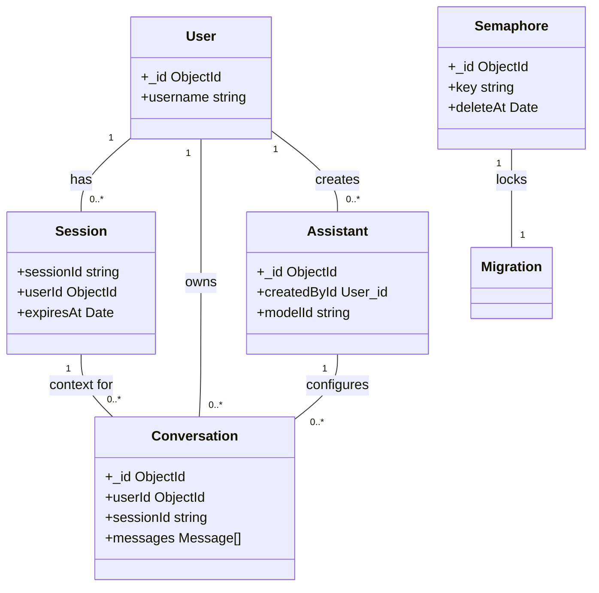

Sources: [src/lib/server/database.ts:119-156](), [src/lib/types/Assistant.ts:6-28](), [src/lib/types/Semaphore.ts:8-19]()

---

# Page: Chat Interface

# Chat Interface

<details>
<summary>Relevant source files</summary>

The following files were used as context for generating this wiki page:

- [src/lib/components/chat/BlockWrapper.svelte](src/lib/components/chat/BlockWrapper.svelte)
- [src/lib/components/chat/ChatInput.svelte](src/lib/components/chat/ChatInput.svelte)
- [src/lib/components/chat/ChatMessage.svelte](src/lib/components/chat/ChatMessage.svelte)
- [src/lib/components/chat/ChatWindow.svelte](src/lib/components/chat/ChatWindow.svelte)
- [src/lib/components/chat/ToolUpdate.svelte](src/lib/components/chat/ToolUpdate.svelte)
- [src/lib/types/MessageUpdate.ts](src/lib/types/MessageUpdate.ts)
- [src/routes/conversation/[id]/+page.svelte](src/routes/conversation/[id]/+page.svelte)
- [src/routes/conversation/[id]/+server.ts](src/routes/conversation/[id]/+server.ts)
- [src/routes/models/+page.svelte](src/routes/models/+page.svelte)
- [src/routes/r/[id]/+page.svelte](src/routes/r/[id]/+page.svelte)
- [src/styles/main.css](src/styles/main.css)

</details>


The Chat Interface is the core user interaction component of the chat-ui application, enabling communication with large language models through a web-based interface. This system manages conversation display, message rendering, user input handling, and file uploads. The interface adapts to different model capabilities, supporting features like tool execution, multimodal interactions, and reasoning blocks.

For information about the conversation data model and API endpoints, see [Conversation System](#5). For details on text generation with language models, see [Models and LLM Integration](#4).

## Component Architecture

The Chat Interface consists of several interconnected components that work together to provide a seamless user experience.

**Chat Interface Component Hierarchy**
```mermaid
graph TD
    ChatWindow["ChatWindow.svelte"] --> ChatMessage["ChatMessage.svelte"]
    ChatWindow --> ChatInput["ChatInput.svelte"]
    ChatWindow --> FileDropzone["FileDropzone.svelte"]
    ChatWindow --> ChatIntro["ChatIntroduction.svelte"]
    ChatWindow --> ScrollControls["ScrollToBottomBtn<br/>ScrollToPreviousBtn"]
    ChatWindow --> ModelSwitch["ModelSwitch.svelte"]
    ChatWindow --> ArtifactPanel["ArtifactPanel.svelte"]
    
    ChatMessage --> MessageAvatar["MessageAvatar.svelte"]
    ChatMessage --> MarkdownRenderer["MarkdownRenderer.svelte"]
    ChatMessage --> OpenReasoning["OpenReasoningResults.svelte"]
    ChatMessage --> UploadedFile["UploadedFile.svelte"]
    ChatMessage --> Alternatives["Alternatives.svelte"]
    ChatMessage --> ToolUpdate["ToolUpdate.svelte"]
    ChatMessage --> ArtifactCard["ArtifactCard.svelte"]
    
    ChatInput --> FileUpload["File Upload Controls"]
    ChatInput --> MCPServerManager["MCPServerManager.svelte"]
    ChatInput --> UrlFetchModal["UrlFetchModal.svelte"]
    
    subgraph "User Interaction Components"
        FileUpload
        ScrollControls
        ModelSwitch
        MCPServerManager
    end
    
    subgraph "Content Display Components"
        MarkdownRenderer
        OpenReasoning
        Alternatives
        ToolUpdate
        ArtifactCard
    end
```

Sources: [src/lib/components/chat/ChatWindow.svelte:5-41](), [src/lib/components/chat/ChatMessage.svelte:7-26](), [src/lib/components/chat/ChatInput.svelte:6-17]()

## Chat Window

The `ChatWindow` component serves as the main container for the chat interface. It manages the overall state of the conversation and orchestrates all chat-related components, including the new **Artifacts** system.

**Chat Window Structure**
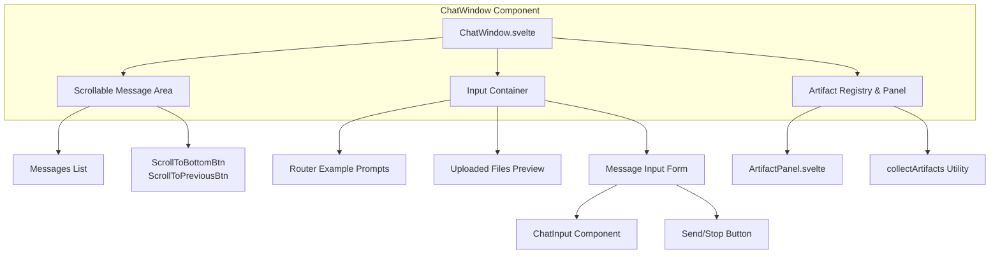

The `ChatWindow` component accepts props defined in the `Props` interface [src/lib/components/chat/ChatWindow.svelte:69-84](). Key features include:

1. **Artifacts Management**: Uses `collectArtifacts` to build a versioned registry of `<artifact>` tags from message history [src/lib/components/chat/ChatWindow.svelte:122-124](). It automatically opens the `ArtifactPanel` when new versions stream in [src/lib/components/chat/ChatWindow.svelte:134-138]().
2. **Router Examples**: For router models, displays clickable example prompts from `routerExamples` [src/lib/components/chat/ChatWindow.svelte:42]().
3. **File Handling**: Supports drag-and-drop [src/lib/components/chat/ChatWindow.svelte:164-172]() and paste file uploads [src/lib/components/chat/ChatWindow.svelte:174-204]().
4. **Large Text Paste Detection**: Automatically converts pasted text over 3984 characters into file attachments with the `application/vnd.chatui.clipboard` type [src/lib/components/chat/ChatWindow.svelte:177-188]().
5. **Voice Interaction**: Integrates `VoiceRecorder` for transcribing audio input when enabled [src/lib/components/chat/ChatWindow.svelte:145-149]().

For details, see [Chat Window and Messages](#3.1).

Sources: [src/lib/components/chat/ChatWindow.svelte:69-138](), [src/lib/components/chat/ChatWindow.svelte:164-204](), [src/lib/utils/artifacts.ts:1-10]()

## Message Rendering

The `ChatMessage` component renders individual messages. It handles different message types and various content formats through a complex block-based pipeline that strips or expands specialized tags.

**Message Component Logic**
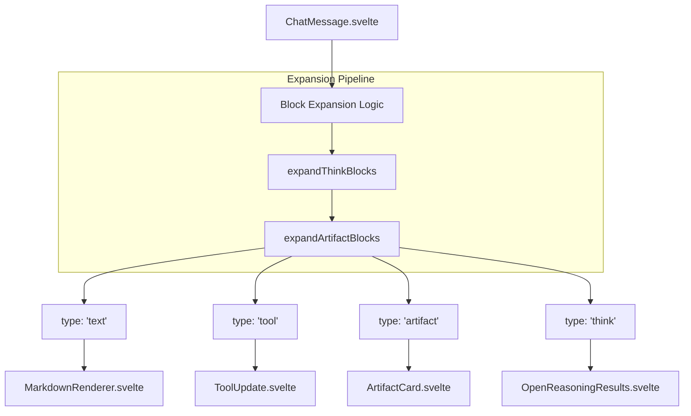

- **Reasoning Blocks**: Automatically detects `<think>` tags in content using `THINK_BLOCK_REGEX` [src/lib/components/chat/ChatMessage.svelte:136](). These are rendered as expandable reasoning results via `OpenReasoningResults` [src/lib/components/chat/ChatMessage.svelte:18]().
- **Artifact Integration**: Inline `<artifact>` blocks are extracted and replaced with `ArtifactCard` components [src/lib/components/chat/ChatMessage.svelte:182-199]().
- **Tool Updates**: Renders tool execution status, including parameters, results, and progress labels via `ToolUpdate` [src/lib/components/chat/ToolUpdate.svelte:102-138]().
- **Interactivity**: Supports editing [src/lib/components/chat/ChatMessage.svelte:80-87](), retrying [src/lib/components/chat/ChatMessage.svelte:41](), and navigating alternative message branches [src/lib/components/chat/ChatMessage.svelte:42]().

For details, see [Markdown and Code Rendering](#3.2).

Sources: [src/lib/components/chat/ChatMessage.svelte:135-147](), [src/lib/components/chat/ChatMessage.svelte:159-199](), [src/lib/components/chat/ToolUpdate.svelte:102-138]()

## Input System

The `ChatInput` component manages user text entry and attachment integration.

- **Adaptive Textarea**: Automatically adjusts height based on content using `adjustTextareaHeight` [src/lib/components/chat/ChatInput.svelte:167-178]().
- **Attachment Controls**: Includes dropdowns for file uploads (images and documents) and `UrlFetchModal` for URL fetching [src/lib/components/chat/ChatInput.svelte:14-15](), [src/lib/components/chat/ChatInput.svelte:83-103]().
- **MCP Integration**: Features a server manager (`MCPServerManager`) for Model Context Protocol tools [src/lib/components/chat/ChatInput.svelte:16-17]().
- **Keyboard Handling**: Manages composition states for IME and prevents submission on Shift+Enter [src/lib/components/chat/ChatInput.svelte:186-198]().

For details, see [File Attachments and URL Fetching](#3.3).

Sources: [src/lib/components/chat/ChatInput.svelte:31-62](), [src/lib/components/chat/ChatInput.svelte:167-184](), [src/lib/components/chat/ChatInput.svelte:230-232]()

## Page Integration

The chat interface is integrated into the application via SvelteKit routes:

- **Conversation View** (`src/routes/conversation/[id]/+page.svelte`): Orchestrates the message history and streaming updates. It uses `createMessagesPath` [src/routes/conversation/[id]/+page.svelte:73-114]() to construct the conversation thread from a tree structure and `writeMessage` [src/routes/conversation/[id]/+page.svelte:127-213]() to handle message submission, file encoding to base64, and retries.
- **Backend Communication** (`src/routes/conversation/[id]/+server.ts`): Handles the POST request for new messages. It manages cross-pod stop signals via `collections.abortedGenerations` [src/routes/conversation/[id]/+server.ts:86-101](), performs rate limiting [src/routes/conversation/[id]/+server.ts:113-132](), and triggers the `textGeneration` pipeline [src/routes/conversation/[id]/+server.ts:24]().

Sources: [src/routes/conversation/[id]/+page.svelte:73-114](), [src/routes/conversation/[id]/+page.svelte:127-156](), [src/routes/conversation/[id]/+server.ts:86-132](), [src/routes/conversation/[id]/+server.ts:24-28]()

---

# Page: Chat Window and Messages

# Chat Window and Messages

<details>
<summary>Relevant source files</summary>

The following files were used as context for generating this wiki page:

- [src/lib/components/CopyToClipBoardBtn.svelte](src/lib/components/CopyToClipBoardBtn.svelte)
- [src/lib/components/RetryBtn.svelte](src/lib/components/RetryBtn.svelte)
- [src/lib/components/ScrollToBottomBtn.svelte](src/lib/components/ScrollToBottomBtn.svelte)
- [src/lib/components/ScrollToPreviousBtn.svelte](src/lib/components/ScrollToPreviousBtn.svelte)
- [src/lib/components/StopGeneratingBtn.svelte](src/lib/components/StopGeneratingBtn.svelte)
- [src/lib/components/chat/Alternatives.svelte](src/lib/components/chat/Alternatives.svelte)
- [src/lib/components/chat/ChatMessage.svelte](src/lib/components/chat/ChatMessage.svelte)
- [src/lib/components/chat/ChatWindow.svelte](src/lib/components/chat/ChatWindow.svelte)
- [src/lib/components/chat/OpenReasoningResults.svelte](src/lib/components/chat/OpenReasoningResults.svelte)
- [src/lib/components/chat/OpenReasoningResults.svelte.test.ts](src/lib/components/chat/OpenReasoningResults.svelte.test.ts)
- [src/lib/constants/gestures.ts](src/lib/constants/gestures.ts)
- [src/lib/utils/scroll/__tests__/chatScroll.svelte.test.ts](src/lib/utils/scroll/__tests__/chatScroll.svelte.test.ts)
- [src/lib/utils/scroll/__tests__/harness.ts](src/lib/utils/scroll/__tests__/harness.ts)
- [src/lib/utils/scroll/chatScroll.svelte.ts](src/lib/utils/scroll/chatScroll.svelte.ts)
- [src/lib/utils/scroll/stickToBottom.ts](src/lib/utils/scroll/stickToBottom.ts)
- [src/routes/api/conversation/[id]/message/[messageId]/+server.ts](src/routes/api/conversation/[id]/message/[messageId]/+server.ts)
- [src/routes/conversation/[id]/+page.svelte](src/routes/conversation/[id]/+page.svelte)
- [src/routes/conversation/[id]/+server.ts](src/routes/conversation/[id]/+server.ts)
- [src/routes/r/[id]/+page.svelte](src/routes/r/[id]/+page.svelte)

</details>


This document details the core components responsible for rendering the chat interface and displaying messages in the chat-ui application. It covers the main components, their relationships, and the rendering process for various message types, including streaming updates, reasoning blocks, artifacts, and tool executions.

## Component Structure

The chat interface consists of a hierarchy of components that work together to display conversations between users and AI assistants.

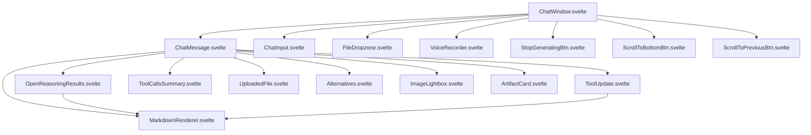

Sources: [src/lib/components/chat/ChatWindow.svelte:5-30](), [src/lib/components/chat/ChatMessage.svelte:7-30]()

## ChatWindow Component

The `ChatWindow.svelte` component serves as the main container for the chat interface. It manages the state of the conversation, handles sophisticated scrolling behavior via `createChatScroll`, and orchestrates the rendering of messages and input controls.

### Key Properties and State

| Property | Type | Description |
|----------|------|-------------|
| `messages` | `Message[]` | Array of message objects in the conversation. |
| `messagesAlternatives` | `Message["id"][][]` | Alternative message versions for branching. |
| `loading` | `boolean` | Indicates if a response is currently being generated. |
| `currentModel` | `Model` | The currently selected language model configuration. |
| `files` | `File[]` | Files currently staged in the input area. |
| `draft` | `string` | The current text in the chat input. |

Sources: [src/lib/components/chat/ChatWindow.svelte:69-84]()

### Artifact Registry
`ChatWindow` uses a `collectArtifacts` utility to fold `<artifact>` operations from the visible message path into a versioned registry. This registry is shared via context to inline `ArtifactCard` components and the `ArtifactPanel`.

Sources: [src/lib/components/chat/ChatWindow.svelte:122-130]()

## ChatMessage Component

The `ChatMessage.svelte` component renders individual messages. It parses the message content into blocks (text, reasoning, tools, or artifacts) and handles user interactions.

### Message Blocks Processing

Messages are decomposed into a sequence of `Block` types to handle interleaved content. The component uses `expandThinkBlocks` and `expandArtifactBlocks` to separate these special segments from standard markdown text.

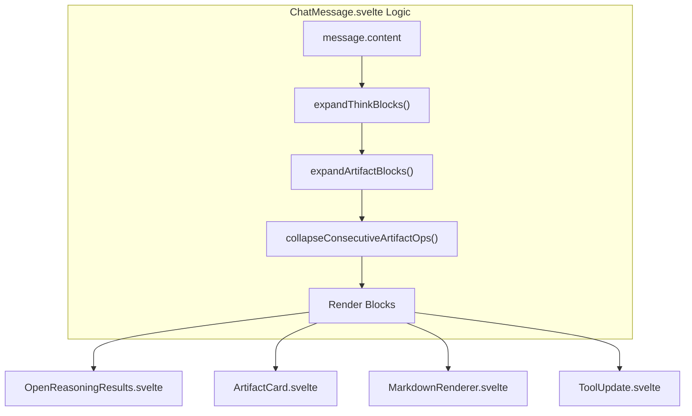

Sources: [src/lib/components/chat/ChatMessage.svelte:143-200]()

### Reasoning Blocks (Thinking)
The UI supports "Reasoning" blocks, denoted by `<think>` tags.
- **Detection**: `THINK_BLOCK_REGEX` identifies these blocks. [src/lib/components/chat/ChatMessage.svelte:136]()
- **Display**: Rendered via `OpenReasoningResults.svelte`. It provides a "Thinking" shimmer effect during generation. [src/lib/components/chat/OpenReasoningResults.svelte:53-56]()
- **Streaming View**: Uses a gradient mask (`.thinking-viewport.has-overflow`) to fade out older tokens while keeping the bottom of the stream visible. [src/lib/components/chat/OpenReasoningResults.svelte:72-76](), [src/lib/components/chat/OpenReasoningResults.svelte:95-98]()

## Scrolling Orchestration

The application uses a sophisticated scroll management system to handle streaming content growth without losing the user's place.

### StickToBottomController
A low-level controller that manages the scroll container. It uses position-based scroll attribution to distinguish between programmatic writes (streaming tokens) and user input (scrolling up to read).

Sources: [src/lib/utils/scroll/stickToBottom.ts:9-17]()

### ChatScroll Class
Built on top of the controller, `ChatScroll` manages "intents" like `send` or `retry`.
- **Send Anchoring**: When a user sends a message, the UI "anchors" the new message ~50px from the top of the viewport using a dynamic spacer element, allowing the assistant's reply to grow into the view. [src/lib/utils/scroll/chatScroll.svelte.ts:28-30](), [src/lib/utils/scroll/chatScroll.svelte.ts:90-94]()
- **Spacer Management**: `computeSpacerHeight` calculates the required padding to keep the anchored message stable during the "fill phase" of a reply. [src/lib/utils/scroll/chatScroll.svelte.ts:17-22]()

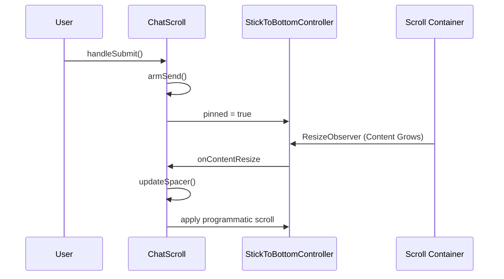

Sources: [src/lib/utils/scroll/chatScroll.svelte.ts:127-130](), [src/lib/components/chat/ChatWindow.svelte:152-158]()

## User Interactions

### Editing and Retrying
- **Editing**: Users can edit their messages by clicking the `CarbonPen` icon. This sets `editMsdgId`, rendering a `textarea` for the message. [src/lib/components/chat/ChatMessage.svelte:12](), [src/lib/components/chat/ChatMessage.svelte:80-87]()
- **Retrying**: The `onretry` callback is triggered when a user clicks the retry button on an assistant message. [src/lib/components/chat/ChatMessage.svelte:41](), [src/lib/components/chat/ChatMessage.svelte:54]()

### Branching (Alternatives)
When a message is edited or retried, a new branch is created in the conversation tree. The `Alternatives.svelte` component allows users to navigate between these siblings (e.g., "2 of 3").

Sources: [src/lib/components/chat/Alternatives.svelte:1-20]()

### Paste Behavior
`ChatWindow` intercepts `onPaste`. If text content is >= 3984 characters, it is converted into a virtual file attachment with MIME type `application/vnd.chatui.clipboard` to prevent UI lag and prompt bloat.

Sources: [src/lib/components/chat/ChatWindow.svelte:174-188]()

## Streaming Implementation

Streaming is handled by fetching updates from `/conversation/[id]`. The `writeMessage` function in the page route manages the lifecycle of a generation:
1. **Initialization**: Creates an `AbortController` and generates an `activeGenerationId`. [src/routes/conversation/[id]/+page.svelte:141-146]()
2. **File Encoding**: Converts staged files to base64. [src/routes/conversation/[id]/+page.svelte:147-156]()
3. **Update Consumption**: Uses `fetchMessageUpdates` to process the Server-Sent Events (SSE) stream. [src/routes/conversation/[id]/+page.svelte:230-240]()
4. **Tombstone Logic**: A `stopRequestedFor` flag ensures that if a user stops a generation, the UI doesn't accidentally resume it during subsequent SvelteKit invalidations. [src/routes/conversation/[id]/+page.svelte:54-60]()

Sources: [src/routes/conversation/[id]/+page.svelte:127-160](), [src/routes/conversation/[id]/+server.ts:157-204]()

### Sources:
- [src/lib/components/chat/ChatWindow.svelte]()
- [src/lib/components/chat/ChatMessage.svelte]()
- [src/lib/utils/scroll/stickToBottom.ts]()
- [src/lib/utils/scroll/chatScroll.svelte.ts]()
- [src/lib/components/chat/OpenReasoningResults.svelte]()
- [src/routes/conversation/[id]/+page.svelte]()
- [src/routes/conversation/[id]/+server.ts]()

---

# Page: Markdown and Code Rendering

# Markdown and Code Rendering

<details>
<summary>Relevant source files</summary>

The following files were used as context for generating this wiki page:

- [package-lock.json](package-lock.json)
- [package.json](package.json)
- [src/lib/components/CodeBlock.svelte](src/lib/components/CodeBlock.svelte)
- [src/lib/components/ExternalLinkModal.svelte](src/lib/components/ExternalLinkModal.svelte)
- [src/lib/components/HtmlPreviewModal.svelte](src/lib/components/HtmlPreviewModal.svelte)
- [src/lib/components/chat/MarkdownBlock.svelte](src/lib/components/chat/MarkdownBlock.svelte)
- [src/lib/components/chat/MarkdownRenderer.svelte](src/lib/components/chat/MarkdownRenderer.svelte)
- [src/lib/components/chat/MarkdownRenderer.svelte.test.ts](src/lib/components/chat/MarkdownRenderer.svelte.test.ts)
- [src/lib/stores/pendingChatInput.ts](src/lib/stores/pendingChatInput.ts)
- [src/lib/utils/externalLink.spec.ts](src/lib/utils/externalLink.spec.ts)
- [src/lib/utils/externalLink.ts](src/lib/utils/externalLink.ts)
- [src/lib/utils/markdownWorkerPool.ts](src/lib/utils/markdownWorkerPool.ts)
- [src/lib/utils/marked.spec.ts](src/lib/utils/marked.spec.ts)
- [src/lib/utils/marked.ts](src/lib/utils/marked.ts)
- [src/lib/utils/markedLight.ts](src/lib/utils/markedLight.ts)
- [src/lib/utils/parseBlocks.spec.ts](src/lib/utils/parseBlocks.spec.ts)
- [src/lib/utils/parseBlocks.ts](src/lib/utils/parseBlocks.ts)
- [src/lib/utils/parseIncompleteMarkdown.spec.ts](src/lib/utils/parseIncompleteMarkdown.spec.ts)
- [src/lib/utils/parseIncompleteMarkdown.ts](src/lib/utils/parseIncompleteMarkdown.ts)
- [src/lib/utils/previewSrcdoc.svelte.test.ts](src/lib/utils/previewSrcdoc.svelte.test.ts)
- [src/lib/workers/markdownWorker.ts](src/lib/workers/markdownWorker.ts)
- [src/styles/highlight-js.css](src/styles/highlight-js.css)
- [vite.config.ts](vite.config.ts)

</details>


## Purpose and Scope

This document describes the markdown and code rendering system in chat-ui, which transforms markdown text from LLM responses into formatted HTML. The system is optimized for streaming updates, handling incomplete markdown tokens, providing syntax highlighting for code blocks, rendering mathematical notation via KaTeX, and ensuring security through HTML sanitization.

## System Architecture

The rendering system follows a layered architecture where markdown content is first normalized, split into manageable blocks for memoization, and then processed into tokens. To protect the main thread from heavy synchronous tasks like KaTeX and Highlight.js, the system utilizes a shared worker pool.

**Component Hierarchy**

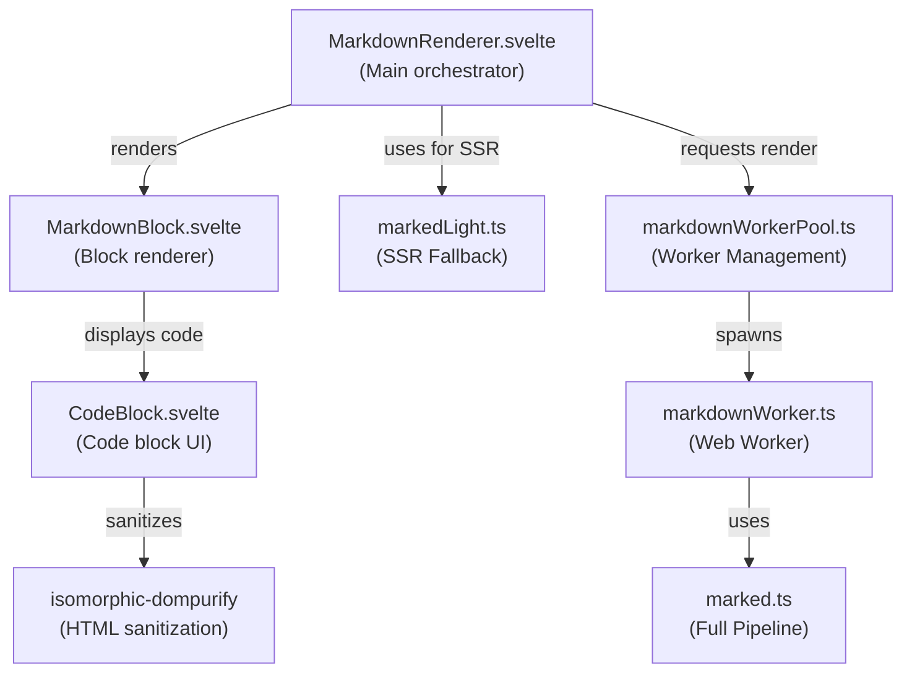

Sources: [src/lib/components/chat/MarkdownRenderer.svelte:1-53](), [src/lib/utils/markdownWorkerPool.ts:1-125](), [src/lib/components/CodeBlock.svelte:1-30]()

## Markdown Processing Pipeline

The pipeline transforms raw markdown strings into structured `BlockToken` objects. It supports "streaming repairs" to ensure that partial syntax (like unclosed bold tags) does not flash as raw text during generation.

**Processing Flow**

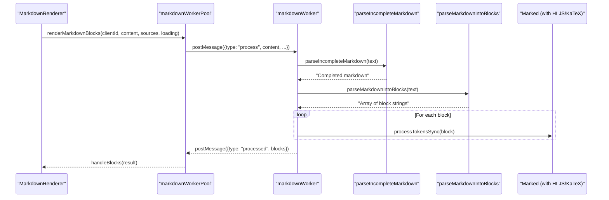

Sources: [src/lib/utils/marked.ts:32-34](), [src/lib/workers/markdownWorker.ts:26-41](), [src/lib/utils/parseIncompleteMarkdown.ts:1-16](), [src/lib/utils/markdownWorkerPool.ts:180-210]()

## Worker Pool and Performance

To avoid exhausting browser memory (especially on mobile), `chat-ui` uses a shared `markdownWorkerPool` instead of one worker per message [src/lib/utils/markdownWorkerPool.ts:40-45]().

- **Pool Size**: Deliberately small (max 2 workers) to stay within tab memory caps [src/lib/utils/markdownWorkerPool.ts:45]().
- **Coalescing**: If a client sends multiple requests while a worker is busy, the pool only keeps the latest job, discarding superseded intermediate states [src/lib/utils/markdownWorkerPool.ts:69-72]().
- **Graceful Degradation**: If workers are blocked by CSP or fail repeatedly, the system falls back to an async main-thread import of the rich module [src/lib/utils/markdownWorkerPool.ts:82-97]().
- **SSR Safety**: Server-side rendering uses `fallbackBlocks` from `markedLight.ts`, which performs basic escaping and block splitting without pulling in the 700KB KaTeX/Highlight.js bundle [src/lib/components/chat/MarkdownRenderer.svelte:22-26]().

Sources: [src/lib/utils/markdownWorkerPool.ts:40-75](), [src/lib/components/chat/MarkdownRenderer.svelte:22-31]()

## Code Block Rendering

The `CodeBlock.svelte` component provides syntax highlighting, clipboard integration, and live previews for web technologies.

| Feature | Implementation |
| :--- | :--- |
| **Syntax Highlighting** | Handled in `marked.ts` via `highlight.js`. Supported languages include JS, TS, Python, Rust, etc. [src/lib/utils/marked.ts:43-66](). |
| **Sanitization** | Uses `isomorphic-dompurify`. During streaming, it skips full sanitization if the code only contains `<span>` tags from the highlighter to maintain performance [src/lib/components/CodeBlock.svelte:27-30](). |
| **HTML/SVG Preview** | Detects `<!doctype html>` or `<svg>` tags and enables a "Preview" button [src/lib/components/CodeBlock.svelte:32-45](). |
| **Iframe Sandbox** | Previews run in a sandboxed `iframe` with `allow-scripts` but no `referrer` [src/lib/components/HtmlPreviewModal.svelte:83-90](). |

### HTML Preview System
The `HtmlPreviewModal` allows users to view generated artifacts. It uses a `MessageEvent` listener to capture errors from within the iframe and allows the user to send those errors back to the chat for the model to fix [src/lib/components/HtmlPreviewModal.svelte:33-51](), [src/lib/components/HtmlPreviewModal.svelte:102-113]().

Sources: [src/lib/components/CodeBlock.svelte:1-46](), [src/lib/components/HtmlPreviewModal.svelte:33-115](), [src/lib/utils/marked.ts:43-66]()

## Math Rendering with KaTeX

Mathematical notation is processed using custom `marked` extensions for both block and inline display modes.

- **Delimiters**: Supports `$$...$$` and `\[...\]` for blocks [src/lib/utils/marked.ts:153-178](), and `$...$` or `\(...\)` for inline math [src/lib/utils/marked.ts:200-225]().
- **Size Constraints**: To prevent pathological inputs from hanging the renderer, KaTeX processing is capped at 10,000 characters; longer strings are escaped as plaintext [src/lib/utils/marked.ts:78-137]().
- **Chemistry**: The `mhchem` extension is loaded to support chemical equations [src/lib/utils/marked.ts:2]().

Sources: [src/lib/utils/marked.ts:1-236]()

## Streaming Repairs

The `parseIncompleteMarkdown` function uses `remend` to ensure partial markdown doesn't break the layout during streaming [src/lib/utils/parseIncompleteMarkdown.ts:1-16]().

- **Incomplete Links**: Closed with a placeholder `streamdown:incomplete-link`. The renderer detects this and produces an inert `<a>` tag without an `href` to prevent dead clicks [src/lib/utils/marked.spec.ts:107-112]().
- **Emphasis**: Ensures that unclosed `**` or `_` tokens are treated as formatting rather than literal text during the stream [src/lib/utils/marked.spec.ts:125-128]().
- **Setext Headings**: Prevents a lone dash `-` on a new line from being prematurely rendered as an `<h2>` until the next line confirms it is not a list item [src/lib/utils/marked.spec.ts:141-145]().

Sources: [src/lib/utils/parseIncompleteMarkdown.ts:1-16](), [src/lib/utils/marked.spec.ts:106-158]()

---

# Page: File Attachments and URL Fetching

# File Attachments and URL Fetching

<details>
<summary>Relevant source files</summary>

The following files were used as context for generating this wiki page:

- [src/lib/components/chat/FileDropzone.svelte](src/lib/components/chat/FileDropzone.svelte)
- [src/lib/components/chat/UploadedFile.svelte](src/lib/components/chat/UploadedFile.svelte)
- [src/lib/components/chat/UrlFetchModal.svelte](src/lib/components/chat/UrlFetchModal.svelte)
- [src/lib/components/chat/VoiceRecorder.svelte](src/lib/components/chat/VoiceRecorder.svelte)
- [src/lib/components/voice/AudioWaveform.svelte](src/lib/components/voice/AudioWaveform.svelte)
- [src/lib/types/Tool.ts](src/lib/types/Tool.ts)
- [src/lib/utils/loadAttachmentsFromUrls.ts](src/lib/utils/loadAttachmentsFromUrls.ts)
- [src/lib/utils/mime.ts](src/lib/utils/mime.ts)
- [src/routes/api/fetch-url/+server.ts](src/routes/api/fetch-url/+server.ts)
- [src/routes/api/transcribe/+server.ts](src/routes/api/transcribe/+server.ts)

</details>


The `chat-ui` system provides a robust mechanism for attaching local files and fetching remote content via URLs. These attachments are processed, validated for security, and stored for consumption by Large Language Models (LLMs).

## Attachment Pipeline Overview

The attachment system handles four primary entry points: direct file uploads (via `FileDropzone.svelte`), clipboard pasting, voice recordings (via `VoiceRecorder.svelte`), and remote URL fetching (via `UrlFetchModal.svelte`). All files undergo MIME type validation and size checks before being persisted or sent to the model.

### Data Flow Diagram

This diagram illustrates the flow from user interaction to the storage and retrieval of file assets.

**Attachment Ingestion and Retrieval Flow**
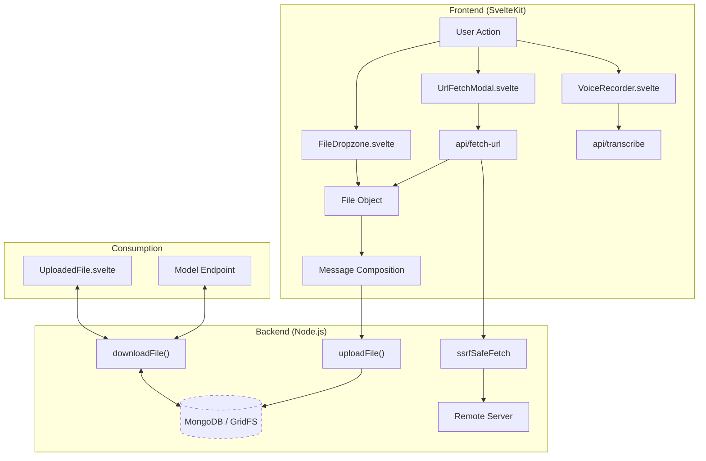
Sources: [src/lib/components/chat/FileDropzone.svelte:20-69](), [src/routes/api/fetch-url/+server.ts:17-114](), [src/lib/utils/loadAttachmentsFromUrls.ts:69-115](), [src/lib/components/chat/VoiceRecorder.svelte:142-158]()

## URL Fetching API

The `/api/fetch-url` endpoint acts as a security-hardened proxy for fetching remote assets. It is designed to prevent Server-Side Request Forgery (SSRF) and ensure that only safe, valid content is ingested.

### Security Controls
- **Protocol Restriction**: Only `https:` URLs are permitted [src/routes/api/fetch-url/+server.ts:25-28]().
- **Size Limits**: Maximum file size is capped at 10MB [src/routes/api/fetch-url/+server.ts:5]().
- **Timeout**: Requests time out after 30 seconds [src/routes/api/fetch-url/+server.ts:6]().
- **SSRF Protection**: 
    - The `isValidUrl` function (used in the route) rejects unsafe targets [src/routes/api/fetch-url/+server.ts:25-28]().
    - A custom `ssrfSafeFetch` is used to execute the request [src/routes/api/fetch-url/+server.ts:41]().
    - Redirects are followed manually (up to 5 hops), and every hop is re-validated via `isValidUrl` [src/routes/api/fetch-url/+server.ts:49-73]().

### Content Delivery
The endpoint returns the file as `text/plain` for browser safety but includes an `X-Forwarded-Content-Type` header containing the original MIME type [src/routes/api/fetch-url/+server.ts:93-100](). It also enforces a strict `Content-Security-Policy` to prevent execution of active content [src/routes/api/fetch-url/+server.ts:8-15]().

Sources: [src/routes/api/fetch-url/+server.ts:1-114](), [src/lib/server/urlSafety.ts:1-5]()

## Audio Transcription

Voice inputs are handled by `VoiceRecorder.svelte`, which captures audio via `MediaRecorder` [src/lib/components/chat/VoiceRecorder.svelte:77](). The resulting blob is sent to the `/api/transcribe` endpoint.

- **Format Support**: Supports `audio/webm`, `audio/ogg`, `audio/wav`, `audio/flac`, and others [src/routes/api/transcribe/+server.ts:9-17]().
- **Backend Processing**: The API forwards the audio buffer to a configured transcription model (e.g., Whisper) via the Hugging Face Inference API [src/routes/api/transcribe/+server.ts:55-72]().
- **Size Limit**: Audio files are limited to 25MB [src/routes/api/transcribe/+server.ts:6]().

Sources: [src/lib/components/chat/VoiceRecorder.svelte:49-101](), [src/routes/api/transcribe/+server.ts:1-104]()

## File Validation and MIME Types

Attachments are categorized by their MIME types to determine how they are rendered in the UI and processed by the backend.

| Category | Validation Logic | UI Component |
| :--- | :--- | :--- |
| **Images** | `image/*`, `webp`, `jpeg`, `png` | `` tag in `UploadedFile.svelte` [src/lib/components/chat/UploadedFile.svelte:39-41]() |
| **Audio** | `audio/*`, `mp3`, `wav`, `x-wav` | `AudioPlayer.svelte` [src/lib/components/chat/UploadedFile.svelte:42-43]() |
| **Video** | `video/*`, `mp4`, `x-mpeg` | `<video>` tag in `UploadedFile.svelte` [src/lib/components/chat/UploadedFile.svelte:44-45]() |
| **Plain Text** | `TEXT_MIME_ALLOWLIST` or clipboard type | `<pre>` block in `UploadedFile.svelte` [src/lib/components/chat/UploadedFile.svelte:60-61]() |

### Key Functions
- `matchesAllowed(contentType, allowed)`: Performs wildcard matching (e.g., `image/*`) against a list of allowed types [src/lib/components/chat/UploadedFile.svelte:47-58]().
- `pickSafeMime(forwardedType, blobType, url)`: Resolves the most appropriate MIME type from multiple sources [src/lib/utils/mime.ts:41-56]().
- `extractFilename(url, contentDisposition)`: Parses the filename from headers or URL path segments [src/lib/utils/loadAttachmentsFromUrls.ts:32-64]().

Sources: [src/lib/components/chat/UploadedFile.svelte:39-62](), [src/lib/components/chat/FileDropzone.svelte:34-51](), [src/lib/utils/loadAttachmentsFromUrls.ts:32-64](), [src/lib/utils/mime.ts:41-56]()

## Storage and Retrieval

Once a file is accepted by the frontend, it is converted into a `MessageFile` object [src/lib/types/Message.ts]().

### File Representation
Files can be stored in two formats within the `MessageFile` interface:
1. **Base64**: Used for small or temporary files [src/lib/components/chat/UploadedFile.svelte:79]().
2. **Hash**: A SHA-256 hash pointing to a file persisted in the backend (GridFS) [src/lib/components/chat/UploadedFile.svelte:72]().

### Retrieval Route
The route `/output/[sha256]` (relative to the conversation) serves stored files. `UploadedFile.svelte` fetches these hashes to display content [src/lib/components/chat/UploadedFile.svelte:104]().

Sources: [src/lib/components/chat/UploadedFile.svelte:66-126](), [src/lib/utils/loadAttachmentsFromUrls.ts:69-115]()

## Implementation Mapping

This diagram maps system concepts to specific code entities involved in the attachment lifecycle.

**Code Entity Mapping**
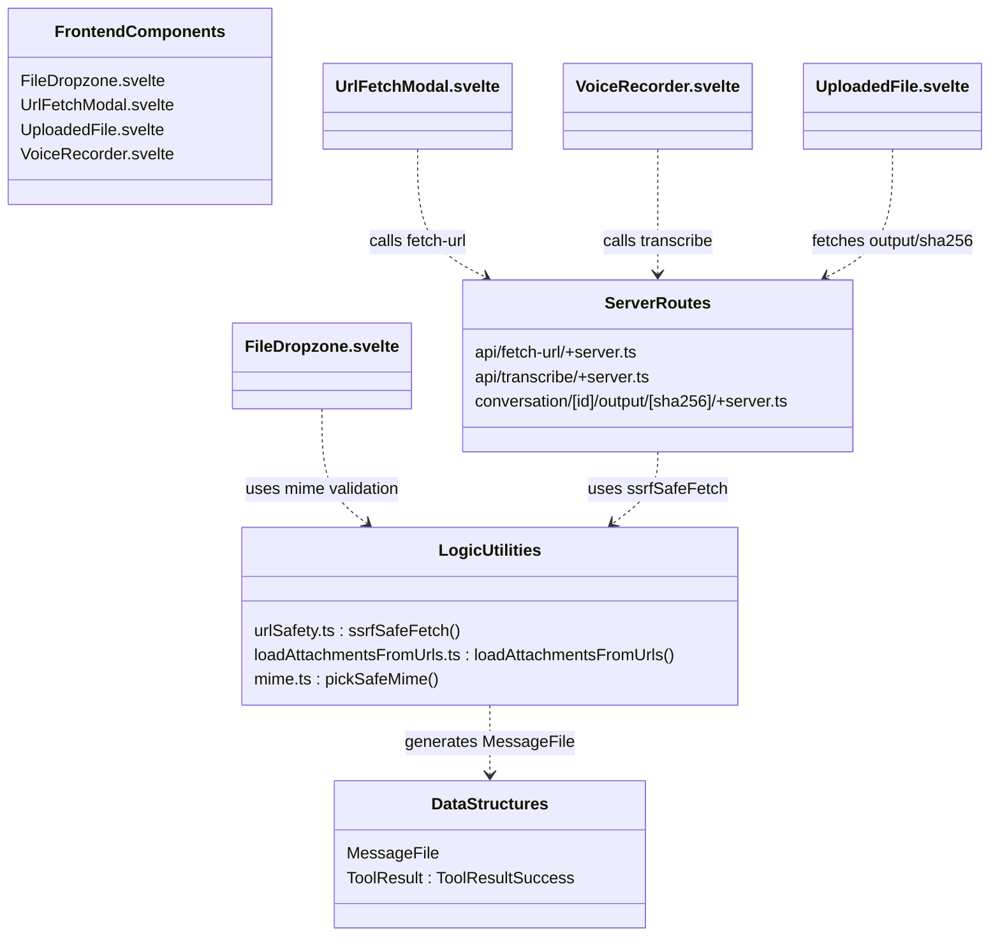
Sources: [src/lib/components/chat/UploadedFile.svelte:1-20](), [src/lib/utils/loadAttachmentsFromUrls.ts:69-71](), [src/lib/types/Tool.ts:12-17](), [src/routes/api/fetch-url/+server.ts:1-15]()

---

# Page: Models and LLM Integration

# Models and LLM Integration

<details>
<summary>Relevant source files</summary>

The following files were used as context for generating this wiki page:

- [README.md](README.md)
- [src/lib/APIClient.ts](src/lib/APIClient.ts)
- [src/lib/server/api/types.ts](src/lib/server/api/types.ts)
- [src/lib/server/api/utils/serializeModel.ts](src/lib/server/api/utils/serializeModel.ts)
- [src/lib/server/endpoints/endpoints.ts](src/lib/server/endpoints/endpoints.ts)
- [src/lib/server/endpoints/openai/endpointOai.ts](src/lib/server/endpoints/openai/endpointOai.ts)
- [src/lib/server/endpoints/openai/openAIChatToTextGenerationStream.ts](src/lib/server/endpoints/openai/openAIChatToTextGenerationStream.ts)
- [src/lib/server/endpoints/openai/openAICompletionToTextGenerationStream.ts](src/lib/server/endpoints/openai/openAICompletionToTextGenerationStream.ts)
- [src/lib/server/models.ts](src/lib/server/models.ts)
- [src/lib/types/Model.ts](src/lib/types/Model.ts)
- [src/routes/api/v2/models/[namespace]/+server.ts](src/routes/api/v2/models/[namespace]/+server.ts)
- [src/routes/api/v2/models/[namespace]/[model]/+server.ts](src/routes/api/v2/models/[namespace]/[model]/+server.ts)

</details>


The Models and LLM Integration system is the core component of chat-ui that handles communication with language model providers. Chat-ui exclusively uses OpenAI-compatible APIs, providing a unified interface for interacting with any LLM provider that implements the OpenAI protocol (e.g., Hugging Face Inference Providers, Ollama, vLLM, or OpenAI itself).

This page explains how models are discovered and configured, how the LLM Router intelligently selects models, how endpoints process requests, and how text generation is orchestrated.

## Overview of the System

The LLM integration system consists of several interconnected components that handle the lifecycle of a model from discovery to generation.

**Model Discovery and Configuration**

Title: Model Discovery and Initialization Flow

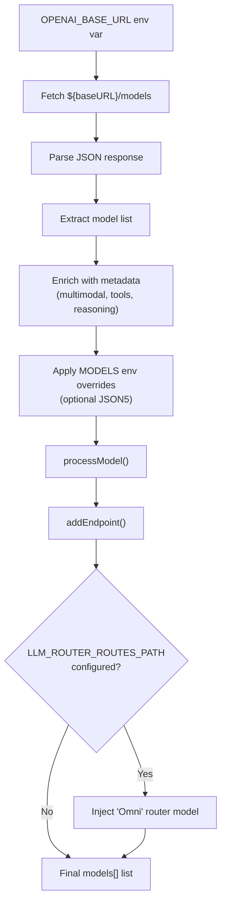

Sources:
- [src/lib/server/models.ts:206-250]() - `buildModels` discovery logic and schema validation
- [src/lib/server/models.ts:159-172]() - `getModelOverrides` processing for the `MODELS` env var
- [src/lib/server/models.ts:276-321]() - LLM Router injection and Omni model configuration

**Endpoint Architecture**

Title: Model to Provider Communication Space

```mermaid
graph TB
    subgraph "Code Entity Space"
        ProcessedModel["ProcessedModel<br/>(src/lib/server/models.ts)"]
        EndpointOai["endpointOai<br/>(src/lib/server/endpoints/openai/endpointOai.ts)"]
        RouterEndpoint["makeRouterEndpoint<br/>(src/lib/server/router/endpoint.ts)"]
    end
    
    subgraph "Natural Language / Network Space"
        OmniModel["'Omni' Virtual Model"]
        OpenAIProtocol["OpenAI-Compatible API"]
        HFRouter["Hugging Face Inference Router"]
    end
    
    ProcessedModel -->|calls| EndpointOai
    ProcessedModel -->|if isRouter| RouterEndpoint
    RouterEndpoint -->|routes to| EndpointOai
    EndpointOai -->|HTTP POST| OpenAIProtocol
    OpenAIProtocol -.-> HFRouter
    OmniModel -.-> RouterEndpoint
```

Sources:
- [src/lib/server/models.ts:137-150]() - `addEndpoint` implementation mapping models to endpoint logic
- [src/lib/server/endpoints/endpoints.ts:35-37]() - `Endpoint` type definition for the abstraction layer
- [src/lib/server/endpoints/openai/endpointOai.ts:53-67]() - `endpointOai` implementation

## Model Schema and Metadata

The system uses a strict Zod schema to define model capabilities. This metadata determines how the UI renders features like image uploads or reasoning toggles.

Title: Model Configuration Entities

```mermaid
classDiagram
    class ModelConfig {
        +string id
        +string name
        +string displayName
        +string preprompt
        +boolean multimodal
        +boolean supportsTools
        +boolean supportsReasoning
        +boolean supportsArtifacts
        +object parameters
    }
    
    class ProcessedModel {
        +ModelConfig
        +function chatPromptRender
        +function getEndpoint
        +boolean isRouter
    }
    
    ModelConfig --|> ProcessedModel : "Enriched via processModel()"
```

Sources:
- [src/lib/server/models.ts:19-71]() - `modelConfig` Zod schema definition
- [src/lib/server/models.ts:127-135]() - `processModel` implementation for metadata enrichment
- [src/lib/types/Model.ts:6-27]() - Client-side `Model` type for UI consumption

### Model Discovery and Overrides

Chat-ui fetches models from `${OPENAI_BASE_URL}/models`. It detects multimodal capabilities by inspecting `architecture.input_modalities` in the response. If the `MODELS` environment variable is provided, it is parsed as JSON5 and used to override discovered metadata (e.g., adding a custom logo or description).

For details, see [Model Configuration and Discovery](#4.1).

Sources:
- [src/lib/server/models.ts:92-110]() - Discovery list schema
- [src/lib/server/models.ts:159-172]() - Environment variable override logic

## LLM Router ('Omni')

The LLM Router is a heuristic-based system that exposes a virtual model (default ID `omni`). Instead of a fixed model, Omni selects a "route" based on the request content:
- **Multimodal**: If images are attached.
- **Agentic**: If MCP tools are enabled.
- **Default**: For standard text chat.

For details, see [LLM Router](#4.2).

Sources:
- [README.md:127-140]() - LLM Router high-level configuration and logic
- [src/lib/server/models.ts:276-321]() - Injection of the router model into the global model list

## OpenAI-Compatible Endpoint Implementation

The `endpointOai` function is the primary implementation of the `Endpoint` interface. It handles:
1.  **Message Formatting**: Converting internal message shapes to OpenAI `ChatCompletionMessageParam`.
2.  **File Handling**: Processing images into base64 Data URLs for multimodal models.
3.  **Stream Conversion**: Transforming OpenAI's stream format into the internal `TextGenerationStreamOutputSimplified` format.
4.  **Metadata Capture**: Extracting router-specific headers (e.g., `X-Router-Model`) to show the user which model was actually used by a provider-side router.

For details, see [Endpoint Implementations](#4.3).

Sources:
- [src/lib/server/endpoints/openai/endpointOai.ts:178-203]() - Chat message and preprompt preparation
- [src/lib/server/endpoints/openai/openAIChatToTextGenerationStream.ts:8-41]() - Stream transformation and router metadata yielding

## Text Generation Orchestration

Text generation is orchestrated by the server to handle multiple concurrent requirements:
- **Streaming**: Tokens are streamed to the client via Server-Sent Events (SSE).
- **Reasoning**: Models like DeepSeek R1 or OpenAI o1 that emit `<think>` blocks are handled by parsing reasoning content.
- **Tools**: If a request requires tools, the system executes them via the Model Context Protocol (MCP) before final generation.

For details, see [Text Generation](#4.4), [Prompt Building and Templates](#4.5), and [MCP Tool Integration](#4.6).

Sources:
- [src/lib/server/endpoints/openai/openAIChatToTextGenerationStream.ts:101-123]() - Logic for handling `<think>` tags and reasoning content
- [src/lib/server/endpoints/openai/endpointOai.ts:205-230]() - Parameter merging (temperature, max_tokens, etc.)

---

# Page: Model Configuration and Discovery

# Model Configuration and Discovery

<details>
<summary>Relevant source files</summary>

The following files were used as context for generating this wiki page:

- [README.md](README.md)
- [src/lib/APIClient.ts](src/lib/APIClient.ts)
- [src/lib/components/BackgroundGenerationPoller.svelte](src/lib/components/BackgroundGenerationPoller.svelte)
- [src/lib/components/chat/ModelSwitch.svelte](src/lib/components/chat/ModelSwitch.svelte)
- [src/lib/server/api/types.ts](src/lib/server/api/types.ts)
- [src/lib/server/api/utils/serializeModel.ts](src/lib/server/api/utils/serializeModel.ts)
- [src/lib/server/endpoints/endpoints.ts](src/lib/server/endpoints/endpoints.ts)
- [src/lib/server/models.ts](src/lib/server/models.ts)
- [src/lib/stores/conversations.svelte.ts](src/lib/stores/conversations.svelte.ts)
- [src/lib/types/Model.ts](src/lib/types/Model.ts)
- [src/lib/utils/models.ts](src/lib/utils/models.ts)
- [src/lib/utils/pendingFiles.ts](src/lib/utils/pendingFiles.ts)
- [src/routes/api/v2/models/+server.ts](src/routes/api/v2/models/+server.ts)
- [src/routes/api/v2/models/[namespace]/+server.ts](src/routes/api/v2/models/[namespace]/+server.ts)
- [src/routes/api/v2/models/[namespace]/[model]/+server.ts](src/routes/api/v2/models/[namespace]/[model]/+server.ts)
- [src/routes/api/v2/public-config/+server.ts](src/routes/api/v2/public-config/+server.ts)
- [src/routes/models/[...model]/+page.svelte](src/routes/models/[...model]/+page.svelte)
- [src/routes/models/[...model]/thumbnail.png/+server.ts](src/routes/models/[...model]/thumbnail.png/+server.ts)
- [src/routes/models/[...model]/thumbnail.png/ModelThumbnail.svelte](src/routes/models/[...model]/thumbnail.png/ModelThumbnail.svelte)
- [static/huggingchat/fulltext-logo.svg](static/huggingchat/fulltext-logo.svg)
- [static/huggingchat/thumbnail.png](static/huggingchat/thumbnail.png)

</details>


## Purpose and Scope

This document describes how `chat-ui` discovers, configures, and manages Large Language Models (LLMs). The system primarily supports OpenAI-compatible API endpoints and automatically discovers available models by querying the `/models` endpoint. Model metadata can be enriched with custom properties, and an optional LLM Router alias ("Omni") can be injected for intelligent model selection.

For information about the LLM Router's route selection logic, see **4.2 LLM Router**. For details on endpoint implementations and streaming, see **4.3 Endpoint Implementations**.

---

## Model Discovery Architecture

The model discovery system fetches available models from an OpenAI-compatible API endpoint at startup. The system queries `${OPENAI_BASE_URL}/models`, parses the response, and constructs internal model configurations with enriched metadata.

### Model Discovery Flow

The discovery process is orchestrated in `src/lib/server/models.ts`. It follows a pipeline from environment configuration to a final array of `ProcessedModel` objects.

```mermaid
graph TB
    subgraph "Configuration_Sources"
        EnvBase["config.OPENAI_BASE_URL<br/>(src/lib/server/config.ts)"]
        EnvKey["config.OPENAI_API_KEY<br/>(src/lib/server/config.ts)"]
        EnvOverrides["MODELS<br/>(src/lib/server/models.ts)"]
    end
    
    subgraph "Discovery_Logic_models_ts"
        FetchModels["fetch()<br/>${baseURL}/models"]
        ParseResponse["listSchema.parse()<br/>Zod validation"]
        EnrichMetadata["processModel()<br/>logos, multimodal"]
        ApplyOverrides["getModelOverrides()<br/>Apply JSON5 overrides"]
        AddEP["addEndpoint()<br/>Assign getEndpoint()"]
    end
    
    subgraph "State_Entities"
        ModelsArray["models array<br/>(ProcessedModel[])"]
        DefaultModel["defaultModel<br/>(models[0])"]
        TaskModel["taskModel<br/>(resolveTaskModel)"]
    end
    
    EnvBase --> FetchModels
    EnvKey --> FetchModels
    FetchModels --> ParseResponse
    ParseResponse --> EnrichMetadata
    EnvOverrides --> ApplyOverrides
    EnrichMetadata --> ApplyOverrides
    ApplyOverrides --> AddEP
    AddEP --> ModelsArray
    ModelsArray --> DefaultModel
    ModelsArray --> TaskModel
```

**Sources:** [src/lib/server/models.ts:206-218](), [src/lib/server/models.ts:159-172](), [src/lib/server/models.ts:87-91](), [src/lib/server/models.ts:127-135]()

---

## Model Configuration Schema

Models are validated using a `zod` schema named `modelConfig`. This schema defines the structure for both discovered models and manual overrides.

| Field | Type | Description |
|-------|------|-------------|
| `id` | `string` | Used as a unique identifier in the database. [src/lib/server/models.ts:21-21]() |
| `name` | `string` | The model name used for inference calls. [src/lib/server/models.ts:23-23]() |
| `displayName` | `string` | Human-readable name shown in the UI. [src/lib/server/models.ts:24-24]() |
| `preprompt` | `string` | The system prompt prefix for the model. [src/lib/server/models.ts:32-32]() |
| `parameters` | `object` | Generation parameters like `temperature`, `max_tokens`, `stop`. [src/lib/server/models.ts:45-57]() |
| `multimodal` | `boolean` | Whether the model supports image inputs. [src/lib/server/models.ts:58-58]() |
| `supportsTools` | `boolean` | Aggregated tool-calling capability across providers. [src/lib/server/models.ts:61-61]() |
| `supportsReasoning`| `boolean` | Supports `reasoning_effort` (e.g., o1/o3 models). [src/lib/server/models.ts:63-63]() |
| `supportsArtifacts`| `boolean` | Opt-in for rendering code/HTML in a side panel. [src/lib/server/models.ts:66-66]() |

### Code Entity Space: Model Types

The system differentiates between raw configuration, processed server-side models, and the subset of data sent to the frontend.

```mermaid
classDiagram
    class modelConfig {
        <<ZodSchema>>
        +string id
        +string name
        +string displayName
        +object parameters
        +boolean multimodal
    }
    class InternalProcessedModel {
        <<Type>>
        +chatPromptRender()
        +getEndpoint() Promise~Endpoint~
        +boolean isRouter
        +boolean hasInferenceAPI
    }
    class Model {
        <<Type>>
        +string id
        +string name
        +string logoUrl
        +boolean supportsTools
        +boolean supportsReasoning
    }

    modelConfig ..> InternalProcessedModel : "defines base"
    InternalProcessedModel --|> Model : "Pick fields for UI"
```

**Sources:** [src/lib/server/models.ts:19-71](), [src/lib/server/models.ts:152-155](), [src/lib/types/Model.ts:6-27]()

---

## Metadata Enrichment and Processing

Once models are fetched from the `/models` endpoint (validated by `listSchema` [src/lib/server/models.ts:92-110]()), they undergo enrichment in the `processModel` and `addEndpoint` functions.

### Enrichment Logic
1.  **ID Assignment**: If no ID is provided, it defaults to the model name. [src/lib/server/models.ts:130-130]()
2.  **Preprompt Loading**: If `prepromptUrl` is provided, the system fetches the text content. [src/lib/server/models.ts:132-132]()
3.  **Parameter Mapping**: Maps `parameters.stop` to `stop_sequences` for internal compatibility. [src/lib/server/models.ts:133-133]()
4.  **Prompt Rendering**: Attaches a `chatPromptRender` function. In this build, it uses a minimal template that formats messages into a `[ROLE]\ncontent` structure to support legacy flows. [src/lib/server/models.ts:112-125]()

### Endpoint Association
The `addEndpoint` function assigns an async `getEndpoint` method to each model. This build exclusively supports OpenAI-compatible endpoints by calling `endpoints.openai` with the model's configuration. [src/lib/server/models.ts:137-150]()

**Sources:** [src/lib/server/models.ts:127-135](), [src/lib/server/models.ts:137-150](), [src/lib/server/endpoints/endpoints.ts:40-42]()

---

## Model Overrides via Environment Variables

Users can customize discovered models or define new ones using the `MODELS` environment variable. This variable accepts a JSON5 array of partial model configurations.

### Override Logic
1.  **Sanitization**: The `sanitizeJSONEnv` function strips backticks and whitespace from the environment string. [src/lib/server/models.ts:13-17]()
2.  **Parsing**: `getModelOverrides` parses the JSON5 string and validates it against `overrideEntrySchema`. [src/lib/server/models.ts:159-172]()
3.  **Schema Requirements**: Each override must provide at least an `id` or `name` to match against discovered models. [src/lib/server/models.ts:75-83]()

**Sources:** [src/lib/server/models.ts:13-17](), [src/lib/server/models.ts:159-172](), [src/lib/server/models.ts:75-83]()

---

## Task Model and Selection

The system maintains a `taskModel` used for background operations like title generation.

### Selection Logic
- If `config.TASK_MODEL` is defined, the system searches the `models` list for a matching ID or name. [src/lib/server/models.ts:194-201]()
- If no match is found or no variable is set, it falls back to the first model in the processed list. [src/lib/server/models.ts:203-203]()

The `findCurrentModel` utility is used on the frontend to resolve which model a conversation should use, especially when switching models for an existing conversation. [src/lib/utils/models.ts:3-14](), [src/lib/components/chat/ModelSwitch.svelte:26-46]()

**Sources:** [src/lib/server/models.ts:189-204](), [src/lib/utils/models.ts:3-14](), [src/lib/components/chat/ModelSwitch.svelte:26-46]()

---

## API Exposure and Discovery

The frontend discovers available models via the `GET /api/v2/models` endpoint.

### Model Filtering
The API endpoint `src/routes/api/v2/models/+server.ts` filters out models marked as `unlisted`. It returns a serialized summary of models to the client. [src/routes/api/v2/models/+server.ts:11-23]()

### Client-Side Access
The `APIClient` provides a structured way to fetch models. `client.models.get()` retrieves the list, while `client.models({ id: "..." }).get()` retrieves specific details like providers and parameters. [src/lib/APIClient.ts:120-128]()

### Thumbnail Generation
For social sharing and UI previews, the system provides a dynamic thumbnail generator at `src/routes/models/[...model]/thumbnail.png/+server.ts`. This uses `satori` and `resvg-js` to render a Svelte component (`ModelThumbnail.svelte`) into a PNG image. [src/routes/models/[...model]/thumbnail.png/+server.ts:15-64]()

**Sources:** [src/routes/api/v2/models/+server.ts:11-23](), [src/lib/APIClient.ts:120-128](), [src/routes/models/[...model]/thumbnail.png/+server.ts:15-64](), [src/routes/models/[...model]/thumbnail.png/ModelThumbnail.svelte:17-32]()

---

# Page: LLM Router

# LLM Router

<details>
<summary>Relevant source files</summary>

The following files were used as context for generating this wiki page:

- [.env](.env)
- [chart/env/dev.yaml](chart/env/dev.yaml)
- [chart/env/prod.yaml](chart/env/prod.yaml)
- [docs/source/configuration/common-issues.md](docs/source/configuration/common-issues.md)
- [docs/source/configuration/llm-router.md](docs/source/configuration/llm-router.md)
- [docs/source/configuration/mcp-tools.md](docs/source/configuration/mcp-tools.md)
- [docs/source/configuration/overview.md](docs/source/configuration/overview.md)
- [docs/source/developing/architecture.md](docs/source/developing/architecture.md)
- [docs/source/index.md](docs/source/index.md)
- [src/hooks.server.ts](src/hooks.server.ts)
- [src/lib/constants/mcpExamples.ts](src/lib/constants/mcpExamples.ts)
- [src/lib/constants/routerExamples.ts](src/lib/constants/routerExamples.ts)
- [src/lib/server/auth.ts](src/lib/server/auth.ts)
- [src/lib/server/router/endpoint.ts](src/lib/server/router/endpoint.ts)
- [src/lib/server/router/types.ts](src/lib/server/router/types.ts)
- [src/lib/server/textGeneration/mcp/routerResolution.ts](src/lib/server/textGeneration/mcp/routerResolution.ts)
- [src/lib/types/User.ts](src/lib/types/User.ts)
- [src/routes/login/callback/+server.ts](src/routes/login/callback/+server.ts)
- [src/routes/login/callback/updateUser.ts](src/routes/login/callback/updateUser.ts)
- [src/routes/logout/+server.ts](src/routes/logout/+server.ts)
- [static/huggingchat/castle-example.jpg](static/huggingchat/castle-example.jpg)
- [static/huggingchat/routes.chat.json](static/huggingchat/routes.chat.json)

</details>


## Purpose and Scope

The LLM Router is an intelligent model selection system that dynamically chooses the best model for each conversation turn. It appears to users as a virtual model alias (by default called "Omni") that, when selected, routes requests to specialized models based on the conversation context. This system uses local heuristics and a policy-based configuration to select models for multimodal, agentic (tool-using), or general-purpose tasks.

---

## Overview

The LLM Router provides server-side intelligent routing without requiring a separate selection model call for every request. When a user selects the router alias (e.g., "Omni") from the model list, the system:

1.  Analyzes the request for specific features (images or active tools). [src/lib/server/router/endpoint.ts:112-118]()
2.  Applies synchronous heuristics to select a route category (e.g., `multimodal`, `agentic`, or `default`). [src/lib/server/router/endpoint.ts:111-111]()
3.  Maps the route to a specific model from a routes policy JSON file. [src/lib/server/router/endpoint.ts:107-107]()
4.  Streams the response from the selected model. [src/lib/server/router/endpoint.ts:163-163]()
5.  Falls back to alternative models if the primary selection fails. [src/lib/server/router/policy.ts:35-44]()

**Sources:** [docs/source/developing/architecture.md:33-35](), [docs/source/configuration/llm-router.md:1-15](), [chart/env/prod.yaml:77-89](), [src/lib/server/router/endpoint.ts:105-165]()

---

## Architecture

### Virtual Model Integration

The router is implemented as a synthetic model entry. Unlike regular models, which have static endpoint configurations, the router model uses a wrapper endpoint that performs dynamic selection.

**Router Entity Mapping**
```mermaid
graph TB
    subgraph "Model Management Space"
        ModelsInit["src/lib/server/models.ts"]
        ProcessModels["ProcessedModel (Interface)"]
    end

    subgraph "Router Logic Space"
        RouterEP["makeRouterEndpoint()"]
        Heuristics["heuristicSelectRoute()"]
        Policy["getRoutes()"]
        ToolsRoute["pickToolsCapableModel()"]
    end

    subgraph "External Providers"
        OpenAICompatible["src/lib/server/endpoints/openai/endpoint.ts"]
    end
    
    ModelsInit -->|"isRouter: true"| RouterEP
    RouterEP --> Heuristics
    RouterEP --> Policy
    RouterEP --> ToolsRoute
    RouterEP -->|"Delegates to"| OpenAICompatible
```

The router model is identified by `isRouter: true`. Its execution logic is encapsulated in `makeRouterEndpoint`, which creates a standard `Endpoint` interface that internally handles the routing and fallback orchestration. [src/lib/server/router/endpoint.ts:105-106]()

**Sources:** [src/lib/server/router/endpoint.ts:105-106](), [src/lib/server/textGeneration/mcp/routerResolution.ts:40-42](), [src/lib/server/router/heuristics.ts:11-11]()

### Router Endpoint Wrapper

The `makeRouterEndpoint` function creates an endpoint that intercepts generation requests. It sanitizes messages (stripping reasoning blocks like `<think>`) and then determines the target model using a priority-based selection: multimodal bypass, then tools bypass, then heuristic-based route selection. [src/lib/server/router/endpoint.ts:105-120]()

**Sources:** [src/lib/server/router/endpoint.ts:105-120](), [src/lib/server/router/endpoint.ts:87-99](), [src/lib/server/router/endpoint.ts:21-21]()

---

## Configuration

### Environment Variables

The router is configured through environment variables that control selection behavior, fallback logic, and UI presentation. [chart/env/prod.yaml:77-91]()

| Variable | Purpose | Default |
|----------|---------|---------|
| `LLM_ROUTER_ROUTES_PATH` | Path to the JSON policy file defining routes | None (Required) |
| `LLM_ROUTER_DEFAULT_ROUTE` | Route name used when no specific heuristic matches | `default` |
| `LLM_ROUTER_FALLBACK_MODEL` | Model to use if every candidate in the selected route fails | None |
| `LLM_ROUTER_ENABLE_MULTIMODAL` | Enable immediate bypass to a specific multimodal model | `false` |
| `LLM_ROUTER_MULTIMODAL_MODEL` | The model ID used for the multimodal bypass | None |
| `LLM_ROUTER_ENABLE_TOOLS` | Enable immediate bypass for tool-active requests | `false` |
| `LLM_ROUTER_TOOLS_MODEL` | The model ID used for the tools bypass | None |
| `PUBLIC_LLM_ROUTER_ALIAS_ID` | The ID used for the virtual router model (e.g., `omni`) | `omni` |

**Sources:** [docs/source/configuration/llm-router.md:17-31](), [chart/env/prod.yaml:77-89](), [.env:64-90]()

### Routes Policy

The routes policy is a JSON array specified by `LLM_ROUTER_ROUTES_PATH`. It maps route names to primary and fallback models. [static/huggingchat/routes.chat.json:1-25]()

```json
[
  {
    "name": "default",
    "description": "General purpose route.",
    "primary_model": "moonshotai/Kimi-K2.6",
    "fallback_models": ["zai-org/GLM-4.6"]
  }
]
```

**Sources:** [static/huggingchat/routes.chat.json:1-25](), [src/lib/server/router/policy.ts:8-28](), [src/lib/server/router/types.ts:1-6]()

---

## Selection Process

### Route Selection Flow

When a request is made via the router, the `routerEndpoint` function follows a strict priority sequence. [src/lib/server/router/endpoint.ts:167-210]()

**Execution Data Flow**
```mermaid
sequenceDiagram
    participant U as User Request
    participant R as makeRouterEndpoint()
    participant H as Heuristics / Bypasses
    participant P as Policy (policy.ts)
    participant E as OpenAI Endpoint

    U->>R: params.messages
    
    alt isMultimodal && LLM_ROUTER_ENABLE_MULTIMODAL
        R->>H: getConfiguredMultimodalModelId()
        H-->>R: multimodal model ID
    else hasToolsActive && LLM_ROUTER_ENABLE_TOOLS
        R->>H: pickToolsCapableModel()
        H-->>R: tools model ID
    else Heuristic Route
        R->>H: heuristicSelectRoute()
        H-->>R: routeName (e.g. "default")
        R->>P: resolveRouteModels(routeName)
        P-->>R: [primary, ...fallbacks]
    end

    R->>E: createCandidateEndpoint(selectedModel)
    E-->>U: Stream Response + routerMetadata
```

**Sources:** [src/lib/server/router/endpoint.ts:167-210](), [src/lib/server/textGeneration/mcp/routerResolution.ts:48-88](), [docs/source/configuration/llm-router.md:9-15](), [src/lib/server/router/endpoint.ts:121-149]()

### Fallback Mechanism

The router handles failures by iterating through the `fallback_models` defined in the policy for the selected route. If the `primary_model` returns an error (captured via `extractUpstreamError`), the router attempts the next candidate in the list. [src/lib/server/router/policy.ts:35-44]() If all candidates fail, it falls back to the global `LLM_ROUTER_FALLBACK_MODEL`. [src/lib/server/router/endpoint.ts:50-85]()

**Sources:** [src/lib/server/router/endpoint.ts:50-85](), [src/lib/server/router/policy.ts:35-44](), [docs/source/configuration/llm-router.md:28-30]()

---

## Multimodal and Tool Support

The router uses specific triggers to identify specialized requests:

*   **Multimodal Detection**: Triggered if any message in the conversation contains a file with a MIME type starting with `image/`. [src/lib/server/router/endpoint.ts:112-116]()
*   **Tools Detection**: Triggered if the user has active MCP server selections in their session (`hasActiveToolsSelection`). [src/lib/server/router/endpoint.ts:118-118]()

If the respective bypass flags (`LLM_ROUTER_ENABLE_MULTIMODAL` or `LLM_ROUTER_ENABLE_TOOLS`) are enabled, the router skips the policy lookup and uses the configured shortcut models. [src/lib/server/router/endpoint.ts:167-188]() If disabled, it falls back to the semantic routes `multimodal` and `agentic` defined within the policy JSON. [static/huggingchat/routes.chat.json:13-23]()

**Sources:** [src/lib/server/router/endpoint.ts:112-118](), [src/lib/server/router/endpoint.ts:167-188](), [src/lib/server/router/endpoint.ts:205-220](), [src/lib/server/textGeneration/mcp/routerResolution.ts:48-78]()

---

## Router Metadata

Before the first token of the generated text is delivered, the router yields a `routerMetadata` object. [src/lib/server/router/endpoint.ts:152-164]() This metadata is used by the UI to inform the user which specific model and route were chosen by the "Omni" system.

```typescript
yield {
    token: { id: 0, text: "", special: true, logprob: 0 },
    generated_text: null,
    details: null,
    routerMetadata: { route: selectedRoute, model: actualModel },
};
```

**Sources:** [src/lib/server/router/endpoint.ts:152-164](), [src/lib/server/router/endpoint.ts:188-188]()

---

# Page: Endpoint Implementations

# Endpoint Implementations

<details>
<summary>Relevant source files</summary>

The following files were used as context for generating this wiki page:

- [src/lib/server/endpoints/openai/endpointOai.ts](src/lib/server/endpoints/openai/endpointOai.ts)
- [src/lib/server/endpoints/openai/openAIChatToTextGenerationStream.ts](src/lib/server/endpoints/openai/openAIChatToTextGenerationStream.ts)
- [src/lib/server/endpoints/openai/openAICompletionToTextGenerationStream.ts](src/lib/server/endpoints/openai/openAICompletionToTextGenerationStream.ts)
- [src/lib/server/endpoints/preprocessMessages.ts](src/lib/server/endpoints/preprocessMessages.ts)
- [src/lib/server/generateFromDefaultEndpoint.ts](src/lib/server/generateFromDefaultEndpoint.ts)

</details>


This page documents the endpoint abstraction layer that provides a unified interface for interacting with various Large Language Model providers. The focus is on the OpenAI-compatible endpoint implementation (`endpointOai`), stream processing mechanisms, and the conversion of LLM responses into `MessageUpdate` events.

## Endpoint Abstraction Layer

The endpoint abstraction defines a unified interface that all LLM providers must implement, allowing the system to interact with different providers through a consistent API.

### Core Types

The `Endpoint` type defines the function signature that all endpoint implementations must conform to:

```typescript
export type Endpoint = (
	params: EndpointParameters
) => Promise<AsyncGenerator<TextGenerationStreamOutputSimplified, void, void>>;
```

**Sources:** [src/lib/server/endpoints/endpoints.ts:35-37]()

The `EndpointParameters` interface specifies the inputs passed to endpoints:

| Parameter | Type | Purpose |
|-----------|------|---------|
| `messages` | `EndpointMessage[]` | Array of conversation messages to send to the LLM |
| `preprompt` | `string \| undefined` | System-level instructions prepended to the conversation |
| `generateSettings` | `Partial<Model["parameters"]>` | Override parameters like temperature, max_tokens, etc. |
| `isMultimodal` | `boolean \| undefined` | Whether to process images in user messages |
| `conversationId` | `ObjectId \| undefined` | Identifier for request tracking and caching |
| `locals` | `App.Locals \| undefined` | Request context including user token for authentication |
| `abortSignal` | `AbortSignal \| undefined` | Signal to cancel the LLM request |
| `provider` | `string \| undefined` | Inference provider preference (e.g., "fastest", "cheapest") |
| `reasoningEffort` | `"low" \| "medium" \| "high"` | Optional effort level for reasoning models |

**Sources:** [src/lib/server/endpoints/endpoints.ts:16-28]()

The `TextGenerationStreamOutputSimplified` type extends the standard Hugging Face inference output with optional router metadata:

```typescript
export type TextGenerationStreamOutputSimplified = TextGenerationStreamOutput & {
	token: TextGenerationStreamToken;
	routerMetadata?: { route?: string; model?: string; provider?: InferenceProvider };
};
```

**Sources:** [src/lib/server/endpoints/endpoints.ts:30-33]()

### Endpoint Registry

The system maintains a registry of available endpoint implementations:

```typescript
export const endpoints = {
	openai: endpointOai,
};
```

**Sources:** [src/lib/server/endpoints/endpoints.ts:40-42]()

## OpenAI Endpoint Implementation

The `endpointOai` function creates an endpoint that communicates with OpenAI-compatible APIs. This implementation supports both the legacy completions API and the modern chat completions API.

### Configuration Schema

The endpoint accepts configuration parameters validated by `endpointOAIParametersSchema`:

| Parameter | Type | Default | Purpose |
|-----------|------|---------|---------|
| `baseURL` | `string` | `"https://api.openai.com/v1"` | Base URL for the OpenAI-compatible API |
| `apiKey` | `string` | `OPENAI_API_KEY` or `HF_TOKEN` | Authentication token |
| `completion` | `"completions" \| "chat_completions"` | `"chat_completions"` | Which API endpoint to use |
| `useCompletionTokens` | `boolean` | `false` | Use `max_completion_tokens` instead of `max_tokens` |
| `multimodal` | `object` | See below | Image processing configuration |

**Sources:** [src/lib/server/endpoints/openai/endpointOai.ts:20-51]()

### OpenAI Client Initialization

The endpoint initializes an OpenAI client with custom configuration and a fetch wrapper to capture metadata:

**Data Flow: OpenAI Endpoint Initialization**
```mermaid
graph TB
    subgraph "endpointOai.ts"
        Init["endpointOai()"]
        Schema["endpointOAIParametersSchema.parse()"]
        Fetch["customFetch wrapper"]
        Client["new OpenAI()"]
        ImgProc["makeImageProcessor()"]
    end

    Init --> Schema
    Schema --> Fetch
    Fetch --> Client
    Client --> ImgProc
    ImgProc --> Return["Return Async Function"]
```

**Sources:** [src/lib/server/endpoints/openai/endpointOai.ts:53-115]()

### Router Metadata Extraction

The `customFetch` wrapper captures router metadata from response headers:
- **X-Router-Route**: The routing decision made by an upstream router.
- **X-Router-Model**: The specific model selected.
- **x-inference-provider**: The provider that handled the request.

**Sources:** [src/lib/server/endpoints/openai/endpointOai.ts:79-102]()

## Completion Modes

### Legacy Completions Mode

When `completion: "completions"` is used, the endpoint builds a single prompt string using `buildPrompt` and calls `openai.completions.create`.

**Sources:** [src/lib/server/endpoints/openai/endpointOai.ts:117-165]()

### Chat Completions Mode

The default mode uses `openai.chat.completions.create`. It handles multimodal content via `prepareMessagesWithFiles` and intelligently injects system prompts.

**Sources:** [src/lib/server/endpoints/openai/endpointOai.ts:166-237]()

#### System Message Logic

If a system message already exists at the start of the message array, the `preprompt` is prepended to it. Otherwise, a new system message is inserted.

**Sources:** [src/lib/server/endpoints/openai/endpointOai.ts:186-203]()

## Stream Processing

Stream processors transform raw OpenAI responses into `TextGenerationStreamOutputSimplified`.

### Chat Completions Stream Processor

The `openAIChatToTextGenerationStream` function handles the following:

1.  **Router Metadata**: Yields metadata if found in `x-router-metadata` property or response headers.
2.  **Reasoning Blocks**: Extracts `reasoning` or `reasoning_content` deltas and wraps them in `<think>` tags.
3.  **Content**: Passes through standard content tokens.
4.  **Finish Reasons**: Signals the end of generation when `finish_reason` is "stop" or "length".

**Stream Logic: openAIChatToTextGenerationStream**
```mermaid
graph TD
    subgraph "openAIChatToTextGenerationStream.ts"
        Chunk["completionStream chunk"]
        CheckMeta{"Has Metadata?"}
        YieldMeta["Yield routerMetadata"]
        ExtractDelta["Extract delta.content / delta.reasoning"]
        ThinkCheck{"Is Reasoning?"}
        WrapThink["Wrap in <think> tags"]
        Acc["Accumulate generatedText"]
        YieldOutput["Yield TextGenerationStreamOutput"]
    end

    Chunk --> CheckMeta
    CheckMeta -- "Yes" --> YieldMeta
    CheckMeta -- "No" --> ExtractDelta
    ExtractDelta --> ThinkCheck
    ThinkCheck -- "Yes" --> WrapThink
    ThinkCheck -- "No" --> Acc
    WrapThink --> Acc
    Acc --> YieldOutput
```

**Sources:** [src/lib/server/endpoints/openai/openAIChatToTextGenerationStream.ts:8-165]()

## Conversion to MessageUpdate Events

The frontend consumes streams via `fetchMessageUpdates`, which converts the server's newline-delimited JSON stream into `MessageUpdate` objects.

### Streaming Modes

Two streaming modes are supported via `applyStreamingMode`:
1.  **raw**: Yields updates as they arrive from the server.
2.  **smooth**: Buffers tokens and releases them at a controlled rate to prevent "jittery" UI updates.

**Sources:** [src/lib/utils/messageUpdates.ts:97-111]()

### Smooth Streaming Implementation

The `smoothStreamUpdates` function uses a `ChunkDetector` (defaulting to word-based detection) to buffer partial tokens and emit them based on a character-rate target (`minRateCharsPerMs`).

**Sources:** [src/lib/utils/messageUpdates.ts:165-220]()

### Stream Event Flow

**Code Entity Space: Stream to MessageUpdate Conversion**
```mermaid
graph LR
    subgraph "Server Space"
        OAI["endpointOai"] --> SProc["openAIChatToTextGenerationStream"]
        SProc --> SSE["SSE /conversation/[id]"]
    end

    subgraph "Client Space"
        SSE --> Fetch["fetchMessageUpdates()"]
        Fetch --> Iter["endpointStreamToIterator()"]
        Iter --> Parse["parseMessageUpdates()"]
        Parse --> Smooth["smoothStreamUpdates()"]
        Smooth --> UI["ChatWindow Update"]
    end
```

**Sources:** [src/lib/utils/messageUpdates.ts:45-95](), [src/lib/utils/messageUpdates.ts:113-141](), [src/lib/utils/messageUpdates.ts:143-163]()

## Preprocessing and Safety

### Preprocessing Pipeline

Before reaching the endpoint, messages are passed through `preprocessMessages` to:
1.  **Download Files**: Fetch remote content for file attachments using `downloadFile`.
2.  **Inject Clipboard Files**: Convert `application/vnd.chatui.clipboard` files into plaintext.
3.  **Strip Empty System Messages**: Remove whitespace-only system prompts to prevent provider errors via `stripEmptyInitialSystemMessage`.

**Sources:** [src/lib/server/endpoints/preprocessMessages.ts:6-14](), [src/lib/server/endpoints/preprocessMessages.ts:48-61]()

### Default Endpoint Utility

The `generateFromDefaultEndpoint` function provides a simplified way to generate text (e.g., for summaries or titles) using the configured `taskModel`. It handles the extraction of `generated_text` and stripping of stop tokens.

**Sources:** [src/lib/server/generateFromDefaultEndpoint.ts:5-46]()

---

# Page: Text Generation

# Text Generation

<details>
<summary>Relevant source files</summary>

The following files were used as context for generating this wiki page:

- [src/lib/server/__tests__/stopTruncation.spec.ts](src/lib/server/__tests__/stopTruncation.spec.ts)
- [src/lib/server/abortedGenerations.ts](src/lib/server/abortedGenerations.ts)
- [src/lib/server/exitHandler.ts](src/lib/server/exitHandler.ts)
- [src/lib/server/stopTruncation.ts](src/lib/server/stopTruncation.ts)
- [src/lib/server/textGeneration/generate.ts](src/lib/server/textGeneration/generate.ts)
- [src/lib/server/textGeneration/index.ts](src/lib/server/textGeneration/index.ts)
- [src/lib/server/textGeneration/reasoning.ts](src/lib/server/textGeneration/reasoning.ts)
- [src/lib/server/textGeneration/title.ts](src/lib/server/textGeneration/title.ts)
- [src/lib/server/textGeneration/types.ts](src/lib/server/textGeneration/types.ts)
- [src/lib/types/AbortedGeneration.ts](src/lib/types/AbortedGeneration.ts)
- [src/lib/utils/messageUpdates.spec.ts](src/lib/utils/messageUpdates.spec.ts)
- [src/lib/utils/messageUpdates.ts](src/lib/utils/messageUpdates.ts)
- [src/routes/conversation/[id]/stop-generating/+server.ts](src/routes/conversation/[id]/stop-generating/+server.ts)

</details>


## Purpose and Scope

This document describes the text generation orchestration system in `chat-ui`, which coordinates the parallel execution of title generation, main content generation, and keep-alive operations. It covers the `textGeneration()` orchestrator function, message preprocessing, the `generate()` function that interfaces with endpoints, the integration of Model Context Protocol (MCP) tool flows, and the flow of `MessageUpdate` events through the system.

For information about endpoint implementations and stream processing, see [Endpoint Implementations](#4.3). For details on the LLM Router that selects models, see [LLM Router](#4.2). For prompt template building, see [Prompt Building and Templates](#4.5).

---

## Overview

The text generation system orchestrates multiple concurrent operations to provide a responsive user experience. When a user sends a message, the system:

1.  Starts three parallel async generators: title generation, main text generation, and keep-alive signals [[src/lib/server/textGeneration/index.ts:28-30]]().
2.  Preprocesses messages to resolve file attachments and formats them for model consumption [[src/lib/server/textGeneration/index.ts:56]]().
3.  Attempts an MCP tool execution flow if configured; otherwise, falls back to standard generation [[src/lib/server/textGeneration/index.ts:60-85]]().
4.  Streams tokens back to the client as `MessageUpdate` events [[src/lib/server/textGeneration/generate.ts:158-204]]().
5.  Handles abort signals and polling-based abort detection to cancel ongoing generation [[src/lib/server/textGeneration/generate.ts:92-98]]().

Sources: [[src/lib/server/textGeneration/index.ts:1-101]](), [[src/lib/server/textGeneration/generate.ts:1-205]]()

---

## Text Generation Orchestration

### The textGeneration Function

The main entry point for text generation is the `textGeneration()` function, which sets up three parallel async generators using `mergeAsyncGenerators()` [[src/lib/server/textGeneration/index.ts:25-35]]().

```typescript
export async function* textGeneration(ctx: TextGenerationContext) {
	const done = new AbortController();

	const titleGen = generateTitleForConversation(ctx.conv, ctx.locals);
	const textGen = textGenerationWithoutTitle(ctx, done);
	const keepAliveGen = keepAlive(done.signal);

	yield* mergeAsyncGenerators([titleGen, textGen, keepAliveGen]);
}
```

**textGeneration Function Flow**

```mermaid
graph TB
    Entry["textGeneration(ctx: TextGenerationContext)"]
    CreateAbort["Create AbortController<br/>(done)"]
    StartTitle["generateTitleForConversation()"]
    StartText["textGenerationWithoutTitle()"]
    StartKeepAlive["keepAlive()"]
    Merge["mergeAsyncGenerators()"]
    YieldUpdates["Yield MessageUpdate events"]
    
    Entry --> CreateAbort
    CreateAbort --> StartTitle
    CreateAbort --> StartText
    CreateAbort --> StartKeepAlive
    
    StartTitle --> Merge
    StartText --> Merge
    StartKeepAlive --> Merge
    
    Merge --> YieldUpdates
    
    StartText -.signals.-> CreateAbort
    CreateAbort -.aborts.-> StartKeepAlive
```

Sources: [[src/lib/server/textGeneration/index.ts:25-35]]()

### Parallel Processes

#### Title Generation
`generateTitleForConversation()` runs concurrently. If the conversation is new (`conv.title === "New Chat"`), it uses `generateFromDefaultEndpoint()` to produce a 2-4 word descriptive title [[src/lib/server/textGeneration/title.ts:8-24]](). It relies on the `TASK_MODEL` or the conversation's model for summarization [[src/lib/server/textGeneration/title.ts:18-19]](). If `LLM_SUMMARIZATION` is disabled, it falls back to the first five words of the user message [[src/lib/server/textGeneration/title.ts:35-38]]().

#### Text Generation
The `textGenerationWithoutTitle()` function manages the primary response:
1.  Yields `MessageUpdateStatus.Started` [[src/lib/server/textGeneration/index.ts:41-44]]().
2.  Handles Artifacts prompt injection if supported or overridden [[src/lib/server/textGeneration/index.ts:51-54]]().
3.  Preprocesses messages using `preprocessMessages()` [[src/lib/server/textGeneration/index.ts:56]]().
4.  Invokes `runMcpFlow()` to check for tool-use requirements [[src/lib/server/textGeneration/index.ts:60-81]]().
5.  If `runMcpFlow()` returns `"not_applicable"`, it falls back to the standard `generate()` function [[src/lib/server/textGeneration/index.ts:82-85]]().
6.  Signals completion by aborting the `done` controller, which stops the keep-alive generator [[src/lib/server/textGeneration/index.ts:100]]().

Sources: [[src/lib/server/textGeneration/index.ts:37-101]](), [[src/lib/server/textGeneration/title.ts:8-81]]()

#### Keep-Alive
The `keepAlive()` generator yields `MessageUpdateStatus.KeepAlive` every 100ms until the `done` signal is aborted, preventing connection timeouts during long inference steps [[src/lib/server/textGeneration/index.ts:15-23]]().

---

## The Generate Function

The `generate()` function interfaces with the `Endpoint` to stream tokens and handle specialized model behaviors like reasoning [[src/lib/server/textGeneration/generate.ts:16-31]]().

### Reasoning and Chain-of-Thought
If a model supports reasoning (defined in the `model.reasoning` config), `generate()` manages a `reasoningBuffer` [[src/lib/server/textGeneration/generate.ts:33-54]]().

*   **Regex Extraction**: Extracts the final answer from the buffer using a configured regex [[src/lib/server/textGeneration/generate.ts:112-114]]().
*   **Summarization**: If `modelReasoning.type` is `"summarize"`, it invokes `generateFromDefaultEndpoint()` to summarize the reasoning steps before presenting the final answer [[src/lib/server/textGeneration/generate.ts:115-142]]().
*   **Token Delimiters**: Handles reasoning encapsulated between tokens (e.g., `beginToken` and `endToken`). It yields `MessageUpdateType.Reasoning` for tokens within these boundaries [[src/lib/server/textGeneration/generate.ts:162-177]]().

### Generate Function Data Flow

```mermaid
sequenceDiagram
    participant Gen as "generate() [src/lib/server/textGeneration/generate.ts]"
    participant EP as "Endpoint [src/lib/server/endpoints/endpoints.ts]"
    participant Stream as "AsyncGenerator<TextGenerationStreamOutputSimplified>"
    participant AbortGen as "AbortedGenerations [src/lib/server/abortedGenerations.ts]"
    participant Client as "Client (via yield MessageUpdate)"
    
    Gen->>EP: Call endpoint({messages, locals, abortSignal, ...})
    EP-->>Gen: return Stream
    
    loop For each output in Stream
        Stream-->>Gen: yield output
        
        alt output.routerMetadata
            Gen->>Client: yield MessageUpdateType.RouterMetadata
        else output.generated_text (Final)
            Gen->>Gen: Process reasoning (regex/summarize/tokens)
            Gen->>Gen: Trim model.parameters.stop tokens
            Gen->>Client: yield MessageUpdateType.FinalAnswer
        else output.token.special
            Gen->>Gen: continue (ignore)
        else output.token.text (Normal)
            alt reasoning == true
                Gen->>Gen: Append to reasoningBuffer
                Gen->>Client: yield MessageUpdateType.Reasoning
            else
                Gen->>Client: yield MessageUpdateType.Stream
            end
            Gen->>AbortGen: getInstance().getAbortTime(convId)
        end
    end
```

Sources: [[src/lib/server/textGeneration/generate.ts:55-161]](), [[src/lib/server/textGeneration/reasoning.ts:4-23]](), [[src/lib/server/textGeneration/generate.ts:162-205]]()

---

## Abort Handling

The system uses a two-tier abort mechanism to ensure generation stops immediately when requested.

1.  **AbortController**: The `ctx.abortController` is passed to the `Endpoint` and underlying network calls to terminate active requests [[src/lib/server/textGeneration/generate.ts:63]]().
2.  **AbortedGenerations Singleton**: The `generate()` function checks `AbortedGenerations.getInstance().getAbortTime(conv._id.toString())` during the stream loop. If an abort record exists in the database with a timestamp newer than the generation start time (`promptedAt`), it manually aborts the controller and breaks the loop [[src/lib/server/textGeneration/generate.ts:92-98]]().
3.  **Stop Endpoint**: The `/conversation/[id]/stop-generating` route updates the `abortedGenerations` collection in MongoDB and triggers the `AbortRegistry` to stop the in-process request [[src/routes/conversation/[id]/stop-generating/+server.ts:44-53]]().

Sources: [[src/lib/server/textGeneration/generate.ts:92-98]](), [[src/lib/server/abortedGenerations.ts:7-43]](), [[src/routes/conversation/[id]/stop-generating/+server.ts:16-56]]()

---

## Client-Side Streaming and Smoothing

The client receives `MessageUpdate` events via the `fetchMessageUpdates` function [[src/lib/utils/messageUpdates.ts:49]]().

### Streaming Modes
`chat-ui` supports two streaming modes [[src/lib/utils/messageUpdates.ts:102-116]]():
*   **Raw**: Tokens are yielded as soon as they are parsed from the response stream.
*   **Smooth**: Tokens are passed through `smoothStreamUpdates`, which buffers characters and paces their release based on an exponentially-decayed estimate of the arrival rate [[src/lib/utils/messageUpdates.ts:177-218]](). This prevents "bursty" text display caused by network jitter.

### Smoothing Data Flow

```mermaid
graph LR
    subgraph "Client Runtime [src/lib/utils/messageUpdates.ts]"
        Fetch["fetchMessageUpdates()"]
        Iter["endpointStreamToIterator()"]
        Smooth["smoothStreamUpdates()"]
        Queue["Internal Queue"]
        Pacer["Pacing Logic (Arrival Rate)"]
    end

    Fetch --> Iter
    Iter --> Smooth
    Smooth --> Queue
    Queue --> Pacer
    Pacer --> Result["UI Update (Token)"]
```

Sources: [[src/lib/utils/messageUpdates.ts:49-146]](), [[src/lib/utils/messageUpdates.ts:177-220]]()

---

# Page: Prompt Building and Templates

# Prompt Building and Templates

<details>
<summary>Relevant source files</summary>

The following files were used as context for generating this wiki page:

- [src/lib/buildPrompt.ts](src/lib/buildPrompt.ts)
- [src/lib/server/mcp/httpClient.ts](src/lib/server/mcp/httpClient.ts)
- [src/lib/server/router/multimodal.ts](src/lib/server/router/multimodal.ts)
- [src/lib/server/textGeneration/mcp/fileRefs.ts](src/lib/server/textGeneration/mcp/fileRefs.ts)
- [src/lib/server/textGeneration/mcp/toolInvocation.ts](src/lib/server/textGeneration/mcp/toolInvocation.ts)
- [src/lib/server/textGeneration/utils/toolPrompt.spec.ts](src/lib/server/textGeneration/utils/toolPrompt.spec.ts)
- [src/lib/server/textGeneration/utils/toolPrompt.ts](src/lib/server/textGeneration/utils/toolPrompt.ts)
- [src/lib/types/Template.ts](src/lib/types/Template.ts)
- [src/lib/utils/template.spec.ts](src/lib/utils/template.spec.ts)
- [src/lib/utils/template.ts](src/lib/utils/template.ts)

</details>


## Purpose and Scope

This document explains how chat-ui constructs prompts from user messages and formats them according to model-specific templates. The system supports two templating engines (Jinja and Handlebars) and handles message formatting, preprompt injection, tool-specific instructions, and token truncation.

For information about how these prompts are used in text generation, see [Text Generation](4.4). For details on model configuration including template definitions, see [Model Configuration and Discovery](4.1).

---

## Overview

The prompt building system consists of three main components:

1.  **Template Compilation**: Compiles template strings into render functions that support both Jinja and Handlebars syntax.
2.  **Prompt Building**: Takes messages and applies the compiled template to produce the final prompt string sent to LLMs.
3.  **Tool Preprompt Injection**: Dynamically generates instructions for models when Model Context Protocol (MCP) tools are active.

The process flows as follows:

### Prompt Construction Flow

```mermaid
graph TD
    Messages["messages[]<br/>(from, content, files)"]
    Preprompt["preprompt<br/>(optional system message)"]
    Model["BackendModel<br/>(includes chatPromptRender)"]
    Tools["OpenAiTool[]<br/>(Active MCP Tools)"]
    
    Tools --> ToolBuild["buildToolPreprompt()"]
    ToolBuild --> CombinedPreprompt["Combined Preprompt<br/>(System + Tool instructions)"]
    Preprompt --> CombinedPreprompt
    
    Messages --> BuildPrompt["buildPrompt()"]
    CombinedPreprompt --> BuildPrompt
    Model --> BuildPrompt
    
    BuildPrompt --> FilterMessages["Filter & format messages"]
    FilterMessages --> ApplyTemplate["model.chatPromptRender()"]
    ApplyTemplate --> Truncate["Truncate to model.parameters.truncate"]
    Truncate --> FinalPrompt["Final prompt string"]
```

**Sources:** [src/lib/buildPrompt.ts:8-33](), [src/lib/server/textGeneration/utils/toolPrompt.ts:3-34]()

---

## Template System

The template system supports two templating engines with automatic fallback behavior to ensure compatibility with various model prompt formats.

### Template Compilation

The `compileTemplate` function attempts to compile templates using both Jinja and Handlebars, with Jinja taking precedence at runtime. This allows the UI to support standard Jinja templates often found in Hugging Face model cards while maintaining backward compatibility with Handlebars templates used in older configurations.

**Sources:** [src/lib/utils/template.ts:18-53]()

### Template Engine Execution Logic

```mermaid
graph TB
    Input["Template string"]
    ModelData["Model data<br/>{preprompt, templateEngine}"]
    
    Input --> TryJinja["Try Jinja compilation<br/>new Template(input)"]
    TryJinja -->|Success| JinjaTemplate["jinjaTemplate object"]
    TryJinja -->|Failure| JinjaUndefined["jinjaTemplate = undefined"]
    
    Input --> CompileHB["Compile Handlebars<br/>Handlebars.compile()"]
    CompileHB --> HBTemplate["hbTemplate function"]
    
    JinjaTemplate --> ReturnRender["Return render(inputs) function"]
    JinjaUndefined --> ReturnRender
    HBTemplate --> ReturnRender
    
    ReturnRender --> RenderCall["render() called"]
    RenderCall --> CheckJinja{"jinjaTemplate<br/>defined?"}
    CheckJinja -->|Yes| TryJinjaRender["jinjaTemplate.render()"]
    CheckJinja -->|No| UseHB["hbTemplate()"]
    
    TryJinjaRender -->|Success| JinjaOutput["Jinja output"]
    TryJinjaRender -->|Error| FallbackHB["Fallback to hbTemplate()"]
    FallbackHB --> HBOutput["Handlebars output"]
    UseHB --> HBOutput
```

**Sources:** [src/lib/utils/template.ts:18-53]()

### Handlebars Helpers

The system registers custom Handlebars helpers to handle message roles within templates:

*   `ifUser`: Renders block only for user messages [src/lib/utils/template.ts:7-9]().
*   `ifAssistant`: Renders block only for assistant messages [src/lib/utils/template.ts:11-16]().

---

## Tool Prompt Building

When tools are available via MCP, the system injects a dynamically generated preprompt to guide the model on tool usage, time awareness, and parallel execution.

### Tool Preprompt Components

The `buildToolPreprompt` function constructs a string containing:
*   **Tool Inventory**: A list of available tool names [src/lib/server/textGeneration/utils/toolPrompt.ts:23]().
*   **Temporal Context**: Current date, time, and user timezone [src/lib/server/textGeneration/utils/toolPrompt.ts:24]().
*   **Usage Guidelines**: Instructions on when to call tools versus responding directly (e.g., for coding or math) [src/lib/server/textGeneration/utils/toolPrompt.ts:25]().
*   **Parallelism**: Rules for executing multiple independent tool calls simultaneously in a single response [src/lib/server/textGeneration/utils/toolPrompt.ts:26]().
*   **Search and Facts**: Specific instructions for keyword usage and factual grounding [src/lib/server/textGeneration/utils/toolPrompt.ts:27-28]().
*   **Image Handling**: Instructions on how to reference uploaded files (e.g., "image_1") in tool arguments [src/lib/server/textGeneration/utils/toolPrompt.ts:31]().

**Sources:** [src/lib/server/textGeneration/utils/toolPrompt.ts:3-34]()

---

## File and Image References

The system uses a referencing mechanism to allow models to "see" and "use" files in prompts without passing massive base64 blobs repeatedly in the template itself.

### Image Reference Resolution

The `buildFileRefResolver` creates a mapping where files are indexed chronologically (e.g., `image_1` is the first image uploaded in the conversation) [src/lib/server/textGeneration/mcp/fileRefs.ts:33-52]().

When a model generates a tool call containing a reference like `image_1`, `attachFileRefsToArgs` walks the tool arguments and replaces the reference with the actual base64 data or a Data URL depending on the configured `FieldRule` (e.g., `image_url` or `input_image`) [src/lib/server/textGeneration/mcp/fileRefs.ts:104-155]().

**Sources:** [src/lib/server/textGeneration/mcp/fileRefs.ts:18-155]()

---

## Prompt Building Process

The `buildPrompt` function orchestrates the final construction:

1.  **Preprompt Injection**: If the first message is a "system" message and a `preprompt` is provided, the message content is updated to the `preprompt` [src/lib/buildPrompt.ts:15-17]().
2.  **Role Mapping**: Messages are mapped to a standard `{ role, content }` format for the template engine [src/lib/buildPrompt.ts:21-24]().
3.  **Template Rendering**: The model's `chatPromptRender` (the compiled template) is called with the messages and preprompt [src/lib/buildPrompt.ts:19-26]().
4.  **Truncation**: The resulting string is truncated based on the model's `truncate` parameter. This is done by splitting on spaces and taking the last `N` tokens [src/lib/buildPrompt.ts:28-30]().

**Sources:** [src/lib/buildPrompt.ts:8-33]()

---

## Key Entity Mapping

This diagram maps natural language concepts to the specific code entities responsible for prompt construction.

```mermaid
graph LR
    subgraph "Natural Language Space"
        UserMsg["User Message"]
        SysInst["System Instructions"]
        ToolList["Available Tools"]
        ImageRef["'image_1' Reference"]
    end

    subgraph "Code Entity Space"
        buildPrompt["buildPrompt()<br/>(src/lib/buildPrompt.ts)"]
        compileTemplate["compileTemplate()<br/>(src/lib/utils/template.ts)"]
        buildToolPreprompt["buildToolPreprompt()<br/>(src/lib/server/textGeneration/utils/toolPrompt.ts)"]
        attachFileRefsToArgs["attachFileRefsToArgs()<br/>(src/lib/server/textGeneration/mcp/fileRefs.ts)"]
    end

    UserMsg --> buildPrompt
    SysInst --> buildPrompt
    ToolList --> buildToolPreprompt
    buildToolPreprompt --> buildPrompt
    ImageRef --> attachFileRefsToArgs
    compileTemplate --> buildPrompt
```

**Sources:** [src/lib/buildPrompt.ts:8-33](), [src/lib/utils/template.ts:19-22](), [src/lib/server/textGeneration/utils/toolPrompt.ts:3-5](), [src/lib/server/textGeneration/mcp/fileRefs.ts:104-108]()

---

## Technical Reference

### Template Input Format
Templates receive a `ChatTemplateInput` object containing the history and optional preprompt:
```typescript
type ChatTemplateInput = {
    messages: Pick<Message, "from" | "content" | "files">[];
    preprompt?: string;
};
```
**Sources:** [src/lib/types/Template.ts:3-6]()

### Error Handling
The system is designed to be resilient during the rendering phase:
*   If Jinja compilation fails during initialization, it falls back to Handlebars [src/lib/utils/template.ts:27-31]().
*   If Jinja rendering fails at runtime (e.g., due to a template syntax error not caught during compilation), it logs the error and attempts Handlebars rendering [src/lib/utils/template.ts:45-49]().

**Sources:** [src/lib/utils/template.ts:23-52]()

---

# Page: MCP Tool Integration

# MCP Tool Integration

<details>
<summary>Relevant source files</summary>

The following files were used as context for generating this wiki page:

- [playwright.config.ts](playwright.config.ts)
- [src/lib/components/mcp/MCPServerManager.svelte](src/lib/components/mcp/MCPServerManager.svelte)
- [src/lib/components/mcp/ServerCard.svelte](src/lib/components/mcp/ServerCard.svelte)
- [src/lib/server/mcp/clientPool.ts](src/lib/server/mcp/clientPool.ts)
- [src/lib/server/mcp/hf.ts](src/lib/server/mcp/hf.ts)
- [src/lib/server/mcp/tools.test.ts](src/lib/server/mcp/tools.test.ts)
- [src/lib/server/mcp/tools.ts](src/lib/server/mcp/tools.ts)
- [src/lib/server/textGeneration/mcp/runMcpFlow.ts](src/lib/server/textGeneration/mcp/runMcpFlow.ts)
- [src/lib/server/urlSafety.test.ts](src/lib/server/urlSafety.test.ts)
- [src/lib/server/urlSafety.ts](src/lib/server/urlSafety.ts)
- [src/lib/stores/mcpServers.spec.ts](src/lib/stores/mcpServers.spec.ts)
- [src/lib/stores/mcpServers.ts](src/lib/stores/mcpServers.ts)
- [src/lib/utils/hf.ts](src/lib/utils/hf.ts)
- [src/routes/api/mcp/health/+server.ts](src/routes/api/mcp/health/+server.ts)
- [src/routes/api/mcp/servers/+server.ts](src/routes/api/mcp/servers/+server.ts)
- [tests/mock-mcp.ts](tests/mock-mcp.ts)

</details>


The Model Context Protocol (MCP) integration in `chat-ui` allows Large Language Models to interact with external systems through a standardized interface. This integration enables capabilities such as web searching, image generation, and data retrieval by connecting the chat interface to various MCP servers.

## Overview and Server Configuration

MCP servers are categorized into **base** servers (configured via environment variables like `MCP_SERVERS`) and **custom** servers (added by users through the UI) [[src/lib/server/config.ts:160]]() [[src/lib/stores/mcpServers.ts:1-5]](). The system manages these servers using a Svelte store that persists user selections and custom configurations in `localStorage` [[src/lib/stores/mcpServers.ts:32-42]]().

### Server Discovery and Health
The application validates and discovers tools from MCP servers using a health check mechanism. It supports two primary transports defined by the MCP SDK: `StreamableHTTPClientTransport` and `SSEClientTransport` [[src/routes/api/mcp/health/+server.ts:1-3]]().

- **Discovery Flow**: The `POST /api/mcp/health` endpoint attempts to connect to a provided URL, first using the Streamable HTTP transport and falling back to SSE if necessary [[src/routes/api/mcp/health/+server.ts:106-186]]().
- **Authentication**: For official Hugging Face MCP endpoints, the system can forward the user's `hfAccessToken` if `MCP_FORWARD_HF_USER_TOKEN` is enabled [[src/routes/api/mcp/health/+server.ts:81-92]]().
- **Tool Mapping**: Tools discovered from servers are converted into OpenAI-compatible function definitions via `getOpenAiToolsForMcp` [[src/lib/server/mcp/tools.ts:150-172]](). To avoid name collisions across different servers, tool names are sanitized and optionally suffixed with the server name [[src/lib/server/mcp/tools.ts:45-47]]().

**Sources:** `src/lib/stores/mcpServers.ts`, `src/routes/api/mcp/health/+server.ts`, `src/lib/server/mcp/tools.ts`, `src/lib/server/config.ts`

---

## System Architecture: MCP Flow

The following diagram illustrates the interaction between the frontend, the backend tool orchestration, and the external MCP servers.

### MCP Component Interaction
```mermaid
sequenceDiagram
    participant UI as ["MCPServerManager.svelte"]
    participant Store as ["mcpServers.ts"]
    participant API as ["api/mcp/health"]
    participant Pool as ["clientPool.ts"]
    participant Server as ["External MCP Server"]

    UI->>Store: "refreshMcpServers()"
    Store->>API: "POST /api/mcp/health"
    API->>Server: "listTools()"
    Server-->>API: "Tool Definitions"
    API-->>Store: "Tool List & Status"
    Store-->>UI: "Update Server Cards"

    Note over UI, Server: Tool Execution Phase (runMcpFlow.ts)

    UI->>Pool: "getClient(serverConfig)"
    Pool->>Server: "Connect (HTTP/SSE)"
    Pool-->>UI: "Client Instance"
```
**Sources:** `src/lib/stores/mcpServers.ts`, `src/routes/api/mcp/health/+server.ts`, `src/lib/server/mcp/clientPool.ts`, `src/lib/server/textGeneration/mcp/runMcpFlow.ts`

---

## Tool Execution Flow

Tool execution is orchestrated by the `runMcpFlow` function [[src/lib/server/textGeneration/mcp/runMcpFlow.ts:45]](), which manages server selection, URL safety, and the execution loop.

### 1. Preparation and Argument Resolution
Before invocation, tool arguments are parsed and "cleaned." A critical step is **File Reference Resolution**, where identifiers are resolved to actual payloads from the conversation history [[src/lib/server/textGeneration/mcp/runMcpFlow.ts:24-25]](). This allows tools to "see" images uploaded by the user.

### 2. Client Pool Management
To minimize connection overhead, the system uses a `clientPool`. Clients are keyed by a combination of the server URL and its headers [[src/lib/server/mcp/clientPool.ts:47-53]]().
- **Persistence**: Clients are kept in a `Map` pool and reused for subsequent calls [[src/lib/server/mcp/clientPool.ts:9]]().
- **Sweeper**: An idle TTL mechanism closes connections that haven't been used for 10 minutes [[src/lib/server/mcp/clientPool.ts:17-45]]().
- **Health Checks**: Clients are pinged if they have been idle for more than 30 seconds before being reused [[src/lib/server/mcp/clientPool.ts:13]]() [[src/lib/server/mcp/clientPool.ts:64]]().

### 3. Execution Logic
Tools are executed via `executeToolCalls`, which manages the parallel execution of multiple tool calls generated by the model [[src/lib/server/textGeneration/mcp/runMcpFlow.ts:16]](). The flow enforces strict URL safety through `isValidUrl` to prevent SSRF attacks [[src/lib/server/urlSafety.ts:89]]() [[src/lib/server/textGeneration/mcp/runMcpFlow.ts:147-170]]().

### Code Entity Space: Execution Pipeline
```mermaid
graph TD
    A["runMcpFlow.ts"] --> B["executeToolCalls()"]
    B --> C["getClient() from clientPool.ts"]
    C --> D["StreamableHTTPClientTransport"]
    C --> E["SSEClientTransport"]
    D --> F["mcpFetch in urlSafety.ts"]
    E --> F
    F --> G["assertSafeIp() Guard"]
    B --> H["NormalizedToolCall"]
    H --> I["MessageUpdateType.Tool"]

    subgraph "Server Selection Logic"
    A -.-> J["getMcpServers()"]
    J -.-> K["isValidUrl() Guard"]
    end
```
**Sources:** `src/lib/server/textGeneration/mcp/runMcpFlow.ts`, `src/lib/server/mcp/clientPool.ts`, `src/lib/server/urlSafety.ts`, `src/lib/server/mcp/tools.ts`

---

## Tool Prompting and Feedback

To ensure the LLM uses tools correctly, a specific "preprompt" is generated and appended to the system message via `buildToolPreprompt` [[src/lib/server/textGeneration/mcp/runMcpFlow.ts:13]]().

### JSON Schema Sanitization
To ensure compatibility with strict providers (e.g., Fireworks), the system sanitizes MCP tool JSON schemas via `sanitizeJsonSchema` [[src/lib/server/mcp/tools.ts:71]]().
- **Null Defaults**: Removes contradictory `default: null` values [[src/lib/server/mcp/tools.ts:74]]().
- **Type Inference**: Infers missing `type` fields based on object/array keywords [[src/lib/server/mcp/tools.ts:111-115]]().

### Result Processing
Once a tool execution finishes, the results are yielded back to the conversation. The `runMcpFlow` function handles the entire lifecycle, returning a `McpFlowResult` indicating if the flow was completed, not applicable, or aborted [[src/lib/server/textGeneration/mcp/runMcpFlow.ts:42-43]]().

**Sources:** `src/lib/server/textGeneration/mcp/runMcpFlow.ts`, `src/lib/server/mcp/tools.ts`

---

## Summary of Key Classes and Functions

| Entity | Location | Role |
| :--- | :--- | :--- |
| `getClient` | `src/lib/server/mcp/clientPool.ts` | Manages persistent connections to MCP servers with HTTP/SSE fallback [[src/lib/server/mcp/clientPool.ts:55]](). |
| `runMcpFlow` | `src/lib/server/textGeneration/mcp/runMcpFlow.ts` | Main orchestrator for the MCP lifecycle during text generation [[src/lib/server/textGeneration/mcp/runMcpFlow.ts:45]](). |
| `sanitizeJsonSchema` | `src/lib/server/mcp/tools.ts` | Normalizes tool schemas for strict OpenAI-compatible providers [[src/lib/server/mcp/tools.ts:71]](). |
| `isValidUrl` | `src/lib/server/urlSafety.ts` | Validates protocols and hostnames to prevent SSRF [[src/lib/server/urlSafety.ts:89]](). |
| `getOpenAiToolsForMcp` | `src/lib/server/mcp/tools.ts` | Aggregates and caches tool definitions from multiple servers [[src/lib/server/mcp/tools.ts:150]](). |
| `drainPool` | `src/lib/server/mcp/clientPool.ts` | Closes all active connections in the pool during shutdown [[src/lib/server/mcp/clientPool.ts:133]](). |

**Sources:** `src/lib/server/mcp/clientPool.ts`, `src/lib/server/textGeneration/mcp/runMcpFlow.ts`, `src/lib/server/mcp/tools.ts`, `src/lib/server/urlSafety.ts`

---

# Page: Conversation System

# Conversation System

<details>
<summary>Relevant source files</summary>

The following files were used as context for generating this wiki page:

- [src/lib/types/Conversation.ts](src/lib/types/Conversation.ts)
- [src/lib/types/Message.ts](src/lib/types/Message.ts)
- [src/lib/types/SharedConversation.ts](src/lib/types/SharedConversation.ts)
- [src/routes/conversation/+server.ts](src/routes/conversation/+server.ts)
- [src/routes/conversation/[id]/share/+server.ts](src/routes/conversation/[id]/share/+server.ts)

</details>


## Purpose and Scope

The Conversation System manages all aspects of chat conversations in chat-ui, including conversation storage, message threading, real-time streaming responses, and user interactions. This system orchestrates the flow from user input through the frontend components, backend API, and LLM integration, back to the UI with streamed updates.

For details on the conversation API endpoints and the SSE streaming mechanism, see [Conversation API](#5.1). For details on how messages are processed, including file handling and reasoning block parsing, see [Message Processing](#5.2).

---

## System Architecture

The conversation system spans three layers: frontend UI components, backend API endpoints, and MongoDB persistence. The frontend uses Svelte components for rendering and interaction, the backend provides REST and streaming APIs via SvelteKit, and MongoDB stores conversation state with a tree-based message structure.

### Component and Data Flow

```mermaid
graph TB
    subgraph "Frontend Layer [SvelteKit]"
        ChatWindow["ChatWindow.svelte<br/>Main orchestrator"]
        ChatMessage["ChatMessage.svelte<br/>Message display"]
        ChatInput["ChatInput.svelte<br/>User input"]
    end
    
    subgraph "API Route Space"
        ConvServer["src/routes/conversation/[id]/+server.ts"]
        NewConvServer["src/routes/conversation/+server.ts"]
        ShareServer["src/routes/conversation/[id]/share/+server.ts"]
    end
    
    subgraph "Code Entity Space [Logic]"
        TreeUtils["Tree utilities<br/>addChildren, addSibling"]
        textGeneration["textGeneration()<br/>Generation orchestrator"]
        hashConv["hashConv()<br/>Deduplication logic"]
    end
    
    subgraph "Persistence Space [MongoDB]"
        Conversations["collections.conversations"]
        SharedConversations["collections.sharedConversations"]
        GridFS["collections.bucket (Files)"]
    end
    
    ChatWindow --> ChatMessage
    ChatWindow --> ChatInput
    
    NewConvServer -- "insertOne" --> Conversations
    ShareServer -- "insertOne" --> SharedConversations
    ShareServer -- "pipe" --> GridFS
    
    ConvServer --> TreeUtils
    ConvServer --> textGeneration
    ConvServer --> Conversations
    
    ShareServer --> hashConv
```

**Sources:** [src/routes/conversation/+server.ts:15-137](), [src/routes/conversation/[id]/share/+server.ts:27-90](), [src/lib/types/Conversation.ts:7-36](), [src/lib/types/Message.ts:6-34]()

---

## Message Tree Structure

Conversations use a tree-based message structure where each message can have multiple children (for branching conversations) and ancestors. This enables features like editing previous messages and retrying generations.

### Message Schema and Operations

Each message is a node containing identifiers for its `ancestors` and `children` [src/lib/types/Message.ts:30-33](). The system supports various content types including standard `content`, `reasoning` (for `<think>` blocks), and `files` [src/lib/types/Message.ts:9-19]().

- **`ancestors`**: An array of message IDs leading back to the root [src/lib/types/Message.ts:30]().
- **`children`**: An array of message IDs representing direct descendants (branches) [src/lib/types/Message.ts:33]().
- **`rootMessageId`**: The entry point for the conversation tree [src/lib/types/Conversation.ts:16]().

### Visualizing the Data Entities

```mermaid
graph TD
    subgraph "Database Entities [MongoDB]"
        C["Conversation Interface"]
        SC["SharedConversation Type"]
        M["Message Type"]
    end

    subgraph "Code Identifiers"
        cid["_id: ObjectId"]
        mid["id: v4 UUID"]
        anc["ancestors: Message['id'][]"]
        chi["children: Message['id'][]"]
    end

    C --> cid
    C --> mid
    C --> M
    M --> mid
    M --> anc
    M --> chi
    SC --> M
```

**Sources:** [src/lib/types/Conversation.ts:7-36](), [src/lib/types/Message.ts:6-41](), [src/lib/types/SharedConversation.ts:3-9]()

---

## Conversation Lifecycle

### 1. Creation and Sharing
New conversations are initialized via `POST /conversation` [src/routes/conversation/+server.ts:15](). 
- **Initialization**: Sets up the initial `system` message and preprompt [src/routes/conversation/+server.ts:45-55]().
- **Sharing**: When a conversation is shared, it is hashed via `hashConv` to prevent duplicates and stored in `collections.sharedConversations` [src/routes/conversation/[id]/share/+server.ts:37-51]().
- **File Cloning**: Shared conversations clone associated files in the MongoDB `bucket` (GridFS) to ensure the share remains static even if the original conversation is deleted [src/routes/conversation/[id]/share/+server.ts:68-82]().

### 2. Import from Share
Users can create a new conversation from a shared link. The system fetches the source, strips `<think>` markers from the title to keep the UI clean, and seeds the new conversation with the shared message history [src/routes/conversation/+server.ts:59-74]().

### 3. Usage Limits
The system enforces `usageLimits` during creation, checking the `convCount` against configured thresholds before allowing a new `insertOne` operation [src/routes/conversation/+server.ts:33-37]().

---

## Message Metadata and Features

Messages track various metadata to support advanced UI features:
- **Reasoning**: Support for server-side or client-side reasoning content via the `reasoning` field [src/lib/types/Message.ts:13]().
- **Router Metadata**: When using the `llm-router`, messages store the specific `route` and `model` used for that generation [src/lib/types/Message.ts:23-27]().
- **Files**: Messages can contain `MessageFile` objects which are either `base64` encoded or reference a `hash` in the server's storage [src/lib/types/Message.ts:36-41]().

**Sources:** [src/lib/types/Message.ts:1-41](), [src/routes/conversation/+server.ts:87-103](), [src/routes/conversation/[id]/share/+server.ts:19-25]()

---

# Page: Conversation API

# Conversation API

<details>
<summary>Relevant source files</summary>

The following files were used as context for generating this wiki page:

- [src/lib/components/NavigationLoadingBar.svelte](src/lib/components/NavigationLoadingBar.svelte)
- [src/lib/components/SharePreviewTags.svelte](src/lib/components/SharePreviewTags.svelte)
- [src/lib/components/chat/DeployToSpaceModal.svelte](src/lib/components/chat/DeployToSpaceModal.svelte)
- [src/lib/types/Conversation.ts](src/lib/types/Conversation.ts)
- [src/lib/types/SharedConversation.ts](src/lib/types/SharedConversation.ts)
- [src/lib/utils/deployableHtml.spec.ts](src/lib/utils/deployableHtml.spec.ts)
- [src/lib/utils/generationState.spec.ts](src/lib/utils/generationState.spec.ts)
- [src/lib/utils/generationState.ts](src/lib/utils/generationState.ts)
- [src/lib/utils/pendingConversation.ts](src/lib/utils/pendingConversation.ts)
- [src/lib/utils/previewSrcdoc.ts](src/lib/utils/previewSrcdoc.ts)
- [src/lib/utils/sharePreviewText.spec.ts](src/lib/utils/sharePreviewText.spec.ts)
- [src/lib/utils/sharePreviewText.ts](src/lib/utils/sharePreviewText.ts)
- [src/routes/api/conversation/[id]/+server.ts](src/routes/api/conversation/[id]/+server.ts)
- [src/routes/api/conversations/+server.ts](src/routes/api/conversations/+server.ts)
- [src/routes/api/models/+server.ts](src/routes/api/models/+server.ts)
- [src/routes/api/v2/conversations/[id]/+server.ts](src/routes/api/v2/conversations/[id]/+server.ts)
- [src/routes/api/v2/conversations/updates/+server.ts](src/routes/api/v2/conversations/updates/+server.ts)
- [src/routes/api/v2/spaces/deploy/+server.ts](src/routes/api/v2/spaces/deploy/+server.ts)
- [src/routes/conversation/+server.ts](src/routes/conversation/+server.ts)
- [src/routes/conversation/[id]/+page.ts](src/routes/conversation/[id]/+page.ts)
- [src/routes/conversation/[id]/share/+server.ts](src/routes/conversation/[id]/share/+server.ts)
- [src/routes/r/[id]/+page.ts](src/routes/r/[id]/+page.ts)

</details>


The Conversation API provides endpoints for creating, retrieving, updating, and managing conversations in the `chat-ui` application. This document details the API routes, request/response formats, and the conversation data flow between the SvelteKit frontend and the MongoDB backend.

## Conversation Data Model

The conversation model uses a tree structure for messages, allowing for branching conversations with multiple paths. Each message can have children (replies) and ancestors (parent messages).

Title: Conversation Data Entities
```mermaid
classDiagram
    class "Conversation" {
        _id: ObjectId
        sessionId: string
        userId: ObjectId
        model: string
        title: string
        rootMessageId: string
        messages: Message[]
        preprompt: string
        assistantId: ObjectId
        createdAt: Date
        updatedAt: Date
        userAgent: string
        deployedSpaces: Record
    }

    class "Message" {
        id: string
        from: "user" | "assistant" | "system"
        content: string
        files: File[]
        createdAt: Date
        updatedAt: Date
        children: string[]
        ancestors: string[]
        updates: MessageUpdate[]
    }

    "Conversation" "1" --> "many" "Message" : contains
```

Sources: [src/lib/types/Conversation.ts:7-36](), [src/routes/conversation/+server.ts:45-55](), [src/routes/api/conversation/[id]/+server.ts:22-31]()

## API Endpoints

The system exposes several RESTful endpoints for conversation management, primarily handled by SvelteKit server routes. The application utilizes a mix of standard SvelteKit routes and a versioned API (`/api/v2`).

| Method | Endpoint | Description |
| --- | --- | --- |
| `POST` | `/conversation` | Create a new conversation or clone from a share [src/routes/conversation/+server.ts:15]() |
| `GET` | `/api/conversations` | List conversations for the current user (paginated) [src/routes/api/conversations/+server.ts:6]() |
| `DELETE` | `/api/conversations` | Delete all conversations for the current user [src/routes/api/conversations/+server.ts:40]() |
| `GET` | `/api/v2/conversations/[id]` | Retrieve a specific conversation (v2) [src/routes/api/v2/conversations/[id]/+server.ts:10]() |
| `PATCH` | `/api/v2/conversations/[id]` | Update conversation title or model [src/routes/api/v2/conversations/[id]/+server.ts:52]() |
| `DELETE` | `/api/v2/conversations/[id]` | Delete a specific conversation [src/routes/api/v2/conversations/[id]/+server.ts:33]() |
| `POST` | `/conversation/[id]/share` | Create a public shareable link [src/routes/conversation/[id]/share/+server.ts:27]() |

### Creating a Conversation

To create a new conversation, a `POST` request is sent to `/conversation`. The server validates the model and applies usage limits.

Title: Conversation Creation Logic
```mermaid
flowchart TD
    subgraph "POST /conversation"
        Parse["Parse Body (zod)"]
        Auth["authCondition(locals)"]
        Limit["collections.conversations.countDocuments"]
        ModelVal["validateModel(models)"]
        ShareCheck{"fromShare?"}
        DB["collections.conversations.insertOne"]
    end

    Parse --> Auth
    Auth --> Limit
    Limit --> ModelVal
    ModelVal --> ShareCheck
    ShareCheck -- "Yes" --> Clone["Clone SharedConversation messages & title"]
    ShareCheck -- "No" --> New["Init with system message & preprompt"]
    Clone --> DB
    New --> DB
    DB --> Resp["Return conversationId + superjson payload"]
```

Sources: [src/routes/conversation/+server.ts:15-137](), [src/lib/server/auth.ts:10](), [src/lib/server/models.ts:8]()

### Listing and Retrieval

Conversations are retrieved with pagination support. 

- **Pagination**: The `GET /api/conversations` endpoint uses `CONV_NUM_PER_PAGE` to skip and limit results based on the `p` query parameter [src/routes/api/conversations/+server.ts:7-21]().
- **Authorization**: All requests use `authCondition(locals)` to ensure users only see their own conversations (via `userId` for logged-in users or `sessionId` for anonymous users) [src/routes/api/conversations/+server.ts:11](), [src/routes/api/v2/conversations/[id]/+server.ts:43]().
- **Optimization**: The creation endpoint returns a `superjson` encoded payload of the new conversation so the client can seed its cache and skip a follow-up `GET` request [src/routes/conversation/+server.ts:115-133]().

### Sharing Mechanism

Sharing a conversation creates a static snapshot in the `sharedConversations` collection.

1. **Hashing**: The conversation content is hashed using `hashConv` to prevent duplicate shares of identical content [src/routes/conversation/[id]/share/+server.ts:37-41]().
2. **Persistence**: A new document is created with a short 7-character ID generated by `nanoid(7)` [src/routes/conversation/[id]/share/+server.ts:52]().
3. **File Duplication**: Associated files in the GridFS `bucket` are copied from the original conversation prefix (`${conversation._id}-`) to the shared prefix (`${shared._id}-`) by piping download streams to upload streams [src/routes/conversation/[id]/share/+server.ts:68-82]().
4. **Prewarming**: The server immediately triggers a social-preview thumbnail generation so link unfurlers (like Slack) hit a cached image [src/routes/conversation/[id]/share/+server.ts:19-25]().

Sources: [src/routes/conversation/[id]/share/+server.ts:27-90](), [src/lib/types/SharedConversation.ts:3-9]()

## Client-Side Integration

The frontend interacts with these endpoints using a typed API client.

Title: System Entity Mapping
```mermaid
flowchart LR
    subgraph "Frontend (Code Entity Space)"
        Client["useAPIClient (src/lib/APIClient.ts)"]
        PageLoad["Conversation PageLoad (src/routes/conversation/[id]/+page.ts)"]
        PendingConv["takePendingConversation (src/lib/utils/pendingConversation.ts)"]
    end

    subgraph "Backend (Code Entity Space)"
        ConvRoute["POST /conversation (src/routes/conversation/+server.ts)"]
        V2Route["GET /api/v2/conversations/[id] (src/routes/api/v2/conversations/[id]/+server.ts)"]
        DB["collections.conversations (src/lib/server/database.ts)"]
    end

    Client -- "calls" --> ConvRoute
    PageLoad -- "checks" --> PendingConv
    PageLoad -- "calls" --> V2Route
    ConvRoute -- "inserts" --> DB
    V2Route -- "queries" --> DB
```

Sources: [src/routes/conversation/[id]/+page.ts:12-58](), [src/lib/utils/pendingConversation.ts:7](), [src/routes/api/v2/conversations/[id]/+server.ts:10-31]()

### Share Import Logic
When a logged-in user visits a shared URL (`/r/[id]` or `/conversation/[id]` where ID is 7 chars), the application attempts to "import" it. This converts the public snapshot into a private, editable conversation in the user's account [src/routes/conversation/[id]/+page.ts:15-38](), [src/routes/r/[id]/+page.ts:13-30]().

### Artifact Deployment
Conversations can contain "artifacts" (HTML, SVG, React, Mermaid) that can be deployed to Hugging Face Spaces. The `POST /api/v2/spaces/deploy` endpoint handles creating or updating a static Space with the artifact content [src/routes/api/v2/spaces/deploy/+server.ts:106-181](). The deployment state is stored in the conversation's `deployedSpaces` field [src/lib/types/Conversation.ts:35]().

Sources: [src/routes/api/v2/spaces/deploy/+server.ts:14-31](), [src/lib/utils/previewSrcdoc.ts:40-75]()

---

# Page: Message Processing

# Message Processing

<details>
<summary>Relevant source files</summary>

The following files were used as context for generating this wiki page:

- [src/lib/components/chat/ChatMessage.svelte](src/lib/components/chat/ChatMessage.svelte)
- [src/lib/components/chat/ChatWindow.svelte](src/lib/components/chat/ChatWindow.svelte)
- [src/lib/types/Message.ts](src/lib/types/Message.ts)
- [src/lib/utils/messageUpdates.spec.ts](src/lib/utils/messageUpdates.spec.ts)
- [src/lib/utils/messageUpdates.ts](src/lib/utils/messageUpdates.ts)
- [src/lib/utils/tree/addChildren.ts](src/lib/utils/tree/addChildren.ts)
- [src/lib/utils/tree/addSibling.ts](src/lib/utils/tree/addSibling.ts)
- [src/lib/utils/tree/convertLegacyConversation.ts](src/lib/utils/tree/convertLegacyConversation.ts)
- [src/lib/utils/tree/isMessageId.spec.ts](src/lib/utils/tree/isMessageId.spec.ts)
- [src/routes/conversation/[id]/+page.svelte](src/routes/conversation/[id]/+page.svelte)
- [src/routes/conversation/[id]/+server.ts](src/routes/conversation/[id]/+server.ts)
- [src/routes/r/[id]/+page.svelte](src/routes/r/[id]/+page.svelte)

</details>


This document explains how messages are processed in the chat-ui application, including input validation, file handling, message tree manipulation, reasoning block parsing, and the streaming of message updates from server to client.

For information about the conversation API endpoints, see [5.1 Conversation API](). For details on text generation orchestration, see [4.4 Text Generation]().

## Overview

Message processing encompasses the complete lifecycle of a message from user input to displayed response. The key stages are:

1.  **Input Validation**: Checking message length, rate limits, and user permissions.
2.  **File Processing**: Handling file uploads and converting them to storable formats.
3.  **Message Tree Manipulation**: Adding messages to the conversation tree structure.
4.  **Streaming Updates**: Generating and transmitting `MessageUpdate` events to the client.
5.  **Client-Side Processing**: Handling updates, parsing reasoning blocks, and updating the UI.

**Message Processing Flow**

```mermaid
flowchart TD
    A["User Input<br/>(ChatInput.svelte)"] --> B["POST /conversation/[id]<br/>(+server.ts)"]
    
    B --> C["Validation<br/>(rate limits, collections)"]
    C --> D["File Upload<br/>(uploadFile)"]
    D --> E["Tree Manipulation<br/>(addChildren/addSibling)"]
    
    E --> F["textGeneration()"]
    F --> G["MessageUpdate Stream"]
    
    G --> H["Server Response<br/>(ReadableStream)"]
    H --> I["Client Processing<br/>(+page.svelte)"]
    
    I --> J["Reasoning Detection<br/>(ChatMessage.svelte)"]
    J --> K["UI Rendering<br/>(MarkdownRenderer)"]
```

Sources:
- [src/routes/conversation/[id]/+server.ts:38-111]()
- [src/routes/conversation/[id]/+page.svelte:127-220]()
- [src/lib/components/chat/ChatMessage.svelte:135-177]()

## Message Validation

Before a message is processed, the server performs several validation checks to ensure the request is legitimate and within usage limits.

**Validation Sequence**

```mermaid
sequenceDiagram
    participant Client
    participant Handler as "src/routes/conversation/[id]/+server.ts"
    participant Auth as "authCondition()"
    participant DB as "collections"
    participant Limits as "usageLimits"
    
    Client->>Handler: POST /conversation/[id]
    Handler->>Auth: Check user access
    Auth->>DB: Query conversation
    DB-->>Handler: Conversation object
    
    Handler->>DB: Insert messageEvent
    Note over Handler: Rate limiting tracking
    
    Handler->>Limits: Check messagesPerMinute
    Limits-->>Handler: Allowed / Denied
    
    Handler->>Limits: Check conversation length
    Limits-->>Handler: Valid / Too many messages
    
    alt Validation Fails
        Handler-->>Client: HTTP 400/429 Error
    else Validation Passes
        Handler->>Handler: Process message
    end
```

The validation checks include:

| Validation | Location | Description |
| :--- | :--- | :--- |
| Authentication | [src/routes/conversation/[id]/+server.ts:43-48]() | Verifies `userId` or `sessionId` exists. |
| Access Control | [src/routes/conversation/[id]/+server.ts:51-84]() | Checks if the user has access via `authCondition`. |
| Rate Limiting | [src/routes/conversation/[id]/+server.ts:113-132]() | Checks `messagesPerMinute` limit via `messageEvents` collection. |
| Conversation Size | [src/routes/conversation/[id]/+server.ts:134-139]() | Ensures conversation hasn't exceeded `usageLimits.messages`. |

Sources:
- [src/routes/conversation/[id]/+server.ts:43-139]()
- [src/lib/server/auth.ts:1-20]()

## File Handling

Messages can include file attachments such as images or documents. The file handling process converts uploaded files to a storable format and associates them with messages.

**File Processing Pipeline**

```mermaid
flowchart TD
    A["User Uploads File"] --> B["file2base64<br/>(+page.svelte:147-156)"]
    
    B --> C["FormData POST<br/>(fetchMessageUpdates)"]
    
    C --> D{"Type in JSON?"}
    D -->|"base64"| E["uploadFile() / GridFS<br/>(+server.ts:231)"]
    D -->|"hash"| F["Reference Existing<br/>(+server.ts:216)"]
    
    E --> G["Message.files[]<br/>with hash reference"]
    F --> G
```

File processing involves:

1.  **Client-Side Preparation**: Files are converted to base64 in the browser using `file2base64` [src/routes/conversation/[id]/+page.svelte:147-156]().
2.  **Transmission**: Files are appended to `FormData` with metadata (mime/name) before being sent to the server [src/lib/utils/messageUpdates.ts:71-75]().
3.  **Server-Side Parsing**: `FormData` is parsed to extract files and JSON metadata [src/routes/conversation/[id]/+server.ts:149-204]().
4.  **Storage**: New files are uploaded to storage via `uploadFile()` which returns a hash for persistence in the message object [src/routes/conversation/[id]/+server.ts:231]().

Sources:
- [src/routes/conversation/[id]/+server.ts:149-233]()
- [src/routes/conversation/[id]/+page.svelte:147-156]()
- [src/lib/utils/messageUpdates.ts:71-75]()

## Message Tree Structure

Messages are organized as a tree to support editing and retries. This is managed by `rootMessageId` and the `ancestors`/`children` arrays in the `Message` object.

**Message Tree Operations**

| Function | Location | Purpose |
| :--- | :--- | :--- |
| `addChildren()` | [src/lib/utils/tree/addChildren.ts:4-48]() | Appends a new message as a child of an existing one. |
| `addSibling()` | [src/lib/utils/tree/addSibling.ts:4-41]() | Adds an alternative message at the same depth. |
| `convertLegacyConversation()` | [src/lib/utils/tree/convertLegacyConversation.ts:5-36]() | Migrates flat message arrays to the tree structure. |

In `writeMessage`, the tree is manipulated based on the user action:
-   **Edit User Message**: `addSibling` creates a new user message node, followed by `addChildren` for the assistant response [src/routes/conversation/[id]/+page.svelte:173-197]().
-   **Retry Assistant**: `addSibling` creates a new assistant node to hold the alternative generation [src/routes/conversation/[id]/+page.svelte:200-207]().

Sources:
- [src/lib/utils/tree/addChildren.ts:4-48]()
- [src/lib/utils/tree/addSibling.ts:4-41]()
- [src/routes/conversation/[id]/+page.svelte:161-212]()

## Reasoning Block Parsing

The UI supports rendering reasoning blocks (e.g., `<think>` tags) which are often emitted by "reasoning" models like DeepSeek-R1.

**Reasoning Handling**
-   **Detection**: `ChatMessage.svelte` uses `THINK_BLOCK_REGEX` to detect `<think>` blocks in the message content [src/lib/components/chat/ChatMessage.svelte:135-136]().
-   **Expansion**: The `expandThinkBlocks` function splits the message content into discrete "think" and "text" blocks for separate rendering [src/lib/components/chat/ChatMessage.svelte:159-177]().
-   **UI Presentation**: Reasoning blocks are rendered via the `OpenReasoningResults` component, which allows users to expand or collapse the "thought process" [src/lib/components/chat/ChatMessage.svelte:18]().

Sources:
- [src/lib/components/chat/ChatMessage.svelte:135-177]()
- [src/lib/types/Message.ts:12-13]()

## Streaming Updates and Smoothing

The server communicates with the client through a stream of `MessageUpdate` objects. To prevent UI flickering and "bursty" text, the client applies a smoothing algorithm.

**Smoothing Logic (`smoothStreamUpdates`)**
-   **Arrival Rate**: Estimates the source arrival rate (chars/ms) using an exponentially-decayed average [src/lib/utils/messageUpdates.ts:204-218]().
-   **Chunking**: Buffers tokens and only flushes them when a full "word" or chunk is detected (via `detectChunk`) to ensure natural reading flow [src/lib/utils/messageUpdates.ts:187-220]().
-   **Pacing**: Spreads burst tokens over time within `minDelayMs` and `maxDelayMs` bounds [src/lib/utils/messageUpdates.ts:177-186]().

**Update Types**

| Update Type | Description |
| :--- | :--- |
| `Stream` | Incremental text tokens [src/lib/types/MessageUpdate.ts:44-49](). |
| `Tool` | Tool call updates (call, result, error) [src/lib/utils/messageUpdates.ts:4-11](). |
| `Status` | Generation lifecycle events (Started, Finished) [src/lib/types/MessageUpdate.ts:26-31](). |

Sources:
- [src/lib/utils/messageUpdates.ts:49-100]()
- [src/lib/utils/messageUpdates.ts:177-240]()
- [src/lib/utils/messageUpdates.spec.ts:29-122]()

## Client-Side Rendering Pipeline

The `ChatWindow` and `ChatMessage` components coordinate to render the final message path.

**Rendering Flow**
1.  **Path Calculation**: `createMessagesPath` traverses the tree to find the current active branch of messages to display [src/routes/conversation/[id]/+page.svelte:73-114]().
2.  **Artifact Extraction**: `collectArtifacts` scans messages for `<artifact>` tags to populate the side panel [src/lib/components/chat/ChatWindow.svelte:122-130]().
3.  **Block Splitting**: `ChatMessage` splits content into text, reasoning, tool, and artifact blocks for specialized rendering [src/lib/components/chat/ChatMessage.svelte:143-155]().

Sources:
- [src/routes/conversation/[id]/+page.svelte:73-114]()
- [src/lib/components/chat/ChatWindow.svelte:122-138]()
- [src/lib/components/chat/ChatMessage.svelte:143-200]()

---

# Page: Assistants

# Assistants

<details>
<summary>Relevant source files</summary>

The following files were used as context for generating this wiki page:

- [.devcontainer/Dockerfile](.devcontainer/Dockerfile)
- [.devcontainer/devcontainer.json](.devcontainer/devcontainer.json)
- [docker-compose.yml](docker-compose.yml)
- [scripts/artifact-real-eval.ts](scripts/artifact-real-eval.ts)
- [src/lib/components/chat/ArtifactCard.svelte](src/lib/components/chat/ArtifactCard.svelte)
- [src/lib/components/chat/ArtifactPanel.svelte](src/lib/components/chat/ArtifactPanel.svelte)
- [src/lib/jobs/refresh-conversation-stats.ts](src/lib/jobs/refresh-conversation-stats.ts)
- [src/lib/server/database.ts](src/lib/server/database.ts)
- [src/lib/server/textGeneration/artifacts.ts](src/lib/server/textGeneration/artifacts.ts)
- [src/lib/stores/artifactPanel.svelte.ts](src/lib/stores/artifactPanel.svelte.ts)
- [src/lib/types/Assistant.ts](src/lib/types/Assistant.ts)
- [src/lib/utils/artifactDiff.spec.ts](src/lib/utils/artifactDiff.spec.ts)
- [src/lib/utils/artifactDiff.ts](src/lib/utils/artifactDiff.ts)
- [src/lib/utils/artifacts.spec.ts](src/lib/utils/artifacts.spec.ts)
- [src/lib/utils/artifacts.ts](src/lib/utils/artifacts.ts)
- [src/routes/admin/stats/compute/+server.ts](src/routes/admin/stats/compute/+server.ts)

</details>


## Purpose and Scope

This document provides a high-level overview of the assistant system in `chat-ui`. Assistants are pre-configured AI personas that allow users to interact with specific models using customized prompts, parameters, and example inputs. They enable rapid access to specialized use cases without requiring users to manually configure settings for each conversation.

This page also introduces **Artifacts**, a specialized feature often utilized by assistants to generate substantial, self-contained content (like web apps or diagrams) rendered in a dedicated side panel.

For detailed information about assistant CRUD operations, UI components, and management features, see [Assistant Management](#6.1). For information about how models are configured and selected, see [Model Configuration and Discovery](#4.1). For details on how conversations are created and managed, see [Conversation System](#5).

## Overview

Assistants are reusable conversation templates that combine:
- A specific model selection (`modelId`) [[src/lib/types/Assistant.ts:13]]().
- A preprompt (system prompt) that defines the assistant's behavior [[src/lib/types/Assistant.ts:15]]().
- Optional example inputs to guide user interactions [[src/lib/types/Assistant.ts:14]]().
- Display metadata including name, description, and an avatar [[src/lib/types/Assistant.ts:9-12]]().
- User-defined generation parameters like temperature and top_p [[src/lib/types/Assistant.ts:19-24]]().

Users can create their own assistants or use assistants created by others. When starting a new conversation, users can select an assistant, which automatically configures the conversation with the assistant's settings.

## Assistant Data Model

### Core Schema

Assistants are stored in MongoDB in the `assistants` collection [[src/lib/server/database.ts:134]](). The `Assistant` interface defines the structure of these documents.

| Field | Type | Purpose |
|-------|------|---------|
| `_id` | `ObjectId` | Unique identifier for the assistant [[src/lib/types/Assistant.ts:7]](). |
| `createdById` | `User["_id"] \| string` | Reference to the user or session that created the assistant [[src/lib/types/Assistant.ts:8]](). |
| `name` | `string` | Display name of the assistant [[src/lib/types/Assistant.ts:11]](). |
| `description` | `string` | Description of the assistant's purpose [[src/lib/types/Assistant.ts:12]](). |
| `modelId` | `string` | The model ID this assistant is pinned to [[src/lib/types/Assistant.ts:13]](). |
| `preprompt` | `string` | System prompt defining behavior [[src/lib/types/Assistant.ts:15]](). |
| `generateSettings` | `object` | LLM parameters like `temperature`, `top_p`, `top_k` [[src/lib/types/Assistant.ts:19-24]](). |
| `userCount` | `number` | Total number of users who have added this assistant [[src/lib/types/Assistant.ts:16]](). |
| `last24HoursCount` | `number` | Usage metric for trending calculations [[src/lib/types/Assistant.ts:27]](). |

### Relationships

The following diagram bridges the natural language concepts to the specific database collections and TypeScript interfaces used in the codebase.

```mermaid
graph TB
    subgraph "Database Space (MongoDB)"
        UsersColl["collections.users"]
        AssistantsColl["collections.assistants"]
        ConversationsColl["collections.conversations"]
        ReportsColl["collections.reports"]
    end

    subgraph "Code Entity Space (TypeScript)"
        UserType["type User"]
        AssistantType["interface Assistant"]
        ConversationType["interface Conversation"]
        ReportType["interface Report"]
    end

    UserType -.-> UsersColl
    AssistantType -.-> AssistantsColl
    ConversationType -.-> ConversationsColl
    ReportType -.-> ReportsColl

    UserType -- "creates" --> AssistantType
    AssistantType -- "configures" --> ConversationType
    UserType -- "submits" --> ReportType
    ReportType -- "targets" --> AssistantType
```

**Diagram: Assistant Entity Mapping**
Sources: [src/lib/server/database.ts:119-150](), [src/lib/types/Assistant.ts:1-28]()

## Assistant Integration Architecture

### Request and Logic Flow

When a conversation is initiated with an assistant, the system resolves the assistant's configuration before starting text generation. The `Database` class provides the `assistants` collection with a `SECONDARY_PREFERRED` read preference to optimize for read-heavy discovery workloads [[src/lib/server/database.ts:133-136]]().

```mermaid
graph TD
    [UserAction] -- "Select Assistant" --> [SvelteKitRoute]
    [SvelteKitRoute] -- "fetchAssistant" --> DB[("collections.assistants")]
    DB -- "Assistant Data" --> [PromptLogic]
    
    subgraph "Prompt Construction"
        [PromptLogic] -- "preprompt" --> [TemplateEngine]
        [TemplateEngine] -- "Rendered Prompt" --> [LLMRequest]
    end

    [LLMRequest] -- "modelId" --> [ModelRouter]
    [ModelRouter] -- "Inference" --> [ProviderAPI]
```

**Diagram: Assistant Integration Flow**
Sources: [src/lib/server/database.ts:134](), [src/lib/types/Assistant.ts:13-15]()

## Artifacts System

Assistants often utilize the **Artifacts** system to provide a richer interactive experience. Artifacts are substantial pieces of content (apps, documents, diagrams) that the model emits inside `<artifact>` tags [[src/lib/utils/artifacts.ts:4-6]]().

### Content Lifecycle and Rendering
1.  **Generation**: The model is instructed via `ARTIFACTS_SYSTEM_PROMPT` to emit specific XML-like tags [[src/lib/server/textGeneration/artifacts.ts:9-19]]().
2.  **Parsing**: The client-side `splitArtifactSegments` function separates prose from artifact operations during streaming [[src/lib/utils/artifacts.ts:170-176]]().
3.  **UI State**: The `artifactPanel` store manages whether the side panel is open and which version is being viewed [[src/lib/stores/artifactPanel.svelte.ts:16-40]]().
4.  **Display**: `ArtifactPanel.svelte` renders the content, supporting live previews for HTML/React and syntax highlighting for code [[src/lib/components/chat/ArtifactPanel.svelte:40-55]]().

### Artifact Operations
The system supports two primary operations:
-   **Create/Rewrite**: Emitting the full content within tags [[src/lib/utils/artifacts.ts:9]]().
-   **Update**: Using `<old_str>` and `<new_str>` pairs to apply targeted string replacements to previous versions, saving tokens [[src/lib/utils/artifacts.ts:10-13]]().

```mermaid
graph LR
    subgraph "Natural Language Space"
        User["User"]
        Output["Model Output"]
    end

    subgraph "Code Entity Space"
        Parser["splitArtifactSegments()"]
        Store["artifactPanel store"]
        Card["ArtifactCard.svelte"]
        Panel["ArtifactPanel.svelte"]
    end

    User -- "sees" --> Card
    Output -- "parsed by" --> Parser
    Parser -- "updates" --> Store
    Store -- "controls" --> Panel
    Card -- "triggers open" --> Store
```

**Diagram: Artifact UI Pipeline**
Sources: [src/lib/utils/artifacts.ts:170](), [src/lib/stores/artifactPanel.svelte.ts:16](), [src/lib/components/chat/ArtifactCard.svelte:77-82]()

## Assistant Lifecycle

### Discovery and Selection
Assistants can be discovered via search or direct links. The database uses a `secondaryPreferred` read preference for the `assistants` collection to handle heavy read loads during discovery [[src/lib/server/database.ts:133-136]]().

### Statistics and Trending
The system tracks assistant popularity. While global conversation stats are computed periodically via `computeAllStats` [[src/lib/jobs/refresh-conversation-stats.ts:19-31]](), individual assistants track their own `userCount` and `last24HoursCount` to facilitate discovery and ranking [[src/lib/types/Assistant.ts:16-27]]().

### Reporting and Moderation
To maintain safety, users can report assistants. These reports are stored in the `reports` collection, which uses a `secondaryPreferred` read preference for efficient administrative review [[src/lib/server/database.ts:140-142]]().

## Assistant Management
For details on the UI implementation, CRUD operations, and administrative features, see the child page:
- **[Assistant Management](#6.1)**: Covers the Svelte components for creating assistants, pagination logic for the assistant gallery, and the reporting interface.

Sources: [src/lib/server/database.ts:134-150](), [src/lib/types/Assistant.ts:1-28](), [src/lib/utils/artifacts.ts:1-19](), [src/lib/server/textGeneration/artifacts.ts:9-54]()

---

# Page: Assistant Management

# Assistant Management

<details>
<summary>Relevant source files</summary>

The following files were used as context for generating this wiki page:

- [.devcontainer/Dockerfile](.devcontainer/Dockerfile)
- [.devcontainer/devcontainer.json](.devcontainer/devcontainer.json)
- [docker-compose.yml](docker-compose.yml)
- [src/lib/jobs/refresh-conversation-stats.ts](src/lib/jobs/refresh-conversation-stats.ts)
- [src/lib/migrations/routines/02-update-assistants-models.ts](src/lib/migrations/routines/02-update-assistants-models.ts)
- [src/lib/server/__tests__/conversation-stop-generating.spec.ts](src/lib/server/__tests__/conversation-stop-generating.spec.ts)
- [src/lib/server/api/__tests__/conversations-message.spec.ts](src/lib/server/api/__tests__/conversations-message.spec.ts)
- [src/lib/server/api/__tests__/conversations.spec.ts](src/lib/server/api/__tests__/conversations.spec.ts)
- [src/lib/server/api/__tests__/misc.spec.ts](src/lib/server/api/__tests__/misc.spec.ts)
- [src/lib/server/api/__tests__/user-reports.spec.ts](src/lib/server/api/__tests__/user-reports.spec.ts)
- [src/lib/server/api/__tests__/user.spec.ts](src/lib/server/api/__tests__/user.spec.ts)
- [src/lib/server/database.ts](src/lib/server/database.ts)
- [src/lib/types/Assistant.ts](src/lib/types/Assistant.ts)
- [src/routes/admin/stats/compute/+server.ts](src/routes/admin/stats/compute/+server.ts)
- [src/routes/login/callback/updateUser.spec.ts](src/routes/login/callback/updateUser.spec.ts)

</details>


## Purpose and Scope

This document covers the management aspects of the assistant system in chat-ui. Assistants are pre-configured AI agents with custom prompts, model selections, and example inputs that users can create and share. This page documents the CRUD operations for assistants, the UI components that enable assistant management, pagination and search functionality, the reporting system for inappropriate assistants, and how assistants integrate with the conversation system.

For an overview of the assistant system's purpose and capabilities, see **6. Assistants**. For information about how conversations are created and managed, see **5. Conversation System**.

---

## Assistant Data Model

Assistants are stored in the MongoDB `assistants` collection and follow a document-based schema. Each assistant document contains configuration for a customized AI agent.

### Core Schema

The `Assistant` interface defines the structure of assistant documents in the database.

| Field | Type | Description |
|-------|------|-------------|
| `_id` | `ObjectId` | Unique identifier for the assistant [src/lib/types/Assistant.ts:7]() |
| `name` | `string` | Display name of the assistant [src/lib/types/Assistant.ts:11]() |
| `modelId` | `string` | ID of the LLM model this assistant uses [src/lib/types/Assistant.ts:13]() |
| `preprompt` | `string` | System prompt that configures the assistant's behavior [src/lib/types/Assistant.ts:15]() |
| `description` | `string` | User-facing description of the assistant's purpose [src/lib/types/Assistant.ts:12]() |
| `exampleInputs` | `string[]` | Sample prompts to help users interact with the assistant [src/lib/types/Assistant.ts:14]() |
| `avatar` | `string` | Hash or URL for the assistant's avatar image [src/lib/types/Assistant.ts:10]() |
| `createdById` | `User["_id"] \| string` | Reference to the user or session who created it [src/lib/types/Assistant.ts:8]() |
| `createdByName` | `string` | Display name of the creator [src/lib/types/Assistant.ts:9]() |
| `userCount` | `number` | Total number of users who have used this assistant [src/lib/types/Assistant.ts:16]() |
| `last24HoursCount`| `number` | Usage count in the last 24 hours for trending [src/lib/types/Assistant.ts:27]() |
| `generateSettings`| `object` | Model parameters like `temperature` and `top_p` [src/lib/types/Assistant.ts:19-24]() |
| `review` | `ReviewStatus` | Status for moderation/review workflows [src/lib/types/Assistant.ts:17]() |

**Assistant Entity Relationship**

```mermaid
graph TB
    subgraph "Code Entities (Database)"
        UserDoc["User"]
        AssistantDoc["Assistant"]
        ReportDoc["Report"]
        SettingsDoc["Settings"]
        ConvDoc["Conversation"]
    end

    UserDoc -- "creates" --> AssistantDoc
    AssistantDoc -- "is reported via" --> ReportDoc
    SettingsDoc -- "references as active" --> AssistantDoc
    ConvDoc -- "uses config from" --> AssistantDoc

    class UserDoc,AssistantDoc,ReportDoc,SettingsDoc,ConvDoc internal
```
Sources: [src/lib/types/Assistant.ts:1-28](), [src/lib/server/database.ts:134-136]()

---

## CRUD Operations and Management

Assistant management operations are handled via SvelteKit server actions and API endpoints. The database uses a `secondaryPreferred` read preference for assistants to optimize for heavy read loads while tolerating slight replication lag [src/lib/server/database.ts:133-136]().

### Database Initialization and Indexes
The `Database` class handles the connection and ensures indexes are created for efficient assistant lookups.
- **Connection**: Managed via `MongoClient` [src/lib/server/database.ts:29]().
- **Collection Access**: The `getCollections()` method returns the `assistants` and `reports` collections [src/lib/server/database.ts:149-150]().
- **Index Creation**: The `initDatabase()` method creates indexes on fields like `searchTokens` and `last24HoursCount` to support search and trending features [src/lib/server/database.ts:170-224]().

### Usage Statistics
Assistant and conversation statistics are computed via a background job.
- **Job Trigger**: Can be manually triggered via `POST /admin/stats/compute` [src/routes/admin/stats/compute/+server.ts:8-17]().
- **Logic**: The `computeAllStats` function in `refresh-conversation-stats.ts` aggregates data across day, week, and month spans using MongoDB aggregation pipelines [src/lib/jobs/refresh-conversation-stats.ts:19-31]().
- **Aggregation Pipeline**: The pipeline uses `$facet` to calculate distinct counts for `userId` and `sessionId` simultaneously [src/lib/jobs/refresh-conversation-stats.ts:110-225]().
- **Concurrency**: Uses a semaphore lock (`Semaphores.CONVERSATION_STATS`) via `acquireLock` to prevent multiple instances from running simultaneously [src/lib/jobs/refresh-conversation-stats.ts:265-281]().

### Maintenance and Migrations
The system includes maintenance routines to keep assistant data consistent. For example, the migration script `02-update-assistants-models.ts` updates assistants that use deprecated models to the current default model using `bulkWrite` [src/lib/migrations/routines/02-update-assistants-models.ts:5-46]().

Sources: [src/lib/server/database.ts:133-150](), [src/lib/jobs/refresh-conversation-stats.ts:19-281](), [src/routes/admin/stats/compute/+server.ts:8-17](), [src/lib/migrations/routines/02-update-assistants-models.ts:5-46]()

---

## Reporting and User Reports API

### Reporting System
Users can flag assistants for review. Reports are stored in the `reports` collection, which also uses `secondaryPreferred` read preference for efficient querying by administrators [src/lib/server/database.ts:140-142]().

### User Reports API
The `GET /api/v2/user/reports` endpoint allows users to retrieve a list of reports they have created [src/lib/server/api/__tests__/user-reports.spec.ts:26-30]().
- **Authentication**: Returns an empty array for unauthenticated users [src/lib/server/api/__tests__/user-reports.spec.ts:31-38]().
- **Data Flow**: Queries the `reports` collection where `createdBy` matches the authenticated user's ID [src/lib/server/api/__tests__/user-reports.spec.ts:40-73]().

**Reporting Data Flow**
```mermaid
sequenceDiagram
    participant User
    participant ReportsAPI["routes/api/v2/user/reports"]
    participant DB["src/lib/server/database.ts"]

    User->>ReportsAPI: GET /api/v2/user/reports
    ReportsAPI->>DB: collections.reports.find({ createdBy: userId })
    DB-->>ReportsAPI: Return Report[] documents
    ReportsAPI-->>User: 200 OK (JSON array)
```
Sources: [src/lib/server/database.ts:140-142](), [src/lib/server/api/__tests__/user-reports.spec.ts:6-83]()

---

## Integration with Conversations

Assistants act as a configuration layer for conversations. When a user selects an assistant:
1. **Context Initialization**: The assistant's `preprompt` is used to set the initial system state [src/lib/types/Assistant.ts:15]().
2. **Model Routing**: The conversation is pinned to the assistant's `modelId` [src/lib/types/Assistant.ts:13]().
3. **Generation Parameters**: Settings like `temperature` or `top_p` defined in `Assistant.generateSettings` are passed to the LLM endpoint [src/lib/types/Assistant.ts:19-24]().
4. **Example Inputs**: Users are presented with `exampleInputs` as clickable suggestions to start the chat [src/lib/types/Assistant.ts:14]().

**Natural Language to Code Entity Space**
```mermaid
graph LR
    subgraph "Natural Language Concepts"
        A["Assistant Profile"]
        B["System Instructions"]
        C["Sample Prompts"]
        D["Model Choice"]
    end

    subgraph "Code Entity Space (src/lib/types/Assistant.ts)"
        A --- Assistant["interface Assistant"]
        B --- Preprompt["Assistant.preprompt"]
        C --- Examples["Assistant.exampleInputs"]
        D --- ModelId["Assistant.modelId"]
    end
```

Sources: [src/lib/types/Assistant.ts:6-28](), [src/lib/server/database.ts:119-129]()

---

# Page: Authentication and User Management

# Authentication and User Management

<details>
<summary>Relevant source files</summary>

The following files were used as context for generating this wiki page:

- [.env](.env)
- [chart/env/dev.yaml](chart/env/dev.yaml)
- [chart/env/prod.yaml](chart/env/prod.yaml)
- [src/hooks.server.ts](src/hooks.server.ts)
- [src/lib/server/__tests__/conversation-stop-generating.spec.ts](src/lib/server/__tests__/conversation-stop-generating.spec.ts)
- [src/lib/server/adminToken.ts](src/lib/server/adminToken.ts)
- [src/lib/server/api/__tests__/conversations-message.spec.ts](src/lib/server/api/__tests__/conversations-message.spec.ts)
- [src/lib/server/api/__tests__/conversations.spec.ts](src/lib/server/api/__tests__/conversations.spec.ts)
- [src/lib/server/api/__tests__/misc.spec.ts](src/lib/server/api/__tests__/misc.spec.ts)
- [src/lib/server/api/__tests__/user-reports.spec.ts](src/lib/server/api/__tests__/user-reports.spec.ts)
- [src/lib/server/api/__tests__/user.spec.ts](src/lib/server/api/__tests__/user.spec.ts)
- [src/lib/server/auth.ts](src/lib/server/auth.ts)
- [src/lib/types/User.ts](src/lib/types/User.ts)
- [src/lib/utils/auth.ts](src/lib/utils/auth.ts)
- [src/routes/.well-known/oauth-cimd/+server.ts](src/routes/.well-known/oauth-cimd/+server.ts)
- [src/routes/login/+server.ts](src/routes/login/+server.ts)
- [src/routes/login/callback/+server.ts](src/routes/login/callback/+server.ts)
- [src/routes/login/callback/updateUser.spec.ts](src/routes/login/callback/updateUser.spec.ts)
- [src/routes/login/callback/updateUser.ts](src/routes/login/callback/updateUser.ts)
- [src/routes/models/[...model]/+page.ts](src/routes/models/[...model]/+page.ts)
- [static/huggingchat/routes.chat.json](static/huggingchat/routes.chat.json)

</details>


This document provides a detailed overview of the authentication and user management system in `chat-ui`. It covers the OpenID Connect (OIDC) integration, session management, token refresh logic, and user data persistence in MongoDB.

## 1. System Overview

`chat-ui` implements authentication primarily using OpenID Connect (OIDC). The system is designed to handle both authenticated users and guest sessions. When authentication is enabled, it integrates with identity providers (like Hugging Face) to manage user profiles and secure access to LLM resources.

```mermaid
flowchart TD
    subgraph "Authentication System"
        OIDCProvider["OIDC Provider\n(e.g., Hugging Face)"]
        LoginRoute["/login [src/routes/login/+server.ts]"]
        CallbackRoute["/login/callback [src/routes/login/callback/+server.ts]"]
        UserDb[("MongoDB Users\n[collections.users]")]
        SessionDb[("MongoDB Sessions\n[collections.sessions]")]
    end

    User["User Browser"] -->|1. GET /login| LoginRoute
    LoginRoute -->|2. Redirects to| OIDCProvider
    OIDCProvider -->|3. Authentication| User
    OIDCProvider -->|4. Redirect with code| CallbackRoute
    CallbackRoute -->|5. updateUser()| UserDb
    CallbackRoute -->|6. insertOne()| SessionDb
    CallbackRoute -->|7. refreshSessionCookie()| User
    User -->|8. Request with Cookie| Hooks["hooks.server.ts"]
    Hooks -->|9. findUser()| SessionDb
```

Sources: [src/lib/server/auth.ts:1-58](), [src/routes/login/callback/+server.ts:34-142](), [src/routes/login/callback/updateUser.ts:19-215]()

## 2. User and Session Models

### 2.1 User Data Model
The `User` interface defines the structure of user records stored in the `users` collection. It includes identity claims from the OIDC provider and authorization flags.

```mermaid
classDiagram
    class "User [src/lib/types/User.ts]" {
        +_id: ObjectId
        +username?: string
        +name: string
        +email?: string
        +avatarUrl: string | undefined
        +hfUserId: string
        +isAdmin?: boolean
        +isEarlyAccess?: boolean
        +createdAt: Date
        +updatedAt: Date
    }
```

Sources: [src/lib/types/User.ts:1-14]()

### 2.2 Session Data Model
Sessions link a `sessionId` (stored as a SHA-256 hash in the DB) to a `userId`. They also store OAuth tokens and metadata for session coupling security.

```mermaid
classDiagram
    class "Session [src/lib/types/Session.ts]" {
        +_id: ObjectId
        +sessionId: string
        +userId: ObjectId
        +userAgent?: string
        +ip?: string
        +expiresAt: Date
        +coupledCookieHash?: string
        +oauth?: OAuthData
    }
    class "OAuthData" {
        +token: TokenData
        +refreshToken?: string
    }
    class "TokenData" {
        +value: string
        +expiresAt: Date
    }
    Session *-- OAuthData
    OAuthData *-- TokenData
```

Sources: [src/lib/server/auth.ts:120-216](), [src/routes/login/callback/updateUser.ts:140-153]()

## 3. Authentication Flow

### 3.1 OIDC Login and Callback
The login process uses the `openid-client` library. The `/login/callback` route performs the following critical steps:
1. **CSRF Validation**: Validates the `state` parameter against the `sessionId` using `validateAndParseCsrfToken` [src/routes/login/callback/+server.ts:56]().
2. **Token Exchange**: Exchanges the authorization code for an ID token and access token via `getOIDCUserData` [src/routes/login/callback/+server.ts:97]().
3. **Domain Filtering**: Checks `ALLOWED_USER_EMAILS` or `ALLOWED_USER_DOMAINS` if configured. It ensures the email is verified if returned [src/routes/login/callback/+server.ts:106-122]().
4. **User Sync**: Calls `updateUser` to sync OIDC claims with the local database [src/routes/login/callback/+server.ts:124]().

### 3.2 User Synchronization (`updateUser`)
The `updateUser` function handles the transition from a guest session to an authenticated user:
- **Session Migration**: It deletes the previous guest session and creates a new authenticated session [src/routes/login/callback/updateUser.ts:141-142]().
- **Data Migration**: Pre-existing conversations and settings associated with the guest `sessionId` are migrated to the new `userId` [src/routes/login/callback/updateUser.ts:185-214]().
- **Role Assignment**: Assigns `isAdmin` or `isEarlyAccess` based on organization membership defined in `HF_ORG_ADMIN` or `HF_ORG_EARLY_ACCESS` [src/routes/login/callback/updateUser.ts:97-101]().
- **Entra ID Support**: Specifically handles Microsoft Entra v1 tokens by mapping the `upn` claim to `preferred_username` if necessary [src/routes/login/callback/updateUser.ts:31-33]().

Sources: [src/routes/login/callback/updateUser.ts:19-215](), [src/routes/login/callback/+server.ts:34-142]()

## 4. Session Management and Security

### 4.1 Session Resolution (`findUser`)
The `findUser` function is called by the server hooks on every request to resolve the user identity. It performs cookie hash validation and handles OAuth token lifecycle.

```mermaid
sequenceDiagram
    participant Hooks as "hooks.server.ts"
    participant Auth as "auth.ts:findUser()"
    participant DB as "MongoDB:sessions"
    participant Refresh as "auth.ts:refreshOAuthToken()"

    Hooks->>Auth: findUser(sessionId, cookieHash)
    Auth->>DB: findOne({sessionId})
    
    alt Cookie Hash Mismatch
        Auth-->>Hooks: invalidateSession: true
    else Token Expiring (< 5 mins)
        Auth->>Auth: acquireLock(OAUTH_TOKEN_REFRESH)
        Auth->>Refresh: refreshOAuthToken()
        Refresh-->>Auth: New TokenSet
        Auth->>DB: updateOne({sessionId}, {$set: {oauth}})
        Auth->>Auth: releaseLock()
    end
    
    Auth-->>Hooks: {user, oauth}
```

Sources: [src/lib/server/auth.ts:120-216]()

### 4.2 OAuth Token Refresh
To prevent race conditions when multiple concurrent requests trigger a token refresh, the system uses a locking mechanism via `acquireLock` [src/lib/server/auth.ts:146](). 
- **Lock Key**: Uses a unique key per session: `${Semaphores.OAUTH_TOKEN_REFRESH}:${sessionId}` [src/lib/server/auth.ts:143]().
- **Wait Logic**: If a token is already being refreshed by another process, subsequent requests will wait for the lock to be released (up to 4 seconds) before re-fetching the updated session from the database [src/lib/server/auth.ts:189-203]().

### 4.3 CSRF and Security
- **SameSite Cookies**: Configurable via `COOKIE_SAMESITE`, defaulting to `lax` or `none` depending on the environment [src/lib/server/auth.ts:65-68]().
- **Cookie Coupling**: If `COUPLE_SESSION_WITH_COOKIE_NAME` is set, the session is cryptographically bound to an additional cookie. If the hash of this cookie changes, the session is invalidated [src/lib/server/auth.ts:135-137]().
- **CSRF Tokens**: Generated using the `sessionId` and an expiration timestamp, then signed to ensure integrity during the OAuth flow [src/lib/server/auth.ts:220-234]().

Sources: [src/lib/server/auth.ts:60-92](), [src/lib/server/auth.ts:135-216]()

## 5. Admin and CLI Management

### 5.1 Admin Token Manager
For CLI-based administration or local development, the `AdminTokenManager` allows elevating a session to admin status using a secret token.
- **Token Validation**: `checkToken(token, sessionId)` validates the provided token and adds the session ID to an internal memory list `adminSessions` [src/lib/server/adminToken.ts:20-30]().
- **Automatic Generation**: If no `ADMIN_TOKEN` is provided in the config, a random UUID is generated and logged to the console on startup [src/lib/server/adminToken.ts:7](), [src/lib/server/adminToken.ts:36-59]().

### 5.2 User Permissions
Permissions are handled via the `authCondition` utility, which ensures queries are scoped either to a `userId` (for logged-in users) or a `sessionId` (for guests) [src/lib/server/auth.ts:217-225]().

Sources: [src/lib/server/adminToken.ts:6-62](), [src/lib/server/auth.ts:217-225]()

## 6. OIDC Configuration Parameters

The `OIDConfig` object is parsed from environment variables and defines the provider interaction.

| Parameter | Source Variable | Description |
| :--- | :--- | :--- |
| `CLIENT_ID` | `OPENID_CLIENT_ID` | OAuth2 Client ID |
| `CLIENT_SECRET` | `OPENID_CLIENT_SECRET` | OAuth2 Client Secret |
| `PROVIDER_URL` | `OPENID_PROVIDER_URL` | Discovery URL for the OIDC provider |
| `SCOPES` | `OPENID_SCOPES` | Requested scopes (e.g., `openid profile email`) |
| `NAME_CLAIM` | `OPENID_NAME_CLAIM` | Claim key to use for the user's display name |
| `TOLERANCE` | `OPENID_TOLERANCE` | Clock skew tolerance for token validation |

Sources: [src/lib/server/auth.ts:42-56]()

---

# Page: Configuration

# Configuration

<details>
<summary>Relevant source files</summary>

The following files were used as context for generating this wiki page:

- [src/lib/components/Switch.svelte](src/lib/components/Switch.svelte)
- [src/lib/server/config.ts](src/lib/server/config.ts)
- [src/lib/stores/settings.ts](src/lib/stores/settings.ts)
- [src/lib/types/Settings.ts](src/lib/types/Settings.ts)
- [src/lib/utils/tree/addChildren.spec.ts](src/lib/utils/tree/addChildren.spec.ts)
- [src/lib/utils/tree/addSibling.spec.ts](src/lib/utils/tree/addSibling.spec.ts)
- [src/lib/utils/tree/buildSubtree.spec.ts](src/lib/utils/tree/buildSubtree.spec.ts)
- [src/lib/utils/tree/convertLegacyConversation.spec.ts](src/lib/utils/tree/convertLegacyConversation.spec.ts)
- [src/routes/+layout.ts](src/routes/+layout.ts)
- [src/routes/api/v2/user/settings/+server.ts](src/routes/api/v2/user/settings/+server.ts)
- [src/routes/settings/(nav)/+server.ts](src/routes/settings/(nav)/+server.ts)
- [src/routes/settings/(nav)/application/+page.svelte](src/routes/settings/(nav)/application/+page.svelte)

</details>


The configuration system in `chat-ui` provides a flexible, multi-layered approach to managing application settings. Configuration combines static environment variables, dynamic database-stored values via a `ConfigManager`, and user-specific settings stored in MongoDB to control LLM providers, authentication, models, feature flags, and deployment parameters.

For detailed documentation on specific environment variables and their purposes, see [Environment Configuration](#8.1). For database setup and schema configuration, see [Database Configuration](#8.2).

## Configuration Architecture

The configuration system operates through multiple layers. The `ConfigManager` (when enabled via `ENABLE_CONFIG_MANAGER`) handles the merging of environment variables and database-stored settings, providing a unified interface for the server via a `Proxy` object.

Title: Configuration System Flow
```mermaid
graph TB
    subgraph "Configuration Sources"
        EnvFile[".env / .env.local<br/>Static Environment Variables"]
        EnvVars["process.env<br/>Runtime Overrides"]
        ConfigDB["MongoDB 'config' Collection<br/>Dynamic Settings"]
    end
    
    subgraph "Configuration Management"
        ConfigMgr["ConfigManager Class<br/>src/lib/server/config.ts"]
        ConfigProxy["config Proxy<br/>src/lib/server/config.ts"]
        ReadyPromise["ready Promise<br/>Initialization Gate"]
        Semaphores["Semaphores.CONFIG_UPDATE<br/>Invalidation Signal"]
    end
    
    subgraph "Application Consumption"
        Layout["+layout.ts<br/>Load Public Config"]
        Models["models.ts<br/>Model Discovery"]
        SettingsRoute["settings/+server.ts<br/>Apply Overrides"]
    end
    
    EnvFile --> ConfigMgr
    EnvVars --> ConfigMgr
    ConfigDB --> ConfigMgr
    
    ConfigMgr --> ConfigProxy
    ConfigMgr --> ReadyPromise
    Semaphores --> ConfigMgr
    
    ReadyPromise --> Layout
    ReadyPromise --> Models
    ConfigProxy --> SettingsRoute
    
    ConfigDB -.->|"Hot Reload"| Semaphores
```

**Configuration Flow Diagram**: Environment variables and database values merge through the `ConfigManager`. The `config` Proxy allows the application to access settings as if they were standard object properties while the `ready` promise ensures initialization is complete before consumption.

Sources: [src/lib/server/config.ts:13-42](), [src/lib/server/config.ts:150-191](), [src/routes/+layout.ts:52-57]()

## User Settings and Overrides

In addition to global system configuration, `chat-ui` manages granular user-level settings. These are stored in the `settings` collection and allow users to customize their experience, including per-model overrides for capabilities like tools, reasoning, or multimodal support.

| Feature | Description | Code Entity |
|---------|-------------|-------------|
| **Schema Validation** | Zod schema ensuring settings adhere to types and defaults. | `settingsSchema` [src/routes/api/v2/user/settings/+server.ts:12-31]() |
| **Store Management** | Svelte store for reactive settings updates with debounced persistence. | `createSettingsStore` [src/lib/stores/settings.ts:41-83]() |
| **Model Overrides** | Per-model toggles for `tools`, `multimodal`, and `reasoning`. | `Settings` Interface [src/lib/types/Settings.ts:8-90]() |
| **UI Control** | Switches and selects for toggling features like Haptics or Streaming Mode. | `Switch.svelte` [src/lib/components/Switch.svelte:1-58]() |

Sources: [src/lib/types/Settings.ts:94-110](), [src/routes/settings/(nav)/application/+page.svelte:24-48](), [src/routes/api/v2/user/settings/+server.ts:85-119]()

## Core Configuration Categories

### LLM Provider & Router
Chat-ui is built around OpenAI-compatible APIs. The system uses environment variables to define the primary endpoint and how models are discovered.

| Variable | Purpose |
|----------|---------|
| `OPENAI_BASE_URL` | Base URL for the OpenAI-compatible provider. |
| `OPENAI_API_KEY` | Primary authentication token for the provider. |
| `DEFAULT_SETTINGS` | Default values for user settings, including the `activeModel`. |

Sources: [src/lib/types/Settings.ts:94-110](), [src/routes/settings/(nav)/application/+page.svelte:52-74]()

### Persistence & State
User preferences and application state are synchronized between the client store and the MongoDB backend.

| Variable / Function | Purpose |
|----------|---------|
| `useSettingsStore` | Accesses the reactive settings store in Svelte components. |
| `collections.settings` | The MongoDB collection where user-specific settings are persisted. |
| `streamingMode` | Configures UI output as "raw" or "smooth" via `resolveStreamingMode`. |

Sources: [src/lib/stores/settings.ts:37-39](), [src/routes/settings/(nav)/+server.ts:29-64](), [src/lib/types/Settings.ts:71-76]()

## Configuration Loading Sequence

The application initialization sequence ensures that configuration is stable before any functional logic executes. During the SvelteKit `load` function, both public configuration and user-specific settings are fetched to populate the UI.

Title: Settings Synchronization Sequence
```mermaid
sequenceDiagram
    participant Browser as Client Browser
    participant Store as settingsStore (Svelte)
    participant API as settings API (+server.ts)
    participant DB as MongoDB (settings)
    
    Browser->>API: GET /api/v2/user/settings
    API->>DB: findOne(authCondition)
    DB-->>API: User Settings Document
    API-->>Browser: JSON SettingsResponse
    Browser->>Store: createSettingsStore(initialValue)
    
    Note over Browser, Store: User toggles a setting
    
    Store->>Store: update local state
    Store->>API: POST /settings (Debounced 300ms)
    API->>DB: updateOne (Upsert)
    DB-->>API: Acknowledgement
    API-->>Store: 200 OK
    Store->>Store: set recentlySaved = true
```

**Synchronization Sequence**: User settings are fetched during the initial page load in `+layout.ts` and managed client-side by `createSettingsStore`. Changes are debounced and persisted back to the `settings` collection in MongoDB.

Sources: [src/routes/+layout.ts:52-104](), [src/lib/stores/settings.ts:47-83](), [src/routes/api/v2/user/settings/+server.ts:33-83]()

## Build-time vs Runtime Configuration

Some configuration is baked into the application during the build process, while others are read at runtime.

*   **Build-time**: Variables prefixed with `PUBLIC_` are accessible to the browser. The `getConfigManager` function processes these for client-side use.
*   **Runtime**: Private server-side variables are managed by the `ConfigProxy`. If `ENABLE_CONFIG_MANAGER` is true, the `ConfigManager` can hot-reload settings from the database without a process restart by checking `Semaphores.CONFIG_UPDATE`.

Sources: [src/lib/server/config.ts:44-56](), [src/lib/server/config.ts:125-146](), [src/routes/+layout.ts:100]()

---

# Page: Environment Configuration

# Environment Configuration

<details>
<summary>Relevant source files</summary>

The following files were used as context for generating this wiki page:

- [.env](.env)
- [chart/env/dev.yaml](chart/env/dev.yaml)
- [chart/env/prod.yaml](chart/env/prod.yaml)
- [docs/source/configuration/common-issues.md](docs/source/configuration/common-issues.md)
- [docs/source/configuration/llm-router.md](docs/source/configuration/llm-router.md)
- [docs/source/configuration/mcp-tools.md](docs/source/configuration/mcp-tools.md)
- [docs/source/configuration/overview.md](docs/source/configuration/overview.md)
- [docs/source/developing/architecture.md](docs/source/developing/architecture.md)
- [docs/source/index.md](docs/source/index.md)
- [scripts/updateLocalEnv.ts](scripts/updateLocalEnv.ts)
- [src/hooks.server.ts](src/hooks.server.ts)
- [src/lib/server/auth.ts](src/lib/server/auth.ts)
- [src/lib/server/config.ts](src/lib/server/config.ts)
- [src/lib/types/User.ts](src/lib/types/User.ts)
- [src/lib/utils/tree/addChildren.spec.ts](src/lib/utils/tree/addChildren.spec.ts)
- [src/lib/utils/tree/addSibling.spec.ts](src/lib/utils/tree/addSibling.spec.ts)
- [src/lib/utils/tree/buildSubtree.spec.ts](src/lib/utils/tree/buildSubtree.spec.ts)
- [src/lib/utils/tree/convertLegacyConversation.spec.ts](src/lib/utils/tree/convertLegacyConversation.spec.ts)
- [src/routes/login/callback/+server.ts](src/routes/login/callback/+server.ts)
- [src/routes/login/callback/updateUser.ts](src/routes/login/callback/updateUser.ts)
- [src/routes/logout/+server.ts](src/routes/logout/+server.ts)
- [static/huggingchat/routes.chat.json](static/huggingchat/routes.chat.json)

</details>


This document catalogs all environment variables used to configure `chat-ui` at runtime and build-time. These variables control LLM provider connections, authentication, database access, feature flags, and application appearance.

For database-specific configuration including MongoDB connection strings, collection schemas, and migrations, see [Database Configuration](#8.2). For how configuration values are loaded and managed dynamically, see [Configuration](#8).

## Environment Variable System

Chat-ui uses the SvelteKit environment variable pattern for configuration management. The repository includes [.env:1-173]() as a template file with comments and defaults. Users should create `.env.local` to override these values with environment-specific settings [docs/source/index.md:23-29]().

```mermaid
graph LR
    EnvTemplate[".env<br/>(template)"]
    EnvLocal[".env.local<br/>(user overrides)"]
    EnvRuntime["Runtime Environment<br/>(process.env)"]
    ConfigModule["config.ts<br/>ConfigManager"]
    
    EnvTemplate -->|"default values"| EnvRuntime
    EnvLocal -->|"overrides defaults"| EnvRuntime
    EnvRuntime -->|"process.env.*"| ConfigModule
    
    ConfigModule -->|"OPENAI_BASE_URL"| ModelsTS["models.ts"]
    ConfigModule -->|"MONGODB_URL"| DatabaseTS["database.ts"]
    ConfigModule -->|"OPENID_CONFIG"| HooksServer["hooks.server.ts"]
    ConfigModule -->|"PUBLIC_*"| PublicConfigSvelte["PublicConfig.svelte"]
```

**Sources:** [.env:1-173](), [docs/source/index.md:23-29]()

The loading order is:
1. [.env:1-173]() provides defaults and documentation.
2. `.env.local` (not tracked in git) provides environment-specific overrides [docs/source/index.md:23-29]().
3. Container/deployment environment can override via `-e` flags (e.g., in Kubernetes `envVars`) [chart/env/prod.yaml:49-55]().
4. `src/lib/server/config.ts` loads and validates all values into typed objects, potentially using a database-backed `ConfigManager` if `ENABLE_CONFIG_MANAGER` is active [src/lib/server/config.ts:44-46]().

Variables prefixed with `PUBLIC_` are exposed to client-side code. All other variables remain server-side only [src/lib/server/config.ts:1-2]().

## Models and LLM Integration

The primary configuration for LLM connectivity determines which OpenAI-compatible API endpoint chat-ui will communicate with. Chat UI connects to any OpenAI-compatible API endpoint via `OPENAI_BASE_URL` [docs/source/index.md:5-11]().

```mermaid
graph TB
    subgraph "Environment Variables"
        OAIBASE["OPENAI_BASE_URL"]
        OAIKEY["OPENAI_API_KEY"]
        HFTOKEN["HF_TOKEN"]
        USETOKEN["USE_USER_TOKEN"]
        TASKMODEL["TASK_MODEL"]
        MODELSOVERRIDE["MODELS"]
    end
    
    subgraph "src/lib/server/models.ts Processing"
        FetchModels["fetch(OPENAI_BASE_URL/models)"]
        ParseList["Parse OpenAI models list"]
        ApplyOverrides["Apply MODELS overrides"]
        SelectTask["Select TASK_MODEL"]
    end
    
    subgraph "Runtime Model Selection"
        ModelsArray["models array"]
        DefaultModel["defaultModel"]
        TaskModelVar["taskModel"]
    end
    
    OAIBASE --> FetchModels
    OAIKEY --> FetchModels
    HFTOKEN --> FetchModels
    
    FetchModels --> ParseList
    ParseList --> ApplyOverrides
    MODELSOVERRIDE --> ApplyOverrides
    
    ApplyOverrides --> ModelsArray
    ModelsArray --> DefaultModel
    
    TASKMODEL --> SelectTask
    ModelsArray --> SelectTask
    SelectTask --> TaskModelVar
    
    USETOKEN -.->|"if true, use user's OAuth token"| FetchModels
```

**Sources:** [.env:4-15](), [docs/source/index.md:32-37]()

### Core LLM Variables

| Variable | Type | Purpose | Default |
|----------|------|---------|---------|
| `OPENAI_BASE_URL` | string | OpenAI-compatible base URL for model discovery and inference [.env:7]() | `https://router.huggingface.co/v1` |
| `OPENAI_API_KEY` | string | Authorization token for the provider (Bearer token) [.env:10]() | none |
| `USE_USER_TOKEN` | boolean | When `true`, uses the authenticated user's OAuth token for inference calls instead of `OPENAI_API_KEY` [.env:12]() | `false` |
| `TASK_MODEL` | string | Model ID/name for internal tasks (title generation, etc.). If unset, uses current conversation model [.env:62]() | none |
| `MODELS` | JSON5 array | Override array to modify model metadata fetched from `/models` endpoint [.env:57]() | `[]` |

**Sources:** [.env:4-62](), [docs/source/index.md:25-37]()

## LLM Router Configuration

The LLM Router system enables intelligent model selection through the "Omni" virtual model [docs/source/index.md:15](). It selects routes based on request heuristics like multimodal inputs or tool calling requirements [chart/env/prod.yaml:79-84]().

```mermaid
graph TB
    subgraph "Router Environment Variables"
        ROUTESPATH["LLM_ROUTER_ROUTES_PATH"]
        DEFAULTROUTE["LLM_ROUTER_DEFAULT_ROUTE"]
        FALLBACKMODEL["LLM_ROUTER_FALLBACK_MODEL"]
        MULTIMODAL["LLM_ROUTER_ENABLE_MULTIMODAL"]
        MMMODEL["LLM_ROUTER_MULTIMODAL_MODEL"]
        TOOLS["LLM_ROUTER_ENABLE_TOOLS"]
        TOOLSMODEL["LLM_ROUTER_TOOLS_MODEL"]
    end
    
    subgraph "Public Router Variables"
        DISPLAYNAME["PUBLIC_LLM_ROUTER_DISPLAY_NAME"]
        LOGOURL["PUBLIC_LLM_ROUTER_LOGO_URL"]
        ALIASID["PUBLIC_LLM_ROUTER_ALIAS_ID"]
    end
    
    subgraph "src/lib/server/models.ts Logic"
        CheckRouterEnabled["if routes path configured"]
        BuildAlias["Build synthetic Omni model"]
        PrependToList["Prepend to models array"]
    end
    
    ROUTESPATH --> CheckRouterEnabled
    CheckRouterEnabled -->|"yes"| BuildAlias
    
    DISPLAYNAME --> BuildAlias
    LOGOURL --> BuildAlias
    ALIASID --> BuildAlias
    MULTIMODAL --> BuildAlias
    
    BuildAlias --> PrependToList
    
    DEFAULTROUTE -.->|"fallback route name"| BuildAlias
    FALLBACKMODEL -.->|"global fallback model"| BuildAlias
```

**Sources:** [.env:64-90](), [chart/env/prod.yaml:79-91]()

### Router Configuration Variables

| Variable | Type | Purpose | Default |
|----------|------|---------|---------|
| `LLM_ROUTER_ROUTES_PATH` | string | Path to routes policy JSON array. Required for router activation [.env:67]() | none |
| `LLM_ROUTER_DEFAULT_ROUTE` | string | Route name to use when no specific heuristic matches [.env:70]() | `default` |
| `LLM_ROUTER_FALLBACK_MODEL` | string | Model to use if all models in a selected route are unavailable [.env:72]() | none |
| `LLM_ROUTER_ENABLE_MULTIMODAL` | boolean | Enable multimodal (image) handling via router [.env:75]() | `false` |
| `LLM_ROUTER_MULTIMODAL_MODEL` | string | Model ID to use for image requests via router [.env:77]() | none |
| `LLM_ROUTER_ENABLE_TOOLS` | boolean | Enable tool calling support via router [.env:80]() | `false` |
| `LLM_ROUTER_TOOLS_MODEL` | string | Model ID to use for MCP tool calls via router [.env:82]() | none |

**Sources:** [.env:64-82](), [static/huggingchat/routes.chat.json:1-24]()

### Router UI Variables (Client-Visible)

| Variable | Type | Purpose | Default |
|----------|------|---------|---------|
| `PUBLIC_LLM_ROUTER_DISPLAY_NAME` | string | Display name shown in UI model selector [.env:86]() | `"Omni"` |
| `PUBLIC_LLM_ROUTER_LOGO_URL` | string | Optional logo URL for the router entry [.env:88]() | none |
| `PUBLIC_LLM_ROUTER_ALIAS_ID` | string | Virtual model ID used to identify the router [.env:90]() | `"omni"` |

**Sources:** [.env:84-90]()

## Authentication and Security

Authentication configuration controls OpenID Connect integration, session management, and request security. The `OIDConfig` object in `src/lib/server/auth.ts` parses these variables using Zod [src/lib/server/auth.ts:42-56]().

### OpenID Connect Variables

| Variable | Type | Purpose | Default |
|----------|------|---------|---------|
| `OPENID_CONFIG` | JSON | Parameters to enable OpenID login [.env:103]() | none |
| `OPENID_CLIENT_ID` | string | OAuth2 client ID. Set to `__CIMD__` for automatic creation [.env:44]() | none |
| `OPENID_CLIENT_SECRET` | string | OAuth2 client secret [.env:45]() | none |
| `OPENID_SCOPES` | string | Space-separated OAuth2 scopes [.env:49]() | `"openid profile inference-api read-mcp read-billing"` |

**Sources:** [.env:43-51](), [src/lib/server/auth.ts:42-56]()

### Access Control and Session Variables

| Variable | Type | Purpose | Default |
|----------|------|---------|---------|
| `ALLOWED_USER_EMAILS` | JSON array | Whitelist of email addresses permitted to log in [.env:105]() | `[]` |
| `ALLOWED_USER_DOMAINS` | JSON array | Whitelist of email domains permitted to log in [.env:107]() | `[]` |
| `AUTOMATIC_LOGIN` | boolean | If true, authentication is required on all routes [.env:51]() | `false` |
| `COOKIE_NAME` | string | Name of the cookie used to store the session [.env:112]() | `hf-chat` |
| `COOKIE_SAMESITE` | enum | SameSite attribute for cookies (`lax`, `strict`, `none`) [.env:117]() | none |
| `COOKIE_SECURE` | boolean | Set to true to only allow cookies over HTTPS [.env:118]() | none |
| `TRUSTED_EMAIL_HEADER` | string | Header to use to get the user email for trusted environments [.env:119]() | none |

**Sources:** [.env:101-120](), [src/lib/server/auth.ts:60-68]()

## Application Appearance and Behavior

Public-facing configuration variables control branding and client-side feature flags. These are accessible via the `ConfigManager` in the frontend [src/lib/server/config.ts:125-146]().

### Branding Variables

| Variable | Type | Purpose | Default |
|----------|------|---------|---------|
| `PUBLIC_APP_NAME` | string | Name used as title throughout the app [.env:23]() | `ChatUI` |
| `PUBLIC_APP_ASSETS` | string | Used to find logos & favicons in `static/$PUBLIC_APP_ASSETS` [.env:24]() | `chatui` |
| `PUBLIC_APP_DESCRIPTION` | string | Description used throughout the app [.env:25]() | `"Making the community's best AI chat models available to everyone."` |
| `PUBLIC_FEATURE_ANNOUNCEMENTS`| JSON array | Toasts shown on the home screen [.env:40]() | none |

**Sources:** [.env:22-40](), [chart/env/prod.yaml:67-73]()

### Feature Flags and Limits

| Variable | Type | Purpose | Default |
|----------|------|---------|---------|
| `LLM_SUMMARIZATION` | boolean | Generate conversation titles with LLMs [.env:126]() | `true` |
| `ALLOW_IFRAME` | boolean | Allow the app to be embedded in an iframe [.env:128]() | `true` |
| `ENABLE_DATA_EXPORT` | boolean | Enable user data export [.env:145]() | `true` |
| `USAGE_LIMITS` | JSON object | Defines per-user restrictions [.env:148]() | `{}` |

**Sources:** [.env:112-155]()

## Transcription and Tools

### Transcription (Whisper)

| Variable | Type | Purpose | Default |
|----------|------|---------|---------|
| `TRANSCRIPTION_MODEL` | string | Whisper model ID for voice-to-text [.env:96]() | none |
| `TRANSCRIPTION_BASE_URL` | string | Base URL for transcription API [.env:99]() | `https://router.huggingface.co/hf-inference/models` |

**Sources:** [.env:92-99]()

### Model Context Protocol (MCP)

| Variable | Type | Purpose | Default |
|----------|------|---------|---------|
| `MCP_SERVERS` | JSON array | List of base MCP servers (name and URL) [.env:135]() | none |
| `MCP_FORWARD_HF_USER_TOKEN` | boolean | Forward logged-in user's HF token to MCP servers [.env:137]() | none |
| `MCP_TOOL_TIMEOUT_MS` | integer | Timeout for MCP tool calls in milliseconds [.env:141]() | `120000` |
| `EXA_API_KEY` | string | API key for Exa MCP integration [.env:139]() | none |

**Sources:** [.env:134-144](), [chart/env/prod.yaml:86-88]()

## Deployment and Build Variables

These variables are used to identify the specific deployment environment or control server behavior.

| Variable | Type | Purpose | Default |
|----------|------|---------|---------|
| `METRICS_ENABLED` | boolean | Enable Prometheus metrics collection [chart/env/prod.yaml:62]() | `false` |
| `LOG_LEVEL` | string | Server-side logging level [chart/env/prod.yaml:63]() | `info` |
| `NODE_LOG_STRUCTURED_DATA` | boolean | Use JSON logging for production observability [chart/env/prod.yaml:64]() | `false` |
| `APP_BASE` | string | Subpath for the application (e.g. `/chat`) [chart/env/prod.yaml:57]() | none |

**Sources:** [chart/env/prod.yaml:49-65](), [.env:147-160]()

---

# Page: Database Configuration

# Database Configuration

<details>
<summary>Relevant source files</summary>

The following files were used as context for generating this wiki page:

- [.devcontainer/Dockerfile](.devcontainer/Dockerfile)
- [.devcontainer/devcontainer.json](.devcontainer/devcontainer.json)
- [docker-compose.yml](docker-compose.yml)
- [docs/source/_toctree.yml](docs/source/_toctree.yml)
- [docs/source/configuration/metrics.md](docs/source/configuration/metrics.md)
- [docs/source/configuration/open-id.md](docs/source/configuration/open-id.md)
- [docs/source/configuration/theming.md](docs/source/configuration/theming.md)
- [docs/source/installation/docker.md](docs/source/installation/docker.md)
- [docs/source/installation/helm.md](docs/source/installation/helm.md)
- [docs/source/installation/local.md](docs/source/installation/local.md)
- [src/lib/components/icons/IconMoon.svelte](src/lib/components/icons/IconMoon.svelte)
- [src/lib/jobs/refresh-conversation-stats.ts](src/lib/jobs/refresh-conversation-stats.ts)
- [src/lib/migrations/migrations.spec.ts](src/lib/migrations/migrations.spec.ts)
- [src/lib/migrations/migrations.ts](src/lib/migrations/migrations.ts)
- [src/lib/migrations/routines/10-update-reports-assistantid.ts](src/lib/migrations/routines/10-update-reports-assistantid.ts)
- [src/lib/migrations/routines/index.ts](src/lib/migrations/routines/index.ts)
- [src/lib/server/database.ts](src/lib/server/database.ts)
- [src/lib/types/Assistant.ts](src/lib/types/Assistant.ts)
- [src/routes/admin/export/+server.ts](src/routes/admin/export/+server.ts)
- [src/routes/admin/stats/compute/+server.ts](src/routes/admin/stats/compute/+server.ts)

</details>


This document explains the database architecture for `chat-ui`, including connection management, collection schemas, indexing strategies, and the migration system. The application primarily uses MongoDB for persistence, with support for both external clusters and an embedded in-memory instance for development.

## MongoDB Connection Configuration

The database connection is managed via the `Database` singleton class. Configuration is driven by environment variables processed through the `config` object.

| Variable | Description | Default |
|----------|-------------|---------|
| `MONGODB_URL` | Connection string. If empty, starts an in-memory server. | `""` |
| `MONGODB_DB_NAME` | Name of the database. | `chat-ui` |
| `MONGODB_DIRECT_CONNECTION` | Forces direct connection to a single node. | `false` |
| `MONGO_STORAGE_PATH` | Disk path for in-memory DB persistence. | `<root>/db` |

### In-Memory MongoDB for Development
When `MONGODB_URL` is absent, the system initializes `MongoMemoryServer` [src/lib/server/database.ts:39-49](). This allows developers to run the application without a separate database installation while still persisting data to the local filesystem at `MONGO_STORAGE_PATH` [src/lib/server/database.ts:35-37](). The initialization logic ensures the storage directory exists before starting the server [src/lib/server/database.ts:43-47]().

Sources: [src/lib/server/database.ts:34-65](), [src/lib/server/database.ts:1-24]()

## Database Architecture and Flow

The `Database` class follows a singleton pattern, ensuring that connection pools and GridFS buckets are shared across the application [src/lib/server/database.ts:28-32](). The `init()` method handles the lifecycle of the connection, including setup and graceful teardown via `onExit` [src/lib/server/database.ts:34-84]().

**Diagram: Data Access Layer and Collection Topology**

```mermaid
graph TD
    subgraph "Application_Layer"
        Hooks["hooks.server.ts"]
        Jobs["refresh-conversation-stats.ts"]
        AdminExport["admin/export/+server.ts"]
        AdminStats["admin/stats/compute/+server.ts"]
    end

    subgraph "Database_Entity_Space"
        DBInstance["Database.getInstance()"]
        Client["MongoClient"]
        GridFS["GridFSBucket ('files')"]
    end

    subgraph "Primary_Collections"
        Conv["'conversations'"]
        Sess["'sessions'"]
        User["'users'"]
        Set["'settings'"]
        Mig["'migrationResults'"]
        Sema["'semaphores'"]
    end

    subgraph "Secondary_Preferred_Reads"
        Assist["'assistants'"]
        Stats["'conversations.stats'"]
        Rep["'reports'"]
        Tools["'tools'"]
    end

    Hooks --> DBInstance
    Jobs --> DBInstance
    AdminExport --> DBInstance
    AdminStats --> DBInstance
    DBInstance --> Client
    Client --> GridFS
    Client --> Conv
    Client --> Sess
    Client --> Assist
    Client --> Stats
    Client --> Mig
    Client --> Sema
    Client --> Tools
```
Sources: [src/lib/server/database.ts:28-164](), [src/lib/jobs/refresh-conversation-stats.ts:2-6](), [src/routes/admin/export/+server.ts:1-10]()

## Collection Definitions

The system uses specific TypeScript interfaces to enforce structure across collections. The `getCollections()` method returns a typed map of these collections, distinguishing between those requiring strict primary reads and those that can use `SECONDARY_PREFERRED` for performance [src/lib/server/database.ts:109-164]().

| Collection | Type Interface | Consistency | Purpose |
|------------|----------------|-------------|---------|
| `conversations` | `Conversation` | Primary | Core chat history and message tree. |
| `users` | `User` | Primary | User profiles and authentication links. |
| `assistants` | `Assistant` | SecondaryPreferred | Pre-configured LLM personas and prompts [src/lib/types/Assistant.ts:6-28](). |
| `sessions` | `Session` | Primary | Auth sessions and expiration tracking. |
| `conversations.stats` | `ConversationStats` | SecondaryPreferred | Aggregated usage metrics (computed by jobs) [src/lib/server/database.ts:137-139](). |
| `semaphores` | `Semaphore` | Primary | Distributed locks for migrations and jobs [src/lib/server/database.ts:125-125](). |
| `files` | `GridFSBucket` | N/A | Large binary storage for chat attachments [src/lib/server/database.ts:130-130](). |
| `tools` | `any` | SecondaryPreferred | MCP tool definitions and configurations [src/lib/server/database.ts:143-145](). |

Sources: [src/lib/server/database.ts:119-145](), [src/lib/types/Assistant.ts:6-28](), [src/lib/server/database.ts:1-13]()

## Indexing Strategy

Indexes are initialized via `initDatabase()` during the connection phase to ensure query performance and data integrity [src/lib/server/database.ts:170]().

### Performance and Search Indexes
- **Conversations**: Optimized for user/session retrieval and message ancestry [src/lib/server/database.ts:187-210]().
- **Assistants**: Supports discovery via `searchTokens` and sorting by popularity (`userCount`) [src/lib/server/database.ts:249-257]().
- **Stats**: Unique compound index on `date.at`, `type`, `date.span`, `date.field`, and `distinct` [src/lib/server/database.ts:219-223]().

### TTL (Time-To-Live) Indexes
The application relies on MongoDB's TTL feature for automatic cleanup of ephemeral data:
- **`sessions`**: Expire at `expiresAt` [src/lib/server/database.ts:245-248]().
- **`messageEvents`**: Expire after 1 second (used for SSE buffering) [src/lib/server/database.ts:269-272]().
- **`abortedGenerations`**: Expire after 30 seconds [src/lib/server/database.ts:224-227]().
- **`semaphores`**: Expire at `deleteAt` to prevent deadlocks if a process crashes [src/lib/server/database.ts:265-268]().

Sources: [src/lib/server/database.ts:170-272]()

## Migration System

`chat-ui` includes a custom migration framework to handle schema updates across versions. Migrations are defined as `Migration` objects in `src/lib/migrations/routines/` [src/lib/migrations/routines/index.ts:5-15]().

### Migration Execution Flow
The `checkAndRunMigrations()` function orchestrates the process:
1. **Locking**: Acquires a global migration lock (`Semaphores.MIGRATION`) using the `semaphores` collection to prevent concurrent execution in multi-node deployments [src/lib/migrations/migrations.ts:27-29]().
2. **State Check**: Consults `migrationResults` to determine which routines have already succeeded [src/lib/migrations/migrations.ts:15-20]().
3. **Transaction**: Each migration `up()` function is executed within a MongoDB session transaction to ensure atomicity [src/lib/migrations/migrations.ts:89-100]().
4. **Lock Refresh**: A background interval refreshes the lock every 10 seconds while migrations are active [src/lib/migrations/migrations.ts:45-47]().

**Diagram: Migration Logic Flow**

```mermaid
graph TD
    Start["checkAndRunMigrations()"] --> UniqueCheck["Validate Migration GUIDs"]
    UniqueCheck --> LockAcquire["acquireLock(Semaphores.MIGRATION)"]
    LockAcquire -- "Success" --> Loop["Iterate Migration[]"]
    LockAcquire -- "Fail" --> Wait["Wait for isDBLocked()"]
    Loop --> CheckRun["Should migration run? (status != 'success')"]
    CheckRun -- "Yes" --> Transaction["session.withTransaction()"]
    Transaction --> Up["migration.up(Database)"]
    Up --> UpdateStatus["Update migrationResults status"]
    UpdateStatus --> Loop
    Loop -- "Done" --> Release["releaseLock(Semaphores.MIGRATION)"]
```
Sources: [src/lib/migrations/migrations.ts:8-119](), [src/lib/migrations/routines/index.ts:5-13]()

## Background Jobs and Stats

Heavy analytical queries are offloaded to background jobs to maintain UI responsiveness.

### Conversation Stats Computation
The `computeAllStats` job uses complex MongoDB aggregation pipelines to calculate metrics across different spans (day, week, month) [src/lib/jobs/refresh-conversation-stats.ts:19-31](). 

Key characteristics of the pipeline:
- **Facet Aggregation**: Simultaneously calculates counts for users, sessions, and unique identifiers [src/lib/jobs/refresh-conversation-stats.ts:110-224]().
- **Merge Operator**: Results are merged into the `CONVERSATION_STATS_COLLECTION` using `$merge` with a `replace` strategy for matched records [src/lib/jobs/refresh-conversation-stats.ts:248-254]().
- **Locking**: Uses `Semaphores.CONVERSATION_STATS` and a `maintainLock` loop to ensure exclusive execution [src/lib/jobs/refresh-conversation-stats.ts:265-281]().

Sources: [src/lib/jobs/refresh-conversation-stats.ts:19-257](), [src/routes/admin/stats/compute/+server.ts:8-16](), [src/lib/server/database.ts:26-26]()

---

# Page: Deployment

# Deployment

<details>
<summary>Relevant source files</summary>

The following files were used as context for generating this wiki page:

- [.dockerignore](.dockerignore)
- [.env.ci](.env.ci)
- [.github/workflows/deploy-prod.yml](.github/workflows/deploy-prod.yml)
- [Dockerfile](Dockerfile)
- [chart/templates/deployment.yaml](chart/templates/deployment.yaml)
- [chart/templates/infisical.yaml](chart/templates/infisical.yaml)
- [chart/templates/ingress-internal.yaml](chart/templates/ingress-internal.yaml)
- [chart/templates/ingress.yaml](chart/templates/ingress.yaml)
- [chart/templates/network-policy.yaml](chart/templates/network-policy.yaml)
- [chart/templates/service-account.yaml](chart/templates/service-account.yaml)
- [chart/templates/service-monitor.yaml](chart/templates/service-monitor.yaml)
- [chart/templates/service.yaml](chart/templates/service.yaml)
- [chart/values.yaml](chart/values.yaml)
- [entrypoint.sh](entrypoint.sh)
- [server.js](server.js)
- [src/routes/settings/(nav)/+page.svelte](src/routes/settings/(nav)/+page.svelte)
- [svelte.config.js](svelte.config.js)

</details>


This page provides an overview of deployment options for `chat-ui`. The application supports two primary deployment modes: production deployment to Kubernetes clusters and local development environments. The deployment strategy uses Docker containerization with a multi-stage build process that can optionally include an embedded MongoDB instance for testing and development scenarios.

For detailed production Kubernetes deployment configuration, see [Production Deployment](#9.1). For local development environment setup, see [Development Setup](#9.2).

## Deployment Architecture

The `chat-ui` application uses a containerized deployment strategy with flexible configuration options. The Docker build process supports two deployment modes controlled by the `INCLUDE_DB` build argument, which determines whether MongoDB is embedded in the container or expected as an external service.

```mermaid
graph TB
    subgraph "Source Repository"
        GH["GitHub Repository<br/>huggingface/chat-ui"]
        Code["Application Code<br/>SvelteKit + Node.js"]
        DF["Dockerfile"]
        Helm["chart/templates/<br/>Helm Templates"]
    end
    
    subgraph "Build Artifacts"
        BaseImg["node:24-slim<br/>Base Image"]
        BuildStage["builder Stage<br/>npm ci + npm run build"]
        MongoImg["mongo:7<br/>MongoDB Image"]
        Decision{"INCLUDE_DB<br/>build arg"}
        ProdImg["chat-ui Image<br/>Production Mode"]
        DevImg["chat-ui Image<br/>With MongoDB"]
    end
    
    subgraph "Deployment Targets"
        LocalDev["Local Development<br/>npm run dev"]
        DockerLocal["Docker Local<br/>INCLUDE_DB=true"]
        K8sProd["Kubernetes Production<br/>INCLUDE_DB=false"]
        ExtMongo["External MongoDB<br/>Managed Service"]
    end
    
    Code --> BuildStage
    DF --> Decision
    BaseImg --> Decision
    BuildStage --> Decision
    MongoImg --> Decision
    
    Decision -->|"false"| ProdImg
    Decision -->|"true"| DevImg
    
    GH --> LocalDev
    DevImg --> DockerLocal
    ProdImg --> K8sProd
    K8sProd --> ExtMongo
```

**Sources:** [Dockerfile:1-94](), [.github/workflows/deploy-prod.yml:1-79](), [chart/templates/deployment.yaml:1-82]()

## Docker Build Process

The `Dockerfile` implements a multi-stage build pattern that produces optimized images for different deployment scenarios. The build process is controlled by the `INCLUDE_DB` build argument, which determines the final image composition.

### Build Stages

| Stage | Purpose | Base Image | Key Operations |
|-------|---------|------------|----------------|
| `base` | Common foundation | `node:24-slim` | Install `dotenv-cli`, create `user`, setup directories [Dockerfile:4-27]() |
| `builder` | Compile application | `node:24` | `npm ci`, `npm run build` [Dockerfile:39-56]() |
| `mongo` | MongoDB source | `mongo:7` | Copy MongoDB binaries [Dockerfile:59-68]() |
| `local_db_false` | Production variant | `base` | No MongoDB included [Dockerfile:62]() |
| `local_db_true` | Development variant | `base` | Copy MongoDB binaries, setup `/data/db` [Dockerfile:65-74]() |
| `final` | Final image | `local_db_${INCLUDE_DB}` | Import `/app/build`, `/app/node_modules`, and `server.js` [Dockerfile:76-92]() |

### Runtime Execution

The image uses `entrypoint.sh` to manage startup logic. It handles the injection of `.env.local` via the `DOTENV_LOCAL` environment variable and conditionally starts `mongod` if `INCLUDE_DB` is set to `true` [entrypoint.sh:1-15](). The final command executes `server.js` using `dotenv-cli` to ensure environment variables are loaded [entrypoint.sh:19]().

**Sources:** [Dockerfile:1-94](), [entrypoint.sh:1-19]()

## Production Deployment Overview

Production deployments target Kubernetes clusters using Helm charts. The deployment follows a GitOps workflow where image tags are updated in an infrastructure repository.

### Kubernetes Infrastructure

The production environment utilizes standard Kubernetes resources defined in the `chart/` directory. The application runs as a `Deployment` with a `RollingUpdate` strategy [chart/templates/deployment.yaml:1-23]().

```mermaid
graph LR
    subgraph "Kubernetes Cluster"
        Ingress["Ingress<br/>networking.k8s.io/v1"]
        Service["Service<br/>v1/Service"]
        Pod["chat-ui Pod<br/>polka + server.js"]
    end

    subgraph "External/Infrastructure"
        Infisical["Infisical<br/>Secret Management"]
        Mongo["MongoDB Instance<br/>MONGODB_URL"]
    end

    Ingress -->|"Prefix Path"| Service
    Service --> Pod
    Pod -->|"envFrom"| Infisical
    Pod -->|"Persistence"| Mongo
```

### CI/CD Pipeline

The `deploy-prod.yml` workflow automates the transition from code to production:

1. **Build and Publish**: Uses `docker/build-push-action` to build the `Dockerfile` and push to Docker Hub [deploy-prod.yml:35-50]().
2. **Value Generation**: Generates a new image tag based on the Git SHA [deploy-prod.yml:59-66]().
3. **Infrastructure Update**: Dispatches a workflow to the `huggingface/infra-deployments` repository to update the `hub/chat-ui/chat-ui.yaml` configuration [deploy-prod.yml:68-78]().

For complete production deployment details, see [Production Deployment](#9.1).

**Sources:** [.github/workflows/deploy-prod.yml:1-79](), [chart/templates/deployment.yaml:1-82](), [chart/values.yaml:1-74]()

## Development Environment Overview

Local development is performed using Vite and SvelteKit. The application is configured to support both SSR (Server-Side Rendering) via `adapter-node` and static builds via `adapter-static` [svelte.config.js:1-32]().

### Application Server

The production-ready entry point is `server.js`, which uses `polka` as the web server and `@polka/compression` for response optimization [server.js:1-69](). It includes logic for graceful shutdown by listening for `SIGTERM` and `SIGINT` to drain in-flight requests [server.js:93-106]().

### Configuration

The build process reads configuration from `.env` and `.env.local` files [svelte.config.js:7-8](). It also automatically injects the current Git commit SHA into `process.env.PUBLIC_COMMIT_SHA` during the build process [svelte.config.js:12-22]().

For complete development setup instructions, see [Development Setup](#9.2).

**Sources:** [svelte.config.js:1-53](), [server.js:1-106]()

---

# Page: Production Deployment

# Production Deployment

<details>
<summary>Relevant source files</summary>

The following files were used as context for generating this wiki page:

- [.env](.env)
- [.github/workflows/build-docs.yml](.github/workflows/build-docs.yml)
- [.github/workflows/build-image.yml](.github/workflows/build-image.yml)
- [.github/workflows/build-pr-docs.yml](.github/workflows/build-pr-docs.yml)
- [.github/workflows/deploy-prod.yml](.github/workflows/deploy-prod.yml)
- [.github/workflows/slugify.yaml](.github/workflows/slugify.yaml)
- [.github/workflows/trufflehog.yml](.github/workflows/trufflehog.yml)
- [.github/workflows/upload-pr-documentation.yml](.github/workflows/upload-pr-documentation.yml)
- [.prettierignore](.prettierignore)
- [Dockerfile](Dockerfile)
- [chart/Chart.yaml](chart/Chart.yaml)
- [chart/env/dev.yaml](chart/env/dev.yaml)
- [chart/env/prod.yaml](chart/env/prod.yaml)
- [chart/templates/_helpers.tpl](chart/templates/_helpers.tpl)
- [chart/templates/config.yaml](chart/templates/config.yaml)
- [chart/templates/deployment.yaml](chart/templates/deployment.yaml)
- [chart/templates/hpa.yaml](chart/templates/hpa.yaml)
- [chart/templates/infisical.yaml](chart/templates/infisical.yaml)
- [chart/templates/ingress-internal.yaml](chart/templates/ingress-internal.yaml)
- [chart/templates/ingress.yaml](chart/templates/ingress.yaml)
- [chart/templates/network-policy.yaml](chart/templates/network-policy.yaml)
- [chart/templates/service-account.yaml](chart/templates/service-account.yaml)
- [chart/templates/service-monitor.yaml](chart/templates/service-monitor.yaml)
- [chart/templates/service.yaml](chart/templates/service.yaml)
- [chart/values.yaml](chart/values.yaml)
- [src/hooks.server.ts](src/hooks.server.ts)
- [src/lib/server/auth.ts](src/lib/server/auth.ts)
- [src/lib/types/User.ts](src/lib/types/User.ts)
- [src/routes/login/callback/+server.ts](src/routes/login/callback/+server.ts)
- [src/routes/login/callback/updateUser.ts](src/routes/login/callback/updateUser.ts)
- [src/routes/settings/(nav)/+page.svelte](src/routes/settings/(nav)/+page.svelte)
- [static/huggingchat/routes.chat.json](static/huggingchat/routes.chat.json)
- [svelte.config.js](svelte.config.js)

</details>


This document details the process and configuration for deploying the `chat-ui` application to a production environment. It covers the CI/CD pipeline, Kubernetes configuration, environment variables, secrets management, and resource allocation. For local development setup information, see [Development Setup](#9.2).

## Deployment Architecture

The `chat-ui` application is deployed as a containerized SvelteKit application running on a Kubernetes cluster. The production environment leverages AWS Application Load Balancers (ALB) and integrates with external LLM providers via an OpenAI-compatible interface.

### System Interaction Diagram

This diagram maps the high-level deployment components to the specific configuration and routing entities used in the codebase.

```mermaid
flowchart TD
    subgraph "Ingress Layer"
        ALB["AWS ALB (ingress.class: 'alb')"]
        Health["/chat/healthcheck"]
    end

    subgraph "Application Pods (chat-ui)"
        Node["Node.js 24 (adapter-node)"]
        Svelte["SvelteKit Server (hooks.server.ts)"]
        Init["initServer (src/lib/server/hooks/init.ts)"]
        Handle["handleRequest (src/lib/server/hooks/handle.ts)"]
    end

    subgraph "External Services"
        HF_Router["router.huggingface.co/v1 (OPENAI_BASE_URL)"]
        Infisical["Infisical Secret Vault"]
        Mongo["MongoDB (MONGODB_URL)"]
    end

    ALB -->|"/chat"| Node
    Node --> Svelte
    Svelte --> Init
    Svelte --> Handle
    Handle -->|"(OPENAI_BASE_URL)"| HF_Router
    Svelte -->|"(envFrom)"| Infisical
    Svelte --> Mongo
```

Sources: [chart/env/prod.yaml:19-33](), [chart/templates/deployment.yaml:36-55](), [src/hooks.server.ts:8-22](), [svelte.config.js:32-37]()

## CI/CD Pipeline

The deployment process is automated using GitHub Actions. The primary production workflow is `deploy-prod.yml`.

### Build and Publish Process

The `deploy-prod.yml` workflow performs the following sequence:
1. **Docker Metadata**: Generates tags based on the short Git SHA (e.g., `sha-797d688`) and the `latest` tag [[.github/workflows/deploy-prod.yml:19-28]]().
2. **Docker Build**: Builds the image using the `Dockerfile`. It passes `INCLUDE_DB=false` and `APP_BASE=/chat` as build arguments [[.github/workflows/deploy-prod.yml:47-50]]().
3. **Publishing**: Pushes the image to `huggingface/chat-ui` on Docker Hub [[.github/workflows/deploy-prod.yml:24-24]]().
4. **Infrastructure Update**: Dispatches a workflow to the `huggingface/infra-deployments` repository to update the image tag in the production Kubernetes manifests using the `Update application single value` workflow [[.github/workflows/deploy-prod.yml:68-78]]().

### Dockerfile Implementation

The `Dockerfile` uses a multi-stage build process to minimize image size and maximize security:
- **Base Stage**: Uses `node:24-slim`, creates a non-root user (`user` with UID 1000), and installs essential system libraries like `libcurl4` and `dnsutils` [[Dockerfile:4-24]]().
- **Builder Stage**: Installs dependencies via `npm ci` and runs `npm run build` to generate the SvelteKit production build in `/app/build` [[Dockerfile:39-57]]().
- **Final Stage**: Copies only the production `build` folder and `node_modules`. It sets the entrypoint to `entrypoint.sh` [[Dockerfile:76-93]]().

Sources: [[.github/workflows/deploy-prod.yml:1-79]](), [[Dockerfile:1-93]]()

## Kubernetes Configuration

The application is managed via Helm charts located in the `/chart` directory.

### Resource Allocation and Scaling

Production resource settings are defined in the environment-specific values files and templates.

| Resource | Value | File Reference |
|----------|-------|----------------|
| **Replicas** | 3 (default) | [[chart/templates/deployment.yaml:14]]() |
| **Strategy** | RollingUpdate (25% surge/unavailable) | [[chart/templates/deployment.yaml:20-22]]() |
| **Probes** | /chat/healthcheck (Port 3000) | [[chart/templates/deployment.yaml:40-51]]() |
| **Autoscaling** | Optional HPA support | [[chart/templates/hpa.yaml:1-20]]() |

### Node Scheduling

To ensure high availability and performance, pods are scheduled on specific nodes:
- **Node Selector**: Pods are pinned to nodes with the label `role-huggingchat: "true"` [[chart/env/prod.yaml:5-6]]() to ensure they run on dedicated hardware.
- **Tolerations**: Pods tolerate the `huggingface.co/huggingchat` taint with `NoSchedule` effect [[chart/env/prod.yaml:8-12]]().

### Ingress and Networking

The application uses the `aws-alb-ingress-controller`. Key annotations include:
- `alb.ingress.kubernetes.io/scheme: "internal"` for the production load balancer [[chart/env/prod.yaml:26]]().
- `alb.ingress.kubernetes.io/healthcheck-path: "/chat/healthcheck"` for load balancer probes [[chart/env/prod.yaml:22]]().
- SSL certificates are managed via ACM ARNs provided in the ingress annotations [[chart/env/prod.yaml:31]]().
- `alb.ingress.kubernetes.io/target-type: "ip"` for direct pod routing [[chart/env/prod.yaml:30]]().

Sources: [[chart/env/prod.yaml:1-48]](), [[chart/templates/deployment.yaml:1-82]](), [[chart/templates/ingress.yaml:1-20]]()

## Secrets Management with Infisical

The production deployment integrates with **Infisical** for secret rotation and management.

- **Auto-Reload**: The deployment is annotated with `secrets.infisical.com/auto-reload: "true"`, allowing pods to restart or pick up new secrets when they change in the Infisical vault [[chart/templates/deployment.yaml:7-10]]().
- **Secret Injection**: Secrets are injected into the container via `envFrom` using a `secretRef` named after the release [[chart/templates/deployment.yaml:69-72]]().
- **Kubernetes Custom Resource**: The integration is managed via the `InfisicalSecret` custom resource definition [[chart/templates/infisical.yaml:1-20]]().

Sources: [[chart/templates/deployment.yaml:7-72]](), [[chart/templates/infisical.yaml:1-20]]()

## Environment Configuration

The production environment is heavily customized via environment variables defined in `chart/env/prod.yaml`.

### Core Production Variables

| Variable | Value | Description |
|----------|-------|-------------|
| `APP_BASE` | `/chat` | Subpath for the application [[chart/env/prod.yaml:57]]() |
| `PUBLIC_ORIGIN` | `https://huggingface.co` | Base URL for the public site [[chart/env/prod.yaml:70]]() |
| `METRICS_ENABLED` | `true` | Enables Prometheus metrics on port 5565 [[chart/env/prod.yaml:62]]() |
| `LOG_LEVEL` | `debug` | Verbosity of the application logs [[chart/env/prod.yaml:63]]() |
| `NODE_LOG_STRUCTURED_DATA` | `true` | Enables JSON logging for Elastic/Kibana [[chart/env/prod.yaml:64]]() |

### LLM Router ('Omni') Production Setup

The production environment uses a specialized routing configuration to handle multimodal and agentic requests.

```mermaid
graph TD
    Request["Incoming Request"]
    Router["LLM Router Logic"]
    Config["routes.chat.json"]
    
    Request --> Router
    Router --> Heuristics{"Heuristics"}
    
    Heuristics -->|"Multimodal Input"| MM["LLM_ROUTER_MULTIMODAL_MODEL"]
    Heuristics -->|"Tool Usage"| AG["LLM_ROUTER_TOOLS_MODEL"]
    Heuristics -->|"Default"| DF["Default Model"]

    MM -->|"Primary"| Kimi_MM["moonshotai/Kimi-K2.6"]
    AG -->|"Primary"| Kimi_AG["moonshotai/Kimi-K2.6"]
    DF -->|"Primary"| Kimi_DF["meta-llama/Llama-3.1-8B-Instruct"]
```

- **Router Base URL**: `https://router.huggingface.co/v1` [[chart/env/prod.yaml:66]]().
- **Routing Config**: Points to a pre-built JSON file containing intent-to-model mappings at `build/client/chat/huggingchat/routes.chat.json` [[chart/env/prod.yaml:80]]().
- **Multimodal/Tools**: Enabled using `moonshotai/Kimi-K2.6` as the primary model for specialized tasks [[chart/env/prod.yaml:81-84]]().
- **Transcription**: Uses `openai/whisper-large-v3-turbo` for voice-to-text [[chart/env/prod.yaml:85]]().

Sources: [[chart/env/prod.yaml:49-90]](), [[.env:64-91]]()

## Security and Auditing

The CI/CD pipeline and application configuration include automated security measures:
- **Secret Leaks**: The `trufflehog.yml` workflow runs on every push to scan the codebase for accidentally committed credentials [[.github/workflows/trufflehog.yml:1-18]]().
- **Permissions**: Workflows are restricted; the image builder requires `packages: write` permissions [[.github/workflows/build-image.yml:3-4]]().
- **CSP**: Content Security Policy is configured in `svelte.config.js`, restricting `frame-ancestors` to `https://huggingface.co` unless `ALLOW_IFRAME` is explicitly enabled [[svelte.config.js:42-48]]().
- **Session Security**: Cookies are configured with `HttpOnly`, `Secure`, and `SameSite: lax` in production [[chart/env/prod.yaml:59-60]]().

Sources: [[.github/workflows/trufflehog.yml:1-18]](), [[.github/workflows/build-image.yml:1-20]](), [[svelte.config.js:42-48]](), [[src/lib/server/auth.ts:93-118]]()

---

# Page: Development Setup

# Development Setup

<details>
<summary>Relevant source files</summary>

The following files were used as context for generating this wiki page:

- [.devcontainer/Dockerfile](.devcontainer/Dockerfile)
- [.devcontainer/devcontainer.json](.devcontainer/devcontainer.json)
- [.dockerignore](.dockerignore)
- [.env.ci](.env.ci)
- [.github/workflows/lint-and-test.yml](.github/workflows/lint-and-test.yml)
- [.gitignore](.gitignore)
- [.vscode/launch.json](.vscode/launch.json)
- [.vscode/settings.json](.vscode/settings.json)
- [docker-compose.yml](docker-compose.yml)
- [entrypoint.sh](entrypoint.sh)
- [package-lock.json](package-lock.json)
- [package.json](package.json)
- [scripts/populate.ts](scripts/populate.ts)
- [scripts/samples.txt](scripts/samples.txt)
- [server.js](server.js)
- [src/lib/components/CodeBlock.svelte](src/lib/components/CodeBlock.svelte)
- [src/lib/jobs/refresh-conversation-stats.ts](src/lib/jobs/refresh-conversation-stats.ts)
- [src/lib/server/database.ts](src/lib/server/database.ts)
- [src/lib/types/Assistant.ts](src/lib/types/Assistant.ts)
- [src/routes/admin/stats/compute/+server.ts](src/routes/admin/stats/compute/+server.ts)
- [tests/fixtures.ts](tests/fixtures.ts)
- [tests/mock-openai.ts](tests/mock-openai.ts)
- [tests/smoke.spec.ts](tests/smoke.spec.ts)
- [tsconfig.json](tsconfig.json)
- [vite.config.ts](vite.config.ts)

</details>


This document explains how to set up a local development environment for chat-ui, including npm scripts, Vite configuration, testing infrastructure with Vitest and Playwright, and Docker-based development workflows. For production deployment information, see section 9.1.

## Prerequisites

| Requirement | Version/Description |
|-------------|---------------------|
| Node.js     | Version 20 or 22 (CI uses 22 for e2e) |
| npm         | Version 9.5.0+ |
| MongoDB     | Version 7.0.18 (provided via `mongodb-memory-server` in dev) |
| Playwright  | Required for client and e2e testing |

Sources: [package.json:5](), [.github/workflows/lint-and-test.yml:19-70](), [src/lib/server/database.ts:55]()

## Quick Start

### Initial Setup

```bash
# Clone repository
git clone https://github.com/huggingface/chat-ui.git
cd chat-ui

# Install dependencies
npm install

# Start development server
npm run dev
```

The development server starts on `http://localhost:5173` by default. If no `MONGODB_URL` is provided in environment variables, the system automatically spawns an in-memory MongoDB instance using `mongodb-memory-server`.

Sources: [package.json:7](), [vite.config.ts:34](), [src/lib/server/database.ts:39-57]()

### Local Data Flow

```mermaid
graph TD
    subgraph "Local Environment"
        Vite["Vite Dev Server (Port 5173)"]
        SvelteKit["SvelteKit App"]
        MMS["MongoMemoryServer (Binary 7.0.18)"]
        DB_Path["Local DB Folder (/db)"]
    end

    Vite --> SvelteKit
    SvelteKit -- "Database.getInstance()" --> MMS
    MMS -- "Persistence" --> DB_Path
```

Sources: [src/lib/server/database.ts:34-57](), [vite.config.ts:33-34]()

## npm Scripts Reference

### Core Scripts

| Script | Command | Purpose |
|--------|---------|---------|
| `dev` | `vite dev` | Starts the SvelteKit dev server with HMR. |
| `build` | `vite build` | Builds the application for production using `@sveltejs/adapter-node`. |
| `check` | `svelte-kit sync && svelte-check` | Performs type checking and Svelte component validation. |
| `lint` | `prettier --check . && eslint .` | Validates code style and linting rules. |
| `format` | `prettier --write .` | Automatically formats the codebase. |

Sources: [package.json:6-14]()

### Data and Config Utilities

| Script | Command | Purpose |
|--------|---------|---------|
| `updateLocalEnv` | `vite-node scripts/updateLocalEnv.ts` | Syncs local environment variables. |
| `populate` | `vite-node scripts/populate.ts` | Seeds the database with fake data for testing. |
| `config` | `vite-node scripts/config.ts` | Manages dynamic application configuration. |

Sources: [package.json:20-22]()

## Vite Configuration

The project uses Vite 6. The configuration in `vite.config.ts` integrates Tailwind CSS, SvelteKit, and custom asset loaders.

### Build Pipeline

```mermaid
graph LR
    subgraph "Vite Plugins"
        TW["@tailwindcss/vite"]
        SK["@sveltejs/kit"]
        Icons["unplugin-icons"]
        TTF["loadTTFAsArrayBuffer"]
    end

    Input["Source Files (.ts, .svelte, .ttf)"] --> Vite["Vite Compiler"]
    Vite --> TW
    Vite --> SK
    Vite --> Icons
    Vite --> TTF
    TTF --> Output["Uint8Array Font Buffers"]
```

Sources: [vite.config.ts:23-31](), [package.json:81]()

### Key Features
*   **TTF Loading**: The `loadTTFAsArrayBuffer` function transforms `.ttf` files into `Uint8Array` buffers, enabling server-side font rendering for thumbnails without native file system dependencies at runtime. [vite.config.ts:11-22]()
*   **Allowed Hosts**: Configured to support `huggingface.ngrok.io` for external tunneling during development. [vite.config.ts:38]()

## Testing Infrastructure

The testing suite is powered by `vitest` and `playwright`, split into three distinct workspaces to handle different execution contexts.

### Vitest Workspace Architecture

| Workspace | Environment | Purpose |
|-----------|-------------|---------|
| `client` | `browser` | Tests Svelte components (e.g., `CodeBlock.svelte`) using Playwright/Chromium. [vite.config.ts:61-78]() |
| `ssr` | `node` | Validates Server-Side Rendering logic. [vite.config.ts:79-87]() |
| `server` | `node` | Tests backend utilities, database interactions, and API routes. [vite.config.ts:88-100]() |

### E2E Testing
End-to-end tests are handled by Playwright and require a running instance or a specific test harness.
*   **Command**: `npm run test:e2e` [package.json:19]()
*   **CI Behavior**: The CI pipeline installs both `chromium` and `webkit` to catch browser-specific layout regressions. [.github/workflows/lint-and-test.yml:86]()

## Database Development Workflow

### In-Memory Server
If `MONGODB_URL` is absent, the `Database` class initializes `MongoMemoryServer`. It defaults to version `7.0.18` and stores data in a local `/db` directory relative to the repository root. [src/lib/server/database.ts:34-57]()

### Seeding Data
The `scripts/populate.ts` script uses `@faker-js/faker` to generate mock data. It supports several flags:
*   `reset`: Deletes existing collections before seeding. [scripts/populate.ts:125-134]()
*   `users`: Creates 100 mock users. [scripts/populate.ts:136-150]()
*   `assistants`: Generates assistants for all users. [scripts/populate.ts:178-213]()
*   `conversations`: Creates complex message trees for users. [scripts/populate.ts:215-220]()

### Message Tree Generation
The `generateMessages` function in the populate script can create both linear and branched conversations using the `addChildren` utility. [scripts/populate.ts:43-119]()

## Docker Development Workflow

The `Dockerfile` and `entrypoint.sh` facilitate containerized development.

### Entrypoint Logic
The `entrypoint.sh` script manages the environment and internal services:
1.  **Environment**: Creates `.env.local` from the `DOTENV_LOCAL` variable if provided. [entrypoint.sh:1-10]()
2.  **Internal DB**: If `INCLUDE_DB=true`, it starts a local `mongod` instance inside the container. [entrypoint.sh:12-15]()
3.  **App Start**: Launches the Node.js server using `dotenv` to load configurations. [entrypoint.sh:19]()

### CI Integration
The GitHub Actions workflow performs a `build-check` by building the Docker image and verifying that the server responds to a health check on port 3000. [.github/workflows/lint-and-test.yml:98-136]()

## Troubleshooting

*   **Database Binary Cache**: In CI, `mongodb-memory-server` binaries are cached at `~/.cache/mongodb-binaries` to prevent race conditions during parallel test execution. [.github/workflows/lint-and-test.yml:43-48]()
*   **Port Configuration**: Use the `PORT` environment variable to override the default `5173`. [vite.config.ts:34]()
*   **Linting**: Run `npm run format` to resolve most linting issues automatically before pushing. [package.json:14]()

Sources: [.github/workflows/lint-and-test.yml:43-48](), [vite.config.ts:34](), [package.json:14]()

---

# Page: Glossary

# Glossary

<details>
<summary>Relevant source files</summary>

The following files were used as context for generating this wiki page:

- [.env](.env)
- [README.md](README.md)
- [chart/env/dev.yaml](chart/env/dev.yaml)
- [chart/env/prod.yaml](chart/env/prod.yaml)
- [playwright.config.ts](playwright.config.ts)
- [src/hooks.server.ts](src/hooks.server.ts)
- [src/lib/components/chat/ChatMessage.svelte](src/lib/components/chat/ChatMessage.svelte)
- [src/lib/components/chat/ChatWindow.svelte](src/lib/components/chat/ChatWindow.svelte)
- [src/lib/components/chat/MarkdownBlock.svelte](src/lib/components/chat/MarkdownBlock.svelte)
- [src/lib/components/chat/MarkdownRenderer.svelte](src/lib/components/chat/MarkdownRenderer.svelte)
- [src/lib/server/auth.ts](src/lib/server/auth.ts)
- [src/lib/server/endpoints/endpoints.ts](src/lib/server/endpoints/endpoints.ts)
- [src/lib/server/mcp/clientPool.ts](src/lib/server/mcp/clientPool.ts)
- [src/lib/server/mcp/tools.test.ts](src/lib/server/mcp/tools.test.ts)
- [src/lib/server/mcp/tools.ts](src/lib/server/mcp/tools.ts)
- [src/lib/server/models.ts](src/lib/server/models.ts)
- [src/lib/server/router/endpoint.ts](src/lib/server/router/endpoint.ts)
- [src/lib/server/router/types.ts](src/lib/server/router/types.ts)
- [src/lib/server/textGeneration/mcp/routerResolution.ts](src/lib/server/textGeneration/mcp/routerResolution.ts)
- [src/lib/server/textGeneration/mcp/runMcpFlow.ts](src/lib/server/textGeneration/mcp/runMcpFlow.ts)
- [src/lib/server/urlSafety.test.ts](src/lib/server/urlSafety.test.ts)
- [src/lib/server/urlSafety.ts](src/lib/server/urlSafety.ts)
- [src/lib/types/User.ts](src/lib/types/User.ts)
- [src/lib/utils/markdownWorkerPool.ts](src/lib/utils/markdownWorkerPool.ts)
- [src/lib/utils/marked.ts](src/lib/utils/marked.ts)
- [src/lib/utils/markedLight.ts](src/lib/utils/markedLight.ts)
- [src/lib/utils/messageUpdates.spec.ts](src/lib/utils/messageUpdates.spec.ts)
- [src/lib/utils/messageUpdates.ts](src/lib/utils/messageUpdates.ts)
- [src/lib/workers/markdownWorker.ts](src/lib/workers/markdownWorker.ts)
- [src/routes/api/mcp/health/+server.ts](src/routes/api/mcp/health/+server.ts)
- [src/routes/conversation/[id]/+page.svelte](src/routes/conversation/[id]/+page.svelte)
- [src/routes/conversation/[id]/+server.ts](src/routes/conversation/[id]/+server.ts)
- [src/routes/login/callback/+server.ts](src/routes/login/callback/+server.ts)
- [src/routes/login/callback/updateUser.ts](src/routes/login/callback/updateUser.ts)
- [src/routes/r/[id]/+page.svelte](src/routes/r/[id]/+page.svelte)
- [static/huggingchat/routes.chat.json](static/huggingchat/routes.chat.json)
- [tests/mock-mcp.ts](tests/mock-mcp.ts)

</details>


This glossary defines codebase-specific terms, abbreviations, and domain concepts used within `chat-ui`.

## Core System Concepts

### Omni (LLM Router)
The "Omni" model is a virtual model alias that acts as an intelligent entry point for requests. Instead of routing to a static model, it uses a local heuristic-based routing system to analyze the user's intent and select the most appropriate model.

*   **Implementation**: Defined in `src/lib/server/models.ts` where it triggers the creation of a router endpoint [src/lib/server/models.ts:9]().
*   **Routing Logic**: Uses signals like image attachments, MCP server status, or a policy JSON file (configured via `LLM_ROUTER_ROUTES_PATH`) to classify the request [README.md:129-138]().
*   **Multimodal/Tools**: Bypasses standard routing if images are detected (routing to `LLM_ROUTER_MULTIMODAL_MODEL`) or if tools are required (routing to `LLM_ROUTER_TOOLS_MODEL`) [.env:75-82]().
*   **Metadata**: Emits `RouterMetadata` immediately upon selection so the UI can display which specific model and route were chosen [README.md:138-140]().

### MCP (Model Context Protocol)
A standard protocol that allows the LLM to interact with external tools and data sources. In `chat-ui`, MCP servers are treated as dynamic tool providers.

*   **Registry**: Manages the list of active servers, defined in the `MCP_SERVERS` environment variable [.env:135]().
*   **Forwarding**: Can forward the user's Hugging Face access token to MCP servers if `MCP_FORWARD_HF_USER_TOKEN` is enabled [.env:137]().
*   **Tool Execution**: Managed via the `runMcpFlow` and tool invocation logic to handle the interaction between LLM tool calls and remote endpoints [src/lib/server/textGeneration/mcp/runMcpFlow.ts]().

### Message Tree
Conversations in `chat-ui` are stored as a tree structure where each message can have `ancestors` and `children`. This allows for "branching" when a user edits an old message or retries an assistant response.

*   **Traversal**: The frontend uses `createMessagesPath` to resolve the linear path of messages from the root to the current leaf [src/routes/conversation/[id]/+page.svelte:73-114]().
*   **Branching Logic**: New branches are created using `addSibling` and `addChildren` utilities when editing or retrying [src/routes/conversation/[id]/+page.svelte:176-196]().
*   **UI Handling**: The `ChatMessage` component handles rendering different branches and alternatives [src/lib/components/chat/ChatMessage.svelte:19]().

---

## Technical Jargon & Abbreviations

| Term | Definition | Code Pointer |
| :--- | :--- | :--- |
| **SSE** | Server-Sent Events used for streaming model responses and tool updates to the frontend. | `src/routes/conversation/[id]/+server.ts` |
| **Preprompt** | A system-level instruction (System Role) prepended to the conversation context. | [src/lib/server/models.ts:32]() |
| **Task Model** | A secondary model (configured via `TASK_MODEL`) used for background tasks like title summarization. | [src/lib/server/models.ts:194]() |
| **Endpoint** | An abstraction layer for LLM providers. Currently, the codebase exclusively supports OpenAI-compatible endpoints. | [src/lib/server/endpoints/endpoints.ts]() |
| **Stop Marker** | A tombstone in the `abortedGenerations` collection used to signal a generation should stop across different server pods. | [src/routes/conversation/[id]/+server.ts:36]() |
| **Artifacts** | Self-contained code snippets, diagrams, or docs emitted by models in `<artifact>` tags, rendered in a dedicated side panel. | [src/lib/components/chat/ChatWindow.svelte:118-130]() |

---

## Data Flow Diagrams

### From Natural Language to Code Entity (Inference)
This diagram maps how a user's natural language input is transformed into a model-specific request through various code entities.

**Text Generation Pipeline**
```mermaid
graph TD
    User["User Prompt (Natural Language)"] --> POST["POST /conversation/[id] /+server.ts"]
    POST --> TG["textGeneration() [src/lib/server/textGeneration/index.ts]"]
    
    subgraph "Logic Space"
        TG --> MCP["runMcpFlow [src/lib/server/textGeneration/mcp/runMcpFlow.ts]"]
        TG --> GEN["generate() [src/lib/server/textGeneration/generate.ts]"]
    end
    
    subgraph "Entity Space"
        MCP --> Registry["MCP_SERVERS config [.env:135]"]
        GEN --> EP["Endpoint Implementation [src/lib/server/endpoints/endpoints.ts]"]
        EP --> SDK["OpenAI-Compatible Request [src/lib/server/models.ts:148]"]
    end
    
    SDK --> LLM["External LLM API (OPENAI_BASE_URL)"]
```
**Sources**: [src/routes/conversation/[id]/+server.ts:38](), [src/lib/server/textGeneration/generate.ts](), [src/lib/server/endpoints/endpoints.ts](), [.env:7]().

### LLM Router (Omni) Flow
How the system maps a general request to a specific model entity via the local router logic.

**Omni Routing Mechanism**
```mermaid
graph TD
    Omni["Virtual Model: 'omni'"] --> RouterEP["makeRouterEndpoint [src/lib/server/router/endpoint.ts]"]
    RouterEP --> Logic["routerResolution [src/lib/server/textGeneration/mcp/routerResolution.ts]"]
    
    subgraph "Heuristic Mapping"
        Logic -- "has images" --> ModelM["LLM_ROUTER_MULTIMODAL_MODEL [.env:77]"]
        Logic -- "has tools" --> ModelT["LLM_ROUTER_TOOLS_MODEL [.env:82]"]
        Logic -- "policy match" --> ModelD["LLM_ROUTER_ROUTES_PATH [.env:67]"]
    end
    
    ModelM --> ActualEP["endpoint.openai [src/lib/server/models.ts:148]"]
    ModelT --> ActualEP
    ModelD --> ActualEP
```
**Sources**: [src/lib/server/models.ts:9-15](), [src/lib/server/textGeneration/mcp/routerResolution.ts](), [README.md:127-140](), [.env:67-82]().

---

## Domain Concepts

### Reasoning Blocks
Certain models produce "thinking" or "reasoning" text (often enclosed in `<think>` tags). The UI detects these blocks to render them separately from the final answer.

*   **Detection**: Uses `THINK_BLOCK_REGEX` to identify reasoning segments in the stream [src/lib/components/chat/ChatMessage.svelte:136]().
*   **UI State**: Reasoning is displayed in a collapsible "Thinking" section to keep the main chat clean [src/lib/components/chat/ChatMessage.svelte:157-160]().
*   **Model Support**: Models can be flagged with `supportsReasoning: true` in configuration to enable specific UI features [chart/env/prod.yaml:95]().

### Prompt Building
The process of converting the conversation history into a single string or message array that the LLM understands.

*   **Logic**: Handled by `getChatPromptRender` which constructs the sequence of system, user, and assistant roles [src/lib/server/models.ts:112-125]().
*   **Sanitization**: Content is cleaned and formatted, including the stripping of artifacts and thinking blocks for specific use cases like clipboard copying [src/lib/components/chat/ChatMessage.svelte:138-142]().

### Transcription
The system supports voice-to-text input using Whisper-compatible models.

*   **Model**: Configured via `TRANSCRIPTION_MODEL` [.env:96]().
*   **Implementation**: Enables a microphone button in `ChatWindow` and uses the transcription API to convert audio to text [src/lib/components/chat/ChatWindow.svelte:144-150]().

**Sources**: [src/lib/components/chat/ChatMessage.svelte:135-142](), [src/lib/server/models.ts:112-125](), [.env:92-99](), [src/routes/conversation/[id]/+server.ts:36-40]().