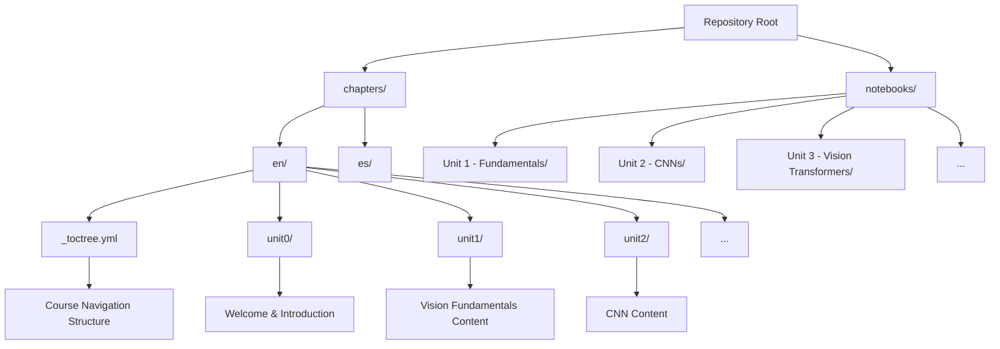
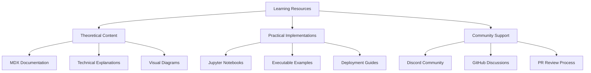
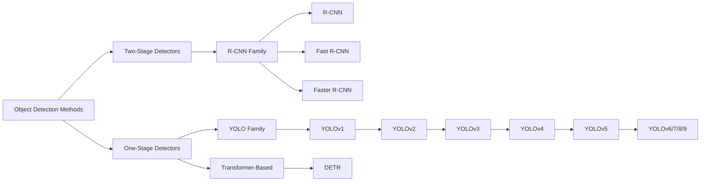
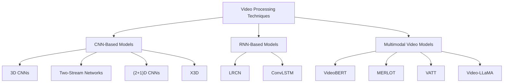
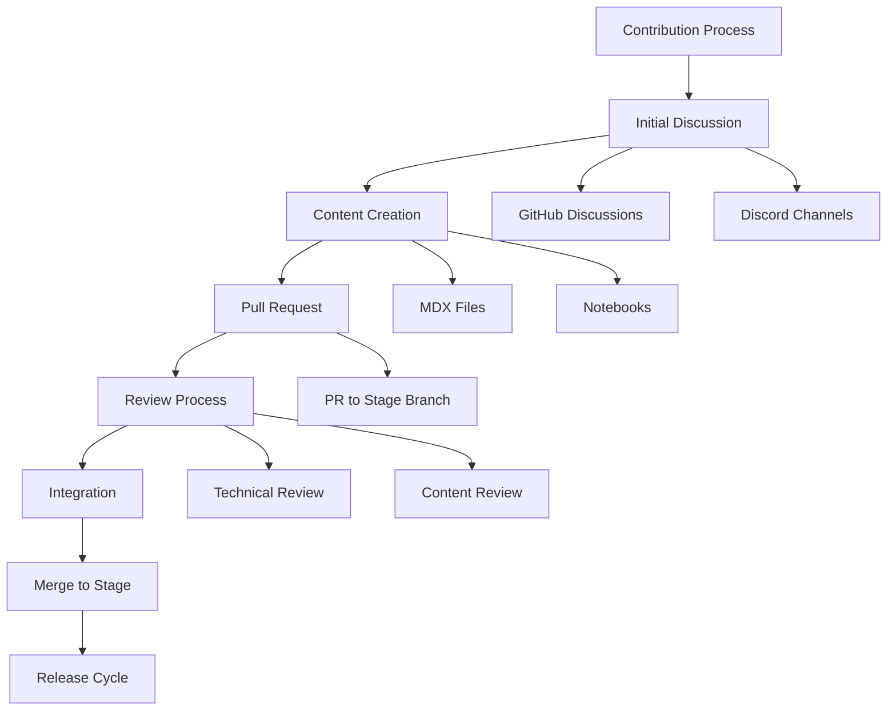

<!-- source: DeepWiki mcp.deepwiki.com · repo huggingface/computer-vision-course · page 1 Computer Vision Course Overview · fetched 2026-10-26 -->

# Computer Vision Course Overview

Relevant source files

The following files were used as context for generating this wiki page:

- [CONTRIBUTING.md](CONTRIBUTING.md)
- [README.md](README.md)
- [chapters/en/_toctree.yml](chapters/en/_toctree.yml)
- [chapters/en/unit0/welcome/welcome.mdx](chapters/en/unit0/welcome/welcome.mdx)
- [chapters/en/unit2/cnns/yolo.mdx](chapters/en/unit2/cnns/yolo.mdx)
- [chapters/en/unit7/video-processing/cnn-based-video-model.mdx](chapters/en/unit7/video-processing/cnn-based-video-model.mdx)
- [chapters/en/unit7/video-processing/multimodal-based-video-models.mdx](chapters/en/unit7/video-processing/multimodal-based-video-models.mdx)
- [chapters/en/unit7/video-processing/rnn-based-video-models.mdx](chapters/en/unit7/video-processing/rnn-based-video-models.mdx)
- [chapters/en/unit8/monocular_depth_estimation.mdx](chapters/en/unit8/monocular_depth_estimation.mdx)
- [chapters/es/unit0/welcome/TableOfContents.mdx](chapters/es/unit0/welcome/TableOfContents.mdx)
- [chapters/es/unit0/welcome/welcome.mdx](chapters/es/unit0/welcome/welcome.mdx)

This document provides a comprehensive overview of the Computer Vision Course repository hosted at https://github.com/huggingface/computer-vision-course. This community-driven educational resource covers a wide range of computer vision topics from fundamentals to advanced techniques. The purpose of this overview is to explain the repository's structure, learning objectives, and how content is organized.

For information about certification and learning paths, see [Certification and Learning Path](#1.2).

## Repository Purpose and Structure

The Computer Vision Course is a comprehensive educational resource developed collaboratively by over 60 contributors from the Hugging Face Computer Vision community. The course is designed to provide both theoretical knowledge and practical implementations, making complex computer vision concepts accessible to learners of various skill levels.

### Course Organization Diagram

```mermaid
graph TD
    A["Computer Vision Course"] --> B["Course Units"]
    A --> C["Practical Resources"]
    A --> D["Community System"]
    
    B --> B1["Unit 1: Fundamentals"]
    B --> B2["Unit 2: CNNs"]
    B --> B3["Unit 3: Vision Transformers"]
    B --> B4["Unit 4: Multimodal Models"]
    B --> B5["Unit 5: Generative Models"]
    B --> B6["Unit 6: Basic CV Tasks"]
    B --> B7["Unit 7: Video Processing"]
    B --> B8["Unit 8: 3D Vision"]
    B --> B9["Unit 9: Model Optimization"]
    B --> B10["Unit 10: Synthetic Data"]
    B --> B11["Unit 11: Zero-Shot Vision"]
    B --> B12["Unit 12: Ethics & Biases"]
    B --> B13["Unit 13: Outlook"]
    
    C --> C1["Jupyter Notebooks"]
    C --> C2["Code Examples"]
    C --> C3["Model Implementation Guides"]
    
    D --> D1["GitHub Contribution Flow"]
    D --> D2["Discord Community"]
    D --> D3["Documentation System"]
```

Sources: 
- `README.md`
- `chapters/en/_toctree.yml`
- `chapters/en/unit0/welcome/welcome.mdx`

## Course Content Structure

The course content is organized into 13 distinct units, each focusing on specific aspects of computer vision. The repository follows a logical file structure that maps to these units.

### Repository Structure Diagram

Sources:
- `README.md`
- `chapters/en/_toctree.yml`

### Unit Overview

The following table provides a comprehensive overview of all course units and their primary content focus:

| Unit | Title | Key Topics |
|------|-------|------------|
| 1 | Fundamentals | Vision basics, image formation, preprocessing, feature extraction |
| 2 | Convolutional Neural Networks | CNN architectures (VGG, GoogLeNet, MobileNet, ResNet), YOLO for object detection |
| 3 | Vision Transformers | ViT, Swin, DETR, segmentation, knowledge distillation |
| 4 | Multimodal Models | Text-vision integration, CLIP, multimodal tasks |
| 5 | Generative Models | VAEs, GANs, diffusion models, Stable Diffusion |
| 6 | Basic CV Tasks | Object detection, image segmentation |
| 7 | Video Processing | Video fundamentals, temporal models, multimodal approaches |
| 8 | 3D Vision | Depth estimation, novel view synthesis, NeRFs |
| 9 | Model Optimization | Deployment strategies, compression, optimized inference |
| 10 | Synthetic Data Creation | Data generation techniques, synthetic datasets |
| 11 | Zero Shot Computer Vision | Generalization, transfer learning |
| 12 | Ethics and Biases | Ethical considerations, bias identification and mitigation |
| 13 | Outlook | Emerging architectures, future trends |

Sources:
- `chapters/en/_toctree.yml`
- `README.md`

## Learning Resources

The course provides multiple types of learning resources to accommodate different learning styles and needs:

### Resource Types

Sources:
- `chapters/en/unit0/welcome/welcome.mdx`
- `chapters/es/unit0/welcome/TableOfContents.mdx`
- `CONTRIBUTING.md`

### Notebooks and Practical Implementations

The course includes numerous Jupyter notebooks that demonstrate practical implementations of the theoretical concepts. These notebooks are organized by unit and accessible through both GitHub and Google Colab.

Examples of key notebooks include:
- Transfer Learning with CNNs
- Fine-tuning Vision Transformers for object detection
- Image classification with CLIP
- Synthetic data generation
- Model optimization techniques

Sources:
- `chapters/es/unit0/welcome/TableOfContents.mdx`

## Technical Focus Areas

The course places particular emphasis on several key technical areas within computer vision. These areas represent core competencies that learners will develop throughout the course.

### Object Detection Evolution

One of the central technical topics is object detection, with particular emphasis on the YOLO (You Only Look Once) family of models:

Sources:
- `chapters/en/unit2/cnns/yolo.mdx:9-270`

### Video Processing Approaches

The course also covers various approaches to video processing, which extends beyond static image analysis:

Sources:
- `chapters/en/unit7/video-processing/cnn-based-video-model.mdx`
- `chapters/en/unit7/video-processing/rnn-based-video-models.mdx`
- `chapters/en/unit7/video-processing/multimodal-based-video-models.mdx`

## Community Contribution System

The Computer Vision Course is a community-driven project that encourages contributions from individuals with diverse backgrounds and expertise.

### Contribution Workflow

Sources:
- `CONTRIBUTING.md`
- `README.md`

## Prerequisites and Target Audience

The course is designed to be accessible to learners with some programming experience in Python and basic familiarity with machine learning concepts. Specific prerequisites include:

- Python programming knowledge
- Understanding of transformers, machine learning, and neural networks
- Familiarity with pre-processing techniques (beneficial but not required)

The course targets a diverse audience, including:
- Students learning computer vision
- Machine learning practitioners expanding into vision
- Researchers exploring specific computer vision domains
- Developers implementing vision applications

Sources:
- `chapters/en/unit0/welcome/welcome.mdx:69-72`

## Technical Implementation Features

The course content utilizes several key technical features to enhance the learning experience:

1. **MDX Documentation**: Content is written in MDX format, allowing for rich interactive elements
2. **Code Integration**: Code snippets and examples are directly integrated into the documentation
3. **Visualizations**: Diagrams and visualizations illustrate complex concepts
4. **Interactive Components**: Support for framework-specific code toggles and interactive demos
5. **Mathematical Notation**: LaTeX support for mathematical formulas

The repository is organized to facilitate both content creation and consumption, with a clear separation between theoretical content and practical implementations.

Sources:
- `CONTRIBUTING.md:36-97`

## Conclusion

The Computer Vision Course serves as a comprehensive resource for learning computer vision concepts and techniques. Through its structured approach, diverse content types, and community-driven development, it provides an accessible path for learners to gain both theoretical knowledge and practical skills in this rapidly evolving field.

The course continues to evolve with contributions from the community, ensuring that the content remains relevant and up-to-date with the latest developments in computer vision research and applications.

Sources:
- `README.md`
- `chapters/en/unit0/welcome/welcome.mdx`

---

