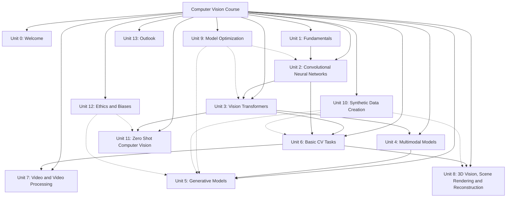
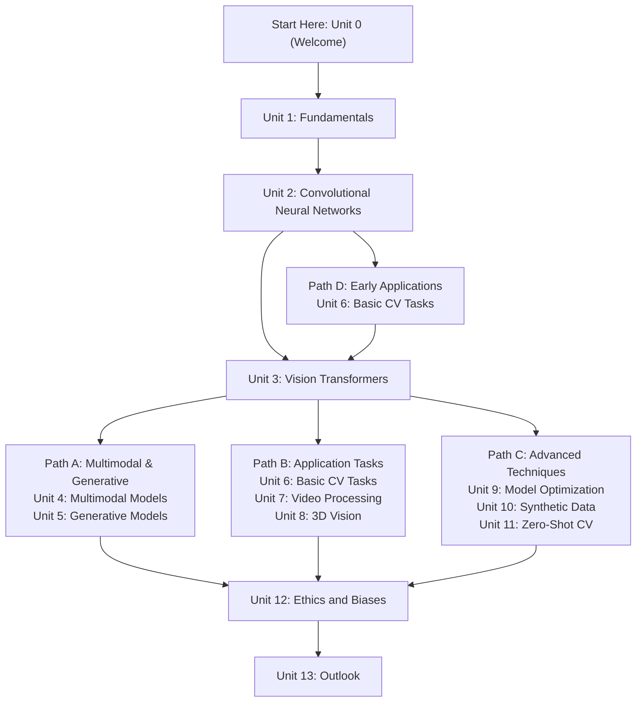

<!-- source: DeepWiki mcp.deepwiki.com · repo huggingface/computer-vision-course · page 1.1 Course Organization · fetched 2026-10-26 -->

# Course Organization

Relevant source files

The following files were used as context for generating this wiki page:

- [CONTRIBUTING.md](CONTRIBUTING.md)
- [README.md](README.md)
- [chapters/en/_toctree.yml](chapters/en/_toctree.yml)
- [chapters/en/unit0/welcome/welcome.mdx](chapters/en/unit0/welcome/welcome.mdx)
- [chapters/en/unit2/cnns/yolo.mdx](chapters/en/unit2/cnns/yolo.mdx)
- [chapters/en/unit7/video-processing/cnn-based-video-model.mdx](chapters/en/unit7/video-processing/cnn-based-video-model.mdx)
- [chapters/en/unit7/video-processing/multimodal-based-video-models.mdx](chapters/en/unit7/video-processing/multimodal-based-video-models.mdx)
- [chapters/en/unit7/video-processing/rnn-based-video-models.mdx](chapters/en/unit7/video-processing/rnn-based-video-models.mdx)
- [chapters/en/unit8/monocular_depth_estimation.mdx](chapters/en/unit8/monocular_depth_estimation.mdx)

## Purpose and Scope

This document provides a comprehensive overview of how the Computer Vision Course is structured into units and serves as a guide to navigate through the course content. It outlines the modular organization of the curriculum, explains the relationships between different units, and offers insights into the progression of topics from fundamentals to advanced concepts. For information about certification requirements and detailed learning paths, see [Certification and Learning Path](#1.2).

Sources: [chapters/en/_toctree.yml:1-211](), [README.md:1-45]()

## Course Structure Overview

The Computer Vision Course is organized into 14 units, starting from foundational concepts and progressively covering more advanced topics. Each unit builds upon knowledge from previous units while introducing new concepts and techniques.

Sources: [chapters/en/_toctree.yml:1-211](), [README.md:7-22](), [chapters/en/unit0/welcome/welcome.mdx:60-90]()

## Detailed Unit Descriptions

### Unit 0: Welcome

An introduction to the computer vision course, explaining its goals, structure, and how to engage with the community. This unit covers prerequisites, certification requirements, and provides an overview of what to expect throughout the course.

### Unit 1: Fundamentals of Computer Vision

Covers essential concepts to get started with computer vision, including:
- The need for computer vision and its applications
- Image fundamentals and formation
- Pre-processing techniques
- Feature extraction and description
- Feature matching

This unit establishes the theoretical foundation necessary for understanding more advanced topics in subsequent units.

### Unit 2: Convolutional Neural Networks (CNNs)

Explores the fundamental architecture that revolutionized computer vision:
- General CNN architecture and key concepts
- Popular CNN models:
  - VGG
  - GoogLeNet
  - ResNet
  - MobileNet
  - ConvNext
- YOLO and object detection
- Transfer learning and fine-tuning techniques

### Unit 3: Vision Transformers

Introduces transformer-based approaches to computer vision:
- Vision Transformer (ViT) architecture
- Specialized transformer variants:
  - Swin Transformer
  - Convolutional Vision Transformer (CvT)
  - DINAT
  - MobileViT v2
- Object detection with transformers (DETR)
- Image segmentation with transformers
- Knowledge distillation techniques

### Unit 4: Multimodal Models

Explores models that combine vision with other modalities:
- Text-vision models
- Introduction to Vision Language Models (VLMs)
- CLIP and related models
- Multimodal text generation (BLIP)
- Multimodal object detection

### Unit 5: Generative Models

Covers techniques for generating visual content:
- Variational Autoencoders (VAEs)
- Generative Adversarial Networks (GANs)
- StyleGAN variants
- Diffusion models
- Stable Diffusion
- Control techniques for diffusion models
- Ethical considerations

### Unit 6: Basic Computer Vision Tasks

Focuses on fundamental tasks in computer vision:
- Object detection
- Image segmentation

### Unit 7: Video and Video Processing

Examines temporal aspects of visual data:
- Video processing fundamentals
- CNN-based video models
- RNN-based video models
- Transformer-based video models
- Multimodal video models

### Unit 8: 3D Vision, Scene Rendering and Reconstruction

Explores three-dimensional vision techniques:
- Camera models
- Depth estimation
- Stereo vision
- Novel view synthesis
- Neural Radiance Fields (NeRFs)

### Unit 9: Model Optimization

Covers techniques for optimizing models for deployment:
- Model compression methods
- Deployment considerations
- Tools and frameworks for optimization

### Unit 10: Synthetic Data Creation

Explores methods for generating synthetic training data:
- Synthetic datasets
- 3D rendering for data generation
- GAN-based synthetic data
- Diffusion model-based data generation
- Point clouds

### Unit 11: Zero Shot Computer Vision

Introduces techniques for models to recognize previously unseen classes:
- Zero-shot learning principles
- Transfer learning approaches

### Unit 12: Ethics and Biases

Addresses critical ethical considerations in computer vision:
- Ethics in AI
- Bias identification and mitigation
- Responsible development practices

### Unit 13: Outlook and Emerging Trends

Explores cutting-edge developments and future directions:
- Retention in Vision
- Hiera architecture
- Hyena models
- I-JEPA

Sources: [chapters/en/_toctree.yml:1-211](), [chapters/en/unit0/welcome/welcome.mdx:60-90]()

## Core Technologies and Relationships

The following diagram illustrates the relationships between key technologies covered throughout the course, showing how they build upon and relate to each other:

```mermaid
graph TD
    %% Core technologies
    CV["Computer Vision Technologies"] --> CNN["Convolutional Neural Networks"]
    CV --> VIT["Vision Transformers"]
    CV --> GM["Generative Models"]
    CV --> MM["Multimodal Models"]
    CV --> VID["Video Processing"]
    CV --> 3D["3D Vision"]
    
    %% CNN branch
    CNN --> VGG["VGG"]
    CNN --> GNET["GoogLeNet"]
    CNN --> RESNET["ResNet"]
    CNN --> MOBNET["MobileNet"]
    CNN --> CONVNEXT["ConvNext"]
    CNN --> YOLO["YOLO Series"]
    
    %% YOLO details
    YOLO --> YOLOv1["YOLOv1"]
    YOLOv1 --> YOLOv2["YOLOv2/YOLO9000"]
    YOLOv2 --> YOLOv3["YOLOv3"]
    YOLOv3 --> YOLOv4["YOLOv4"]
    YOLOv4 --> YOLOv5["YOLOv5"]
    YOLOv5 --> YOLOv8["YOLOv6/v7/v8/v9"]
    
    %% Vision Transformer branch
    VIT --> SWIN["Swin Transformer"]
    VIT --> CVT["Convolutional Vision Transformer"]
    VIT --> DINAT["Dilated Neighborhood Attention Transformer"]
    VIT --> MVIT["MobileViT"]
    VIT --> DETR["DEtection TRansformer"]
    VIT --> ONEFORMER["OneFormer"]
    VIT --> KD["Knowledge Distillation"]
    
    %% Multimodal branch
    MM --> CLIP["CLIP"]
    MM --> VLM["Vision Language Models"]
    CLIP --> BLIP["BLIP"]
    CLIP --> OWLVIT["OWL-ViT"]
    
    %% Generative Models branch
    GM --> VAE["Variational Autoencoders"]
    GM --> GAN["Generative Adversarial Networks"]
    GM --> DM["Diffusion Models"]
    
    GAN --> STYLEGAN["StyleGAN"]
    GAN --> CYCLEGAN["CycleGAN"]
    
    DM --> SD["Stable Diffusion"]
    
    %% Video Processing branch
    VID --> CNN_VID["CNN-Based Video Models"]
    VID --> RNN_VID["RNN-Based Video Models"]
    VID --> TRANS_VID["Transformer-Based Video Models"]
    VID --> MULTI_VID["Multimodal Video Models"]
    
    CNN_VID --> TWOSTREAM["Two-Stream Networks"]
    CNN_VID --> C3D["3D CNNs"]
    CNN_VID --> X3D["X3D"]
    
    RNN_VID --> LRCN["LRCN"]
    RNN_VID --> CONVLSTM["ConvLSTM"]
    
    MULTI_VID --> VBERT["VideoBERT"]
    MULTI_VID --> MERLOT["MERLOT"]
    MULTI_VID --> VATT["VATT"]
    MULTI_VID --> VLLAMA["Video-LLaMA"]
    
    %% 3D Vision branch
    3D --> STEREO["Stereo Vision"]
    3D --> DEPTH["Depth Estimation"]
    3D --> NVS["Novel View Synthesis"]
    3D --> NERF["Neural Radiance Fields"]
```

Sources: [chapters/en/unit2/cnns/yolo.mdx:208-246](), [chapters/en/unit7/video-processing/multimodal-based-video-models.mdx:1-133](), [chapters/en/unit7/video-processing/rnn-based-video-models.mdx:1-109](), [chapters/en/unit8/monocular_depth_estimation.mdx:1-40]()

## Course Progression and Learning Paths

The course is designed to accommodate different learning paths depending on your specific interests in computer vision. Here are the recommended progression paths:

Sources: [chapters/en/unit0/welcome/welcome.mdx:60-90]()

## Community-Driven Development

The Computer Vision Course is the result of collaborative work from over 60 contributors from the Hugging Face Computer Vision community. This community-driven approach has yielded a diverse and comprehensive curriculum.

### Contribution Structure

The course content is maintained through a structured contribution process, which ensures quality and consistency across all units:

| Role | Responsibility |
|------|----------------|
| Writers | Create the primary content for each unit |
| Reviewers | Verify technical accuracy and clarity |
| Organization Team | Coordinate the overall course structure and integration |

### Unit Contributors

Each unit was developed by a dedicated team of writers and reviewers, bringing diverse perspectives and expertise to the content. The full list of contributors for each unit can be found in the Welcome section of the course.

Sources: [chapters/en/unit0/welcome/welcome.mdx:91-164](), [README.md:22-44]()

## Course Materials and Resources

The course includes a variety of materials to support learning:

1. **Theory**: Detailed explanations of computer vision concepts with practical examples
2. **Hands-on Tutorials**: Jupyter notebooks for applying key computer vision models
3. **Coding Examples**: Code samples demonstrating implementation of various techniques
4. **Assignments**: Tasks required for certification completion

### Certification Requirements

To obtain certification, learners need to complete two main assignments:

1. Training/fine-tuning a model
2. Building and hosting an application on Hugging Face Spaces

For detailed certification requirements, please refer to the [Certification and Learning Path](#1.2) page.

Sources: [chapters/en/unit0/welcome/welcome.mdx:11-39]()

## Community Engagement

The course is supported by an active community on Discord where learners can:

- Engage in discussions about course content
- Request assistance with assignments
- Collaborate with fellow learners
- Connect with course contributors

Relevant Discord channels include:
- `#computer-vision`: General computer vision discussions
- `#cv-study-group`: Exchange ideas and ask questions
- `#3d`: Discussions specific to 3D computer vision
- `#cv-community-project`: Discussions specific to the course

Sources: [chapters/en/unit0/welcome/welcome.mdx:40-59](), [README.md:34-38]()

---

