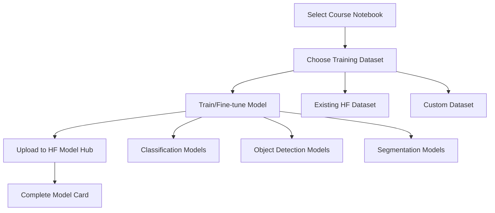
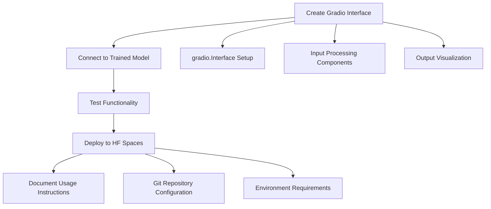
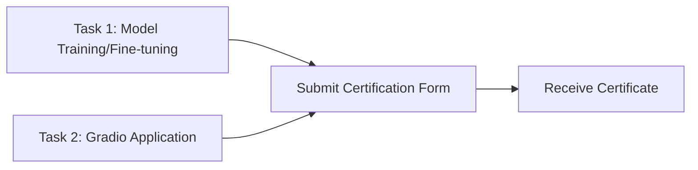
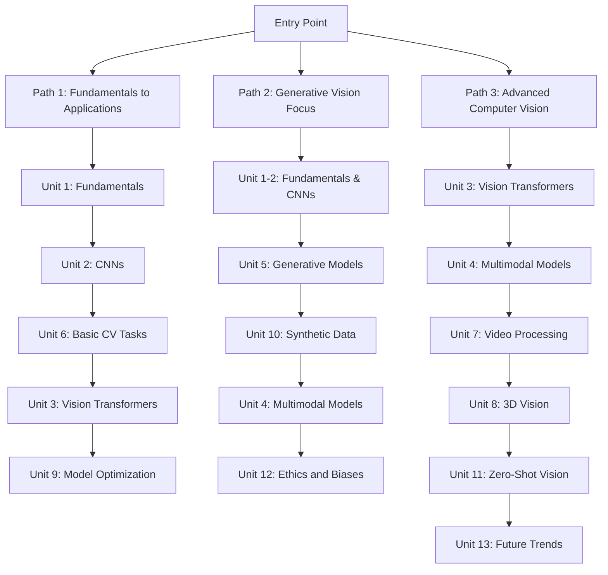
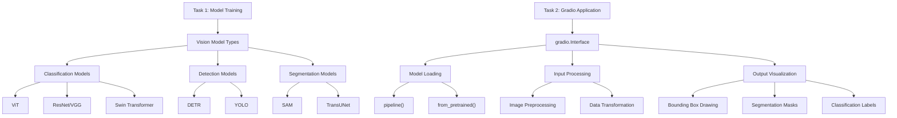

<!-- source: DeepWiki mcp.deepwiki.com · repo huggingface/computer-vision-course · page 1.2 Certification and Learning Path · fetched 2026-10-26 -->

# Certification and Learning Path

Relevant source files

The following files were used as context for generating this wiki page:

- [CONTRIBUTING.md](CONTRIBUTING.md)
- [README.md](README.md)
- [chapters/es/unit0/welcome/TableOfContents.mdx](chapters/es/unit0/welcome/TableOfContents.mdx)
- [chapters/es/unit0/welcome/welcome.mdx](chapters/es/unit0/welcome/welcome.mdx)

This document outlines the certification process for the Computer Vision Course and provides structured learning paths through the course material. It focuses specifically on how to earn a certificate by completing practical tasks and how to navigate the course content based on your background and interests.

## Certification Requirements

To earn certification in the Computer Vision Course, you must complete two technical tasks that demonstrate practical application of computer vision concepts and submit your work through the official certification form.

### Task 1: Train or Fine-tune a Model

For this task, you must train or fine-tune a computer vision model using the course notebooks and publish it to Hugging Face Hub.

**Requirements:**
1. Select an appropriate notebook from the course repository
2. Train or fine-tune a model on either:
   - An existing dataset from Hugging Face
   - Your own dataset uploaded to the Hugging Face Hub
3. Upload your trained model to Hugging Face with:
   - A properly completed model card
   - The dataset ID linked in the model card
   - Appropriate metadata and tags

**Model Training Certification Flow**

Sources: [chapters/es/unit0/welcome/welcome.mdx:17-28]()

### Task 2: Create a Gradio Application

For this task, you must build an interactive application using Gradio that demonstrates your trained model and deploy it on Hugging Face Spaces.

**Requirements:**
1. Create a Gradio interface for your vision model
2. Deploy the application to Hugging Face Spaces
3. Ensure the application is functional and intuitive
4. Include clear usage instructions in the README

**Gradio Application Deployment Flow**

Sources: [chapters/es/unit0/welcome/welcome.mdx:29-35]()

### Certification Submission Process

After completing both required tasks:

1. Fill out the [certification form](https://forms.gle/isiVSw59oiiHP6pN9) with:
   - Your name and contact details
   - Link to your model repository
   - Link to your Hugging Face Space

**Certification Process Overview**

Sources: [chapters/es/unit0/welcome/welcome.mdx:36-38]()

## Course Structure and Learning Paths

The Computer Vision Course consists of 13 units covering fundamentals through advanced topics. Based on your background and interests, you can follow different learning paths.

**Course Units and Recommended Learning Paths**

Sources: [README.md:7-21](), [chapters/es/unit0/welcome/welcome.mdx:74-88]()

### Path 1: Fundamentals to Applications (Beginner-Friendly)

This path provides a structured progression from core concepts to practical applications:

1. **Unit 1: Fundamentals** - Essential computer vision concepts and image processing
2. **Unit 2: Convolutional Neural Networks** - CNN architectures and transfer learning
3. **Unit 6: Basic CV Tasks** - Classification, detection, and segmentation
4. **Unit 3: Vision Transformers** - Advanced vision models
5. **Unit 9: Model Optimization** - Deployment and optimization techniques

This path is ideal for beginners and provides all necessary skills for certification tasks.

### Path 2: Generative and Multimodal Focus

For those interested in generative models and multimodal approaches:

1. **Units 1-2: Fundamentals and CNNs** - Core concepts review
2. **Unit 5: Generative Models** - GANs, VAEs, and diffusion models
3. **Unit 10: Synthetic Data Creation** - Generating synthetic training data
4. **Unit 4: Multimodal Models** - Text-image models like CLIP
5. **Unit 12: Ethics and Biases** - Ethical considerations in generative AI

This path is suited for those interested in generative AI applications and multimodal systems.

### Path 3: Advanced Computer Vision Systems

For practitioners with existing computer vision experience:

1. **Unit 3: Vision Transformers** - Transformer architectures for vision
2. **Unit 4: Multimodal Models** - Vision-language models
3. **Unit 7: Video Processing** - Temporal modeling and video understanding
4. **Unit 8: 3D Vision** - 3D reconstruction, NeRFs, novel view synthesis
5. **Unit 11: Zero-Shot Vision** - Transfer learning and generalization
6. **Unit 13: Future Trends** - Emerging architectures and research

This path focuses on cutting-edge techniques for experienced practitioners.

## Recommended Notebooks for Certification Tasks

The following notebooks are particularly well-suited for completing the certification tasks:

### Classification Models

| Notebook | Description | Path |
|----------|-------------|------|
| Transfer Learning with VGG19 | Fine-tuning VGG19 | [notebooks/Unit 2 - Convolutional Neural Networks/transfer_learning_vgg19.ipynb]() |
| LoRA Fine-tuning | Parameter-efficient fine-tuning | [notebooks/Unit 3 - Vision Transformers/LoRA-Image-Classification.ipynb]() |
| Multilabel Classification | Fine-tuning for multiple labels | [notebooks/Unit 3 - Vision Transformers/fine-tuning-multilabel-image-classification.ipynb]() |

### Object Detection Models

| Notebook | Description | Path |
|----------|-------------|------|
| DETR | Detection Transformer implementation | [notebooks/Unit 3 - Vision Transformers/DETR.ipynb]() |
| Vision Transformer Object Detection | Fine-tuning for detection | [notebooks/Unit 3 - Vision Transformers/Fine-tuning Vision Transformers for Object detection.ipynb]() |

### Segmentation Models

| Notebook | Description | Path |
|----------|-------------|------|
| Segmentation Transfer Learning | Adapting pre-trained models | [notebooks/Unit 3 - Vision Transformers/transfer-learning-segmentation.ipynb]() |
| SAM Fine-tuning | Customizing Segment Anything | [notebooks/Unit 6 - Basic CV Tasks/Fine_tune_SAM_(Segment_Anything_Model)_on_Custom_Dataset.ipynb]() |

Sources: [chapters/es/unit0/welcome/TableOfContents.mdx:7-45]()

## Technical Components for Certification Tasks

The following diagram illustrates how certification tasks map to specific technical components within the codebase:

**Certification Tasks to Technical Components Mapping**

Sources: [chapters/es/unit0/welcome/welcome.mdx:17-35](), [chapters/es/unit0/welcome/TableOfContents.mdx:11-28]()

## Community Support Resources

The Computer Vision Course is supported by a community of over 60 contributors. To enhance your learning experience:

1. Join the [Hugging Face Discord server](http://hf.co/join/discord)
2. Participate in the `#cv-community-project` channel for course-specific discussions
3. Explore the `#computer-vision` and `#3d` channels for broader CV topics
4. Connect with course creators and fellow learners for collaboration and feedback

Sources: [README.md:33-44](), [chapters/es/unit0/welcome/welcome.mdx:40-57]()

---

