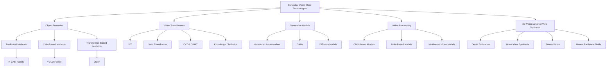
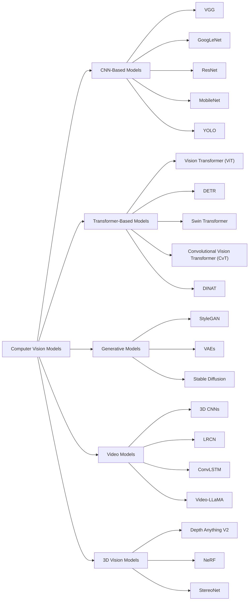
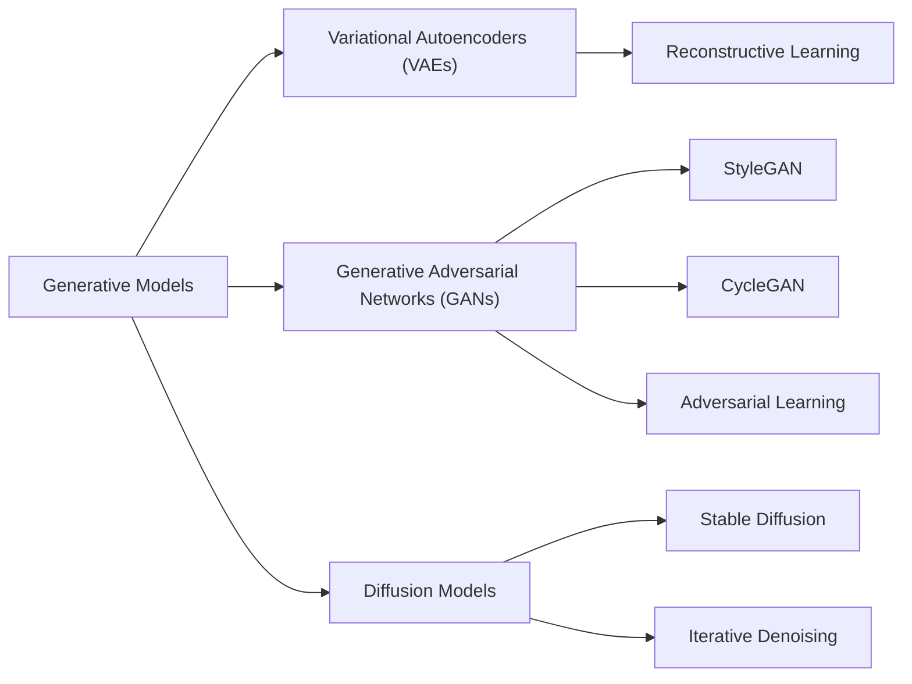
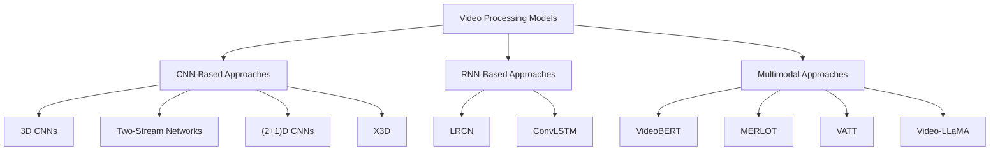
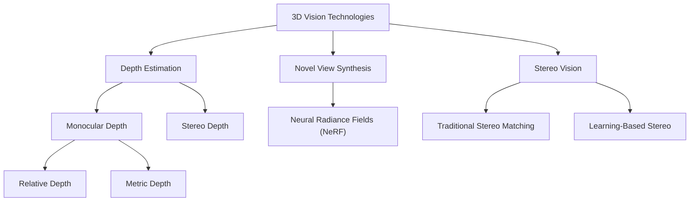

<!-- source: DeepWiki mcp.deepwiki.com · repo huggingface/computer-vision-course · page 2 Core Computer Vision Technologies · fetched 2026-10-26 -->

# Core Computer Vision Technologies

Relevant source files

The following files were used as context for generating this wiki page:

- [chapters/en/_toctree.yml](chapters/en/_toctree.yml)
- [chapters/en/unit0/welcome/TableOfContents.mdx](chapters/en/unit0/welcome/TableOfContents.mdx)
- [chapters/en/unit0/welcome/welcome.mdx](chapters/en/unit0/welcome/welcome.mdx)
- [chapters/en/unit1/chapter1/applications.mdx](chapters/en/unit1/chapter1/applications.mdx)
- [chapters/en/unit1/chapter1/definition.mdx](chapters/en/unit1/chapter1/definition.mdx)
- [chapters/en/unit1/chapter1/motivation.mdx](chapters/en/unit1/chapter1/motivation.mdx)
- [chapters/en/unit1/feature-extraction/feature-matching.mdx](chapters/en/unit1/feature-extraction/feature-matching.mdx)
- [chapters/en/unit1/feature-extraction/feature_description.mdx](chapters/en/unit1/feature-extraction/feature_description.mdx)
- [chapters/en/unit1/feature-extraction/real-world-applications.mdx](chapters/en/unit1/feature-extraction/real-world-applications.mdx)
- [chapters/en/unit1/image_and_imaging/extension-image.mdx](chapters/en/unit1/image_and_imaging/extension-image.mdx)
- [chapters/en/unit2/cnns/yolo.mdx](chapters/en/unit2/cnns/yolo.mdx)
- [chapters/en/unit7/video-processing/cnn-based-video-model.mdx](chapters/en/unit7/video-processing/cnn-based-video-model.mdx)
- [chapters/en/unit7/video-processing/multimodal-based-video-models.mdx](chapters/en/unit7/video-processing/multimodal-based-video-models.mdx)
- [chapters/en/unit7/video-processing/rnn-based-video-models.mdx](chapters/en/unit7/video-processing/rnn-based-video-models.mdx)
- [chapters/en/unit8/monocular_depth_estimation.mdx](chapters/en/unit8/monocular_depth_estimation.mdx)
- [notebooks/Unit 3 - Vision Transformers/DETR.ipynb](notebooks/Unit 3 - Vision Transformers/DETR.ipynb)

This document provides an overview of the fundamental computer vision technologies covered in the course repository. It serves as a guide to understanding the key architectures, approaches, and techniques that form the backbone of modern computer vision systems.

For information about specific implementations and practical aspects of these technologies, see [Implementation Details](#3). For ethical considerations related to these technologies, see [Applications and Ethical Considerations](#4).

## Overview of Core Technologies

Computer vision encompasses a diverse set of technologies that enable machines to interpret and understand visual data. The core technologies covered in this course include:

Sources: [chapters/en/_toctree.yml:29-144](), [chapters/en/unit2/cnns/yolo.mdx:1-274](), [chapters/en/unit7/video-processing/multimodal-based-video-models.mdx:1-132](), [chapters/en/unit7/video-processing/rnn-based-video-models.mdx:1-109](), [chapters/en/unit8/monocular_depth_estimation.mdx:1-250]()

## Technology Stack and Implementation Architecture

The following diagram illustrates how the core computer vision technologies translate to the specific implementations covered in the course:

Sources: [chapters/en/_toctree.yml:29-158](), [chapters/en/unit2/cnns/yolo.mdx:61-249](), [chapters/en/unit7/video-processing/rnn-based-video-models.mdx:21-109](), [chapters/en/unit8/monocular_depth_estimation.mdx:120-390]()

## Object Detection

Object detection is a fundamental computer vision task that focuses on identifying and localizing objects within images. It combines classification (what objects are present) with localization (where they are in the image).

### Key Architectures and Approaches

Object detection technologies have evolved from traditional two-stage detectors to modern single-stage and transformer-based approaches:

| Architecture Type | Key Examples | Characteristics |
|-------------------|--------------|-----------------|
| Two-Stage Detectors | R-CNN, Fast R-CNN, Faster R-CNN | First generate region proposals, then classify objects within these regions |
| One-Stage Detectors | YOLO family (v1-v9), SSD | Process the entire image in a single pass, making predictions directly |
| Transformer-Based | DETR | Use attention mechanisms to eliminate the need for hand-designed components like anchor boxes |

#### Evolution of YOLO Architecture

The YOLO (You Only Look Once) architecture represents a significant advancement in object detection, offering real-time performance with high accuracy. Its evolution spans multiple versions:

```mermaid
graph TB
    YOLOv1["YOLOv1 (2015)"]
    YOLOv2["YOLOv2/YOLO9000 (2016)"]
    YOLOv3["YOLOv3 (2018)"]
    YOLOv4["YOLOv4 (2020)"]
    YOLOv5["YOLOv5 (2020)"]
    YOLOv6["YOLOv6 (2022)"]
    YOLOv7["YOLOv7 (2022)"]
    YOLOv8["YOLOv8 (2023)"]
    YOLOv9["YOLOv9 (2024)"]
    
    YOLOv1 --> YOLOv2
    YOLOv2 --> YOLOv3
    YOLOv3 --> YOLOv4
    YOLOv4 --> YOLOv5
    YOLOv5 --> YOLOv6
    YOLOv6 --> YOLOv7
    YOLOv7 --> YOLOv8
    YOLOv8 --> YOLOv9
    
    subgraph "Key Innovations"
    YOLOv1["YOLOv1: Single Network Approach"]
    YOLOv2["YOLOv2: Anchor Boxes, Darknet-19"]
    YOLOv3["YOLOv3: Multi-Scale Detection, Darknet-53"]
    YOLOv4["YOLOv4: CSPDarknet53, Bag-of-Freebies"]
    YOLOv5["YOLOv5: PyTorch Implementation, Auto-anchors"]
    YOLOv6["YOLOv6: Rep-PANs, Quantization"]
    YOLOv7["YOLOv7: Extended Bag-of-Freebies"]
    YOLOv8["YOLOv8: Anchor-Free Approach"]
    YOLOv9["YOLOv9: Programmable Gradient Information"]
    end
```

Sources: [chapters/en/unit2/cnns/yolo.mdx:60-250]()

YOLO divides an image into a grid and predicts objects and their positions in a single forward pass, making it significantly faster than two-stage detection methods. The architecture consists of:

1. **Backbone Network**: Extracts features from the input image (evolved from custom architectures to Darknet variants)
2. **Neck**: Aggregates features across different scales
3. **Head**: Makes the final predictions (bounding boxes, confidence scores, class probabilities)

The success of YOLO has led to numerous variations and improvements over time, with each version addressing limitations of previous iterations and incorporating new techniques from the field.

For more detailed information on object detection techniques, especially YOLO and its variants, see [Object Detection](#2.1).

Sources: [chapters/en/unit2/cnns/yolo.mdx:61-273]()

## Vision Transformers

Vision Transformers represent a paradigm shift in computer vision, adapting the transformer architecture (originally designed for natural language processing) to visual tasks. These models replace the traditional convolutional operation with self-attention mechanisms to process image data.

### Key Vision Transformer Architectures

| Architecture | Key Characteristics | Primary Applications |
|--------------|---------------------|----------------------|
| Vision Transformer (ViT) | Divides images into patches, processes them as token sequences | Image classification |
| Swin Transformer | Hierarchical structure with shifted windows for attention | Dense prediction tasks (detection, segmentation) |
| CvT | Combines convolution and transformer components | Image classification, object detection |
| DINAT | Uses dilated neighborhood attention | High-resolution image processing |
| DETR | End-to-end object detection without hand-designed components | Object detection |

### ViT Architecture Overview

Vision Transformer (ViT) processes images by:
1. Dividing the input image into fixed-size patches
2. Linearly embedding these patches
3. Adding position embeddings
4. Processing the sequence with standard transformer encoder blocks

This approach has proven highly effective for image classification when trained on sufficient data, often outperforming CNN-based approaches.

For more detailed information on Vision Transformers and their applications in classification, detection, and segmentation, see [Vision Transformers](#2.2).

Sources: [chapters/en/_toctree.yml:49-70](), [notebooks/Unit 3 - Vision Transformers/DETR.ipynb:97-117]()

## Generative Models

Generative models in computer vision are designed to create new visual content by learning the underlying distribution of training data. These models have revolutionized tasks such as image synthesis, style transfer, and image-to-image translation.

### Key Generative Architectures

Sources: [chapters/en/_toctree.yml:95-114]()

#### Comparison of Generative Approaches

| Model Type | Working Principle | Strengths | Limitations |
|------------|-------------------|-----------|------------|
| VAEs | Encode inputs to a latent distribution, then decode to reconstruct | Good for learning compressed representations | Often produce blurry outputs |
| GANs | Generator and discriminator networks compete in adversarial training | Can generate highly realistic images | Training instability, mode collapse |
| Diffusion Models | Gradually add noise to data, then learn to reverse the process | State-of-the-art image quality, controllable generation | Computationally intensive inference |

These generative models serve as the foundation for numerous applications including text-to-image generation, image inpainting, style transfer, and synthetic data creation.

For more detailed information on generative models and their implementations, see [Generative Models](#2.3).

Sources: [chapters/en/_toctree.yml:95-114]()

## Video Processing

Video processing extends computer vision techniques to the temporal dimension, analyzing sequences of images to understand motion and temporal relationships.

### Video Processing Approaches

Sources: [chapters/en/unit7/video-processing/cnn-based-video-model.mdx:9-124](), [chapters/en/unit7/video-processing/rnn-based-video-models.mdx:21-109](), [chapters/en/unit7/video-processing/multimodal-based-video-models.mdx:23-132]()

#### Key Video Processing Architectures

| Architecture Type | Examples | Approach |
|-------------------|----------|----------|
| CNN-Based | 3D CNNs, Two-Stream Networks, (2+1)D ResNets, X3D | Extend convolutional operations to the temporal dimension |
| RNN-Based | LRCN, ConvLSTM | Use recurrent architectures to model temporal dependencies |
| Multimodal | VideoBERT, VATT, Video-LLaMA | Integrate multiple modalities (video, audio, text) |

**3D CNNs** extend 2D convolutions to process spatio-temporal data, capturing motion information directly from video sequences. **Two-Stream Networks** process spatial (appearance) and temporal (motion) information separately before fusion. **RNN-Based** approaches like LRCN and ConvLSTM are designed to handle sequential data, maintaining state information across frames.

**Multimodal Video Models** integrate different data types:
- Video-Text models (VideoBERT, MERLOT)
- Video-Audio-Text models (VATT, Video-LLaMA)
- Multi-modality integration (ImageBind)

For more detailed information on video processing techniques and architectures, see [Video Processing](#2.4).

Sources: [chapters/en/unit7/video-processing/cnn-based-video-model.mdx:9-134](), [chapters/en/unit7/video-processing/rnn-based-video-models.mdx:21-109](), [chapters/en/unit7/video-processing/multimodal-based-video-models.mdx:6-132]()

## 3D Vision and Novel View Synthesis

3D vision techniques aim to recover three-dimensional information from two-dimensional images, enabling depth perception, 3D reconstruction, and the ability to generate novel views of scenes.

### Key 3D Vision Technologies

Sources: [chapters/en/_toctree.yml:137-158](), [chapters/en/unit8/monocular_depth_estimation.mdx:1-390]()

#### Monocular Depth Estimation

Monocular depth estimation recovers depth information from a single image, a fundamentally challenging task due to the inherent ambiguity of 3D-to-2D projection. Modern approaches include:

1. **Relative Depth Estimation**: Predicts depth relationships (closer/farther) without absolute measurements
2. **Metric Depth Estimation**: Predicts actual distance values in real-world units

The state-of-the-art model in this area is Depth Anything V2, which uses:
- DPT architecture (based on Vision Transformers)
- DINOv2 encoder pre-trained with self-supervision
- Scale and shift invariant loss functions to handle diverse data

#### Neural Radiance Fields (NeRF)

NeRF represents scenes as continuous 5D functions that map 3D location and 2D viewing direction to color and density. This representation allows novel view synthesis - generating new perspectives of a scene from a set of input views.

For more detailed information on 3D vision techniques, depth estimation, and novel view synthesis, see [3D Vision and Novel View Synthesis](#2.5).

Sources: [chapters/en/unit8/monocular_depth_estimation.mdx:1-390]()

## Cross-Cutting Technologies and Connections

Several technologies and approaches span multiple areas of computer vision, creating connections between the core technologies:

### Transfer Learning and Fine-Tuning

Transfer learning is critical across all computer vision domains, allowing models pre-trained on large datasets to be adapted to specific tasks with limited data. This approach is applied in:

- Object detection: Pre-trained CNN backbones for YOLO models
- Vision Transformers: Fine-tuning ViT models for downstream tasks
- Generative models: Adapting pre-trained diffusion models for specific domains
- Video models: Leveraging image-based pre-training for video understanding

### Attention Mechanisms

Attention has become ubiquitous across computer vision models:

- Vision Transformers: Self-attention as the core operation
- Object Detection: DETR uses attention for object relationships
- Video Models: Temporal attention in video transformers
- Generative Models: Cross-attention in diffusion models for conditioning

### Multimodal Learning

The integration of multiple modalities is increasingly important:

- Image-Text: Vision-language models like CLIP
- Video-Audio-Text: Models like VATT and Video-LLaMA
- Cross-modal generation: Text-to-image models like Stable Diffusion

Sources: [chapters/en/unit7/video-processing/multimodal-based-video-models.mdx:6-132](), [chapters/en/_toctree.yml:71-94]()

## Real-World Applications

The core computer vision technologies covered in this course enable numerous real-world applications:

| Technology | Applications |
|------------|--------------|
| Object Detection | Autonomous vehicles, surveillance, retail analytics |
| Vision Transformers | Medical image analysis, satellite imagery, robotics |
| Generative Models | Content creation, data augmentation, entertainment |
| Video Processing | Action recognition, video surveillance, sports analytics |
| 3D Vision | Augmented reality, robotics, autonomous navigation |

For more detailed information on real-world applications and ethical considerations, see [Applications and Ethical Considerations](#4).

Sources: [chapters/en/unit1/chapter1/applications.mdx:1-99](), [chapters/en/unit1/chapter1/definition.mdx:1-67]()

## Conclusion

The core computer vision technologies covered in this course represent the foundation of modern visual AI systems. From traditional CNN-based architectures to cutting-edge transformer models and generative approaches, these technologies enable machines to interpret, analyze, and create visual content in increasingly sophisticated ways.

As the field continues to evolve, the boundaries between these technologies blur, with hybrid approaches combining the strengths of different techniques. Understanding these core technologies provides the foundation for exploring more specialized and advanced computer vision applications.

---

