<!-- source: DeepWiki mcp.deepwiki.com · repo huggingface/computer-vision-course · page 2.1 Object Detection · fetched 2026-10-26 -->

# Object Detection

Relevant source files

The following files were used as context for generating this wiki page:

- [chapters/en/_toctree.yml](chapters/en/_toctree.yml)
- [chapters/en/unit0/welcome/welcome.mdx](chapters/en/unit0/welcome/welcome.mdx)
- [chapters/en/unit2/cnns/yolo.mdx](chapters/en/unit2/cnns/yolo.mdx)
- [chapters/en/unit7/video-processing/cnn-based-video-model.mdx](chapters/en/unit7/video-processing/cnn-based-video-model.mdx)
- [chapters/en/unit7/video-processing/multimodal-based-video-models.mdx](chapters/en/unit7/video-processing/multimodal-based-video-models.mdx)
- [chapters/en/unit7/video-processing/rnn-based-video-models.mdx](chapters/en/unit7/video-processing/rnn-based-video-models.mdx)
- [chapters/en/unit8/monocular_depth_estimation.mdx](chapters/en/unit8/monocular_depth_estimation.mdx)
- [notebooks/Unit 3 - Vision Transformers/DETR.ipynb](notebooks/Unit 3 - Vision Transformers/DETR.ipynb)

This document provides a technical overview of object detection systems and architectures implemented in the Computer Vision Course. Object detection is a fundamental computer vision task that involves not only classifying objects in images but also accurately locating them through bounding box coordinates. For image classification without localization, see the Introduction to Convolutional Neural Networks section, and for image segmentation, see the Image Segmentation page in Unit 6.

## Introduction to Object Detection

Object detection combines two fundamental tasks:
1. **Classification** - Identifying what objects are present in the image
2. **Localization** - Determining where these objects are located via bounding boxes

Unlike image classification, which only outputs class labels for the entire image, object detection outputs both class labels and spatial coordinates for each detected object. This makes it significantly more challenging but also more useful for many real-world applications such as autonomous driving, surveillance, and robotics.

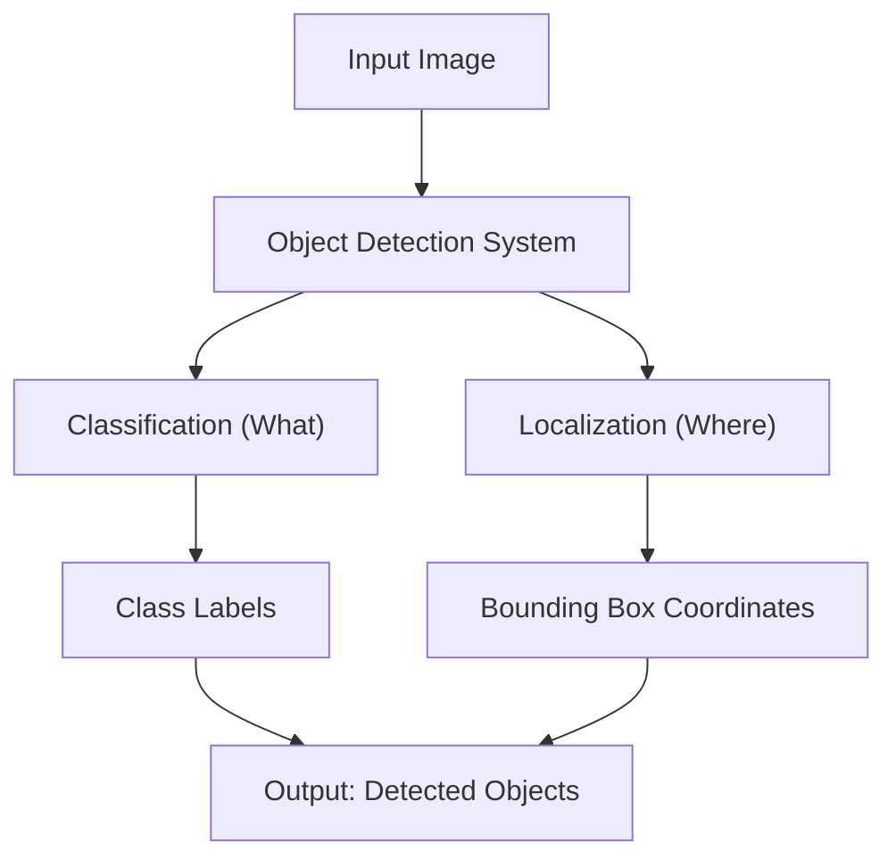

Sources: [chapters/en/unit2/cnns/yolo.mdx:5-6]()

## Object Detection Approaches

Object detection methodologies can be broadly categorized into three main approaches:

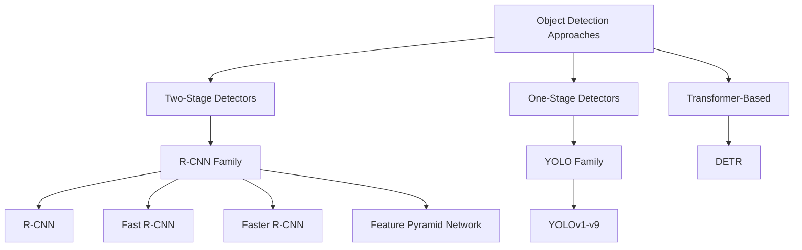

### Two-Stage Detectors
Two-stage detectors like the R-CNN family first generate region proposals (potential object locations) and then classify each proposed region. This approach tends to be more accurate but slower.

### One-Stage Detectors
One-stage detectors like YOLO (You Only Look Once) perform detection in a single forward pass, predicting bounding boxes and class probabilities directly. This approach is typically faster but historically has been less accurate than two-stage methods.

### Transformer-Based Detectors
More recently, transformer-based approaches like DETR (DEtection TRansformer) have been applied to object detection, leveraging attention mechanisms to capture global dependencies in the image.

Sources: [chapters/en/unit2/cnns/yolo.mdx:6-7](), [chapters/en/unit2/cnns/yolo.mdx:62-73]()

## R-CNN Family

### R-CNN (Region-based Convolutional Neural Networks)

R-CNN was one of the earliest deep learning-based object detection approaches, introduced in 2014. The architecture follows a multi-step process:

1. Use Selective Search algorithm to generate ~2000 region proposals
2. Extract CNN features from each proposed region
3. Classify regions using SVMs
4. Refine bounding box coordinates with regression

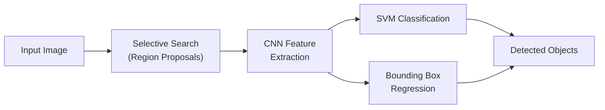

While groundbreaking, R-CNN is computationally expensive as it requires running the CNN for each of the ~2000 region proposals independently.

Sources: [chapters/en/unit2/cnns/yolo.mdx:10-27]()

### Fast R-CNN

Fast R-CNN improved upon R-CNN by processing the entire image once through a CNN and then extracting features for each region proposal from the shared feature map. Key improvements include:

- Single-stage training with multi-task loss (classification + bounding box regression)
- No disk storage required for feature caching
- Introduction of ROI (Region of Interest) pooling layer
- End-to-end training

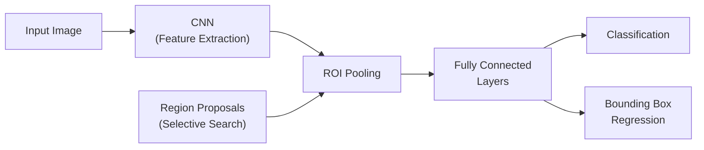

Fast R-CNN significantly improved both speed and accuracy compared to R-CNN.

Sources: [chapters/en/unit2/cnns/yolo.mdx:30-39]()

### Faster R-CNN

Faster R-CNN further improved the detection pipeline by replacing the Selective Search algorithm with a Region Proposal Network (RPN), making the entire system end-to-end trainable. The key innovation was:

- Introduction of RPN, which shares full-image convolutional features with the detection network
- End-to-end trainable system
- Significant speed improvement (90% faster than Fast R-CNN)

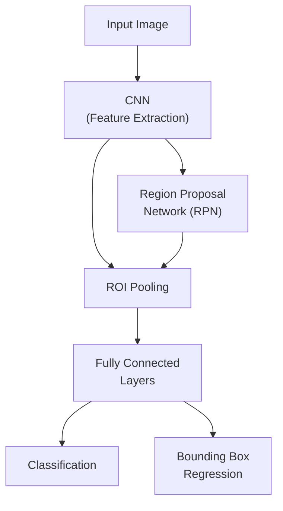

Faster R-CNN represented a significant milestone in object detection, combining high accuracy with reasonable speed.

Sources: [chapters/en/unit2/cnns/yolo.mdx:41-47]()

### Feature Pyramid Network (FPN)

Feature Pyramid Network is an enhancement that can be applied to detection architectures like Faster R-CNN. It addresses the challenge of detecting objects at different scales by creating a pyramid of feature maps:

- Creates a feature hierarchy from a single input image scale
- Combines low-resolution, semantically strong features with high-resolution features
- Uses top-down pathways and lateral connections to merge feature maps of different scales

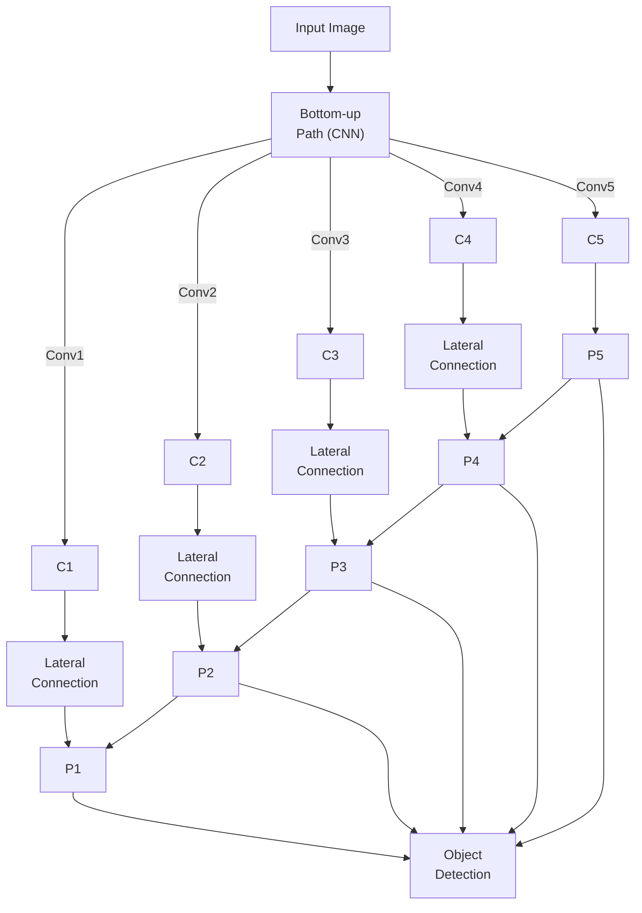

FPN has become a standard component in many state-of-the-art object detection systems.

Sources: [chapters/en/unit2/cnns/yolo.mdx:49-59]()

## YOLO Architecture

YOLO (You Only Look Once) revolutionized object detection by introducing a single-stage detection approach that is both fast and accurate. The key innovation of YOLO is treating detection as a regression problem, predicting bounding boxes and class probabilities directly from full images in a single evaluation.

### Core Concept: Grid-Based Detection

YOLO divides the input image into an S×S grid. Each grid cell is responsible for detecting objects whose centers fall within that cell.

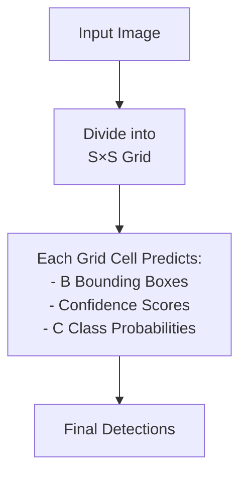

For each grid cell, YOLO predicts:
- B bounding boxes (each with x, y, w, h coordinates)
- Confidence scores for each box
- C conditional class probabilities

Sources: [chapters/en/unit2/cnns/yolo.mdx:74-96]()

### Confidence Score and Class Prediction

The confidence score reflects the likelihood of an object being present in the box and the accuracy of the box. It's defined as:

Confidence = P(Object) × IOU(predicted, truth)

Where IOU (Intersection over Union) measures the overlap between the predicted box and the ground truth.

Class probabilities are conditioned on the presence of an object in the grid cell:
P(Class_i | Object)

At test time, these components are combined to give class-specific confidence scores:
P(Class_i) × IOU(predicted, truth)

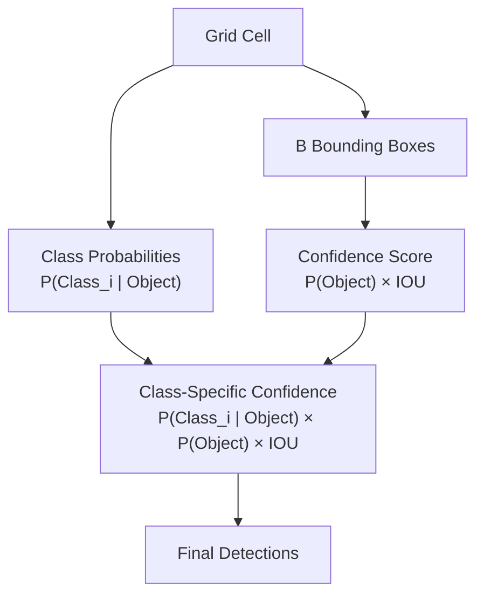

Sources: [chapters/en/unit2/cnns/yolo.mdx:81-103]()

### YOLO v1 Network Architecture

The original YOLOv1 architecture consists of:
- Input: 448×448 RGB image
- Output: 7×7×30 tensor (7×7 grid, each with 2 boxes and 20 class probabilities)
- 24 convolutional layers followed by 2 fully connected layers
- Final layer uses linear activation, all others use leaky ReLU

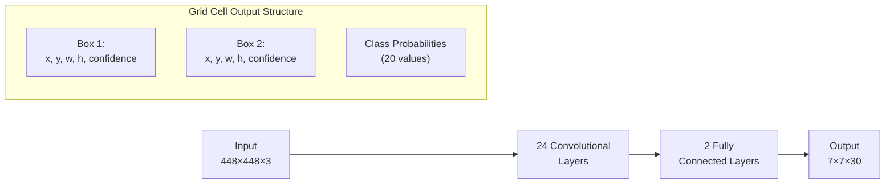

Sources: [chapters/en/unit2/cnns/yolo.mdx:108-124]()

### Training and Loss Function

YOLO is trained end-to-end using a custom loss function that balances several components:

1. **Localization Loss**: Error in bounding box coordinates
2. **Confidence Loss**: Error in predicting object presence
3. **Classification Loss**: Error in predicting class probabilities

The loss function includes special weighting to address:
- Different scales of bounding boxes (using square root of width and height)
- Imbalance between cells with and without objects
- Equal importance of localization and classification errors

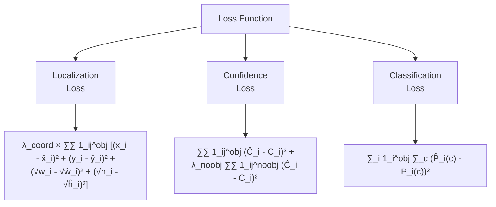

Sources: [chapters/en/unit2/cnns/yolo.mdx:125-197]()

### Inference and Non-Maximum Suppression

During inference, YOLO:
1. Passes the image through the network to get predictions
2. Filters out boxes with low confidence scores
3. Applies Non-Maximum Suppression (NMS) to eliminate redundant overlapping boxes

NMS works by:
1. Sorting all detection boxes by confidence
2. Taking the box with highest confidence and eliminating all other boxes with high overlap (IOU > threshold)
3. Repeating until no boxes remain

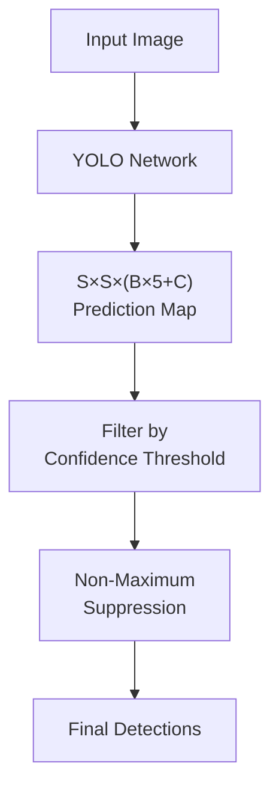

Sources: [chapters/en/unit2/cnns/yolo.mdx:198-206]()

## Evolution of YOLO

The YOLO architecture has evolved significantly since its initial release, with each version bringing improvements in accuracy, speed, and usability.

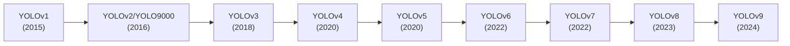

### YOLOv2 (2016)

Key improvements:
- Replaced backbone with Darknet-19
- Added batch normalization to all convolutional layers
- Introduced anchor boxes for better bounding box predictions
- Improved grid resolution to 13×13
- Maximum number of boxes: 13×13×5 = 845

Sources: [chapters/en/unit2/cnns/yolo.mdx:212-214]()

### YOLOv3 (2018)

Key improvements:
- Replaced backbone with Darknet-53
- Improved detection at multiple scales (13×13, 26×26, 52×52 grids)
- Increased the number of potential bounding boxes to 10,647
- Better handling of small objects

Sources: [chapters/en/unit2/cnns/yolo.mdx:214-216]()

### YOLOv4 (2020)

Key improvements:
- Replaced backbone with CSPDarknet53
- Optimized for efficient resource utilization
- Introduced "bag-of-freebies" - training optimizations that improve accuracy without increasing inference time
- Better data augmentation techniques

Sources: [chapters/en/unit2/cnns/yolo.mdx:217-220]()

### YOLOv5 (2020)

Key improvements:
- Translated from Darknet (C) to PyTorch
- Automated anchor detection mechanism (auto-anchors)
- Different model sizes for various hardware constraints (YOLOv5s, YOLOv5m, YOLOv5l, YOLOv5x)

Sources: [chapters/en/unit2/cnns/yolo.mdx:220-222]()

### YOLOv6 (2022)

Key improvements:
- Reparameterization using RepVGG technique
- Quantization of reparameterization-based detectors
- Consideration of different hardware capabilities
- New loss functions (Varifocal Loss, IoU Series Loss, Distribution Focal Loss)
- Knowledge distillation for improved accuracy

Sources: [chapters/en/unit2/cnns/yolo.mdx:223-231]()

### YOLOv7 (2022)

Key improvements:
- New "trainable bag-of-freebies"
- Coarse-to-fine lead-guided label assignment
- Gradient flow propagation paths for re-parameterized convolution
- "Extend" and "compound scaling" methods for real-time detection

Sources: [chapters/en/unit2/cnns/yolo.mdx:232-234]()

### YOLOv8 (2023)

Key improvements:
- Improved backbone and neck architecture
- Anchor-free approach for direct predictions
- Support for a wide range of vision tasks (classification, segmentation, pose estimation)
- Pre-trained models in various sizes (nano, small, medium, large, extra-large)
- Easy fine-tuning on custom datasets

Sources: [chapters/en/unit2/cnns/yolo.mdx:235-237]()

### YOLOv9 (2024)

Key improvements:
- Programmable gradient information (PGI) to handle various changes required by deep networks
- Generalized Efficient Layer Aggregation Network (GELAN) for better parameter utilization
- New state-of-the-art benchmarks on MS COCO challenge

Sources: [chapters/en/unit2/cnns/yolo.mdx:238-246]()

## YOLO Version Comparison

The following table summarizes the key differences between YOLO versions:

| Version | Year | Backbone | Key Innovations | Advantages |
|---------|------|----------|----------------|------------|
| YOLOv1  | 2015 | Custom CNN | Grid-based single-pass detection | Speed |
| YOLOv2  | 2016 | Darknet-19 | Anchor boxes, batch normalization | Improved accuracy |
| YOLOv3  | 2018 | Darknet-53 | Multi-scale detection | Better small object detection |
| YOLOv4  | 2020 | CSPDarknet53 | Bag-of-freebies, optimized training | Hardware adaptability |
| YOLOv5  | 2020 | Custom PyTorch | Auto-anchors, multiple model sizes | Ease of use, scalability |
| YOLOv6  | 2022 | RepVGG-based | Reparameterization, specialized loss functions | Industry optimization |
| YOLOv7  | 2022 | E-ELAN | Trainable bag-of-freebies, compound scaling | State-of-the-art performance |
| YOLOv8  | 2023 | Enhanced backbone | Anchor-free, multi-task capability | Versatility |
| YOLOv9  | 2024 | GELAN | Programmable gradient information | Improved parameter efficiency |

Sources: [chapters/en/unit2/cnns/yolo.mdx:247-251]()

## Summary

Object detection is a fundamental computer vision task that combines classification and localization. The field has evolved significantly over the years, from two-stage approaches like the R-CNN family to single-stage detectors like YOLO. The YOLO family of models, in particular, has seen rapid advancement, with each new version bringing improvements in accuracy, speed, and usability.

The key takeaways from this overview are:
1. Two-stage detectors (R-CNN family) prioritize accuracy but may be slower
2. One-stage detectors (YOLO family) offer a better speed-accuracy tradeoff
3. YOLO revolutionized object detection with its grid-based approach and single-pass detection
4. The evolution of YOLO (v1 through v9) demonstrates continuous innovation in the field
5. Modern object detection systems can achieve real-time performance while maintaining high accuracy

For practical implementations of object detection systems, refer to the notebooks in the repository, particularly those focusing on YOLO and DETR architectures.

Sources: [chapters/en/unit2/cnns/yolo.mdx](), [chapters/en/_toctree.yml:47-48]()

---

