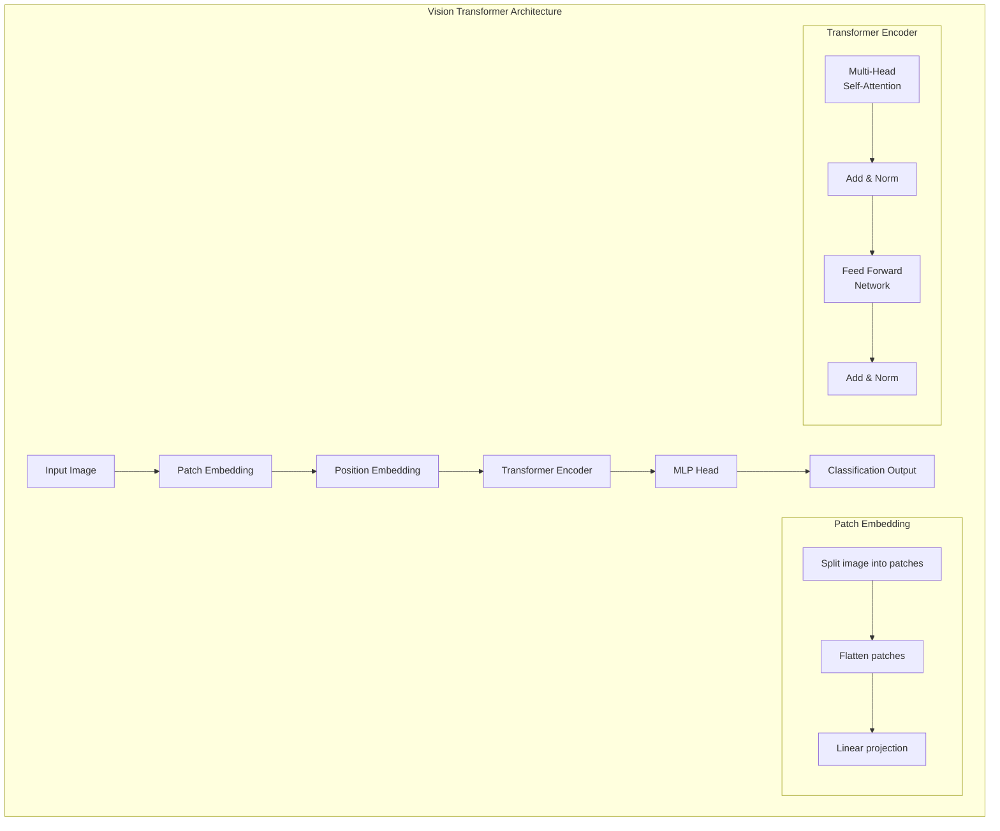
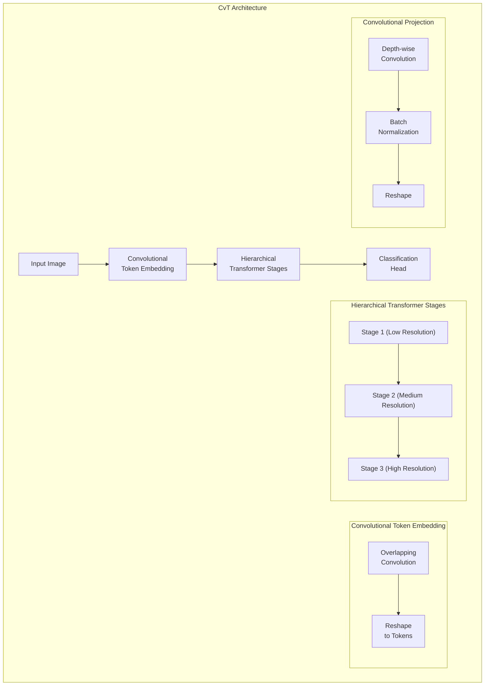
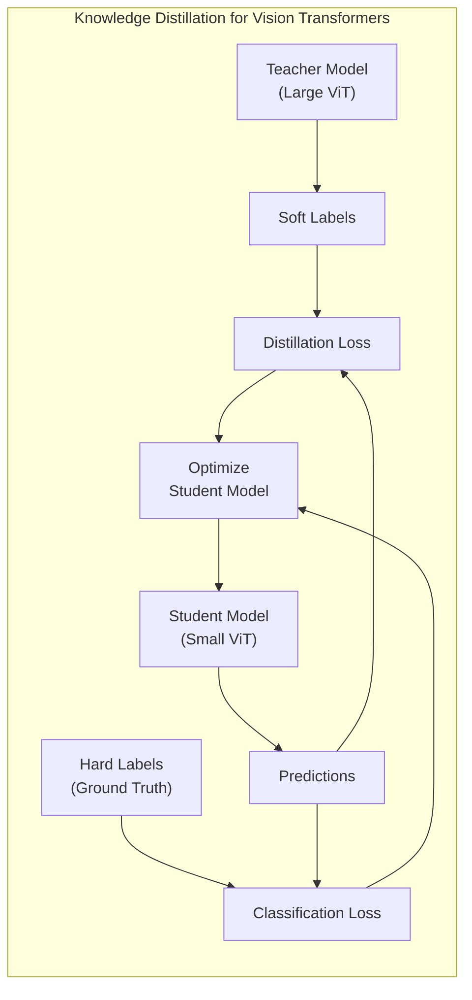

<!-- source: DeepWiki mcp.deepwiki.com · repo huggingface/computer-vision-course · page 2.2 Vision Transformers · fetched 2026-10-26 -->

# Vision Transformers

<details>
<summary>Relevant source files</summary>

The following files were used as context for generating this wiki page:

- [chapters/en/unit1/image_and_imaging/examples-preprocess.mdx](chapters/en/unit1/image_and_imaging/examples-preprocess.mdx)
- [chapters/en/unit10/blenderProc.mdx](chapters/en/unit10/blenderProc.mdx)
- [chapters/en/unit10/point_clouds.mdx](chapters/en/unit10/point_clouds.mdx)
- [chapters/en/unit10/synthetic-lung-images.mdx](chapters/en/unit10/synthetic-lung-images.mdx)
- [chapters/en/unit3/vision-transformers/cvt.mdx](chapters/en/unit3/vision-transformers/cvt.mdx)
- [chapters/en/unit5/generative-models/gans-vaes/stylegan.mdx](chapters/en/unit5/generative-models/gans-vaes/stylegan.mdx)
- [notebooks/Unit 3 - Vision Transformers/DETR.ipynb](notebooks/Unit 3 - Vision Transformers/DETR.ipynb)
- [notebooks/Unit 3 - Vision Transformers/KnowledgeDistillation.ipynb](notebooks/Unit 3 - Vision Transformers/KnowledgeDistillation.ipynb)

</details>


This document covers the architecture, implementation, and applications of Vision Transformers (ViT) - a class of deep learning models that apply the transformer architecture to computer vision tasks. Vision Transformers have demonstrated outstanding performance on various image recognition tasks by treating images as sequences of patches. For information about object detection with transformers, see [Object Detection](#2.1).

## Introduction to Vision Transformers

Vision Transformers (ViT) represent a paradigm shift in computer vision by applying the transformer architecture, initially developed for natural language processing, to image recognition tasks. Unlike Convolutional Neural Networks (CNNs) that use convolutional operations to process images hierarchically, ViTs divide an image into fixed-size patches, linearly embed each patch, and process them using transformer encoder layers.

The key innovation of ViTs is treating an image as a sequence of tokens (patches), similar to how words are treated in NLP transformers. This approach allows ViTs to capture global dependencies in images more effectively than CNNs, which are limited by their local receptive fields.

Sources:
- notebooks/Unit 3 - Vision Transformers/DETR.ipynb
- chapters/en/unit3/vision-transformers/cvt.mdx

## Core Architecture of Vision Transformers

Vision Transformer architecture



The core architecture of a Vision Transformer consists of:

1. **Patch Embedding**: The input image is divided into fixed-size patches (e.g., 16×16 pixels). Each patch is flattened and linearly projected to obtain patch embeddings.

2. **Position Embedding**: Since transformers don't have an inherent understanding of spatial relationships, positional embeddings are added to provide information about the location of each patch.

3. **Transformer Encoder**: The embedded patches are processed by multiple transformer encoder layers. Each encoder layer consists of:
   - Multi-Head Self-Attention (MHSA): Allows each patch to attend to all other patches
   - Feed-Forward Network (FFN): A simple MLP applied to each position separately

4. **Classification Head**: A Multi-Layer Perceptron (MLP) that processes the output of the transformer encoder for classification tasks.

The self-attention mechanism in ViTs allows the model to weigh the importance of different patches when making predictions, enabling it to capture long-range dependencies that might be difficult for CNNs to model.

Sources:
- notebooks/Unit 3 - Vision Transformers/DETR.ipynb
- chapters/en/unit3/vision-transformers/cvt.mdx

## Variants of Vision Transformers

Several variants of Vision Transformers have been developed to address limitations and improve performance:

### Convolutional Vision Transformer (CvT)

CvT Architecture



Convolutional Vision Transformer (CvT) integrates the strengths of CNNs with transformers:

1. **Convolutional Token Embedding**: Uses convolutional operations instead of simple patch extraction to create token embeddings, introducing locality bias and reducing computational complexity.

2. **Convolutional Projection**: Replaces the linear projections in the self-attention mechanism with convolutional projections.

3. **Hierarchical Structure**: Employs a multi-stage architecture with progressively lower resolution but higher channel dimensions.

Key advantages of CvT over standard ViT:
- Eliminates the need for explicit positional encodings
- Reduces computational complexity
- Improves performance by leveraging local receptive fields
- Provides better generalization with fewer parameters

The table below compares CvT with other Vision Transformer variants:

| Model | Needs Position Encoding | Token Embedding | Projection for Attention | Hierarchical Structure |
|-------|-------------------------|-----------------|--------------------------|------------------------|
| ViT   | Yes                     | Non-overlapping | Linear                   | No                     |
| CvT   | No                      | Overlapping (Convolution) | Convolution | Yes |

Sources:
- chapters/en/unit3/vision-transformers/cvt.mdx

### DETR (DEtection TRansformer)

DETR extends Vision Transformers for object detection tasks:

1. **CNN Backbone**: Uses a CNN (typically ResNet) to extract features from images.

2. **Transformer Encoder-Decoder**: Processes image features with a transformer encoder, and a transformer decoder that predicts object classes and bounding boxes.

3. **Object Queries**: Uses a fixed set of learned object queries (e.g., 100) that the decoder transforms into predictions, enabling the model to detect a pre-defined maximum number of objects.

4. **Bipartite Matching Loss**: Employs a novel loss function that matches predictions to ground-truth objects optimally.

DETR simplifies the traditional object detection pipeline by eliminating the need for anchor boxes, non-maximum suppression, and other hand-designed components.

Sources:
- notebooks/Unit 3 - Vision Transformers/DETR.ipynb

## Knowledge Distillation for Vision Transformers

Knowledge Distillation Process



Knowledge distillation is a technique for transferring knowledge from a larger, more complex "teacher" model to a smaller, more efficient "student" model. For Vision Transformers, this involves:

1. **Teacher Model**: A pre-trained larger ViT model (e.g., ViT-Base)
2. **Student Model**: A smaller ViT model (e.g., ViT-Tiny)
3. **Training Process**:
   - The teacher model provides soft labels (probability distributions) for images
   - The student model is trained to mimic the teacher's outputs while also learning from ground-truth labels
   - A combined loss function balances distillation loss and classification loss

Benefits of knowledge distillation for Vision Transformers:
- Produces smaller, faster models while maintaining accuracy
- Enables deployment on resource-constrained devices
- Reduces inference time and computational requirements
- Improves generalization by transferring nuanced knowledge

Sources:
- notebooks/Unit 3 - Vision Transformers/KnowledgeDistillation.ipynb

## Practical Implementation

### Using DETR for Object Detection

DETR can be implemented using the Hugging Face `transformers` library:

```python
from transformers import DetrImageProcessor, DetrForObjectDetection
import torch
from PIL import Image
import requests

# Load model and processor
processor = DetrImageProcessor.from_pretrained("facebook/detr-resnet-50")
model = DetrForObjectDetection.from_pretrained("facebook/detr-resnet-50")

# Load image
url = "http://images.cocodataset.org/val2017/000000039769.jpg"
image = Image.open(requests.get(url, stream=True).raw)

# Process image
inputs = processor(images=image, return_tensors="pt")

# Forward pass
outputs = model(**inputs)

# Post-process to get bounding boxes
target_sizes = torch.tensor([image.size[::-1]])
results = processor.post_process_object_detection(outputs, target_sizes=target_sizes, threshold=0.9)[0]
```

The DETR model architecture includes:
- A backbone (typically ResNet) to extract features
- A transformer encoder-decoder that processes these features and produces object predictions
- A set of learned object queries (default: 100) that limit the maximum number of objects the model can detect

The output of DETR includes:
- `logits`: Class predictions for each object query (shape: [batch_size, num_queries, num_classes])
- `pred_boxes`: Bounding box coordinates for each object query (shape: [batch_size, num_queries, 4])

Sources:
- notebooks/Unit 3 - Vision Transformers/DETR.ipynb

### Implementing Knowledge Distillation

Knowledge distillation can be implemented using PyTorch:

```python
import torch.nn.functional as F

def distillation_loss(student_logits, teacher_logits, temperature=1.0):
    """
    Compute the knowledge distillation loss
    """
    soft_targets = F.softmax(teacher_logits / temperature, dim=-1)
    student_log_softmax = F.log_softmax(student_logits / temperature, dim=-1)
    
    # KL divergence loss
    loss = F.kl_div(student_log_softmax, soft_targets, reduction='batchmean') * temperature**2
    return loss

# Training loop
def train_with_distillation(teacher_model, student_model, dataloader, optimizer, alpha=0.5):
    teacher_model.eval()  # Set teacher to evaluation mode
    student_model.train()  # Set student to training mode
    
    for images, labels in dataloader:
        # Get teacher's predictions
        with torch.no_grad():
            teacher_outputs = teacher_model(images)
            
        # Get student's predictions
        student_outputs = student_model(images)
        
        # Standard classification loss
        cls_loss = F.cross_entropy(student_outputs, labels)
        
        # Distillation loss
        dist_loss = distillation_loss(student_outputs, teacher_outputs)
        
        # Combined loss
        loss = alpha * cls_loss + (1 - alpha) * dist_loss
        
        # Backward and optimize
        optimizer.zero_grad()
        loss.backward()
        optimizer.step()
```

The process involves:
1. Training a large teacher model first (or using a pre-trained one)
2. Creating a smaller student model with the same output structure
3. Training the student to match both the ground truth labels and the teacher's soft predictions
4. Balancing between standard classification loss and distillation loss

Sources:
- notebooks/Unit 3 - Vision Transformers/KnowledgeDistillation.ipynb

### Using CvT

Convolutional Vision Transformer (CvT) can be used through the Hugging Face `transformers` library:

```python
from transformers import AutoFeatureExtractor, CvtForImageClassification
from PIL import Image
import requests

# Load model and processor
feature_extractor = AutoFeatureExtractor.from_pretrained("microsoft/cvt-13")
model = CvtForImageClassification.from_pretrained("microsoft/cvt-13")

# Load image
url = "http://images.cocodataset.org/val2017/000000039769.jpg"
image = Image.open(requests.get(url, stream=True).raw)

# Process image and predict
inputs = feature_extractor(images=image, return_tensors="pt")
outputs = model(**inputs)
logits = outputs.logits

# Get predicted class
predicted_class_idx = logits.argmax(-1).item()
print("Predicted class:", model.config.id2label[predicted_class_idx])
```

CvT models offer better performance with fewer parameters compared to standard ViT models, making them suitable for various deployment scenarios.

Sources:
- chapters/en/unit3/vision-transformers/cvt.mdx

## Conclusion

Vision Transformers have revolutionized computer vision by adapting the transformer architecture from NLP to image recognition tasks. Their ability to capture global dependencies and their flexibility have led to state-of-the-art performance across various computer vision tasks.

Key variants like CvT and DETR have addressed limitations of the original ViT architecture, while techniques like knowledge distillation have made these models more practical for real-world deployment. The integration of Vision Transformers with the Hugging Face ecosystem has made them accessible to a wide range of practitioners.

As research continues, Vision Transformers are expected to evolve further, potentially combining the best aspects of CNNs and transformers to create even more powerful and efficient computer vision models.

---

