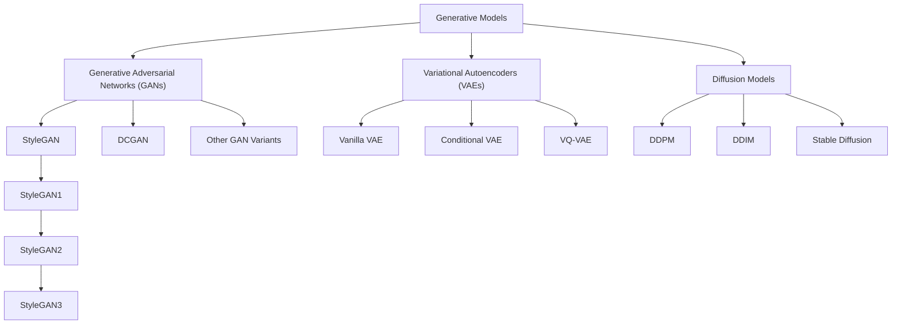
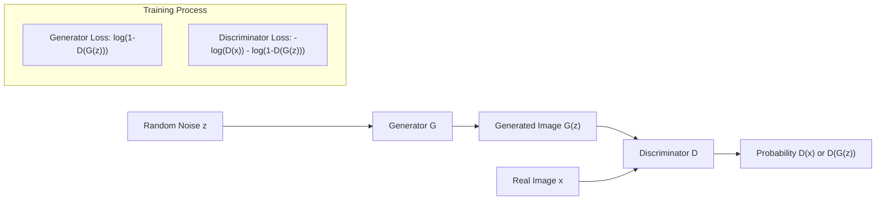
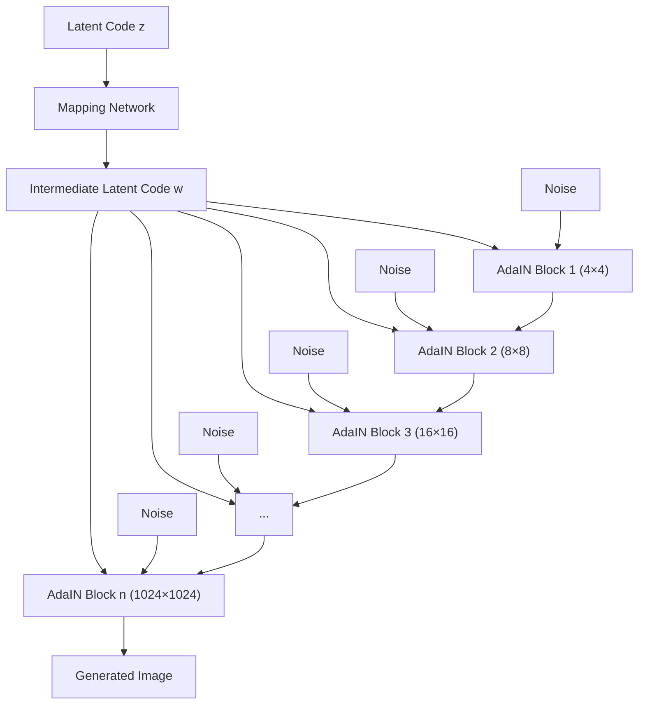
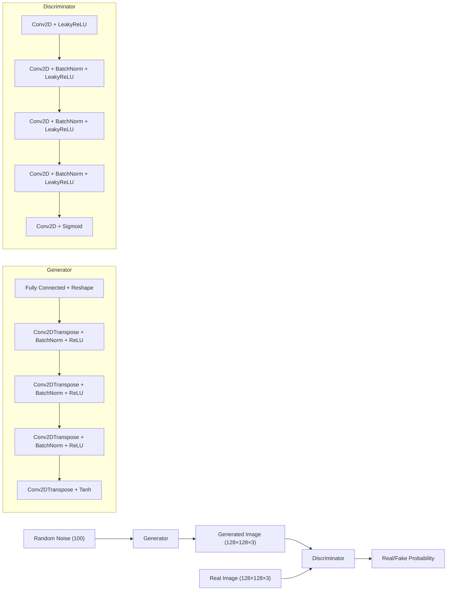
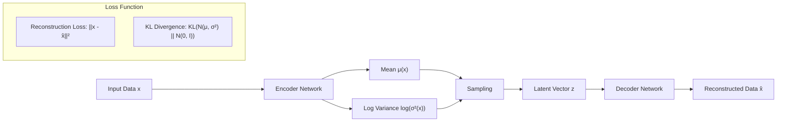
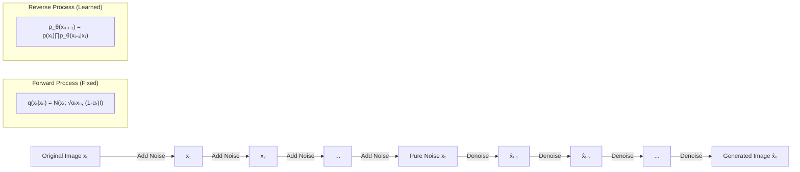
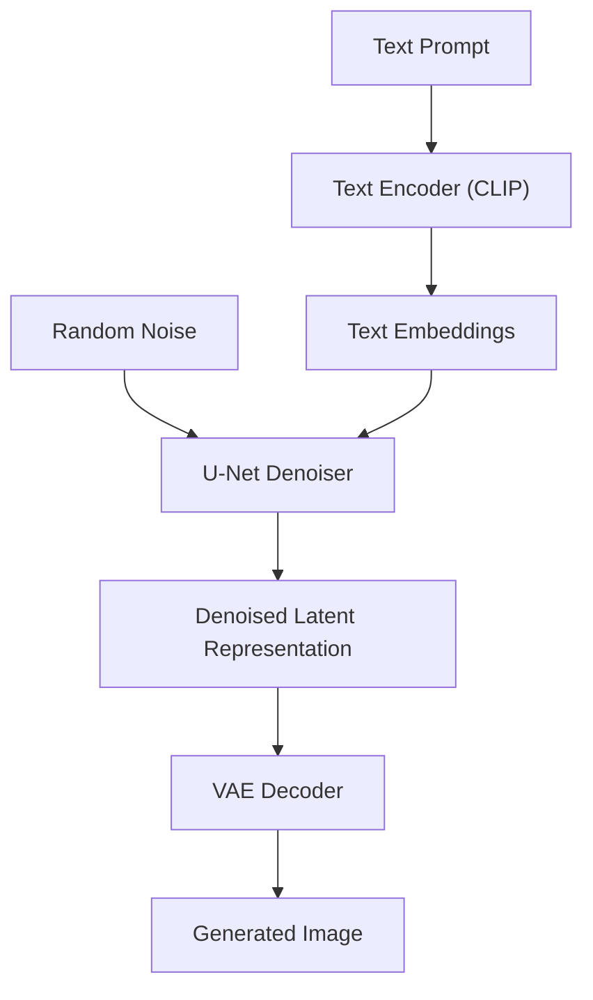

<!-- source: DeepWiki mcp.deepwiki.com · repo huggingface/computer-vision-course · page 2.3 Generative Models · fetched 2026-10-26 -->

# Generative Models

<details>
<summary>Relevant source files</summary>

The following files were used as context for generating this wiki page:

- [chapters/en/unit1/image_and_imaging/examples-preprocess.mdx](chapters/en/unit1/image_and_imaging/examples-preprocess.mdx)
- [chapters/en/unit10/blenderProc.mdx](chapters/en/unit10/blenderProc.mdx)
- [chapters/en/unit10/point_clouds.mdx](chapters/en/unit10/point_clouds.mdx)
- [chapters/en/unit10/synthetic-lung-images.mdx](chapters/en/unit10/synthetic-lung-images.mdx)
- [chapters/en/unit3/vision-transformers/cvt.mdx](chapters/en/unit3/vision-transformers/cvt.mdx)
- [chapters/en/unit5/generative-models/gans-vaes/stylegan.mdx](chapters/en/unit5/generative-models/gans-vaes/stylegan.mdx)
- [notebooks/Unit 5 - Generative Models/Diffusion Models/README.md](notebooks/Unit 5 - Generative Models/Diffusion Models/README.md)
- [notebooks/Unit 5 - Generative Models/GANs & VAEs/README.md](notebooks/Unit 5 - Generative Models/GANs & VAEs/README.md)
- [notebooks/Unit 5 - Generative Models/Introduction/README.md](notebooks/Unit 5 - Generative Models/Introduction/README.md)
- [notebooks/Unit 5 - Generative Models/Practical Applications & Challenges/README.md](notebooks/Unit 5 - Generative Models/Practical Applications & Challenges/README.md)

</details>


## Purpose and Scope

This document provides a technical overview of generative models used in computer vision, focusing on their architectures, implementations, and applications. Generative models are machine learning systems designed to create new data samples that resemble a training distribution. This page covers three primary types of generative models: Generative Adversarial Networks (GANs), Variational Autoencoders (VAEs), and Diffusion Models. For information about synthetic data generation using 3D rendering techniques, see [Using a 3D Renderer to Generate Synthetic Data](#10).

## Overview of Generative Models

Generative models learn to approximate the underlying probability distribution of training data, enabling them to generate new samples that share similar characteristics with the original dataset. Unlike discriminative models that focus on classification or regression, generative models aim to understand the full data distribution.

### Taxonomy of Generative Models



Sources: `notebooks/Unit 5 - Generative Models/Introduction/README.md`, `notebooks/Unit 5 - Generative Models/GANs & VAEs/README.md`, `notebooks/Unit 5 - Generative Models/Diffusion Models/README.md`

## Generative Adversarial Networks (GANs)

GANs, introduced by Ian Goodfellow in 2014, consist of two neural networks—a generator and a discriminator—that compete against each other in a minimax game. The generator creates fake samples while the discriminator attempts to distinguish between real and generated samples.

### Basic GAN Architecture



Sources: `notebooks/Unit 5 - Generative Models/GANs & VAEs/README.md`

### Training Process

GANs are trained through an adversarial process where:
1. The discriminator learns to maximize the probability of correctly identifying real and fake samples
2. The generator learns to minimize the probability of the discriminator correctly identifying its outputs as fake

This results in a minimax optimization problem:

```
min_G max_D V(D, G) = E_x~p_data [log D(x)] + E_z~p_z [log(1 - D(G(z)))]
```

### StyleGAN Variants

StyleGAN is a state-of-the-art GAN architecture developed by NVIDIA that introduced several key innovations to improve the quality and controllability of generated images.

#### StyleGAN1 Components

StyleGAN1 introduced three key components that set it apart from vanilla GANs:

1. **Mapping Network**: Transforms the latent code z into an intermediate latent space w, which helps disentangle features
2. **AdaIN (Adaptive Instance Normalization)**: Allows style information to be injected at different resolutions
3. **Noise Injection**: Adds stochasticity to generate fine details like hair strands and skin pores



Sources: `chapters/en/unit5/generative-models/gans-vaes/stylegan.mdx:10-56`

#### StyleGAN Evolution

StyleGAN2 addressed key issues from the original model:
- Eliminated blob-like artifacts by replacing AdaIN with a demodulation technique
- Fixed strong location preference artifacts by redesigning the progressive growing architecture

StyleGAN3 tackled aliasing effects, ensuring that features aren't unnaturally fixed to specific pixel coordinates during animation and interpolation.

Sources: `chapters/en/unit5/generative-models/gans-vaes/stylegan.mdx:57-86`

### DCGAN (Deep Convolutional GAN)

DCGAN incorporates convolutional layers into the GAN architecture to improve image quality and training stability.

#### DCGAN Architecture



Sources: `chapters/en/unit10/synthetic-lung-images.mdx:8-31`

DCGAN has been used extensively for medical image synthesis, including lung X-ray images, as discussed in the synthetic-lung-images chapter. It addresses challenges in medical imaging such as small datasets, privacy concerns, and limited annotated samples.

Sources: `chapters/en/unit10/synthetic-lung-images.mdx:32-86`

## Variational Autoencoders (VAEs)

VAEs are generative models that combine neural networks with variational inference to learn latent representations of data. Unlike traditional autoencoders, VAEs enforce a probabilistic structure on the latent space.

### VAE Architecture



Sources: `notebooks/Unit 5 - Generative Models/GANs & VAEs/README.md`

### Training Process

VAEs are trained to minimize two components:
1. **Reconstruction Loss**: Measures how well the decoder reconstructs the input from the latent representation
2. **KL Divergence**: Encourages the latent space to approximate a standard normal distribution

The VAE loss function is:

```
L(θ, φ) = E_q_φ(z|x)[log p_θ(x|z)] - KL(q_φ(z|x) || p(z))
```

Where:
- θ are the decoder parameters
- φ are the encoder parameters
- q_φ(z|x) is the approximate posterior
- p_θ(x|z) is the likelihood of reconstructing x from z
- p(z) is the prior distribution (usually a standard normal)

## Diffusion Models

Diffusion models generate data by gradually denoising a pure noise signal. They have gained prominence recently due to their exceptional ability to generate high-quality images.

### Diffusion Process



Sources: `notebooks/Unit 5 - Generative Models/Diffusion Models/README.md`

### Training Process

Diffusion models are trained to predict the noise added at each step of the forward process. The training objective is typically a variational lower bound on the data likelihood.

Key phases in diffusion models:

1. **Forward Process**: Gradually add Gaussian noise to the data according to a fixed schedule
2. **Reverse Process**: Learn to gradually denoise a pure noise sample to generate a new data point

The models are trained using a simplified objective that amounts to predicting the noise that was added at each step.

### Stable Diffusion

Stable Diffusion is a latent diffusion model that operates in a compressed latent space rather than pixel space, making it more computationally efficient. It incorporates:

- A VAE to map between image space and latent space
- A U-Net denoising network conditioned on text embeddings
- A text encoder (typically CLIP) to provide conditioning information



Sources: `notebooks/Unit 5 - Generative Models/Diffusion Models/README.md`

## Applications of Generative Models

Generative models have numerous applications in computer vision:

| Application | Description | Primary Models Used |
|-------------|-------------|---------------------|
| Image Synthesis | Creating new, realistic images | GANs, Diffusion Models |
| Image Translation | Converting images from one domain to another | GANs (CycleGAN, Pix2Pix) |
| Super-resolution | Enhancing image resolution | GANs, Diffusion Models |
| Inpainting | Filling in missing parts of images | GANs, Diffusion Models |
| Style Transfer | Applying artistic styles to images | StyleGAN, Neural Style Transfer |
| Data Augmentation | Generating additional training data | GANs, Diffusion Models |
| Medical Imaging | Synthesizing medical images for training | DCGAN, Diffusion Models |
| 3D Shape Generation | Creating 3D models from 2D images | GANs, Diffusion Models |

Sources: `chapters/en/unit5/generative-models/gans-vaes/stylegan.mdx:88-106`, `chapters/en/unit10/synthetic-lung-images.mdx:87-93`

## Comparative Analysis

The following table compares the key characteristics of the three main generative model types:

| Characteristic | GANs | VAEs | Diffusion Models |
|----------------|------|------|------------------|
| Training Stability | Challenging (mode collapse, non-convergence) | Relatively stable | Stable but computationally intensive |
| Sample Quality | High (especially StyleGAN) | Often blurry | Very high |
| Sampling Speed | Fast | Fast | Slow (requires multiple denoising steps) |
| Mode Coverage | Often limited (mode collapse) | Good | Excellent |
| Latent Space | Not explicitly structured | Structured (enforced through KL divergence) | No explicit latent space |
| Conditioning | Through conditional GANs | Through conditional VAEs | Natural through guidance |
| Architecture Complexity | Moderate to high | Moderate | High |
| Interpretability | Limited | Better (due to structured latent space) | Limited |

Sources: `notebooks/Unit 5 - Generative Models/Introduction/README.md`, `notebooks/Unit 5 - Generative Models/GANs & VAEs/README.md`, `notebooks/Unit 5 - Generative Models/Diffusion Models/README.md`

## Challenges and Limitations

### GANs
- Mode collapse: Generator produces limited variety of samples
- Training instability: Balancing generator and discriminator training
- Evaluation difficulty: No explicit likelihood measurement

### VAEs
- Blurry generation: Tends to produce less sharp images than GANs
- Posterior collapse: Latent variables may be ignored with powerful decoders
- Limited expressiveness: Simple Gaussian priors may constrain model capacity

### Diffusion Models
- Slow sampling: Requires many denoising steps
- Computational cost: Training requires simulating the entire diffusion process
- Memory requirements: Typically higher than GANs or VAEs

Sources: `notebooks/Unit 5 - Generative Models/Practical Applications & Challenges/README.md`

## Recent Advances and Future Directions

Recent advances in generative modeling include:

1. Hybrid approaches combining multiple model types
2. Improved training techniques for increased stability
3. Integration with other AI technologies like transformers
4. Domain-specific architectures for medical imaging and other specialized applications
5. Text-to-image generation with models like DALL-E, Midjourney, and Stable Diffusion

Future research directions focus on:

1. Reducing computational requirements
2. Improving control over the generation process
3. Extending to video, audio, and 3D domains
4. Enhancing model interpretability
5. Addressing ethical concerns around synthetic media

Sources: `notebooks/Unit 5 - Generative Models/Practical Applications & Challenges/README.md`

---

