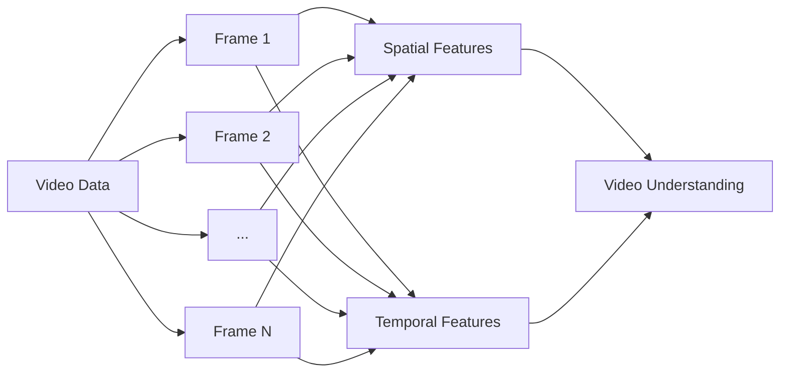
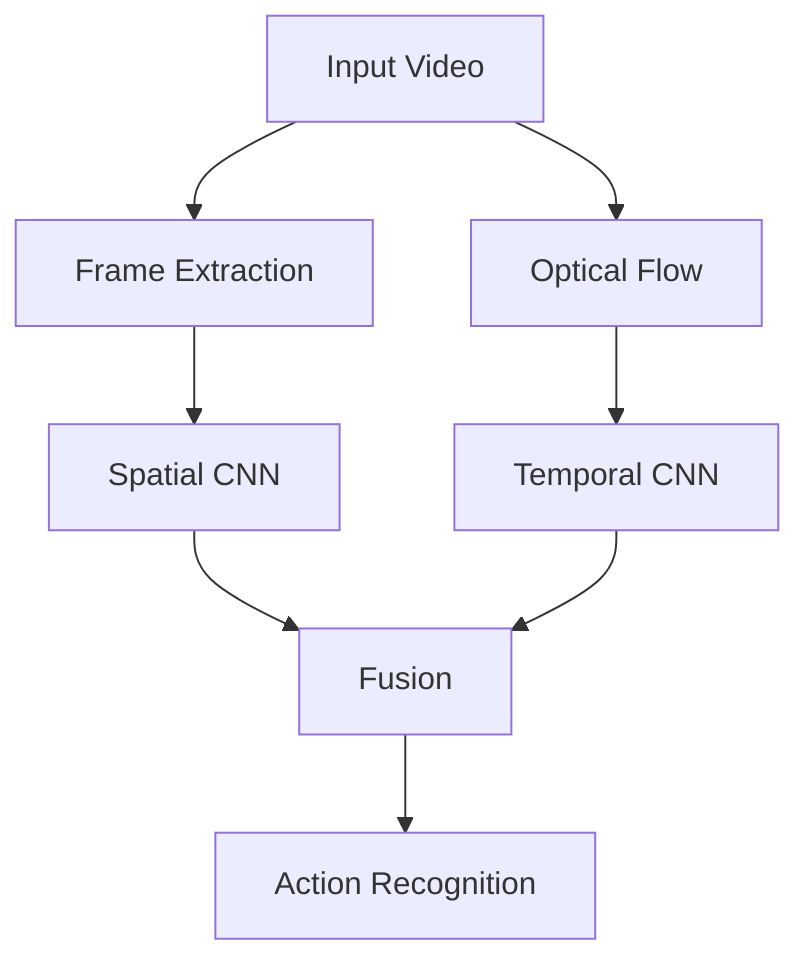
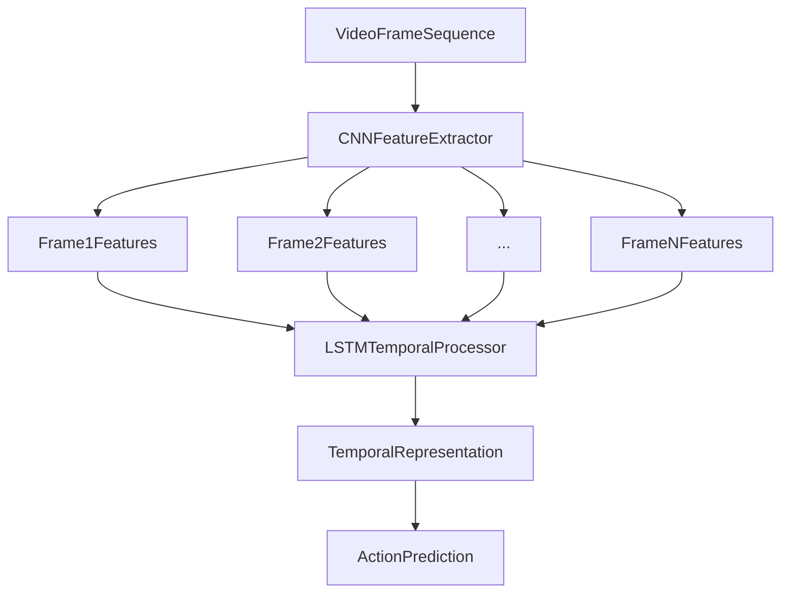
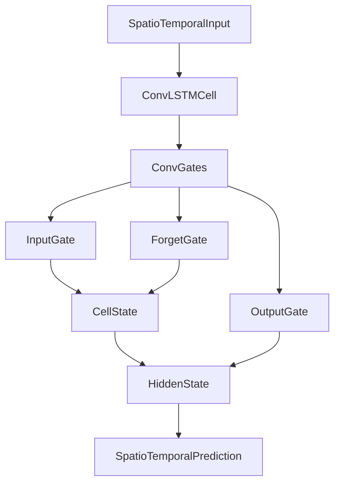
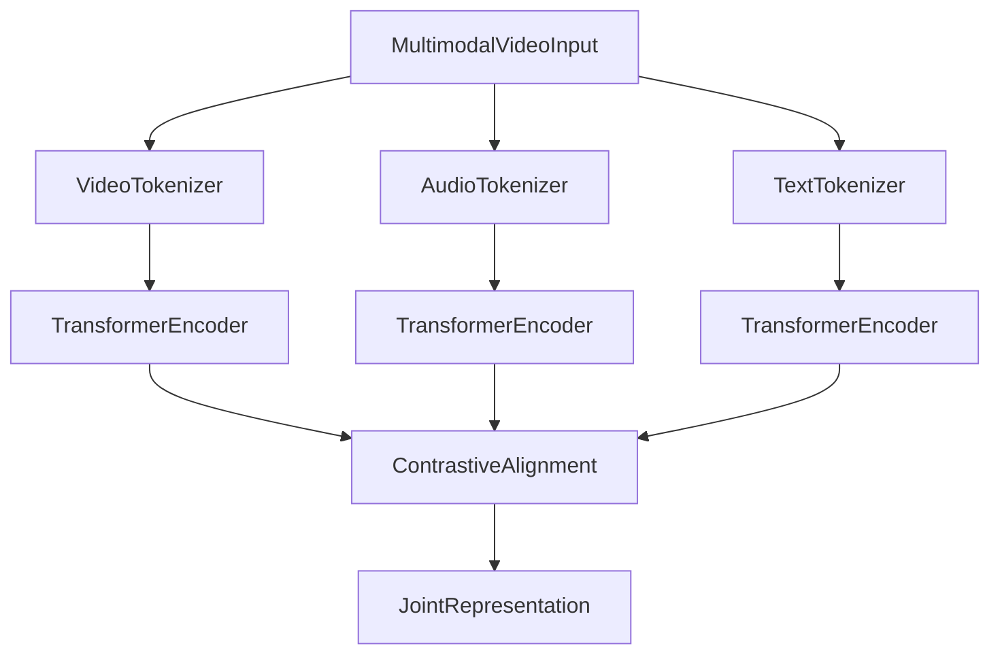
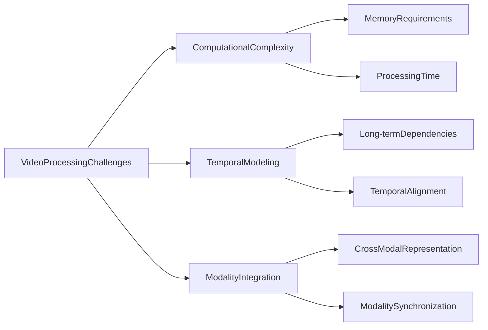

<!-- source: DeepWiki mcp.deepwiki.com · repo huggingface/computer-vision-course · page 2.4 Video Processing · fetched 2026-10-26 -->

# Video Processing

Relevant source files

The following files were used as context for generating this wiki page:

- [chapters/en/_toctree.yml](chapters/en/_toctree.yml)
- [chapters/en/unit0/welcome/welcome.mdx](chapters/en/unit0/welcome/welcome.mdx)
- [chapters/en/unit2/cnns/yolo.mdx](chapters/en/unit2/cnns/yolo.mdx)
- [chapters/en/unit7/video-processing/cnn-based-video-model.mdx](chapters/en/unit7/video-processing/cnn-based-video-model.mdx)
- [chapters/en/unit7/video-processing/multimodal-based-video-models.mdx](chapters/en/unit7/video-processing/multimodal-based-video-models.mdx)
- [chapters/en/unit7/video-processing/rnn-based-video-models.mdx](chapters/en/unit7/video-processing/rnn-based-video-models.mdx)
- [chapters/en/unit8/monocular_depth_estimation.mdx](chapters/en/unit8/monocular_depth_estimation.mdx)

## Purpose and Scope

Video processing in computer vision involves analyzing sequences of images (frames) to extract meaningful temporal and spatial information. Unlike static image processing, video processing must handle the additional dimension of time, presenting unique challenges and opportunities. This document covers the fundamental approaches to video processing including CNN-based models, RNN-based models, and multimodal models, focusing on architectures that effectively capture spatiotemporal relationships in video data.

For information about object detection or image segmentation, see [Basic CV Tasks](#6). For information about 3D vision and scene reconstruction, see [3D Vision](#8).

## Video Data Representation

Videos are essentially sequences of frames with temporal relationships between them. Processing video data requires understanding both the spatial information within each frame and how this information evolves over time.

### Video as Sequential Data

Sources:
- chapters/en/unit7/video-processing/rnn-based-video-models.mdx

## CNN-Based Video Models

Convolutional Neural Networks (CNNs) have been adapted from image processing to handle the temporal dimension in videos.

### Key Architectures

#### Two-Stream Networks (2014)

This architecture uses two separate pathways:
- **Spatial Stream**: Processes individual frames to capture appearance
- **Temporal Stream**: Processes optical flow to capture motion
- The outputs are then fused for final prediction

#### 3D ResNets (2017)

These models extend 2D CNNs by using 3D convolutional kernels to process spatial and temporal information simultaneously. 3D ResNets apply the residual learning framework to 3D CNNs, allowing deeper architectures that better capture complex spatiotemporal patterns.

#### (2+1)D ResNets (2017)

This architecture decomposes 3D convolution into sequential operations:
- 2D spatial convolution captures features within frames
- 1D temporal convolution captures motion across frames

This decomposition:
- Doubles the number of non-linearities for the same parameter count
- Facilitates optimization, yielding lower training and test loss

#### X3D (Expanded 3D Networks)

X3D is a lightweight 3D CNN model that:
- Achieves high accuracy with fewer parameters
- Uses progressive expansion of network dimensions
- Is optimized for deployment on devices with limited resources

Sources:
- chapters/en/unit7/video-processing/cnn-based-video-model.mdx

## RNN-Based Video Models

Recurrent Neural Networks (RNNs) are specifically designed for processing sequential data, making them well-suited for modeling temporal relationships in videos.

### Key Architectures

#### LRCN (Long-term Recurrent Convolutional Networks)

LRCN combines CNNs and LSTMs:
- CNN extracts spatial features from each frame
- LSTM processes these features sequentially to model temporal relationships

#### ConvLSTM Network

ConvLSTM modifies the traditional LSTM by:
- Replacing linear operations with convolutional operations
- Maintaining spatial structure throughout temporal processing
- Operating directly on 2D spatial data across time

#### Unsupervised Video Representation Learning

This approach uses encoder-decoder LSTM networks to:
- Learn video representations without labeled data
- Map arbitrary-length sequences to fixed-size representations
- Reconstruct input sequences or predict future frames

Sources:
- chapters/en/unit7/video-processing/rnn-based-video-models.mdx

## Multimodal Video Models

Multimodal video models integrate video with other data types such as text and audio to create richer representations.

### Text-Video Models

#### VideoBERT
- Applies BERT architecture to video data
- Uses visual tokens and text tokens for alignment
- Performs masked language/frame modeling for self-supervised learning

#### MERLOT
- Improves multimodal reasoning on large-scale video-text datasets
- Learns from unlabeled video data through temporal reordering and frame-caption matching tasks
- Enhances visual commonsense reasoning capabilities

### Audio-Video-Text Models

#### VATT (Visual-Audio-Text Transformer)

VATT uses self-supervised learning from raw video, audio, and text:
- Applies different tokenization methods to each modality
- Employs the Transformer architecture for modality-specific encoding
- Utilizes contrastive learning to align representations

#### Video-LLaMA
- Extends Large Language Models to understand audiovisual content
- Uses two branches: vision-language and audio-language
- Leverages ImageBind to overcome limited audio-text data

### Multi-Modality Integration

#### ImageBind
- Unifies multiple modalities (image, audio, text, depth) using paired data
- Uses images as the reference point for alignment
- Enables cross-modal retrieval without direct pairings between non-image modalities

Sources:
- chapters/en/unit7/video-processing/multimodal-based-video-models.mdx

## Technical Challenges and Limitations

### CNN-Based Model Limitations
- Computational complexity due to 3D convolutions
- Difficulty capturing long-range temporal dependencies
- Trade-offs between model depth and processing efficiency

### RNN-Based Model Limitations
- Challenges with long-term dependencies in extended sequences
- Sequential processing limits parallelization opportunities
- Higher computational demands for processing long videos

Sources:
- chapters/en/unit7/video-processing/rnn-based-video-models.mdx
- chapters/en/unit7/video-processing/cnn-based-video-model.mdx

## Applications

Video processing techniques enable a wide range of applications:

| Application | Description | Primary Approach |
|-------------|-------------|------------------|
| Action Recognition | Identifying human actions in videos | CNN-based, Two-Stream Networks |
| Video Captioning | Generating text descriptions of video content | RNN-based, Attention mechanisms |
| Video Summarization | Creating concise summaries of longer videos | RNN-based, Attention mechanisms |
| Object Tracking | Following objects across video frames | CNN-based, RNN-based hybrid |
| Video Generation | Creating new video content | GAN-based, Diffusion models |
| Video Retrieval | Finding videos based on queries | Multimodal embedding models |
| Anomaly Detection | Identifying unusual events in videos | Unsupervised learning approaches |

Sources:
- chapters/en/unit7/video-processing/cnn-based-video-model.mdx
- chapters/en/unit7/video-processing/rnn-based-video-models.mdx
- chapters/en/unit7/video-processing/multimodal-based-video-models.mdx

## Future Directions

Research in video processing is moving toward:

1. **Transformer-based architectures** that can better capture long-range dependencies
2. **Self-supervised learning approaches** to leverage the vast amount of unlabeled video data
3. **More efficient architectures** for real-time processing on edge devices
4. **Enhanced multimodal integration** for more comprehensive video understanding
5. **Privacy-preserving video analytics** that can process video without compromising sensitive information

Sources:
- chapters/en/unit7/video-processing/cnn-based-video-model.mdx
- chapters/en/unit7/video-processing/rnn-based-video-models.mdx

## Conclusion

Video processing is a complex but rapidly evolving field within computer vision. The different approaches—CNN-based, RNN-based, and multimodal models—each offer unique strengths in addressing the challenges of spatiotemporal data analysis. As computational resources continue to improve and model architectures become more sophisticated, we can expect significant advancements in our ability to understand and generate video content.

Sources:
- chapters/en/unit7/video-processing/multimodal-based-video-models.mdx
- chapters/en/unit7/video-processing/rnn-based-video-models.mdx
- chapters/en/unit7/video-processing/cnn-based-video-model.mdx

---

