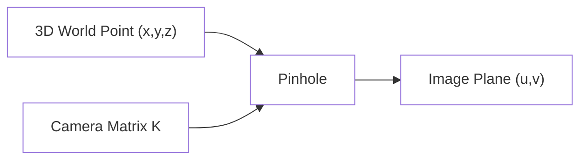
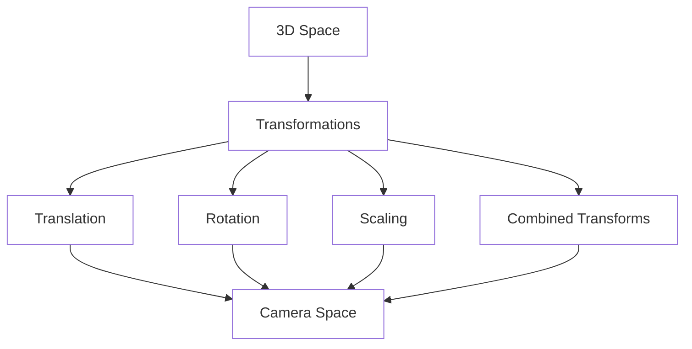
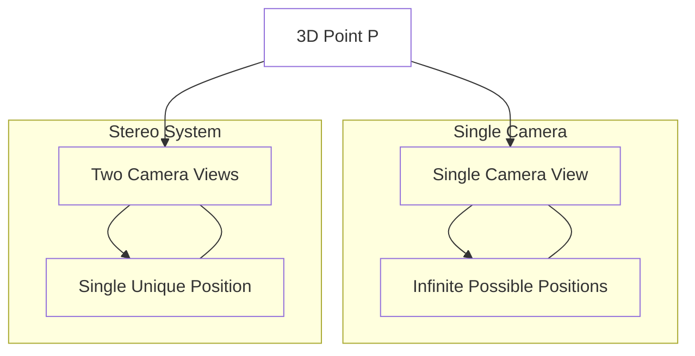
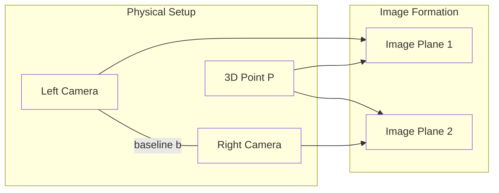
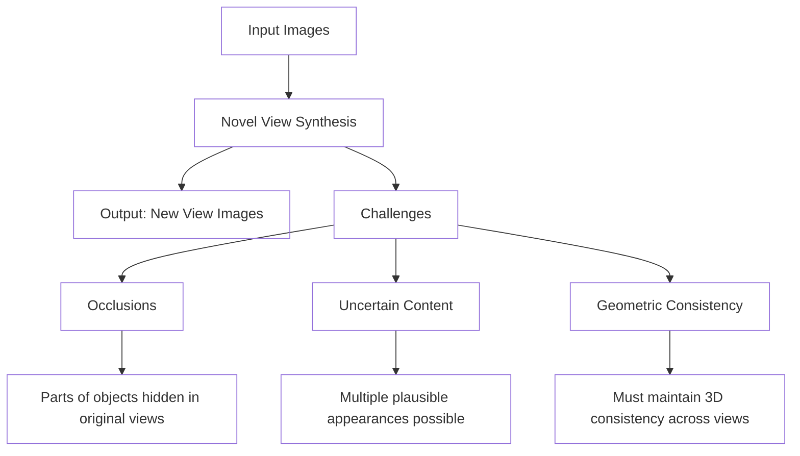
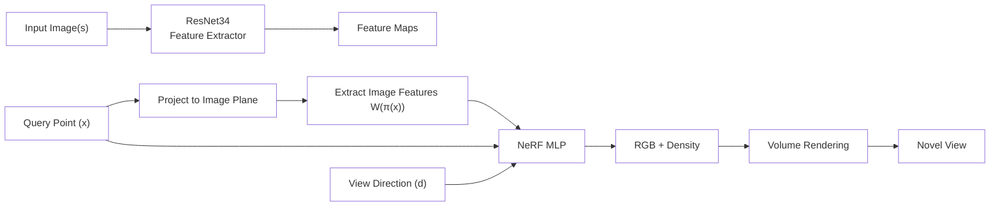
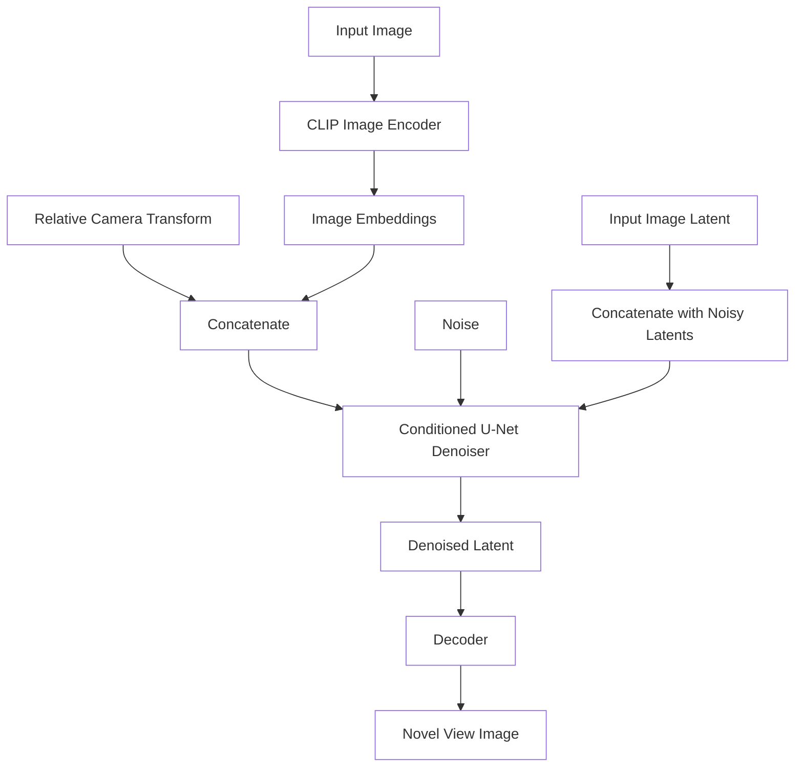
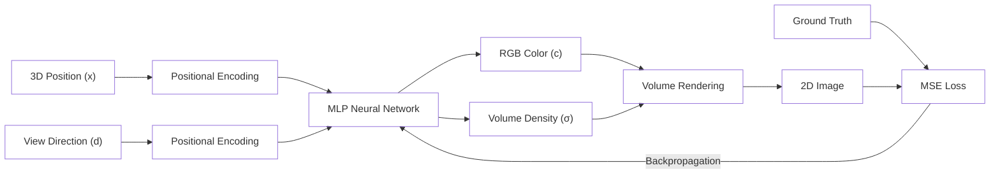

<!-- source: DeepWiki mcp.deepwiki.com · repo huggingface/computer-vision-course · page 2.5 3D Vision and Novel View Synthesis · fetched 2026-10-26 -->

# 3D Vision and Novel View Synthesis

Relevant source files

The following files were used as context for generating this wiki page:

- [chapters/en/unit8/3d-vision/nvs.mdx](chapters/en/unit8/3d-vision/nvs.mdx)
- [chapters/en/unit8/3d_measurements_stereo_vision.mdx](chapters/en/unit8/3d_measurements_stereo_vision.mdx)
- [chapters/en/unit8/nerf.mdx](chapters/en/unit8/nerf.mdx)
- [chapters/en/unit8/terminologies/camera-models.mdx](chapters/en/unit8/terminologies/camera-models.mdx)
- [chapters/en/unit8/terminologies/linear-algebra.mdx](chapters/en/unit8/terminologies/linear-algebra.mdx)
- [chapters/en/unit8/terminologies/representations.mdx](chapters/en/unit8/terminologies/representations.mdx)

## Purpose and Scope

This document explains techniques for reconstructing and navigating 3D scenes from 2D images. It covers stereo vision for depth measurement, novel view synthesis for generating new perspectives, and neural radiance fields (NeRFs) for implicit 3D scene representation. The focus is on the mathematical foundations, computational approaches, and practical implementations of these technologies.

Sources: [chapters/en/unit8/3d_measurements_stereo_vision.mdx:1-8](), [chapters/en/unit8/3d-vision/nvs.mdx:1-7](), [chapters/en/unit8/nerf.mdx:1-6]()

## 3D Geometric Foundations

### Camera Models and Image Formation

The pinhole camera model is fundamental to 3D vision, forming the basis for how 3D scenes are projected onto 2D image planes:

**Camera Coordinate Transformation**

A camera's intrinsic parameters are captured in the camera matrix:

$$
K = \begin{pmatrix}
f_x & 0 & c_x  \\
0 & f_y & c_y  \\
0 & 0 & 1  \\
\end{pmatrix}
$$

Where:
- $f_x$ and $f_y$ are focal lengths in pixels
- $c_x$ and $c_y$ are the coordinates of the principal point (where the optical axis intersects the image plane)

To project a 3D point to 2D, the point is multiplied by the camera matrix and the homogeneous coordinates are normalized.

Sources: [chapters/en/unit8/terminologies/camera-models.mdx:1-50](), [chapters/en/unit8/3d_measurements_stereo_vision.mdx:4-7]()

### Coordinate Systems and Transformations

Coordinate transformations are essential for 3D vision, allowing us to relate positions in world space to camera space:

These transformations are represented as 4×4 matrices operating on homogeneous coordinates:

- **Translation**: Moving points by a vector $(t_x, t_y, t_z)$
- **Rotation**: Rotating points around the x, y, or z axes
- **Scaling**: Changing the size of objects
- **Combined transformations**: Multiple transforms applied in sequence (matrix multiplication)

Sources: [chapters/en/unit8/terminologies/linear-algebra.mdx:3-216]()

### 3D Representations

Various representations are used to encode 3D data depending on the application:

| Representation | Description | Common Uses |
|----------------|-------------|-------------|
| Point Clouds | Lists of 3D points with coordinates | LIDAR scans, 3D scanning |
| Meshes | Triangular faces connecting vertices | Computer graphics, games |
| Volumetric Data | Function mapping positions to density/color | Representing transparent objects |
| Implicit Surfaces | Function whose zero level-set defines a surface | Efficient rendering, physics |

Sources: [chapters/en/unit8/terminologies/representations.mdx:1-24]()

## Stereo Vision

### Problem Statement and Approach

Stereo vision addresses a fundamental ambiguity in 3D reconstruction: a single 2D image can't uniquely determine the 3D coordinates of scene points because all points along a ray project to the same pixel.

The solution uses two cameras (or two positions of the same camera) to observe the scene from different viewpoints. The 3D position can be determined by finding the intersection of the two rays from each camera through the corresponding image points.

Sources: [chapters/en/unit8/3d_measurements_stereo_vision.mdx:4-41]()

### Stereo Vision Setup and Computation

A typical stereo vision setup places two cameras side by side with parallel image planes:

For this ideal configuration, the 3D coordinates of a point can be calculated using these equations:

- $x = \frac{b(u_{left} - O_x)}{u_{left} - u_{right}}$
- $y = \frac{b \cdot f_x (v_{left} - O_y)}{f_y (u_{left} - u_{right})}$
- $z = \frac{b \cdot f_x}{u_{left} - u_{right}}$

Where:
- $b$ is the baseline (distance between cameras)
- $u_{left}, v_{left}$ are pixel coordinates in the left image
- $u_{right}, v_{right}$ are corresponding pixel coordinates in the right image
- $O_x, O_y$ are principal point coordinates
- $f_x, f_y$ are focal lengths in pixels

The difference $(u_{left} - u_{right})$ is called disparity and is inversely proportional to depth.

Sources: [chapters/en/unit8/3d_measurements_stereo_vision.mdx:43-96]()

### Image Rectification and Practical Implementation

In practice, cameras may not be perfectly aligned. Image rectification transforms the original images to appear as if captured by perfectly aligned cameras:

1. Raw images have different intrinsic parameters and slight misalignments
2. Rectification applies transformations to make epipolar lines horizontal
3. After rectification, corresponding points lie on the same horizontal scanline ($v_{left} = v_{right}$)

This preprocessing simplifies the stereo matching problem to a 1D search along scanlines, greatly reducing computational complexity.

Sources: [chapters/en/unit8/3d_measurements_stereo_vision.mdx:97-146]()

### Accuracy and Applications

Stereo vision can achieve high accuracy in depth measurement. Experiments show that calculated dimensions match actual measurements with errors below 1.2%.

Applications include:
- Autonomous vehicles (obstacle detection)
- Robotics (navigation and manipulation)
- 3D scanning and modeling
- Augmented reality

Sources: [chapters/en/unit8/3d_measurements_stereo_vision.mdx:147-196]()

## Novel View Synthesis

Novel View Synthesis (NVS) is the task of generating images from new camera viewpoints that weren't included in the original dataset. It's particularly useful when only a limited number of views are available.

### Challenges in Novel View Synthesis

A key difficulty is that this task is underdetermined—there are usually multiple possible appearances for unseen parts of objects. Traditional regression-based models tend to produce blurry, averaged results in uncertain regions.

Sources: [chapters/en/unit8/3d-vision/nvs.mdx:1-15]()

### Approaches to Novel View Synthesis

NVS methods can be divided into two main categories:

| Approach | Description | Examples | Advantages |
|----------|-------------|----------|------------|
| 3D-based | Generate an intermediate 3D representation then render new views | PixelNeRF, Generative Query Networks | Explicit geometry control |
| Direct generation | Generate new view images directly without 3D representation | Zero123, 3DiM | Can leverage prior knowledge from large datasets |

Sources: [chapters/en/unit8/3d-vision/nvs.mdx:8-15]()

### PixelNeRF: 3D-based Approach

PixelNeRF creates a Neural Radiance Field conditioned on input images:

The method:
1. Processes input images through a CNN to extract features
2. For each 3D query point, projects it to the input image(s) to sample features
3. Feeds these features plus positional encoding and view direction to a NeRF network
4. Outputs color and density for volume rendering

This approach explicitly encodes 3D structure while still leveraging the power of neural networks.

Sources: [chapters/en/unit8/3d-vision/nvs.mdx:22-59]()

### Zero123: Direct Generation Approach

Zero123 (Zero-1-to-3) adapts the Stable Diffusion model to generate novel views directly:

Key aspects:
1. Uses CLIP image embeddings instead of text prompts
2. Conditions generation on relative camera transformation
3. Leverages the Stable Diffusion architecture for high-quality image generation
4. Concatenates the input image latent with the noise being denoised

Being a diffusion model, Zero123 can generate multiple plausible views for ambiguous cases, rather than averaging to a blurry result.

Sources: [chapters/en/unit8/3d-vision/nvs.mdx:70-91]()

## Neural Radiance Fields (NeRFs)

Neural Radiance Fields (NeRFs) represent a revolutionary approach to storing 3D scenes using implicit neural representations rather than explicit geometric data.

### NeRF Principles and Architecture

A NeRF represents a 3D scene as a continuous function approximated by a neural network:

$F_{\mathrm{\Theta}} : (\mathbf{x}, \boldsymbol{\theta}) \to (\mathbf{c},\sigma)$

Where:
- $\mathbf{x}$ is a 3D position
- $\boldsymbol{\theta}$ is a viewing direction
- $\mathbf{c}$ is the emitted color
- $\sigma$ is the volume density

Sources: [chapters/en/unit8/nerf.mdx:27-46]()

### Volume Rendering in NeRFs

To render a 2D image from the NeRF, ray marching is performed through the scene, with the final pixel color calculated as:

$$\boldsymbol{\hat{C}}(\mathbf{r})=\sum_{i=1}^{N}T_i (1-\exp(-\sigma_i \delta_i)) \mathbf{c}_i\,, \textrm{ where }T_i=\exp \bigg(-\sum_{j=1}^{i-1} \sigma_j \delta_j \bigg)$$

Where:
- $\mathbf{r}(t)=\mathbf{o}+t\mathbf{d}$ is a camera ray with origin $\mathbf{o}$ and direction $\mathbf{d}$
- $\sigma_i$ is the density at sample point $i$
- $\mathbf{c}_i$ is the color at sample point $i$
- $\delta_i$ is the distance between adjacent samples
- $T_i$ is the accumulated transmittance (probability of light reaching this point)

The network is trained by minimizing the squared error between rendered and ground truth pixel colors.

Sources: [chapters/en/unit8/nerf.mdx:48-76]()

### Optimizations and Advancements

Recent advancements in NeRF technology have focused on:

1. **Faster training and rendering**:
   - Instant-NGP (2022): Using hash-based encodings to reduce MLP size
   - Zip-NeRF (2023): Combining multiple optimizations for sub-hour training times

2. **Handling complex scenes**:
   - Mip-NeRF 360: Scene contraction techniques for unbounded scenes
   - VR-NeRF and SMERF: Real-time rendering capabilities

3. **Other extensions**:
   - Generative NeRFs
   - Deformable NeRFs for dynamic scenes
   - Compositional NeRFs

Sources: [chapters/en/unit8/nerf.mdx:9-26](), [chapters/en/unit8/nerf.mdx:155-164]()

## Conclusion

3D vision and novel view synthesis represent active and rapidly evolving fields within computer vision. From the foundational stereo vision techniques that enable depth perception to the cutting-edge neural radiance fields that can implicitly represent complex 3D scenes, these technologies are enabling new applications in augmented reality, robotics, autonomous vehicles, and creative media.

The connections between traditional geometric approaches and newer neural methods highlight how the field is progressing—leveraging both the mathematical precision of 3D geometry and the flexible, data-driven capabilities of deep learning.

---

