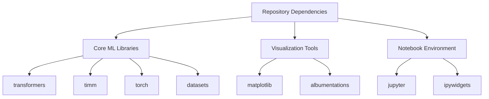
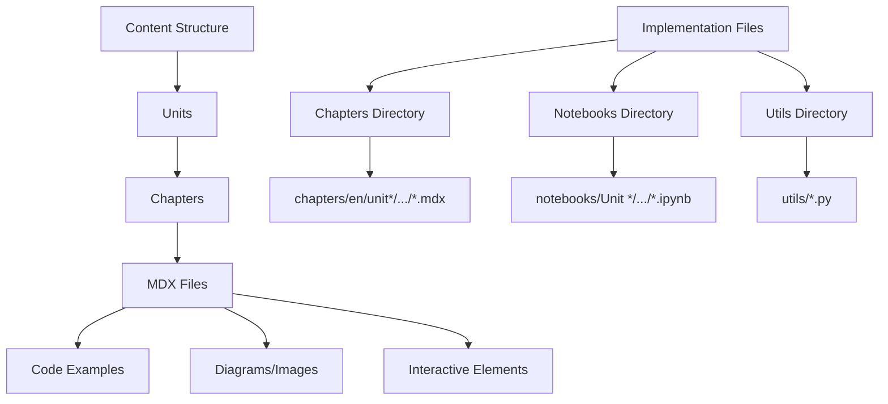
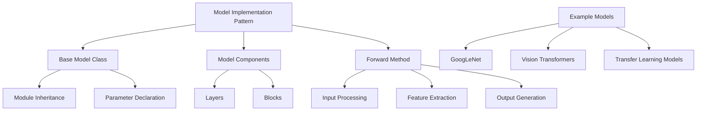
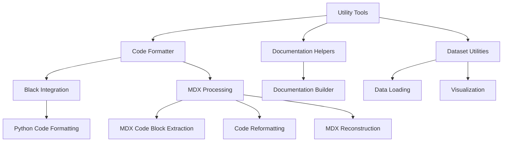
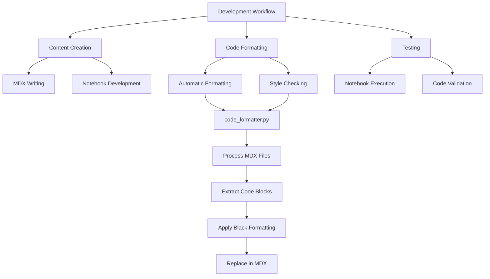

<!-- source: DeepWiki mcp.deepwiki.com · repo huggingface/computer-vision-course · page 3 Implementation Details · fetched 2026-10-26 -->

# Implementation Details

Relevant source files

The following files were used as context for generating this wiki page:

- [chapters/en/unit2/cnns/googlenet.mdx](chapters/en/unit2/cnns/googlenet.mdx)
- [notebooks/Unit 3 - Vision Transformers/DETR.ipynb](notebooks/Unit 3 - Vision Transformers/DETR.ipynb)
- [notebooks/Unit 3 - Vision Transformers/transfer-learning-segmentation.ipynb](notebooks/Unit 3 - Vision Transformers/transfer-learning-segmentation.ipynb)
- [requirements.txt](requirements.txt)
- [utils/code_formatter.py](utils/code_formatter.py)

This document provides a comprehensive overview of the technical implementation aspects of the computer vision course repository. It covers the core dependencies, code structure, model implementations, and utility tools used throughout the course materials. For information about the course content organization and learning path, see [Course Organization](#1.1). For contribution process details, see [Contribution Process](#5.1).

## Core Dependencies

The computer vision course relies on several key Python libraries to power its examples, notebooks, and demonstrations. These dependencies are carefully chosen to provide a balance between cutting-edge capabilities and stability.

### Primary Dependencies

The following dependencies are critical for the functioning of the course materials:

| Dependency | Purpose | Version |
|------------|---------|---------|
| transformers | Hugging Face Transformers library for state-of-the-art models | 4.34.0 |
| timm | PyTorch Image Models for computer vision models | 0.9.7 |
| torch | PyTorch deep learning framework | 2.1.0 |
| datasets | Hugging Face Datasets library for data handling | 2.14.5 |
| jupyter | Interactive notebook environment | 1.0.0 |
| ipywidgets | Interactive widgets for Jupyter notebooks | 8.1.1 |
| albumentations | Image augmentation library | 1.3.1 |
| matplotlib | Visualization library | 3.7.1 |

Sources: [requirements.txt:1-9]()

## Content Implementation Structure

The course content is organized into a hierarchical structure of units, chapters, and examples. Content is primarily written in MDX format (Markdown with JSX extensions), which allows for rich interactive elements alongside standard markdown.

### Course Material Organization

The course materials are implemented as:

1. **MDX Files**: Core instructional content with explanations, diagrams, and code examples
2. **Jupyter Notebooks**: Interactive examples and exercises with runnable code
3. **Utility Scripts**: Support functionality like code formatting

Sources: [chapters/en/unit2/cnns/googlenet.mdx:1-235](), [notebooks/Unit 3 - Vision Transformers/transfer-learning-segmentation.ipynb:1-472]()

## Model Implementation Patterns

The course includes implementations of various computer vision models. These implementations follow consistent patterns to make them easy to understand and modify.

### CNN Implementations

The course implements several CNN architectures, with GoogLeNet serving as a representative example. The implementation pattern typically includes:

#### GoogLeNet Implementation Structure

GoogLeNet is implemented as a PyTorch module with several key components:

1. **Base Convolution Layer**: Implemented as a simple convolutional layer with ReLU activation
2. **Inception Module**: The core building block of GoogLeNet that performs multiple convolutions in parallel
3. **Auxiliary Classifier**: Additional classifier outputs used during training
4. **Main Network**: The full GoogLeNet architecture composed of these components

The implementation follows PyTorch conventions, with each component implemented as a subclass of `nn.Module` and a `forward` method defining the computation.

Sources: [chapters/en/unit2/cnns/googlenet.mdx:77-234]()

### Transfer Learning Implementation

The transfer learning approach in the course allows students to fine-tune pre-trained models on custom datasets. The implementation typically involves:

1. Loading a pre-trained model
2. Creating a dataset wrapper for custom data
3. Freezing parts of the model
4. Fine-tuning on the target task

An example of this pattern is shown in the semantic segmentation transfer learning notebook, which fine-tunes a MaskFormer model on the sidewalk dataset.

Sources: [notebooks/Unit 3 - Vision Transformers/transfer-learning-segmentation.ipynb:54-79](), [notebooks/Unit 3 - Vision Transformers/transfer-learning-segmentation.ipynb:139-142]()

## Utility Tools Implementation

The course includes several utility tools to maintain consistency and support the development workflow.

### Code Formatter Implementation

The code formatter utility ensures consistent code style across examples in MDX files. It:

1. Extracts Python code blocks from MDX files
2. Formats them using the Black code formatter
3. Rebuilds the MDX files with the formatted code

The implementation uses regular expressions to identify code blocks and preserves special features like the `!` prefix for shell commands.

Sources: [utils/code_formatter.py:1-96]()

### Data Visualization Helpers

The course implements helper functions for visualizing data and model outputs. For example, the `show_samples` function in the transfer learning notebook displays images alongside their segmentation maps.

Sources: [notebooks/Unit 3 - Vision Transformers/transfer-learning-segmentation.ipynb:429-458]()

## Development Environment and Workflow

The development environment for the course is designed to ensure consistency and quality across all materials.

### Code Formatting Workflow

The code formatter is run as part of the development workflow to ensure all code examples maintain a consistent style:

1. The formatter can be run in two modes:
   - Format mode: Automatically formats all code blocks in MDX files
   - Check mode: Verifies if files are properly formatted without making changes

2. The formatter processes all MDX files in the `chapters` directory, extracting and formatting Python code blocks.

3. It uses Black with Python 3.7 compatibility and a line length of 90 characters.

Sources: [utils/code_formatter.py:70-84](), [utils/code_formatter.py:39-42]()

## Conclusion

The implementation details of the computer vision course repository provide a solid foundation for both learners and contributors. The consistent model implementation patterns, well-defined content structure, and utility tools ensure a high-quality learning experience while maintaining extensibility for future additions.

---

