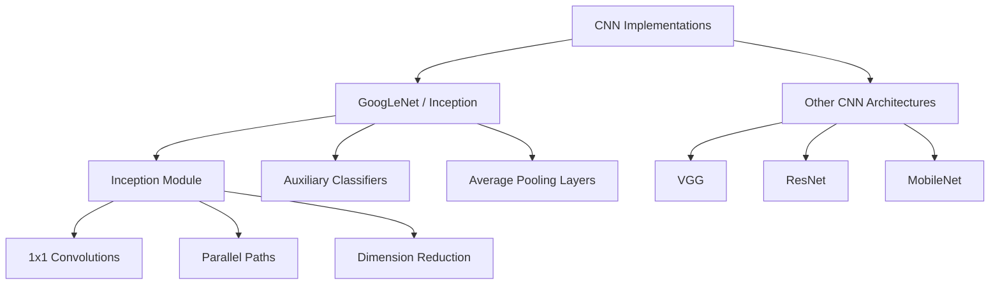
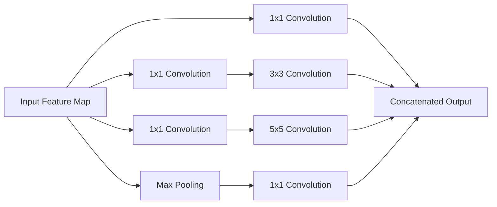
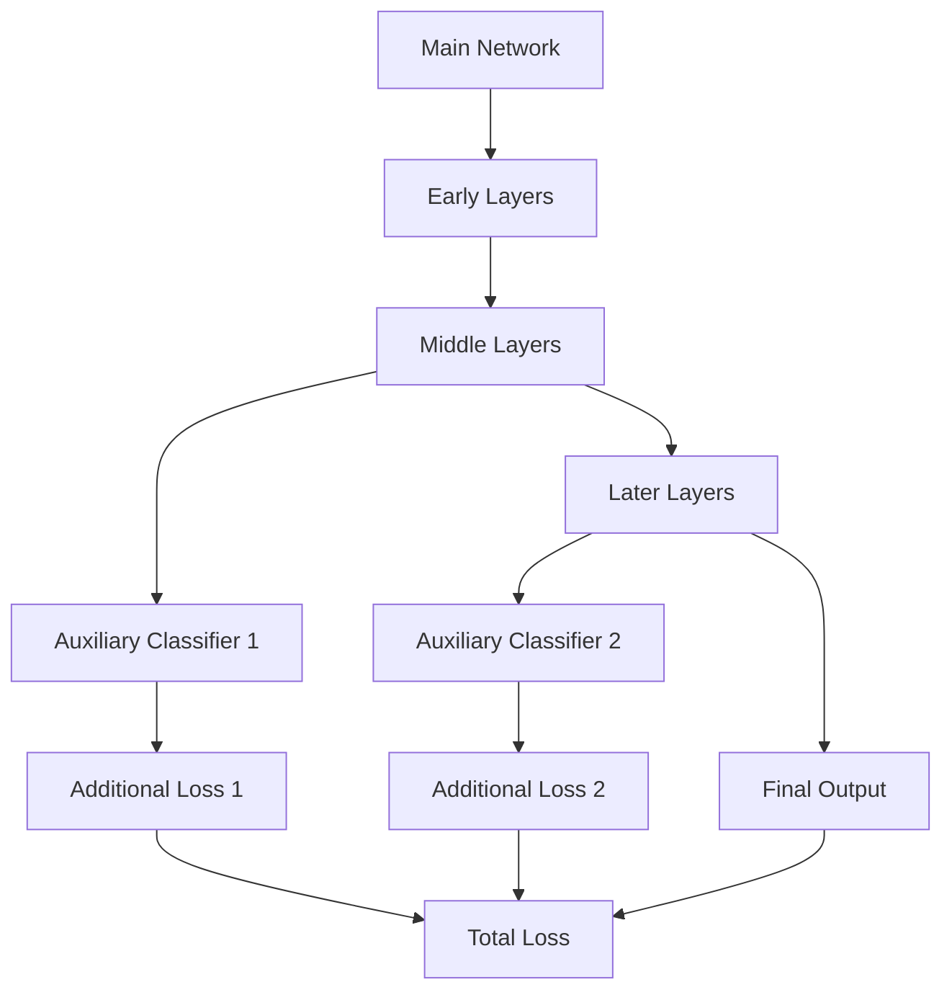
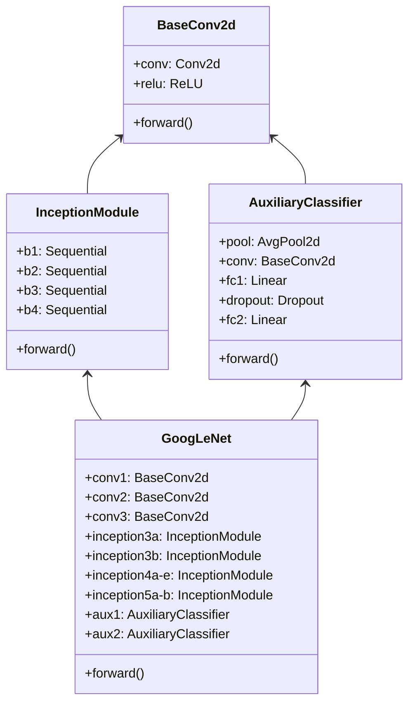
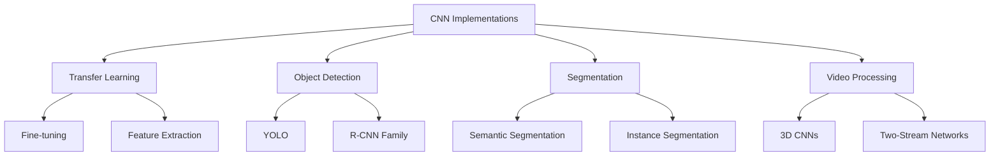

<!-- source: DeepWiki mcp.deepwiki.com · repo huggingface/computer-vision-course · page 3.1 CNN Implementations · fetched 2026-10-26 -->

# CNN Implementations

Relevant source files

The following files were used as context for generating this wiki page:

- [chapters/en/unit2/cnns/googlenet.mdx](chapters/en/unit2/cnns/googlenet.mdx)
- [notebooks/Unit 3 - Vision Transformers/transfer-learning-segmentation.ipynb](notebooks/Unit 3 - Vision Transformers/transfer-learning-segmentation.ipynb)
- [requirements.txt](requirements.txt)
- [utils/code_formatter.py](utils/code_formatter.py)

This document provides an overview of the Convolutional Neural Network (CNN) implementations available in the computer vision course repository. It specifically focuses on architectural designs and code implementations of CNN models, with detailed explanations of their components and usage patterns. For transfer learning applications utilizing these CNN implementations, see [Transfer Learning](#3.2).

## Overview of CNN Implementations

The repository includes comprehensive implementations of key CNN architectures that have revolutionized the field of computer vision. These implementations are designed both for educational purposes and practical applications, offering clean, readable code that closely follows the original architecture specifications.

Sources: [chapters/en/unit2/cnns/googlenet.mdx:1-234]()

## GoogLeNet Architecture

The primary CNN implementation highlighted in the repository is GoogLeNet (also known as Inception v1), which was a groundbreaking architecture introduced in the ImageNet 2014 challenge. This implementation is notable for its:

1. Efficiency - Contains fewer than 7 million parameters
2. Compact design - 9 times smaller than AlexNet and 22 times smaller than VGG16
3. Innovative architectural components that improve performance while reducing computational demands

### The Inception Module

The cornerstone of GoogLeNet is the Inception module, a novel building block that replaced the traditional convolutional layer with a more complex structure.

The Inception module applies convolution filters of different kernel sizes (1×1, 3×3, 5×5) and a max pooling operation in parallel, allowing feature extraction at multiple scales. To reduce computational complexity, 1×1 convolutions are used for dimension reduction before the more expensive 3×3 and 5×5 convolutions.

For example, converting a feature map of size S×S×128 to S×S×256 via a 5×5 convolution would require 5×5×128×256 = 819,200 parameters. By first reducing the dimensions with a 1×1 convolution to 64 channels, the parameter count becomes 1×1×128×64 + 5×5×64×256 = 8,192 + 409,600 = 417,792, reducing the parameters by nearly half.

Sources: [chapters/en/unit2/cnns/googlenet.mdx:10-34]()

### Auxiliary Classifiers

GoogLeNet introduced auxiliary classifiers to address the vanishing gradient problem that occurs in deep networks. These classifiers branch out from intermediate layers and add their loss to the total loss (with reduced weight), ensuring that layers close to the input receive sufficient gradients.

Each auxiliary classifier consists of:
- An average pooling layer (5×5 filter, stride 3)
- A 1×1 convolution with 128 filters and ReLU activation
- A fully connected layer with 1024 units and ReLU activation
- A dropout layer (70% drop rate)
- A linear layer with softmax loss

These auxiliary classifiers are only used during training and are removed during inference.

Sources: [chapters/en/unit2/cnns/googlenet.mdx:48-66]()

### Average Pooling

GoogLeNet replaced the traditional fully connected layers at the end of the network with average pooling, significantly reducing the number of parameters. While traditional architectures like AlexNet and VGG had 89-95% of their parameters in fully connected layers, GoogLeNet has only about 15% of its parameters in fully connected layers.

Sources: [chapters/en/unit2/cnns/googlenet.mdx:37-46]()

## Code Implementation Details

The repository provides a complete PyTorch implementation of GoogLeNet. The implementation is organized into several key components:

### Key Components

1. **BaseConv2d**: A wrapper class that combines a convolutional layer with ReLU activation, making the network construction more concise.

2. **InceptionModule**: Implements the parallel path architecture with dimension reduction:
   - b1: 1×1 convolution path
   - b2: 1×1 convolution → 3×3 convolution path
   - b3: 1×1 convolution → 5×5 convolution path
   - b4: max pooling → 1×1 convolution path

3. **AuxiliaryClassifier**: Implements the auxiliary classifier structure for addressing the vanishing gradient problem.

4. **GoogLeNet**: The main class that assembles all components into the complete architecture. It's structured in blocks:
   - Block 1-2: Initial convolutions and max pooling
   - Block 3: Two Inception modules (3a, 3b) followed by max pooling
   - Block 4: Five Inception modules (4a-4e) followed by max pooling, with auxiliary classifiers after 4a and 4d
   - Block 5: Two Inception modules (5a, 5b)
   - Block 6: Average pooling, dropout, and final fully connected layer

Sources: [chapters/en/unit2/cnns/googlenet.mdx:76-233]()

## Training and Usage

When training GoogLeNet, the implementation supports both using and disabling auxiliary classifiers through the `use_aux` parameter in the constructor. During training, if auxiliary classifiers are enabled, the model returns three outputs: the main output and two auxiliary outputs. During inference, only the main output is returned.

The model supports input images of size 224×224×3, following the original GoogLeNet design, and outputs class probabilities for 1000 classes (matching the ImageNet classification task).

## Code Format and Maintenance

The repository maintains high code quality standards through automated formatting tools. The code formatting is handled by a Python script using the `black` formatter, ensuring consistent style across all Python code examples in the repository.

Sources: [utils/code_formatter.py:1-96]()

## Relationship to Other Components

CNN implementations serve as fundamental building blocks for more advanced tasks in the computer vision course, such as transfer learning, object detection, and segmentation. The modular design of these implementations allows them to be easily adapted for various downstream tasks.

This hierarchy shows how CNN architectures like GoogLeNet provide the foundation for more complex vision tasks covered in other sections of the course.

Sources: [notebooks/Unit 3 - Vision Transformers/transfer-learning-segmentation.ipynb:1-322]()

---

