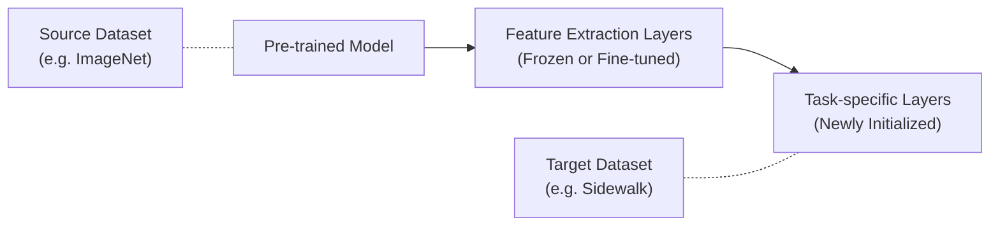
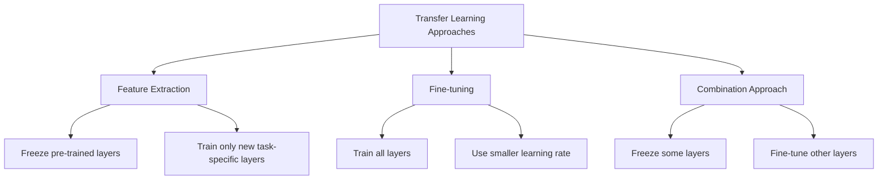
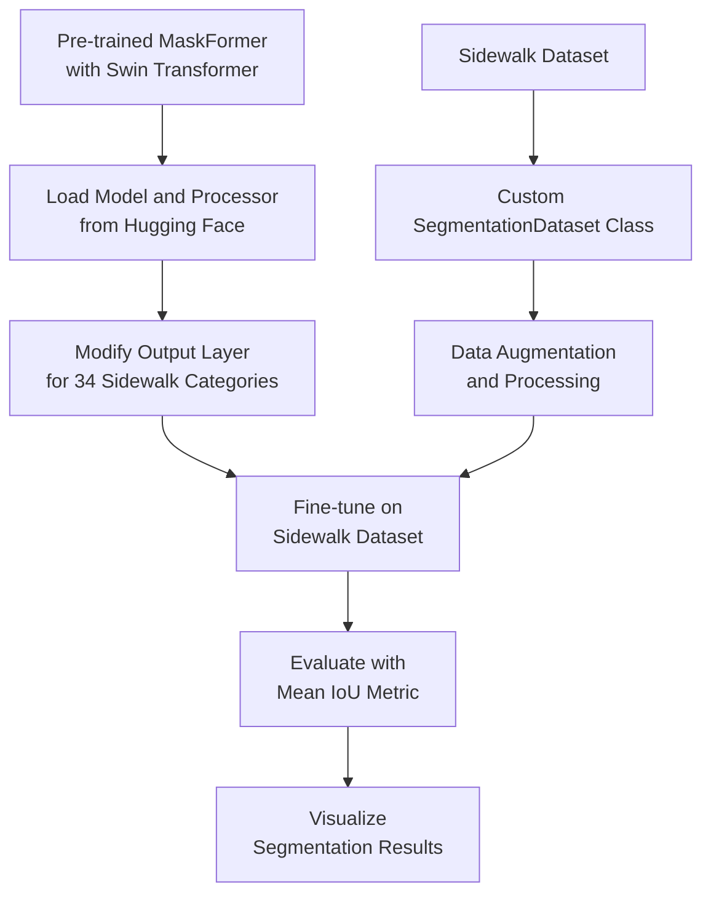
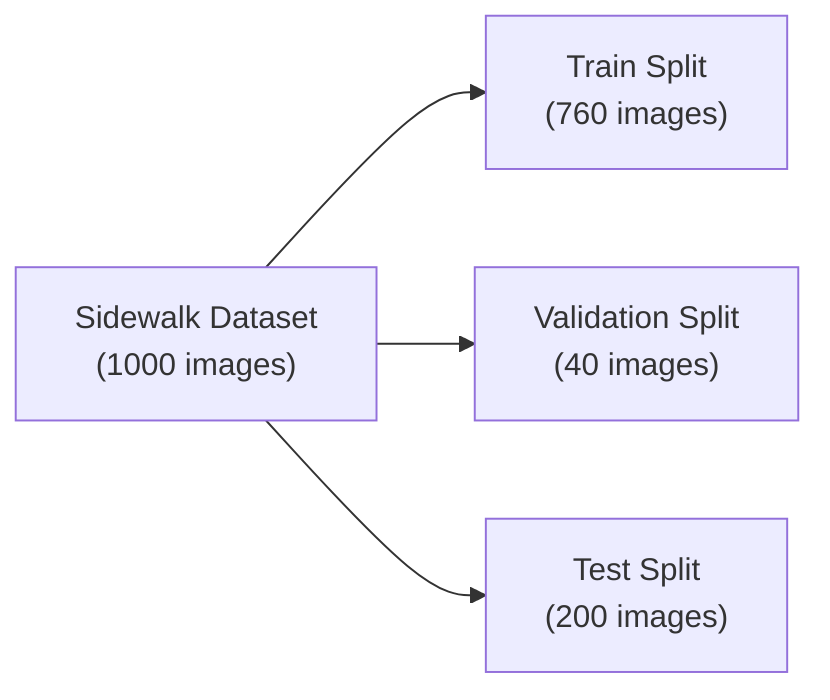
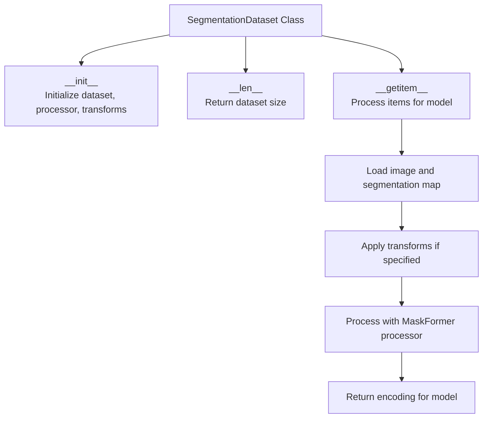
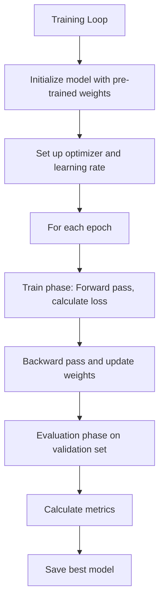
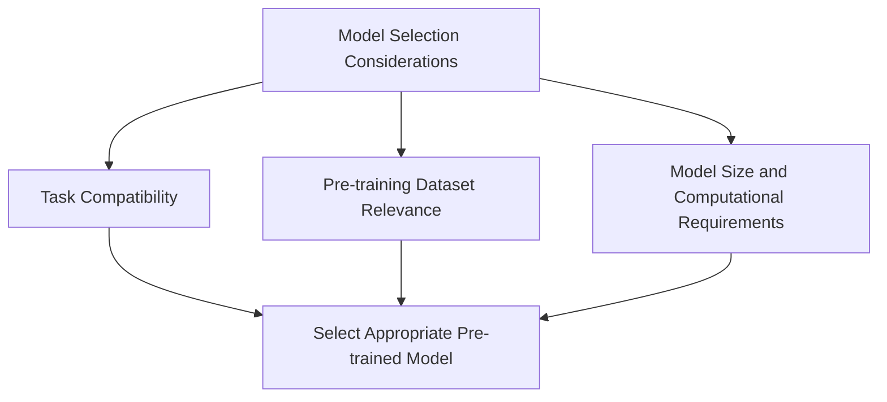
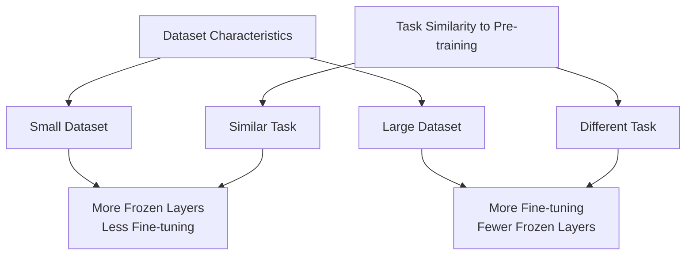
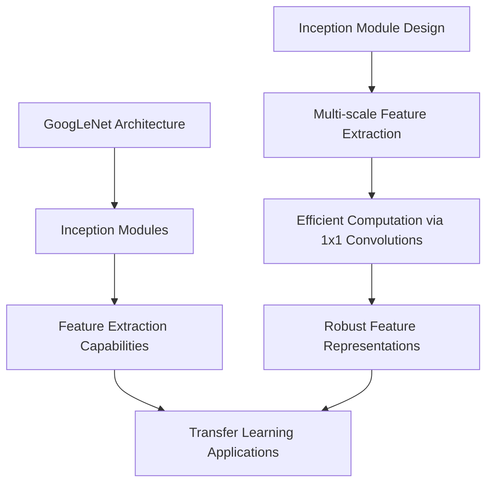

<!-- source: DeepWiki mcp.deepwiki.com · repo huggingface/computer-vision-course · page 3.2 Transfer Learning · fetched 2026-10-26 -->

# Transfer Learning

<details>
<summary>Relevant source files</summary>

The following files were used as context for generating this wiki page:

- [chapters/en/unit2/cnns/googlenet.mdx](chapters/en/unit2/cnns/googlenet.mdx)
- [notebooks/Unit 3 - Vision Transformers/KnowledgeDistillation.ipynb](notebooks/Unit 3 - Vision Transformers/KnowledgeDistillation.ipynb)
- [notebooks/Unit 3 - Vision Transformers/transfer-learning-segmentation.ipynb](notebooks/Unit 3 - Vision Transformers/transfer-learning-segmentation.ipynb)
- [requirements.txt](requirements.txt)
- [utils/code_formatter.py](utils/code_formatter.py)

</details>


## Purpose and Scope

This document explains transfer learning implementation details for computer vision models in the repository. Transfer learning is a technique where knowledge from a pre-trained model is leveraged to improve learning on a new task with less data. In computer vision, this typically involves taking models pre-trained on large datasets like ImageNet and fine-tuning them for specific tasks such as image classification, object detection, or semantic segmentation with smaller task-specific datasets.

## Introduction to Transfer Learning

Transfer learning allows us to utilize knowledge gained from training models on large datasets and apply it to new tasks, particularly when we have limited labeled data. This approach involves:

1. Taking a pre-trained model (e.g., trained on ImageNet)
2. Modifying the architecture as needed for the new task
3. Fine-tuning some or all of the model's parameters on the new dataset



Sources:
- notebooks/Unit 3 - Vision Transformers/transfer-learning-segmentation.ipynb

### Transfer Learning Approaches

There are several approaches to transfer learning in computer vision:



**Feature Extraction**: The pre-trained model is used as a fixed feature extractor, where we freeze the weights of all convolutional layers and only train the new task-specific layers (usually the fully connected layers).

**Fine-tuning**: We train the entire model or selected layers with a small learning rate to adapt the pre-trained features to the new task.

**Combination Approach**: We freeze some early layers (which capture generic features) and fine-tune later layers (which capture more task-specific features).

Sources:
- notebooks/Unit 3 - Vision Transformers/transfer-learning-segmentation.ipynb

## Implementation in the Repository

The repository includes an implementation of transfer learning for semantic segmentation in the notebook `transfer-learning-segmentation.ipynb`. This notebook demonstrates how to fine-tune a pre-trained transformer-based model for semantic segmentation on a new dataset.

### Transfer Learning for Semantic Segmentation

The implementation uses a pre-trained MaskFormer model with a Swin Transformer backbone from Hugging Face (`facebook/maskformer-swin-base-ade`) and fine-tunes it on the sidewalk dataset, which contains 1000 images with 34 categories for semantic segmentation.



Sources:
- notebooks/Unit 3 - Vision Transformers/transfer-learning-segmentation.ipynb:54-78
- notebooks/Unit 3 - Vision Transformers/transfer-learning-segmentation.ipynb:139-142

### Data Preparation and Loading

The implementation begins by loading the sidewalk dataset from Hugging Face and splitting it into training, validation, and test sets:



The dataset contains:
- RGB images as `pixel_values`
- Segmentation maps as `label`
- 34 category labels for various sidewalk elements

Sources:
- notebooks/Unit 3 - Vision Transformers/transfer-learning-segmentation.ipynb:140-331
- notebooks/Unit 3 - Vision Transformers/transfer-learning-segmentation.ipynb:347-411

### Loading Pre-trained Model

The implementation loads a pre-trained MaskFormer model and image processor:

```python
model = MaskFormerForInstanceSegmentation.from_pretrained(
    model_name, id2label=id2label, ignore_mismatched_sizes=True
)
processor = MaskFormerImageProcessor.from_pretrained(model_name)
```

The `ignore_mismatched_sizes=True` parameter is important as it allows adapting the model's output layer to handle the 34 categories in the sidewalk dataset, which may differ from the original model's output size.

Sources:
- notebooks/Unit 3 - Vision Transformers/transfer-learning-segmentation.ipynb:72-76

### Custom Dataset Implementation

A custom dataset class handles the preparation of the sidewalk dataset for the model:



This custom dataset class performs several key functions:
1. Loads the image and segmentation map from the dataset
2. Applies data augmentation transforms when specified
3. Processes the data using the MaskFormer processor
4. Returns the encoded data ready for the model

Sources:
- notebooks/Unit 3 - Vision Transformers/transfer-learning-segmentation.ipynb:430-457

### Data Augmentation

Data augmentation helps the model generalize better to unseen data by creating variations of the training images:

```python
transforms = A.Compose([
    A.RandomResizedCrop(height=512, width=512, scale=(0.8, 1.0)),
    A.HorizontalFlip(p=0.5),
    A.RandomBrightnessContrast(p=0.2),
])
```

The augmentation techniques applied include:
- Random cropping and resizing to 512×512 pixels
- Random horizontal flipping with 50% probability
- Random adjustments to brightness and contrast

Sources:
- notebooks/Unit 3 - Vision Transformers/transfer-learning-segmentation.ipynb:460-464
- requirements.txt:8

### Training Implementation

The training loop implements the transfer learning process:



Key aspects of the training implementation:
1. Using an appropriate optimizer (like AdamW) with a small learning rate for fine-tuning
2. Computing the loss using the model's built-in loss function
3. Evaluating on a validation set to monitor progress
4. Saving the best model based on validation performance

Sources:
- notebooks/Unit 3 - Vision Transformers/transfer-learning-segmentation.ipynb:480-600

### Evaluation Metrics

The model is evaluated using metrics specific to semantic segmentation, primarily Mean Intersection over Union (mIoU):

```python
metric = evaluate.load("mean_iou")
# ...
metrics = metric.compute(
    num_labels=len(id2label),
    ignore_index=0,
    reduce_labels=False,
)
```

Mean IoU measures the overlap between predicted segmentation masks and ground truth, providing a standard measure of segmentation quality across all classes.

Sources:
- notebooks/Unit 3 - Vision Transformers/transfer-learning-segmentation.ipynb:550-600

## Best Practices for Transfer Learning

Based on the implementation in the repository, here are key best practices for effective transfer learning in computer vision:

### 1. Model Selection



When selecting a pre-trained model:
- Choose an architecture suitable for your task (e.g., CNNs for classification, transformer-based models for segmentation)
- Consider the similarity between the pre-training dataset and your target dataset
- Balance model size with available computational resources

Sources:
- notebooks/Unit 3 - Vision Transformers/transfer-learning-segmentation.ipynb:17-21
- notebooks/Unit 3 - Vision Transformers/transfer-learning-segmentation.ipynb:72-76

### 2. Data Preparation

Proper data preparation is crucial for effective transfer learning:

- Ensure your data format is compatible with the model's expectations
- Implement appropriate preprocessing steps (resizing, normalization)
- Use data augmentation to improve generalization
- Create proper training, validation, and test splits

Sources:
- notebooks/Unit 3 - Vision Transformers/transfer-learning-segmentation.ipynb:323-331
- notebooks/Unit 3 - Vision Transformers/transfer-learning-segmentation.ipynb:460-464

### 3. Transfer Learning Strategy

Choose the appropriate transfer learning strategy based on your data and task:



For smaller datasets or tasks similar to the pre-training task, freezing more layers often works better.
For larger datasets or tasks different from the pre-training task, fine-tuning more layers typically yields better results.

Sources:
- notebooks/Unit 3 - Vision Transformers/transfer-learning-segmentation.ipynb:72-76

### 4. Training Parameters

Optimization parameters for transfer learning differ from training from scratch:

- Use smaller learning rates (typically 10-100x smaller than training from scratch)
- Consider using different learning rates for different layers (higher for new layers)
- Implement appropriate regularization to prevent overfitting
- Monitor validation performance to prevent overfitting

Sources:
- notebooks/Unit 3 - Vision Transformers/transfer-learning-segmentation.ipynb:480-600

## Common Challenges and Solutions

### Model Adaptation

When adapting pre-trained models to new tasks:

- Modify the output layer to match your task's requirements (number of classes)
- Adjust input processing to match the expected input format
- Use `ignore_mismatched_sizes=True` when loading models with different output dimensions

Sources:
- notebooks/Unit 3 - Vision Transformers/transfer-learning-segmentation.ipynb:72-76

### Small Dataset Challenges

When working with limited data:

- Increase data augmentation to create more training variations
- Freeze more layers of the pre-trained model
- Use stronger regularization techniques
- Consider techniques like gradual unfreezing of layers

Sources:
- notebooks/Unit 3 - Vision Transformers/transfer-learning-segmentation.ipynb:460-464

### Domain Gap

When there's a significant difference between pre-training and target domains:

- Implement domain adaptation techniques
- Use more extensive fine-tuning
- Apply data augmentation specifically designed to bridge the domain gap

Sources:
- notebooks/Unit 3 - Vision Transformers/transfer-learning-segmentation.ipynb:460-464

## Example: GoogLeNet Architecture for Transfer Learning

The repository includes an implementation of the GoogLeNet architecture, which is often used as a base model for transfer learning:



GoogLeNet's architecture makes it particularly suitable for transfer learning because:
1. The Inception modules capture features at multiple scales
2. The efficient use of parameters (9x smaller than AlexNet) allows for faster fine-tuning
3. The hierarchical feature representation transfers well to various tasks

Sources:
- chapters/en/unit2/cnns/googlenet.mdx:1-235

## Conclusion

Transfer learning is a powerful technique for leveraging pre-trained models in computer vision tasks. The implementation in this repository demonstrates how to effectively apply transfer learning to semantic segmentation using transformer-based models. By following the best practices outlined here, you can efficiently adapt pre-trained models to new tasks while achieving strong performance even with limited training data.

Key takeaways:
- Choose appropriate pre-trained models based on your task requirements
- Prepare your data to match the model's expectations
- Select a transfer learning strategy based on dataset size and task similarity
- Use appropriate training parameters and regularization techniques
- Address common challenges like domain gaps and small datasets with specific solutions

---

