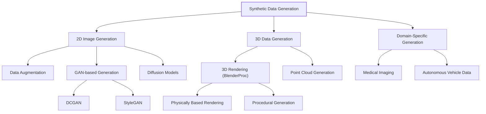
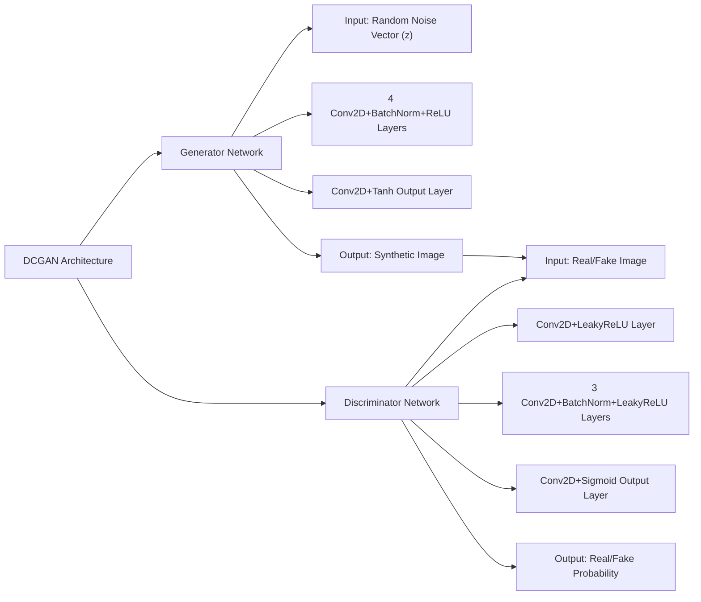
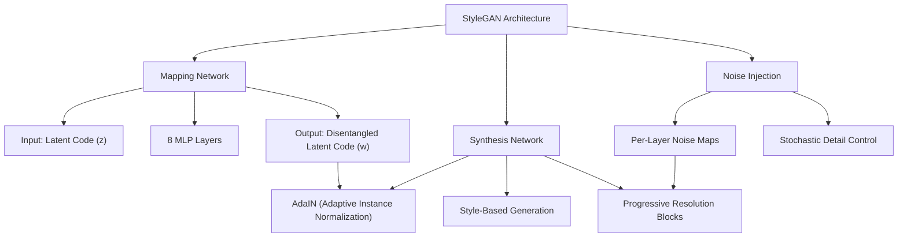
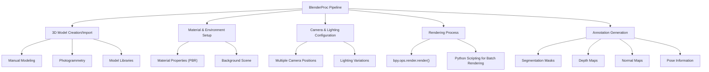
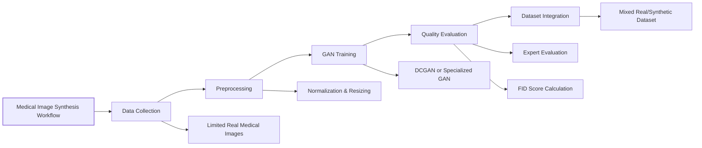

<!-- source: DeepWiki mcp.deepwiki.com · repo huggingface/computer-vision-course · page 3.3 Synthetic Data Generation · fetched 2026-10-26 -->

# Synthetic Data Generation

<details>
<summary>Relevant source files</summary>

The following files were used as context for generating this wiki page:

- [chapters/en/unit1/image_and_imaging/examples-preprocess.mdx](chapters/en/unit1/image_and_imaging/examples-preprocess.mdx)
- [chapters/en/unit10/blenderProc.mdx](chapters/en/unit10/blenderProc.mdx)
- [chapters/en/unit10/point_clouds.mdx](chapters/en/unit10/point_clouds.mdx)
- [chapters/en/unit10/synthetic-lung-images.mdx](chapters/en/unit10/synthetic-lung-images.mdx)
- [chapters/en/unit3/vision-transformers/cvt.mdx](chapters/en/unit3/vision-transformers/cvt.mdx)
- [chapters/en/unit5/generative-models/gans-vaes/stylegan.mdx](chapters/en/unit5/generative-models/gans-vaes/stylegan.mdx)
- [notebooks/Unit 5 - Generative Models/Diffusion Models/README.md](notebooks/Unit 5 - Generative Models/Diffusion Models/README.md)
- [notebooks/Unit 5 - Generative Models/GANs & VAEs/README.md](notebooks/Unit 5 - Generative Models/GANs & VAEs/README.md)
- [notebooks/Unit 5 - Generative Models/Introduction/README.md](notebooks/Unit 5 - Generative Models/Introduction/README.md)
- [notebooks/Unit 5 - Generative Models/Practical Applications & Challenges/README.md](notebooks/Unit 5 - Generative Models/Practical Applications & Challenges/README.md)

</details>


## Purpose and Scope

This document covers methods and implementations for generating synthetic training data for computer vision tasks. Synthetic data generation involves creating artificial data that mimics real-world data characteristics, providing solutions for scenarios with limited data availability, privacy constraints, or the need for specific edge cases. This page focuses on technical approaches to generating synthetic visual data, including 2D images, 3D models, and specialized domain data.

For information on generative models in general, see [Generative Models](#2.3). For details on transfer learning that may leverage synthetic data, see [Transfer Learning](#3.2).

Sources: [chapters/en/unit10/blenderProc.mdx:1-46](). [chapters/en/unit10/synthetic-lung-images.mdx:1-4]().

## Synthetic Data Generation Approaches

The following diagram illustrates the main approaches to synthetic data generation covered in this document:



Sources: [chapters/en/unit10/blenderProc.mdx:43-45](). [chapters/en/unit10/synthetic-lung-images.mdx:1-8](). [chapters/en/unit5/generative-models/gans-vaes/stylegan.mdx:8-16]().

### Data Augmentation vs. Synthetic Data

While related, data augmentation and synthetic data generation serve different purposes:

| Feature | Data Augmentation | Synthetic Data Generation |
|---------|-------------------|---------------------------|
| Source | Transforms existing real data | Creates entirely new data |
| Implementation | Simple transformations (rotation, flipping, etc.) | Complex generative models or simulators |
| Purpose | Increase dataset variation | Create data for scenarios with limited or no real data |
| Control | Limited control over specific features | Can target specific attributes or edge cases |
| Example methods | Geometric transformations, color adjustments | GANs, 3D rendering, diffusion models |

Data augmentation involves applying transformations such as geometric and color space modifications to existing data, thereby enriching the original dataset with varied forms. Synthetic data is entirely new and generated from scratch using advanced techniques like Deep Neural Networks (DNNs), Generative Adversarial Networks (GANs), or 3D rendering engines.

Sources: [chapters/en/unit1/image_and_imaging/examples-preprocess.mdx:22-31]().

## GAN-Based Synthetic Data Generation

Generative Adversarial Networks (GANs) provide a powerful approach for generating synthetic images. Two primary GAN architectures used for synthetic data generation are DCGAN and StyleGAN.

### DCGAN for Medical Image Synthesis

Deep Convolutional Generative Adversarial Networks (DCGAN) have been successfully applied to generate synthetic medical images, addressing challenges in domains with small datasets, privacy concerns, and limited annotated samples.



DCGAN has been used in medical imaging for:
- Generating synthetic lung X-ray images
- Creating retina images
- Producing brain scans for Alzheimer's disease stages
- Synthesizing liver lesion images

Sources: [chapters/en/unit10/synthetic-lung-images.mdx:3-9](). [chapters/en/unit10/synthetic-lung-images.mdx:20-30]().

### StyleGAN for Controlled Synthesis

StyleGAN is a specialized GAN architecture that provides fine-grained control over generated images, enabling both high-level (pose, facial expression) and low-level (skin details, hair placement) feature manipulation.



StyleGAN offers several advantages for synthetic data generation:
- Disentangled feature control, allowing manipulation of specific attributes
- Progressive generation of high-resolution images
- Control over both global features and fine details
- Useful for privacy-preserving applications by generating realistic but synthetic faces

Sources: [chapters/en/unit5/generative-models/gans-vaes/stylegan.mdx:15-56]().

## 3D Synthetic Data Generation

### Using Physically Based Renderers

Physically Based Renderers (PBR) like Blender Cycles create photorealistic synthetic images by simulating how light interacts with different materials and surfaces in the real world.



Key benefits of using 3D renderers for synthetic data generation:
1. Photorealistic image quality that closely mimics real-world data
2. Precise control over object positions, camera angles, and lighting conditions
3. Automatic generation of ground truth annotations (segmentation, depth, etc.)
4. Ability to render challenging scenarios that are rare in real-world data

BlenderProc, built on top of Blender, provides a specialized pipeline for synthetic data generation with these features:
- Procedural scene generation for automated creation of complex 3D environments
- Physics simulation capabilities
- Large-scale generation of diverse scenes
- Python scripting for automation and customization

Sources: [chapters/en/unit10/blenderProc.mdx:1-83](). [chapters/en/unit10/blenderProc.mdx:84-103]().

### BlenderProc Implementation

BlenderProc must be run inside the Blender Python environment (bpy) to access the Blender API:

```bash
blenderproc run <your_python_script>
```

The pipeline enables generation of:
- Realistic RGB images
- Segmentation masks
- Depth maps
- Surface normal maps
- Object pose information

Sources: [chapters/en/unit10/blenderProc.mdx:104-122]().

### Point Cloud Generation

Point clouds represent 3D data as collections of individual points with [x, y, z] coordinates and optional attributes like color, normals, and reflectance properties.

Synthetic point cloud data can be generated from:
1. Mesh formats (PLY, STL, OFF, OBJ, 3DS, VRML 2.0, X3D, COLLADA)
2. 3D rendering with depth information
3. Conversion from other 3D representations

Libraries like `point-cloud-utils` and `open3d` facilitate working with point cloud data:

```python
# Install required libraries
pip install point-cloud-utils open3d
```

Sources: [chapters/en/unit10/point_clouds.mdx:1-44](). [chapters/en/unit10/point_clouds.mdx:45-88]().

## Medical Image Synthesis

Medical imaging is a domain that particularly benefits from synthetic data generation due to:
1. Limited availability of real patient data
2. Privacy concerns with medical records
3. Scarcity of rare conditions in datasets
4. Need for balanced datasets across conditions

The process for generating synthetic medical images using GANs involves:



Recent research has shown that diffusion models often outperform GANs for medical image synthesis, with models like MedFusion demonstrating superior quality in generating realistic medical imagery.

Sources: [chapters/en/unit10/synthetic-lung-images.mdx:5-11](). [chapters/en/unit10/synthetic-lung-images.mdx:32-91]().

## Implementation Challenges and Best Practices

When implementing synthetic data generation systems, several challenges commonly arise:

| Challenge | Best Practice |
|-----------|---------------|
| Domain gap | Mix synthetic with real data for training |
| Mode collapse in GANs | Use specialized architectures like StyleGAN |
| Hyperparameter tuning | Use validation sets to optimize generation quality |
| Computational requirements | Leverage cloud resources for large-scale generation |
| Quality evaluation | Combine automated metrics with expert evaluation |
| Dataset bias | Ensure synthetic data covers diverse scenarios |

For 3D rendering specifically:
- Create varied lighting conditions to improve model robustness
- Randomize camera positions and parameters
- Include realistic background variation
- Apply post-processing to bridge the sim-to-real gap

Sources: [chapters/en/unit10/blenderProc.mdx:78-83](). [chapters/en/unit10/synthetic-lung-images.mdx:87-91]().

## Further Resources

For those looking to implement synthetic data generation systems, the following resources provide additional information:

### BlenderProc Resources
- [BlenderProc Github Repository](https://github.com/DLR-RM/BlenderProc)
- [Documentation](https://dlr-rm.github.io/BlenderProc/)

### GAN-Based Generation
- [DCGAN Tutorial (PyTorch)](https://pytorch.org/tutorials/beginner/dcgan_faces_tutorial.html)
- [StyleGAN Repository](https://github.com/NVlabs/stylegan)

### Medical Image Synthesis
- [MedFusion Repository](https://github.com/mueller-franzes/medfusion)
- [PyTorch-StudioGAN](https://github.com/POSTECH-CVLab/PyTorch-StudioGAN)

Sources: [chapters/en/unit10/blenderProc.mdx:143-158](). [chapters/en/unit10/synthetic-lung-images.mdx:93-111]().

---

