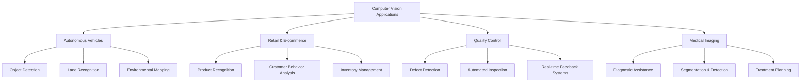
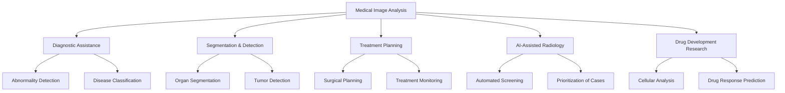
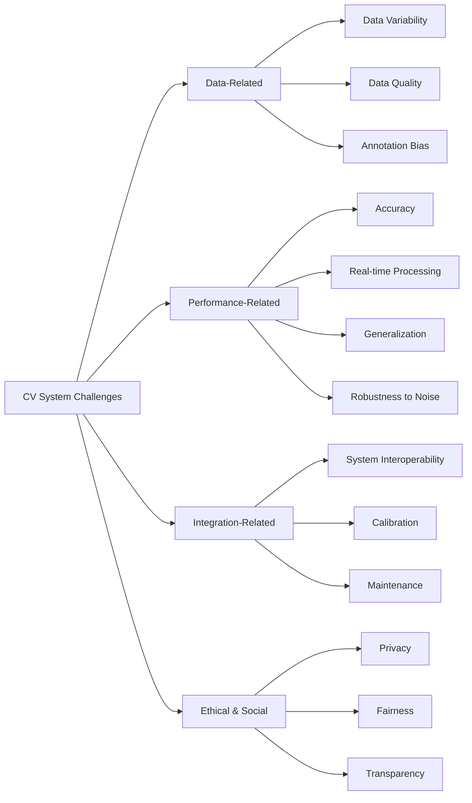
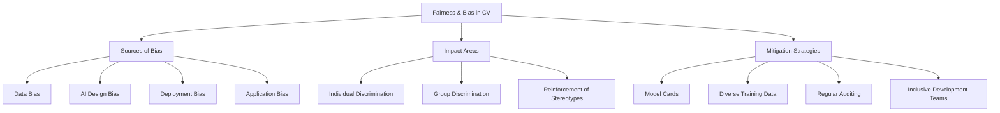

<!-- source: DeepWiki mcp.deepwiki.com · repo huggingface/computer-vision-course · page 4 Applications and Ethical Considerations · fetched 2026-10-26 -->

# Applications and Ethical Considerations

Relevant source files

The following files were used as context for generating this wiki page:

- [chapters/en/unit0/welcome/TableOfContents.mdx](chapters/en/unit0/welcome/TableOfContents.mdx)
- [chapters/en/unit1/chapter1/applications.mdx](chapters/en/unit1/chapter1/applications.mdx)
- [chapters/en/unit1/chapter1/definition.mdx](chapters/en/unit1/chapter1/definition.mdx)
- [chapters/en/unit1/chapter1/motivation.mdx](chapters/en/unit1/chapter1/motivation.mdx)
- [chapters/en/unit1/feature-extraction/feature-matching.mdx](chapters/en/unit1/feature-extraction/feature-matching.mdx)
- [chapters/en/unit1/feature-extraction/feature_description.mdx](chapters/en/unit1/feature-extraction/feature_description.mdx)
- [chapters/en/unit1/feature-extraction/real-world-applications.mdx](chapters/en/unit1/feature-extraction/real-world-applications.mdx)
- [chapters/en/unit1/image_and_imaging/extension-image.mdx](chapters/en/unit1/image_and_imaging/extension-image.mdx)

This document provides a comprehensive overview of the real-world applications of computer vision technologies and the ethical considerations associated with their deployment. The material covered bridges the gap between technical implementations and their societal impacts, highlighting both opportunities and challenges in using computer vision responsibly.

For technical implementation details of specific computer vision models, refer to [Implementation Details](#3). For information about contributing to the course content, see [Community and Contribution](#5).

## Real-World Applications of Computer Vision

Computer vision technologies have been adopted across numerous industries, transforming how organizations operate and how people interact with technology. This section explores key application domains where computer vision is making significant impact.

Sources: [chapters/en/unit1/chapter1/applications.mdx:9-35]

### Autonomous Vehicles

Self-driving vehicles rely heavily on computer vision for perceiving and interpreting the environment. These systems use cameras and sensors to identify objects, pedestrians, traffic signs, lane markings, and other vehicles. Computer vision algorithms help autonomous vehicles make real-time decisions for navigation and safety.

Companies like Tesla, Waymo, and Uber use computer vision technology to enhance transportation safety and efficiency. Their systems must perform object detection, lane recognition, and environmental mapping in real-time under varying conditions.

Sources: [chapters/en/unit1/chapter1/applications.mdx:11-15]

### Retail and E-commerce

Computer vision is revolutionizing retail through several key applications:

1. **Object Recognition and Recommendation**: Computer vision algorithms analyze product images to identify items and recommend similar products to customers.

2. **Inventory Management**: CV-powered systems track inventory levels, detect stock shortages, and optimize supply chain operations.

3. **Customer Behavior Analysis**: Vision systems analyze customer movement and interactions in physical stores to optimize layouts and marketing strategies.

Major platforms like Amazon, eBay, and Walmart implement these technologies to enhance customer experience and operational efficiency.

Sources: [chapters/en/unit1/chapter1/applications.mdx:17-19]

### Quality Control in Assembly Lines

Computer vision systems have revolutionized quality control in manufacturing through:

| Application | Description |
|-------------|-------------|
| Defect Detection | Real-time analysis of products to identify defects not immediately visible to humans |
| Automated Inspection | Using cameras and ML algorithms to replace manual inspection of products |
| Real-time Feedback | Triggering immediate actions when defects are detected, optimizing production |

These systems compare products against reference standards, ensuring consistency and high quality across mass production operations while minimizing waste.

Sources: [chapters/en/unit1/chapter1/applications.mdx:21-29]

### Medical Image Analysis

Medical image analysis applies computer vision to interpret medical images including X-rays, CT scans, MRIs, ultrasounds, and histopathology slides. Key applications include:

1. **Diagnostic Assistance**: Algorithms detect abnormalities such as tumors and fractures in medical images, helping healthcare professionals in diagnosis.

2. **Segmentation and Detection**: Computer vision segments and isolates specific structures or anomalies within images for closer examination.

3. **Treatment Planning**: These systems provide precise measurements, track changes over time, and assist in surgical planning.

4. **AI-Assisted Radiology**: Automated systems flag potentially abnormal findings, provide quantitative analysis, and predict potential health issues.

5. **Drug Development**: Computer vision techniques analyze cellular structures and tissue samples for research and drug development.

While doctors could perform many of these tasks manually, CV systems automate the process, allowing medical professionals to focus on other critical aspects of patient care.

Sources: [chapters/en/unit1/chapter1/applications.mdx:31-48]

## Challenges for Computer Vision Systems

The deployment of computer vision systems in real-world applications faces numerous challenges that must be addressed to ensure reliable performance.

The table below summarizes key challenges faced by computer vision systems:

| Challenge Category | Specific Challenges | Description |
|-------------------|---------------------|-------------|
| Data Quality | Variability in Data | Real-world data varies in lighting, viewpoint, occlusions, and backgrounds |
| | Robustness to Noise | Systems must handle defects, sensor artifacts, and distortions |
| Performance | Accuracy | Achieving high accuracy in detection and interpretation, especially in complex scenes |
| | Real-time Processing | Applications like autonomous vehicles require instantaneous processing |
| | Generalization | Models must adapt to diverse contexts without extensive retraining |
| Operational | Scalability | Managing increasing volumes of visual data |
| | Long-term Reliability | Maintaining performance over extended periods in real-life scenarios |
| | Calibration and Maintenance | Keeping hardware properly calibrated in challenging environments |
| Integration | Integration with Other Technologies | Combining vision with NLP, robotics, or augmented reality |
| Ethical | Privacy and Ethical Concerns | Handling surveillance, facial recognition, and personal data |

Sources: [chapters/en/unit1/chapter1/applications.mdx:49-64], [chapters/en/unit1/image_and_imaging/extension-image.mdx:1-19]

## Ethical Considerations in Computer Vision

Computer vision technologies raise significant ethical considerations that must be addressed to ensure responsible deployment and use. These considerations have been present since the earliest applications of pattern recognition and artificial intelligence.

```mermaid
graph TD
    A["Ethical Considerations in CV"] --> B["Privacy"]
    A --> C["Bias & Fairness"]
    A --> D["Transparency"]
    A --> E["Accountability"]
    A --> F["Consent"]
    A --> G["Dual Use"]
    A --> H["Other Concerns"]
    
    B --> B1["Surveillance"]
    B --> B2["Facial Recognition"]
    B --> B3["Data Protection"]
    
    C --> C1["Algorithmic Bias"]
    C --> C2["Representation Issues"]
    C --> C3["Social Impact"]
    
    D --> D1["Explainability"]
    D --> D2["Model Cards"]
    D --> D3["Decision Understanding"]
    
    E --> E1["Human Oversight"]
    E --> E2["Responsibility Attribution"]
    
    F --> F1["Informed Consent"]
    F --> F2["User Control"]
    
    G --> G1["Beneficial Uses"]
    G --> G2["Harmful Applications"]
    
    H --> H1["Environmental Impact"]
    H --> H2["Child Protection"]
    H --> H3["Cultural Sensitivity"]
```

The development and deployment of computer vision systems must consider the following ethical aspects:

| Ethical Consideration | Description |
|------------------------|-------------|
| Privacy Concerns | Computer vision involves collecting and analyzing visual data, raising issues around unauthorized surveillance, facial recognition, and potential misuse of sensitive information |
| Bias and Fairness | Biases in data, algorithms, or design can lead to unfair outcomes and perpetuate social inequalities |
| Transparency | Systems should be transparent in their functioning and decisions, allowing users to understand how they work |
| Accuracy and Accountability | CV systems must be accurate and reliable, with clear accountability measures for errors or failures |
| Consent | Obtaining informed consent from individuals whose data is being collected is essential |
| Dual Use Concerns | Technology can have both beneficial and harmful applications, requiring safeguards against misuse |
| Human Oversight | Human intervention capabilities are crucial when systems may cause harm |
| Child Protection | Special protections are needed for visual data involving children |
| Cultural Sensitivity | Systems should respect cultural differences and diverse contexts |
| Environmental Impact | Development and deployment should consider energy consumption and electronic waste |
| Educational Training | Training programs are needed to raise awareness about ethical implications |

Sources: [chapters/en/unit1/chapter1/applications.mdx:66-97], [chapters/en/unit1/chapter1/definition.mdx:66-66]

### Historical Context and Evolution

The ethical considerations of computer vision are not new. Early examples like the London Hospital survival predictor from 1972, which predicted whether patients would recover from comas, already raised significant ethical concerns. Doctors were advised not to make decisions solely based on the machine's judgments, establishing an early precedent for human oversight of AI systems.

As technology has evolved and become more integrated into everyday life, ethical considerations have expanded to include global perspectives on fairness and bias. The challenge of defining and measuring fairness mathematically remains significant, as bias can appear at any stage of model development—from data collection to deployment and application.

Sources: [chapters/en/unit1/chapter1/applications.mdx:71-82]

### Fairness and Bias in Computer Vision

Fairness in computer vision refers to a model's ability to behave equitably without discrimination or unfair bias against groups or individuals. Unlike performance metrics such as accuracy or precision, fairness cannot be easily quantified with a single mathematical metric and requires understanding the specific context of the problem.

Bias can manifest at multiple points in the model development pipeline:
- In the data (through sampling bias or annotation bias)
- In the AI design (through algorithm selection or feature emphasis)
- During deployment (through system integration decisions)
- In model applications (through misuse or misinterpretation)

Industry efforts to address these issues include systematic reporting of model risks, limitations, and biases through model cards—documentation files that accompany models and provide important information about their characteristics and potential ethical considerations.

Sources: [chapters/en/unit1/chapter1/applications.mdx:75-84]

## Balancing Innovation and Ethical Responsibility

As computer vision technologies continue to advance, balancing technical innovation with ethical responsibility becomes increasingly important. This balance requires:

1. **Proactive ethical design**: Incorporating ethical considerations from the earliest stages of development
2. **Ongoing assessment**: Continuously evaluating systems for emerging ethical issues
3. **Stakeholder involvement**: Including diverse perspectives in development and decision-making
4. **Regulatory compliance**: Adhering to evolving legal frameworks for AI and data use
5. **Transparency**: Clearly documenting model limitations, biases, and intended uses

The field of computer vision has tremendous potential to benefit society through applications in healthcare, safety, accessibility, and more. However, realizing these benefits requires careful consideration of ethical implications alongside technical advances.

Sources: [chapters/en/unit1/chapter1/applications.mdx:66-97], [chapters/en/unit1/chapter1/definition.mdx:66-66]

## Best Practices for Ethical Computer Vision

Based on the ethical considerations discussed, the following best practices help ensure responsible development and deployment of computer vision systems:

| Best Practice | Description |
|---------------|-------------|
| Diverse and Representative Data | Ensure training data represents diverse populations and scenarios |
| Regular Bias Auditing | Continuously test for and address biases in systems |
| Clear Documentation | Provide transparent documentation of system capabilities and limitations |
| Privacy by Design | Incorporate privacy protections from the earliest development stages |
| Opt-in Consent | Obtain clear consent for data collection and use when possible |
| Fallback Mechanisms | Design systems with safe fallback options when confidence is low |
| Impact Assessment | Evaluate potential societal impacts before deployment |
| Ongoing Monitoring | Monitor systems after deployment for unexpected behaviors or biases |
| Education and Training | Ensure developers and users understand ethical implications |
| Stakeholder Engagement | Include diverse perspectives in the development process |

These practices help mitigate risks while maximizing the benefits of computer vision applications across different domains.

Sources: [chapters/en/unit1/chapter1/applications.mdx:86-97]

## Conclusion

Computer vision applications continue to transform numerous industries, from healthcare to retail, autonomous vehicles to manufacturing. As these technologies become more integrated into critical systems and everyday life, the ethical considerations surrounding their development and deployment grow increasingly important.

Addressing challenges related to privacy, bias, transparency, and accountability requires ongoing attention from developers, organizations, policymakers, and society at large. By proactively engaging with these ethical considerations and implementing best practices, we can work toward computer vision systems that are not only technically sophisticated but also socially responsible.

The computer vision course explores these ethical dimensions alongside technical implementation, recognizing that responsible innovation requires both technical excellence and ethical awareness.

Sources: [chapters/en/unit1/chapter1/applications.mdx:49-97], [chapters/en/unit1/chapter1/definition.mdx:66-66]

---

