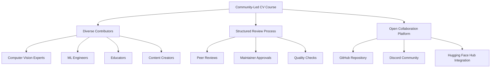
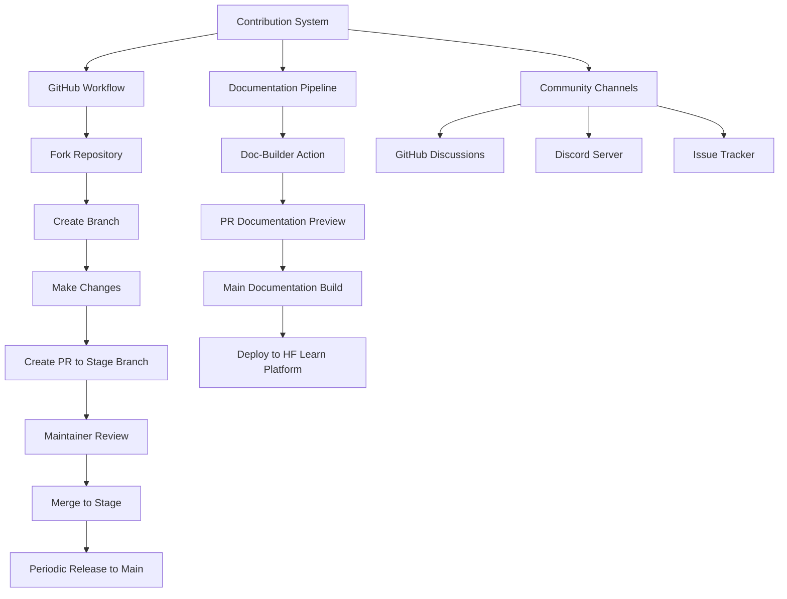
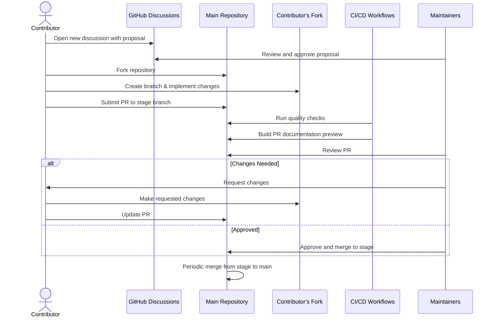
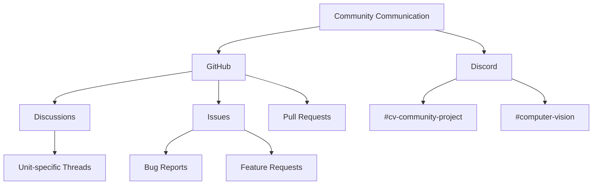

<!-- source: DeepWiki mcp.deepwiki.com · repo huggingface/computer-vision-course · page 5 Community and Contribution · fetched 2026-10-26 -->

# Community and Contribution

Relevant source files

The following files were used as context for generating this wiki page:

- [.github/CODEOWNERS](.github/CODEOWNERS)
- [.github/workflows/build_documentation.yml](.github/workflows/build_documentation.yml)
- [.github/workflows/build_pr_documentation.yml](.github/workflows/build_pr_documentation.yml)
- [.github/workflows/quality.yml](.github/workflows/quality.yml)
- [.github/workflows/upload_pr_documentation.yml](.github/workflows/upload_pr_documentation.yml)
- [CONTRIBUTING.md](CONTRIBUTING.md)
- [README.md](README.md)

This document details the community-driven nature of the Computer Vision Course and explains how to contribute to its development. It covers the contribution process, documentation system, and community management aspects. For implementation details about specific computer vision technologies, see [Core Computer Vision Technologies](#2).

## Overview of the Community-Driven Approach

The Computer Vision Course is a uniquely community-led project with contributions from over 60 members of the Hugging Face Computer Vision community. Unlike traditional educational courses created by small groups with consistent tone, this course embraces diverse authoring styles while maintaining cohesive content organization.

Sources: [README.md:5-26](), [CONTRIBUTING.md:1-4]()

## Contribution System Architecture

The contribution system is built around GitHub workflows, documentation automation, and community engagement channels. This design allows distributed global collaboration while maintaining high content quality standards.

Sources: [CONTRIBUTING.md:23-32](), [.github/workflows/build_documentation.yml:1-19](), [.github/workflows/build_pr_documentation.yml:1-20](), [.github/workflows/upload_pr_documentation.yml:1-17]()

## Contribution Process

The contribution process is designed to ensure high-quality content while making it accessible for contributors with various levels of experience.

### Adding New Content

1. **Proposal Stage**: First, contributors must propose their ideas in the GitHub discussions section, categorized by course unit.
2. **Approval Process**: Repository maintainers review proposals and provide feedback or approval.
3. **Content Creation**: After approval, contributors create the content as `.mdx` files or Jupyter notebooks following the content guidelines.
4. **Pull Request**: Contributors submit their work through a pull request to the stage branch.
5. **Review & Merge**: Maintainers review the PR and merge if it meets the quality standards.

### Bug Fixes and Minor Changes

For smaller contributions like typo fixes or bug corrections, contributors can:
1. Open an issue describing the problem
2. Get approval from maintainers
3. Follow the pull request process to submit the fix

### Pull Request Workflow

Sources: [CONTRIBUTING.md:5-22](), [.github/workflows/quality.yml:1-21]()

## Documentation System and CI/CD

The course uses a sophisticated documentation system to automatically build and deploy content to the Hugging Face learning platform.

### Documentation Features

The documentation system supports various content types and special features:
- Tip blocks for notes and warnings
- Framework-dependent code toggles
- Embedded Gradio demos
- LaTeX for mathematical notation
- Anchor links for cross-referencing
- Syntax highlighting for code blocks

### CI/CD Pipeline

When a pull request is created:
1. Quality checks run to ensure code style and formatting
2. The doc-builder builds a preview of the documentation
3. The preview is uploaded and available for review
4. After approval and merge to stage, changes accumulate for the next release
5. Regular releases merge from stage to main, triggering the main documentation build
6. The built documentation is deployed to the Hugging Face learning platform

Sources: [.github/workflows/build_documentation.yml:1-19](), [.github/workflows/build_pr_documentation.yml:1-20](), [.github/workflows/upload_pr_documentation.yml:1-17](), [CONTRIBUTING.md:37-120]()

## Community Management

The community structure is designed to facilitate collaboration while ensuring content quality and consistency.

### Code Ownership

The repository uses GitHub's CODEOWNERS feature to automatically assign reviewers to pull requests based on the files being changed:

| Path | Owners |
|------|--------|
| Repository-wide | @merveenoyan @johko @burtenshaw @sergiopaniego |
| /chapters/ | @merveenoyan @johko @burtenshaw @sergiopaniego |
| /notebooks/ | @merveenoyan @johko @burtenshaw @sergiopaniego |

### Communication Channels

- **GitHub Discussions**: Organized by course unit for proposals and feedback
- **GitHub Issues**: For reporting bugs or suggesting improvements
- **Discord**: Active community channels for real-time discussion
  - #cv-community-project: Specific to course development
  - #computer-vision: General CV discussion

### Content Guidelines

Contributors must follow specific content guidelines to ensure consistency and compatibility with the documentation system. Key requirements include:
- Proper header structure
- Standardized special blocks (tips, warnings)
- Framework-specific code organization
- Standard embedding formats for demos
- Consistent file structure

Sources: [README.md:33-38](), [.github/CODEOWNERS:1-13](), [CONTRIBUTING.md:121-136]()

## Contribution Resources

To help new contributors get started, various resources are available:

1. **Contributing Guidelines**: Detailed documentation on how to contribute
2. **Discord Community**: Real-time support and discussion
3. **GitHub Discussions**: Proposal and feedback system
4. **Example Content**: Existing chapters serve as templates for new contributions

For additional details on specific aspects of contribution, see:
- [Contribution Process](#5.1) for step-by-step instructions
- [Documentation and CI/CD](#5.2) for technical details on the documentation system

Sources: [README.md:28-30](), [CONTRIBUTING.md:127-136]()

---

