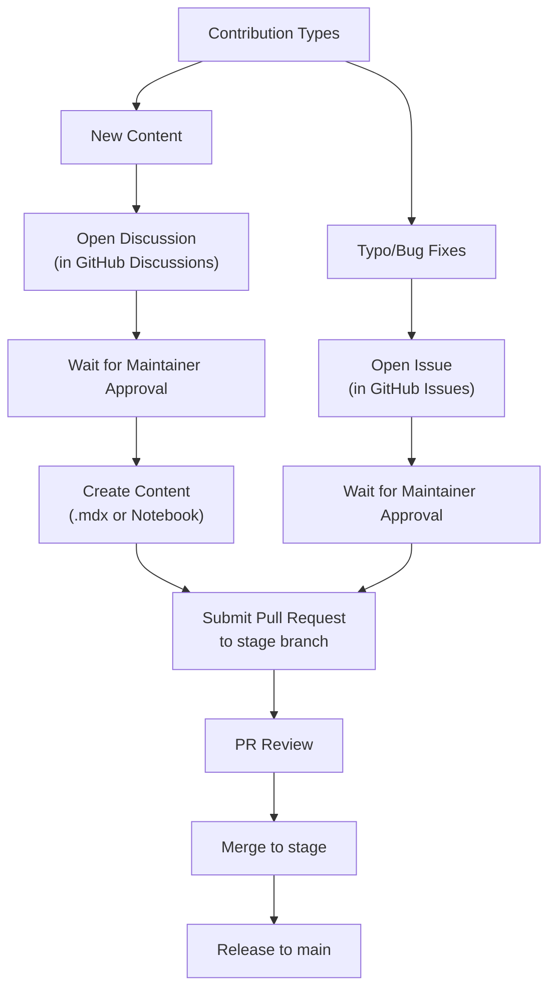
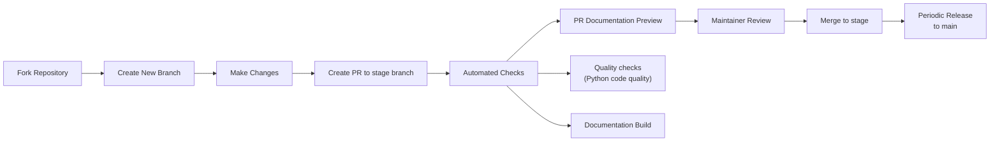
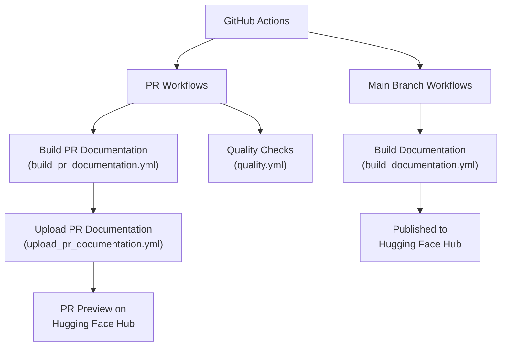

<!-- source: DeepWiki mcp.deepwiki.com · repo huggingface/computer-vision-course · page 5.1 Contribution Process · fetched 2026-10-26 -->

# Contribution Process

<details>
<summary>Relevant source files</summary>

The following files were used as context for generating this wiki page:

- [.github/CODEOWNERS](.github/CODEOWNERS)
- [.github/workflows/build_documentation.yml](.github/workflows/build_documentation.yml)
- [.github/workflows/build_pr_documentation.yml](.github/workflows/build_pr_documentation.yml)
- [.github/workflows/quality.yml](.github/workflows/quality.yml)
- [.github/workflows/upload_pr_documentation.yml](.github/workflows/upload_pr_documentation.yml)
- [CONTRIBUTING.md](CONTRIBUTING.md)
- [README.md](README.md)

</details>


## Purpose and Scope

This document provides a step-by-step guide on how to contribute to the Computer Vision Course repository. It covers the workflow for adding new content, fixing issues, and submitting pull requests. For information about the documentation system and CI/CD workflows, see [Documentation and CI/CD](#5.2).

## Contribution Workflow Overview

The Computer Vision Course is a community-led project with over 60 contributors. The repository follows a structured process for accepting contributions to maintain high-quality content while encouraging community participation.



Sources: [CONTRIBUTING.md:1-33](CONTRIBUTING.md:1-33), [README.md:23-28](README.md:23-28)

## Adding New Content

To contribute new content to the course, follow these steps:

1. **Propose your content**: Go to the [GitHub Discussions section](https://github.com/johko/computer-vision-course/discussions/) and find the unit you want to contribute to.

2. **Open a new discussion**: Describe what you want to add.

3. **Wait for approval**: Repository maintainers will review your proposal and either approve it or request changes.

4. **Create content**: After approval, create an `.mdx` file or Jupyter Notebook following the content guidelines.

5. **Submit a pull request**: Create a PR to the `stage` branch of the repository.

Sources: [CONTRIBUTING.md:5-15](CONTRIBUTING.md:5-15)

## Fixing Issues and Typos

If you want to fix typos or bugs in the existing content:

1. **Open an Issue**: Create a new issue describing what you want to fix.

2. **Wait for approval**: Repository maintainers will review your issue.

3. **Submit a pull request**: After approval, follow the PR creation process to submit your fix.

Sources: [CONTRIBUTING.md:17-21](CONTRIBUTING.md:17-21)

## Pull Request Process



To submit your contribution:

1. **Fork the repository**: Create your personal fork of the Computer Vision Course repository.

2. **Create a new branch**: Make a new branch for your changes.

3. **Make your changes**: Add or modify content following the guidelines.

4. **Create a pull request**: Submit a PR targeting the `stage` branch of the main repository, not the `main` branch.

5. **Wait for approval**: Repository maintainers will review your PR.

6. **Address feedback**: Make any requested changes to your PR.

7. **Merged contribution**: Once approved, your PR will be merged into the `stage` branch.

8. **Release**: Contributions are collected in the `stage` branch and published to `main` in regular intervals.

Sources: [CONTRIBUTING.md:23-33](CONTRIBUTING.md:23-33), [.github/workflows/build_pr_documentation.yml:1-20](.github/workflows/build_pr_documentation.yml:1-20)

## Repository Maintainers

The repository has designated maintainers who review and approve contributions:

| Username | Role |
|----------|------|
| @merveenoyan | Maintainer |
| @johko | Maintainer |
| @burtenshaw | Maintainer |
| @sergiopaniego | Maintainer |

These maintainers have review authority over all parts of the repository, with special focus on chapters and notebooks.

Sources: [.github/CODEOWNERS:1-13](.github/CODEOWNERS:1-13)

## Content Guidelines

The course has specific syntax and documentation rules to ensure proper rendering on the Hugging Face platform.

### Core Requirements

1. Every chapter should have a main header (h1, e.g. `# Introduction`) before the content.
2. Content must follow the specific directory structure:

```
.
└── course/
    └── chapters/
        ├── chapter0/
        │   ├── introduction.mdx
        │   └── getting_started.mdx
        ├── chapter1/
        │   └── ...mdx
        └── _toctree.yml
```

3. Any new chapter should be added to `_toctree.yml`.

Sources: [CONTRIBUTING.md:37-111](CONTRIBUTING.md:37-111)

### Special Syntax Elements

```mermaid
graph TD
    A["MDX Syntax Features"] --> B["Tip Blocks"]
    A --> C["Framework Dependent Code"]
    A --> D["Gradio Demo Embedding"]
    A --> E["LaTeX Support"]
    A --> F["Anchor Links"]
    A --> G["Code Blocks"]
    
    B --> B1["Regular Tips: \n<Tip>...</Tip>"]
    B --> B2["Warnings: \n<Tip warning={true}>...</Tip>"]
    
    C --> C1["Framework Toggle with:\n<frameworkcontent>...\n<pt>...</pt>\n<tf>...</tf>"]
    
    D --> D1["iframe embedding for Spaces"]
    
    E --> E1["Inline LaTeX: \\( X )\\"]
    E --> E2["Block LaTeX: $$ ... $$"]
    
    F --> F1["## Header[[anchor-id]]"]
    
    G --> G1["```py\n# Python code\n```"]
```

The document supports various special syntax features including:

- **Tip Blocks**: Use `<Tip>...</Tip>` for notes and `<Tip warning={true}>...</Tip>` for warnings
- **Framework-dependent code**: Use framework toggles to show content for different frameworks
- **Gradio demos embedding**: Embed Hugging Face Spaces demos using iframes
- **LaTeX**: Support for both inline and block LaTeX equations
- **Anchor links**: Create referenceable section headers
- **Code blocks**: Language-specific syntax highlighting

Sources: [CONTRIBUTING.md:39-96](CONTRIBUTING.md:39-96)

### Asset Management

To keep the repository lightweight, media assets (images, videos) should be stored in the [course-assets Hugging Face repository](https://huggingface.co/datasets/hf-vision/course-assets).

To add assets:
1. Request to join the `hf-vision` organization
2. Upload assets to the `course-assets` repository
3. Get the direct URL (using `resolve` instead of `blob` in the path)
4. Reference the assets in markdown with ``

Sources: [CONTRIBUTING.md:115-120](CONTRIBUTING.md:115-120)

### Notebooks

There are two approaches for including notebooks:

1. **Auto-generated notebooks**: Add `[[open-in-colab]]` at the top of `.mdx` files to create a button that opens a notebook version automatically
2. **Custom notebooks**: Create separate notebooks in the appropriate chapter folder under the `notebooks` directory

Sources: [CONTRIBUTING.md:122-124](CONTRIBUTING.md:122-124)

## Getting Help

If you need assistance with the contribution process, you can:

1. **Join the Discord**: Ask questions in the `#cv-community-project` channel on the Hugging Face Discord server
2. **Use ReviewNB**: For collaborating on notebooks, ReviewNB is available for free for open-source projects
3. **Check helpful packages**: The `requirements.txt` file includes recommended packages for creating course materials

Sources: [CONTRIBUTING.md:127-135](CONTRIBUTING.md:127-135), [README.md:34-38](README.md:34-38)

## CI/CD and Documentation Workflow



When you submit a pull request, several automated processes run:

1. **Quality checks**: Ensures code quality meets standards
2. **Documentation build**: Builds a preview of documentation from your PR
3. **Documentation upload**: Makes the preview available for review

After merging to the main branch, the documentation is automatically built and published to the Hugging Face Hub.

Sources: [.github/workflows/build_documentation.yml:1-19](.github/workflows/build_documentation.yml:1-19), [.github/workflows/build_pr_documentation.yml:1-20](.github/workflows/build_pr_documentation.yml:1-20), [.github/workflows/upload_pr_documentation.yml:1-17](.github/workflows/upload_pr_documentation.yml:1-17), [.github/workflows/quality.yml:1-21](.github/workflows/quality.yml:1-21)

---

