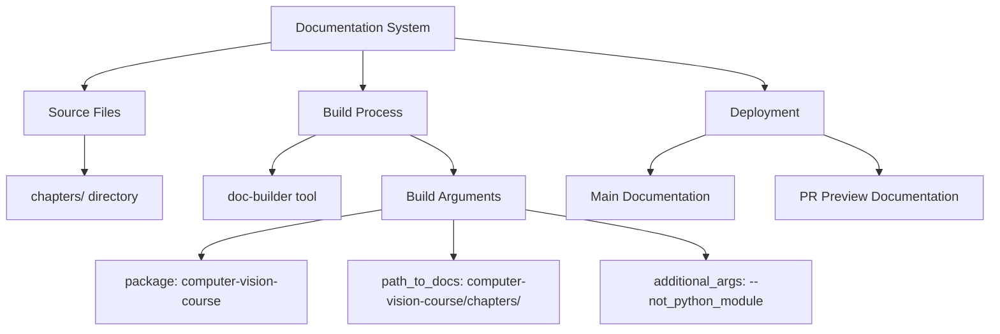
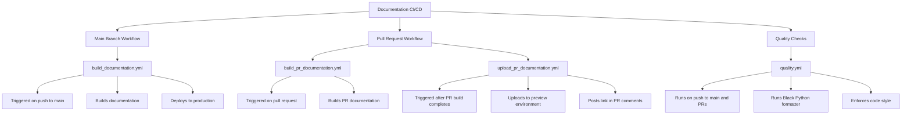
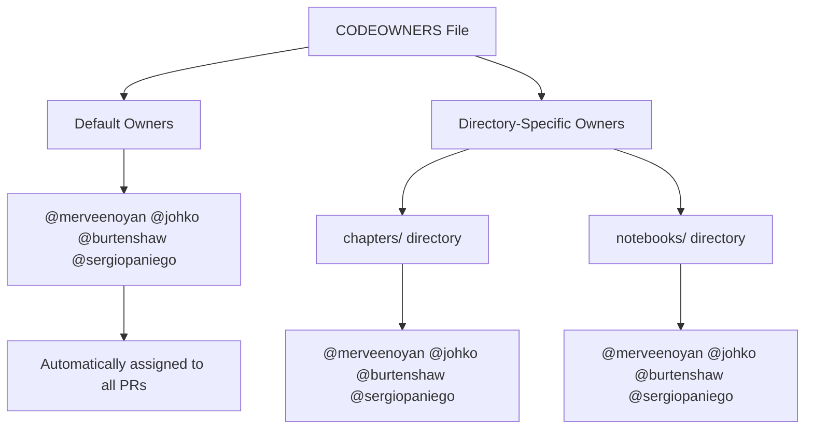
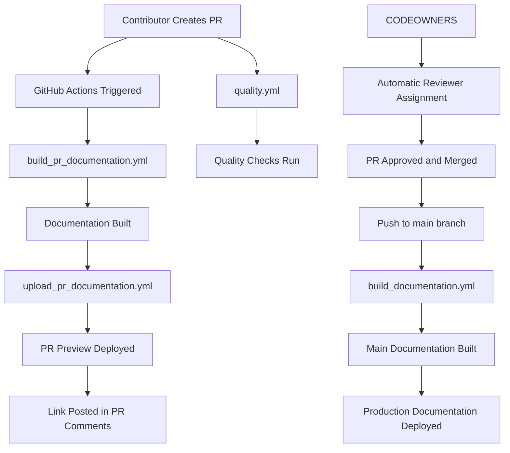

<!-- source: DeepWiki mcp.deepwiki.com · repo huggingface/computer-vision-course · page 5.2 Documentation and CI/CD · fetched 2026-10-26 -->

# Documentation and CI/CD

Relevant source files

The following files were used as context for generating this wiki page:

- [.github/CODEOWNERS](.github/CODEOWNERS)
- [.github/workflows/build_documentation.yml](.github/workflows/build_documentation.yml)
- [.github/workflows/build_pr_documentation.yml](.github/workflows/build_pr_documentation.yml)
- [.github/workflows/quality.yml](.github/workflows/quality.yml)
- [.github/workflows/upload_pr_documentation.yml](.github/workflows/upload_pr_documentation.yml)

This page provides a technical explanation of the documentation system and Continuous Integration/Continuous Deployment (CI/CD) workflows implemented in the Computer Vision Course repository. For information about how to contribute to the course content, see the [Contribution Process](#5.1).

## Overview

The Computer Vision Course repository uses GitHub Actions workflows to automate documentation building, quality checking, and deployment processes. This automation ensures that documentation remains consistent and up-to-date as contributions are made to the repository.

Sources: [.github/workflows/build_documentation.yml](), [.github/workflows/build_pr_documentation.yml](), [.github/workflows/upload_pr_documentation.yml](), [.github/workflows/quality.yml]()

## Documentation System

The documentation for the Computer Vision Course is built using Hugging Face's doc-builder tool. Documentation source files are located in the `computer-vision-course/chapters/` directory and are automatically built and deployed through CI/CD workflows.

### Documentation Structure

Sources: [.github/workflows/build_documentation.yml:10-17](), [.github/workflows/build_pr_documentation.yml:12-19]()

## CI/CD Workflows

The repository implements several GitHub Actions workflows to automate documentation building, quality checking, and deployment processes.

### Documentation Build Workflow

Sources: [.github/workflows/build_documentation.yml](), [.github/workflows/build_pr_documentation.yml](), [.github/workflows/upload_pr_documentation.yml](), [.github/workflows/quality.yml]()

### Main Documentation Build

When changes are pushed to the main branch, the `build_documentation.yml` workflow is triggered. This workflow:

1. Uses Hugging Face's doc-builder action to build the documentation
2. Specifies the package name as `computer-vision-course`
3. Sets the documentation source path to `computer-vision-course/chapters/`
4. Deploys the built documentation to the production environment

This ensures that the official documentation is always synchronized with the latest content in the main branch.

Sources: [.github/workflows/build_documentation.yml:3-7](), [.github/workflows/build_documentation.yml:9-19]()

### Pull Request Documentation

The repository implements a two-step process for building and deploying documentation for pull requests:

#### Step 1: Build PR Documentation

The `build_pr_documentation.yml` workflow is triggered whenever a pull request is created or updated. This workflow:

1. Builds documentation from the PR's commit
2. Processes the content from the PR branch
3. Prepares the documentation for preview

This workflow uses concurrency controls to ensure that if a PR is updated, any previous build is cancelled and replaced with the newest one.

Sources: [.github/workflows/build_pr_documentation.yml:3-8](), [.github/workflows/build_pr_documentation.yml:10-20]()

#### Step 2: Upload PR Documentation

After the PR documentation is built, the `upload_pr_documentation.yml` workflow is triggered. This workflow:

1. Uploads the built documentation to a preview environment
2. Posts a comment on the PR with a link to the preview
3. Makes the documentation available at the Hugging Face Moon CI docs URL

This allows contributors and reviewers to preview documentation changes before they are merged into the main branch.

Sources: [.github/workflows/upload_pr_documentation.yml:3-7](), [.github/workflows/upload_pr_documentation.yml:9-16]()

### Quality Checks

The `quality.yml` workflow runs automatically on all pull requests and pushes to the main branch. It performs the following tasks:

1. Sets up a Python 3.8 environment
2. Installs the Black code formatter
3. Runs quality checks via the `make quality` command

This ensures that all code contributions maintain a consistent style and pass basic quality checks.

| Event | Trigger | Action |
|-------|---------|--------|
| Push to main | Automatic | Run quality checks |
| Pull request | Automatic | Run quality checks |

Sources: [.github/workflows/quality.yml:3-8](), [.github/workflows/quality.yml:10-21]()

## Code Ownership

The repository uses GitHub's CODEOWNERS feature to automatically assign reviewers to pull requests based on which files are modified.

When a pull request is created, GitHub automatically requests reviews from the appropriate code owners. The specific rules are:

1. Default owners (`@merveenoyan`, `@johko`, `@burtenshaw`, `@sergiopaniego`) are assigned to all PRs unless overridden
2. PRs that modify files in the `/chapters/` directory are assigned to the same set of reviewers
3. PRs that modify files in the `/notebooks/` directory are assigned to the same set of reviewers

This system ensures that all contributions are reviewed by the appropriate maintainers before being merged.

Sources: [.github/CODEOWNERS:1-13]()

## Complete Documentation Workflow

This diagram illustrates the full documentation workflow from contribution to deployment:

Sources: [.github/workflows/build_documentation.yml](), [.github/workflows/build_pr_documentation.yml](), [.github/workflows/upload_pr_documentation.yml](), [.github/workflows/quality.yml](), [.github/CODEOWNERS]()