# Page: Computer Vision Course Overview

# Computer Vision Course Overview

<details>
<summary>Relevant source files</summary>

The following files were used as context for generating this wiki page:

- [CONTRIBUTING.md](CONTRIBUTING.md)
- [README.md](README.md)
- [chapters/en/_toctree.yml](chapters/en/_toctree.yml)
- [chapters/en/unit0/welcome/welcome.mdx](chapters/en/unit0/welcome/welcome.mdx)
- [chapters/en/unit2/cnns/yolo.mdx](chapters/en/unit2/cnns/yolo.mdx)
- [chapters/en/unit7/video-processing/cnn-based-video-model.mdx](chapters/en/unit7/video-processing/cnn-based-video-model.mdx)
- [chapters/en/unit7/video-processing/multimodal-based-video-models.mdx](chapters/en/unit7/video-processing/multimodal-based-video-models.mdx)
- [chapters/en/unit7/video-processing/rnn-based-video-models.mdx](chapters/en/unit7/video-processing/rnn-based-video-models.mdx)
- [chapters/en/unit8/monocular_depth_estimation.mdx](chapters/en/unit8/monocular_depth_estimation.mdx)
- [chapters/es/unit0/welcome/TableOfContents.mdx](chapters/es/unit0/welcome/TableOfContents.mdx)
- [chapters/es/unit0/welcome/welcome.mdx](chapters/es/unit0/welcome/welcome.mdx)

</details>


This document provides a comprehensive overview of the Computer Vision Course repository hosted at https://github.com/huggingface/computer-vision-course. This community-driven educational resource covers a wide range of computer vision topics from fundamentals to advanced techniques. The purpose of this overview is to explain the repository's structure, learning objectives, and how content is organized.

For information about certification and learning paths, see [Certification and Learning Path](#1.2).

## Repository Purpose and Structure

The Computer Vision Course is a comprehensive educational resource developed collaboratively by over 60 contributors from the Hugging Face Computer Vision community. The course is designed to provide both theoretical knowledge and practical implementations, making complex computer vision concepts accessible to learners of various skill levels.

### Course Organization Diagram

```mermaid
graph TD
    A["Computer Vision Course"] --> B["Course Units"]
    A --> C["Practical Resources"]
    A --> D["Community System"]
    
    B --> B1["Unit 1: Fundamentals"]
    B --> B2["Unit 2: CNNs"]
    B --> B3["Unit 3: Vision Transformers"]
    B --> B4["Unit 4: Multimodal Models"]
    B --> B5["Unit 5: Generative Models"]
    B --> B6["Unit 6: Basic CV Tasks"]
    B --> B7["Unit 7: Video Processing"]
    B --> B8["Unit 8: 3D Vision"]
    B --> B9["Unit 9: Model Optimization"]
    B --> B10["Unit 10: Synthetic Data"]
    B --> B11["Unit 11: Zero-Shot Vision"]
    B --> B12["Unit 12: Ethics & Biases"]
    B --> B13["Unit 13: Outlook"]
    
    C --> C1["Jupyter Notebooks"]
    C --> C2["Code Examples"]
    C --> C3["Model Implementation Guides"]
    
    D --> D1["GitHub Contribution Flow"]
    D --> D2["Discord Community"]
    D --> D3["Documentation System"]
```

Sources: 
- `README.md`
- `chapters/en/_toctree.yml`
- `chapters/en/unit0/welcome/welcome.mdx`

## Course Content Structure

The course content is organized into 13 distinct units, each focusing on specific aspects of computer vision. The repository follows a logical file structure that maps to these units.

### Repository Structure Diagram

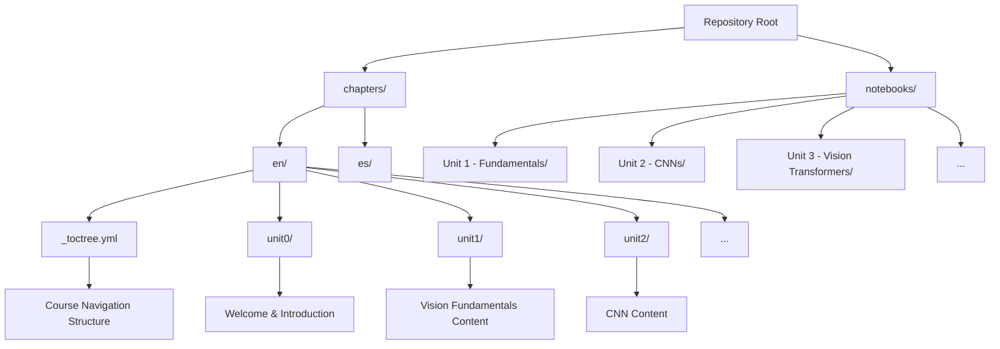

Sources:
- `README.md`
- `chapters/en/_toctree.yml`

### Unit Overview

The following table provides a comprehensive overview of all course units and their primary content focus:

| Unit | Title | Key Topics |
|------|-------|------------|
| 1 | Fundamentals | Vision basics, image formation, preprocessing, feature extraction |
| 2 | Convolutional Neural Networks | CNN architectures (VGG, GoogLeNet, MobileNet, ResNet), YOLO for object detection |
| 3 | Vision Transformers | ViT, Swin, DETR, segmentation, knowledge distillation |
| 4 | Multimodal Models | Text-vision integration, CLIP, multimodal tasks |
| 5 | Generative Models | VAEs, GANs, diffusion models, Stable Diffusion |
| 6 | Basic CV Tasks | Object detection, image segmentation |
| 7 | Video Processing | Video fundamentals, temporal models, multimodal approaches |
| 8 | 3D Vision | Depth estimation, novel view synthesis, NeRFs |
| 9 | Model Optimization | Deployment strategies, compression, optimized inference |
| 10 | Synthetic Data Creation | Data generation techniques, synthetic datasets |
| 11 | Zero Shot Computer Vision | Generalization, transfer learning |
| 12 | Ethics and Biases | Ethical considerations, bias identification and mitigation |
| 13 | Outlook | Emerging architectures, future trends |

Sources:
- `chapters/en/_toctree.yml`
- `README.md`

## Learning Resources

The course provides multiple types of learning resources to accommodate different learning styles and needs:

### Resource Types

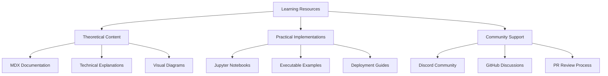

Sources:
- `chapters/en/unit0/welcome/welcome.mdx`
- `chapters/es/unit0/welcome/TableOfContents.mdx`
- `CONTRIBUTING.md`

### Notebooks and Practical Implementations

The course includes numerous Jupyter notebooks that demonstrate practical implementations of the theoretical concepts. These notebooks are organized by unit and accessible through both GitHub and Google Colab.

Examples of key notebooks include:
- Transfer Learning with CNNs
- Fine-tuning Vision Transformers for object detection
- Image classification with CLIP
- Synthetic data generation
- Model optimization techniques

Sources:
- `chapters/es/unit0/welcome/TableOfContents.mdx`

## Technical Focus Areas

The course places particular emphasis on several key technical areas within computer vision. These areas represent core competencies that learners will develop throughout the course.

### Object Detection Evolution

One of the central technical topics is object detection, with particular emphasis on the YOLO (You Only Look Once) family of models:

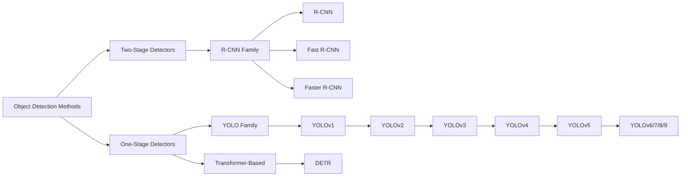

Sources:
- `chapters/en/unit2/cnns/yolo.mdx:9-270`

### Video Processing Approaches

The course also covers various approaches to video processing, which extends beyond static image analysis:

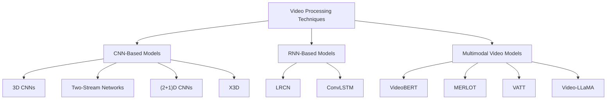

Sources:
- `chapters/en/unit7/video-processing/cnn-based-video-model.mdx`
- `chapters/en/unit7/video-processing/rnn-based-video-models.mdx`
- `chapters/en/unit7/video-processing/multimodal-based-video-models.mdx`

## Community Contribution System

The Computer Vision Course is a community-driven project that encourages contributions from individuals with diverse backgrounds and expertise.

### Contribution Workflow

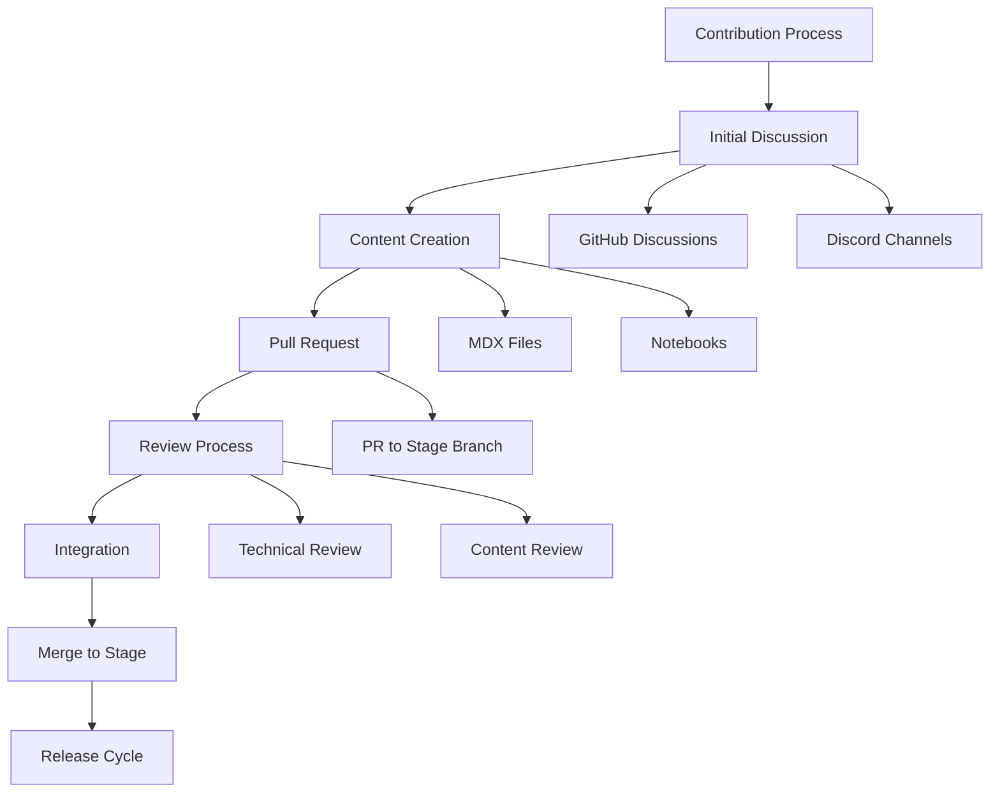

Sources:
- `CONTRIBUTING.md`
- `README.md`

## Prerequisites and Target Audience

The course is designed to be accessible to learners with some programming experience in Python and basic familiarity with machine learning concepts. Specific prerequisites include:

- Python programming knowledge
- Understanding of transformers, machine learning, and neural networks
- Familiarity with pre-processing techniques (beneficial but not required)

The course targets a diverse audience, including:
- Students learning computer vision
- Machine learning practitioners expanding into vision
- Researchers exploring specific computer vision domains
- Developers implementing vision applications

Sources:
- `chapters/en/unit0/welcome/welcome.mdx:69-72`

## Technical Implementation Features

The course content utilizes several key technical features to enhance the learning experience:

1. **MDX Documentation**: Content is written in MDX format, allowing for rich interactive elements
2. **Code Integration**: Code snippets and examples are directly integrated into the documentation
3. **Visualizations**: Diagrams and visualizations illustrate complex concepts
4. **Interactive Components**: Support for framework-specific code toggles and interactive demos
5. **Mathematical Notation**: LaTeX support for mathematical formulas

The repository is organized to facilitate both content creation and consumption, with a clear separation between theoretical content and practical implementations.

Sources:
- `CONTRIBUTING.md:36-97`

## Conclusion

The Computer Vision Course serves as a comprehensive resource for learning computer vision concepts and techniques. Through its structured approach, diverse content types, and community-driven development, it provides an accessible path for learners to gain both theoretical knowledge and practical skills in this rapidly evolving field.

The course continues to evolve with contributions from the community, ensuring that the content remains relevant and up-to-date with the latest developments in computer vision research and applications.

Sources:
- `README.md`
- `chapters/en/unit0/welcome/welcome.mdx`

---

# Page: Course Organization

# Course Organization

<details>
<summary>Relevant source files</summary>

The following files were used as context for generating this wiki page:

- [CONTRIBUTING.md](CONTRIBUTING.md)
- [README.md](README.md)
- [chapters/en/_toctree.yml](chapters/en/_toctree.yml)
- [chapters/en/unit0/welcome/welcome.mdx](chapters/en/unit0/welcome/welcome.mdx)
- [chapters/en/unit2/cnns/yolo.mdx](chapters/en/unit2/cnns/yolo.mdx)
- [chapters/en/unit7/video-processing/cnn-based-video-model.mdx](chapters/en/unit7/video-processing/cnn-based-video-model.mdx)
- [chapters/en/unit7/video-processing/multimodal-based-video-models.mdx](chapters/en/unit7/video-processing/multimodal-based-video-models.mdx)
- [chapters/en/unit7/video-processing/rnn-based-video-models.mdx](chapters/en/unit7/video-processing/rnn-based-video-models.mdx)
- [chapters/en/unit8/monocular_depth_estimation.mdx](chapters/en/unit8/monocular_depth_estimation.mdx)

</details>


## Purpose and Scope

This document provides a comprehensive overview of how the Computer Vision Course is structured into units and serves as a guide to navigate through the course content. It outlines the modular organization of the curriculum, explains the relationships between different units, and offers insights into the progression of topics from fundamentals to advanced concepts. For information about certification requirements and detailed learning paths, see [Certification and Learning Path](#1.2).

Sources: [chapters/en/_toctree.yml:1-211](), [README.md:1-45]()

## Course Structure Overview

The Computer Vision Course is organized into 14 units, starting from foundational concepts and progressively covering more advanced topics. Each unit builds upon knowledge from previous units while introducing new concepts and techniques.

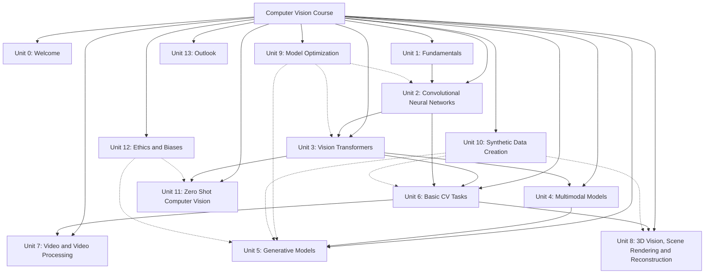

Sources: [chapters/en/_toctree.yml:1-211](), [README.md:7-22](), [chapters/en/unit0/welcome/welcome.mdx:60-90]()

## Detailed Unit Descriptions

### Unit 0: Welcome

An introduction to the computer vision course, explaining its goals, structure, and how to engage with the community. This unit covers prerequisites, certification requirements, and provides an overview of what to expect throughout the course.

### Unit 1: Fundamentals of Computer Vision

Covers essential concepts to get started with computer vision, including:
- The need for computer vision and its applications
- Image fundamentals and formation
- Pre-processing techniques
- Feature extraction and description
- Feature matching

This unit establishes the theoretical foundation necessary for understanding more advanced topics in subsequent units.

### Unit 2: Convolutional Neural Networks (CNNs)

Explores the fundamental architecture that revolutionized computer vision:
- General CNN architecture and key concepts
- Popular CNN models:
  - VGG
  - GoogLeNet
  - ResNet
  - MobileNet
  - ConvNext
- YOLO and object detection
- Transfer learning and fine-tuning techniques

### Unit 3: Vision Transformers

Introduces transformer-based approaches to computer vision:
- Vision Transformer (ViT) architecture
- Specialized transformer variants:
  - Swin Transformer
  - Convolutional Vision Transformer (CvT)
  - DINAT
  - MobileViT v2
- Object detection with transformers (DETR)
- Image segmentation with transformers
- Knowledge distillation techniques

### Unit 4: Multimodal Models

Explores models that combine vision with other modalities:
- Text-vision models
- Introduction to Vision Language Models (VLMs)
- CLIP and related models
- Multimodal text generation (BLIP)
- Multimodal object detection

### Unit 5: Generative Models

Covers techniques for generating visual content:
- Variational Autoencoders (VAEs)
- Generative Adversarial Networks (GANs)
- StyleGAN variants
- Diffusion models
- Stable Diffusion
- Control techniques for diffusion models
- Ethical considerations

### Unit 6: Basic Computer Vision Tasks

Focuses on fundamental tasks in computer vision:
- Object detection
- Image segmentation

### Unit 7: Video and Video Processing

Examines temporal aspects of visual data:
- Video processing fundamentals
- CNN-based video models
- RNN-based video models
- Transformer-based video models
- Multimodal video models

### Unit 8: 3D Vision, Scene Rendering and Reconstruction

Explores three-dimensional vision techniques:
- Camera models
- Depth estimation
- Stereo vision
- Novel view synthesis
- Neural Radiance Fields (NeRFs)

### Unit 9: Model Optimization

Covers techniques for optimizing models for deployment:
- Model compression methods
- Deployment considerations
- Tools and frameworks for optimization

### Unit 10: Synthetic Data Creation

Explores methods for generating synthetic training data:
- Synthetic datasets
- 3D rendering for data generation
- GAN-based synthetic data
- Diffusion model-based data generation
- Point clouds

### Unit 11: Zero Shot Computer Vision

Introduces techniques for models to recognize previously unseen classes:
- Zero-shot learning principles
- Transfer learning approaches

### Unit 12: Ethics and Biases

Addresses critical ethical considerations in computer vision:
- Ethics in AI
- Bias identification and mitigation
- Responsible development practices

### Unit 13: Outlook and Emerging Trends

Explores cutting-edge developments and future directions:
- Retention in Vision
- Hiera architecture
- Hyena models
- I-JEPA

Sources: [chapters/en/_toctree.yml:1-211](), [chapters/en/unit0/welcome/welcome.mdx:60-90]()

## Core Technologies and Relationships

The following diagram illustrates the relationships between key technologies covered throughout the course, showing how they build upon and relate to each other:

```mermaid
graph TD
    %% Core technologies
    CV["Computer Vision Technologies"] --> CNN["Convolutional Neural Networks"]
    CV --> VIT["Vision Transformers"]
    CV --> GM["Generative Models"]
    CV --> MM["Multimodal Models"]
    CV --> VID["Video Processing"]
    CV --> 3D["3D Vision"]
    
    %% CNN branch
    CNN --> VGG["VGG"]
    CNN --> GNET["GoogLeNet"]
    CNN --> RESNET["ResNet"]
    CNN --> MOBNET["MobileNet"]
    CNN --> CONVNEXT["ConvNext"]
    CNN --> YOLO["YOLO Series"]
    
    %% YOLO details
    YOLO --> YOLOv1["YOLOv1"]
    YOLOv1 --> YOLOv2["YOLOv2/YOLO9000"]
    YOLOv2 --> YOLOv3["YOLOv3"]
    YOLOv3 --> YOLOv4["YOLOv4"]
    YOLOv4 --> YOLOv5["YOLOv5"]
    YOLOv5 --> YOLOv8["YOLOv6/v7/v8/v9"]
    
    %% Vision Transformer branch
    VIT --> SWIN["Swin Transformer"]
    VIT --> CVT["Convolutional Vision Transformer"]
    VIT --> DINAT["Dilated Neighborhood Attention Transformer"]
    VIT --> MVIT["MobileViT"]
    VIT --> DETR["DEtection TRansformer"]
    VIT --> ONEFORMER["OneFormer"]
    VIT --> KD["Knowledge Distillation"]
    
    %% Multimodal branch
    MM --> CLIP["CLIP"]
    MM --> VLM["Vision Language Models"]
    CLIP --> BLIP["BLIP"]
    CLIP --> OWLVIT["OWL-ViT"]
    
    %% Generative Models branch
    GM --> VAE["Variational Autoencoders"]
    GM --> GAN["Generative Adversarial Networks"]
    GM --> DM["Diffusion Models"]
    
    GAN --> STYLEGAN["StyleGAN"]
    GAN --> CYCLEGAN["CycleGAN"]
    
    DM --> SD["Stable Diffusion"]
    
    %% Video Processing branch
    VID --> CNN_VID["CNN-Based Video Models"]
    VID --> RNN_VID["RNN-Based Video Models"]
    VID --> TRANS_VID["Transformer-Based Video Models"]
    VID --> MULTI_VID["Multimodal Video Models"]
    
    CNN_VID --> TWOSTREAM["Two-Stream Networks"]
    CNN_VID --> C3D["3D CNNs"]
    CNN_VID --> X3D["X3D"]
    
    RNN_VID --> LRCN["LRCN"]
    RNN_VID --> CONVLSTM["ConvLSTM"]
    
    MULTI_VID --> VBERT["VideoBERT"]
    MULTI_VID --> MERLOT["MERLOT"]
    MULTI_VID --> VATT["VATT"]
    MULTI_VID --> VLLAMA["Video-LLaMA"]
    
    %% 3D Vision branch
    3D --> STEREO["Stereo Vision"]
    3D --> DEPTH["Depth Estimation"]
    3D --> NVS["Novel View Synthesis"]
    3D --> NERF["Neural Radiance Fields"]
```

Sources: [chapters/en/unit2/cnns/yolo.mdx:208-246](), [chapters/en/unit7/video-processing/multimodal-based-video-models.mdx:1-133](), [chapters/en/unit7/video-processing/rnn-based-video-models.mdx:1-109](), [chapters/en/unit8/monocular_depth_estimation.mdx:1-40]()

## Course Progression and Learning Paths

The course is designed to accommodate different learning paths depending on your specific interests in computer vision. Here are the recommended progression paths:

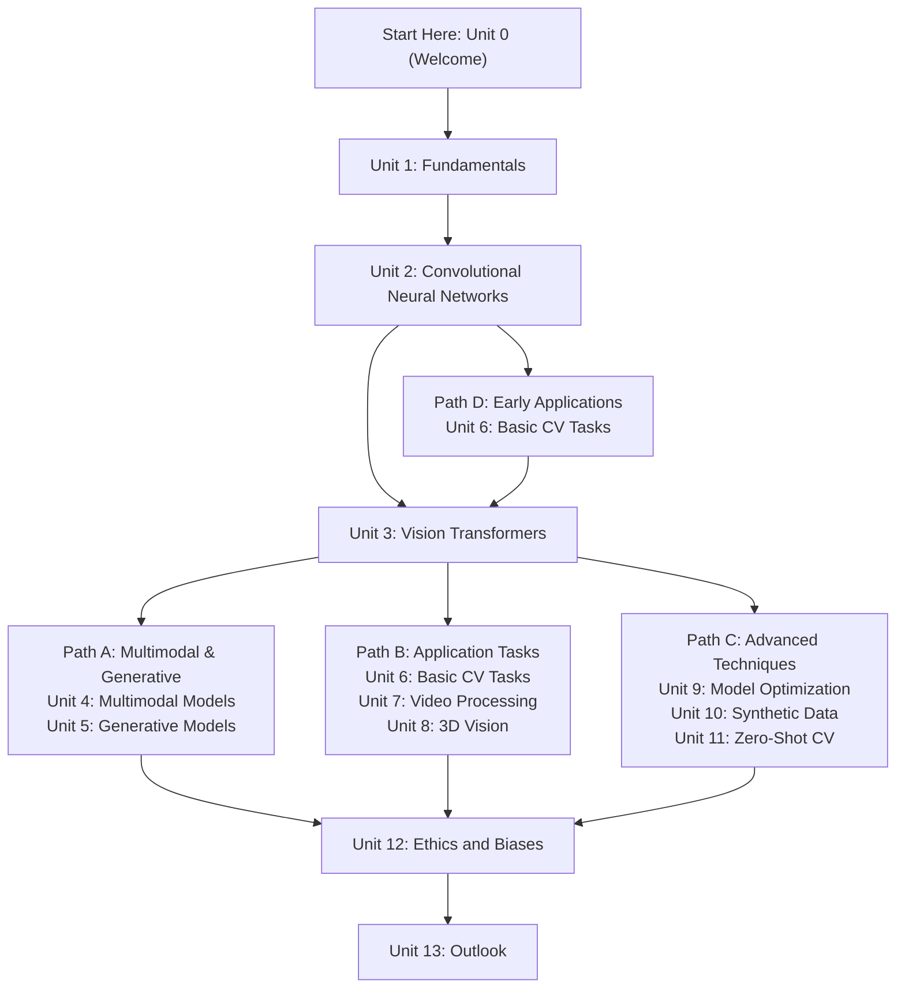

Sources: [chapters/en/unit0/welcome/welcome.mdx:60-90]()

## Community-Driven Development

The Computer Vision Course is the result of collaborative work from over 60 contributors from the Hugging Face Computer Vision community. This community-driven approach has yielded a diverse and comprehensive curriculum.

### Contribution Structure

The course content is maintained through a structured contribution process, which ensures quality and consistency across all units:

| Role | Responsibility |
|------|----------------|
| Writers | Create the primary content for each unit |
| Reviewers | Verify technical accuracy and clarity |
| Organization Team | Coordinate the overall course structure and integration |

### Unit Contributors

Each unit was developed by a dedicated team of writers and reviewers, bringing diverse perspectives and expertise to the content. The full list of contributors for each unit can be found in the Welcome section of the course.

Sources: [chapters/en/unit0/welcome/welcome.mdx:91-164](), [README.md:22-44]()

## Course Materials and Resources

The course includes a variety of materials to support learning:

1. **Theory**: Detailed explanations of computer vision concepts with practical examples
2. **Hands-on Tutorials**: Jupyter notebooks for applying key computer vision models
3. **Coding Examples**: Code samples demonstrating implementation of various techniques
4. **Assignments**: Tasks required for certification completion

### Certification Requirements

To obtain certification, learners need to complete two main assignments:

1. Training/fine-tuning a model
2. Building and hosting an application on Hugging Face Spaces

For detailed certification requirements, please refer to the [Certification and Learning Path](#1.2) page.

Sources: [chapters/en/unit0/welcome/welcome.mdx:11-39]()

## Community Engagement

The course is supported by an active community on Discord where learners can:

- Engage in discussions about course content
- Request assistance with assignments
- Collaborate with fellow learners
- Connect with course contributors

Relevant Discord channels include:
- `#computer-vision`: General computer vision discussions
- `#cv-study-group`: Exchange ideas and ask questions
- `#3d`: Discussions specific to 3D computer vision
- `#cv-community-project`: Discussions specific to the course

Sources: [chapters/en/unit0/welcome/welcome.mdx:40-59](), [README.md:34-38]()

---

# Page: Certification and Learning Path

# Certification and Learning Path

<details>
<summary>Relevant source files</summary>

The following files were used as context for generating this wiki page:

- [CONTRIBUTING.md](CONTRIBUTING.md)
- [README.md](README.md)
- [chapters/es/unit0/welcome/TableOfContents.mdx](chapters/es/unit0/welcome/TableOfContents.mdx)
- [chapters/es/unit0/welcome/welcome.mdx](chapters/es/unit0/welcome/welcome.mdx)

</details>


This document outlines the certification process for the Computer Vision Course and provides structured learning paths through the course material. It focuses specifically on how to earn a certificate by completing practical tasks and how to navigate the course content based on your background and interests.

## Certification Requirements

To earn certification in the Computer Vision Course, you must complete two technical tasks that demonstrate practical application of computer vision concepts and submit your work through the official certification form.

### Task 1: Train or Fine-tune a Model

For this task, you must train or fine-tune a computer vision model using the course notebooks and publish it to Hugging Face Hub.

**Requirements:**
1. Select an appropriate notebook from the course repository
2. Train or fine-tune a model on either:
   - An existing dataset from Hugging Face
   - Your own dataset uploaded to the Hugging Face Hub
3. Upload your trained model to Hugging Face with:
   - A properly completed model card
   - The dataset ID linked in the model card
   - Appropriate metadata and tags

**Model Training Certification Flow**

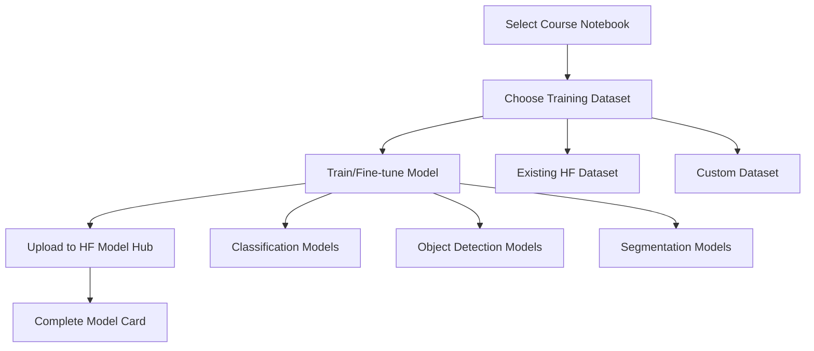

Sources: [chapters/es/unit0/welcome/welcome.mdx:17-28]()

### Task 2: Create a Gradio Application

For this task, you must build an interactive application using Gradio that demonstrates your trained model and deploy it on Hugging Face Spaces.

**Requirements:**
1. Create a Gradio interface for your vision model
2. Deploy the application to Hugging Face Spaces
3. Ensure the application is functional and intuitive
4. Include clear usage instructions in the README

**Gradio Application Deployment Flow**

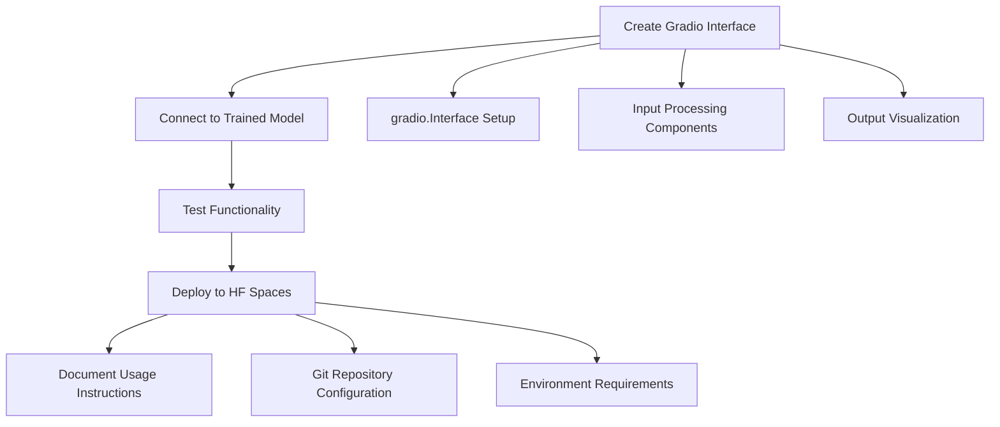

Sources: [chapters/es/unit0/welcome/welcome.mdx:29-35]()

### Certification Submission Process

After completing both required tasks:

1. Fill out the [certification form](https://forms.gle/isiVSw59oiiHP6pN9) with:
   - Your name and contact details
   - Link to your model repository
   - Link to your Hugging Face Space

**Certification Process Overview**

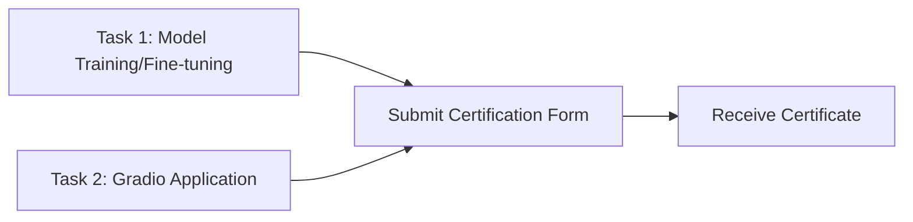

Sources: [chapters/es/unit0/welcome/welcome.mdx:36-38]()

## Course Structure and Learning Paths

The Computer Vision Course consists of 13 units covering fundamentals through advanced topics. Based on your background and interests, you can follow different learning paths.

**Course Units and Recommended Learning Paths**

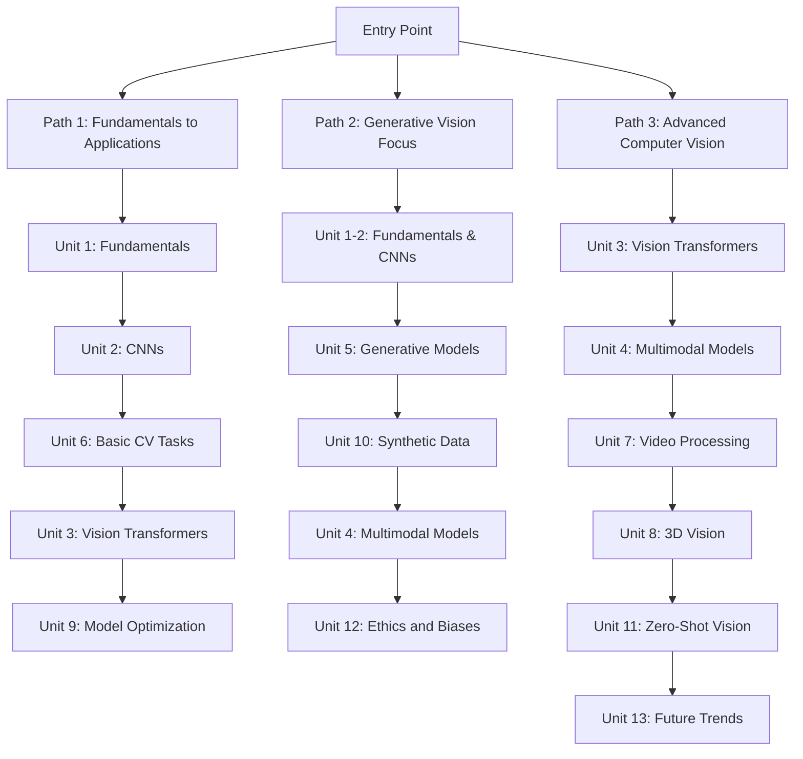

Sources: [README.md:7-21](), [chapters/es/unit0/welcome/welcome.mdx:74-88]()

### Path 1: Fundamentals to Applications (Beginner-Friendly)

This path provides a structured progression from core concepts to practical applications:

1. **Unit 1: Fundamentals** - Essential computer vision concepts and image processing
2. **Unit 2: Convolutional Neural Networks** - CNN architectures and transfer learning
3. **Unit 6: Basic CV Tasks** - Classification, detection, and segmentation
4. **Unit 3: Vision Transformers** - Advanced vision models
5. **Unit 9: Model Optimization** - Deployment and optimization techniques

This path is ideal for beginners and provides all necessary skills for certification tasks.

### Path 2: Generative and Multimodal Focus

For those interested in generative models and multimodal approaches:

1. **Units 1-2: Fundamentals and CNNs** - Core concepts review
2. **Unit 5: Generative Models** - GANs, VAEs, and diffusion models
3. **Unit 10: Synthetic Data Creation** - Generating synthetic training data
4. **Unit 4: Multimodal Models** - Text-image models like CLIP
5. **Unit 12: Ethics and Biases** - Ethical considerations in generative AI

This path is suited for those interested in generative AI applications and multimodal systems.

### Path 3: Advanced Computer Vision Systems

For practitioners with existing computer vision experience:

1. **Unit 3: Vision Transformers** - Transformer architectures for vision
2. **Unit 4: Multimodal Models** - Vision-language models
3. **Unit 7: Video Processing** - Temporal modeling and video understanding
4. **Unit 8: 3D Vision** - 3D reconstruction, NeRFs, novel view synthesis
5. **Unit 11: Zero-Shot Vision** - Transfer learning and generalization
6. **Unit 13: Future Trends** - Emerging architectures and research

This path focuses on cutting-edge techniques for experienced practitioners.

## Recommended Notebooks for Certification Tasks

The following notebooks are particularly well-suited for completing the certification tasks:

### Classification Models

| Notebook | Description | Path |
|----------|-------------|------|
| Transfer Learning with VGG19 | Fine-tuning VGG19 | [notebooks/Unit 2 - Convolutional Neural Networks/transfer_learning_vgg19.ipynb]() |
| LoRA Fine-tuning | Parameter-efficient fine-tuning | [notebooks/Unit 3 - Vision Transformers/LoRA-Image-Classification.ipynb]() |
| Multilabel Classification | Fine-tuning for multiple labels | [notebooks/Unit 3 - Vision Transformers/fine-tuning-multilabel-image-classification.ipynb]() |

### Object Detection Models

| Notebook | Description | Path |
|----------|-------------|------|
| DETR | Detection Transformer implementation | [notebooks/Unit 3 - Vision Transformers/DETR.ipynb]() |
| Vision Transformer Object Detection | Fine-tuning for detection | [notebooks/Unit 3 - Vision Transformers/Fine-tuning Vision Transformers for Object detection.ipynb]() |

### Segmentation Models

| Notebook | Description | Path |
|----------|-------------|------|
| Segmentation Transfer Learning | Adapting pre-trained models | [notebooks/Unit 3 - Vision Transformers/transfer-learning-segmentation.ipynb]() |
| SAM Fine-tuning | Customizing Segment Anything | [notebooks/Unit 6 - Basic CV Tasks/Fine_tune_SAM_(Segment_Anything_Model)_on_Custom_Dataset.ipynb]() |

Sources: [chapters/es/unit0/welcome/TableOfContents.mdx:7-45]()

## Technical Components for Certification Tasks

The following diagram illustrates how certification tasks map to specific technical components within the codebase:

**Certification Tasks to Technical Components Mapping**

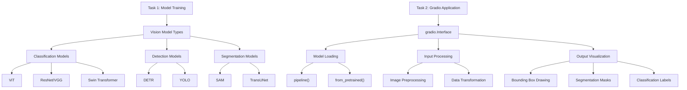

Sources: [chapters/es/unit0/welcome/welcome.mdx:17-35](), [chapters/es/unit0/welcome/TableOfContents.mdx:11-28]()

## Community Support Resources

The Computer Vision Course is supported by a community of over 60 contributors. To enhance your learning experience:

1. Join the [Hugging Face Discord server](http://hf.co/join/discord)
2. Participate in the `#cv-community-project` channel for course-specific discussions
3. Explore the `#computer-vision` and `#3d` channels for broader CV topics
4. Connect with course creators and fellow learners for collaboration and feedback

Sources: [README.md:33-44](), [chapters/es/unit0/welcome/welcome.mdx:40-57]()

---

# Page: Core Computer Vision Technologies

# Core Computer Vision Technologies

<details>
<summary>Relevant source files</summary>

The following files were used as context for generating this wiki page:

- [chapters/en/_toctree.yml](chapters/en/_toctree.yml)
- [chapters/en/unit0/welcome/TableOfContents.mdx](chapters/en/unit0/welcome/TableOfContents.mdx)
- [chapters/en/unit0/welcome/welcome.mdx](chapters/en/unit0/welcome/welcome.mdx)
- [chapters/en/unit1/chapter1/applications.mdx](chapters/en/unit1/chapter1/applications.mdx)
- [chapters/en/unit1/chapter1/definition.mdx](chapters/en/unit1/chapter1/definition.mdx)
- [chapters/en/unit1/chapter1/motivation.mdx](chapters/en/unit1/chapter1/motivation.mdx)
- [chapters/en/unit1/feature-extraction/feature-matching.mdx](chapters/en/unit1/feature-extraction/feature-matching.mdx)
- [chapters/en/unit1/feature-extraction/feature_description.mdx](chapters/en/unit1/feature-extraction/feature_description.mdx)
- [chapters/en/unit1/feature-extraction/real-world-applications.mdx](chapters/en/unit1/feature-extraction/real-world-applications.mdx)
- [chapters/en/unit1/image_and_imaging/extension-image.mdx](chapters/en/unit1/image_and_imaging/extension-image.mdx)
- [chapters/en/unit2/cnns/yolo.mdx](chapters/en/unit2/cnns/yolo.mdx)
- [chapters/en/unit7/video-processing/cnn-based-video-model.mdx](chapters/en/unit7/video-processing/cnn-based-video-model.mdx)
- [chapters/en/unit7/video-processing/multimodal-based-video-models.mdx](chapters/en/unit7/video-processing/multimodal-based-video-models.mdx)
- [chapters/en/unit7/video-processing/rnn-based-video-models.mdx](chapters/en/unit7/video-processing/rnn-based-video-models.mdx)
- [chapters/en/unit8/monocular_depth_estimation.mdx](chapters/en/unit8/monocular_depth_estimation.mdx)
- [notebooks/Unit 3 - Vision Transformers/DETR.ipynb](notebooks/Unit 3 - Vision Transformers/DETR.ipynb)

</details>


This document provides an overview of the fundamental computer vision technologies covered in the course repository. It serves as a guide to understanding the key architectures, approaches, and techniques that form the backbone of modern computer vision systems.

For information about specific implementations and practical aspects of these technologies, see [Implementation Details](#3). For ethical considerations related to these technologies, see [Applications and Ethical Considerations](#4).

## Overview of Core Technologies

Computer vision encompasses a diverse set of technologies that enable machines to interpret and understand visual data. The core technologies covered in this course include:

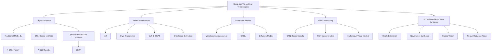

Sources: [chapters/en/_toctree.yml:29-144](), [chapters/en/unit2/cnns/yolo.mdx:1-274](), [chapters/en/unit7/video-processing/multimodal-based-video-models.mdx:1-132](), [chapters/en/unit7/video-processing/rnn-based-video-models.mdx:1-109](), [chapters/en/unit8/monocular_depth_estimation.mdx:1-250]()

## Technology Stack and Implementation Architecture

The following diagram illustrates how the core computer vision technologies translate to the specific implementations covered in the course:

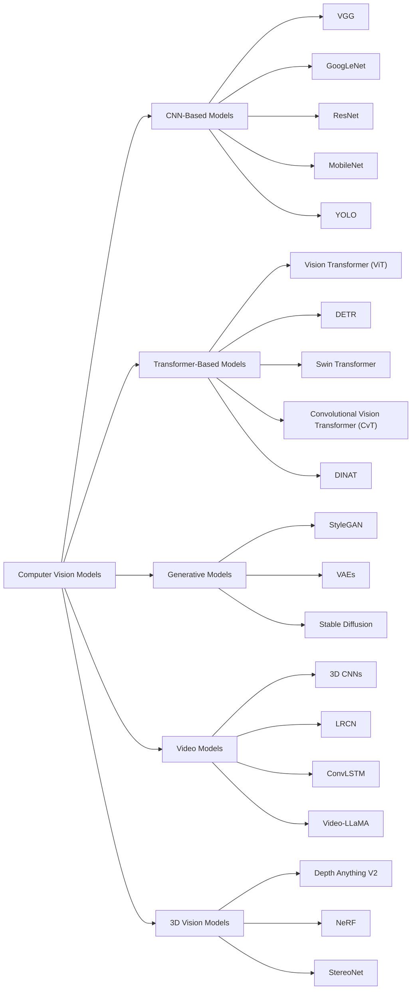

Sources: [chapters/en/_toctree.yml:29-158](), [chapters/en/unit2/cnns/yolo.mdx:61-249](), [chapters/en/unit7/video-processing/rnn-based-video-models.mdx:21-109](), [chapters/en/unit8/monocular_depth_estimation.mdx:120-390]()

## Object Detection

Object detection is a fundamental computer vision task that focuses on identifying and localizing objects within images. It combines classification (what objects are present) with localization (where they are in the image).

### Key Architectures and Approaches

Object detection technologies have evolved from traditional two-stage detectors to modern single-stage and transformer-based approaches:

| Architecture Type | Key Examples | Characteristics |
|-------------------|--------------|-----------------|
| Two-Stage Detectors | R-CNN, Fast R-CNN, Faster R-CNN | First generate region proposals, then classify objects within these regions |
| One-Stage Detectors | YOLO family (v1-v9), SSD | Process the entire image in a single pass, making predictions directly |
| Transformer-Based | DETR | Use attention mechanisms to eliminate the need for hand-designed components like anchor boxes |

#### Evolution of YOLO Architecture

The YOLO (You Only Look Once) architecture represents a significant advancement in object detection, offering real-time performance with high accuracy. Its evolution spans multiple versions:


Sources: [chapters/en/unit2/cnns/yolo.mdx:60-250]()

YOLO divides an image into a grid and predicts objects and their positions in a single forward pass, making it significantly faster than two-stage detection methods. The architecture consists of:

1. **Backbone Network**: Extracts features from the input image (evolved from custom architectures to Darknet variants)
2. **Neck**: Aggregates features across different scales
3. **Head**: Makes the final predictions (bounding boxes, confidence scores, class probabilities)

The success of YOLO has led to numerous variations and improvements over time, with each version addressing limitations of previous iterations and incorporating new techniques from the field.

For more detailed information on object detection techniques, especially YOLO and its variants, see [Object Detection](#2.1).

Sources: [chapters/en/unit2/cnns/yolo.mdx:61-273]()

## Vision Transformers

Vision Transformers represent a paradigm shift in computer vision, adapting the transformer architecture (originally designed for natural language processing) to visual tasks. These models replace the traditional convolutional operation with self-attention mechanisms to process image data.

### Key Vision Transformer Architectures

| Architecture | Key Characteristics | Primary Applications |
|--------------|---------------------|----------------------|
| Vision Transformer (ViT) | Divides images into patches, processes them as token sequences | Image classification |
| Swin Transformer | Hierarchical structure with shifted windows for attention | Dense prediction tasks (detection, segmentation) |
| CvT | Combines convolution and transformer components | Image classification, object detection |
| DINAT | Uses dilated neighborhood attention | High-resolution image processing |
| DETR | End-to-end object detection without hand-designed components | Object detection |

### ViT Architecture Overview

Vision Transformer (ViT) processes images by:
1. Dividing the input image into fixed-size patches
2. Linearly embedding these patches
3. Adding position embeddings
4. Processing the sequence with standard transformer encoder blocks

This approach has proven highly effective for image classification when trained on sufficient data, often outperforming CNN-based approaches.

For more detailed information on Vision Transformers and their applications in classification, detection, and segmentation, see [Vision Transformers](#2.2).

Sources: [chapters/en/_toctree.yml:49-70](), [notebooks/Unit 3 - Vision Transformers/DETR.ipynb:97-117]()

## Generative Models

Generative models in computer vision are designed to create new visual content by learning the underlying distribution of training data. These models have revolutionized tasks such as image synthesis, style transfer, and image-to-image translation.

### Key Generative Architectures

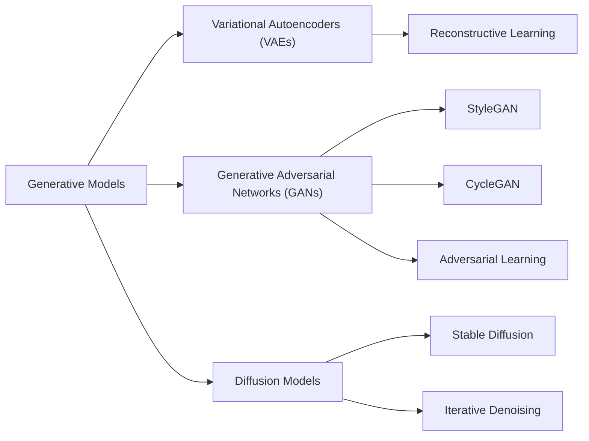

Sources: [chapters/en/_toctree.yml:95-114]()

#### Comparison of Generative Approaches

| Model Type | Working Principle | Strengths | Limitations |
|------------|-------------------|-----------|------------|
| VAEs | Encode inputs to a latent distribution, then decode to reconstruct | Good for learning compressed representations | Often produce blurry outputs |
| GANs | Generator and discriminator networks compete in adversarial training | Can generate highly realistic images | Training instability, mode collapse |
| Diffusion Models | Gradually add noise to data, then learn to reverse the process | State-of-the-art image quality, controllable generation | Computationally intensive inference |

These generative models serve as the foundation for numerous applications including text-to-image generation, image inpainting, style transfer, and synthetic data creation.

For more detailed information on generative models and their implementations, see [Generative Models](#2.3).

Sources: [chapters/en/_toctree.yml:95-114]()

## Video Processing

Video processing extends computer vision techniques to the temporal dimension, analyzing sequences of images to understand motion and temporal relationships.

### Video Processing Approaches

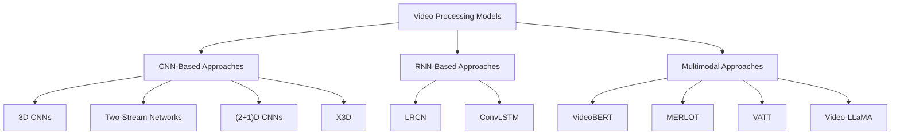

Sources: [chapters/en/unit7/video-processing/cnn-based-video-model.mdx:9-124](), [chapters/en/unit7/video-processing/rnn-based-video-models.mdx:21-109](), [chapters/en/unit7/video-processing/multimodal-based-video-models.mdx:23-132]()

#### Key Video Processing Architectures

| Architecture Type | Examples | Approach |
|-------------------|----------|----------|
| CNN-Based | 3D CNNs, Two-Stream Networks, (2+1)D ResNets, X3D | Extend convolutional operations to the temporal dimension |
| RNN-Based | LRCN, ConvLSTM | Use recurrent architectures to model temporal dependencies |
| Multimodal | VideoBERT, VATT, Video-LLaMA | Integrate multiple modalities (video, audio, text) |

**3D CNNs** extend 2D convolutions to process spatio-temporal data, capturing motion information directly from video sequences. **Two-Stream Networks** process spatial (appearance) and temporal (motion) information separately before fusion. **RNN-Based** approaches like LRCN and ConvLSTM are designed to handle sequential data, maintaining state information across frames.

**Multimodal Video Models** integrate different data types:
- Video-Text models (VideoBERT, MERLOT)
- Video-Audio-Text models (VATT, Video-LLaMA)
- Multi-modality integration (ImageBind)

For more detailed information on video processing techniques and architectures, see [Video Processing](#2.4).

Sources: [chapters/en/unit7/video-processing/cnn-based-video-model.mdx:9-134](), [chapters/en/unit7/video-processing/rnn-based-video-models.mdx:21-109](), [chapters/en/unit7/video-processing/multimodal-based-video-models.mdx:6-132]()

## 3D Vision and Novel View Synthesis

3D vision techniques aim to recover three-dimensional information from two-dimensional images, enabling depth perception, 3D reconstruction, and the ability to generate novel views of scenes.

### Key 3D Vision Technologies

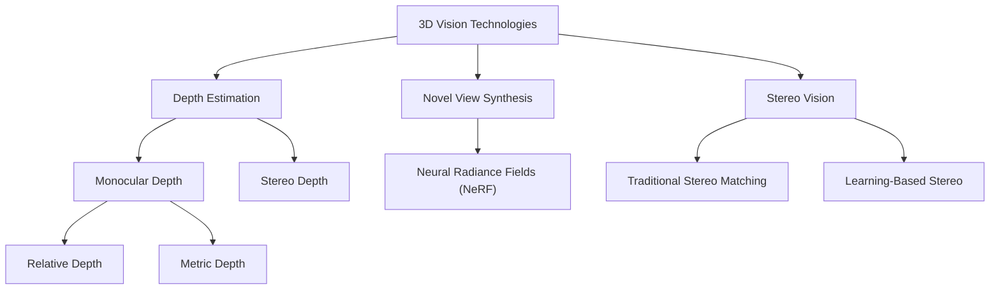

Sources: [chapters/en/_toctree.yml:137-158](), [chapters/en/unit8/monocular_depth_estimation.mdx:1-390]()

#### Monocular Depth Estimation

Monocular depth estimation recovers depth information from a single image, a fundamentally challenging task due to the inherent ambiguity of 3D-to-2D projection. Modern approaches include:

1. **Relative Depth Estimation**: Predicts depth relationships (closer/farther) without absolute measurements
2. **Metric Depth Estimation**: Predicts actual distance values in real-world units

The state-of-the-art model in this area is Depth Anything V2, which uses:
- DPT architecture (based on Vision Transformers)
- DINOv2 encoder pre-trained with self-supervision
- Scale and shift invariant loss functions to handle diverse data

#### Neural Radiance Fields (NeRF)

NeRF represents scenes as continuous 5D functions that map 3D location and 2D viewing direction to color and density. This representation allows novel view synthesis - generating new perspectives of a scene from a set of input views.

For more detailed information on 3D vision techniques, depth estimation, and novel view synthesis, see [3D Vision and Novel View Synthesis](#2.5).

Sources: [chapters/en/unit8/monocular_depth_estimation.mdx:1-390]()

## Cross-Cutting Technologies and Connections

Several technologies and approaches span multiple areas of computer vision, creating connections between the core technologies:

### Transfer Learning and Fine-Tuning

Transfer learning is critical across all computer vision domains, allowing models pre-trained on large datasets to be adapted to specific tasks with limited data. This approach is applied in:

- Object detection: Pre-trained CNN backbones for YOLO models
- Vision Transformers: Fine-tuning ViT models for downstream tasks
- Generative models: Adapting pre-trained diffusion models for specific domains
- Video models: Leveraging image-based pre-training for video understanding

### Attention Mechanisms

Attention has become ubiquitous across computer vision models:

- Vision Transformers: Self-attention as the core operation
- Object Detection: DETR uses attention for object relationships
- Video Models: Temporal attention in video transformers
- Generative Models: Cross-attention in diffusion models for conditioning

### Multimodal Learning

The integration of multiple modalities is increasingly important:

- Image-Text: Vision-language models like CLIP
- Video-Audio-Text: Models like VATT and Video-LLaMA
- Cross-modal generation: Text-to-image models like Stable Diffusion

Sources: [chapters/en/unit7/video-processing/multimodal-based-video-models.mdx:6-132](), [chapters/en/_toctree.yml:71-94]()

## Real-World Applications

The core computer vision technologies covered in this course enable numerous real-world applications:

| Technology | Applications |
|------------|--------------|
| Object Detection | Autonomous vehicles, surveillance, retail analytics |
| Vision Transformers | Medical image analysis, satellite imagery, robotics |
| Generative Models | Content creation, data augmentation, entertainment |
| Video Processing | Action recognition, video surveillance, sports analytics |
| 3D Vision | Augmented reality, robotics, autonomous navigation |

For more detailed information on real-world applications and ethical considerations, see [Applications and Ethical Considerations](#4).

Sources: [chapters/en/unit1/chapter1/applications.mdx:1-99](), [chapters/en/unit1/chapter1/definition.mdx:1-67]()

## Conclusion

The core computer vision technologies covered in this course represent the foundation of modern visual AI systems. From traditional CNN-based architectures to cutting-edge transformer models and generative approaches, these technologies enable machines to interpret, analyze, and create visual content in increasingly sophisticated ways.

As the field continues to evolve, the boundaries between these technologies blur, with hybrid approaches combining the strengths of different techniques. Understanding these core technologies provides the foundation for exploring more specialized and advanced computer vision applications.

---

# Page: Object Detection

# Object Detection

<details>
<summary>Relevant source files</summary>

The following files were used as context for generating this wiki page:

- [chapters/en/_toctree.yml](chapters/en/_toctree.yml)
- [chapters/en/unit0/welcome/welcome.mdx](chapters/en/unit0/welcome/welcome.mdx)
- [chapters/en/unit2/cnns/yolo.mdx](chapters/en/unit2/cnns/yolo.mdx)
- [chapters/en/unit7/video-processing/cnn-based-video-model.mdx](chapters/en/unit7/video-processing/cnn-based-video-model.mdx)
- [chapters/en/unit7/video-processing/multimodal-based-video-models.mdx](chapters/en/unit7/video-processing/multimodal-based-video-models.mdx)
- [chapters/en/unit7/video-processing/rnn-based-video-models.mdx](chapters/en/unit7/video-processing/rnn-based-video-models.mdx)
- [chapters/en/unit8/monocular_depth_estimation.mdx](chapters/en/unit8/monocular_depth_estimation.mdx)
- [notebooks/Unit 3 - Vision Transformers/DETR.ipynb](notebooks/Unit 3 - Vision Transformers/DETR.ipynb)

</details>


This document provides a technical overview of object detection systems and architectures implemented in the Computer Vision Course. Object detection is a fundamental computer vision task that involves not only classifying objects in images but also accurately locating them through bounding box coordinates. For image classification without localization, see the Introduction to Convolutional Neural Networks section, and for image segmentation, see the Image Segmentation page in Unit 6.

## Introduction to Object Detection

Object detection combines two fundamental tasks:
1. **Classification** - Identifying what objects are present in the image
2. **Localization** - Determining where these objects are located via bounding boxes

Unlike image classification, which only outputs class labels for the entire image, object detection outputs both class labels and spatial coordinates for each detected object. This makes it significantly more challenging but also more useful for many real-world applications such as autonomous driving, surveillance, and robotics.

```mermaid
flowchart TD
    A["Input Image"] --> B["Object Detection System"]
    B --> C["Classification (What)"]
    B --> D["Localization (Where)"]
    C --> E["Class Labels"]
    D --> F["Bounding Box Coordinates"]
    E --> G["Output: Detected Objects"]
    F --> G
```

Sources: [chapters/en/unit2/cnns/yolo.mdx:5-6]()

## Object Detection Approaches

Object detection methodologies can be broadly categorized into three main approaches:

```mermaid
flowchart TD
    A["Object Detection Approaches"] --> B["Two-Stage Detectors"]
    A --> C["One-Stage Detectors"]
    A --> D["Transformer-Based"]
    
    B --> B1["R-CNN Family"]
    B1 --> B11["R-CNN"]
    B1 --> B12["Fast R-CNN"]
    B1 --> B13["Faster R-CNN"]
    B1 --> B14["Feature Pyramid Network"]
    
    C --> C1["YOLO Family"]
    C1 --> C11["YOLOv1-v9"]
    
    D --> D1["DETR"]
```

### Two-Stage Detectors
Two-stage detectors like the R-CNN family first generate region proposals (potential object locations) and then classify each proposed region. This approach tends to be more accurate but slower.

### One-Stage Detectors
One-stage detectors like YOLO (You Only Look Once) perform detection in a single forward pass, predicting bounding boxes and class probabilities directly. This approach is typically faster but historically has been less accurate than two-stage methods.

### Transformer-Based Detectors
More recently, transformer-based approaches like DETR (DEtection TRansformer) have been applied to object detection, leveraging attention mechanisms to capture global dependencies in the image.

Sources: [chapters/en/unit2/cnns/yolo.mdx:6-7](), [chapters/en/unit2/cnns/yolo.mdx:62-73]()

## R-CNN Family

### R-CNN (Region-based Convolutional Neural Networks)

R-CNN was one of the earliest deep learning-based object detection approaches, introduced in 2014. The architecture follows a multi-step process:

1. Use Selective Search algorithm to generate ~2000 region proposals
2. Extract CNN features from each proposed region
3. Classify regions using SVMs
4. Refine bounding box coordinates with regression

```mermaid
flowchart LR
    A["Input Image"] --> B["Selective Search\n(Region Proposals)"]
    B --> C["CNN Feature\nExtraction"]
    C --> D["SVM Classification"]
    C --> E["Bounding Box\nRegression"]
    D --> F["Detected Objects"]
    E --> F
```

While groundbreaking, R-CNN is computationally expensive as it requires running the CNN for each of the ~2000 region proposals independently.

Sources: [chapters/en/unit2/cnns/yolo.mdx:10-27]()

### Fast R-CNN

Fast R-CNN improved upon R-CNN by processing the entire image once through a CNN and then extracting features for each region proposal from the shared feature map. Key improvements include:

- Single-stage training with multi-task loss (classification + bounding box regression)
- No disk storage required for feature caching
- Introduction of ROI (Region of Interest) pooling layer
- End-to-end training

```mermaid
flowchart LR
    A["Input Image"] --> B["CNN\n(Feature Extraction)"]
    B --> C["ROI Pooling"]
    D["Region Proposals\n(Selective Search)"] --> C
    C --> E["Fully Connected\nLayers"]
    E --> F["Classification"]
    E --> G["Bounding Box\nRegression"]
```

Fast R-CNN significantly improved both speed and accuracy compared to R-CNN.

Sources: [chapters/en/unit2/cnns/yolo.mdx:30-39]()

### Faster R-CNN

Faster R-CNN further improved the detection pipeline by replacing the Selective Search algorithm with a Region Proposal Network (RPN), making the entire system end-to-end trainable. The key innovation was:

- Introduction of RPN, which shares full-image convolutional features with the detection network
- End-to-end trainable system
- Significant speed improvement (90% faster than Fast R-CNN)

```mermaid
flowchart TB
    A["Input Image"] --> B["CNN\n(Feature Extraction)"]
    B --> C["Region Proposal\nNetwork (RPN)"]
    B --> D["ROI Pooling"]
    C --> D
    D --> E["Fully Connected\nLayers"]
    E --> F["Classification"]
    E --> G["Bounding Box\nRegression"]
```

Faster R-CNN represented a significant milestone in object detection, combining high accuracy with reasonable speed.

Sources: [chapters/en/unit2/cnns/yolo.mdx:41-47]()

### Feature Pyramid Network (FPN)

Feature Pyramid Network is an enhancement that can be applied to detection architectures like Faster R-CNN. It addresses the challenge of detecting objects at different scales by creating a pyramid of feature maps:

- Creates a feature hierarchy from a single input image scale
- Combines low-resolution, semantically strong features with high-resolution features
- Uses top-down pathways and lateral connections to merge feature maps of different scales

```mermaid
flowchart TB
    A["Input Image"] --> B["Bottom-up\nPath (CNN)"]
    B -->|"Conv1"| C1["C1"]
    B -->|"Conv2"| C2["C2"]
    B -->|"Conv3"| C3["C3"]
    B -->|"Conv4"| C4["C4"]
    B -->|"Conv5"| C5["C5"]
    
    C5 --> P5["P5"]
    P5 --> P4["P4"]
    C4 --> L4["Lateral\nConnection"]
    L4 --> P4
    
    P4 --> P3["P3"]
    C3 --> L3["Lateral\nConnection"]
    L3 --> P3
    
    P3 --> P2["P2"]
    C2 --> L2["Lateral\nConnection"]
    L2 --> P2
    
    P2 --> P1["P1"]
    C1 --> L1["Lateral\nConnection"]
    L1 --> P1
    
    P1 --> D["Object\nDetection"]
    P2 --> D
    P3 --> D
    P4 --> D
    P5 --> D
```

FPN has become a standard component in many state-of-the-art object detection systems.

Sources: [chapters/en/unit2/cnns/yolo.mdx:49-59]()

## YOLO Architecture

YOLO (You Only Look Once) revolutionized object detection by introducing a single-stage detection approach that is both fast and accurate. The key innovation of YOLO is treating detection as a regression problem, predicting bounding boxes and class probabilities directly from full images in a single evaluation.

### Core Concept: Grid-Based Detection

YOLO divides the input image into an S×S grid. Each grid cell is responsible for detecting objects whose centers fall within that cell.

```mermaid
flowchart TD
    A["Input Image"] --> B["Divide into\nS×S Grid"]
    B --> C["Each Grid Cell Predicts:\n- B Bounding Boxes\n- Confidence Scores\n- C Class Probabilities"]
    C --> D["Final Detections"]
```

For each grid cell, YOLO predicts:
- B bounding boxes (each with x, y, w, h coordinates)
- Confidence scores for each box
- C conditional class probabilities

Sources: [chapters/en/unit2/cnns/yolo.mdx:74-96]()

### Confidence Score and Class Prediction

The confidence score reflects the likelihood of an object being present in the box and the accuracy of the box. It's defined as:

Confidence = P(Object) × IOU(predicted, truth)

Where IOU (Intersection over Union) measures the overlap between the predicted box and the ground truth.

Class probabilities are conditioned on the presence of an object in the grid cell:
P(Class_i | Object)

At test time, these components are combined to give class-specific confidence scores:
P(Class_i) × IOU(predicted, truth)

```mermaid
flowchart TB
    A["Grid Cell"] --> B["B Bounding Boxes"]
    A --> C["Class Probabilities\nP(Class_i | Object)"]
    
    B --> D["Confidence Score\nP(Object) × IOU"]
    
    C --> E["Class-Specific Confidence\nP(Class_i | Object) × P(Object) × IOU"]
    D --> E
    
    E --> F["Final Detections"]
```

Sources: [chapters/en/unit2/cnns/yolo.mdx:81-103]()

### YOLO v1 Network Architecture

The original YOLOv1 architecture consists of:
- Input: 448×448 RGB image
- Output: 7×7×30 tensor (7×7 grid, each with 2 boxes and 20 class probabilities)
- 24 convolutional layers followed by 2 fully connected layers
- Final layer uses linear activation, all others use leaky ReLU

```mermaid
flowchart LR
    A["Input\n448×448×3"] --> B["24 Convolutional\nLayers"]
    B --> C["2 Fully\nConnected Layers"]
    C --> D["Output\n7×7×30"]
    
    subgraph "Grid Cell Output Structure"
        E["Box 1:\nx, y, w, h, confidence"]
        F["Box 2:\nx, y, w, h, confidence"]
        G["Class Probabilities\n(20 values)"]
    end
```

Sources: [chapters/en/unit2/cnns/yolo.mdx:108-124]()

### Training and Loss Function

YOLO is trained end-to-end using a custom loss function that balances several components:

1. **Localization Loss**: Error in bounding box coordinates
2. **Confidence Loss**: Error in predicting object presence
3. **Classification Loss**: Error in predicting class probabilities

The loss function includes special weighting to address:
- Different scales of bounding boxes (using square root of width and height)
- Imbalance between cells with and without objects
- Equal importance of localization and classification errors

```mermaid
flowchart TD
    A["Loss Function"] --> B["Localization\nLoss"]
    A --> C["Confidence\nLoss"]
    A --> D["Classification\nLoss"]
    
    B --> E["λ_coord × ∑∑ 1_ij^obj [(x_i - x̂_i)² + (y_i - ŷ_i)² +\n(√w_i - √ŵ_i)² + (√h_i - √ĥ_i)²]"]
    
    C --> F["∑∑ 1_ij^obj (Ĉ_i - C_i)² +\nλ_noobj ∑∑ 1_ij^noobj (Ĉ_i - C_i)²"]
    
    D --> G["∑_i 1_i^obj ∑_c (P̂_i(c) - P_i(c))²"]
```

Sources: [chapters/en/unit2/cnns/yolo.mdx:125-197]()

### Inference and Non-Maximum Suppression

During inference, YOLO:
1. Passes the image through the network to get predictions
2. Filters out boxes with low confidence scores
3. Applies Non-Maximum Suppression (NMS) to eliminate redundant overlapping boxes

NMS works by:
1. Sorting all detection boxes by confidence
2. Taking the box with highest confidence and eliminating all other boxes with high overlap (IOU > threshold)
3. Repeating until no boxes remain

```mermaid
flowchart TD
    A["Input Image"] --> B["YOLO Network"]
    B --> C["S×S×(B×5+C)\nPrediction Map"]
    C --> D["Filter by\nConfidence Threshold"]
    D --> E["Non-Maximum\nSuppression"]
    E --> F["Final Detections"]
```

Sources: [chapters/en/unit2/cnns/yolo.mdx:198-206]()

## Evolution of YOLO

The YOLO architecture has evolved significantly since its initial release, with each version bringing improvements in accuracy, speed, and usability.

```mermaid
flowchart LR
    A["YOLOv1\n(2015)"] --> B["YOLOv2/YOLO9000\n(2016)"]
    B --> C["YOLOv3\n(2018)"]
    C --> D["YOLOv4\n(2020)"]
    D --> E["YOLOv5\n(2020)"]
    E --> F["YOLOv6\n(2022)"]
    F --> G["YOLOv7\n(2022)"]
    G --> H["YOLOv8\n(2023)"]
    H --> I["YOLOv9\n(2024)"]
```

### YOLOv2 (2016)

Key improvements:
- Replaced backbone with Darknet-19
- Added batch normalization to all convolutional layers
- Introduced anchor boxes for better bounding box predictions
- Improved grid resolution to 13×13
- Maximum number of boxes: 13×13×5 = 845

Sources: [chapters/en/unit2/cnns/yolo.mdx:212-214]()

### YOLOv3 (2018)

Key improvements:
- Replaced backbone with Darknet-53
- Improved detection at multiple scales (13×13, 26×26, 52×52 grids)
- Increased the number of potential bounding boxes to 10,647
- Better handling of small objects

Sources: [chapters/en/unit2/cnns/yolo.mdx:214-216]()

### YOLOv4 (2020)

Key improvements:
- Replaced backbone with CSPDarknet53
- Optimized for efficient resource utilization
- Introduced "bag-of-freebies" - training optimizations that improve accuracy without increasing inference time
- Better data augmentation techniques

Sources: [chapters/en/unit2/cnns/yolo.mdx:217-220]()

### YOLOv5 (2020)

Key improvements:
- Translated from Darknet (C) to PyTorch
- Automated anchor detection mechanism (auto-anchors)
- Different model sizes for various hardware constraints (YOLOv5s, YOLOv5m, YOLOv5l, YOLOv5x)

Sources: [chapters/en/unit2/cnns/yolo.mdx:220-222]()

### YOLOv6 (2022)

Key improvements:
- Reparameterization using RepVGG technique
- Quantization of reparameterization-based detectors
- Consideration of different hardware capabilities
- New loss functions (Varifocal Loss, IoU Series Loss, Distribution Focal Loss)
- Knowledge distillation for improved accuracy

Sources: [chapters/en/unit2/cnns/yolo.mdx:223-231]()

### YOLOv7 (2022)

Key improvements:
- New "trainable bag-of-freebies"
- Coarse-to-fine lead-guided label assignment
- Gradient flow propagation paths for re-parameterized convolution
- "Extend" and "compound scaling" methods for real-time detection

Sources: [chapters/en/unit2/cnns/yolo.mdx:232-234]()

### YOLOv8 (2023)

Key improvements:
- Improved backbone and neck architecture
- Anchor-free approach for direct predictions
- Support for a wide range of vision tasks (classification, segmentation, pose estimation)
- Pre-trained models in various sizes (nano, small, medium, large, extra-large)
- Easy fine-tuning on custom datasets

Sources: [chapters/en/unit2/cnns/yolo.mdx:235-237]()

### YOLOv9 (2024)

Key improvements:
- Programmable gradient information (PGI) to handle various changes required by deep networks
- Generalized Efficient Layer Aggregation Network (GELAN) for better parameter utilization
- New state-of-the-art benchmarks on MS COCO challenge

Sources: [chapters/en/unit2/cnns/yolo.mdx:238-246]()

## YOLO Version Comparison

The following table summarizes the key differences between YOLO versions:

| Version | Year | Backbone | Key Innovations | Advantages |
|---------|------|----------|----------------|------------|
| YOLOv1  | 2015 | Custom CNN | Grid-based single-pass detection | Speed |
| YOLOv2  | 2016 | Darknet-19 | Anchor boxes, batch normalization | Improved accuracy |
| YOLOv3  | 2018 | Darknet-53 | Multi-scale detection | Better small object detection |
| YOLOv4  | 2020 | CSPDarknet53 | Bag-of-freebies, optimized training | Hardware adaptability |
| YOLOv5  | 2020 | Custom PyTorch | Auto-anchors, multiple model sizes | Ease of use, scalability |
| YOLOv6  | 2022 | RepVGG-based | Reparameterization, specialized loss functions | Industry optimization |
| YOLOv7  | 2022 | E-ELAN | Trainable bag-of-freebies, compound scaling | State-of-the-art performance |
| YOLOv8  | 2023 | Enhanced backbone | Anchor-free, multi-task capability | Versatility |
| YOLOv9  | 2024 | GELAN | Programmable gradient information | Improved parameter efficiency |

Sources: [chapters/en/unit2/cnns/yolo.mdx:247-251]()

## Summary

Object detection is a fundamental computer vision task that combines classification and localization. The field has evolved significantly over the years, from two-stage approaches like the R-CNN family to single-stage detectors like YOLO. The YOLO family of models, in particular, has seen rapid advancement, with each new version bringing improvements in accuracy, speed, and usability.

The key takeaways from this overview are:
1. Two-stage detectors (R-CNN family) prioritize accuracy but may be slower
2. One-stage detectors (YOLO family) offer a better speed-accuracy tradeoff
3. YOLO revolutionized object detection with its grid-based approach and single-pass detection
4. The evolution of YOLO (v1 through v9) demonstrates continuous innovation in the field
5. Modern object detection systems can achieve real-time performance while maintaining high accuracy

For practical implementations of object detection systems, refer to the notebooks in the repository, particularly those focusing on YOLO and DETR architectures.

Sources: [chapters/en/unit2/cnns/yolo.mdx](), [chapters/en/_toctree.yml:47-48]()

---

# Page: Vision Transformers

# Vision Transformers

<details>
<summary>Relevant source files</summary>

The following files were used as context for generating this wiki page:

- [chapters/en/unit1/image_and_imaging/examples-preprocess.mdx](chapters/en/unit1/image_and_imaging/examples-preprocess.mdx)
- [chapters/en/unit10/blenderProc.mdx](chapters/en/unit10/blenderProc.mdx)
- [chapters/en/unit10/point_clouds.mdx](chapters/en/unit10/point_clouds.mdx)
- [chapters/en/unit10/synthetic-lung-images.mdx](chapters/en/unit10/synthetic-lung-images.mdx)
- [chapters/en/unit3/vision-transformers/cvt.mdx](chapters/en/unit3/vision-transformers/cvt.mdx)
- [chapters/en/unit5/generative-models/gans-vaes/stylegan.mdx](chapters/en/unit5/generative-models/gans-vaes/stylegan.mdx)
- [notebooks/Unit 3 - Vision Transformers/DETR.ipynb](notebooks/Unit 3 - Vision Transformers/DETR.ipynb)
- [notebooks/Unit 3 - Vision Transformers/KnowledgeDistillation.ipynb](notebooks/Unit 3 - Vision Transformers/KnowledgeDistillation.ipynb)

</details>


This document covers the architecture, implementation, and applications of Vision Transformers (ViT) - a class of deep learning models that apply the transformer architecture to computer vision tasks. Vision Transformers have demonstrated outstanding performance on various image recognition tasks by treating images as sequences of patches. For information about object detection with transformers, see [Object Detection](#2.1).

## Introduction to Vision Transformers

Vision Transformers (ViT) represent a paradigm shift in computer vision by applying the transformer architecture, initially developed for natural language processing, to image recognition tasks. Unlike Convolutional Neural Networks (CNNs) that use convolutional operations to process images hierarchically, ViTs divide an image into fixed-size patches, linearly embed each patch, and process them using transformer encoder layers.

The key innovation of ViTs is treating an image as a sequence of tokens (patches), similar to how words are treated in NLP transformers. This approach allows ViTs to capture global dependencies in images more effectively than CNNs, which are limited by their local receptive fields.

Sources:
- notebooks/Unit 3 - Vision Transformers/DETR.ipynb
- chapters/en/unit3/vision-transformers/cvt.mdx

## Core Architecture of Vision Transformers

Vision Transformer architecture

```mermaid
flowchart TD
    subgraph "Vision Transformer Architecture"
        A["Input Image"] --> B["Patch Embedding"]
        B --> C["Position Embedding"]
        C --> D["Transformer Encoder"]
        D --> E["MLP Head"]
        E --> F["Classification Output"]
        
        subgraph "Patch Embedding"
            B1["Split image into patches"] --> B2["Flatten patches"]
            B2 --> B3["Linear projection"]
        end
        
        subgraph "Transformer Encoder"
            D1["Multi-Head\nSelf-Attention"] --> D2["Add & Norm"]
            D2 --> D3["Feed Forward\nNetwork"]
            D3 --> D4["Add & Norm"]
        end
    end
```

The core architecture of a Vision Transformer consists of:

1. **Patch Embedding**: The input image is divided into fixed-size patches (e.g., 16×16 pixels). Each patch is flattened and linearly projected to obtain patch embeddings.

2. **Position Embedding**: Since transformers don't have an inherent understanding of spatial relationships, positional embeddings are added to provide information about the location of each patch.

3. **Transformer Encoder**: The embedded patches are processed by multiple transformer encoder layers. Each encoder layer consists of:
   - Multi-Head Self-Attention (MHSA): Allows each patch to attend to all other patches
   - Feed-Forward Network (FFN): A simple MLP applied to each position separately

4. **Classification Head**: A Multi-Layer Perceptron (MLP) that processes the output of the transformer encoder for classification tasks.

The self-attention mechanism in ViTs allows the model to weigh the importance of different patches when making predictions, enabling it to capture long-range dependencies that might be difficult for CNNs to model.

Sources:
- notebooks/Unit 3 - Vision Transformers/DETR.ipynb
- chapters/en/unit3/vision-transformers/cvt.mdx

## Variants of Vision Transformers

Several variants of Vision Transformers have been developed to address limitations and improve performance:

### Convolutional Vision Transformer (CvT)

CvT Architecture

```mermaid
flowchart TD
    subgraph "CvT Architecture"
        A["Input Image"] --> B["Convolutional\nToken Embedding"]
        B --> C["Hierarchical\nTransformer Stages"]
        C --> D["Classification\nHead"]
        
        subgraph "Convolutional Token Embedding"
            B1["Overlapping\nConvolution"] --> B2["Reshape\nto Tokens"]
        end
        
        subgraph "Hierarchical Transformer Stages"
            C1["Stage 1 (Low Resolution)"] --> C2["Stage 2 (Medium Resolution)"]
            C2 --> C3["Stage 3 (High Resolution)"]
        end
        
        subgraph "Convolutional Projection"
            E1["Depth-wise\nConvolution"] --> E2["Batch\nNormalization"]
            E2 --> E3["Reshape"]
        end
    end
```

Convolutional Vision Transformer (CvT) integrates the strengths of CNNs with transformers:

1. **Convolutional Token Embedding**: Uses convolutional operations instead of simple patch extraction to create token embeddings, introducing locality bias and reducing computational complexity.

2. **Convolutional Projection**: Replaces the linear projections in the self-attention mechanism with convolutional projections.

3. **Hierarchical Structure**: Employs a multi-stage architecture with progressively lower resolution but higher channel dimensions.

Key advantages of CvT over standard ViT:
- Eliminates the need for explicit positional encodings
- Reduces computational complexity
- Improves performance by leveraging local receptive fields
- Provides better generalization with fewer parameters

The table below compares CvT with other Vision Transformer variants:

| Model | Needs Position Encoding | Token Embedding | Projection for Attention | Hierarchical Structure |
|-------|-------------------------|-----------------|--------------------------|------------------------|
| ViT   | Yes                     | Non-overlapping | Linear                   | No                     |
| CvT   | No                      | Overlapping (Convolution) | Convolution | Yes |

Sources:
- chapters/en/unit3/vision-transformers/cvt.mdx

### DETR (DEtection TRansformer)

DETR extends Vision Transformers for object detection tasks:

1. **CNN Backbone**: Uses a CNN (typically ResNet) to extract features from images.

2. **Transformer Encoder-Decoder**: Processes image features with a transformer encoder, and a transformer decoder that predicts object classes and bounding boxes.

3. **Object Queries**: Uses a fixed set of learned object queries (e.g., 100) that the decoder transforms into predictions, enabling the model to detect a pre-defined maximum number of objects.

4. **Bipartite Matching Loss**: Employs a novel loss function that matches predictions to ground-truth objects optimally.

DETR simplifies the traditional object detection pipeline by eliminating the need for anchor boxes, non-maximum suppression, and other hand-designed components.

Sources:
- notebooks/Unit 3 - Vision Transformers/DETR.ipynb

## Knowledge Distillation for Vision Transformers

Knowledge Distillation Process

```mermaid
flowchart LR
    subgraph "Knowledge Distillation for Vision Transformers"
        A["Teacher Model\n(Large ViT)"] --> B["Soft Labels"]
        C["Student Model\n(Small ViT)"] --> D["Predictions"]
        B --> E["Distillation Loss"]
        D --> E
        E --> F["Optimize\nStudent Model"]
        F --> C
        G["Hard Labels\n(Ground Truth)"] --> H["Classification Loss"]
        D --> H
        H --> F
    end
```

Knowledge distillation is a technique for transferring knowledge from a larger, more complex "teacher" model to a smaller, more efficient "student" model. For Vision Transformers, this involves:

1. **Teacher Model**: A pre-trained larger ViT model (e.g., ViT-Base)
2. **Student Model**: A smaller ViT model (e.g., ViT-Tiny)
3. **Training Process**:
   - The teacher model provides soft labels (probability distributions) for images
   - The student model is trained to mimic the teacher's outputs while also learning from ground-truth labels
   - A combined loss function balances distillation loss and classification loss

Benefits of knowledge distillation for Vision Transformers:
- Produces smaller, faster models while maintaining accuracy
- Enables deployment on resource-constrained devices
- Reduces inference time and computational requirements
- Improves generalization by transferring nuanced knowledge

Sources:
- notebooks/Unit 3 - Vision Transformers/KnowledgeDistillation.ipynb

## Practical Implementation

### Using DETR for Object Detection

DETR can be implemented using the Hugging Face `transformers` library:

```python
from transformers import DetrImageProcessor, DetrForObjectDetection
import torch
from PIL import Image
import requests

# Load model and processor
processor = DetrImageProcessor.from_pretrained("facebook/detr-resnet-50")
model = DetrForObjectDetection.from_pretrained("facebook/detr-resnet-50")

# Load image
url = "http://images.cocodataset.org/val2017/000000039769.jpg"
image = Image.open(requests.get(url, stream=True).raw)

# Process image
inputs = processor(images=image, return_tensors="pt")

# Forward pass
outputs = model(**inputs)

# Post-process to get bounding boxes
target_sizes = torch.tensor([image.size[::-1]])
results = processor.post_process_object_detection(outputs, target_sizes=target_sizes, threshold=0.9)[0]
```

The DETR model architecture includes:
- A backbone (typically ResNet) to extract features
- A transformer encoder-decoder that processes these features and produces object predictions
- A set of learned object queries (default: 100) that limit the maximum number of objects the model can detect

The output of DETR includes:
- `logits`: Class predictions for each object query (shape: [batch_size, num_queries, num_classes])
- `pred_boxes`: Bounding box coordinates for each object query (shape: [batch_size, num_queries, 4])

Sources:
- notebooks/Unit 3 - Vision Transformers/DETR.ipynb

### Implementing Knowledge Distillation

Knowledge distillation can be implemented using PyTorch:

```python
import torch.nn.functional as F

def distillation_loss(student_logits, teacher_logits, temperature=1.0):
    """
    Compute the knowledge distillation loss
    """
    soft_targets = F.softmax(teacher_logits / temperature, dim=-1)
    student_log_softmax = F.log_softmax(student_logits / temperature, dim=-1)
    
    # KL divergence loss
    loss = F.kl_div(student_log_softmax, soft_targets, reduction='batchmean') * temperature**2
    return loss

# Training loop
def train_with_distillation(teacher_model, student_model, dataloader, optimizer, alpha=0.5):
    teacher_model.eval()  # Set teacher to evaluation mode
    student_model.train()  # Set student to training mode
    
    for images, labels in dataloader:
        # Get teacher's predictions
        with torch.no_grad():
            teacher_outputs = teacher_model(images)
            
        # Get student's predictions
        student_outputs = student_model(images)
        
        # Standard classification loss
        cls_loss = F.cross_entropy(student_outputs, labels)
        
        # Distillation loss
        dist_loss = distillation_loss(student_outputs, teacher_outputs)
        
        # Combined loss
        loss = alpha * cls_loss + (1 - alpha) * dist_loss
        
        # Backward and optimize
        optimizer.zero_grad()
        loss.backward()
        optimizer.step()
```

The process involves:
1. Training a large teacher model first (or using a pre-trained one)
2. Creating a smaller student model with the same output structure
3. Training the student to match both the ground truth labels and the teacher's soft predictions
4. Balancing between standard classification loss and distillation loss

Sources:
- notebooks/Unit 3 - Vision Transformers/KnowledgeDistillation.ipynb

### Using CvT

Convolutional Vision Transformer (CvT) can be used through the Hugging Face `transformers` library:

```python
from transformers import AutoFeatureExtractor, CvtForImageClassification
from PIL import Image
import requests

# Load model and processor
feature_extractor = AutoFeatureExtractor.from_pretrained("microsoft/cvt-13")
model = CvtForImageClassification.from_pretrained("microsoft/cvt-13")

# Load image
url = "http://images.cocodataset.org/val2017/000000039769.jpg"
image = Image.open(requests.get(url, stream=True).raw)

# Process image and predict
inputs = feature_extractor(images=image, return_tensors="pt")
outputs = model(**inputs)
logits = outputs.logits

# Get predicted class
predicted_class_idx = logits.argmax(-1).item()
print("Predicted class:", model.config.id2label[predicted_class_idx])
```

CvT models offer better performance with fewer parameters compared to standard ViT models, making them suitable for various deployment scenarios.

Sources:
- chapters/en/unit3/vision-transformers/cvt.mdx

## Conclusion

Vision Transformers have revolutionized computer vision by adapting the transformer architecture from NLP to image recognition tasks. Their ability to capture global dependencies and their flexibility have led to state-of-the-art performance across various computer vision tasks.

Key variants like CvT and DETR have addressed limitations of the original ViT architecture, while techniques like knowledge distillation have made these models more practical for real-world deployment. The integration of Vision Transformers with the Hugging Face ecosystem has made them accessible to a wide range of practitioners.

As research continues, Vision Transformers are expected to evolve further, potentially combining the best aspects of CNNs and transformers to create even more powerful and efficient computer vision models.

---

# Page: Generative Models

# Generative Models

<details>
<summary>Relevant source files</summary>

The following files were used as context for generating this wiki page:

- [chapters/en/unit1/image_and_imaging/examples-preprocess.mdx](chapters/en/unit1/image_and_imaging/examples-preprocess.mdx)
- [chapters/en/unit10/blenderProc.mdx](chapters/en/unit10/blenderProc.mdx)
- [chapters/en/unit10/point_clouds.mdx](chapters/en/unit10/point_clouds.mdx)
- [chapters/en/unit10/synthetic-lung-images.mdx](chapters/en/unit10/synthetic-lung-images.mdx)
- [chapters/en/unit3/vision-transformers/cvt.mdx](chapters/en/unit3/vision-transformers/cvt.mdx)
- [chapters/en/unit5/generative-models/gans-vaes/stylegan.mdx](chapters/en/unit5/generative-models/gans-vaes/stylegan.mdx)
- [notebooks/Unit 5 - Generative Models/Diffusion Models/README.md](notebooks/Unit 5 - Generative Models/Diffusion Models/README.md)
- [notebooks/Unit 5 - Generative Models/GANs & VAEs/README.md](notebooks/Unit 5 - Generative Models/GANs & VAEs/README.md)
- [notebooks/Unit 5 - Generative Models/Introduction/README.md](notebooks/Unit 5 - Generative Models/Introduction/README.md)
- [notebooks/Unit 5 - Generative Models/Practical Applications & Challenges/README.md](notebooks/Unit 5 - Generative Models/Practical Applications & Challenges/README.md)

</details>


## Purpose and Scope

This document provides a technical overview of generative models used in computer vision, focusing on their architectures, implementations, and applications. Generative models are machine learning systems designed to create new data samples that resemble a training distribution. This page covers three primary types of generative models: Generative Adversarial Networks (GANs), Variational Autoencoders (VAEs), and Diffusion Models. For information about synthetic data generation using 3D rendering techniques, see [Using a 3D Renderer to Generate Synthetic Data](#10).

## Overview of Generative Models

Generative models learn to approximate the underlying probability distribution of training data, enabling them to generate new samples that share similar characteristics with the original dataset. Unlike discriminative models that focus on classification or regression, generative models aim to understand the full data distribution.

### Taxonomy of Generative Models

```mermaid
graph TD
    A["Generative Models"] --> B["Generative Adversarial Networks (GANs)"]
    A --> C["Variational Autoencoders (VAEs)"]
    A --> D["Diffusion Models"]
    
    B --> B1["StyleGAN"]
    B --> B2["DCGAN"]
    B --> B3["Other GAN Variants"]
    
    B1 --> B11["StyleGAN1"]
    B11 --> B12["StyleGAN2"]
    B12 --> B13["StyleGAN3"]
    
    C --> C1["Vanilla VAE"]
    C --> C2["Conditional VAE"]
    C --> C3["VQ-VAE"]
    
    D --> D1["DDPM"]
    D --> D2["DDIM"]
    D --> D3["Stable Diffusion"]
```

Sources: `notebooks/Unit 5 - Generative Models/Introduction/README.md`, `notebooks/Unit 5 - Generative Models/GANs & VAEs/README.md`, `notebooks/Unit 5 - Generative Models/Diffusion Models/README.md`

## Generative Adversarial Networks (GANs)

GANs, introduced by Ian Goodfellow in 2014, consist of two neural networks—a generator and a discriminator—that compete against each other in a minimax game. The generator creates fake samples while the discriminator attempts to distinguish between real and generated samples.

### Basic GAN Architecture

```mermaid
graph LR
    A["Random Noise z"] --> B["Generator G"]
    B --> C["Generated Image G(z)"]
    C --> D["Discriminator D"]
    E["Real Image x"] --> D
    D --> F["Probability D(x) or D(G(z))"]
    
    subgraph "Training Process"
        G["Generator Loss: log(1-D(G(z)))"]
        H["Discriminator Loss: -log(D(x)) - log(1-D(G(z)))"]
    end
```

Sources: `notebooks/Unit 5 - Generative Models/GANs & VAEs/README.md`

### Training Process

GANs are trained through an adversarial process where:
1. The discriminator learns to maximize the probability of correctly identifying real and fake samples
2. The generator learns to minimize the probability of the discriminator correctly identifying its outputs as fake

This results in a minimax optimization problem:

```
min_G max_D V(D, G) = E_x~p_data [log D(x)] + E_z~p_z [log(1 - D(G(z)))]
```

### StyleGAN Variants

StyleGAN is a state-of-the-art GAN architecture developed by NVIDIA that introduced several key innovations to improve the quality and controllability of generated images.

#### StyleGAN1 Components

StyleGAN1 introduced three key components that set it apart from vanilla GANs:

1. **Mapping Network**: Transforms the latent code z into an intermediate latent space w, which helps disentangle features
2. **AdaIN (Adaptive Instance Normalization)**: Allows style information to be injected at different resolutions
3. **Noise Injection**: Adds stochasticity to generate fine details like hair strands and skin pores

```mermaid
graph TD
    A["Latent Code z"] --> B["Mapping Network"]
    B --> C["Intermediate Latent Code w"]
    
    C --> D1["AdaIN Block 1 (4×4)"]
    C --> D2["AdaIN Block 2 (8×8)"]
    C --> D3["AdaIN Block 3 (16×16)"]
    C --> D4["..."]
    C --> D5["AdaIN Block n (1024×1024)"]
    
    E1["Noise"] --> D1
    E2["Noise"] --> D2
    E3["Noise"] --> D3
    E4["Noise"] --> D4
    E5["Noise"] --> D5
    
    D1 --> D2
    D2 --> D3
    D3 --> D4
    D4 --> D5
    
    D5 --> F["Generated Image"]
```

Sources: `chapters/en/unit5/generative-models/gans-vaes/stylegan.mdx:10-56`

#### StyleGAN Evolution

StyleGAN2 addressed key issues from the original model:
- Eliminated blob-like artifacts by replacing AdaIN with a demodulation technique
- Fixed strong location preference artifacts by redesigning the progressive growing architecture

StyleGAN3 tackled aliasing effects, ensuring that features aren't unnaturally fixed to specific pixel coordinates during animation and interpolation.

Sources: `chapters/en/unit5/generative-models/gans-vaes/stylegan.mdx:57-86`

### DCGAN (Deep Convolutional GAN)

DCGAN incorporates convolutional layers into the GAN architecture to improve image quality and training stability.

#### DCGAN Architecture

```mermaid
graph LR
    A["Random Noise (100)"] --> B["Generator"]
    
    subgraph "Generator"
        B1["Fully Connected + Reshape"]
        B2["Conv2DTranspose + BatchNorm + ReLU"]
        B3["Conv2DTranspose + BatchNorm + ReLU"]
        B4["Conv2DTranspose + BatchNorm + ReLU"]
        B5["Conv2DTranspose + Tanh"]
        
        B1 --> B2
        B2 --> B3
        B3 --> B4
        B4 --> B5
    end
    
    B --> C["Generated Image (128×128×3)"]
    C --> D["Discriminator"]
    E["Real Image (128×128×3)"] --> D
    
    subgraph "Discriminator"
        D1["Conv2D + LeakyReLU"]
        D2["Conv2D + BatchNorm + LeakyReLU"]
        D3["Conv2D + BatchNorm + LeakyReLU"]
        D4["Conv2D + BatchNorm + LeakyReLU"]
        D5["Conv2D + Sigmoid"]
        
        D1 --> D2
        D2 --> D3
        D3 --> D4
        D4 --> D5
    end
    
    D --> F["Real/Fake Probability"]
```

Sources: `chapters/en/unit10/synthetic-lung-images.mdx:8-31`

DCGAN has been used extensively for medical image synthesis, including lung X-ray images, as discussed in the synthetic-lung-images chapter. It addresses challenges in medical imaging such as small datasets, privacy concerns, and limited annotated samples.

Sources: `chapters/en/unit10/synthetic-lung-images.mdx:32-86`

## Variational Autoencoders (VAEs)

VAEs are generative models that combine neural networks with variational inference to learn latent representations of data. Unlike traditional autoencoders, VAEs enforce a probabilistic structure on the latent space.

### VAE Architecture

```mermaid
graph LR
    A["Input Data x"] --> B["Encoder Network"]
    B --> C["Mean μ(x)"]
    B --> D["Log Variance log(σ²(x))"]
    
    C --> E["Sampling"]
    D --> E
    E --> F["Latent Vector z"]
    
    F --> G["Decoder Network"]
    G --> H["Reconstructed Data x̂"]
    
    subgraph "Loss Function"
        I["Reconstruction Loss: ||x - x̂||²"]
        J["KL Divergence: KL(N(μ, σ²) || N(0, I))"]
    end
```

Sources: `notebooks/Unit 5 - Generative Models/GANs & VAEs/README.md`

### Training Process

VAEs are trained to minimize two components:
1. **Reconstruction Loss**: Measures how well the decoder reconstructs the input from the latent representation
2. **KL Divergence**: Encourages the latent space to approximate a standard normal distribution

The VAE loss function is:

```
L(θ, φ) = E_q_φ(z|x)[log p_θ(x|z)] - KL(q_φ(z|x) || p(z))
```

Where:
- θ are the decoder parameters
- φ are the encoder parameters
- q_φ(z|x) is the approximate posterior
- p_θ(x|z) is the likelihood of reconstructing x from z
- p(z) is the prior distribution (usually a standard normal)

## Diffusion Models

Diffusion models generate data by gradually denoising a pure noise signal. They have gained prominence recently due to their exceptional ability to generate high-quality images.

### Diffusion Process

```mermaid
graph LR
    A["Original Image x₀"] --"Add Noise"--> B["x₁"]
    B --"Add Noise"--> C["x₂"]
    C --"Add Noise"--> D["..."]
    D --"Add Noise"--> E["Pure Noise xₜ"]
    
    subgraph "Forward Process (Fixed)"
        F["q(xₜ|x₀) = N(xₜ; √αₜx₀, (1-αₜ)I)"]
    end
    
    E --"Denoise"--> G["x̂ₜ₋₁"]
    G --"Denoise"--> H["x̂ₜ₋₂"]
    H --"Denoise"--> I["..."]
    I --"Denoise"--> J["Generated Image x̂₀"]
    
    subgraph "Reverse Process (Learned)"
        K["p_θ(x₀:ₜ₋₁) = p(xₜ)∏p_θ(xₜ₋₁|xₜ)"]
    end
```

Sources: `notebooks/Unit 5 - Generative Models/Diffusion Models/README.md`

### Training Process

Diffusion models are trained to predict the noise added at each step of the forward process. The training objective is typically a variational lower bound on the data likelihood.

Key phases in diffusion models:

1. **Forward Process**: Gradually add Gaussian noise to the data according to a fixed schedule
2. **Reverse Process**: Learn to gradually denoise a pure noise sample to generate a new data point

The models are trained using a simplified objective that amounts to predicting the noise that was added at each step.

### Stable Diffusion

Stable Diffusion is a latent diffusion model that operates in a compressed latent space rather than pixel space, making it more computationally efficient. It incorporates:

- A VAE to map between image space and latent space
- A U-Net denoising network conditioned on text embeddings
- A text encoder (typically CLIP) to provide conditioning information

```mermaid
graph TD
    A["Text Prompt"] --> B["Text Encoder (CLIP)"]
    B --> C["Text Embeddings"]
    
    D["Random Noise"] --> E["U-Net Denoiser"]
    C --> E
    
    E --> F["Denoised Latent Representation"]
    F --> G["VAE Decoder"]
    G --> H["Generated Image"]
```

Sources: `notebooks/Unit 5 - Generative Models/Diffusion Models/README.md`

## Applications of Generative Models

Generative models have numerous applications in computer vision:

| Application | Description | Primary Models Used |
|-------------|-------------|---------------------|
| Image Synthesis | Creating new, realistic images | GANs, Diffusion Models |
| Image Translation | Converting images from one domain to another | GANs (CycleGAN, Pix2Pix) |
| Super-resolution | Enhancing image resolution | GANs, Diffusion Models |
| Inpainting | Filling in missing parts of images | GANs, Diffusion Models |
| Style Transfer | Applying artistic styles to images | StyleGAN, Neural Style Transfer |
| Data Augmentation | Generating additional training data | GANs, Diffusion Models |
| Medical Imaging | Synthesizing medical images for training | DCGAN, Diffusion Models |
| 3D Shape Generation | Creating 3D models from 2D images | GANs, Diffusion Models |

Sources: `chapters/en/unit5/generative-models/gans-vaes/stylegan.mdx:88-106`, `chapters/en/unit10/synthetic-lung-images.mdx:87-93`

## Comparative Analysis

The following table compares the key characteristics of the three main generative model types:

| Characteristic | GANs | VAEs | Diffusion Models |
|----------------|------|------|------------------|
| Training Stability | Challenging (mode collapse, non-convergence) | Relatively stable | Stable but computationally intensive |
| Sample Quality | High (especially StyleGAN) | Often blurry | Very high |
| Sampling Speed | Fast | Fast | Slow (requires multiple denoising steps) |
| Mode Coverage | Often limited (mode collapse) | Good | Excellent |
| Latent Space | Not explicitly structured | Structured (enforced through KL divergence) | No explicit latent space |
| Conditioning | Through conditional GANs | Through conditional VAEs | Natural through guidance |
| Architecture Complexity | Moderate to high | Moderate | High |
| Interpretability | Limited | Better (due to structured latent space) | Limited |

Sources: `notebooks/Unit 5 - Generative Models/Introduction/README.md`, `notebooks/Unit 5 - Generative Models/GANs & VAEs/README.md`, `notebooks/Unit 5 - Generative Models/Diffusion Models/README.md`

## Challenges and Limitations

### GANs
- Mode collapse: Generator produces limited variety of samples
- Training instability: Balancing generator and discriminator training
- Evaluation difficulty: No explicit likelihood measurement

### VAEs
- Blurry generation: Tends to produce less sharp images than GANs
- Posterior collapse: Latent variables may be ignored with powerful decoders
- Limited expressiveness: Simple Gaussian priors may constrain model capacity

### Diffusion Models
- Slow sampling: Requires many denoising steps
- Computational cost: Training requires simulating the entire diffusion process
- Memory requirements: Typically higher than GANs or VAEs

Sources: `notebooks/Unit 5 - Generative Models/Practical Applications & Challenges/README.md`

## Recent Advances and Future Directions

Recent advances in generative modeling include:

1. Hybrid approaches combining multiple model types
2. Improved training techniques for increased stability
3. Integration with other AI technologies like transformers
4. Domain-specific architectures for medical imaging and other specialized applications
5. Text-to-image generation with models like DALL-E, Midjourney, and Stable Diffusion

Future research directions focus on:

1. Reducing computational requirements
2. Improving control over the generation process
3. Extending to video, audio, and 3D domains
4. Enhancing model interpretability
5. Addressing ethical concerns around synthetic media

Sources: `notebooks/Unit 5 - Generative Models/Practical Applications & Challenges/README.md`

---

# Page: Video Processing

# Video Processing

<details>
<summary>Relevant source files</summary>

The following files were used as context for generating this wiki page:

- [chapters/en/_toctree.yml](chapters/en/_toctree.yml)
- [chapters/en/unit0/welcome/welcome.mdx](chapters/en/unit0/welcome/welcome.mdx)
- [chapters/en/unit2/cnns/yolo.mdx](chapters/en/unit2/cnns/yolo.mdx)
- [chapters/en/unit7/video-processing/cnn-based-video-model.mdx](chapters/en/unit7/video-processing/cnn-based-video-model.mdx)
- [chapters/en/unit7/video-processing/multimodal-based-video-models.mdx](chapters/en/unit7/video-processing/multimodal-based-video-models.mdx)
- [chapters/en/unit7/video-processing/rnn-based-video-models.mdx](chapters/en/unit7/video-processing/rnn-based-video-models.mdx)
- [chapters/en/unit8/monocular_depth_estimation.mdx](chapters/en/unit8/monocular_depth_estimation.mdx)

</details>


## Purpose and Scope

Video processing in computer vision involves analyzing sequences of images (frames) to extract meaningful temporal and spatial information. Unlike static image processing, video processing must handle the additional dimension of time, presenting unique challenges and opportunities. This document covers the fundamental approaches to video processing including CNN-based models, RNN-based models, and multimodal models, focusing on architectures that effectively capture spatiotemporal relationships in video data.

For information about object detection or image segmentation, see [Basic CV Tasks](#6). For information about 3D vision and scene reconstruction, see [3D Vision](#8).

## Video Data Representation

Videos are essentially sequences of frames with temporal relationships between them. Processing video data requires understanding both the spatial information within each frame and how this information evolves over time.

### Video as Sequential Data

```mermaid
graph LR
    A["Video Data"] --> B["Frame 1"]
    A --> C["Frame 2"]
    A --> D["..."]
    A --> E["Frame N"]
    B --> F["Spatial Features"]
    C --> F
    D --> F
    E --> F
    B --> G["Temporal Features"]
    C --> G
    D --> G
    E --> G
    F --> H["Video Understanding"]
    G --> H
```

Sources:
- chapters/en/unit7/video-processing/rnn-based-video-models.mdx

## CNN-Based Video Models

Convolutional Neural Networks (CNNs) have been adapted from image processing to handle the temporal dimension in videos.

### Key Architectures

#### Two-Stream Networks (2014)

This architecture uses two separate pathways:
- **Spatial Stream**: Processes individual frames to capture appearance
- **Temporal Stream**: Processes optical flow to capture motion
- The outputs are then fused for final prediction

```mermaid
graph TD
    A["Input Video"] --> B["Frame Extraction"]
    A --> C["Optical Flow"]
    B --> D["Spatial CNN"]
    C --> E["Temporal CNN"]
    D --> F["Fusion"]
    E --> F
    F --> G["Action Recognition"]
```

#### 3D ResNets (2017)

These models extend 2D CNNs by using 3D convolutional kernels to process spatial and temporal information simultaneously. 3D ResNets apply the residual learning framework to 3D CNNs, allowing deeper architectures that better capture complex spatiotemporal patterns.

#### (2+1)D ResNets (2017)

This architecture decomposes 3D convolution into sequential operations:
- 2D spatial convolution captures features within frames
- 1D temporal convolution captures motion across frames

This decomposition:
- Doubles the number of non-linearities for the same parameter count
- Facilitates optimization, yielding lower training and test loss

#### X3D (Expanded 3D Networks)

X3D is a lightweight 3D CNN model that:
- Achieves high accuracy with fewer parameters
- Uses progressive expansion of network dimensions
- Is optimized for deployment on devices with limited resources

Sources:
- chapters/en/unit7/video-processing/cnn-based-video-model.mdx

## RNN-Based Video Models

Recurrent Neural Networks (RNNs) are specifically designed for processing sequential data, making them well-suited for modeling temporal relationships in videos.

### Key Architectures

#### LRCN (Long-term Recurrent Convolutional Networks)

LRCN combines CNNs and LSTMs:
- CNN extracts spatial features from each frame
- LSTM processes these features sequentially to model temporal relationships

```mermaid
graph TD
    A["VideoFrameSequence"] --> B["CNNFeatureExtractor"]
    B --> C["Frame1Features"]
    B --> D["Frame2Features"]
    B --> E["..."]
    B --> F["FrameNFeatures"]
    C --> G["LSTMTemporalProcessor"]
    D --> G
    E --> G
    F --> G
    G --> H["TemporalRepresentation"]
    H --> I["ActionPrediction"]
```

#### ConvLSTM Network

ConvLSTM modifies the traditional LSTM by:
- Replacing linear operations with convolutional operations
- Maintaining spatial structure throughout temporal processing
- Operating directly on 2D spatial data across time

```mermaid
graph TD
    A["SpatioTemporalInput"] --> B["ConvLSTMCell"]
    B --> C["ConvGates"]
    C --> D["InputGate"]
    C --> E["ForgetGate"]
    C --> F["OutputGate"]
    D --> G["CellState"]
    E --> G
    G --> H["HiddenState"]
    F --> H
    H --> I["SpatioTemporalPrediction"]
```

#### Unsupervised Video Representation Learning

This approach uses encoder-decoder LSTM networks to:
- Learn video representations without labeled data
- Map arbitrary-length sequences to fixed-size representations
- Reconstruct input sequences or predict future frames

Sources:
- chapters/en/unit7/video-processing/rnn-based-video-models.mdx

## Multimodal Video Models

Multimodal video models integrate video with other data types such as text and audio to create richer representations.

### Text-Video Models

#### VideoBERT
- Applies BERT architecture to video data
- Uses visual tokens and text tokens for alignment
- Performs masked language/frame modeling for self-supervised learning

#### MERLOT
- Improves multimodal reasoning on large-scale video-text datasets
- Learns from unlabeled video data through temporal reordering and frame-caption matching tasks
- Enhances visual commonsense reasoning capabilities

### Audio-Video-Text Models

#### VATT (Visual-Audio-Text Transformer)

VATT uses self-supervised learning from raw video, audio, and text:
- Applies different tokenization methods to each modality
- Employs the Transformer architecture for modality-specific encoding
- Utilizes contrastive learning to align representations

```mermaid
graph TD
    A["MultimodalVideoInput"] --> B["VideoTokenizer"]
    A --> C["AudioTokenizer"]
    A --> D["TextTokenizer"]
    B --> E["TransformerEncoder"]
    C --> F["TransformerEncoder"]
    D --> G["TransformerEncoder"]
    E --> H["ContrastiveAlignment"]
    F --> H
    G --> H
    H --> I["JointRepresentation"]
```

#### Video-LLaMA
- Extends Large Language Models to understand audiovisual content
- Uses two branches: vision-language and audio-language
- Leverages ImageBind to overcome limited audio-text data

### Multi-Modality Integration

#### ImageBind
- Unifies multiple modalities (image, audio, text, depth) using paired data
- Uses images as the reference point for alignment
- Enables cross-modal retrieval without direct pairings between non-image modalities

Sources:
- chapters/en/unit7/video-processing/multimodal-based-video-models.mdx

## Technical Challenges and Limitations

### CNN-Based Model Limitations
- Computational complexity due to 3D convolutions
- Difficulty capturing long-range temporal dependencies
- Trade-offs between model depth and processing efficiency

### RNN-Based Model Limitations
- Challenges with long-term dependencies in extended sequences
- Sequential processing limits parallelization opportunities
- Higher computational demands for processing long videos

```mermaid
graph LR
    A["VideoProcessingChallenges"] --> B["ComputationalComplexity"]
    A --> C["TemporalModeling"]
    A --> D["ModalityIntegration"]
    B --> E["MemoryRequirements"]
    B --> F["ProcessingTime"]
    C --> G["Long-termDependencies"]
    C --> H["TemporalAlignment"]
    D --> I["CrossModalRepresentation"]
    D --> J["ModalitySynchronization"]
```

Sources:
- chapters/en/unit7/video-processing/rnn-based-video-models.mdx
- chapters/en/unit7/video-processing/cnn-based-video-model.mdx

## Applications

Video processing techniques enable a wide range of applications:

| Application | Description | Primary Approach |
|-------------|-------------|------------------|
| Action Recognition | Identifying human actions in videos | CNN-based, Two-Stream Networks |
| Video Captioning | Generating text descriptions of video content | RNN-based, Attention mechanisms |
| Video Summarization | Creating concise summaries of longer videos | RNN-based, Attention mechanisms |
| Object Tracking | Following objects across video frames | CNN-based, RNN-based hybrid |
| Video Generation | Creating new video content | GAN-based, Diffusion models |
| Video Retrieval | Finding videos based on queries | Multimodal embedding models |
| Anomaly Detection | Identifying unusual events in videos | Unsupervised learning approaches |

Sources:
- chapters/en/unit7/video-processing/cnn-based-video-model.mdx
- chapters/en/unit7/video-processing/rnn-based-video-models.mdx
- chapters/en/unit7/video-processing/multimodal-based-video-models.mdx

## Future Directions

Research in video processing is moving toward:

1. **Transformer-based architectures** that can better capture long-range dependencies
2. **Self-supervised learning approaches** to leverage the vast amount of unlabeled video data
3. **More efficient architectures** for real-time processing on edge devices
4. **Enhanced multimodal integration** for more comprehensive video understanding
5. **Privacy-preserving video analytics** that can process video without compromising sensitive information

Sources:
- chapters/en/unit7/video-processing/cnn-based-video-model.mdx
- chapters/en/unit7/video-processing/rnn-based-video-models.mdx

## Conclusion

Video processing is a complex but rapidly evolving field within computer vision. The different approaches—CNN-based, RNN-based, and multimodal models—each offer unique strengths in addressing the challenges of spatiotemporal data analysis. As computational resources continue to improve and model architectures become more sophisticated, we can expect significant advancements in our ability to understand and generate video content.

Sources:
- chapters/en/unit7/video-processing/multimodal-based-video-models.mdx
- chapters/en/unit7/video-processing/rnn-based-video-models.mdx
- chapters/en/unit7/video-processing/cnn-based-video-model.mdx

---

# Page: 3D Vision and Novel View Synthesis

# 3D Vision and Novel View Synthesis

<details>
<summary>Relevant source files</summary>

The following files were used as context for generating this wiki page:

- [chapters/en/unit8/3d-vision/nvs.mdx](chapters/en/unit8/3d-vision/nvs.mdx)
- [chapters/en/unit8/3d_measurements_stereo_vision.mdx](chapters/en/unit8/3d_measurements_stereo_vision.mdx)
- [chapters/en/unit8/nerf.mdx](chapters/en/unit8/nerf.mdx)
- [chapters/en/unit8/terminologies/camera-models.mdx](chapters/en/unit8/terminologies/camera-models.mdx)
- [chapters/en/unit8/terminologies/linear-algebra.mdx](chapters/en/unit8/terminologies/linear-algebra.mdx)
- [chapters/en/unit8/terminologies/representations.mdx](chapters/en/unit8/terminologies/representations.mdx)

</details>


## Purpose and Scope

This document explains techniques for reconstructing and navigating 3D scenes from 2D images. It covers stereo vision for depth measurement, novel view synthesis for generating new perspectives, and neural radiance fields (NeRFs) for implicit 3D scene representation. The focus is on the mathematical foundations, computational approaches, and practical implementations of these technologies.

Sources: [chapters/en/unit8/3d_measurements_stereo_vision.mdx:1-8](), [chapters/en/unit8/3d-vision/nvs.mdx:1-7](), [chapters/en/unit8/nerf.mdx:1-6]()

## 3D Geometric Foundations

### Camera Models and Image Formation

The pinhole camera model is fundamental to 3D vision, forming the basis for how 3D scenes are projected onto 2D image planes:

```mermaid
graph LR
    A["3D World Point (x,y,z)"] --> B["Pinhole"]
    B --> C["Image Plane (u,v)"]
    D["Camera Matrix K"] --> B
    style A fill:none
    style B fill:none
    style C fill:none
    style D fill:none
```

**Camera Coordinate Transformation**

A camera's intrinsic parameters are captured in the camera matrix:

$$
K = \begin{pmatrix}
f_x & 0 & c_x  \\
0 & f_y & c_y  \\
0 & 0 & 1  \\
\end{pmatrix}
$$

Where:
- $f_x$ and $f_y$ are focal lengths in pixels
- $c_x$ and $c_y$ are the coordinates of the principal point (where the optical axis intersects the image plane)

To project a 3D point to 2D, the point is multiplied by the camera matrix and the homogeneous coordinates are normalized.

Sources: [chapters/en/unit8/terminologies/camera-models.mdx:1-50](), [chapters/en/unit8/3d_measurements_stereo_vision.mdx:4-7]()

### Coordinate Systems and Transformations

Coordinate transformations are essential for 3D vision, allowing us to relate positions in world space to camera space:

```mermaid
graph TD
    A["3D Space"] --> B["Transformations"]
    B --> C["Translation"]
    B --> D["Rotation"]
    B --> E["Scaling"]
    B --> F["Combined Transforms"]
    C --> G["Camera Space"]
    D --> G
    E --> G
    F --> G
    style A fill:none
    style B fill:none
    style C fill:none
    style D fill:none
    style E fill:none
    style F fill:none
    style G fill:none
```

These transformations are represented as 4×4 matrices operating on homogeneous coordinates:

- **Translation**: Moving points by a vector $(t_x, t_y, t_z)$
- **Rotation**: Rotating points around the x, y, or z axes
- **Scaling**: Changing the size of objects
- **Combined transformations**: Multiple transforms applied in sequence (matrix multiplication)

Sources: [chapters/en/unit8/terminologies/linear-algebra.mdx:3-216]()

### 3D Representations

Various representations are used to encode 3D data depending on the application:

| Representation | Description | Common Uses |
|----------------|-------------|-------------|
| Point Clouds | Lists of 3D points with coordinates | LIDAR scans, 3D scanning |
| Meshes | Triangular faces connecting vertices | Computer graphics, games |
| Volumetric Data | Function mapping positions to density/color | Representing transparent objects |
| Implicit Surfaces | Function whose zero level-set defines a surface | Efficient rendering, physics |

Sources: [chapters/en/unit8/terminologies/representations.mdx:1-24]()

## Stereo Vision

### Problem Statement and Approach

Stereo vision addresses a fundamental ambiguity in 3D reconstruction: a single 2D image can't uniquely determine the 3D coordinates of scene points because all points along a ray project to the same pixel.

```mermaid
graph TD
    A["3D Point P"] --> B["Single Camera View"]
    B --> C["Infinite Possible Positions"]
    A --> D["Two Camera Views"]
    D --> E["Single Unique Position"]
    subgraph "Single Camera"
    B --- C
    end
    subgraph "Stereo System"
    D --- E
    end
    style A fill:none
    style B fill:none
    style C fill:none
    style D fill:none
    style E fill:none
```

The solution uses two cameras (or two positions of the same camera) to observe the scene from different viewpoints. The 3D position can be determined by finding the intersection of the two rays from each camera through the corresponding image points.

Sources: [chapters/en/unit8/3d_measurements_stereo_vision.mdx:4-41]()

### Stereo Vision Setup and Computation

A typical stereo vision setup places two cameras side by side with parallel image planes:

```mermaid
graph LR
    A["Left Camera"] --> B["Image Plane 1"]
    C["Right Camera"] --> D["Image Plane 2"]
    E["3D Point P"] --> B
    E --> D
    A --- |"baseline b"| C
    subgraph "Physical Setup"
    A
    C
    E
    end
    subgraph "Image Formation"
    B
    D
    end
    style A fill:none
    style B fill:none
    style C fill:none
    style D fill:none
    style E fill:none
```

For this ideal configuration, the 3D coordinates of a point can be calculated using these equations:

- $x = \frac{b(u_{left} - O_x)}{u_{left} - u_{right}}$
- $y = \frac{b \cdot f_x (v_{left} - O_y)}{f_y (u_{left} - u_{right})}$
- $z = \frac{b \cdot f_x}{u_{left} - u_{right}}$

Where:
- $b$ is the baseline (distance between cameras)
- $u_{left}, v_{left}$ are pixel coordinates in the left image
- $u_{right}, v_{right}$ are corresponding pixel coordinates in the right image
- $O_x, O_y$ are principal point coordinates
- $f_x, f_y$ are focal lengths in pixels

The difference $(u_{left} - u_{right})$ is called disparity and is inversely proportional to depth.

Sources: [chapters/en/unit8/3d_measurements_stereo_vision.mdx:43-96]()

### Image Rectification and Practical Implementation

In practice, cameras may not be perfectly aligned. Image rectification transforms the original images to appear as if captured by perfectly aligned cameras:

1. Raw images have different intrinsic parameters and slight misalignments
2. Rectification applies transformations to make epipolar lines horizontal
3. After rectification, corresponding points lie on the same horizontal scanline ($v_{left} = v_{right}$)

This preprocessing simplifies the stereo matching problem to a 1D search along scanlines, greatly reducing computational complexity.

Sources: [chapters/en/unit8/3d_measurements_stereo_vision.mdx:97-146]()

### Accuracy and Applications

Stereo vision can achieve high accuracy in depth measurement. Experiments show that calculated dimensions match actual measurements with errors below 1.2%.

Applications include:
- Autonomous vehicles (obstacle detection)
- Robotics (navigation and manipulation)
- 3D scanning and modeling
- Augmented reality

Sources: [chapters/en/unit8/3d_measurements_stereo_vision.mdx:147-196]()

## Novel View Synthesis

Novel View Synthesis (NVS) is the task of generating images from new camera viewpoints that weren't included in the original dataset. It's particularly useful when only a limited number of views are available.

### Challenges in Novel View Synthesis

```mermaid
graph TD
    A["Input Images"] --> B["Novel View Synthesis"]
    B --> C["Output: New View Images"]
    B --> D["Challenges"]
    D --> E["Occlusions"]
    D --> F["Uncertain Content"]
    D --> G["Geometric Consistency"]
    E --> H["Parts of objects hidden in original views"]
    F --> I["Multiple plausible appearances possible"]
    G --> J["Must maintain 3D consistency across views"]
    style A fill:none
    style B fill:none
    style C fill:none
    style D fill:none
    style E fill:none
    style F fill:none
    style G fill:none
    style H fill:none
    style I fill:none
    style J fill:none
```

A key difficulty is that this task is underdetermined—there are usually multiple possible appearances for unseen parts of objects. Traditional regression-based models tend to produce blurry, averaged results in uncertain regions.

Sources: [chapters/en/unit8/3d-vision/nvs.mdx:1-15]()

### Approaches to Novel View Synthesis

NVS methods can be divided into two main categories:

| Approach | Description | Examples | Advantages |
|----------|-------------|----------|------------|
| 3D-based | Generate an intermediate 3D representation then render new views | PixelNeRF, Generative Query Networks | Explicit geometry control |
| Direct generation | Generate new view images directly without 3D representation | Zero123, 3DiM | Can leverage prior knowledge from large datasets |

Sources: [chapters/en/unit8/3d-vision/nvs.mdx:8-15]()

### PixelNeRF: 3D-based Approach

PixelNeRF creates a Neural Radiance Field conditioned on input images:

```mermaid
graph LR
    A["Input Image(s)"] --> B["ResNet34\nFeature Extractor"]
    B --> C["Feature Maps"]
    D["Query Point (x)"] --> E["Project to Image Plane"]
    E --> F["Extract Image Features W(π(x))"]
    F --> G["NeRF MLP"]
    D --> G
    H["View Direction (d)"] --> G
    G --> I["RGB + Density"]
    I --> J["Volume Rendering"]
    J --> K["Novel View"]
    style A fill:none
    style B fill:none
    style C fill:none
    style D fill:none
    style E fill:none
    style F fill:none
    style G fill:none
    style H fill:none
    style I fill:none
    style J fill:none
    style K fill:none
```

The method:
1. Processes input images through a CNN to extract features
2. For each 3D query point, projects it to the input image(s) to sample features
3. Feeds these features plus positional encoding and view direction to a NeRF network
4. Outputs color and density for volume rendering

This approach explicitly encodes 3D structure while still leveraging the power of neural networks.

Sources: [chapters/en/unit8/3d-vision/nvs.mdx:22-59]()

### Zero123: Direct Generation Approach

Zero123 (Zero-1-to-3) adapts the Stable Diffusion model to generate novel views directly:

```mermaid
graph TD
    A["Input Image"] --> B["CLIP Image Encoder"]
    B --> C["Image Embeddings"]
    D["Relative Camera Transform"] --> E["Concatenate"]
    C --> E
    E --> F["Conditioned U-Net Denoiser"]
    G["Noise"] --> F
    H["Input Image Latent"] --> I["Concatenate with Noisy Latents"]
    I --> F
    F --> J["Denoised Latent"]
    J --> K["Decoder"]
    K --> L["Novel View Image"]
    style A fill:none
    style B fill:none
    style C fill:none
    style D fill:none
    style E fill:none
    style F fill:none
    style G fill:none
    style H fill:none
    style I fill:none
    style J fill:none
    style K fill:none
    style L fill:none
```

Key aspects:
1. Uses CLIP image embeddings instead of text prompts
2. Conditions generation on relative camera transformation
3. Leverages the Stable Diffusion architecture for high-quality image generation
4. Concatenates the input image latent with the noise being denoised

Being a diffusion model, Zero123 can generate multiple plausible views for ambiguous cases, rather than averaging to a blurry result.

Sources: [chapters/en/unit8/3d-vision/nvs.mdx:70-91]()

## Neural Radiance Fields (NeRFs)

Neural Radiance Fields (NeRFs) represent a revolutionary approach to storing 3D scenes using implicit neural representations rather than explicit geometric data.

### NeRF Principles and Architecture

```mermaid
graph LR
    A["3D Position (x)"] --> D["Positional Encoding"]
    B["View Direction (d)"] --> E["Positional Encoding"]
    D --> F["MLP Neural Network"]
    E --> F
    F --> G["RGB Color (c)"]
    F --> H["Volume Density (σ)"]
    G --> I["Volume Rendering"]
    H --> I
    I --> J["2D Image"]
    K["Ground Truth"] --> L["MSE Loss"]
    J --> L
    L --> |"Backpropagation"| F
    style A fill:none
    style B fill:none
    style D fill:none
    style E fill:none
    style F fill:none
    style G fill:none
    style H fill:none
    style I fill:none
    style J fill:none
    style K fill:none
    style L fill:none
```

A NeRF represents a 3D scene as a continuous function approximated by a neural network:

$F_{\mathrm{\Theta}} : (\mathbf{x}, \boldsymbol{\theta}) \to (\mathbf{c},\sigma)$

Where:
- $\mathbf{x}$ is a 3D position
- $\boldsymbol{\theta}$ is a viewing direction
- $\mathbf{c}$ is the emitted color
- $\sigma$ is the volume density

Sources: [chapters/en/unit8/nerf.mdx:27-46]()

### Volume Rendering in NeRFs

To render a 2D image from the NeRF, ray marching is performed through the scene, with the final pixel color calculated as:

$$\boldsymbol{\hat{C}}(\mathbf{r})=\sum_{i=1}^{N}T_i (1-\exp(-\sigma_i \delta_i)) \mathbf{c}_i\,, \textrm{ where }T_i=\exp \bigg(-\sum_{j=1}^{i-1} \sigma_j \delta_j \bigg)$$

Where:
- $\mathbf{r}(t)=\mathbf{o}+t\mathbf{d}$ is a camera ray with origin $\mathbf{o}$ and direction $\mathbf{d}$
- $\sigma_i$ is the density at sample point $i$
- $\mathbf{c}_i$ is the color at sample point $i$
- $\delta_i$ is the distance between adjacent samples
- $T_i$ is the accumulated transmittance (probability of light reaching this point)

The network is trained by minimizing the squared error between rendered and ground truth pixel colors.

Sources: [chapters/en/unit8/nerf.mdx:48-76]()

### Optimizations and Advancements

Recent advancements in NeRF technology have focused on:

1. **Faster training and rendering**:
   - Instant-NGP (2022): Using hash-based encodings to reduce MLP size
   - Zip-NeRF (2023): Combining multiple optimizations for sub-hour training times

2. **Handling complex scenes**:
   - Mip-NeRF 360: Scene contraction techniques for unbounded scenes
   - VR-NeRF and SMERF: Real-time rendering capabilities

3. **Other extensions**:
   - Generative NeRFs
   - Deformable NeRFs for dynamic scenes
   - Compositional NeRFs

Sources: [chapters/en/unit8/nerf.mdx:9-26](), [chapters/en/unit8/nerf.mdx:155-164]()

## Conclusion

3D vision and novel view synthesis represent active and rapidly evolving fields within computer vision. From the foundational stereo vision techniques that enable depth perception to the cutting-edge neural radiance fields that can implicitly represent complex 3D scenes, these technologies are enabling new applications in augmented reality, robotics, autonomous vehicles, and creative media.

The connections between traditional geometric approaches and newer neural methods highlight how the field is progressing—leveraging both the mathematical precision of 3D geometry and the flexible, data-driven capabilities of deep learning.

---

# Page: Implementation Details

# Implementation Details

<details>
<summary>Relevant source files</summary>

The following files were used as context for generating this wiki page:

- [chapters/en/unit2/cnns/googlenet.mdx](chapters/en/unit2/cnns/googlenet.mdx)
- [notebooks/Unit 3 - Vision Transformers/DETR.ipynb](notebooks/Unit 3 - Vision Transformers/DETR.ipynb)
- [notebooks/Unit 3 - Vision Transformers/transfer-learning-segmentation.ipynb](notebooks/Unit 3 - Vision Transformers/transfer-learning-segmentation.ipynb)
- [requirements.txt](requirements.txt)
- [utils/code_formatter.py](utils/code_formatter.py)

</details>


This document provides a comprehensive overview of the technical implementation aspects of the computer vision course repository. It covers the core dependencies, code structure, model implementations, and utility tools used throughout the course materials. For information about the course content organization and learning path, see [Course Organization](#1.1). For contribution process details, see [Contribution Process](#5.1).

## Core Dependencies

The computer vision course relies on several key Python libraries to power its examples, notebooks, and demonstrations. These dependencies are carefully chosen to provide a balance between cutting-edge capabilities and stability.

```mermaid
flowchart TD
    A["Repository Dependencies"] --> B["Core ML Libraries"]
    A --> C["Visualization Tools"]
    A --> D["Notebook Environment"]
    
    B --> B1["transformers"]
    B --> B2["timm"]
    B --> B3["torch"]
    B --> B4["datasets"]
    
    C --> C1["matplotlib"]
    C --> C2["albumentations"]
    
    D --> D1["jupyter"]
    D --> D2["ipywidgets"]
```

### Primary Dependencies

The following dependencies are critical for the functioning of the course materials:

| Dependency | Purpose | Version |
|------------|---------|---------|
| transformers | Hugging Face Transformers library for state-of-the-art models | 4.34.0 |
| timm | PyTorch Image Models for computer vision models | 0.9.7 |
| torch | PyTorch deep learning framework | 2.1.0 |
| datasets | Hugging Face Datasets library for data handling | 2.14.5 |
| jupyter | Interactive notebook environment | 1.0.0 |
| ipywidgets | Interactive widgets for Jupyter notebooks | 8.1.1 |
| albumentations | Image augmentation library | 1.3.1 |
| matplotlib | Visualization library | 3.7.1 |

Sources: [requirements.txt:1-9]()

## Content Implementation Structure

The course content is organized into a hierarchical structure of units, chapters, and examples. Content is primarily written in MDX format (Markdown with JSX extensions), which allows for rich interactive elements alongside standard markdown.

```mermaid
flowchart TD
    A["Content Structure"] --> B["Units"]
    B --> C["Chapters"]
    C --> D["MDX Files"]
    D --> E["Code Examples"]
    D --> F["Diagrams/Images"]
    D --> G["Interactive Elements"]
    
    H["Implementation Files"] --> I["Chapters Directory"]
    H --> J["Notebooks Directory"]
    H --> K["Utils Directory"]
    
    I --> I1["chapters/en/unit*/.../*.mdx"]
    J --> J1["notebooks/Unit */.../*.ipynb"]
    K --> K1["utils/*.py"]
```

### Course Material Organization

The course materials are implemented as:

1. **MDX Files**: Core instructional content with explanations, diagrams, and code examples
2. **Jupyter Notebooks**: Interactive examples and exercises with runnable code
3. **Utility Scripts**: Support functionality like code formatting

Sources: [chapters/en/unit2/cnns/googlenet.mdx:1-235](), [notebooks/Unit 3 - Vision Transformers/transfer-learning-segmentation.ipynb:1-472]()

## Model Implementation Patterns

The course includes implementations of various computer vision models. These implementations follow consistent patterns to make them easy to understand and modify.

```mermaid
flowchart TD
    A["Model Implementation Pattern"] --> B["Base Model Class"]
    A --> C["Model Components"]
    A --> D["Forward Method"]
    
    B --> B1["Module Inheritance"]
    B --> B2["Parameter Declaration"]
    
    C --> C1["Layers"]
    C --> C2["Blocks"]
    
    D --> D1["Input Processing"]
    D --> D2["Feature Extraction"]
    D --> D3["Output Generation"]
    
    E["Example Models"] --> F["GoogLeNet"]
    E --> G["Vision Transformers"]
    E --> H["Transfer Learning Models"]
```

### CNN Implementations

The course implements several CNN architectures, with GoogLeNet serving as a representative example. The implementation pattern typically includes:

#### GoogLeNet Implementation Structure

GoogLeNet is implemented as a PyTorch module with several key components:

1. **Base Convolution Layer**: Implemented as a simple convolutional layer with ReLU activation
2. **Inception Module**: The core building block of GoogLeNet that performs multiple convolutions in parallel
3. **Auxiliary Classifier**: Additional classifier outputs used during training
4. **Main Network**: The full GoogLeNet architecture composed of these components

The implementation follows PyTorch conventions, with each component implemented as a subclass of `nn.Module` and a `forward` method defining the computation.

Sources: [chapters/en/unit2/cnns/googlenet.mdx:77-234]()

### Transfer Learning Implementation

The transfer learning approach in the course allows students to fine-tune pre-trained models on custom datasets. The implementation typically involves:

1. Loading a pre-trained model
2. Creating a dataset wrapper for custom data
3. Freezing parts of the model
4. Fine-tuning on the target task

An example of this pattern is shown in the semantic segmentation transfer learning notebook, which fine-tunes a MaskFormer model on the sidewalk dataset.

Sources: [notebooks/Unit 3 - Vision Transformers/transfer-learning-segmentation.ipynb:54-79](), [notebooks/Unit 3 - Vision Transformers/transfer-learning-segmentation.ipynb:139-142]()

## Utility Tools Implementation

The course includes several utility tools to maintain consistency and support the development workflow.

```mermaid
flowchart TD
    A["Utility Tools"] --> B["Code Formatter"]
    A --> C["Documentation Helpers"]
    A --> D["Dataset Utilities"]
    
    B --> B1["Black Integration"]
    B --> B2["MDX Processing"]
    
    C --> C1["Documentation Builder"]
    
    D --> D1["Data Loading"]
    D --> D2["Visualization"]
    
    B1 --> B1a["Python Code Formatting"]
    B2 --> B2a["MDX Code Block Extraction"]
    B2 --> B2b["Code Reformatting"]
    B2 --> B2c["MDX Reconstruction"]
```

### Code Formatter Implementation

The code formatter utility ensures consistent code style across examples in MDX files. It:

1. Extracts Python code blocks from MDX files
2. Formats them using the Black code formatter
3. Rebuilds the MDX files with the formatted code

The implementation uses regular expressions to identify code blocks and preserves special features like the `!` prefix for shell commands.

Sources: [utils/code_formatter.py:1-96]()

### Data Visualization Helpers

The course implements helper functions for visualizing data and model outputs. For example, the `show_samples` function in the transfer learning notebook displays images alongside their segmentation maps.

Sources: [notebooks/Unit 3 - Vision Transformers/transfer-learning-segmentation.ipynb:429-458]()

## Development Environment and Workflow

The development environment for the course is designed to ensure consistency and quality across all materials.

```mermaid
flowchart TD
    A["Development Workflow"] --> B["Content Creation"]
    A --> C["Code Formatting"]
    A --> D["Testing"]
    
    B --> B1["MDX Writing"]
    B --> B2["Notebook Development"]
    
    C --> C1["Automatic Formatting"]
    C --> C2["Style Checking"]
    
    D --> D1["Notebook Execution"]
    D --> D2["Code Validation"]
    
    C1 --> E["code_formatter.py"]
    C2 --> E
    
    E --> F["Process MDX Files"]
    F --> G["Extract Code Blocks"]
    G --> H["Apply Black Formatting"]
    H --> I["Replace in MDX"]
```

### Code Formatting Workflow

The code formatter is run as part of the development workflow to ensure all code examples maintain a consistent style:

1. The formatter can be run in two modes:
   - Format mode: Automatically formats all code blocks in MDX files
   - Check mode: Verifies if files are properly formatted without making changes

2. The formatter processes all MDX files in the `chapters` directory, extracting and formatting Python code blocks.

3. It uses Black with Python 3.7 compatibility and a line length of 90 characters.

Sources: [utils/code_formatter.py:70-84](), [utils/code_formatter.py:39-42]()

## Conclusion

The implementation details of the computer vision course repository provide a solid foundation for both learners and contributors. The consistent model implementation patterns, well-defined content structure, and utility tools ensure a high-quality learning experience while maintaining extensibility for future additions.

---

# Page: CNN Implementations

# CNN Implementations

<details>
<summary>Relevant source files</summary>

The following files were used as context for generating this wiki page:

- [chapters/en/unit2/cnns/googlenet.mdx](chapters/en/unit2/cnns/googlenet.mdx)
- [notebooks/Unit 3 - Vision Transformers/transfer-learning-segmentation.ipynb](notebooks/Unit 3 - Vision Transformers/transfer-learning-segmentation.ipynb)
- [requirements.txt](requirements.txt)
- [utils/code_formatter.py](utils/code_formatter.py)

</details>


This document provides an overview of the Convolutional Neural Network (CNN) implementations available in the computer vision course repository. It specifically focuses on architectural designs and code implementations of CNN models, with detailed explanations of their components and usage patterns. For transfer learning applications utilizing these CNN implementations, see [Transfer Learning](#3.2).

## Overview of CNN Implementations

The repository includes comprehensive implementations of key CNN architectures that have revolutionized the field of computer vision. These implementations are designed both for educational purposes and practical applications, offering clean, readable code that closely follows the original architecture specifications.

```mermaid
flowchart TD
    A["CNN Implementations"] --> B["GoogLeNet / Inception"]
    A --> C["Other CNN Architectures"]
    
    B --> D["Inception Module"]
    B --> E["Auxiliary Classifiers"]
    B --> F["Average Pooling Layers"]
    
    D --> G["1x1 Convolutions"]
    D --> H["Parallel Paths"]
    D --> I["Dimension Reduction"]
    
    C --> J["VGG"]
    C --> K["ResNet"]
    C --> L["MobileNet"]
```

Sources: [chapters/en/unit2/cnns/googlenet.mdx:1-234]()

## GoogLeNet Architecture

The primary CNN implementation highlighted in the repository is GoogLeNet (also known as Inception v1), which was a groundbreaking architecture introduced in the ImageNet 2014 challenge. This implementation is notable for its:

1. Efficiency - Contains fewer than 7 million parameters
2. Compact design - 9 times smaller than AlexNet and 22 times smaller than VGG16
3. Innovative architectural components that improve performance while reducing computational demands

### The Inception Module

The cornerstone of GoogLeNet is the Inception module, a novel building block that replaced the traditional convolutional layer with a more complex structure.

```mermaid
flowchart LR
    A["Input Feature Map"] --> B["1x1 Convolution"]
    A --> C["1x1 Convolution"]
    A --> D["1x1 Convolution"]
    A --> E["Max Pooling"]
    
    C --> F["3x3 Convolution"]
    D --> G["5x5 Convolution"]
    E --> H["1x1 Convolution"]
    
    B --> I["Concatenated Output"]
    F --> I
    G --> I
    H --> I
```

The Inception module applies convolution filters of different kernel sizes (1×1, 3×3, 5×5) and a max pooling operation in parallel, allowing feature extraction at multiple scales. To reduce computational complexity, 1×1 convolutions are used for dimension reduction before the more expensive 3×3 and 5×5 convolutions.

For example, converting a feature map of size S×S×128 to S×S×256 via a 5×5 convolution would require 5×5×128×256 = 819,200 parameters. By first reducing the dimensions with a 1×1 convolution to 64 channels, the parameter count becomes 1×1×128×64 + 5×5×64×256 = 8,192 + 409,600 = 417,792, reducing the parameters by nearly half.

Sources: [chapters/en/unit2/cnns/googlenet.mdx:10-34]()

### Auxiliary Classifiers

GoogLeNet introduced auxiliary classifiers to address the vanishing gradient problem that occurs in deep networks. These classifiers branch out from intermediate layers and add their loss to the total loss (with reduced weight), ensuring that layers close to the input receive sufficient gradients.

```mermaid
flowchart TD
    A["Main Network"] --> B["Early Layers"]
    B --> C["Middle Layers"]
    C --> D["Later Layers"]
    D --> E["Final Output"]
    
    C --> F["Auxiliary Classifier 1"]
    D --> G["Auxiliary Classifier 2"]
    
    F --> H["Additional Loss 1"]
    G --> I["Additional Loss 2"]
    
    H --> J["Total Loss"]
    I --> J
    E --> J
```

Each auxiliary classifier consists of:
- An average pooling layer (5×5 filter, stride 3)
- A 1×1 convolution with 128 filters and ReLU activation
- A fully connected layer with 1024 units and ReLU activation
- A dropout layer (70% drop rate)
- A linear layer with softmax loss

These auxiliary classifiers are only used during training and are removed during inference.

Sources: [chapters/en/unit2/cnns/googlenet.mdx:48-66]()

### Average Pooling

GoogLeNet replaced the traditional fully connected layers at the end of the network with average pooling, significantly reducing the number of parameters. While traditional architectures like AlexNet and VGG had 89-95% of their parameters in fully connected layers, GoogLeNet has only about 15% of its parameters in fully connected layers.

Sources: [chapters/en/unit2/cnns/googlenet.mdx:37-46]()

## Code Implementation Details

The repository provides a complete PyTorch implementation of GoogLeNet. The implementation is organized into several key components:

```mermaid
classDiagram
    class BaseConv2d {
        +conv: Conv2d
        +relu: ReLU
        +forward()
    }
    
    class InceptionModule {
        +b1: Sequential
        +b2: Sequential
        +b3: Sequential
        +b4: Sequential
        +forward()
    }
    
    class AuxiliaryClassifier {
        +pool: AvgPool2d
        +conv: BaseConv2d
        +fc1: Linear
        +dropout: Dropout
        +fc2: Linear
        +forward()
    }
    
    class GoogLeNet {
        +conv1: BaseConv2d
        +conv2: BaseConv2d
        +conv3: BaseConv2d
        +inception3a: InceptionModule
        +inception3b: InceptionModule
        +inception4a-e: InceptionModule
        +inception5a-b: InceptionModule
        +aux1: AuxiliaryClassifier
        +aux2: AuxiliaryClassifier
        +forward()
    }
    
    BaseConv2d <-- InceptionModule
    BaseConv2d <-- AuxiliaryClassifier
    InceptionModule <-- GoogLeNet
    AuxiliaryClassifier <-- GoogLeNet
```

### Key Components

1. **BaseConv2d**: A wrapper class that combines a convolutional layer with ReLU activation, making the network construction more concise.

2. **InceptionModule**: Implements the parallel path architecture with dimension reduction:
   - b1: 1×1 convolution path
   - b2: 1×1 convolution → 3×3 convolution path
   - b3: 1×1 convolution → 5×5 convolution path
   - b4: max pooling → 1×1 convolution path

3. **AuxiliaryClassifier**: Implements the auxiliary classifier structure for addressing the vanishing gradient problem.

4. **GoogLeNet**: The main class that assembles all components into the complete architecture. It's structured in blocks:
   - Block 1-2: Initial convolutions and max pooling
   - Block 3: Two Inception modules (3a, 3b) followed by max pooling
   - Block 4: Five Inception modules (4a-4e) followed by max pooling, with auxiliary classifiers after 4a and 4d
   - Block 5: Two Inception modules (5a, 5b)
   - Block 6: Average pooling, dropout, and final fully connected layer

Sources: [chapters/en/unit2/cnns/googlenet.mdx:76-233]()

## Training and Usage

When training GoogLeNet, the implementation supports both using and disabling auxiliary classifiers through the `use_aux` parameter in the constructor. During training, if auxiliary classifiers are enabled, the model returns three outputs: the main output and two auxiliary outputs. During inference, only the main output is returned.

The model supports input images of size 224×224×3, following the original GoogLeNet design, and outputs class probabilities for 1000 classes (matching the ImageNet classification task).

## Code Format and Maintenance

The repository maintains high code quality standards through automated formatting tools. The code formatting is handled by a Python script using the `black` formatter, ensuring consistent style across all Python code examples in the repository.

Sources: [utils/code_formatter.py:1-96]()

## Relationship to Other Components

CNN implementations serve as fundamental building blocks for more advanced tasks in the computer vision course, such as transfer learning, object detection, and segmentation. The modular design of these implementations allows them to be easily adapted for various downstream tasks.

```mermaid
graph TD
    A["CNN Implementations"] --> B["Transfer Learning"]
    A --> C["Object Detection"]
    A --> D["Segmentation"]
    A --> E["Video Processing"]
    
    B --> F["Fine-tuning"]
    B --> G["Feature Extraction"]
    
    C --> H["YOLO"]
    C --> I["R-CNN Family"]
    
    D --> J["Semantic Segmentation"]
    D --> K["Instance Segmentation"]
    
    E --> L["3D CNNs"]
    E --> M["Two-Stream Networks"]
```

This hierarchy shows how CNN architectures like GoogLeNet provide the foundation for more complex vision tasks covered in other sections of the course.

Sources: [notebooks/Unit 3 - Vision Transformers/transfer-learning-segmentation.ipynb:1-322]()

---

# Page: Transfer Learning

# Transfer Learning

<details>
<summary>Relevant source files</summary>

The following files were used as context for generating this wiki page:

- [chapters/en/unit2/cnns/googlenet.mdx](chapters/en/unit2/cnns/googlenet.mdx)
- [notebooks/Unit 3 - Vision Transformers/KnowledgeDistillation.ipynb](notebooks/Unit 3 - Vision Transformers/KnowledgeDistillation.ipynb)
- [notebooks/Unit 3 - Vision Transformers/transfer-learning-segmentation.ipynb](notebooks/Unit 3 - Vision Transformers/transfer-learning-segmentation.ipynb)
- [requirements.txt](requirements.txt)
- [utils/code_formatter.py](utils/code_formatter.py)

</details>


## Purpose and Scope

This document explains transfer learning implementation details for computer vision models in the repository. Transfer learning is a technique where knowledge from a pre-trained model is leveraged to improve learning on a new task with less data. In computer vision, this typically involves taking models pre-trained on large datasets like ImageNet and fine-tuning them for specific tasks such as image classification, object detection, or semantic segmentation with smaller task-specific datasets.

## Introduction to Transfer Learning

Transfer learning allows us to utilize knowledge gained from training models on large datasets and apply it to new tasks, particularly when we have limited labeled data. This approach involves:

1. Taking a pre-trained model (e.g., trained on ImageNet)
2. Modifying the architecture as needed for the new task
3. Fine-tuning some or all of the model's parameters on the new dataset

```mermaid
graph LR
    A["Pre-trained Model"] --> B["Feature Extraction Layers<br>(Frozen or Fine-tuned)"]
    B --> C["Task-specific Layers<br>(Newly Initialized)"]
    D["Source Dataset<br>(e.g. ImageNet)"] -.- A
    E["Target Dataset<br>(e.g. Sidewalk)"] -.- C
```

Sources:
- notebooks/Unit 3 - Vision Transformers/transfer-learning-segmentation.ipynb

### Transfer Learning Approaches

There are several approaches to transfer learning in computer vision:

```mermaid
graph TD
    A["Transfer Learning Approaches"] --> B["Feature Extraction"]
    A --> C["Fine-tuning"]
    A --> D["Combination Approach"]
    
    B --> B1["Freeze pre-trained layers"]
    B --> B2["Train only new task-specific layers"]
    
    C --> C1["Train all layers"]
    C --> C2["Use smaller learning rate"]
    
    D --> D1["Freeze some layers"]
    D --> D2["Fine-tune other layers"]
```

**Feature Extraction**: The pre-trained model is used as a fixed feature extractor, where we freeze the weights of all convolutional layers and only train the new task-specific layers (usually the fully connected layers).

**Fine-tuning**: We train the entire model or selected layers with a small learning rate to adapt the pre-trained features to the new task.

**Combination Approach**: We freeze some early layers (which capture generic features) and fine-tune later layers (which capture more task-specific features).

Sources:
- notebooks/Unit 3 - Vision Transformers/transfer-learning-segmentation.ipynb

## Implementation in the Repository

The repository includes an implementation of transfer learning for semantic segmentation in the notebook `transfer-learning-segmentation.ipynb`. This notebook demonstrates how to fine-tune a pre-trained transformer-based model for semantic segmentation on a new dataset.

### Transfer Learning for Semantic Segmentation

The implementation uses a pre-trained MaskFormer model with a Swin Transformer backbone from Hugging Face (`facebook/maskformer-swin-base-ade`) and fine-tunes it on the sidewalk dataset, which contains 1000 images with 34 categories for semantic segmentation.

```mermaid
graph TD
    A["Pre-trained MaskFormer<br>with Swin Transformer"] --> B["Load Model and Processor<br>from Hugging Face"]
    B --> C["Modify Output Layer<br>for 34 Sidewalk Categories"]
    C --> D["Fine-tune on<br>Sidewalk Dataset"]
    E["Sidewalk Dataset"] --> F["Custom SegmentationDataset Class"]
    F --> G["Data Augmentation<br>and Processing"]
    G --> D
    D --> H["Evaluate with<br>Mean IoU Metric"]
    H --> I["Visualize<br>Segmentation Results"]
```

Sources:
- notebooks/Unit 3 - Vision Transformers/transfer-learning-segmentation.ipynb:54-78
- notebooks/Unit 3 - Vision Transformers/transfer-learning-segmentation.ipynb:139-142

### Data Preparation and Loading

The implementation begins by loading the sidewalk dataset from Hugging Face and splitting it into training, validation, and test sets:

```mermaid
graph LR
    A["Sidewalk Dataset<br>(1000 images)"] --> B["Train Split<br>(760 images)"]
    A --> C["Validation Split<br>(40 images)"]
    A --> D["Test Split<br>(200 images)"]
```

The dataset contains:
- RGB images as `pixel_values`
- Segmentation maps as `label`
- 34 category labels for various sidewalk elements

Sources:
- notebooks/Unit 3 - Vision Transformers/transfer-learning-segmentation.ipynb:140-331
- notebooks/Unit 3 - Vision Transformers/transfer-learning-segmentation.ipynb:347-411

### Loading Pre-trained Model

The implementation loads a pre-trained MaskFormer model and image processor:

```python
model = MaskFormerForInstanceSegmentation.from_pretrained(
    model_name, id2label=id2label, ignore_mismatched_sizes=True
)
processor = MaskFormerImageProcessor.from_pretrained(model_name)
```

The `ignore_mismatched_sizes=True` parameter is important as it allows adapting the model's output layer to handle the 34 categories in the sidewalk dataset, which may differ from the original model's output size.

Sources:
- notebooks/Unit 3 - Vision Transformers/transfer-learning-segmentation.ipynb:72-76

### Custom Dataset Implementation

A custom dataset class handles the preparation of the sidewalk dataset for the model:

```mermaid
graph TD
    A["SegmentationDataset Class"] --> B["__init__<br>Initialize dataset, processor, transforms"]
    A --> C["__len__<br>Return dataset size"]
    A --> D["__getitem__<br>Process items for model"]
    D --> D1["Load image and segmentation map"]
    D1 --> D2["Apply transforms if specified"]
    D2 --> D3["Process with MaskFormer processor"]
    D3 --> D4["Return encoding for model"]
```

This custom dataset class performs several key functions:
1. Loads the image and segmentation map from the dataset
2. Applies data augmentation transforms when specified
3. Processes the data using the MaskFormer processor
4. Returns the encoded data ready for the model

Sources:
- notebooks/Unit 3 - Vision Transformers/transfer-learning-segmentation.ipynb:430-457

### Data Augmentation

Data augmentation helps the model generalize better to unseen data by creating variations of the training images:

```python
transforms = A.Compose([
    A.RandomResizedCrop(height=512, width=512, scale=(0.8, 1.0)),
    A.HorizontalFlip(p=0.5),
    A.RandomBrightnessContrast(p=0.2),
])
```

The augmentation techniques applied include:
- Random cropping and resizing to 512×512 pixels
- Random horizontal flipping with 50% probability
- Random adjustments to brightness and contrast

Sources:
- notebooks/Unit 3 - Vision Transformers/transfer-learning-segmentation.ipynb:460-464
- requirements.txt:8

### Training Implementation

The training loop implements the transfer learning process:

```mermaid
graph TD
    A["Training Loop"] --> B["Initialize model with pre-trained weights"]
    B --> C["Set up optimizer and learning rate"]
    C --> D["For each epoch"]
    D --> E["Train phase: Forward pass, calculate loss"]
    E --> F["Backward pass and update weights"]
    F --> G["Evaluation phase on validation set"]
    G --> H["Calculate metrics"]
    H --> I["Save best model"]
```

Key aspects of the training implementation:
1. Using an appropriate optimizer (like AdamW) with a small learning rate for fine-tuning
2. Computing the loss using the model's built-in loss function
3. Evaluating on a validation set to monitor progress
4. Saving the best model based on validation performance

Sources:
- notebooks/Unit 3 - Vision Transformers/transfer-learning-segmentation.ipynb:480-600

### Evaluation Metrics

The model is evaluated using metrics specific to semantic segmentation, primarily Mean Intersection over Union (mIoU):

```python
metric = evaluate.load("mean_iou")
# ...
metrics = metric.compute(
    num_labels=len(id2label),
    ignore_index=0,
    reduce_labels=False,
)
```

Mean IoU measures the overlap between predicted segmentation masks and ground truth, providing a standard measure of segmentation quality across all classes.

Sources:
- notebooks/Unit 3 - Vision Transformers/transfer-learning-segmentation.ipynb:550-600

## Best Practices for Transfer Learning

Based on the implementation in the repository, here are key best practices for effective transfer learning in computer vision:

### 1. Model Selection

```mermaid
graph TD
    A["Model Selection Considerations"] --> B["Task Compatibility"]
    A --> C["Pre-training Dataset Relevance"]
    A --> D["Model Size and Computational Requirements"]
    B & C & D --> E["Select Appropriate Pre-trained Model"]
```

When selecting a pre-trained model:
- Choose an architecture suitable for your task (e.g., CNNs for classification, transformer-based models for segmentation)
- Consider the similarity between the pre-training dataset and your target dataset
- Balance model size with available computational resources

Sources:
- notebooks/Unit 3 - Vision Transformers/transfer-learning-segmentation.ipynb:17-21
- notebooks/Unit 3 - Vision Transformers/transfer-learning-segmentation.ipynb:72-76

### 2. Data Preparation

Proper data preparation is crucial for effective transfer learning:

- Ensure your data format is compatible with the model's expectations
- Implement appropriate preprocessing steps (resizing, normalization)
- Use data augmentation to improve generalization
- Create proper training, validation, and test splits

Sources:
- notebooks/Unit 3 - Vision Transformers/transfer-learning-segmentation.ipynb:323-331
- notebooks/Unit 3 - Vision Transformers/transfer-learning-segmentation.ipynb:460-464

### 3. Transfer Learning Strategy

Choose the appropriate transfer learning strategy based on your data and task:

```mermaid
graph TD
    A["Dataset Characteristics"] --> B["Small Dataset"]
    A --> C["Large Dataset"]
    B --> D["More Frozen Layers<br>Less Fine-tuning"]
    C --> E["More Fine-tuning<br>Fewer Frozen Layers"]
    F["Task Similarity to Pre-training"] --> G["Similar Task"]
    F --> H["Different Task"]
    G --> D
    H --> E
```

For smaller datasets or tasks similar to the pre-training task, freezing more layers often works better.
For larger datasets or tasks different from the pre-training task, fine-tuning more layers typically yields better results.

Sources:
- notebooks/Unit 3 - Vision Transformers/transfer-learning-segmentation.ipynb:72-76

### 4. Training Parameters

Optimization parameters for transfer learning differ from training from scratch:

- Use smaller learning rates (typically 10-100x smaller than training from scratch)
- Consider using different learning rates for different layers (higher for new layers)
- Implement appropriate regularization to prevent overfitting
- Monitor validation performance to prevent overfitting

Sources:
- notebooks/Unit 3 - Vision Transformers/transfer-learning-segmentation.ipynb:480-600

## Common Challenges and Solutions

### Model Adaptation

When adapting pre-trained models to new tasks:

- Modify the output layer to match your task's requirements (number of classes)
- Adjust input processing to match the expected input format
- Use `ignore_mismatched_sizes=True` when loading models with different output dimensions

Sources:
- notebooks/Unit 3 - Vision Transformers/transfer-learning-segmentation.ipynb:72-76

### Small Dataset Challenges

When working with limited data:

- Increase data augmentation to create more training variations
- Freeze more layers of the pre-trained model
- Use stronger regularization techniques
- Consider techniques like gradual unfreezing of layers

Sources:
- notebooks/Unit 3 - Vision Transformers/transfer-learning-segmentation.ipynb:460-464

### Domain Gap

When there's a significant difference between pre-training and target domains:

- Implement domain adaptation techniques
- Use more extensive fine-tuning
- Apply data augmentation specifically designed to bridge the domain gap

Sources:
- notebooks/Unit 3 - Vision Transformers/transfer-learning-segmentation.ipynb:460-464

## Example: GoogLeNet Architecture for Transfer Learning

The repository includes an implementation of the GoogLeNet architecture, which is often used as a base model for transfer learning:

```mermaid
graph TD
    A["GoogLeNet Architecture"] --> B["Inception Modules"]
    B --> C["Feature Extraction Capabilities"]
    C --> D["Transfer Learning Applications"]
    
    E["Inception Module Design"] --> F["Multi-scale Feature Extraction"]
    F --> G["Efficient Computation via 1x1 Convolutions"]
    G --> H["Robust Feature Representations"]
    
    H --> D
```

GoogLeNet's architecture makes it particularly suitable for transfer learning because:
1. The Inception modules capture features at multiple scales
2. The efficient use of parameters (9x smaller than AlexNet) allows for faster fine-tuning
3. The hierarchical feature representation transfers well to various tasks

Sources:
- chapters/en/unit2/cnns/googlenet.mdx:1-235

## Conclusion

Transfer learning is a powerful technique for leveraging pre-trained models in computer vision tasks. The implementation in this repository demonstrates how to effectively apply transfer learning to semantic segmentation using transformer-based models. By following the best practices outlined here, you can efficiently adapt pre-trained models to new tasks while achieving strong performance even with limited training data.

Key takeaways:
- Choose appropriate pre-trained models based on your task requirements
- Prepare your data to match the model's expectations
- Select a transfer learning strategy based on dataset size and task similarity
- Use appropriate training parameters and regularization techniques
- Address common challenges like domain gaps and small datasets with specific solutions

---

# Page: Synthetic Data Generation

# Synthetic Data Generation

<details>
<summary>Relevant source files</summary>

The following files were used as context for generating this wiki page:

- [chapters/en/unit1/image_and_imaging/examples-preprocess.mdx](chapters/en/unit1/image_and_imaging/examples-preprocess.mdx)
- [chapters/en/unit10/blenderProc.mdx](chapters/en/unit10/blenderProc.mdx)
- [chapters/en/unit10/point_clouds.mdx](chapters/en/unit10/point_clouds.mdx)
- [chapters/en/unit10/synthetic-lung-images.mdx](chapters/en/unit10/synthetic-lung-images.mdx)
- [chapters/en/unit3/vision-transformers/cvt.mdx](chapters/en/unit3/vision-transformers/cvt.mdx)
- [chapters/en/unit5/generative-models/gans-vaes/stylegan.mdx](chapters/en/unit5/generative-models/gans-vaes/stylegan.mdx)
- [notebooks/Unit 5 - Generative Models/Diffusion Models/README.md](notebooks/Unit 5 - Generative Models/Diffusion Models/README.md)
- [notebooks/Unit 5 - Generative Models/GANs & VAEs/README.md](notebooks/Unit 5 - Generative Models/GANs & VAEs/README.md)
- [notebooks/Unit 5 - Generative Models/Introduction/README.md](notebooks/Unit 5 - Generative Models/Introduction/README.md)
- [notebooks/Unit 5 - Generative Models/Practical Applications & Challenges/README.md](notebooks/Unit 5 - Generative Models/Practical Applications & Challenges/README.md)

</details>


## Purpose and Scope

This document covers methods and implementations for generating synthetic training data for computer vision tasks. Synthetic data generation involves creating artificial data that mimics real-world data characteristics, providing solutions for scenarios with limited data availability, privacy constraints, or the need for specific edge cases. This page focuses on technical approaches to generating synthetic visual data, including 2D images, 3D models, and specialized domain data.

For information on generative models in general, see [Generative Models](#2.3). For details on transfer learning that may leverage synthetic data, see [Transfer Learning](#3.2).

Sources: [chapters/en/unit10/blenderProc.mdx:1-46](). [chapters/en/unit10/synthetic-lung-images.mdx:1-4]().

## Synthetic Data Generation Approaches

The following diagram illustrates the main approaches to synthetic data generation covered in this document:

```mermaid
flowchart TD
    A["Synthetic Data Generation"] --> B["2D Image Generation"]
    A --> C["3D Data Generation"]
    A --> D["Domain-Specific Generation"]

    B --> B1["Data Augmentation"]
    B --> B2["GAN-based Generation"]
    B --> B3["Diffusion Models"]
    
    C --> C1["3D Rendering (BlenderProc)"]
    C --> C2["Point Cloud Generation"]
    
    D --> D1["Medical Imaging"]
    D --> D2["Autonomous Vehicle Data"]
    
    B2 --> BA["DCGAN"]
    B2 --> BB["StyleGAN"]
    
    C1 --> CA["Physically Based Rendering"]
    C1 --> CB["Procedural Generation"]
    
    style A stroke-width:2px
```

Sources: [chapters/en/unit10/blenderProc.mdx:43-45](). [chapters/en/unit10/synthetic-lung-images.mdx:1-8](). [chapters/en/unit5/generative-models/gans-vaes/stylegan.mdx:8-16]().

### Data Augmentation vs. Synthetic Data

While related, data augmentation and synthetic data generation serve different purposes:

| Feature | Data Augmentation | Synthetic Data Generation |
|---------|-------------------|---------------------------|
| Source | Transforms existing real data | Creates entirely new data |
| Implementation | Simple transformations (rotation, flipping, etc.) | Complex generative models or simulators |
| Purpose | Increase dataset variation | Create data for scenarios with limited or no real data |
| Control | Limited control over specific features | Can target specific attributes or edge cases |
| Example methods | Geometric transformations, color adjustments | GANs, 3D rendering, diffusion models |

Data augmentation involves applying transformations such as geometric and color space modifications to existing data, thereby enriching the original dataset with varied forms. Synthetic data is entirely new and generated from scratch using advanced techniques like Deep Neural Networks (DNNs), Generative Adversarial Networks (GANs), or 3D rendering engines.

Sources: [chapters/en/unit1/image_and_imaging/examples-preprocess.mdx:22-31]().

## GAN-Based Synthetic Data Generation

Generative Adversarial Networks (GANs) provide a powerful approach for generating synthetic images. Two primary GAN architectures used for synthetic data generation are DCGAN and StyleGAN.

### DCGAN for Medical Image Synthesis

Deep Convolutional Generative Adversarial Networks (DCGAN) have been successfully applied to generate synthetic medical images, addressing challenges in domains with small datasets, privacy concerns, and limited annotated samples.

```mermaid
flowchart LR
    A["DCGAN Architecture"] --> B["Generator Network"]
    A --> C["Discriminator Network"]
    
    B --> B1["Input: Random Noise Vector (z)"]
    B --> B2["4 Conv2D+BatchNorm+ReLU Layers"]
    B --> B3["Conv2D+Tanh Output Layer"]
    B --> B4["Output: Synthetic Image"]
    
    C --> C1["Input: Real/Fake Image"]
    C --> C2["Conv2D+LeakyReLU Layer"]
    C --> C3["3 Conv2D+BatchNorm+LeakyReLU Layers"]
    C --> C4["Conv2D+Sigmoid Output Layer"]
    C --> C5["Output: Real/Fake Probability"]
    
    B4 --> C1
```

DCGAN has been used in medical imaging for:
- Generating synthetic lung X-ray images
- Creating retina images
- Producing brain scans for Alzheimer's disease stages
- Synthesizing liver lesion images

Sources: [chapters/en/unit10/synthetic-lung-images.mdx:3-9](). [chapters/en/unit10/synthetic-lung-images.mdx:20-30]().

### StyleGAN for Controlled Synthesis

StyleGAN is a specialized GAN architecture that provides fine-grained control over generated images, enabling both high-level (pose, facial expression) and low-level (skin details, hair placement) feature manipulation.

```mermaid
flowchart TD
    A["StyleGAN Architecture"] --> B["Mapping Network"]
    A --> C["Synthesis Network"]
    A --> D["Noise Injection"]
    
    B --> B1["Input: Latent Code (z)"]
    B --> B2["8 MLP Layers"]
    B --> B3["Output: Disentangled Latent Code (w)"]
    
    C --> C1["AdaIN (Adaptive Instance Normalization)"]
    C --> C2["Style-Based Generation"]
    C --> C3["Progressive Resolution Blocks"]
    
    D --> D1["Per-Layer Noise Maps"]
    D --> D2["Stochastic Detail Control"]
    
    B3 --> C1
    D1 --> C3
```

StyleGAN offers several advantages for synthetic data generation:
- Disentangled feature control, allowing manipulation of specific attributes
- Progressive generation of high-resolution images
- Control over both global features and fine details
- Useful for privacy-preserving applications by generating realistic but synthetic faces

Sources: [chapters/en/unit5/generative-models/gans-vaes/stylegan.mdx:15-56]().

## 3D Synthetic Data Generation

### Using Physically Based Renderers

Physically Based Renderers (PBR) like Blender Cycles create photorealistic synthetic images by simulating how light interacts with different materials and surfaces in the real world.

```mermaid
flowchart TD
    A["BlenderProc Pipeline"] --> B["3D Model Creation/Import"]
    A --> C["Material & Environment Setup"]
    A --> D["Camera & Lighting Configuration"]
    A --> E["Rendering Process"]
    A --> F["Annotation Generation"]
    
    B --> B1["Manual Modeling"]
    B --> B2["Photogrammetry"]
    B --> B3["Model Libraries"]
    
    C --> C1["Material Properties (PBR)"]
    C --> C2["Background Scene"]
    
    D --> D1["Multiple Camera Positions"]
    D --> D2["Lighting Variations"]
    
    E --> E1["bpy.ops.render.render()"]
    E --> E2["Python Scripting for Batch Rendering"]
    
    F --> F1["Segmentation Masks"]
    F --> F2["Depth Maps"]
    F --> F3["Normal Maps"]
    F --> F4["Pose Information"]
```

Key benefits of using 3D renderers for synthetic data generation:
1. Photorealistic image quality that closely mimics real-world data
2. Precise control over object positions, camera angles, and lighting conditions
3. Automatic generation of ground truth annotations (segmentation, depth, etc.)
4. Ability to render challenging scenarios that are rare in real-world data

BlenderProc, built on top of Blender, provides a specialized pipeline for synthetic data generation with these features:
- Procedural scene generation for automated creation of complex 3D environments
- Physics simulation capabilities
- Large-scale generation of diverse scenes
- Python scripting for automation and customization

Sources: [chapters/en/unit10/blenderProc.mdx:1-83](). [chapters/en/unit10/blenderProc.mdx:84-103]().

### BlenderProc Implementation

BlenderProc must be run inside the Blender Python environment (bpy) to access the Blender API:

```bash
blenderproc run <your_python_script>
```

The pipeline enables generation of:
- Realistic RGB images
- Segmentation masks
- Depth maps
- Surface normal maps
- Object pose information

Sources: [chapters/en/unit10/blenderProc.mdx:104-122]().

### Point Cloud Generation

Point clouds represent 3D data as collections of individual points with [x, y, z] coordinates and optional attributes like color, normals, and reflectance properties.

Synthetic point cloud data can be generated from:
1. Mesh formats (PLY, STL, OFF, OBJ, 3DS, VRML 2.0, X3D, COLLADA)
2. 3D rendering with depth information
3. Conversion from other 3D representations

Libraries like `point-cloud-utils` and `open3d` facilitate working with point cloud data:

```python
# Install required libraries
pip install point-cloud-utils open3d
```

Sources: [chapters/en/unit10/point_clouds.mdx:1-44](). [chapters/en/unit10/point_clouds.mdx:45-88]().

## Medical Image Synthesis

Medical imaging is a domain that particularly benefits from synthetic data generation due to:
1. Limited availability of real patient data
2. Privacy concerns with medical records
3. Scarcity of rare conditions in datasets
4. Need for balanced datasets across conditions

The process for generating synthetic medical images using GANs involves:

```mermaid
flowchart LR
    A["Medical Image Synthesis Workflow"] --> B["Data Collection"]
    B --> C["Preprocessing"]
    C --> D["GAN Training"]
    D --> E["Quality Evaluation"]
    E --> F["Dataset Integration"]
    
    B --> B1["Limited Real Medical Images"]
    C --> C1["Normalization & Resizing"]
    D --> D1["DCGAN or Specialized GAN"]
    E --> E1["Expert Evaluation"]
    E --> E2["FID Score Calculation"]
    F --> F1["Mixed Real/Synthetic Dataset"]
    
    style A stroke-width:2px
```

Recent research has shown that diffusion models often outperform GANs for medical image synthesis, with models like MedFusion demonstrating superior quality in generating realistic medical imagery.

Sources: [chapters/en/unit10/synthetic-lung-images.mdx:5-11](). [chapters/en/unit10/synthetic-lung-images.mdx:32-91]().

## Implementation Challenges and Best Practices

When implementing synthetic data generation systems, several challenges commonly arise:

| Challenge | Best Practice |
|-----------|---------------|
| Domain gap | Mix synthetic with real data for training |
| Mode collapse in GANs | Use specialized architectures like StyleGAN |
| Hyperparameter tuning | Use validation sets to optimize generation quality |
| Computational requirements | Leverage cloud resources for large-scale generation |
| Quality evaluation | Combine automated metrics with expert evaluation |
| Dataset bias | Ensure synthetic data covers diverse scenarios |

For 3D rendering specifically:
- Create varied lighting conditions to improve model robustness
- Randomize camera positions and parameters
- Include realistic background variation
- Apply post-processing to bridge the sim-to-real gap

Sources: [chapters/en/unit10/blenderProc.mdx:78-83](). [chapters/en/unit10/synthetic-lung-images.mdx:87-91]().

## Further Resources

For those looking to implement synthetic data generation systems, the following resources provide additional information:

### BlenderProc Resources
- [BlenderProc Github Repository](https://github.com/DLR-RM/BlenderProc)
- [Documentation](https://dlr-rm.github.io/BlenderProc/)

### GAN-Based Generation
- [DCGAN Tutorial (PyTorch)](https://pytorch.org/tutorials/beginner/dcgan_faces_tutorial.html)
- [StyleGAN Repository](https://github.com/NVlabs/stylegan)

### Medical Image Synthesis
- [MedFusion Repository](https://github.com/mueller-franzes/medfusion)
- [PyTorch-StudioGAN](https://github.com/POSTECH-CVLab/PyTorch-StudioGAN)

Sources: [chapters/en/unit10/blenderProc.mdx:143-158](). [chapters/en/unit10/synthetic-lung-images.mdx:93-111]().

---

# Page: Applications and Ethical Considerations

# Applications and Ethical Considerations

<details>
<summary>Relevant source files</summary>

The following files were used as context for generating this wiki page:

- [chapters/en/unit0/welcome/TableOfContents.mdx](chapters/en/unit0/welcome/TableOfContents.mdx)
- [chapters/en/unit1/chapter1/applications.mdx](chapters/en/unit1/chapter1/applications.mdx)
- [chapters/en/unit1/chapter1/definition.mdx](chapters/en/unit1/chapter1/definition.mdx)
- [chapters/en/unit1/chapter1/motivation.mdx](chapters/en/unit1/chapter1/motivation.mdx)
- [chapters/en/unit1/feature-extraction/feature-matching.mdx](chapters/en/unit1/feature-extraction/feature-matching.mdx)
- [chapters/en/unit1/feature-extraction/feature_description.mdx](chapters/en/unit1/feature-extraction/feature_description.mdx)
- [chapters/en/unit1/feature-extraction/real-world-applications.mdx](chapters/en/unit1/feature-extraction/real-world-applications.mdx)
- [chapters/en/unit1/image_and_imaging/extension-image.mdx](chapters/en/unit1/image_and_imaging/extension-image.mdx)

</details>


This document provides a comprehensive overview of the real-world applications of computer vision technologies and the ethical considerations associated with their deployment. The material covered bridges the gap between technical implementations and their societal impacts, highlighting both opportunities and challenges in using computer vision responsibly.

For technical implementation details of specific computer vision models, refer to [Implementation Details](#3). For information about contributing to the course content, see [Community and Contribution](#5).

## Real-World Applications of Computer Vision

Computer vision technologies have been adopted across numerous industries, transforming how organizations operate and how people interact with technology. This section explores key application domains where computer vision is making significant impact.

```mermaid
graph TD
    A["Computer Vision Applications"] --> B["Autonomous Vehicles"]
    A --> C["Retail & E-commerce"]
    A --> D["Quality Control"]
    A --> E["Medical Imaging"]
    
    B --> B1["Object Detection"]
    B --> B2["Lane Recognition"]
    B --> B3["Environmental Mapping"]
    
    C --> C1["Product Recognition"]
    C --> C2["Customer Behavior Analysis"]
    C --> C3["Inventory Management"]
    
    D --> D1["Defect Detection"]
    D --> D2["Automated Inspection"]
    D --> D3["Real-time Feedback Systems"]
    
    E --> E1["Diagnostic Assistance"]
    E --> E2["Segmentation & Detection"]
    E --> E3["Treatment Planning"]
```

Sources: [chapters/en/unit1/chapter1/applications.mdx:9-35]

### Autonomous Vehicles

Self-driving vehicles rely heavily on computer vision for perceiving and interpreting the environment. These systems use cameras and sensors to identify objects, pedestrians, traffic signs, lane markings, and other vehicles. Computer vision algorithms help autonomous vehicles make real-time decisions for navigation and safety.

Companies like Tesla, Waymo, and Uber use computer vision technology to enhance transportation safety and efficiency. Their systems must perform object detection, lane recognition, and environmental mapping in real-time under varying conditions.

Sources: [chapters/en/unit1/chapter1/applications.mdx:11-15]

### Retail and E-commerce

Computer vision is revolutionizing retail through several key applications:

1. **Object Recognition and Recommendation**: Computer vision algorithms analyze product images to identify items and recommend similar products to customers.

2. **Inventory Management**: CV-powered systems track inventory levels, detect stock shortages, and optimize supply chain operations.

3. **Customer Behavior Analysis**: Vision systems analyze customer movement and interactions in physical stores to optimize layouts and marketing strategies.

Major platforms like Amazon, eBay, and Walmart implement these technologies to enhance customer experience and operational efficiency.

Sources: [chapters/en/unit1/chapter1/applications.mdx:17-19]

### Quality Control in Assembly Lines

Computer vision systems have revolutionized quality control in manufacturing through:

| Application | Description |
|-------------|-------------|
| Defect Detection | Real-time analysis of products to identify defects not immediately visible to humans |
| Automated Inspection | Using cameras and ML algorithms to replace manual inspection of products |
| Real-time Feedback | Triggering immediate actions when defects are detected, optimizing production |

These systems compare products against reference standards, ensuring consistency and high quality across mass production operations while minimizing waste.

Sources: [chapters/en/unit1/chapter1/applications.mdx:21-29]

### Medical Image Analysis

```mermaid
graph TD
    A["Medical Image Analysis"] --> B["Diagnostic Assistance"]
    A --> C["Segmentation & Detection"]
    A --> D["Treatment Planning"]
    A --> E["AI-Assisted Radiology"]
    A --> F["Drug Development Research"]
    
    B --> B1["Abnormality Detection"]
    B --> B2["Disease Classification"]
    
    C --> C1["Organ Segmentation"]
    C --> C2["Tumor Detection"]
    
    D --> D1["Surgical Planning"]
    D --> D2["Treatment Monitoring"]
    
    E --> E1["Automated Screening"]
    E --> E2["Prioritization of Cases"]
    
    F --> F1["Cellular Analysis"]
    F --> F2["Drug Response Prediction"]
```

Medical image analysis applies computer vision to interpret medical images including X-rays, CT scans, MRIs, ultrasounds, and histopathology slides. Key applications include:

1. **Diagnostic Assistance**: Algorithms detect abnormalities such as tumors and fractures in medical images, helping healthcare professionals in diagnosis.

2. **Segmentation and Detection**: Computer vision segments and isolates specific structures or anomalies within images for closer examination.

3. **Treatment Planning**: These systems provide precise measurements, track changes over time, and assist in surgical planning.

4. **AI-Assisted Radiology**: Automated systems flag potentially abnormal findings, provide quantitative analysis, and predict potential health issues.

5. **Drug Development**: Computer vision techniques analyze cellular structures and tissue samples for research and drug development.

While doctors could perform many of these tasks manually, CV systems automate the process, allowing medical professionals to focus on other critical aspects of patient care.

Sources: [chapters/en/unit1/chapter1/applications.mdx:31-48]

## Challenges for Computer Vision Systems

The deployment of computer vision systems in real-world applications faces numerous challenges that must be addressed to ensure reliable performance.

```mermaid
graph LR
    A["CV System Challenges"] --> B["Data-Related"]
    A --> C["Performance-Related"]
    A --> D["Integration-Related"]
    A --> E["Ethical & Social"]
    
    B --> B1["Data Variability"]
    B --> B2["Data Quality"]
    B --> B3["Annotation Bias"]
    
    C --> C1["Accuracy"]
    C --> C2["Real-time Processing"]
    C --> C3["Generalization"]
    C --> C4["Robustness to Noise"]
    
    D --> D1["System Interoperability"]
    D --> D2["Calibration"]
    D --> D3["Maintenance"]
    
    E --> E1["Privacy"]
    E --> E2["Fairness"]
    E --> E3["Transparency"]
```

The table below summarizes key challenges faced by computer vision systems:

| Challenge Category | Specific Challenges | Description |
|-------------------|---------------------|-------------|
| Data Quality | Variability in Data | Real-world data varies in lighting, viewpoint, occlusions, and backgrounds |
| | Robustness to Noise | Systems must handle defects, sensor artifacts, and distortions |
| Performance | Accuracy | Achieving high accuracy in detection and interpretation, especially in complex scenes |
| | Real-time Processing | Applications like autonomous vehicles require instantaneous processing |
| | Generalization | Models must adapt to diverse contexts without extensive retraining |
| Operational | Scalability | Managing increasing volumes of visual data |
| | Long-term Reliability | Maintaining performance over extended periods in real-life scenarios |
| | Calibration and Maintenance | Keeping hardware properly calibrated in challenging environments |
| Integration | Integration with Other Technologies | Combining vision with NLP, robotics, or augmented reality |
| Ethical | Privacy and Ethical Concerns | Handling surveillance, facial recognition, and personal data |

Sources: [chapters/en/unit1/chapter1/applications.mdx:49-64], [chapters/en/unit1/image_and_imaging/extension-image.mdx:1-19]

## Ethical Considerations in Computer Vision

Computer vision technologies raise significant ethical considerations that must be addressed to ensure responsible deployment and use. These considerations have been present since the earliest applications of pattern recognition and artificial intelligence.

```mermaid
graph TD
    A["Ethical Considerations in CV"] --> B["Privacy"]
    A --> C["Bias & Fairness"]
    A --> D["Transparency"]
    A --> E["Accountability"]
    A --> F["Consent"]
    A --> G["Dual Use"]
    A --> H["Other Concerns"]
    
    B --> B1["Surveillance"]
    B --> B2["Facial Recognition"]
    B --> B3["Data Protection"]
    
    C --> C1["Algorithmic Bias"]
    C --> C2["Representation Issues"]
    C --> C3["Social Impact"]
    
    D --> D1["Explainability"]
    D --> D2["Model Cards"]
    D --> D3["Decision Understanding"]
    
    E --> E1["Human Oversight"]
    E --> E2["Responsibility Attribution"]
    
    F --> F1["Informed Consent"]
    F --> F2["User Control"]
    
    G --> G1["Beneficial Uses"]
    G --> G2["Harmful Applications"]
    
    H --> H1["Environmental Impact"]
    H --> H2["Child Protection"]
    H --> H3["Cultural Sensitivity"]
```

The development and deployment of computer vision systems must consider the following ethical aspects:

| Ethical Consideration | Description |
|------------------------|-------------|
| Privacy Concerns | Computer vision involves collecting and analyzing visual data, raising issues around unauthorized surveillance, facial recognition, and potential misuse of sensitive information |
| Bias and Fairness | Biases in data, algorithms, or design can lead to unfair outcomes and perpetuate social inequalities |
| Transparency | Systems should be transparent in their functioning and decisions, allowing users to understand how they work |
| Accuracy and Accountability | CV systems must be accurate and reliable, with clear accountability measures for errors or failures |
| Consent | Obtaining informed consent from individuals whose data is being collected is essential |
| Dual Use Concerns | Technology can have both beneficial and harmful applications, requiring safeguards against misuse |
| Human Oversight | Human intervention capabilities are crucial when systems may cause harm |
| Child Protection | Special protections are needed for visual data involving children |
| Cultural Sensitivity | Systems should respect cultural differences and diverse contexts |
| Environmental Impact | Development and deployment should consider energy consumption and electronic waste |
| Educational Training | Training programs are needed to raise awareness about ethical implications |

Sources: [chapters/en/unit1/chapter1/applications.mdx:66-97], [chapters/en/unit1/chapter1/definition.mdx:66-66]

### Historical Context and Evolution

The ethical considerations of computer vision are not new. Early examples like the London Hospital survival predictor from 1972, which predicted whether patients would recover from comas, already raised significant ethical concerns. Doctors were advised not to make decisions solely based on the machine's judgments, establishing an early precedent for human oversight of AI systems.

As technology has evolved and become more integrated into everyday life, ethical considerations have expanded to include global perspectives on fairness and bias. The challenge of defining and measuring fairness mathematically remains significant, as bias can appear at any stage of model development—from data collection to deployment and application.

Sources: [chapters/en/unit1/chapter1/applications.mdx:71-82]

### Fairness and Bias in Computer Vision

```mermaid
flowchart TD
    A["Fairness & Bias in CV"] --> B["Sources of Bias"]
    A --> C["Impact Areas"]
    A --> D["Mitigation Strategies"]
    
    B --> B1["Data Bias"]
    B --> B2["AI Design Bias"]
    B --> B3["Deployment Bias"] 
    B --> B4["Application Bias"]
    
    C --> C1["Individual Discrimination"]
    C --> C2["Group Discrimination"]
    C --> C3["Reinforcement of Stereotypes"]
    
    D --> D1["Model Cards"]
    D --> D2["Diverse Training Data"]
    D --> D3["Regular Auditing"]
    D --> D4["Inclusive Development Teams"]
```

Fairness in computer vision refers to a model's ability to behave equitably without discrimination or unfair bias against groups or individuals. Unlike performance metrics such as accuracy or precision, fairness cannot be easily quantified with a single mathematical metric and requires understanding the specific context of the problem.

Bias can manifest at multiple points in the model development pipeline:
- In the data (through sampling bias or annotation bias)
- In the AI design (through algorithm selection or feature emphasis)
- During deployment (through system integration decisions)
- In model applications (through misuse or misinterpretation)

Industry efforts to address these issues include systematic reporting of model risks, limitations, and biases through model cards—documentation files that accompany models and provide important information about their characteristics and potential ethical considerations.

Sources: [chapters/en/unit1/chapter1/applications.mdx:75-84]

## Balancing Innovation and Ethical Responsibility

As computer vision technologies continue to advance, balancing technical innovation with ethical responsibility becomes increasingly important. This balance requires:

1. **Proactive ethical design**: Incorporating ethical considerations from the earliest stages of development
2. **Ongoing assessment**: Continuously evaluating systems for emerging ethical issues
3. **Stakeholder involvement**: Including diverse perspectives in development and decision-making
4. **Regulatory compliance**: Adhering to evolving legal frameworks for AI and data use
5. **Transparency**: Clearly documenting model limitations, biases, and intended uses

The field of computer vision has tremendous potential to benefit society through applications in healthcare, safety, accessibility, and more. However, realizing these benefits requires careful consideration of ethical implications alongside technical advances.

Sources: [chapters/en/unit1/chapter1/applications.mdx:66-97], [chapters/en/unit1/chapter1/definition.mdx:66-66]

## Best Practices for Ethical Computer Vision

Based on the ethical considerations discussed, the following best practices help ensure responsible development and deployment of computer vision systems:

| Best Practice | Description |
|---------------|-------------|
| Diverse and Representative Data | Ensure training data represents diverse populations and scenarios |
| Regular Bias Auditing | Continuously test for and address biases in systems |
| Clear Documentation | Provide transparent documentation of system capabilities and limitations |
| Privacy by Design | Incorporate privacy protections from the earliest development stages |
| Opt-in Consent | Obtain clear consent for data collection and use when possible |
| Fallback Mechanisms | Design systems with safe fallback options when confidence is low |
| Impact Assessment | Evaluate potential societal impacts before deployment |
| Ongoing Monitoring | Monitor systems after deployment for unexpected behaviors or biases |
| Education and Training | Ensure developers and users understand ethical implications |
| Stakeholder Engagement | Include diverse perspectives in the development process |

These practices help mitigate risks while maximizing the benefits of computer vision applications across different domains.

Sources: [chapters/en/unit1/chapter1/applications.mdx:86-97]

## Conclusion

Computer vision applications continue to transform numerous industries, from healthcare to retail, autonomous vehicles to manufacturing. As these technologies become more integrated into critical systems and everyday life, the ethical considerations surrounding their development and deployment grow increasingly important.

Addressing challenges related to privacy, bias, transparency, and accountability requires ongoing attention from developers, organizations, policymakers, and society at large. By proactively engaging with these ethical considerations and implementing best practices, we can work toward computer vision systems that are not only technically sophisticated but also socially responsible.

The computer vision course explores these ethical dimensions alongside technical implementation, recognizing that responsible innovation requires both technical excellence and ethical awareness.

Sources: [chapters/en/unit1/chapter1/applications.mdx:49-97], [chapters/en/unit1/chapter1/definition.mdx:66-66]

---

# Page: Community and Contribution

# Community and Contribution

<details>
<summary>Relevant source files</summary>

The following files were used as context for generating this wiki page:

- [.github/CODEOWNERS](.github/CODEOWNERS)
- [.github/workflows/build_documentation.yml](.github/workflows/build_documentation.yml)
- [.github/workflows/build_pr_documentation.yml](.github/workflows/build_pr_documentation.yml)
- [.github/workflows/quality.yml](.github/workflows/quality.yml)
- [.github/workflows/upload_pr_documentation.yml](.github/workflows/upload_pr_documentation.yml)
- [CONTRIBUTING.md](CONTRIBUTING.md)
- [README.md](README.md)

</details>


This document details the community-driven nature of the Computer Vision Course and explains how to contribute to its development. It covers the contribution process, documentation system, and community management aspects. For implementation details about specific computer vision technologies, see [Core Computer Vision Technologies](#2).

## Overview of the Community-Driven Approach

The Computer Vision Course is a uniquely community-led project with contributions from over 60 members of the Hugging Face Computer Vision community. Unlike traditional educational courses created by small groups with consistent tone, this course embraces diverse authoring styles while maintaining cohesive content organization.

```mermaid
flowchart TD
    A["Community-Led CV Course"] --> B["Diverse Contributors"]
    A --> C["Structured Review Process"]
    A --> D["Open Collaboration Platform"]
    
    B --> B1["Computer Vision Experts"]
    B --> B2["ML Engineers"]
    B --> B3["Educators"]
    B --> B4["Content Creators"]
    
    C --> C1["Peer Reviews"]
    C --> C2["Maintainer Approvals"]
    C --> C3["Quality Checks"]
    
    D --> D1["GitHub Repository"]
    D --> D2["Discord Community"]
    D --> D3["Hugging Face Hub Integration"]
```

Sources: [README.md:5-26](), [CONTRIBUTING.md:1-4]()

## Contribution System Architecture

The contribution system is built around GitHub workflows, documentation automation, and community engagement channels. This design allows distributed global collaboration while maintaining high content quality standards.

```mermaid
flowchart TD
    A["Contribution System"] --> B["GitHub Workflow"]
    A --> C["Documentation Pipeline"]
    A --> D["Community Channels"]
    
    B --> B1["Fork Repository"]
    B1 --> B2["Create Branch"]
    B2 --> B3["Make Changes"]
    B3 --> B4["Create PR to Stage Branch"]
    B4 --> B5["Maintainer Review"]
    B5 --> B6["Merge to Stage"]
    B6 --> B7["Periodic Release to Main"]
    
    C --> C1["Doc-Builder Action"]
    C1 --> C2["PR Documentation Preview"]
    C2 --> C3["Main Documentation Build"]
    C3 --> C4["Deploy to HF Learn Platform"]
    
    D --> D1["GitHub Discussions"]
    D --> D2["Discord Server"]
    D --> D3["Issue Tracker"]
```

Sources: [CONTRIBUTING.md:23-32](), [.github/workflows/build_documentation.yml:1-19](), [.github/workflows/build_pr_documentation.yml:1-20](), [.github/workflows/upload_pr_documentation.yml:1-17]()

## Contribution Process

The contribution process is designed to ensure high-quality content while making it accessible for contributors with various levels of experience.

### Adding New Content

1. **Proposal Stage**: First, contributors must propose their ideas in the GitHub discussions section, categorized by course unit.
2. **Approval Process**: Repository maintainers review proposals and provide feedback or approval.
3. **Content Creation**: After approval, contributors create the content as `.mdx` files or Jupyter notebooks following the content guidelines.
4. **Pull Request**: Contributors submit their work through a pull request to the stage branch.
5. **Review & Merge**: Maintainers review the PR and merge if it meets the quality standards.

### Bug Fixes and Minor Changes

For smaller contributions like typo fixes or bug corrections, contributors can:
1. Open an issue describing the problem
2. Get approval from maintainers
3. Follow the pull request process to submit the fix

### Pull Request Workflow

```mermaid
sequenceDiagram
    actor Contributor
    participant Discussions as GitHub Discussions
    participant Repository as Main Repository
    participant Fork as Contributor's Fork
    participant CI as CI/CD Workflows
    participant Maintainers
    
    Contributor->>Discussions: Open new discussion with proposal
    Maintainers->>Discussions: Review and approve proposal
    Contributor->>Repository: Fork repository
    Contributor->>Fork: Create branch & implement changes
    Contributor->>Repository: Submit PR to stage branch
    CI->>Repository: Run quality checks
    CI->>Repository: Build PR documentation preview
    Maintainers->>Repository: Review PR
    alt Changes Needed
        Maintainers->>Contributor: Request changes
        Contributor->>Fork: Make requested changes
        Contributor->>Repository: Update PR
    else Approved
        Maintainers->>Repository: Approve and merge to stage
    end
    Repository->>Repository: Periodic merge from stage to main
```

Sources: [CONTRIBUTING.md:5-22](), [.github/workflows/quality.yml:1-21]()

## Documentation System and CI/CD

The course uses a sophisticated documentation system to automatically build and deploy content to the Hugging Face learning platform.

### Documentation Features

The documentation system supports various content types and special features:
- Tip blocks for notes and warnings
- Framework-dependent code toggles
- Embedded Gradio demos
- LaTeX for mathematical notation
- Anchor links for cross-referencing
- Syntax highlighting for code blocks

### CI/CD Pipeline

```mermaid
flowchart LR
    A["PR Created"] --> B["Quality Checks"]
    B --> C["Build PR Documentation"]
    C --> D["Upload PR Preview"]
    D --> E["Review Process"]
    E --> F["Merge to Stage"]
    F --> G["Scheduled Merge to Main"]
    G --> H["Build Main Documentation"]
    H --> I["Deploy to HF Learn Platform"]
```

When a pull request is created:
1. Quality checks run to ensure code style and formatting
2. The doc-builder builds a preview of the documentation
3. The preview is uploaded and available for review
4. After approval and merge to stage, changes accumulate for the next release
5. Regular releases merge from stage to main, triggering the main documentation build
6. The built documentation is deployed to the Hugging Face learning platform

Sources: [.github/workflows/build_documentation.yml:1-19](), [.github/workflows/build_pr_documentation.yml:1-20](), [.github/workflows/upload_pr_documentation.yml:1-17](), [CONTRIBUTING.md:37-120]()

## Community Management

The community structure is designed to facilitate collaboration while ensuring content quality and consistency.

### Code Ownership

The repository uses GitHub's CODEOWNERS feature to automatically assign reviewers to pull requests based on the files being changed:

| Path | Owners |
|------|--------|
| Repository-wide | @merveenoyan @johko @burtenshaw @sergiopaniego |
| /chapters/ | @merveenoyan @johko @burtenshaw @sergiopaniego |
| /notebooks/ | @merveenoyan @johko @burtenshaw @sergiopaniego |

### Communication Channels

```mermaid
flowchart TD
    A["Community Communication"] --> B["GitHub"]
    A --> C["Discord"]
    
    B --> B1["Discussions"]
    B1 --> B11["Unit-specific Threads"]
    B --> B2["Issues"]
    B2 --> B21["Bug Reports"]
    B2 --> B22["Feature Requests"]
    B --> B3["Pull Requests"]
    
    C --> C1["#cv-community-project"]
    C --> C2["#computer-vision"]
```

- **GitHub Discussions**: Organized by course unit for proposals and feedback
- **GitHub Issues**: For reporting bugs or suggesting improvements
- **Discord**: Active community channels for real-time discussion
  - #cv-community-project: Specific to course development
  - #computer-vision: General CV discussion

### Content Guidelines

Contributors must follow specific content guidelines to ensure consistency and compatibility with the documentation system. Key requirements include:
- Proper header structure
- Standardized special blocks (tips, warnings)
- Framework-specific code organization
- Standard embedding formats for demos
- Consistent file structure

Sources: [README.md:33-38](), [.github/CODEOWNERS:1-13](), [CONTRIBUTING.md:121-136]()

## Contribution Resources

To help new contributors get started, various resources are available:

1. **Contributing Guidelines**: Detailed documentation on how to contribute
2. **Discord Community**: Real-time support and discussion
3. **GitHub Discussions**: Proposal and feedback system
4. **Example Content**: Existing chapters serve as templates for new contributions

For additional details on specific aspects of contribution, see:
- [Contribution Process](#5.1) for step-by-step instructions
- [Documentation and CI/CD](#5.2) for technical details on the documentation system

Sources: [README.md:28-30](), [CONTRIBUTING.md:127-136]()

---

# Page: Contribution Process

# Contribution Process

<details>
<summary>Relevant source files</summary>

The following files were used as context for generating this wiki page:

- [.github/CODEOWNERS](.github/CODEOWNERS)
- [.github/workflows/build_documentation.yml](.github/workflows/build_documentation.yml)
- [.github/workflows/build_pr_documentation.yml](.github/workflows/build_pr_documentation.yml)
- [.github/workflows/quality.yml](.github/workflows/quality.yml)
- [.github/workflows/upload_pr_documentation.yml](.github/workflows/upload_pr_documentation.yml)
- [CONTRIBUTING.md](CONTRIBUTING.md)
- [README.md](README.md)

</details>


## Purpose and Scope

This document provides a step-by-step guide on how to contribute to the Computer Vision Course repository. It covers the workflow for adding new content, fixing issues, and submitting pull requests. For information about the documentation system and CI/CD workflows, see [Documentation and CI/CD](#5.2).

## Contribution Workflow Overview

The Computer Vision Course is a community-led project with over 60 contributors. The repository follows a structured process for accepting contributions to maintain high-quality content while encouraging community participation.

```mermaid
flowchart TD
    A["Contribution Types"] --> B["New Content"]
    A --> C["Typo/Bug Fixes"]
    
    B --> D["Open Discussion\n(in GitHub Discussions)"]
    D --> E["Wait for Maintainer Approval"]
    E --> F["Create Content\n(.mdx or Notebook)"]
    F --> G["Submit Pull Request\nto stage branch"]
    
    C --> H["Open Issue\n(in GitHub Issues)"]
    H --> I["Wait for Maintainer Approval"]
    I --> G
    
    G --> J["PR Review"]
    J --> K["Merge to stage"]
    K --> L["Release to main"]
```

Sources: [CONTRIBUTING.md:1-33](CONTRIBUTING.md:1-33), [README.md:23-28](README.md:23-28)

## Adding New Content

To contribute new content to the course, follow these steps:

1. **Propose your content**: Go to the [GitHub Discussions section](https://github.com/johko/computer-vision-course/discussions/) and find the unit you want to contribute to.

2. **Open a new discussion**: Describe what you want to add.

3. **Wait for approval**: Repository maintainers will review your proposal and either approve it or request changes.

4. **Create content**: After approval, create an `.mdx` file or Jupyter Notebook following the content guidelines.

5. **Submit a pull request**: Create a PR to the `stage` branch of the repository.

Sources: [CONTRIBUTING.md:5-15](CONTRIBUTING.md:5-15)

## Fixing Issues and Typos

If you want to fix typos or bugs in the existing content:

1. **Open an Issue**: Create a new issue describing what you want to fix.

2. **Wait for approval**: Repository maintainers will review your issue.

3. **Submit a pull request**: After approval, follow the PR creation process to submit your fix.

Sources: [CONTRIBUTING.md:17-21](CONTRIBUTING.md:17-21)

## Pull Request Process

```mermaid
flowchart LR
    A["Fork Repository"] --> B["Create New Branch"]
    B --> C["Make Changes"]
    C --> D["Create PR to stage branch"]
    D --> E["Automated Checks"]
    E --> F["PR Documentation Preview"]
    F --> G["Maintainer Review"]
    G --> H["Merge to stage"]
    H --> I["Periodic Release\nto main"]
    
    E --> E1["Quality checks\n(Python code quality)"]
    E --> E2["Documentation Build"]
```

To submit your contribution:

1. **Fork the repository**: Create your personal fork of the Computer Vision Course repository.

2. **Create a new branch**: Make a new branch for your changes.

3. **Make your changes**: Add or modify content following the guidelines.

4. **Create a pull request**: Submit a PR targeting the `stage` branch of the main repository, not the `main` branch.

5. **Wait for approval**: Repository maintainers will review your PR.

6. **Address feedback**: Make any requested changes to your PR.

7. **Merged contribution**: Once approved, your PR will be merged into the `stage` branch.

8. **Release**: Contributions are collected in the `stage` branch and published to `main` in regular intervals.

Sources: [CONTRIBUTING.md:23-33](CONTRIBUTING.md:23-33), [.github/workflows/build_pr_documentation.yml:1-20](.github/workflows/build_pr_documentation.yml:1-20)

## Repository Maintainers

The repository has designated maintainers who review and approve contributions:

| Username | Role |
|----------|------|
| @merveenoyan | Maintainer |
| @johko | Maintainer |
| @burtenshaw | Maintainer |
| @sergiopaniego | Maintainer |

These maintainers have review authority over all parts of the repository, with special focus on chapters and notebooks.

Sources: [.github/CODEOWNERS:1-13](.github/CODEOWNERS:1-13)

## Content Guidelines

The course has specific syntax and documentation rules to ensure proper rendering on the Hugging Face platform.

### Core Requirements

1. Every chapter should have a main header (h1, e.g. `# Introduction`) before the content.
2. Content must follow the specific directory structure:

```
.
└── course/
    └── chapters/
        ├── chapter0/
        │   ├── introduction.mdx
        │   └── getting_started.mdx
        ├── chapter1/
        │   └── ...mdx
        └── _toctree.yml
```

3. Any new chapter should be added to `_toctree.yml`.

Sources: [CONTRIBUTING.md:37-111](CONTRIBUTING.md:37-111)

### Special Syntax Elements

```mermaid
graph TD
    A["MDX Syntax Features"] --> B["Tip Blocks"]
    A --> C["Framework Dependent Code"]
    A --> D["Gradio Demo Embedding"]
    A --> E["LaTeX Support"]
    A --> F["Anchor Links"]
    A --> G["Code Blocks"]
    
    B --> B1["Regular Tips: \n<Tip>...</Tip>"]
    B --> B2["Warnings: \n<Tip warning={true}>...</Tip>"]
    
    C --> C1["Framework Toggle with:\n<frameworkcontent>...\n<pt>...</pt>\n<tf>...</tf>"]
    
    D --> D1["iframe embedding for Spaces"]
    
    E --> E1["Inline LaTeX: \\( X )\\"]
    E --> E2["Block LaTeX: $$ ... $$"]
    
    F --> F1["## Header[[anchor-id]]"]
    
    G --> G1["```py\n# Python code\n```"]
```

The document supports various special syntax features including:

- **Tip Blocks**: Use `<Tip>...</Tip>` for notes and `<Tip warning={true}>...</Tip>` for warnings
- **Framework-dependent code**: Use framework toggles to show content for different frameworks
- **Gradio demos embedding**: Embed Hugging Face Spaces demos using iframes
- **LaTeX**: Support for both inline and block LaTeX equations
- **Anchor links**: Create referenceable section headers
- **Code blocks**: Language-specific syntax highlighting

Sources: [CONTRIBUTING.md:39-96](CONTRIBUTING.md:39-96)

### Asset Management

To keep the repository lightweight, media assets (images, videos) should be stored in the [course-assets Hugging Face repository](https://huggingface.co/datasets/hf-vision/course-assets).

To add assets:
1. Request to join the `hf-vision` organization
2. Upload assets to the `course-assets` repository
3. Get the direct URL (using `resolve` instead of `blob` in the path)
4. Reference the assets in markdown with ``

Sources: [CONTRIBUTING.md:115-120](CONTRIBUTING.md:115-120)

### Notebooks

There are two approaches for including notebooks:

1. **Auto-generated notebooks**: Add `[[open-in-colab]]` at the top of `.mdx` files to create a button that opens a notebook version automatically
2. **Custom notebooks**: Create separate notebooks in the appropriate chapter folder under the `notebooks` directory

Sources: [CONTRIBUTING.md:122-124](CONTRIBUTING.md:122-124)

## Getting Help

If you need assistance with the contribution process, you can:

1. **Join the Discord**: Ask questions in the `#cv-community-project` channel on the Hugging Face Discord server
2. **Use ReviewNB**: For collaborating on notebooks, ReviewNB is available for free for open-source projects
3. **Check helpful packages**: The `requirements.txt` file includes recommended packages for creating course materials

Sources: [CONTRIBUTING.md:127-135](CONTRIBUTING.md:127-135), [README.md:34-38](README.md:34-38)

## CI/CD and Documentation Workflow

```mermaid
flowchart TD
    A["GitHub Actions"] --> B["PR Workflows"]
    A --> C["Main Branch Workflows"]
    
    B --> D["Build PR Documentation\n(build_pr_documentation.yml)"]
    D --> E["Upload PR Documentation\n(upload_pr_documentation.yml)"]
    B --> F["Quality Checks\n(quality.yml)"]
    
    C --> G["Build Documentation\n(build_documentation.yml)"]
    
    G --> H["Published to\nHugging Face Hub"]
    E --> I["PR Preview on\nHugging Face Hub"]
```

When you submit a pull request, several automated processes run:

1. **Quality checks**: Ensures code quality meets standards
2. **Documentation build**: Builds a preview of documentation from your PR
3. **Documentation upload**: Makes the preview available for review

After merging to the main branch, the documentation is automatically built and published to the Hugging Face Hub.

Sources: [.github/workflows/build_documentation.yml:1-19](.github/workflows/build_documentation.yml:1-19), [.github/workflows/build_pr_documentation.yml:1-20](.github/workflows/build_pr_documentation.yml:1-20), [.github/workflows/upload_pr_documentation.yml:1-17](.github/workflows/upload_pr_documentation.yml:1-17), [.github/workflows/quality.yml:1-21](.github/workflows/quality.yml:1-21)

---

# Page: Documentation and CI/CD

# Documentation and CI/CD

<details>
<summary>Relevant source files</summary>

The following files were used as context for generating this wiki page:

- [.github/CODEOWNERS](.github/CODEOWNERS)
- [.github/workflows/build_documentation.yml](.github/workflows/build_documentation.yml)
- [.github/workflows/build_pr_documentation.yml](.github/workflows/build_pr_documentation.yml)
- [.github/workflows/quality.yml](.github/workflows/quality.yml)
- [.github/workflows/upload_pr_documentation.yml](.github/workflows/upload_pr_documentation.yml)

</details>


This page provides a technical explanation of the documentation system and Continuous Integration/Continuous Deployment (CI/CD) workflows implemented in the Computer Vision Course repository. For information about how to contribute to the course content, see the [Contribution Process](#5.1).

## Overview

The Computer Vision Course repository uses GitHub Actions workflows to automate documentation building, quality checking, and deployment processes. This automation ensures that documentation remains consistent and up-to-date as contributions are made to the repository.

Sources: [.github/workflows/build_documentation.yml](), [.github/workflows/build_pr_documentation.yml](), [.github/workflows/upload_pr_documentation.yml](), [.github/workflows/quality.yml]()

## Documentation System

The documentation for the Computer Vision Course is built using Hugging Face's doc-builder tool. Documentation source files are located in the `computer-vision-course/chapters/` directory and are automatically built and deployed through CI/CD workflows.

### Documentation Structure

```mermaid
graph TD
    A["Documentation System"] --> B["Source Files"]
    A --> C["Build Process"]
    A --> D["Deployment"]
    
    B --> B1["chapters/ directory"]
    
    C --> C1["doc-builder tool"]
    C --> C2["Build Arguments"]
    C2 --> C21["package: computer-vision-course"]
    C2 --> C22["path_to_docs: computer-vision-course/chapters/"]
    C2 --> C23["additional_args: --not_python_module"]
    
    D --> D1["Main Documentation"]
    D --> D2["PR Preview Documentation"]
```

Sources: [.github/workflows/build_documentation.yml:10-17](), [.github/workflows/build_pr_documentation.yml:12-19]()

## CI/CD Workflows

The repository implements several GitHub Actions workflows to automate documentation building, quality checking, and deployment processes.

### Documentation Build Workflow

```mermaid
graph TD
    A["Documentation CI/CD"] --> B["Main Branch Workflow"]
    A --> C["Pull Request Workflow"]
    A --> D["Quality Checks"]
    
    B --> B1["build_documentation.yml"]
    B1 --> B2["Triggered on push to main"]
    B1 --> B3["Builds documentation"]
    B1 --> B4["Deploys to production"]
    
    C --> C1["build_pr_documentation.yml"]
    C1 --> C2["Triggered on pull request"]
    C1 --> C3["Builds PR documentation"]
    
    C --> C4["upload_pr_documentation.yml"]
    C4 --> C5["Triggered after PR build completes"]
    C4 --> C6["Uploads to preview environment"]
    C4 --> C7["Posts link in PR comments"]
    
    D --> D1["quality.yml"]
    D1 --> D2["Runs on push to main and PRs"]
    D1 --> D3["Runs Black Python formatter"]
    D1 --> D4["Enforces code style"]
```

Sources: [.github/workflows/build_documentation.yml](), [.github/workflows/build_pr_documentation.yml](), [.github/workflows/upload_pr_documentation.yml](), [.github/workflows/quality.yml]()

### Main Documentation Build

When changes are pushed to the main branch, the `build_documentation.yml` workflow is triggered. This workflow:

1. Uses Hugging Face's doc-builder action to build the documentation
2. Specifies the package name as `computer-vision-course`
3. Sets the documentation source path to `computer-vision-course/chapters/`
4. Deploys the built documentation to the production environment

This ensures that the official documentation is always synchronized with the latest content in the main branch.

Sources: [.github/workflows/build_documentation.yml:3-7](), [.github/workflows/build_documentation.yml:9-19]()

### Pull Request Documentation

The repository implements a two-step process for building and deploying documentation for pull requests:

#### Step 1: Build PR Documentation

The `build_pr_documentation.yml` workflow is triggered whenever a pull request is created or updated. This workflow:

1. Builds documentation from the PR's commit
2. Processes the content from the PR branch
3. Prepares the documentation for preview

This workflow uses concurrency controls to ensure that if a PR is updated, any previous build is cancelled and replaced with the newest one.

Sources: [.github/workflows/build_pr_documentation.yml:3-8](), [.github/workflows/build_pr_documentation.yml:10-20]()

#### Step 2: Upload PR Documentation

After the PR documentation is built, the `upload_pr_documentation.yml` workflow is triggered. This workflow:

1. Uploads the built documentation to a preview environment
2. Posts a comment on the PR with a link to the preview
3. Makes the documentation available at the Hugging Face Moon CI docs URL

This allows contributors and reviewers to preview documentation changes before they are merged into the main branch.

Sources: [.github/workflows/upload_pr_documentation.yml:3-7](), [.github/workflows/upload_pr_documentation.yml:9-16]()

### Quality Checks

The `quality.yml` workflow runs automatically on all pull requests and pushes to the main branch. It performs the following tasks:

1. Sets up a Python 3.8 environment
2. Installs the Black code formatter
3. Runs quality checks via the `make quality` command

This ensures that all code contributions maintain a consistent style and pass basic quality checks.

| Event | Trigger | Action |
|-------|---------|--------|
| Push to main | Automatic | Run quality checks |
| Pull request | Automatic | Run quality checks |

Sources: [.github/workflows/quality.yml:3-8](), [.github/workflows/quality.yml:10-21]()

## Code Ownership

The repository uses GitHub's CODEOWNERS feature to automatically assign reviewers to pull requests based on which files are modified.

```mermaid
graph TD
    A["CODEOWNERS File"] --> B["Default Owners"]
    A --> C["Directory-Specific Owners"]
    
    B --> B1["@merveenoyan @johko @burtenshaw @sergiopaniego"]
    B1 --> B2["Automatically assigned to all PRs"]
    
    C --> C1["chapters/ directory"]
    C1 --> C11["@merveenoyan @johko @burtenshaw @sergiopaniego"]
    
    C --> C2["notebooks/ directory"]
    C2 --> C21["@merveenoyan @johko @burtenshaw @sergiopaniego"]
```

When a pull request is created, GitHub automatically requests reviews from the appropriate code owners. The specific rules are:

1. Default owners (`@merveenoyan`, `@johko`, `@burtenshaw`, `@sergiopaniego`) are assigned to all PRs unless overridden
2. PRs that modify files in the `/chapters/` directory are assigned to the same set of reviewers
3. PRs that modify files in the `/notebooks/` directory are assigned to the same set of reviewers

This system ensures that all contributions are reviewed by the appropriate maintainers before being merged.

Sources: [.github/CODEOWNERS:1-13]()

## Complete Documentation Workflow

This diagram illustrates the full documentation workflow from contribution to deployment:

```mermaid
flowchart TD
    A["Contributor Creates PR"] --> B["GitHub Actions Triggered"]
    B --> C["build_pr_documentation.yml"]
    C --> D["Documentation Built"]
    D --> E["upload_pr_documentation.yml"]
    E --> F["PR Preview Deployed"]
    F --> G["Link Posted in PR Comments"]
    
    A --> H["quality.yml"]
    H --> I["Quality Checks Run"]
    
    J["PR Approved and Merged"] --> K["Push to main branch"]
    K --> L["build_documentation.yml"]
    L --> M["Main Documentation Built"]
    M --> N["Production Documentation Deployed"]
    
    O["CODEOWNERS"] --> P["Automatic Reviewer Assignment"]
    P --> J
```

Sources: [.github/workflows/build_documentation.yml](), [.github/workflows/build_pr_documentation.yml](), [.github/workflows/upload_pr_documentation.yml](), [.github/workflows/quality.yml](), [.github/CODEOWNERS]()