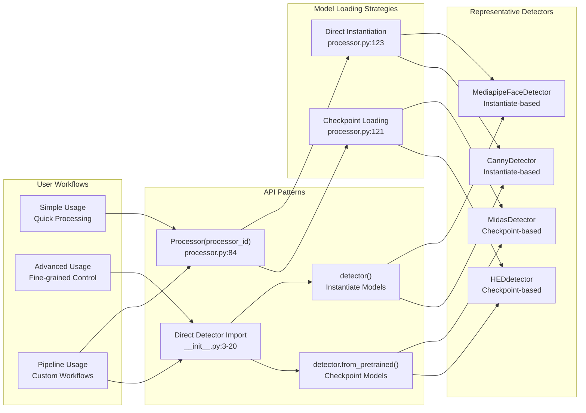

<!-- source: DeepWiki mcp.deepwiki.com · repo huggingface/controlnet_aux · page 1 Overview · fetched 2026-10-26 -->

# Overview

<details>
<summary>Relevant source files</summary>

The following files were used as context for generating this wiki page:

- [.gitignore](.gitignore)
- [README.md](README.md)
- [setup.py](setup.py)
- [src/controlnet_aux/__init__.py](src/controlnet_aux/__init__.py)
- [src/controlnet_aux/processor.py](src/controlnet_aux/processor.py)
- [src/controlnet_aux/tests/test_processor_pytest.py](src/controlnet_aux/tests/test_processor_pytest.py)

</details>


## Purpose and Scope

The `controlnet_aux` repository provides a comprehensive collection of auxiliary models for ControlNet image preprocessing and feature detection. This library serves as a PyPI-installable package that consolidates various computer vision models for edge detection, depth estimation, pose detection, line art generation, and image segmentation. The system is designed to preprocess images into control signals that can guide diffusion models in ControlNet workflows.

This document covers the overall architecture, core components, and integration patterns of the `controlnet_aux` system. For detailed information about specific detector implementations, see [Detector Categories](#4). For advanced model architectures and customization, see [Advanced Topics](#5).

## System Architecture

The `controlnet_aux` library follows a modular architecture with two primary access patterns: a unified `Processor` interface for simplified usage and direct detector instantiation for advanced control.

```mermaid
graph TB
    subgraph "Public API Layer"
        INIT["__init__.py<br/>Direct Imports"]
        PROC_CLASS["Processor<br/>src/controlnet_aux/processor.py"]
        MODELS_REGISTRY["MODELS Dictionary<br/>processor.py:20-49"]
        PARAMS_REGISTRY["MODEL_PARAMS Dictionary<br/>processor.py:52-79"]
    end
    
    subgraph "Edge Detection Detectors"
        HED["HEDdetector<br/>src/controlnet_aux/hed"]
        CANNY["CannyDetector<br/>src/controlnet_aux/canny"]
        PIDI["PidiNetDetector<br/>src/controlnet_aux/pidi"]
        TEED["TEEDdetector<br/>src/controlnet_aux/teed"]
        ANYLINE["AnylineDetector<br/>src/controlnet_aux/anyline"]
    end
    
    subgraph "Depth Estimation Detectors"
        MIDAS["MidasDetector<br/>src/controlnet_aux/midas"]
        ZOE["ZoeDetector<br/>src/controlnet_aux/zoe"]
        LERES["LeresDetector<br/>src/controlnet_aux/leres"]
        NORMALBAE["NormalBaeDetector<br/>src/controlnet_aux/normalbae"]
    end
    
    subgraph "Pose Detection Detectors"
        DWPOSE["DWposeDetector<br/>src/controlnet_aux/dwpose"]
        OPENPOSE["OpenposeDetector<br/>src/controlnet_aux/open_pose"]
    end
    
    subgraph "Line Art Detectors"
        LINEART["LineartDetector<br/>src/controlnet_aux/lineart"]
        LINEART_ANIME["LineartAnimeDetector<br/>src/controlnet_aux/lineart_anime"]
        LINEART_STD["LineartStandardDetector<br/>src/controlnet_aux/lineart_standard"]
        MLSD["MLSDdetector<br/>src/controlnet_aux/mlsd"]
    end
    
    subgraph "Segmentation Detectors"
        SAM["SamDetector<br/>src/controlnet_aux/segment_anything"]
        MEDIAPIPE["MediapipeFaceDetector<br/>src/controlnet_aux/mediapipe_face"]
        SHUFFLE["ContentShuffleDetector<br/>src/controlnet_aux/shuffle"]
    end
    
    subgraph "Infrastructure"
        HF_HUB["🤗 Hugging Face Hub<br/>Model Storage"]
        SETUP["setup.py<br/>Package Definition"]
    end
    
    PROC_CLASS --> MODELS_REGISTRY
    PROC_CLASS --> PARAMS_REGISTRY
    MODELS_REGISTRY --> HED
    MODELS_REGISTRY --> MIDAS
    MODELS_REGISTRY --> DWPOSE
    MODELS_REGISTRY --> OPENPOSE
    MODELS_REGISTRY --> SAM
    MODELS_REGISTRY --> PIDI
    MODELS_REGISTRY --> LINEART
    MODELS_REGISTRY --> NORMALBAE
    MODELS_REGISTRY --> ZOE
    MODELS_REGISTRY --> LERES
    MODELS_REGISTRY --> MLSD
    MODELS_REGISTRY --> TEED
    MODELS_REGISTRY --> ANYLINE
    MODELS_REGISTRY --> LINEART_ANIME
    MODELS_REGISTRY --> LINEART_STD
    MODELS_REGISTRY --> MEDIAPIPE
    MODELS_REGISTRY --> CANNY
    MODELS_REGISTRY --> SHUFFLE
    
    INIT --> HED
    INIT --> CANNY
    INIT --> MIDAS
    INIT --> DWPOSE
    INIT --> OPENPOSE
    INIT --> SAM
    INIT --> PIDI
    INIT --> LINEART
    INIT --> NORMALBAE
    INIT --> ZOE
    INIT --> LERES
    INIT --> MLSD
    INIT --> TEED
    INIT --> ANYLINE
    INIT --> LINEART_ANIME
    INIT --> LINEART_STD
    INIT --> MEDIAPIPE
    INIT --> SHUFFLE
    
    HED -.-> HF_HUB
    MIDAS -.-> HF_HUB
    DWPOSE -.-> HF_HUB
    OPENPOSE -.-> HF_HUB
    SAM -.-> HF_HUB
    PIDI -.-> HF_HUB
    ZOE -.-> HF_HUB
    LERES -.-> HF_HUB
    NORMALBAE -.-> HF_HUB
    LINEART -.-> HF_HUB
    LINEART_ANIME -.-> HF_HUB
    MLSD -.-> HF_HUB
    TEED -.-> HF_HUB
    ANYLINE -.-> HF_HUB
```



**System Architecture Overview**

The architecture separates concerns into three main layers: the Public API Layer provides unified access through the `Processor` class and direct imports, specialized detector modules handle specific computer vision tasks, and shared infrastructure manages model loading and package distribution.

Sources: [src/controlnet_aux/__init__.py:1-21](), [src/controlnet_aux/processor.py:20-149](), [setup.py:181-213]()

## Core Components

### Processor Interface

The `Processor` class in [src/controlnet_aux/processor.py:84-149]() serves as the primary entry point, providing a unified interface to all detectors through a registry-based system.

| Component | Purpose | Location |
|-----------|---------|----------|
| `MODELS` | Maps processor IDs to detector classes and loading strategies | [processor.py:20-49]() |
| `MODEL_PARAMS` | Default parameters for each processor configuration | [processor.py:52-79]() |
| `Processor.__init__()` | Initializes detector based on processor ID | [processor.py:85-107]() |
| `Processor.load_processor()` | Handles checkpoint vs. instantiate loading patterns | [processor.py:108-124]() |

### Detector Registration System

The system supports 19 different processor configurations mapped through the `MODELS` dictionary:

**Checkpoint-based Models** (loaded via `from_pretrained()`):
- Edge Detection: `scribble_hed`, `softedge_hed`, `scribble_hedsafe`, `softedge_hedsafe`, `scribble_pidinet`, `softedge_pidinet`, `scribble_pidsafe`, `softedge_pidsafe`
- Depth Estimation: `depth_midas`, `depth_zoe`, `depth_leres`, `depth_leres++`, `normal_bae`
- Pose Detection: `openpose`, `openpose_face`, `openpose_faceonly`, `openpose_full`, `openpose_hand`, `dwpose`
- Line Art: `lineart_coarse`, `lineart_realistic`, `lineart_anime`, `mlsd`

**Instantiate Models** (direct `__init__()`):
- Classical CV: `canny`
- Face Detection: `mediapipe_face`
- Content Processing: `shuffle`

Sources: [src/controlnet_aux/processor.py:20-49](), [src/controlnet_aux/processor.py:52-79]()

## Usage Patterns

The library provides flexibility through multiple access patterns, each optimized for different use cases.



**Usage Pattern Analysis**

The system supports three primary usage patterns: Simple Usage via the `Processor` class for quick access with predefined configurations, Advanced Usage through direct detector imports for fine-grained parameter control, and Pipeline Usage combining both approaches for custom workflows.

Sources: [README.md:35-61](), [README.md:63-131](), [src/controlnet_aux/processor.py:84-149]()

## Detector Categories

The library organizes detectors into five main functional categories:

| Category | Detectors | Purpose | Model Loading |
|----------|-----------|---------|---------------|
| **Edge Detection** | `HEDdetector`, `CannyDetector`, `PidiNetDetector`, `TEEDdetector`, `AnylineDetector` | Extract edges and boundaries for line-based control | Mixed (Checkpoint + Instantiate) |
| **Depth Estimation** | `MidasDetector`, `ZoeDetector`, `LeresDetector`, `NormalBaeDetector` | Generate depth maps and normal maps | Checkpoint-based |
| **Pose Detection** | `DWposeDetector`, `OpenposeDetector` | Detect human body, hand, and face keypoints | Checkpoint-based |
| **Line Art Generation** | `LineartDetector`, `LineartAnimeDetector`, `LineartStandardDetector`, `MLSDdetector` | Generate line art and sketch representations | Mixed (Checkpoint + Instantiate) |
| **Segmentation** | `SamDetector`, `MediapipeFaceDetector`, `ContentShuffleDetector` | Segment objects and detect regions | Mixed (Checkpoint + Instantiate) |

Sources: [src/controlnet_aux/__init__.py:3-21](), [src/controlnet_aux/processor.py:20-49]()

## Model Integration and Dependencies

The package integrates with the broader machine learning ecosystem through several key dependencies and model sources:

### Core Dependencies

The system relies on a carefully curated set of dependencies defined in [setup.py:166-179]():

- **Deep Learning**: `torch`, `torchvision`, `timm`, `einops`
- **Computer Vision**: `opencv-python-headless`, `scikit-image`, `Pillow`
- **Scientific Computing**: `numpy`, `scipy`
- **Model Hub**: `huggingface_hub`, `filelock`

### Model Storage and Loading

Models are primarily stored on the Hugging Face Hub under the `lllyasviel/Annotators` repository, with additional models from specialized repositories like `ybelkada/segment-anything` for SAM models and `fal-ai/teed` for TEED models.

Sources: [setup.py:166-179](), [README.md:78-93]()

## Package Structure

The package follows a standard Python package structure with modular detector implementations:

```
src/controlnet_aux/
├── __init__.py                 # Public API imports
├── processor.py                # Unified Processor interface
├── [detector_name]/            # Individual detector modules
│   ├── __init__.py            # Detector class exports
│   └── [implementation files] # Detector-specific code
└── tests/                     # Package tests
```

Each detector module is self-contained and can be imported directly or accessed through the `Processor` interface, providing flexibility for different integration scenarios.

Sources: [src/controlnet_aux/__init__.py:1-21](), [src/controlnet_aux/processor.py:1-149]()

---

