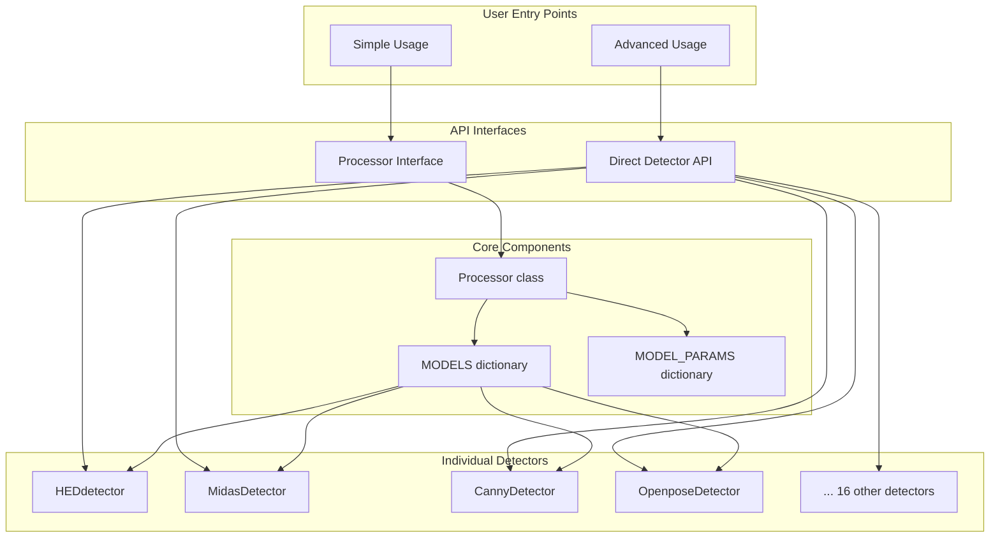
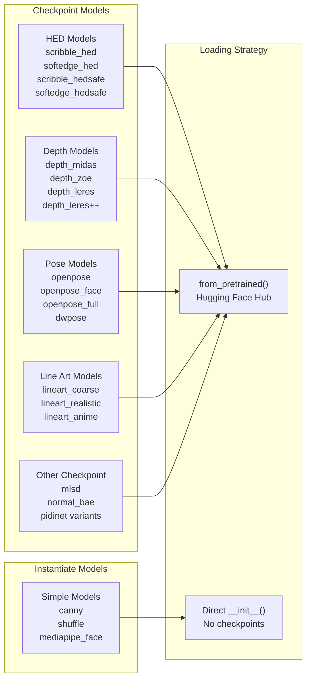

<!-- source: DeepWiki mcp.deepwiki.com · repo huggingface/controlnet_aux · page 2 Getting Started · fetched 2026-10-26 -->

# Getting Started

<details>
<summary>Relevant source files</summary>

The following files were used as context for generating this wiki page:

- [.gitignore](.gitignore)
- [README.md](README.md)
- [setup.py](setup.py)
- [src/controlnet_aux/__init__.py](src/controlnet_aux/__init__.py)
- [src/controlnet_aux/processor.py](src/controlnet_aux/processor.py)
- [src/controlnet_aux/tests/test_processor_pytest.py](src/controlnet_aux/tests/test_processor_pytest.py)

</details>


This guide covers the essential steps for installing and using controlnet_aux, including installation procedures, basic usage patterns, and available detection models. The controlnet_aux library provides auxiliary models for ControlNet preprocessing tasks such as edge detection, depth estimation, pose detection, and more.

For detailed information about individual detector architectures, see [Detector Categories](#4). For advanced configuration and customization options, see [Advanced Topics](#5).

## Installation

The controlnet_aux package is available on PyPI and can be installed using pip. The package includes all necessary dependencies for running the core detection models.

```bash
pip install -U controlnet-aux
```

### Optional Dependencies

For DWPose functionality, an additional lightweight package is available that uses ONNX models:

```bash
pip install easy-dwpose
```

The package dependencies include core computer vision and machine learning libraries as defined in [setup.py:166-179]():

| Dependency | Purpose |
|------------|---------|
| `torch` | Core deep learning framework |
| `torchvision` | Computer vision utilities |
| `PIL` | Image processing |
| `opencv-python-headless` | Computer vision operations |
| `huggingface_hub` | Model downloading and caching |
| `timm` | Vision transformer models |
| `scipy` | Scientific computing |
| `scikit-image` | Additional image processing |

**Sources:** [setup.py:166-179](), [README.md:11-22]()

## API Overview

The controlnet_aux library provides two main usage patterns for accessing detection models:



**Sources:** [src/controlnet_aux/processor.py:20-49](), [src/controlnet_aux/__init__.py:1-21]()

## Processor Interface Usage

The `Processor` class provides a unified interface to all detection models through a single API. This is the recommended approach for most users.

### Basic Usage Pattern

```python
from controlnet_aux.processor import Processor

# Initialize processor with model ID
processor = Processor('scribble_hed')

# Process image
processed_image = processor(input_image, to_pil=True)
```

### Available Processor IDs

The following processor IDs are available in the `MODELS` dictionary:



**Sources:** [src/controlnet_aux/processor.py:20-49](), [src/controlnet_aux/processor.py:52-79]()

## Direct Detector Usage

Individual detectors can be imported and used directly for more control over initialization and parameters.

### Checkpoint-based Detectors

Most detectors require downloading pretrained models from Hugging Face Hub:

```python
from controlnet_aux import HEDdetector, MidasDetector, OpenposeDetector

# Load models with checkpoints
hed = HEDdetector.from_pretrained("lllyasviel/Annotators")
midas = MidasDetector.from_pretrained("lllyasviel/Annotators") 
openpose = OpenposeDetector.from_pretrained("lllyasviel/Annotators")

# Process images
edge_image = hed(input_image)
depth_image = midas(input_image)
pose_image = openpose(input_image, hand_and_face=True)
```

### Instantiated Detectors

Some detectors do not require checkpoints and can be used immediately:

```python
from controlnet_aux import CannyDetector, ContentShuffleDetector, MediapipeFaceDetector

# Instantiate directly
canny = CannyDetector()
shuffle = ContentShuffleDetector()
face_detector = MediapipeFaceDetector()

# Process images
canny_image = canny(input_image)
shuffled_image = shuffle(input_image)
face_landmarks = face_detector(input_image)
```

**Sources:** [README.md:63-131](), [src/controlnet_aux/__init__.py:3-20]()

## Detection Model Categories

The library includes 20 different detector classes organized by functionality:

| Category | Detectors | Purpose |
|----------|-----------|---------|
| **Edge Detection** | `HEDdetector`, `CannyDetector`, `PidiNetDetector`, `TEEDdetector`, `AnylineDetector` | Boundary and edge detection |
| **Depth Estimation** | `MidasDetector`, `ZoeDetector`, `LeresDetector`, `NormalBaeDetector` | Monocular depth and normal maps |
| **Pose Detection** | `DWposeDetector`, `OpenposeDetector` | Human pose keypoint detection |
| **Line Art** | `LineartDetector`, `LineartAnimeDetector`, `LineartStandardDetector`, `MLSDdetector` | Line art and sketch generation |
| **Segmentation** | `SamDetector`, `MediapipeFaceDetector`, `ContentShuffleDetector` | Object and face segmentation |

**Sources:** [src/controlnet_aux/__init__.py:3-20](), [src/controlnet_aux/processor.py:20-49]()

## Image Resolution Requirements

All detectors in controlnet_aux require input images with dimensions that are multiples of 64 pixels to maintain aspect ratio during processing.

```python
import numpy as np
from PIL import Image

def prepare_image(image, target_resolution=512):
    W, H = image.size
    k = float(target_resolution) / min(H, W)
    H = int(np.round(H * k / 64.0)) * 64
    W = int(np.round(W * k / 64.0)) * 64
    return image.resize((W, H))
```

This resolution requirement is enforced across all detector implementations and is essential for proper model inference.

**Sources:** [README.md:133-135](), [src/controlnet_aux/tests/test_processor_pytest.py:52-66]()

## Complete Usage Example

Here is a complete example demonstrating both usage patterns:

```python
import requests
from PIL import Image
from io import BytesIO
from controlnet_aux.processor import Processor
from controlnet_aux import HEDdetector

# Load test image
url = "https://huggingface.co/lllyasviel/sd-controlnet-openpose/resolve/main/images/pose.png"
response = requests.get(url)
img = Image.open(BytesIO(response.content)).convert("RGB").resize((512, 512))

# Method 1: Using Processor interface
processor = Processor('scribble_hed')
processed_image_1 = processor(img, to_pil=True)

# Method 2: Using direct detector
hed = HEDdetector.from_pretrained("lllyasviel/Annotators")
processed_image_2 = hed(img, scribble=True)
```

**Sources:** [README.md:37-61](), [README.md:65-131]()

---

