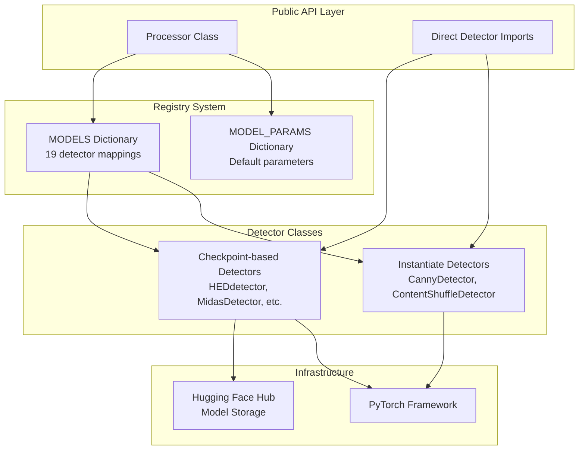
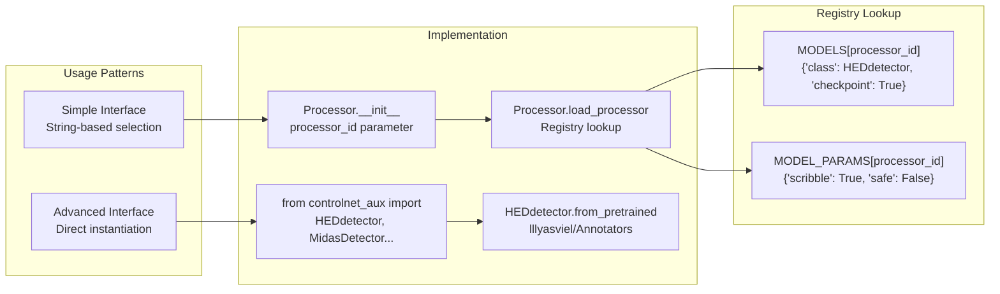
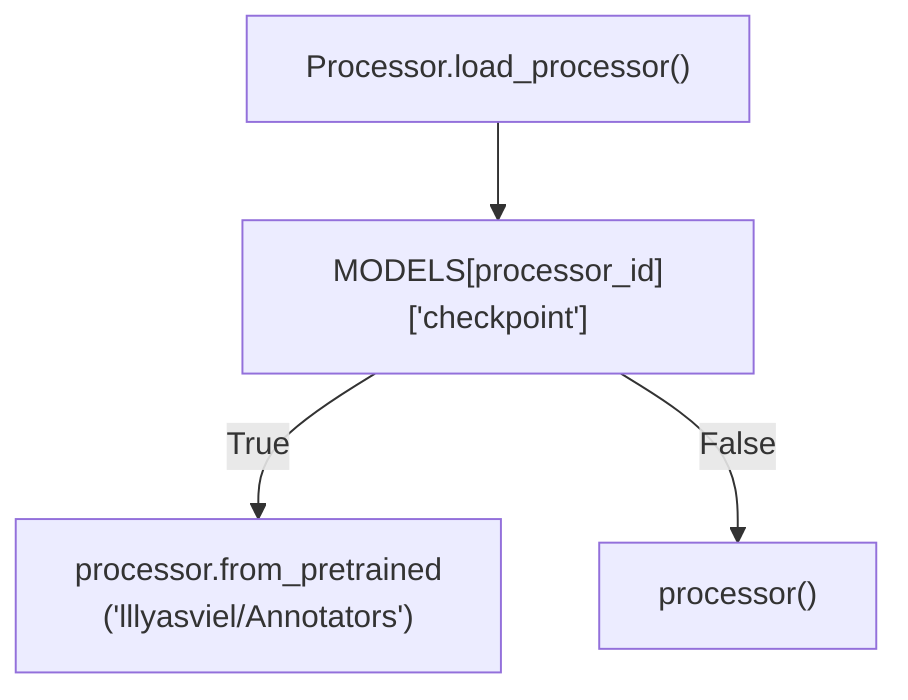
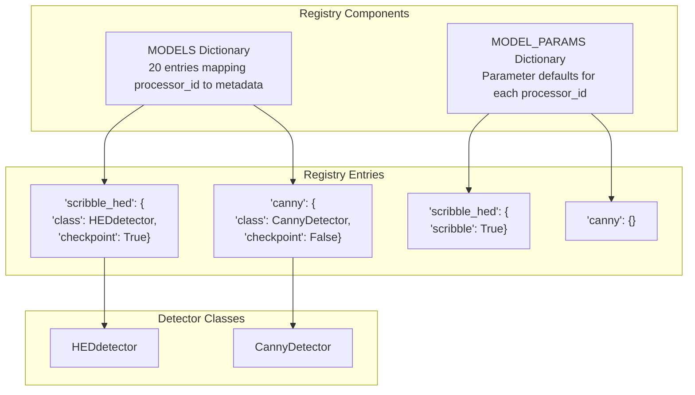
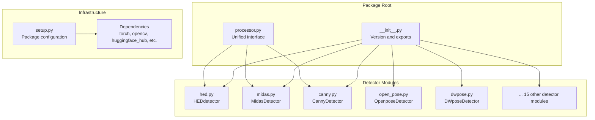

<!-- source: DeepWiki mcp.deepwiki.com · repo huggingface/controlnet_aux · page 3 Core Architecture · fetched 2026-10-26 -->

# Core Architecture

<details>
<summary>Relevant source files</summary>

The following files were used as context for generating this wiki page:

- [.gitignore](.gitignore)
- [README.md](README.md)
- [setup.py](setup.py)
- [src/controlnet_aux/__init__.py](src/controlnet_aux/__init__.py)
- [src/controlnet_aux/processor.py](src/controlnet_aux/processor.py)
- [src/controlnet_aux/tests/test_processor_pytest.py](src/controlnet_aux/tests/test_processor_pytest.py)

</details>


This document explains the fundamental design patterns and architectural components that form the foundation of the controlnet_aux library. It covers the dual API design, model registry system, and loading strategies that enable unified access to diverse computer vision preprocessing models.

For specific details about the unified interface, see [Processor Interface](#3.1). For package organization details, see [Package Structure](#3.2). For implementation details of individual detector categories, see [Detector Categories](#4).

## System Overview

The controlnet_aux library implements a **two-tier architecture** that provides both simplified and advanced access patterns to a collection of computer vision preprocessing models. The system is built around a central registry that maps string identifiers to detector classes and manages their instantiation patterns.

**Core Architecture Components**



Sources: [src/controlnet_aux/processor.py:1-149](), [src/controlnet_aux/__init__.py:1-21](), [setup.py:70-213]()

## Dual API Design Pattern

The architecture provides two distinct usage patterns that cater to different user needs and complexity requirements.

**API Access Patterns**



Sources: [src/controlnet_aux/processor.py:84-124](), [src/controlnet_aux/__init__.py:3-20](), [README.md:35-61]()

## Model Loading Strategies

The system implements two distinct loading patterns based on the computational requirements and model architecture of each detector.

| Loading Pattern | Detector Examples | Registry Flag | Instantiation Method |
|----------------|-------------------|---------------|---------------------|
| **Checkpoint-based** | `HEDdetector`, `MidasDetector`, `OpenposeDetector` | `'checkpoint': True` | `DetectorClass.from_pretrained()` |
| **Direct Instantiation** | `CannyDetector`, `ContentShuffleDetector`, `MediapipeFaceDetector` | `'checkpoint': False` | `DetectorClass()` |

**Model Loading Decision Flow**



Sources: [src/controlnet_aux/processor.py:108-124](), [src/controlnet_aux/processor.py:20-49]()

## Registry System Architecture

The registry system centralizes detector metadata and configuration through two primary dictionaries that map string identifiers to classes and parameters.

**Registry Structure**



The `MODELS` dictionary contains 20 processor configurations that map string identifiers to detector classes and loading metadata. Key entries include multiple variants for edge detection (`scribble_hed`, `softedge_hed`), pose estimation (`openpose`, `openpose_full`, `dwpose`), and depth estimation (`depth_midas`, `depth_zoe`).

Sources: [src/controlnet_aux/processor.py:20-49](), [src/controlnet_aux/processor.py:52-79]()

## Package Structure Design

The package follows a flat module structure where each detector is implemented in its own module and exposed through centralized imports.

**Package Organization**



The `__init__.py` file serves as the central export point, importing all 20 detector classes and making them available for direct import. This design enables both the unified `Processor` interface and direct detector access patterns.

Sources: [src/controlnet_aux/__init__.py:1-21](), [setup.py:166-179]()

## Error Handling and Validation

The architecture includes validation mechanisms to ensure robust operation across different usage patterns.

The `Processor` class validates processor IDs against the registry and provides clear error messages when invalid identifiers are used. The validation logic checks against the `MODELS.keys()` and raises `ValueError` with the complete list of valid options.

```python
# Validation implementation from processor.py lines 96-97
if processor_id not in MODELS:
    raise ValueError(f"{processor_id} is not a valid processor id. Please make sure to choose one of {', '.join(MODELS.keys())}")
```

Sources: [src/controlnet_aux/processor.py:96-97](), [src/controlnet_aux/processor.py:81-82]()

---

