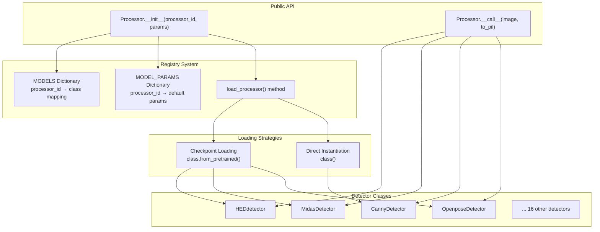
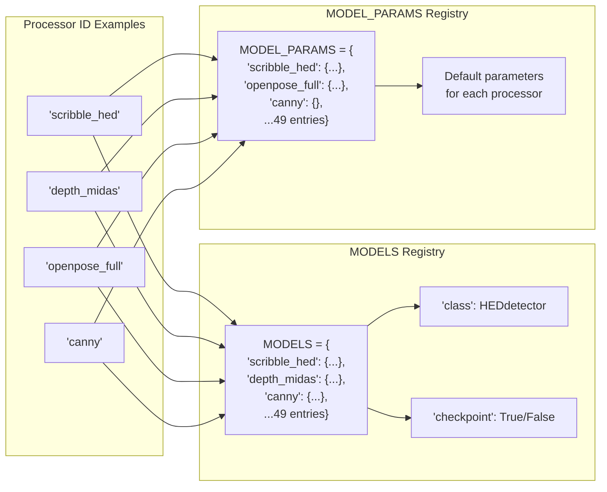
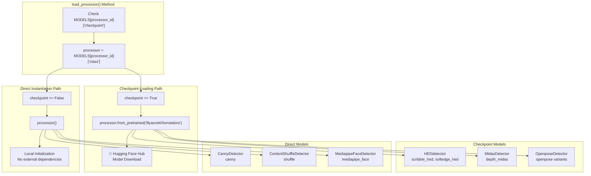
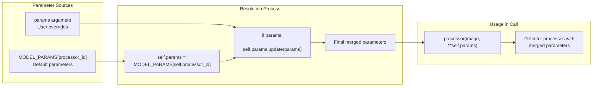
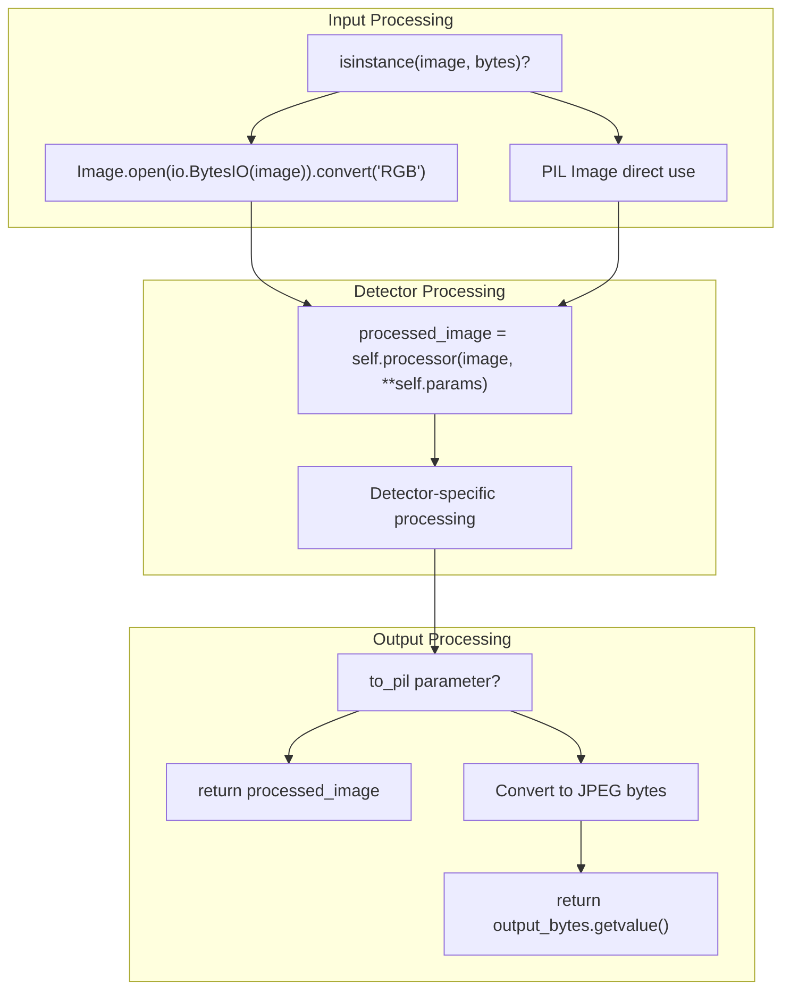

<!-- source: DeepWiki mcp.deepwiki.com · repo huggingface/controlnet_aux · page 3.1 Processor Interface · fetched 2026-10-26 -->

# Processor Interface

<details>
<summary>Relevant source files</summary>

The following files were used as context for generating this wiki page:

- [README.md](README.md)
- [src/controlnet_aux/processor.py](src/controlnet_aux/processor.py)
- [src/controlnet_aux/tests/test_processor_pytest.py](src/controlnet_aux/tests/test_processor_pytest.py)

</details>


The Processor interface provides a unified entry point for accessing all auxiliary models in controlnet_aux through a single, consistent API. This system abstracts the complexity of individual detector instantiation and configuration, allowing users to access any supported detector using a simple string identifier rather than manually importing and configuring specific detector classes.

For information about individual detector implementations, see [Detector Categories](#4). For details about the package structure and direct detector access patterns, see [Package Structure](#3.2).

## Architecture Overview

The Processor interface implements a registry-based architecture that maps string identifiers to detector classes and their associated parameters. This design centralizes model access while maintaining flexibility for both checkpoint-based and direct instantiation models.

**Processor Class Architecture**



Sources: [src/controlnet_aux/processor.py:1-149]()

## Registry System

The registry system consists of two primary dictionaries that define the available processors and their configurations. This centralized approach ensures consistent access patterns across all supported detectors.

**Registry Components**



### MODELS Dictionary Structure

The `MODELS` dictionary maps processor IDs to detector class references and loading metadata. Each entry contains:

| Key | Purpose | Values |
|-----|---------|---------|
| `'class'` | Detector class reference | `HEDdetector`, `MidasDetector`, etc. |
| `'checkpoint'` | Loading strategy flag | `True` for checkpoint models, `False` for direct instantiation |

The registry includes 49 processor variants covering checkpoint-based models like `'scribble_hed'` and `'depth_midas'` [src/controlnet_aux/processor.py:22-43](), and direct instantiation models like `'canny'` and `'shuffle'` [src/controlnet_aux/processor.py:46-49]().

### MODEL_PARAMS Dictionary Structure

The `MODEL_PARAMS` dictionary stores default parameters for each processor, enabling specialized behavior without requiring users to understand detector-specific configuration options. Examples include:

- OpenPose variants with different body part configurations [src/controlnet_aux/processor.py:59-63]()
- HED detector safety and scribble mode settings [src/controlnet_aux/processor.py:53-56]()
- PiDiNet safety and scribble combinations [src/controlnet_aux/processor.py:65-68]()

Sources: [src/controlnet_aux/processor.py:20-79]()

## Loading Strategies

The Processor interface supports two distinct loading strategies based on the detector's implementation requirements, determined by the `'checkpoint'` flag in the MODELS registry.

**Loading Strategy Flow**



### Checkpoint-Based Loading

Checkpoint models require pre-trained weights downloaded from Hugging Face Hub. The loading process calls `from_pretrained("lllyasviel/Annotators")` [src/controlnet_aux/processor.py:121](), which handles model weight download and initialization automatically.

### Direct Instantiation

Direct instantiation models like `CannyDetector` and `ContentShuffleDetector` require no external checkpoints and initialize with `processor()` [src/controlnet_aux/processor.py:123](). These typically implement classical computer vision algorithms or lightweight processing.

Sources: [src/controlnet_aux/processor.py:108-124]()

## Parameter Management

The Processor interface implements a layered parameter system that combines default configurations with user-provided overrides, ensuring sensible defaults while maintaining customization flexibility.

**Parameter Resolution Flow**



The parameter system supports detector-specific configurations such as:

- **OpenPose body part inclusion**: `include_body`, `include_hand`, `include_face` [src/controlnet_aux/processor.py:59-63]()
- **HED processing modes**: `scribble` and `safe` flags [src/controlnet_aux/processor.py:53-56]()
- **LeRes depth enhancement**: `boost` parameter for `depth_leres++` variant [src/controlnet_aux/processor.py:76-77]()

Sources: [src/controlnet_aux/processor.py:102-106](), [src/controlnet_aux/processor.py:141]()

## Usage Patterns

The Processor interface supports flexible input/output handling with automatic format conversion between PIL Images and bytes, enabling integration with diverse application architectures.

**Input/Output Processing Flow**



### Basic Usage Pattern

```python
processor = Processor("scribble_hed")
processed_image = processor(input_image, to_pil=True)
```

### Parameter Customization

```python
custom_params = {"scribble": False, "safe": True}
processor = Processor("scribble_hed", params=custom_params)
```

The interface validates processor IDs against the MODELS registry and raises `ValueError` with available options if an invalid ID is provided [src/controlnet_aux/processor.py:96-97]().

Sources: [src/controlnet_aux/processor.py:126-148](), [src/controlnet_aux/processor.py:85-106]()

---

