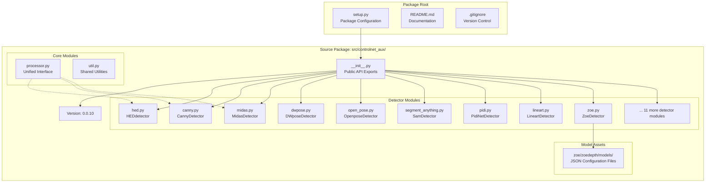
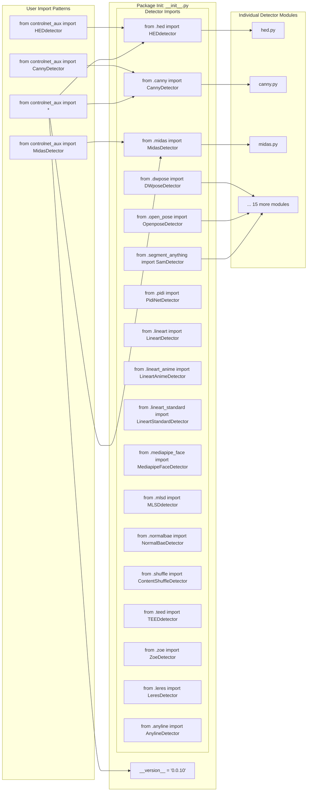
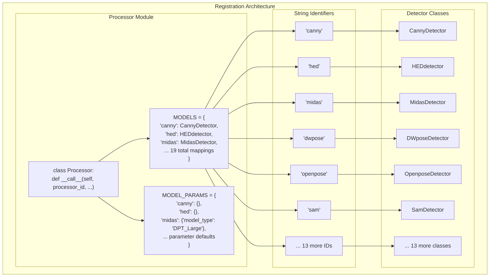
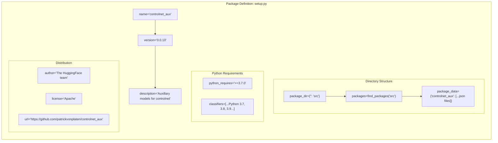

<!-- source: DeepWiki mcp.deepwiki.com · repo huggingface/controlnet_aux · page 3.2 Package Structure · fetched 2026-10-26 -->

# Package Structure

<details>
<summary>Relevant source files</summary>

The following files were used as context for generating this wiki page:

- [.gitignore](.gitignore)
- [setup.py](setup.py)
- [src/controlnet_aux/__init__.py](src/controlnet_aux/__init__.py)

</details>


This document explains the organization and design of the controlnet_aux package, covering the public API patterns, detector registration system, and package configuration. For details about the unified Processor interface, see [Processor Interface](#3.1). For information about shared utilities used across detectors, see [Common Utilities](#3.3).

## Package Organization

The controlnet_aux package follows a flat module structure where each detector type is implemented as a separate module within the `src/controlnet_aux/` directory. The package uses a dual API design that supports both direct detector imports and unified access through the Processor interface.

### Directory Structure



**Package Structure Overview**

Sources: [setup.py:192-194](), [src/controlnet_aux/__init__.py:1-21]()

## Public API Design

The package implements a **dual API pattern** that provides two ways to access detector functionality: direct imports and unified processor access. This design accommodates both simple use cases and advanced customization needs.

### Direct Import Pattern

The primary public API is exposed through direct imports in the package's `__init__.py` file, where each detector class is individually imported and made available at the package level.



**Direct Import API Structure**

Sources: [src/controlnet_aux/__init__.py:3-20]()

### Detector Naming Conventions

The package follows consistent naming patterns for detector classes to provide predictable import names:

| Pattern | Examples | Purpose |
|---------|----------|---------|
| `*Detector` | `CannyDetector`, `MidasDetector`, `SamDetector` | Standard detector classes |
| `*detector` | `HEDdetector`, `MLSDdetector`, `TEEDdetector` | Legacy naming for specific detectors |
| Descriptive Names | `LineartAnimeDetector`, `ContentShuffleDetector` | Domain-specific functionality |

Sources: [src/controlnet_aux/__init__.py:3-20]()

## Detector Registration System

While the package uses direct imports for its primary API, it also maintains a registration system for the unified Processor interface. This system maps string identifiers to detector classes and their parameters.



**Detector Registration and Lookup System**

Sources: References to processor.py (implementation details in [Processor Interface](#3.1))

## Package Configuration

The package configuration is defined in `setup.py` and establishes the package metadata, dependencies, and distribution settings.

### Core Dependencies

The package requires several key dependencies for computer vision and machine learning functionality:

| Category | Dependencies | Purpose |
|----------|-------------|---------|
| **Core ML** | `torch`, `torchvision`, `timm` | PyTorch ecosystem and model implementations |
| **Computer Vision** | `opencv-python-headless`, `scikit-image`, `Pillow` | Image processing and manipulation |
| **Scientific Computing** | `numpy`, `scipy`, `einops` | Numerical operations and tensor manipulation |
| **Model Hub** | `huggingface_hub` | Model downloading and caching |
| **Utilities** | `filelock`, `importlib_metadata` | File locking and metadata access |

Sources: [setup.py:79-92](), [setup.py:166-179]()

### Package Metadata

The package is configured with the following key metadata:



**Package Configuration Structure**

Sources: [setup.py:181-213]()

### Special Package Data

The package includes special configuration files for the ZoeDepth models that are bundled as package data:

```python
package_data={
    'controlnet_aux': [
        'zoe/zoedepth/models/zoedepth/*.json', 
        'zoe/zoedepth/models/zoedepth_nk/*.json'
    ]
}
```

This ensures that the ZoeDepth model configuration files are included in the distributed package and accessible at runtime.

Sources: [setup.py:212]()

## Package Distribution

The package follows standard Python distribution practices with setuptools, supporting both wheel and source distributions for PyPI publication.

### Version Management

Version information is maintained in two locations for consistency:
- Package version in `setup.py`: `version="0.0.10"`
- Module version in `__init__.py`: `__version__ = "0.0.10"`

This dual declaration ensures version consistency between the installed package metadata and runtime version queries.

Sources: [setup.py:183](), [src/controlnet_aux/__init__.py:1]()

### Development and Release Process

The package includes detailed release procedures and dependency management through custom commands:

- **Dependency Table Updates**: Custom `DepsTableUpdateCommand` for maintaining dependency version tables
- **Release Checklist**: Comprehensive steps for version bumping, testing, and PyPI publication
- **Package Discovery**: Automatic discovery of subpackages using `find_packages("src")`

Sources: [setup.py:125-162](), [setup.py:215-233]()

---

