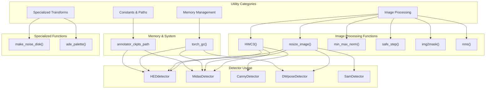
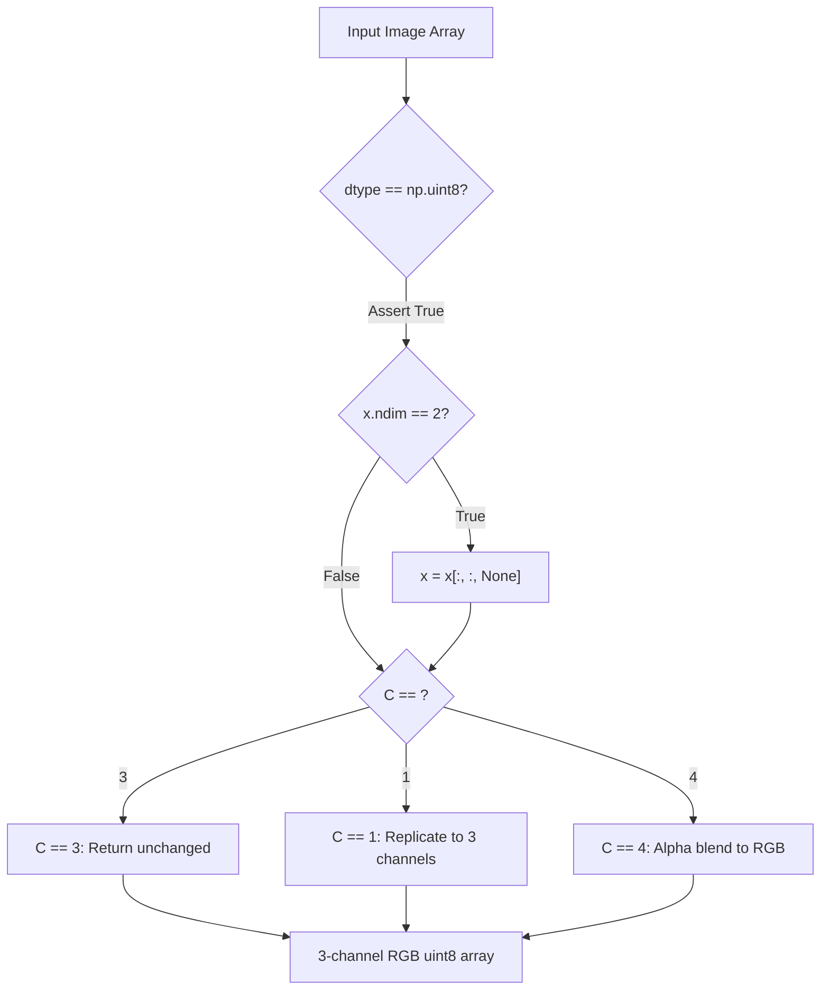
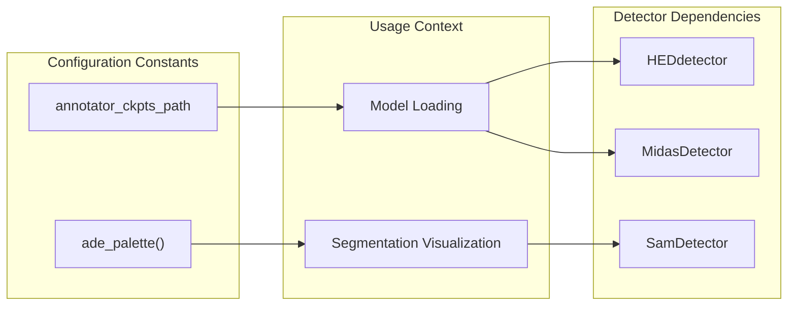

<!-- source: DeepWiki mcp.deepwiki.com · repo huggingface/controlnet_aux · page 3.3 Common Utilities · fetched 2026-10-26 -->

# Common Utilities

<details>
<summary>Relevant source files</summary>

The following files were used as context for generating this wiki page:

- [src/controlnet_aux/util.py](src/controlnet_aux/util.py)

</details>


This page documents the shared utility functions provided by the `util.py` module that are used across all detector implementations in controlnet_aux. These utilities handle common image processing operations, memory management, and specialized transformations required by the neural network models.

For information about the overall package structure and how these utilities fit into the architecture, see [Package Structure](#3.2). For details on specific detector implementations that use these utilities, see [Detector Categories](#4).

## Overview

The `util.py` module serves as the central repository for cross-cutting concerns that are shared among different detector implementations. These utilities fall into several categories:

- **Image format standardization** - ensuring consistent image formats across detectors
- **Image preprocessing** - resizing, normalization, and filtering operations
- **Memory management** - GPU memory cleanup and optimization
- **Specialized transformations** - noise generation, masking, and color palette operations



Sources: [src/controlnet_aux/util.py:1-147]()

## Image Format Standardization

### HWC3 Function

The `HWC3` function is the primary image format standardization utility, ensuring all images are converted to a consistent 3-channel (RGB) format with uint8 data type.

| Input Format | Output Behavior |
|-------------|----------------|
| Grayscale (H,W) | Converted to (H,W,1) then replicated to (H,W,3) |
| Single channel (H,W,1) | Replicated across 3 channels |
| RGB (H,W,3) | Returned unchanged |
| RGBA (H,W,4) | Alpha blending applied, converted to RGB |

The function handles alpha channel blending using the standard compositing formula: `color * alpha + 255.0 * (1.0 - alpha)`.



Sources: [src/controlnet_aux/util.py:11-27]()

## Image Preprocessing Utilities

### Resolution and Resizing

The `resize_image` function provides standardized image resizing with 64-pixel alignment, which is required by many neural network architectures that expect input dimensions to be multiples of 64.

**Algorithm:**
1. Calculate scaling factor based on minimum dimension
2. Apply scaling to both dimensions
3. Round to nearest multiple of 64
4. Use appropriate interpolation method based on scaling direction

The function uses LANCZOS4 interpolation for upscaling and AREA interpolation for downscaling to preserve image quality.

### Normalization Functions

**Min-Max Normalization (`min_max_norm`):**
- Scales pixel values to [0, 1] range
- Prevents division by zero with epsilon value of 1e-5
- Used for preparing inputs to neural networks

**Safe Step Function (`safe_step`):**
- Quantizes pixel values to reduce noise
- Default step size of 2 provides 3 quantization levels
- Helps stabilize edge detection and line art generation

Sources: [src/controlnet_aux/util.py:58-67](), [src/controlnet_aux/util.py:87-97]()

## Specialized Image Processing

### Non-Maximum Suppression

The `nms` function implements directional non-maximum suppression for edge detection, using four directional kernels to preserve edge continuity:

| Kernel | Direction | Pattern |
|--------|-----------|---------|
| f1 | Horizontal | `[[0,0,0],[1,1,1],[0,0,0]]` |
| f2 | Vertical | `[[0,1,0],[0,1,0],[0,1,0]]` |
| f3 | Diagonal / | `[[1,0,0],[0,1,0],[0,0,1]]` |
| f4 | Diagonal \ | `[[0,0,1],[0,1,0],[1,0,0]]` |

The algorithm applies Gaussian blur first, then checks if each pixel is a local maximum in any of the four directions.

### Noise Generation

The `make_noise_disk` function creates smooth noise patterns using:
1. Random uniform noise generation at reduced resolution
2. Cubic interpolation upsampling with padding
3. Min-max normalization to [0, 1] range

This is used for texture synthesis and data augmentation in certain detectors.

### Mask Generation

The `img2mask` function converts images to binary masks with random channel selection and intensity inversion, supporting data augmentation for training and scribble mode operations.

Sources: [src/controlnet_aux/util.py:41-56](), [src/controlnet_aux/util.py:30-38](), [src/controlnet_aux/util.py:70-84]()

## Memory Management

### GPU Memory Cleanup

The `torch_gc` function provides centralized GPU memory management:

```python
def torch_gc():
    if torch.cuda.is_available():
        torch.cuda.empty_cache()
        torch.cuda.ipc_collect()
```

This function is called by detectors after processing to free GPU memory and clean up CUDA IPC resources, preventing memory leaks during batch processing or long-running applications.

Sources: [src/controlnet_aux/util.py:100-103]()

## Constants and Configuration

### Checkpoint Path

The `annotator_ckpts_path` variable provides a centralized location for model checkpoints:
```python
annotator_ckpts_path = os.path.join(os.path.dirname(__file__), 'ckpts')
```

This path is used by detectors that require local checkpoint files, providing a consistent storage location within the package structure.

### ADE20K Color Palette

The `ade_palette` function returns the standard ADE20K dataset color mapping, used for semantic segmentation visualization and consistent color coding across different detectors.



Sources: [src/controlnet_aux/util.py:8](), [src/controlnet_aux/util.py:106-145]()

## Integration with Detector Architecture

The utility functions are designed to be imported and used by individual detector classes, providing consistent preprocessing and postprocessing across the entire library. Most detectors follow this pattern:

1. Import required utilities at the module level
2. Use `HWC3` for input image standardization
3. Apply `resize_image` for resolution normalization
4. Use specialized functions (`nms`, `min_max_norm`) for model-specific preprocessing
5. Call `torch_gc` for memory cleanup after processing

This centralized approach ensures consistency, reduces code duplication, and provides a single point of maintenance for common operations across all detector implementations.

Sources: [src/controlnet_aux/util.py:1-147]()

---

