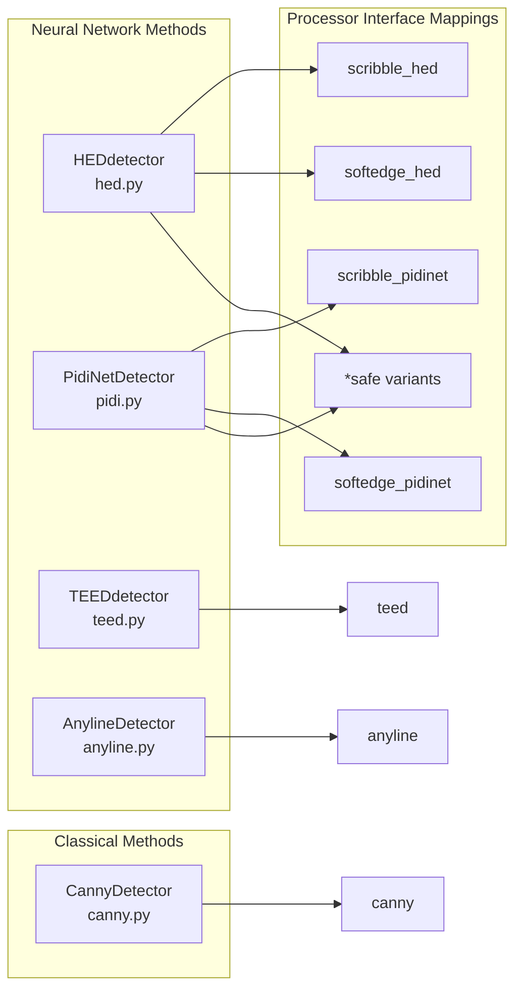
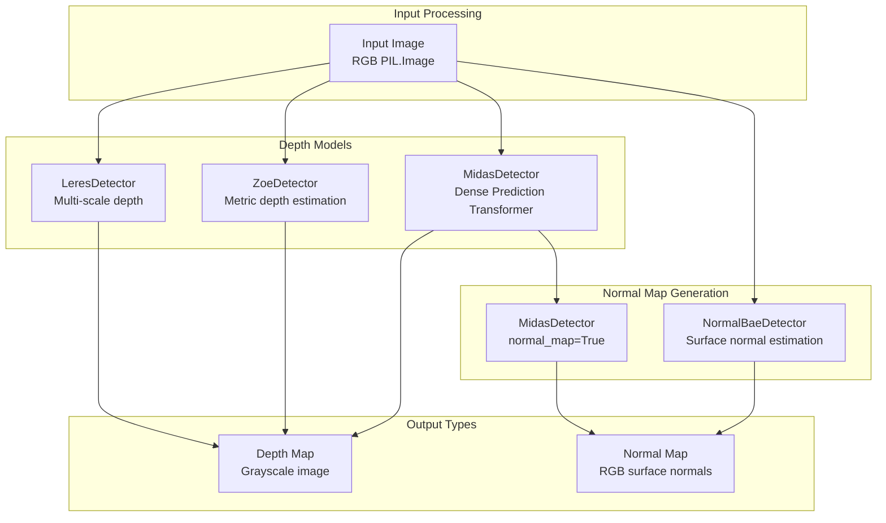
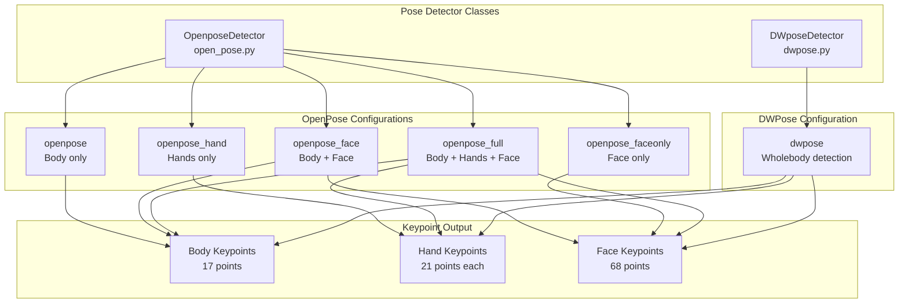
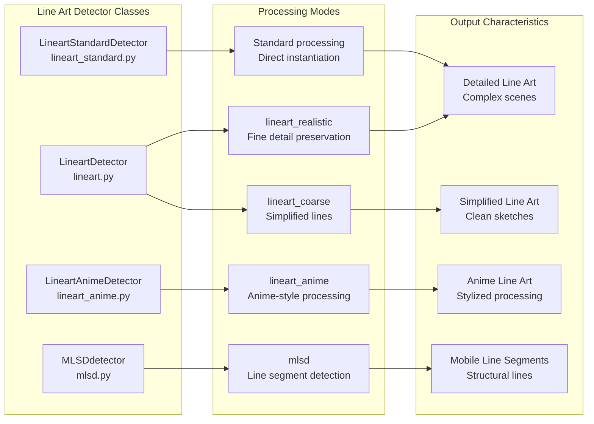
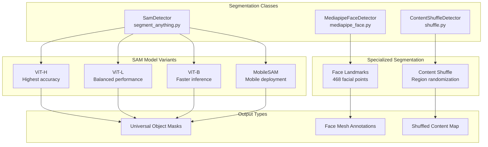
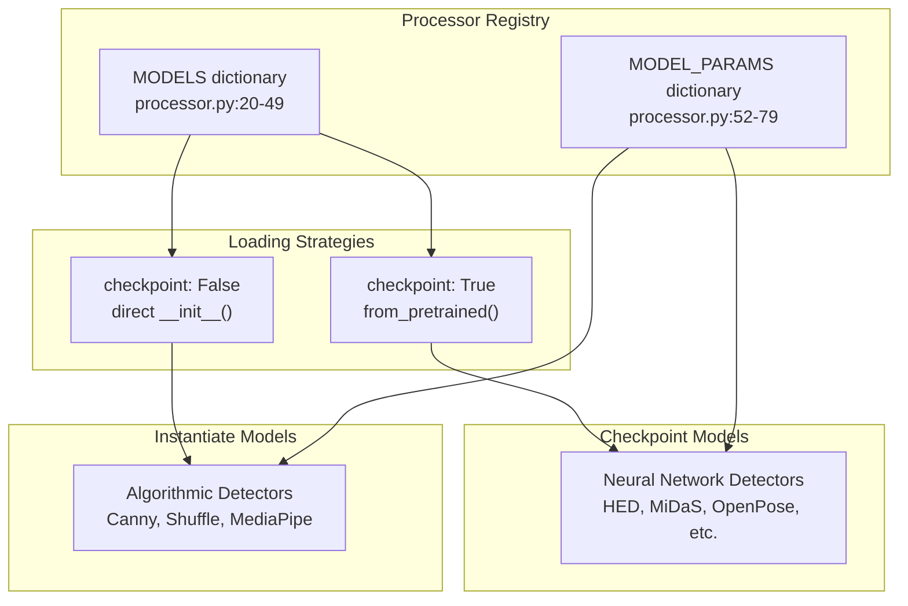

<!-- source: DeepWiki mcp.deepwiki.com · repo huggingface/controlnet_aux · page 4 Detector Categories · fetched 2026-10-26 -->

# Detector Categories

Relevant source files

The following files were used as context for generating this wiki page:

- [.gitignore](.gitignore)
- [README.md](README.md)
- [setup.py](setup.py)
- [src/controlnet_aux/__init__.py](src/controlnet_aux/__init__.py)
- [src/controlnet_aux/processor.py](src/controlnet_aux/processor.py)
- [src/controlnet_aux/tests/test_processor_pytest.py](src/controlnet_aux/tests/test_processor_pytest.py)

This document provides a comprehensive overview of the different types of feature detectors available in controlnet_aux, organized by their primary functionality and intended use cases. The categorization system helps users understand which detector to use for specific image preprocessing tasks in ControlNet workflows.

For information about the unified interface to access these detectors, see [Processor Interface](#3.1). For details about the internal neural network architectures powering these detectors, see [Neural Network Architectures](#5.2).

## Detector Classification System

The controlnet_aux library organizes 20 different detector classes into five main functional categories. Each category serves a specific type of image analysis task required for ControlNet conditioning.

### Category-to-Code Mapping

```mermaid
graph TB
    subgraph "Functional Categories"
        EDGE["Edge Detection<br/>Boundary identification"]
        DEPTH["Depth Estimation<br/>3D structure analysis"] 
        POSE["Pose Detection<br/>Human keypoint extraction"]
        LINEART["Line Art Generation<br/>Sketch-style processing"]
        SEGMENT["Segmentation<br/>Region identification"]
    end
    
    subgraph "Edge Detection Classes"
        HED["HEDdetector"]
        CANNY["CannyDetector"] 
        PIDI["PidiNetDetector"]
        TEED["TEEDdetector"]
        ANYLINE["AnylineDetector"]
    end
    
    subgraph "Depth Estimation Classes"
        MIDAS["MidasDetector"]
        ZOE["ZoeDetector"]
        LERES["LeresDetector"] 
        NORMALBAE["NormalBaeDetector"]
    end
    
    subgraph "Pose Detection Classes"
        OPENPOSE["OpenposeDetector"]
        DWPOSE["DWposeDetector"]
    end
    
    subgraph "Line Art Classes"
        LINEART_DET["LineartDetector"]
        LINEART_ANIME["LineartAnimeDetector"]
        LINEART_STD["LineartStandardDetector"]
        MLSD["MLSDdetector"]
    end
    
    subgraph "Segmentation Classes"
        SAM["SamDetector"]
        MEDIAPIPE["MediapipeFaceDetector"]
        SHUFFLE["ContentShuffleDetector"]
    end
    
    EDGE --> HED
    EDGE --> CANNY
    EDGE --> PIDI
    EDGE --> TEED
    EDGE --> ANYLINE
    
    DEPTH --> MIDAS
    DEPTH --> ZOE
    DEPTH --> LERES
    DEPTH --> NORMALBAE
    
    POSE --> OPENPOSE
    POSE --> DWPOSE
    
    LINEART --> LINEART_DET
    LINEART --> LINEART_ANIME
    LINEART --> LINEART_STD
    LINEART --> MLSD
    
    SEGMENT --> SAM
    SEGMENT --> MEDIAPIPE
    SEGMENT --> SHUFFLE
```

**Sources:** [src/controlnet_aux/__init__.py:3-21](), [src/controlnet_aux/processor.py:20-49]()

## Edge Detection

Edge detection detectors identify boundaries and contours in images, producing binary or grayscale edge maps suitable for line-based ControlNet conditioning.

### Edge Detection Architecture

| Detector Class | Model Type | Key Features | Processor IDs |
|---|---|---|---|
| `CannyDetector` | Classical CV | Threshold-based, fast | `canny` |
| `HEDdetector` | CNN | Multi-scale, scribble mode | `scribble_hed`, `softedge_hed`, `*hedsafe` |
| `PidiNetDetector` | CNN | Safety filtering, scribble mode | `scribble_pidinet`, `softedge_pidinet`, `*pidsafe` |
| `TEEDdetector` | Lightweight CNN | Efficient edge detection | Not in processor |
| `AnylineDetector` | CNN | Combined edge+line detection | Not in processor |

**Sources:** [src/controlnet_aux/processor.py:22-26,34-37,48](), [README.md:105,126]()

## Depth Estimation

Depth estimation detectors perform monocular depth estimation, generating depth maps and normal maps for 3D-aware ControlNet conditioning.

### Depth Estimation Pipeline

| Detector Class | Architecture | Processor IDs | Special Features |
|---|---|---|---|
| `MidasDetector` | DPT (Dense Prediction Transformer) | `depth_midas`, `normal_midas` | Optional normal map generation |
| `ZoeDetector` | ZoeDepth | `depth_zoe` | Metric depth, gamma correction |
| `LeresDetector` | LeRes | `depth_leres`, `depth_leres++` | Boost mode available |
| `NormalBaeDetector` | NormalBAE | `normal_bae` | Dedicated normal map generation |

**Sources:** [src/controlnet_aux/processor.py:26,38,42-44](), [README.md:79,86,89,121]()

## Pose Detection

Pose detection detectors extract human keypoints for body, hand, and face landmarks, enabling pose-conditioned image generation.

### Pose Detection Variants

**Sources:** [src/controlnet_aux/processor.py:28-33,59-63](), [README.md:81,115,129]()

## Line Art Generation

Line art detectors generate sketch-like representations and line segment detection for artistic and structural line-based conditioning.

### Line Art Processing Types

| Detector Class | Architecture | Processor IDs | Specialization |
|---|---|---|---|
| `LineartDetector` | U-Net | `lineart_realistic`, `lineart_coarse` | General line art with quality control |
| `LineartAnimeDetector` | U-Net | `lineart_anime` | Anime/manga style optimization |
| `LineartStandardDetector` | U-Net | Not in processor | Direct instantiation only |
| `MLSDdetector` | Mobile architecture | `mlsd` | Mobile line segment detection |

**Sources:** [src/controlnet_aux/processor.py:27,39-41,70-72](), [src/controlnet_aux/__init__.py:8-10,13](), [README.md:80,84-85,114,130]()

## Segmentation

Segmentation detectors identify and isolate regions, objects, or specific features for mask-based ControlNet conditioning.

### Segmentation Detector Types

| Detector Class | Technology | Processor IDs | Use Case |
|---|---|---|---|
| `SamDetector` | Segment Anything Model | Not in processor | Universal object segmentation |
| `MediapipeFaceDetector` | MediaPipe | `mediapipe_face` | Face landmark detection |
| `ContentShuffleDetector` | Algorithmic | `shuffle` | Content region shuffling |

**Sources:** [src/controlnet_aux/processor.py:46-47](), [README.md:87-88,106-107,127-128]()

## Processor Integration

All detector categories integrate with the unified `Processor` interface through the `MODELS` registry system, enabling consistent access patterns across different detector types.

### Processor Registry Mapping

The `MODELS` dictionary in [src/controlnet_aux/processor.py:20-49]() maps 25 processor IDs to their corresponding detector classes and loading strategies. Models requiring pretrained weights use `checkpoint: True`, while algorithmic detectors use `checkpoint: False` for direct instantiation.

**Sources:** [src/controlnet_aux/processor.py:20-49,52-79,117-124](), [src/controlnet_aux/__init__.py:1-21]()

---

