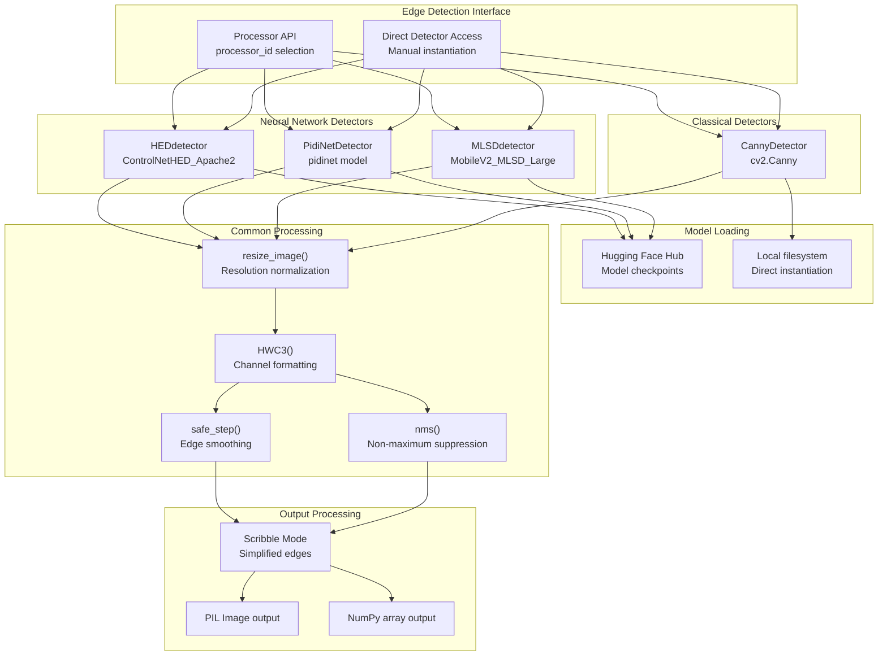
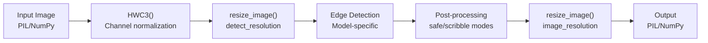
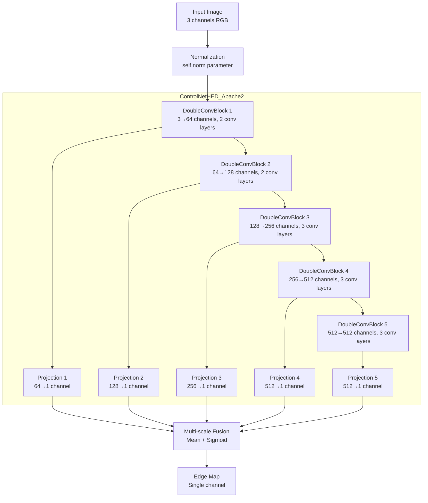
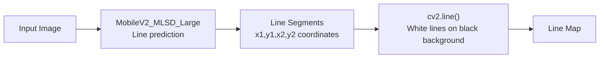
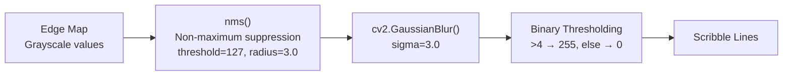

<!-- source: DeepWiki mcp.deepwiki.com · repo huggingface/controlnet_aux · page 4.1 Edge Detection · fetched 2026-10-26 -->

# Edge Detection

<details>
<summary>Relevant source files</summary>

The following files were used as context for generating this wiki page:

- [src/controlnet_aux/canny/__init__.py](src/controlnet_aux/canny/__init__.py)
- [src/controlnet_aux/hed/__init__.py](src/controlnet_aux/hed/__init__.py)
- [src/controlnet_aux/mediapipe_face/__init__.py](src/controlnet_aux/mediapipe_face/__init__.py)
- [src/controlnet_aux/mlsd/__init__.py](src/controlnet_aux/mlsd/__init__.py)
- [src/controlnet_aux/normalbae/__init__.py](src/controlnet_aux/normalbae/__init__.py)
- [src/controlnet_aux/pidi/__init__.py](src/controlnet_aux/pidi/__init__.py)
- [src/controlnet_aux/segment_anything/__init__.py](src/controlnet_aux/segment_anything/__init__.py)

</details>


This document covers the edge detection systems in controlnet_aux, which extract boundary and edge information from images to create line-based control maps for ControlNet. Edge detection is fundamental for applications requiring precise structural guidance, sketch-to-image generation, and boundary-aware image synthesis.

For information about line art generation which produces cleaner artistic lines, see [Line Art Generation](#4.4). For depth-based boundary detection through normal maps, see [Depth Estimation](#4.2).

## Overview

The controlnet_aux library provides four primary edge detection systems, each optimized for different use cases and computational requirements:

| Detector | Type | Model Architecture | Primary Use Case |
|----------|------|-------------------|------------------|
| `HEDdetector` | Neural Network | Custom CNN with 5 blocks | Multi-scale holistic edge detection |
| `CannyDetector` | Classical CV | OpenCV Canny algorithm | Fast, parameter-tunable edge detection |
| `PidiNetDetector` | Neural Network | PiDiNet architecture | Pixel difference-based edge detection |
| `MLSDdetector` | Neural Network | MobileV2-based | Mobile line segment detection |

**Edge Detection System Architecture**


Sources: [src/controlnet_aux/hed/__init__.py:59-129](), [src/controlnet_aux/canny/__init__.py:7-36](), [src/controlnet_aux/pidi/__init__.py:15-84](), [src/controlnet_aux/mlsd/__init__.py:15-79]()

## Common Interface Patterns

All edge detectors implement a standardized interface with consistent parameter handling and processing pipelines. The core `__call__` method signature follows this pattern:

**Standard Parameters**
- `input_image`: Input image as PIL Image or NumPy array
- `detect_resolution`: Resolution for edge detection processing (default: 512)
- `image_resolution`: Output image resolution (default: 512)
- `output_type`: Output format - "pil" or "np" (default: "pil")

**Neural Network Specific Parameters**
- `safe`: Apply safe step smoothing for cleaner edges
- `scribble`: Convert edges to simplified scribble-like lines using NMS

**Processing Pipeline Flow**


Sources: [src/controlnet_aux/hed/__init__.py:82-129](), [src/controlnet_aux/canny/__init__.py:8-36](), [src/controlnet_aux/pidi/__init__.py:38-84]()

## HED Detector

The `HEDdetector` implements Holistically-nested Edge Detection using a custom `ControlNetHED_Apache2` neural network architecture optimized for ControlNet applications.

**Model Architecture**


The HED architecture extracts edge features at multiple scales through five `DoubleConvBlock` layers [src/controlnet_aux/hed/__init__.py:21-38](), each producing side outputs that are fused for the final edge map [src/controlnet_aux/hed/__init__.py:104-107]().

**Key Features**
- Multi-scale edge detection with hierarchical feature extraction
- RGB input processing (optimized for Gradio compatibility)
- Scribble mode for simplified line drawings using NMS and Gaussian blur
- Safe mode for smoothed edge outputs

Sources: [src/controlnet_aux/hed/__init__.py:21-58](), [src/controlnet_aux/hed/__init__.py:59-129]()

## Canny Detector

The `CannyDetector` provides classical Canny edge detection using OpenCV's optimized implementation. This detector offers the fastest processing with minimal memory requirements.

**Implementation Details**
- Direct `cv2.Canny()` invocation with configurable thresholds [src/controlnet_aux/canny/__init__.py:25]()
- No model loading required - immediate instantiation
- Threshold parameters: `low_threshold` (default: 100), `high_threshold` (default: 200)

**Usage Pattern**
```python
detector = CannyDetector()
edges = detector(input_image, low_threshold=50, high_threshold=150)
```

Sources: [src/controlnet_aux/canny/__init__.py:7-36]()

## PiDiNet Detector

The `PidiNetDetector` uses the Pixel Difference Network architecture for edge detection with enhanced filtering and safety options.

**Model Characteristics**
- PiDiNet architecture from `pidinet()` model factory [src/controlnet_aux/pidi/__init__.py:28]()
- BGR input processing with channel reversal [src/controlnet_aux/pidi/__init__.py:54]()
- Binary filtering option with 0.5 threshold [src/controlnet_aux/pidi/__init__.py:61-62]()
- Supports both safe mode and scribble mode post-processing

**Configuration Options**
- `apply_filter`: Binary thresholding at 0.5 for cleaner edges
- `safe`: Safe step smoothing for reduced noise
- `scribble`: NMS-based line simplification matching HED behavior

Sources: [src/controlnet_aux/pidi/__init__.py:15-84](), [src/controlnet_aux/pidi/model.py:1-100]()

## MLSD Detector

The `MLSDdetector` implements Mobile Line Segment Detection for efficient line detection on mobile devices using a `MobileV2_MLSD_Large` architecture.

**Line Detection Process**


The detector extracts line segments as coordinate pairs and renders them as white lines on a black background [src/controlnet_aux/mlsd/__init__.py:61-64]().

**Parameters**
- `thr_v`: Value threshold for line detection (default: 0.1)
- `thr_d`: Distance threshold for line detection (default: 0.1)

Sources: [src/controlnet_aux/mlsd/__init__.py:15-79](), [src/controlnet_aux/mlsd/models/mbv2_mlsd_large.py:1-100]()

## Scribble Mode Processing

Both HED and PiDiNet detectors support scribble mode, which converts detailed edge maps into simplified line drawings suitable for sketch-based control.

**Scribble Processing Pipeline**


This processing creates clean, sketch-like lines by suppressing weak edges and applying Gaussian smoothing [src/controlnet_aux/hed/__init__.py:121-124](), [src/controlnet_aux/pidi/__init__.py:76-79]().

Sources: [src/controlnet_aux/hed/__init__.py:120-125](), [src/controlnet_aux/pidi/__init__.py:75-80](), [src/controlnet_aux/util.py:1-100]()

---

