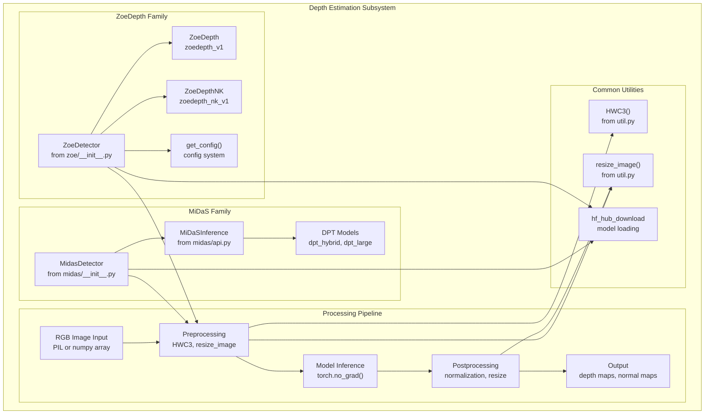
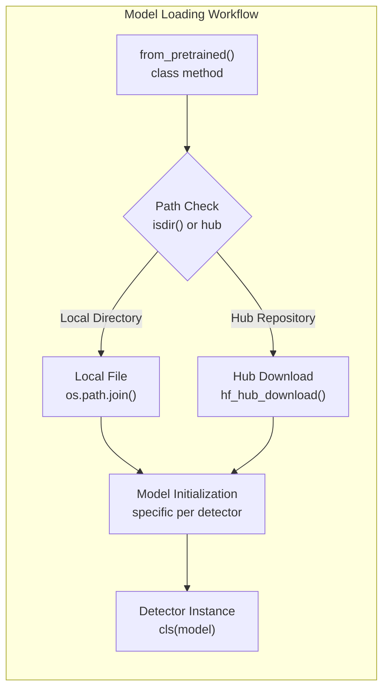
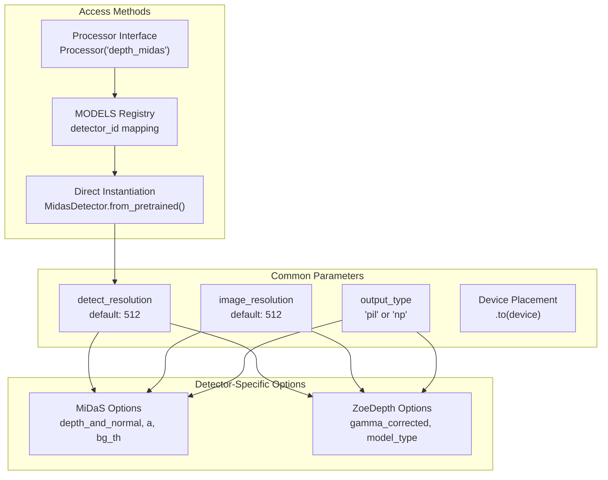

<!-- source: DeepWiki mcp.deepwiki.com · repo huggingface/controlnet_aux · page 4.2 Depth Estimation · fetched 2026-10-26 -->

# Depth Estimation

Relevant source files

The following files were used as context for generating this wiki page:

- [src/controlnet_aux/midas/__init__.py](src/controlnet_aux/midas/__init__.py)
- [src/controlnet_aux/zoe/__init__.py](src/controlnet_aux/zoe/__init__.py)

This document covers the depth estimation subsystem within controlnet_aux, which provides monocular depth estimation capabilities for generating depth maps and normal maps from single RGB images. These detectors are essential for depth-based control in ControlNet pipelines, enabling spatial understanding and 3D-aware image generation.

For pose-based spatial understanding, see [Pose Estimation](#4.3). For edge-based spatial features, see [Edge Detection](#4.1).

## Overview

The depth estimation system in controlnet_aux implements several state-of-the-art monocular depth estimation models that can infer depth information from single RGB images. These detectors serve two primary purposes:

1. **Depth Map Generation**: Creating grayscale depth maps where pixel intensity represents distance from the camera
2. **Normal Map Generation**: Computing surface normal vectors for 3D lighting and shading effects

The depth estimation subsystem follows the standard detector interface pattern established in controlnet_aux, providing both direct instantiation and `Processor`-based access methods.

Sources: [src/controlnet_aux/midas/__init__.py:1-96](), [src/controlnet_aux/zoe/__init__.py:1-94]()

## System Architecture

This architecture shows how depth estimation detectors integrate with the common processing pipeline and utility functions. Each detector family implements its own model loading and inference logic while sharing preprocessing and postprocessing utilities.

Sources: [src/controlnet_aux/midas/__init__.py:14-32](), [src/controlnet_aux/zoe/__init__.py:16-44]()

## Common Processing Patterns

All depth estimation detectors in controlnet_aux follow consistent patterns for model loading, preprocessing, and output formatting:

### Model Loading Pattern

### Processing Pipeline

| Stage | MidasDetector | ZoeDetector | Common Operations |
|-------|---------------|-------------|-------------------|
| **Input Handling** | `np.array(input_image)` | `np.array(input_image)` | Type conversion, output_type detection |
| **Preprocessing** | `HWC3()`, `resize_image()` | `HWC3()`, `resize_image()` | Standardization to HWC format |
| **Tensor Conversion** | `/127.5 - 1.0` normalization | `/255.0` normalization | Different normalization schemes |
| **Inference** | `self.model(image_depth)[0]` | `self.model.infer(image_depth)` | Model-specific inference calls |
| **Postprocessing** | Min-max normalization | Percentile-based normalization | Depth value scaling |
| **Output Formatting** | PIL/numpy based on input | PIL/numpy based on input | Consistent return type handling |

Sources: [src/controlnet_aux/midas/__init__.py:39-96](), [src/controlnet_aux/zoe/__init__.py:50-94]()

## Available Detectors

The depth estimation subsystem includes several specialized detectors, each optimized for different use cases:

### MidasDetector
- **Purpose**: General-purpose monocular depth estimation with optional normal map generation
- **Model Architecture**: Dense Prediction Transformer (DPT) with hybrid backbone
- **Key Features**: 
  - Dual output mode (`depth_and_normal=True`)
  - Sobel gradient-based normal computation
  - Configurable background threshold (`bg_th`)
- **Default Model**: `dpt_hybrid-midas-501f0c75.pt`

### ZoeDetector  
- **Purpose**: Metric depth estimation with improved accuracy
- **Model Architecture**: ZoeDepth with encoder-decoder structure
- **Key Features**:
  - Gamma correction option (`gamma_corrected`)
  - Percentile-based depth normalization
  - Two model variants (ZoeDepth, ZoeDepthNK)
- **Default Model**: `ZoeD_M12_N.pt`

### Additional Detectors
- **LeresDetector**: Focus on high-resolution depth estimation (see [LeRes and Normal Map Detectors](#4.2.3))
- **NormalBaeDetector**: Specialized normal map generation (see [LeRes and Normal Map Detectors](#4.2.3))

Sources: [src/controlnet_aux/midas/__init__.py:19-23](), [src/controlnet_aux/zoe/__init__.py:21-22]()

## Usage Integration

The depth estimation detectors integrate seamlessly with the controlnet_aux ecosystem, supporting both direct instantiation for fine-grained control and `Processor`-based access for simplified usage patterns. All detectors support GPU acceleration through the standard `.to(device)` method and maintain consistent parameter interfaces for resolution control and output formatting.

Sources: [src/controlnet_aux/midas/__init__.py:35-37](), [src/controlnet_aux/zoe/__init__.py:46-48]()

---

