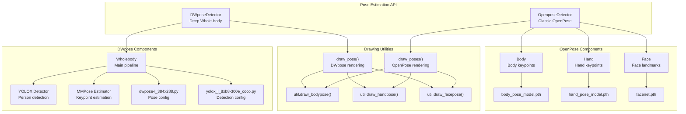
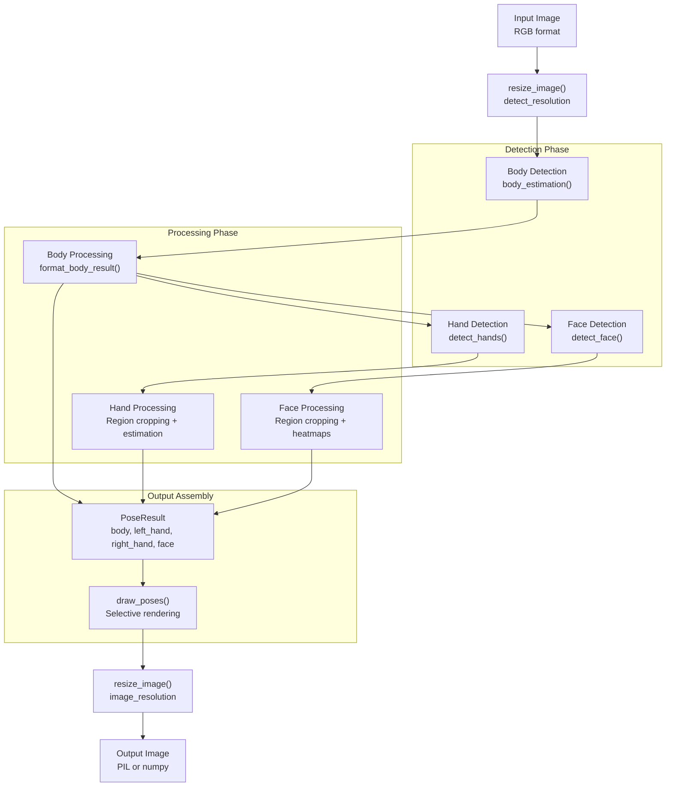

<!-- source: DeepWiki mcp.deepwiki.com · repo huggingface/controlnet_aux · page 4.3 Pose Estimation · fetched 2026-10-26 -->

# Pose Estimation

<details>
<summary>Relevant source files</summary>

The following files were used as context for generating this wiki page:

- [src/controlnet_aux/dwpose/__init__.py](src/controlnet_aux/dwpose/__init__.py)
- [src/controlnet_aux/dwpose/dwpose_config/dwpose-l_384x288.py](src/controlnet_aux/dwpose/dwpose_config/dwpose-l_384x288.py)
- [src/controlnet_aux/dwpose/util.py](src/controlnet_aux/dwpose/util.py)
- [src/controlnet_aux/dwpose/wholebody.py](src/controlnet_aux/dwpose/wholebody.py)
- [src/controlnet_aux/dwpose/yolox_config/yolox_l_8xb8-300e_coco.py](src/controlnet_aux/dwpose/yolox_config/yolox_l_8xb8-300e_coco.py)
- [src/controlnet_aux/open_pose/__init__.py](src/controlnet_aux/open_pose/__init__.py)
- [tests/test_controlnet_aux.py](tests/test_controlnet_aux.py)

</details>


This document covers the pose estimation systems in controlnet_aux, which detect human body keypoints including body pose, hand gestures, and facial landmarks. These detectors generate skeleton representations suitable for pose-based image control tasks.

For information about other feature detection types, see [Edge Detection](#4.1), [Depth Estimation](#4.2), and [Segmentation](#4.5).

## Overview

The pose estimation module provides two main detector implementations:

| Detector | Description | Key Features |
|----------|-------------|--------------|
| `DWposeDetector` | Deep Whole-body pose estimation | YOLOX + MMPose pipeline, unified whole-body detection |
| `OpenposeDetector` | Classic OpenPose implementation | Modular body/hand/face components, flexible configuration |

Both detectors output visual pose representations as RGB images showing skeleton overlays on black backgrounds.

## System Architecture



**Sources:** [src/controlnet_aux/dwpose/__init__.py:33-91](), [src/controlnet_aux/open_pose/__init__.py:70-234](), [src/controlnet_aux/dwpose/wholebody.py:32-121]()

## DWpose Detection Pipeline

The `DWposeDetector` implements a two-stage approach combining object detection with pose estimation:

```mermaid
graph LR
    INPUT["Input Image<br/>RGB format"]
    RESIZE["resize_image()<br/>detect_resolution"]
    DETECT["YOLOX Person Detection<br/>confidence > 0.5"]
    NMS["Non-Maximum Suppression<br/>threshold 0.7"]
    POSE["MMPose Keypoint Estimation<br/>133 keypoints total"]
    TRANSFORM["Coordinate Transformation<br/>Normalize & restructure"]
    SPLIT["Split Keypoints<br/>body[18], hands[42], face[68]"]
    DRAW["draw_pose()<br/>Skeleton visualization"]
    FINAL_RESIZE["resize_image()<br/>image_resolution"]
    OUTPUT["Output Image<br/>PIL or numpy"]
    
    INPUT --> RESIZE
    RESIZE --> DETECT
    DETECT --> NMS
    NMS --> POSE
    POSE --> TRANSFORM
    TRANSFORM --> SPLIT
    SPLIT --> DRAW
    DRAW --> FINAL_RESIZE
    FINAL_RESIZE --> OUTPUT
```



### Key Implementation Details

The `DWposeDetector` initialization requires MMPose and MMDetection dependencies:

- **Detection Model**: YOLOX-L trained on COCO dataset for person detection
- **Pose Model**: DWPose-L trained on COCO WholeBody + UBody datasets
- **Output Structure**: 133 keypoints split into body (18), hands (42), and face (68) regions

The keypoint processing includes coordinate normalization and OpenPose-compatible indexing:

[src/controlnet_aux/dwpose/__init__.py:51-78]()

**Sources:** [src/controlnet_aux/dwpose/__init__.py:33-91](), [src/controlnet_aux/dwpose/wholebody.py:65-121]()

## OpenPose Detection Pipeline

The `OpenposeDetector` provides a modular approach with separate components for different body parts:



### Modular Component System

The OpenPose detector supports selective component activation:

| Parameter | Type | Description |
|-----------|------|-------------|
| `include_body` | bool | Enable body keypoint detection |
| `include_hand` | bool | Enable hand keypoint detection |
| `include_face` | bool | Enable face landmark detection |

The hand and face detection are dependent on body detection results, using body keypoints to locate regions of interest:

[src/controlnet_aux/open_pose/__init__.py:119-158]()

**Sources:** [src/controlnet_aux/open_pose/__init__.py:70-234](), [src/controlnet_aux/open_pose/__init__.py:160-197]()

## Pose Data Structures

### DWpose Output Format

DWpose uses a dictionary-based structure:

```python
pose = {
    'bodies': {
        'candidate': body_keypoints,  # Shape: (N*18, 3)
        'subset': score_indices      # Shape: (N, 18)
    },
    'hands': hand_keypoints,        # Shape: (42, 2) 
    'faces': face_keypoints         # Shape: (68, 2)
}
```

### OpenPose Output Format

OpenPose uses structured `PoseResult` objects:

```python
PoseResult = NamedTuple(
    body: BodyResult,              # List of Keypoint objects
    left_hand: HandResult,         # List of Keypoint objects or None
    right_hand: HandResult,        # List of Keypoint objects or None  
    face: FaceResult              # List of Keypoint objects or None
)
```

**Sources:** [src/controlnet_aux/dwpose/__init__.py:77-78](), [src/controlnet_aux/open_pose/__init__.py:33-37]()

## Drawing and Visualization

Both detectors share common drawing utilities for consistent visual output:

### Rendering Functions

| Function | Purpose | Key Features |
|----------|---------|--------------|
| `draw_bodypose()` | Body skeleton rendering | 18 keypoints, colored limb connections |
| `draw_handpose()` | Hand skeleton rendering | 21 keypoints per hand, finger connections |
| `draw_facepose()` | Face landmark rendering | 68 facial landmarks as white dots |

### Visual Output Characteristics

- **Canvas**: Black background RGB image
- **Body Lines**: Colored elliptical connections between keypoints
- **Hand Lines**: HSV-colored finger segment connections  
- **Face Points**: White circular markers for landmarks
- **Keypoint Circles**: Colored circles at joint locations

The drawing functions handle coordinate scaling and visibility thresholding automatically:

[src/controlnet_aux/dwpose/util.py:67-156]()

**Sources:** [src/controlnet_aux/dwpose/util.py:67-156](), [src/controlnet_aux/open_pose/__init__.py:39-67]()

## Usage Examples

### Basic Pose Detection

```python
# DWpose detector
dwpose = DWposeDetector()
pose_image = dwpose(input_image)

# OpenPose detector  
openpose = OpenposeDetector.from_pretrained("lllyasviel/Annotators")
pose_image = openpose(input_image, include_hand=True, include_face=True)
```

### Configuration Options

Both detectors support common parameters:

- `detect_resolution`: Input resolution for detection (default: 512)
- `image_resolution`: Output resolution for result image (default: 512)  
- `output_type`: Output format - "pil" for PIL Image or "np" for numpy array

**Sources:** [tests/test_controlnet_aux.py:123-126](), [tests/test_controlnet_aux.py:91-100]()

---

