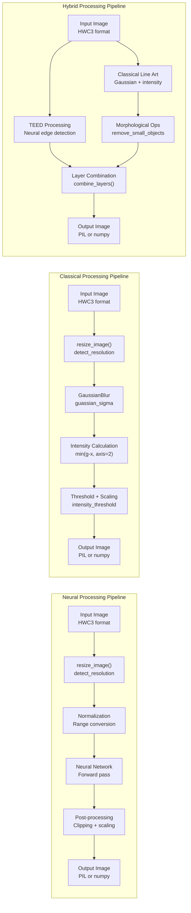
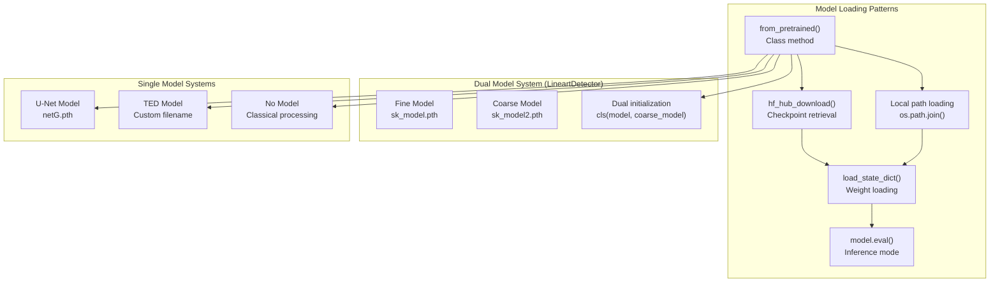

<!-- source: DeepWiki mcp.deepwiki.com · repo huggingface/controlnet_aux · page 4.4 Line Art Generation · fetched 2026-10-26 -->

# Line Art Generation

<details>
<summary>Relevant source files</summary>

The following files were used as context for generating this wiki page:

- [src/controlnet_aux/anyline/__init__.py](src/controlnet_aux/anyline/__init__.py)
- [src/controlnet_aux/leres/__init__.py](src/controlnet_aux/leres/__init__.py)
- [src/controlnet_aux/lineart/__init__.py](src/controlnet_aux/lineart/__init__.py)
- [src/controlnet_aux/lineart_anime/__init__.py](src/controlnet_aux/lineart_anime/__init__.py)
- [src/controlnet_aux/lineart_standard/__init__.py](src/controlnet_aux/lineart_standard/__init__.py)
- [src/controlnet_aux/teed/Fsmish.py](src/controlnet_aux/teed/Fsmish.py)
- [src/controlnet_aux/teed/LICENSE.txt](src/controlnet_aux/teed/LICENSE.txt)
- [src/controlnet_aux/teed/Xsmish.py](src/controlnet_aux/teed/Xsmish.py)
- [src/controlnet_aux/teed/__init__.py](src/controlnet_aux/teed/__init__.py)
- [src/controlnet_aux/teed/ted.py](src/controlnet_aux/teed/ted.py)

</details>


Line art generation systems in controlnet_aux convert photographs and images into simplified line drawings suitable for artistic control and sketch-based conditioning. These detectors extract structural outlines, contours, and artistic line representations from input images.

This document covers the architectural patterns and processing approaches used across line art generation systems. For detailed implementation of specific neural network-based detectors, see [LineArt Detectors](#4.4.1). For classical line segment detection approaches, see [Line Segment Detection](#4.4.2).

## System Overview

The line art generation subsystem provides multiple complementary approaches ranging from classical computer vision techniques to specialized neural networks optimized for different artistic styles and use cases.

**Line Art Generation System Architecture**
```mermaid
graph TD
    subgraph "Line Art Generation Systems"
        LINEART["LineartDetector<br/>Dual Model System"]
        LINEART_ANIME["LineartAnimeDetector<br/>U-Net Architecture"]
        LINEART_STANDARD["LineartStandardDetector<br/>Classical Processing"]
        TEED["TEEDdetector<br/>Tiny Efficient Edge"]
        ANYLINE["AnylineDetector<br/>Hybrid Approach"]
    end
    
    subgraph "Processing Approaches"
        NEURAL["Neural Network<br/>Deep Learning"]
        CLASSICAL["Classical CV<br/>Gaussian Blur + Intensity"]
        HYBRID["Hybrid Processing<br/>Neural + Classical"]
    end
    
    subgraph "Output Characteristics"
        GENERAL["General Line Art<br/>Photorealistic"]
        ANIME["Anime Style<br/>Stylized"]
        EDGES["Edge Detection<br/>Boundary Focus"]
        COMBINED["Combined Lines<br/>Edges + Line Art"]
    end
    
    LINEART --> NEURAL
    LINEART_ANIME --> NEURAL
    TEED --> NEURAL
    LINEART_STANDARD --> CLASSICAL
    ANYLINE --> HYBRID
    
    LINEART --> GENERAL
    LINEART_ANIME --> ANIME
    TEED --> EDGES
    LINEART_STANDARD --> GENERAL
    ANYLINE --> COMBINED
    
    NEURAL -.-> "PyTorch Models"
    CLASSICAL -.-> "OpenCV Processing"
    HYBRID -.-> "Mixed Pipeline"
```

Sources: [src/controlnet_aux/lineart/__init__.py:94-167](), [src/controlnet_aux/lineart_anime/__init__.py:116-189](), [src/controlnet_aux/lineart_standard/__init__.py:10-47](), [src/controlnet_aux/teed/__init__.py:14-84](), [src/controlnet_aux/anyline/__init__.py:16-119]()

## Neural Network Architectures

Line art generation employs three distinct neural network architectures, each optimized for different artistic requirements and computational constraints.

**Neural Architecture Comparison**

```mermaid
graph TD
    subgraph "Generator Architecture (LineartDetector)"
        GEN_IN["Input: 3 channels"]
        GEN_CONV1["ReflectionPad2d + Conv2d(3,64,7)"]
        GEN_DOWN["Downsampling: 2x Conv blocks"]
        GEN_RES["Residual Blocks: n_residual_blocks"]
        GEN_UP["Upsampling: 2x ConvTranspose2d"]
        GEN_OUT["Output: Conv2d + Sigmoid"]
        
        GEN_IN --> GEN_CONV1
        GEN_CONV1 --> GEN_DOWN
        GEN_DOWN --> GEN_RES
        GEN_RES --> GEN_UP
        GEN_UP --> GEN_OUT
    end
    
    subgraph "U-Net Architecture (LineartAnimeDetector)"
        UNET_IN["Input: 3 channels"]
        UNET_DOWN["Encoder: Progressive downsampling"]
        UNET_SKIP["Skip Connections"]
        UNET_UP["Decoder: Progressive upsampling"]
        UNET_OUT["Output: 1 channel + Tanh"]
        
        UNET_IN --> UNET_DOWN
        UNET_DOWN --> UNET_UP
        UNET_SKIP -.-> UNET_UP
        UNET_UP --> UNET_OUT
    end
    
    subgraph "TED Architecture (TEEDdetector)"
        TED_IN["Input: 3 channels"]
        TED_BLOCK1["DoubleConvBlock(3,16,16)"]
        TED_BLOCK2["DoubleConvBlock(16,32)"]
        TED_DENSE["_DenseBlock(1,32,48)"]
        TED_UP["UpConvBlocks: Multi-scale"]
        TED_FUSION["DoubleFusion: Feature combination"]
        
        TED_IN --> TED_BLOCK1
        TED_BLOCK1 --> TED_BLOCK2
        TED_BLOCK2 --> TED_DENSE
        TED_DENSE --> TED_UP
        TED_UP --> TED_FUSION
    end
```


Sources: [src/controlnet_aux/lineart/__init__.py:36-92](), [src/controlnet_aux/lineart_anime/__init__.py:16-114](), [src/controlnet_aux/teed/ted.py:215-311]()

### Generator Architecture

The `Generator` class implements a ResNet-style architecture with reflection padding and residual connections. This design excels at preserving fine details while generating clean line art from photorealistic inputs.

| Component | Configuration | Purpose |
|-----------|---------------|---------|
| Initial Block | `ReflectionPad2d(3) + Conv2d(3,64,7)` | Feature extraction |
| Downsampling | 2 blocks, stride=2 | Spatial compression |
| Residual Blocks | Configurable count (default: 9) | Feature refinement |
| Upsampling | 2 `ConvTranspose2d` blocks | Spatial reconstruction |
| Output Layer | `Conv2d(64,1,7) + Sigmoid` | Line map generation |

Sources: [src/controlnet_aux/lineart/__init__.py:36-92]()

### U-Net Architecture

The `UnetGenerator` implements a classic U-Net with skip connections optimized for anime-style line art generation. The architecture uses instance normalization and supports configurable dropout for regularization.

Key architectural features:
- **Skip Connections**: Direct feature routing via `UnetSkipConnectionBlock`
- **Progressive Scaling**: 8 downsampling levels for multi-scale processing
- **Instance Normalization**: `functools.partial(nn.InstanceNorm2d, affine=False)`
- **Activation**: Tanh output activation for symmetric range

Sources: [src/controlnet_aux/lineart_anime/__init__.py:16-114](), [src/controlnet_aux/lineart_anime/__init__.py:129-130]()

### TED Architecture

The Tiny Efficient Edge Detector (`TED`) implements a lightweight architecture using Smish activation functions and dense connections for efficient edge detection suitable for line art generation.

Architecture highlights:
- **Smish Activation**: Custom activation function `smish(x) = x * tanh(ln(1 + sigmoid(x)))`
- **Dense Blocks**: `_DenseBlock` with skip connections for feature reuse
- **Multi-scale Outputs**: `UpConvBlock` generators at different scales
- **Feature Fusion**: `DoubleFusion` for combining multi-scale predictions

Sources: [src/controlnet_aux/teed/ted.py:215-311](), [src/controlnet_aux/teed/Fsmish.py:12-19]()

## Processing Pipelines

Line art generation systems implement different processing strategies depending on their underlying architecture and target output characteristics.

**Processing Pipeline Comparison**


Sources: [src/controlnet_aux/lineart/__init__.py:126-167](), [src/controlnet_aux/lineart_anime/__init__.py:145-189](), [src/controlnet_aux/lineart_standard/__init__.py:11-47](), [src/controlnet_aux/anyline/__init__.py:38-106]()

### Neural Processing Pattern

Neural network-based detectors follow a standardized pipeline:

1. **Input Preparation**: Convert to `HWC3` format and resize to `detect_resolution`
2. **Normalization**: Convert pixel values to model-specific ranges
3. **Model Inference**: Forward pass through neural network
4. **Output Processing**: Scale, clip, and convert to target format

Common normalization patterns:
- **LineartDetector**: `image / 255.0` (0-1 range)
- **LineartAnimeDetector**: `(image / 127.5) - 1.0` (-1 to 1 range)
- **TEEDdetector**: Direct float conversion with tensor operations

Sources: [src/controlnet_aux/lineart/__init__.py:145-152](), [src/controlnet_aux/lineart_anime/__init__.py:166-171](), [src/controlnet_aux/teed/__init__.py:57-70]()

### Classical Processing Pattern

The `LineartStandardDetector` implements a classical computer vision approach using Gaussian blur and intensity analysis:

```python
# Core algorithm from lineart_standard
x = input_image.astype(np.float32)
g = cv2.GaussianBlur(x, (0, 0), guassian_sigma)
intensity = np.min(g - x, axis=2).clip(0, 255)
intensity /= max(16, np.median(intensity[intensity > intensity_threshold]))
intensity *= 127
```

This approach excels at detecting fine lines and texture boundaries without requiring trained models.

Sources: [src/controlnet_aux/lineart_standard/__init__.py:29-34]()

### Hybrid Processing Pattern

The `AnylineDetector` combines neural edge detection with classical line art processing, demonstrating advanced pipeline composition:

1. **TEED Processing**: Neural edge detection using TED architecture
2. **Classical Line Art**: Gaussian blur-based intensity calculation
3. **Morphological Filtering**: Remove noise using `morphology.remove_small_objects`
4. **Layer Combination**: Blend results using custom `combine_layers` function

This hybrid approach leverages the strengths of both neural and classical methods for comprehensive line art generation.

Sources: [src/controlnet_aux/anyline/__init__.py:61-95](), [src/controlnet_aux/anyline/__init__.py:114-118]()

## Model Loading and Configuration

Line art detectors implement the standard `from_pretrained` pattern with model-specific configurations and checkpoint management.

**Model Loading Architecture**


Sources: [src/controlnet_aux/lineart/__init__.py:99-119](), [src/controlnet_aux/lineart_anime/__init__.py:120-139](), [src/controlnet_aux/teed/__init__.py:18-30]()

### Dual Model Configuration

The `LineartDetector` uniquely implements a dual model system for different quality levels:

| Model | Filename | Purpose | Architecture |
|-------|----------|---------|--------------|
| Fine Model | `sk_model.pth` | High-quality line art | `Generator(3, 1, 3)` |
| Coarse Model | `sk_model2.pth` | Fast processing | `Generator(3, 1, 3)` |

Model selection is controlled via the `coarse` parameter in the `__call__` method.

Sources: [src/controlnet_aux/lineart/__init__.py:100-119](), [src/controlnet_aux/lineart/__init__.py:142]()

### Configuration Parameters

Each detector supports specific configuration parameters for fine-tuning output characteristics:

| Detector | Key Parameters | Default Values | Purpose |
|----------|----------------|----------------|---------|
| `LineartDetector` | `coarse`, `detect_resolution`, `image_resolution` | `False`, `512`, `512` | Quality vs speed trade-off |
| `LineartAnimeDetector` | `detect_resolution`, `image_resolution` | `512`, `512` | Resolution control |
| `LineartStandardDetector` | `guassian_sigma`, `intensity_threshold` | `6.0`, `8` | Blur and sensitivity |
| `TEEDdetector` | `safe_steps`, `detect_resolution` | `2`, `512` | Edge refinement |
| `AnylineDetector` | `guassian_sigma`, `intensity_threshold`, `detect_resolution` | `2.0`, `3`, `1280` | Hybrid processing |

Sources: [src/controlnet_aux/lineart/__init__.py:126](), [src/controlnet_aux/lineart_anime/__init__.py:145](), [src/controlnet_aux/lineart_standard/__init__.py:11-17](), [src/controlnet_aux/teed/__init__.py:36-42](), [src/controlnet_aux/anyline/__init__.py:38-45]()

---

