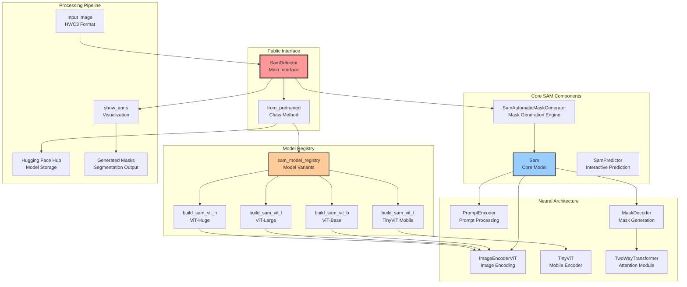
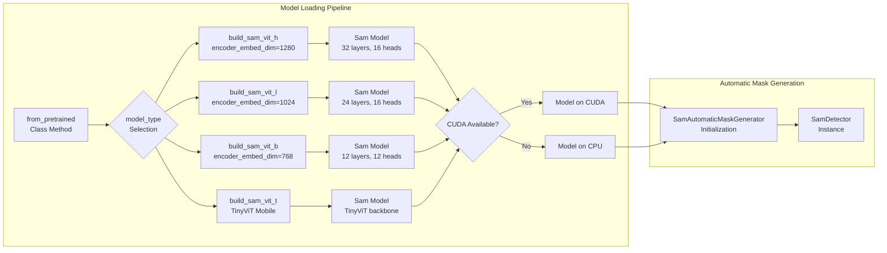
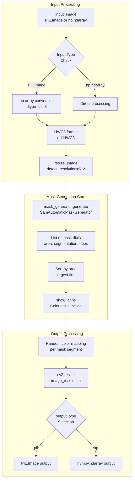
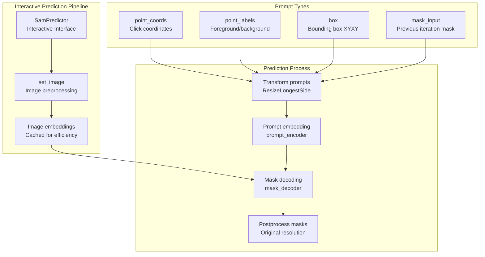
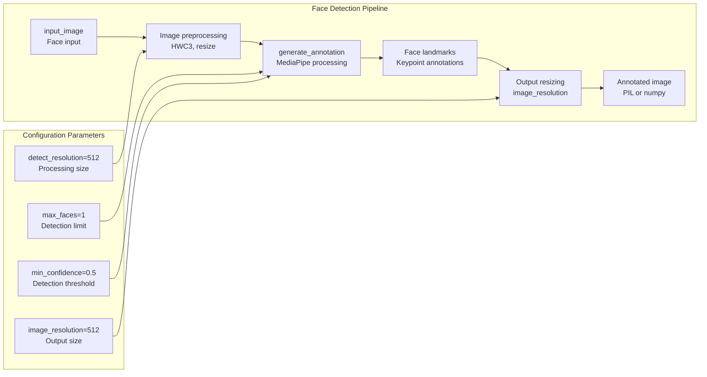

<!-- source: DeepWiki mcp.deepwiki.com · repo huggingface/controlnet_aux · page 4.5 Segmentation · fetched 2026-10-26 -->

# Segmentation

<details>
<summary>Relevant source files</summary>

The following files were used as context for generating this wiki page:

- [src/controlnet_aux/canny/__init__.py](src/controlnet_aux/canny/__init__.py)
- [src/controlnet_aux/mediapipe_face/__init__.py](src/controlnet_aux/mediapipe_face/__init__.py)
- [src/controlnet_aux/segment_anything/__init__.py](src/controlnet_aux/segment_anything/__init__.py)
- [src/controlnet_aux/segment_anything/build_sam.py](src/controlnet_aux/segment_anything/build_sam.py)
- [src/controlnet_aux/segment_anything/modeling/__init__.py](src/controlnet_aux/segment_anything/modeling/__init__.py)
- [src/controlnet_aux/segment_anything/modeling/sam.py](src/controlnet_aux/segment_anything/modeling/sam.py)
- [src/controlnet_aux/segment_anything/modeling/tiny_vit_sam.py](src/controlnet_aux/segment_anything/modeling/tiny_vit_sam.py)
- [src/controlnet_aux/segment_anything/predictor.py](src/controlnet_aux/segment_anything/predictor.py)

</details>


Segmentation detectors in controlnet_aux provide image segmentation and region detection capabilities for mask-based control in ControlNet applications. These detectors identify and isolate objects, regions, or features within images to generate segmentation masks that can guide image generation processes.

For line-based control methods, see [Edge Detection](#4.1). For depth-based control, see [Depth Estimation](#4.2).

## Overview

The segmentation system consists of two primary detector categories:

| Detector | Purpose | Output |
|----------|---------|---------|
| `SamDetector` | Universal object segmentation using Segment Anything Model | Colored segmentation masks |
| `MediapipeFaceDetector` | Face landmark detection and annotation | Face keypoint annotations |

## SAM Detector Architecture

The `SamDetector` serves as the primary universal segmentation system, built around Meta's Segment Anything Model (SAM). It provides automatic mask generation for arbitrary objects in images without requiring specific prompts.

### SAM System Components



**Sources**: [src/controlnet_aux/segment_anything/__init__.py:22-44](), [src/controlnet_aux/segment_anything/build_sam.py:96-102](), [src/controlnet_aux/segment_anything/modeling/sam.py:19-49]()

### Model Variants and Capabilities

SAM supports four distinct model architectures with different computational requirements and performance characteristics:

| Model Type | Architecture | Parameters | Use Case |
|------------|-------------|------------|----------|
| `vit_h` | Vision Transformer Huge | ~630M | Highest accuracy |
| `vit_l` | Vision Transformer Large | ~308M | Balanced performance |
| `vit_b` | Vision Transformer Base | ~91M | Standard deployment |
| `vit_t` | TinyViT Mobile | ~5M | Mobile/edge devices |



**Sources**: [src/controlnet_aux/segment_anything/__init__.py:27-44](), [src/controlnet_aux/segment_anything/build_sam.py:14-102]()

## SAM Processing Workflow

The `SamDetector` implements a complete processing pipeline from image input to segmentation visualization:



**Sources**: [src/controlnet_aux/segment_anything/__init__.py:62-92](), [src/controlnet_aux/segment_anything/__init__.py:47-60]()

### SamPredictor for Interactive Segmentation

The `SamPredictor` class provides fine-grained control for interactive segmentation with user-provided prompts:



**Sources**: [src/controlnet_aux/segment_anything/predictor.py:17-243]()

## MediaPipe Face Detection

The `MediapipeFaceDetector` provides specialized face landmark detection and annotation capabilities:



**Sources**: [src/controlnet_aux/mediapipe_face/__init__.py:12-53]()

## Usage Patterns

Both segmentation detectors follow the standard controlnet_aux usage patterns:

### Direct Instantiation
```python
# SAM detector with specific model
sam_detector = SamDetector.from_pretrained("lllyasviel/Annotators", model_type="vit_b")

# MediaPipe face detector  
face_detector = MediapipeFaceDetector()
```

### Processor Interface Integration
The detectors integrate with the unified `Processor` interface through the model registry system, allowing users to access them via processor IDs for consistent API usage across all detector types.

**Sources**: [src/controlnet_aux/segment_anything/__init__.py:22-44](), [src/controlnet_aux/mediapipe_face/__init__.py:12-20]()

---

