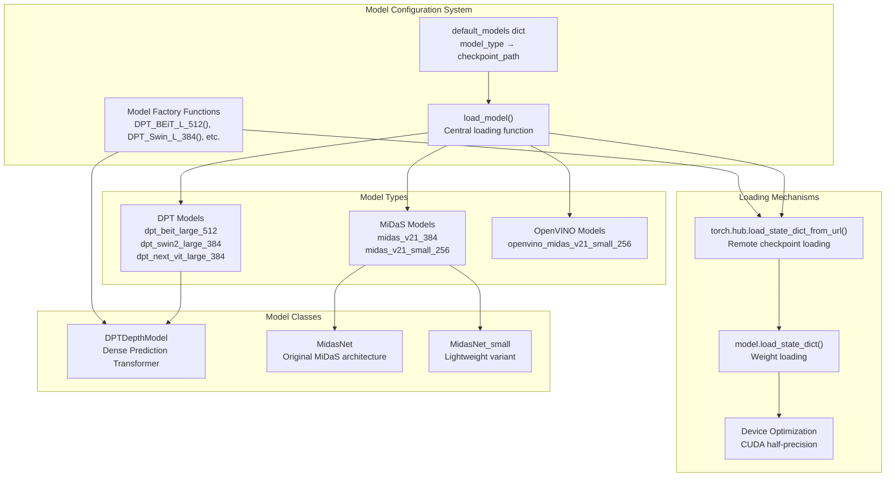
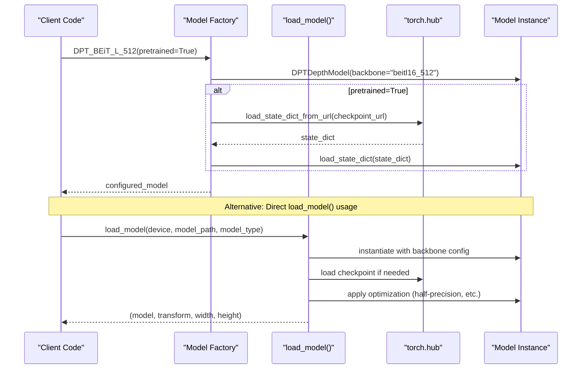
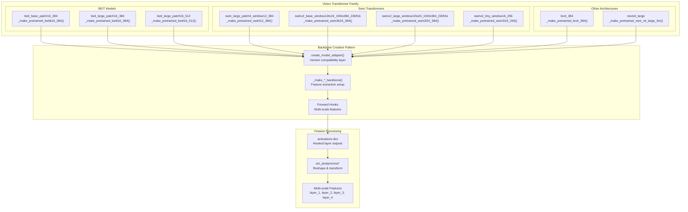
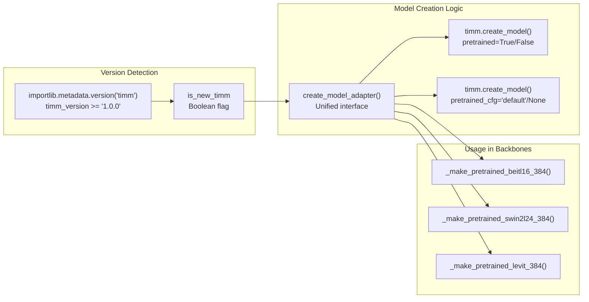
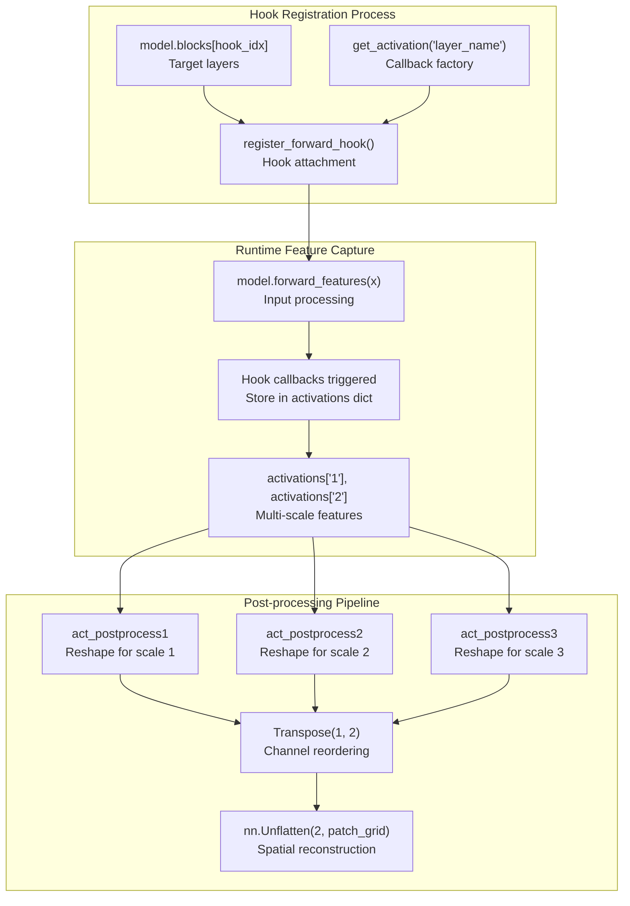
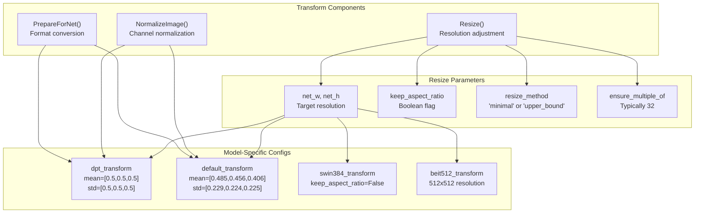

<!-- source: DeepWiki mcp.deepwiki.com · repo huggingface/controlnet_aux · page 5 Advanced Topics · fetched 2026-10-26 -->

# Advanced Topics

Relevant source files

The following files were used as context for generating this wiki page:

- [src/controlnet_aux/zoe/zoedepth/__init__.py](src/controlnet_aux/zoe/zoedepth/__init__.py)
- [src/controlnet_aux/zoe/zoedepth/models/base_models/midas_repo/__init__.py](src/controlnet_aux/zoe/zoedepth/models/base_models/midas_repo/__init__.py)
- [src/controlnet_aux/zoe/zoedepth/models/base_models/midas_repo/hubconf.py](src/controlnet_aux/zoe/zoedepth/models/base_models/midas_repo/hubconf.py)
- [src/controlnet_aux/zoe/zoedepth/models/base_models/midas_repo/midas/__init__.py](src/controlnet_aux/zoe/zoedepth/models/base_models/midas_repo/midas/__init__.py)
- [src/controlnet_aux/zoe/zoedepth/models/base_models/midas_repo/midas/backbones/__init__.py](src/controlnet_aux/zoe/zoedepth/models/base_models/midas_repo/midas/backbones/__init__.py)
- [src/controlnet_aux/zoe/zoedepth/models/base_models/midas_repo/midas/backbones/beit.py](src/controlnet_aux/zoe/zoedepth/models/base_models/midas_repo/midas/backbones/beit.py)
- [src/controlnet_aux/zoe/zoedepth/models/base_models/midas_repo/midas/backbones/levit.py](src/controlnet_aux/zoe/zoedepth/models/base_models/midas_repo/midas/backbones/levit.py)
- [src/controlnet_aux/zoe/zoedepth/models/base_models/midas_repo/midas/backbones/next_vit.py](src/controlnet_aux/zoe/zoedepth/models/base_models/midas_repo/midas/backbones/next_vit.py)
- [src/controlnet_aux/zoe/zoedepth/models/base_models/midas_repo/midas/backbones/swin.py](src/controlnet_aux/zoe/zoedepth/models/base_models/midas_repo/midas/backbones/swin.py)
- [src/controlnet_aux/zoe/zoedepth/models/base_models/midas_repo/midas/backbones/swin2.py](src/controlnet_aux/zoe/zoedepth/models/base_models/midas_repo/midas/backbones/swin2.py)
- [src/controlnet_aux/zoe/zoedepth/models/base_models/midas_repo/midas/backbones/timm_adapter.py](src/controlnet_aux/zoe/zoedepth/models/base_models/midas_repo/midas/backbones/timm_adapter.py)
- [src/controlnet_aux/zoe/zoedepth/models/base_models/midas_repo/midas/model_loader.py](src/controlnet_aux/zoe/zoedepth/models/base_models/midas_repo/midas/model_loader.py)

This document covers advanced implementation details of controlnet_aux, including model loading mechanisms, neural network architectures, and customization patterns. This material is intended for developers who need to understand the internal workings of the library, extend it with custom detectors, or debug complex issues.

For basic usage patterns, see [Getting Started](#2). For detector-specific configuration, see [Detector Categories](#4).

## Model Loading and Checkpoints

The controlnet_aux library implements a sophisticated model loading system that handles checkpoint management, version compatibility, and multiple model variants. This system supports both local file loading and automatic downloading from remote repositories.

### Model Registry Pattern

The model registry uses a centralized `default_models` dictionary to map model identifiers to checkpoint paths. Each model type has specific configuration parameters including backbone architecture, input resolution, and normalization settings.

Sources: [src/controlnet_aux/zoe/zoedepth/models/base_models/midas_repo/midas/model_loader.py:11-26](), [src/controlnet_aux/zoe/zoedepth/models/base_models/midas_repo/hubconf.py:9-30]()

### Checkpoint Loading Workflow

The loading process supports both factory functions (like `DPT_BEiT_L_512()`) and direct calls to `load_model()`. Factory functions provide a simplified interface while `load_model()` offers more control over device placement and optimization.

Sources: [src/controlnet_aux/zoe/zoedepth/models/base_models/midas_repo/hubconf.py:9-53](), [src/controlnet_aux/zoe/zoedepth/models/base_models/midas_repo/midas/model_loader.py:29-242]()

### Model Configuration Patterns

The model loading system uses conditional configuration based on model type:

| Model Type | Backbone | Resolution | Normalization | Keep Aspect Ratio |
|------------|----------|------------|---------------|-------------------|
| `dpt_beit_large_512` | `beitl16_512` | 512×512 | [-1,1] | Yes |
| `dpt_swin2_large_384` | `swin2l24_384` | 384×384 | [-1,1] | No |
| `dpt_levit_224` | `levit_384` | 224×224 | [-1,1] | No |
| `midas_v21_384` | `efficientnet_b5` | 384×384 | ImageNet | Yes |

Each configuration includes specific parameters for head features, resize modes, and optimization flags. The system automatically applies appropriate transformations and normalizations based on the model architecture requirements.

Sources: [src/controlnet_aux/zoe/zoedepth/models/base_models/midas_repo/midas/model_loader.py:49-149]()

## Neural Network Architectures

The controlnet_aux library supports multiple neural network architectures through a backbone abstraction system. This design enables the same detection algorithms to work with different underlying feature extractors.

### Vision Transformer Architectures

The architecture system uses a factory pattern where each backbone type has a dedicated creation function. These functions handle model instantiation through the `timm` library and set up feature extraction hooks at specific layer depths.

Sources: [src/controlnet_aux/zoe/zoedepth/models/base_models/midas_repo/midas/backbones/beit.py:170-210](), [src/controlnet_aux/zoe/zoedepth/models/base_models/midas_repo/midas/backbones/swin2.py:5-34]()

### Timm Version Compatibility System

The `timm_adapter.py` module provides version compatibility between timm 0.6.7 and 1.0+. The key difference is that newer versions deprecated the `pretrained` parameter in favor of `pretrained_cfg`. This adapter ensures consistent behavior across different timm installations.

Sources: [src/controlnet_aux/zoe/zoedepth/models/base_models/midas_repo/midas/backbones/timm_adapter.py:1-20]()

### Feature Extraction Hook System

The backbone architectures use PyTorch's forward hook mechanism to extract multi-scale features. This pattern enables dense prediction tasks by capturing intermediate representations at different spatial resolutions:

Different architectures use different hook positions. For example, BEiT models typically use hooks at layers `[2, 5, 8, 11]` while Swin models use `[1, 1, 17, 1]`. The post-processing steps handle the conversion from flattened patch representations back to spatial feature maps.

Sources: [src/controlnet_aux/zoe/zoedepth/models/base_models/midas_repo/midas/backbones/beit.py:143-167](), [src/controlnet_aux/zoe/zoedepth/models/base_models/midas_repo/midas/backbones/levit.py:23-52]()

### Architecture-Specific Adaptations

Each architecture requires specific modifications to support arbitrary input sizes and feature extraction:

**BEiT Adaptations:**
- Modified `patch_embed_forward()` to support arbitrary window sizes
- Custom `_get_rel_pos_bias()` for relative position bias interpolation
- Enhanced `attention_forward()` with resolution-aware attention computation

**Swin Adaptations:**
- Window size adjustment for different input resolutions
- Hierarchical feature extraction at multiple scales
- Support for both SwinV1 and SwinV2 architectures

**LeViT Adaptations:**
- `ConvTransposeNorm` for upsampling operations
- `stem_b4_transpose()` for stem layer modifications
- Patch grid size calculations for different resolutions

Sources: [src/controlnet_aux/zoe/zoedepth/models/base_models/midas_repo/midas/backbones/beit.py:18-119](), [src/controlnet_aux/zoe/zoedepth/models/base_models/midas_repo/midas/backbones/levit.py:55-96]()

## Configuration and Customization

The controlnet_aux library provides several extension points for customization, including parameter tuning, custom model integration, and detector extension.

### Transform Configuration System

Each model type has an associated transform pipeline that handles input preprocessing:

Transform configurations are defined in `hubconf.py` and used by the model loading system to ensure proper input preprocessing for each architecture type.

Sources: [src/controlnet_aux/zoe/zoedepth/models/base_models/midas_repo/hubconf.py:303-435]()

### Optimization and Device Management

The loading system includes several optimization strategies:

| Optimization | Condition | Effect |
|--------------|-----------|---------|
| Half-precision | `device == cuda and optimize=True` | Converts model to `float16` |
| Memory format | CUDA devices | Uses `channels_last` memory layout |
| Model evaluation | All non-OpenVINO models | Sets `model.eval()` |
| Device placement | All models | Moves model to target device |

The optimization process is handled automatically during model loading but can be controlled through the `optimize` parameter in `load_model()`.

Sources: [src/controlnet_aux/zoe/zoedepth/models/base_models/midas_repo/midas/model_loader.py:228-241]()

### Custom Detector Integration

To extend controlnet_aux with custom detectors, follow these patterns:

1. **Implement the detector interface:** Create a class with methods matching existing detectors
2. **Register model factory functions:** Add backbone creation functions following the `_make_pretrained_*` pattern  
3. **Configure transforms:** Define appropriate preprocessing pipelines
4. **Handle checkpoints:** Implement loading mechanisms for custom model weights

The modular architecture allows new detectors to leverage existing backbone infrastructures while providing custom preprocessing and post-processing logic.

Sources: [src/controlnet_aux/zoe/zoedepth/models/base_models/midas_repo/midas/backbones/beit.py:170-210](), [src/controlnet_aux/zoe/zoedepth/models/base_models/midas_repo/midas/model_loader.py:29-42]()

---

