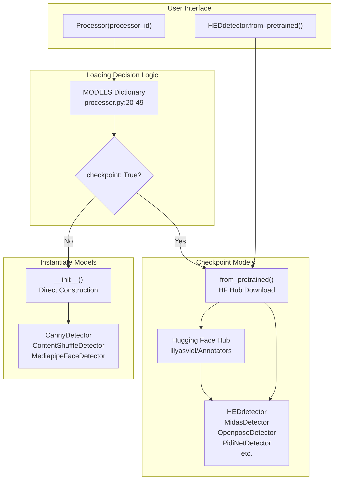
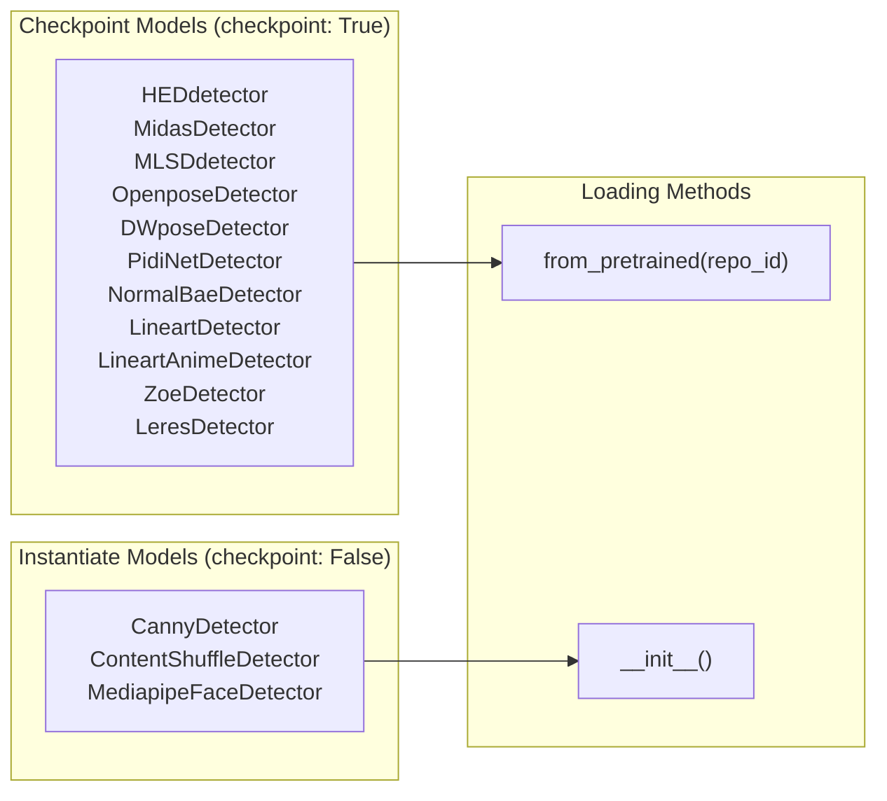
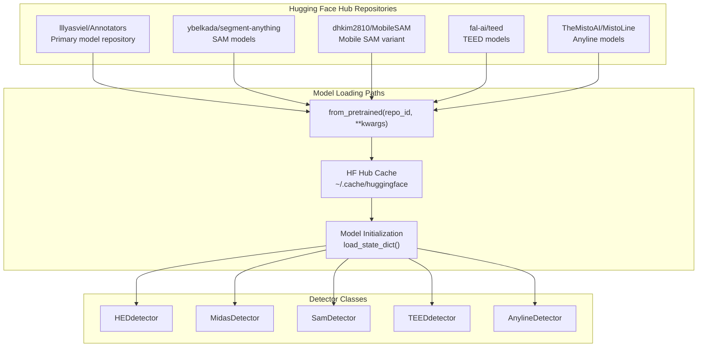
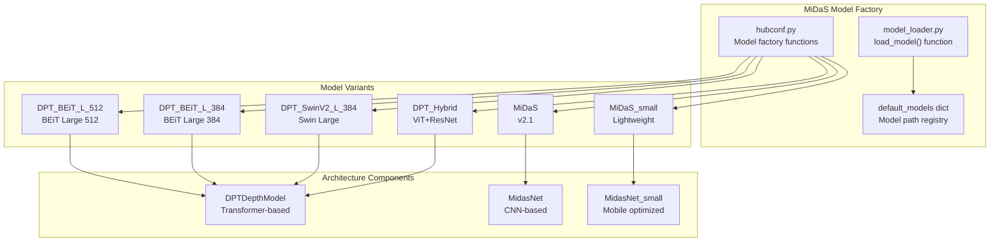

<!-- source: DeepWiki mcp.deepwiki.com · repo huggingface/controlnet_aux · page 5.1 Model Loading and Checkpoints · fetched 2026-10-26 -->

# Model Loading and Checkpoints

<details>
<summary>Relevant source files</summary>

The following files were used as context for generating this wiki page:

- [README.md](README.md)
- [src/controlnet_aux/processor.py](src/controlnet_aux/processor.py)
- [src/controlnet_aux/tests/test_processor_pytest.py](src/controlnet_aux/tests/test_processor_pytest.py)
- [src/controlnet_aux/zoe/zoedepth/__init__.py](src/controlnet_aux/zoe/zoedepth/__init__.py)
- [src/controlnet_aux/zoe/zoedepth/models/base_models/midas_repo/__init__.py](src/controlnet_aux/zoe/zoedepth/models/base_models/midas_repo/__init__.py)
- [src/controlnet_aux/zoe/zoedepth/models/base_models/midas_repo/hubconf.py](src/controlnet_aux/zoe/zoedepth/models/base_models/midas_repo/hubconf.py)
- [src/controlnet_aux/zoe/zoedepth/models/base_models/midas_repo/midas/__init__.py](src/controlnet_aux/zoe/zoedepth/models/base_models/midas_repo/midas/__init__.py)
- [src/controlnet_aux/zoe/zoedepth/models/base_models/midas_repo/midas/backbones/__init__.py](src/controlnet_aux/zoe/zoedepth/models/base_models/midas_repo/midas/backbones/__init__.py)
- [src/controlnet_aux/zoe/zoedepth/models/base_models/midas_repo/midas/model_loader.py](src/controlnet_aux/zoe/zoedepth/models/base_models/midas_repo/midas/model_loader.py)

</details>


This document covers the model loading and checkpoint management systems in controlnet_aux. It explains how models are loaded from Hugging Face Hub, the distinction between checkpoint-based and instantiate models, and the underlying model registry patterns.

For information about the neural network architectures themselves, see [Neural Network Architectures](#5.2). For configuration and customization options, see [Configuration and Customization](#5.3).

## Loading Strategy Overview

The controlnet_aux library implements a two-tier model loading strategy that handles both lightweight models that can be instantiated directly and heavyweight models that require pre-trained checkpoints.



**Model Loading Architecture**

Sources: [src/controlnet_aux/processor.py:20-49](), [src/controlnet_aux/processor.py:108-124]()

## Model Registry System

The core of the loading system is the `MODELS` dictionary in `processor.py`, which acts as a registry mapping processor IDs to detector classes and loading strategies.

| Processor ID | Detector Class | Checkpoint Required | Repository |
|--------------|----------------|-------------------|------------|
| `scribble_hed` | `HEDdetector` | Yes | `lllyasviel/Annotators` |
| `depth_midas` | `MidasDetector` | Yes | `lllyasviel/Annotators` |
| `openpose` | `OpenposeDetector` | Yes | `lllyasviel/Annotators` |
| `canny` | `CannyDetector` | No | N/A |
| `shuffle` | `ContentShuffleDetector` | No | N/A |
| `mediapipe_face` | `MediapipeFaceDetector` | No | N/A |

The registry structure follows this pattern:

```python
MODELS = {
    'detector_id': {'class': DetectorClass, 'checkpoint': boolean}
}
```

**Checkpoint vs Instantiate Classification**



**Model Classification by Loading Strategy**

Sources: [src/controlnet_aux/processor.py:20-49]()

## Checkpoint-based Models

Checkpoint-based models require pre-trained weights downloaded from Hugging Face Hub. These models implement the `from_pretrained()` class method that handles checkpoint loading and model initialization.

### Standard Checkpoint Loading

Most checkpoint models use the default repository `lllyasviel/Annotators`:

```python
# Via Processor class
processor = Processor('scribble_hed')  # Automatically calls from_pretrained()

# Direct instantiation
hed = HEDdetector.from_pretrained("lllyasviel/Annotators")
midas = MidasDetector.from_pretrained("lllyasviel/Annotators")
```

### Custom Repository Models

Some models require specific repositories and configurations:

```python
# SAM with custom repository and subfolder
sam = SamDetector.from_pretrained("ybelkada/segment-anything", subfolder="checkpoints")

# MobileSAM with specific model type and filename
mobile_sam = SamDetector.from_pretrained("dhkim2810/MobileSAM", 
                                        model_type="vit_t", 
                                        filename="mobile_sam.pt")

# TEED with specific filename
teed = TEEDdetector.from_pretrained("fal-ai/teed", filename="5_model.pth")

# Anyline with subfolder specification
anyline = AnylineDetector.from_pretrained("TheMistoAI/MistoLine", 
                                         filename="MTEED.pth", 
                                         subfolder="Anyline")
```

Sources: [README.md:77-93](), [src/controlnet_aux/processor.py:120-121]()

## Instantiate Models

Instantiate models are lightweight detectors that don't require pre-trained checkpoints. They use classical computer vision algorithms or can be initialized with default parameters.

### Classical CV Models

```python
# Direct instantiation - no checkpoints needed
canny = CannyDetector()
content = ContentShuffleDetector() 
face_detector = MediapipeFaceDetector()
lineart_standard = LineartStandardDetector()
```

These models implement their functionality using:
- OpenCV algorithms (`CannyDetector`)
- MediaPipe frameworks (`MediapipeFaceDetector`) 
- Image processing operations (`ContentShuffleDetector`)

Sources: [README.md:105-108](), [src/controlnet_aux/processor.py:122-123]()

## Hugging Face Hub Integration

The checkpoint loading system integrates with Hugging Face Hub for model storage and retrieval. The `from_pretrained()` method leverages HF Hub's caching and download mechanisms.



**Hugging Face Hub Repository Integration**

### Repository Structure

The primary repository `lllyasviel/Annotators` contains checkpoint files organized by model type:
- Standard model weights (`.pt`, `.pth` files)
- Configuration files where needed
- Model-specific subfolders for organization

### Custom Loading Parameters

Different models support various loading parameters:

| Parameter | Purpose | Example Models |
|-----------|---------|----------------|
| `subfolder` | Specify subdirectory in repo | SAM, Anyline |
| `filename` | Specific checkpoint file | TEED, MobileSAM |
| `model_type` | Model variant selection | SAM variants |

Sources: [README.md:87-93]()

## Model Factory Patterns

The underlying model architectures implement factory patterns for flexible model creation and checkpoint management.

### MiDaS Model Factory

The MiDaS implementation demonstrates a comprehensive model factory pattern with multiple architecture variants:



**MiDaS Model Factory Architecture**

### Default Models Registry

The `default_models` dictionary maps model identifiers to checkpoint paths:

```python
default_models = {
    "dpt_beit_large_512": "weights/dpt_beit_large_512.pt",
    "dpt_beit_large_384": "weights/dpt_beit_large_384.pt",
    "dpt_swin2_large_384": "weights/dpt_swin2_large_384.pt",
    "midas_v21_384": "weights/midas_v21_384.pt",
    # ... additional models
}
```

### Model-specific Loading Logic

Each model variant has specific configuration requirements handled by the factory:

```python
def load_model(device, model_path, model_type="dpt_large_384", optimize=True):
    if model_type == "dpt_beit_large_512":
        model = DPTDepthModel(path=model_path, backbone="beitl16_512", non_negative=True)
        net_w, net_h = 512, 512
    elif model_type == "dpt_beit_large_384":
        model = DPTDepthModel(path=model_path, backbone="beitl16_384", non_negative=True)  
        net_w, net_h = 384, 384
    # ... additional model types
```

Sources: [src/controlnet_aux/zoe/zoedepth/models/base_models/midas_repo/hubconf.py:9-30](), [src/controlnet_aux/zoe/zoedepth/models/base_models/midas_repo/midas/model_loader.py:11-26](), [src/controlnet_aux/zoe/zoedepth/models/base_models/midas_repo/midas/model_loader.py:29-42]()

## Configuration and Parameters

The model loading system includes parameter management through the `MODEL_PARAMS` dictionary, which provides default configurations for each processor.

```python
MODEL_PARAMS = {
    'scribble_hed': {'scribble': True},
    'softedge_hed': {'scribble': False},
    'openpose_full': {'include_body': True, 'include_hand': True, 'include_face': True},
    'depth_leres++': {'boost': True},
    # ... additional configurations
}
```

### Parameter Inheritance and Override

The `Processor` class loads default parameters and allows user override:

```python
# Default parameters loaded from MODEL_PARAMS
self.params = MODEL_PARAMS[self.processor_id]

# User parameters override defaults  
if params:
    self.params.update(params)
```

This system enables flexible model configuration while maintaining sensible defaults for each detector type.

Sources: [src/controlnet_aux/processor.py:52-79](), [src/controlnet_aux/processor.py:102-106]()

---

