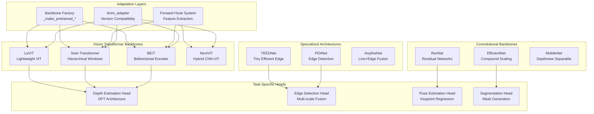
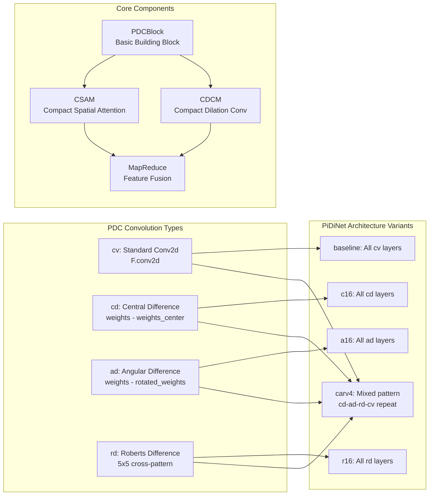
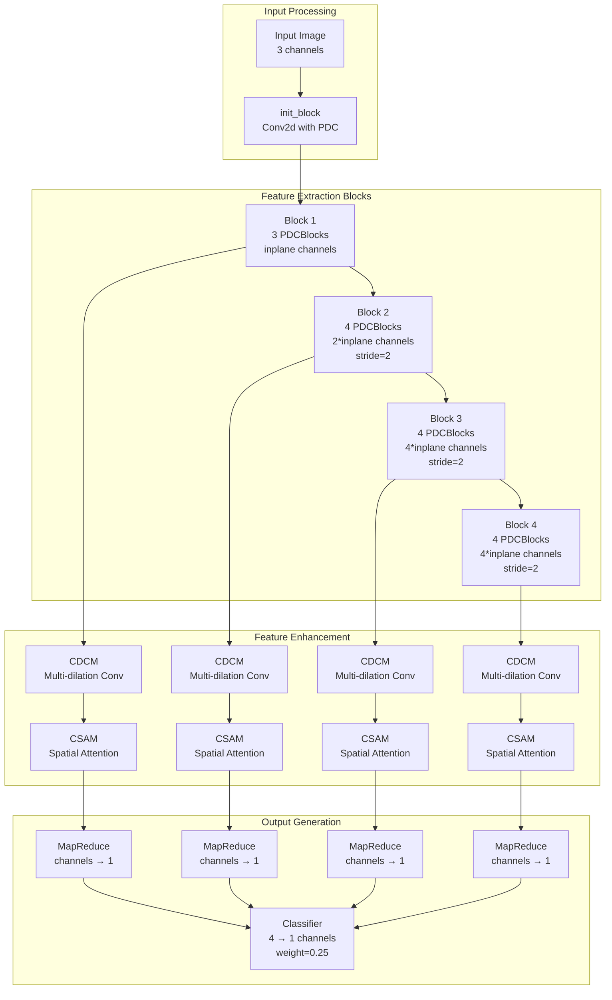
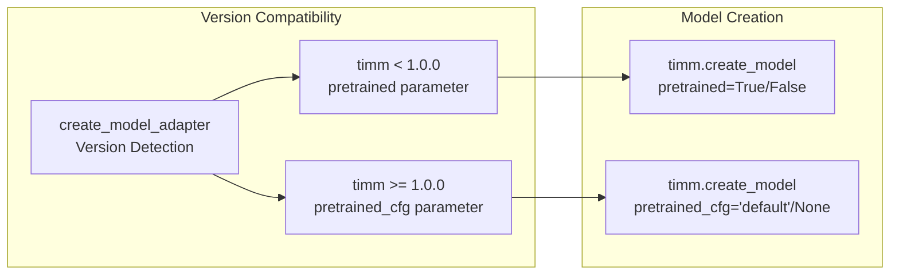
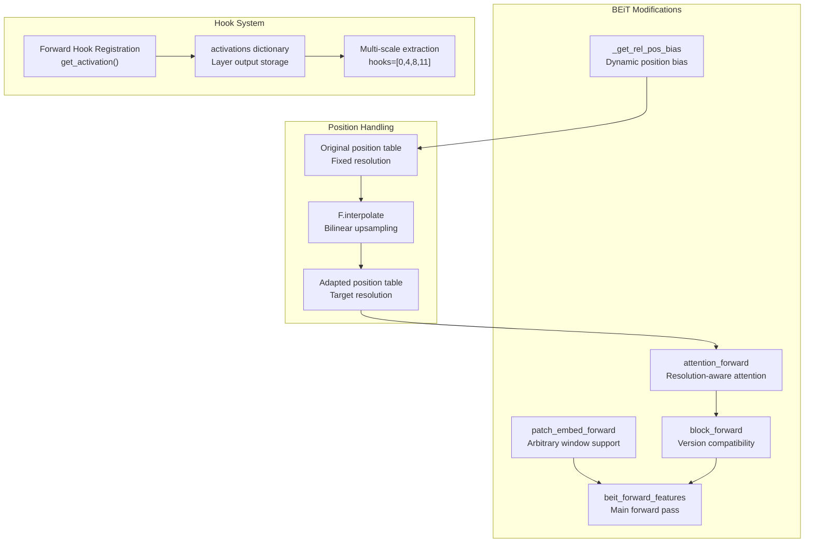
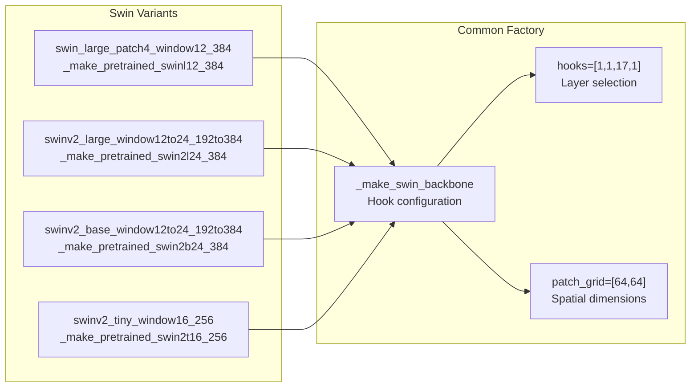
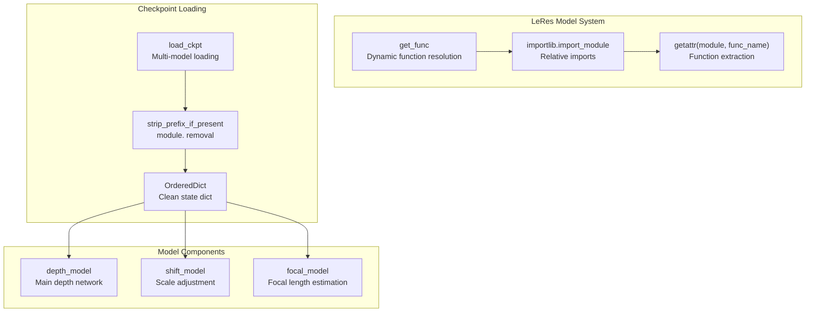
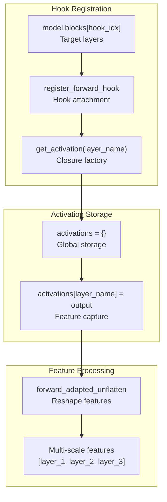

<!-- source: DeepWiki mcp.deepwiki.com · repo huggingface/controlnet_aux · page 5.2 Neural Network Architectures · fetched 2026-10-26 -->

# Neural Network Architectures

Relevant source files

The following files were used as context for generating this wiki page:

- [src/controlnet_aux/leres/leres/net_tools.py](src/controlnet_aux/leres/leres/net_tools.py)
- [src/controlnet_aux/leres/pix2pix/models/__init__.py](src/controlnet_aux/leres/pix2pix/models/__init__.py)
- [src/controlnet_aux/pidi/model.py](src/controlnet_aux/pidi/model.py)
- [src/controlnet_aux/zoe/zoedepth/models/base_models/midas_repo/midas/backbones/beit.py](src/controlnet_aux/zoe/zoedepth/models/base_models/midas_repo/midas/backbones/beit.py)
- [src/controlnet_aux/zoe/zoedepth/models/base_models/midas_repo/midas/backbones/levit.py](src/controlnet_aux/zoe/zoedepth/models/base_models/midas_repo/midas/backbones/levit.py)
- [src/controlnet_aux/zoe/zoedepth/models/base_models/midas_repo/midas/backbones/next_vit.py](src/controlnet_aux/zoe/zoedepth/models/base_models/midas_repo/midas/backbones/next_vit.py)
- [src/controlnet_aux/zoe/zoedepth/models/base_models/midas_repo/midas/backbones/swin.py](src/controlnet_aux/zoe/zoedepth/models/base_models/midas_repo/midas/backbones/swin.py)
- [src/controlnet_aux/zoe/zoedepth/models/base_models/midas_repo/midas/backbones/swin2.py](src/controlnet_aux/zoe/zoedepth/models/base_models/midas_repo/midas/backbones/swin2.py)
- [src/controlnet_aux/zoe/zoedepth/models/base_models/midas_repo/midas/backbones/timm_adapter.py](src/controlnet_aux/zoe/zoedepth/models/base_models/midas_repo/midas/backbones/timm_adapter.py)

This document provides a deep dive into the underlying neural network architectures used throughout controlnet_aux. It covers the specialized architectures designed for specific tasks, the adaptation patterns for Vision Transformers, and the model loading mechanisms that enable consistent integration across different detectors.

For information about how these architectures are instantiated and configured, see [Model Loading and Checkpoints](#5.1). For details on extending these architectures with custom implementations, see [Configuration and Customization](#5.3).

## Architecture Categories

The controlnet_aux library implements several categories of neural network architectures, each optimized for specific computer vision tasks. These architectures can be broadly classified into specialized task-specific networks and general-purpose vision backbones that are adapted for various detection tasks.

**Sources:** [src/controlnet_aux/pidi/model.py:43-296](), [src/controlnet_aux/zoe/zoedepth/models/base_models/midas_repo/midas/backbones/timm_adapter.py:8-20]()

## PiDiNet: Pixel Difference Networks

PiDiNet represents a specialized architecture for edge detection that introduces Pixel Difference Convolutions (PDC) as an alternative to standard convolutions. The architecture implements different types of convolutions optimized for edge detection tasks.

### PDC Convolution Types

The `createConvFunc` function dynamically generates the appropriate convolution operation based on the operation type specified in the network configuration.

**Sources:** [src/controlnet_aux/pidi/model.py:298-344](), [src/controlnet_aux/pidi/model.py:379-424](), [src/controlnet_aux/pidi/model.py:493-644]()

### PiDiNet Network Structure

**Sources:** [src/controlnet_aux/pidi/model.py:493-570](), [src/controlnet_aux/pidi/model.py:587-644]()

## Vision Transformer Adaptations

The library implements sophisticated adaptations of Vision Transformers to handle arbitrary input resolutions and extract multi-scale features through forward hooks. These adaptations are primarily used in depth estimation models like MiDaS and ZoeDepth.

### timm Compatibility Layer

The `timm_adapter` provides version compatibility across different timm releases by detecting the installed version and using the appropriate API.

**Sources:** [src/controlnet_aux/zoe/zoedepth/models/base_models/midas_repo/midas/backbones/timm_adapter.py:1-20]()

### BEiT Architecture Modifications

BEiT (Bidirectional Encoder representation from Image Transformers) requires several modifications to support arbitrary window sizes, which is essential for processing images at different resolutions.

**Sources:** [src/controlnet_aux/zoe/zoedepth/models/base_models/midas_repo/midas/backbones/beit.py:18-27](), [src/controlnet_aux/zoe/zoedepth/models/base_models/midas_repo/midas/backbones/beit.py:29-62](), [src/controlnet_aux/zoe/zoedepth/models/base_models/midas_repo/midas/backbones/beit.py:94-119]()

### Swin Transformer Integration

Swin Transformers use hierarchical windowed attention and are integrated through the common `_make_swin_backbone` factory function.

**Sources:** [src/controlnet_aux/zoe/zoedepth/models/base_models/midas_repo/midas/backbones/swin.py:5-12](), [src/controlnet_aux/zoe/zoedepth/models/base_models/midas_repo/midas/backbones/swin2.py:5-33]()

## Model Loading and Adaptation Patterns

The library implements sophisticated model loading patterns that handle checkpoint management, module prefix stripping, and dynamic module resolution.

### Dynamic Module Loading

The `get_func` function enables dynamic loading of network architectures based on string identifiers, allowing flexible model configuration without hardcoded imports.

**Sources:** [src/controlnet_aux/leres/leres/net_tools.py:7-29](), [src/controlnet_aux/leres/leres/net_tools.py:31-49](), [src/controlnet_aux/leres/leres/net_tools.py:51-58]()

### Pix2Pix Model Factory

```mermaid
graph LR
    subgraph "Model Discovery"
        FIND_MODEL["find_model_using_name<br/>Dynamic model loading"]
        MODEL_FILENAME["model_filename<br/>.{model_name}_model"]
        IMPORTLIB["importlib.import_module<br/>Runtime import"]
    end
    
    subgraph "Class Resolution"
        MODEL_DICT["modellib.__dict__<br/>Module introspection"]
        TARGET_NAME["target_model_name<br/>name.replace('_', '') + 'model'"]
        ISSUBCLASS["issubclass(cls, BaseModel)<br/>Type validation"]
    end
    
    subgraph "Model Creation"
        CREATE_MODEL["create_model(opt)<br/>Factory function"]
        MODEL_INSTANCE["model(opt)<br/>Instantiation"]
    end
    
    FIND_MODEL --> MODEL_FILENAME
    MODEL_FILENAME --> IMPORTLIB
    IMPORTLIB --> MODEL_DICT
    MODEL_DICT --> TARGET_NAME
    TARGET_NAME --> ISSUBCLASS
    ISSUBCLASS --> CREATE_MODEL
    CREATE_MODEL --> MODEL_INSTANCE
```

**Sources:** [src/controlnet_aux/leres/pix2pix/models/__init__.py:25-49](), [src/controlnet_aux/leres/pix2pix/models/__init__.py:58-71]()

## Architecture Integration Patterns

The neural network architectures in controlnet_aux follow consistent integration patterns that enable modular composition and feature extraction across different scales and modalities.

| Architecture Type | Key Components | Integration Pattern | Use Cases |
|------------------|----------------|-------------------|-----------|
| **PiDiNet** | PDC blocks, CSAM, CDCM | Multi-scale edge fusion | Edge detection, line art |
| **BEiT** | Attention, position bias | Hook-based feature extraction | Depth estimation, normal maps |
| **Swin** | Window attention | Hierarchical features | Multi-scale depth, segmentation |
| **LeViT** | ConvTranspose, stem | Lightweight transformers | Mobile depth estimation |
| **NextViT** | Hybrid CNN-ViT | Feature pyramid | Efficient depth prediction |

### Forward Hook Architecture

The forward hook system enables consistent feature extraction across all Vision Transformer architectures without modifying the original model implementations.

This pattern is consistently applied across BEiT, Swin, LeViT, and NextViT architectures to extract intermediate features for depth estimation and other tasks.

**Sources:** [src/controlnet_aux/zoe/zoedepth/models/base_models/midas_repo/midas/backbones/beit.py:143-167](), [src/controlnet_aux/zoe/zoedepth/models/base_models/midas_repo/midas/backbones/next_vit.py:14-28]()

---

