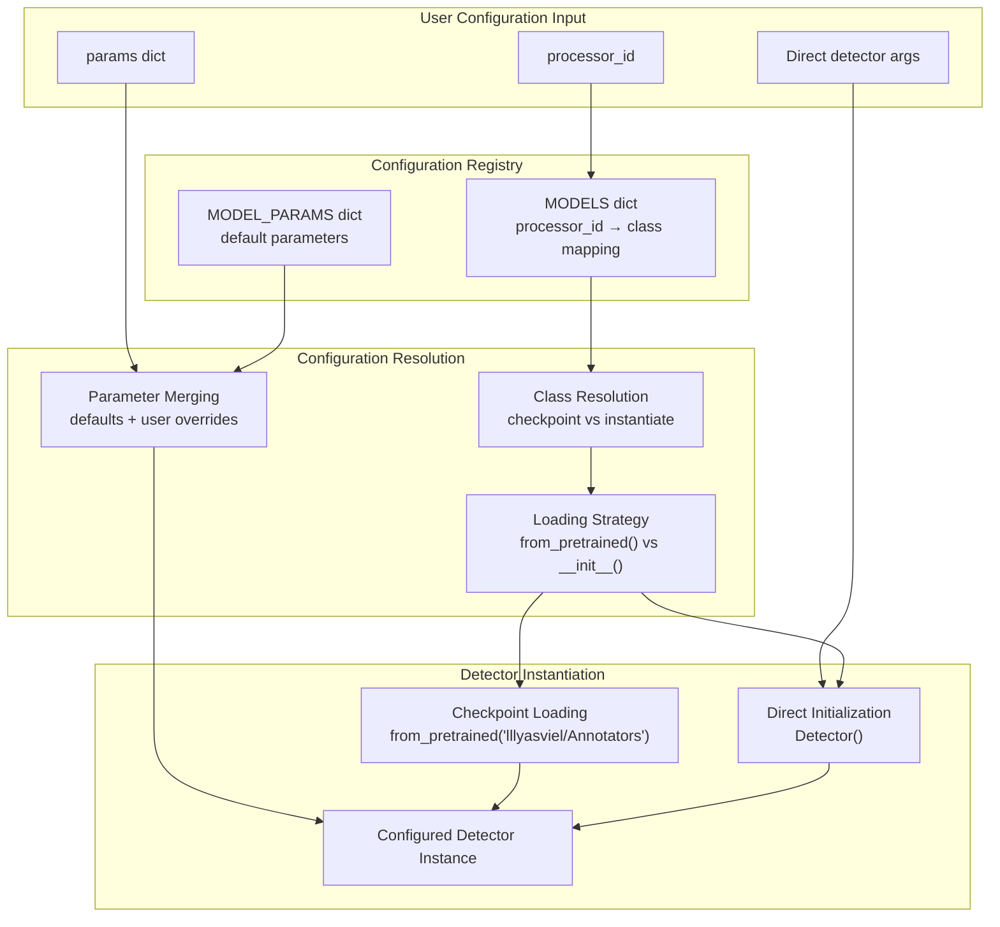
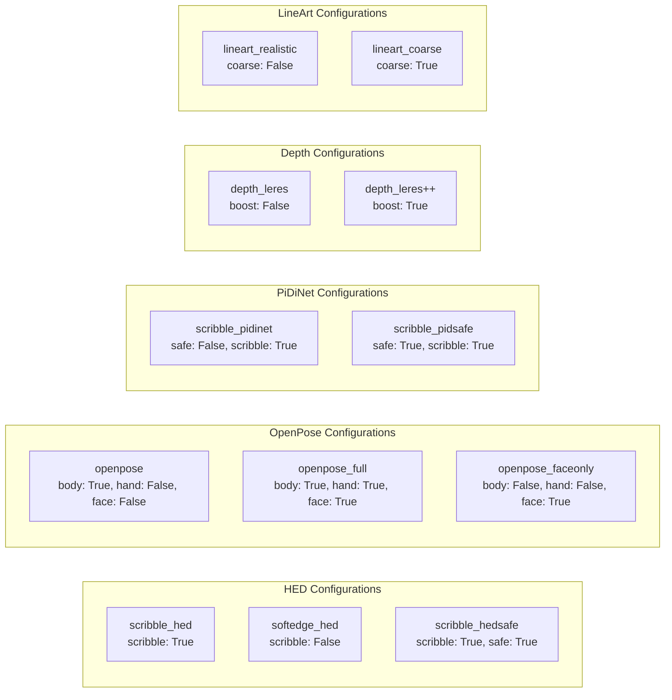
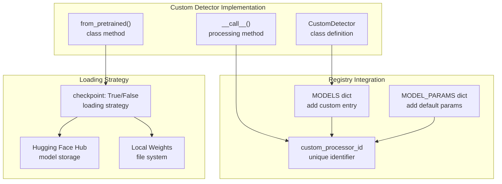

<!-- source: DeepWiki mcp.deepwiki.com · repo huggingface/controlnet_aux · page 5.3 Configuration and Customization · fetched 2026-10-26 -->

# Configuration and Customization

<details>
<summary>Relevant source files</summary>

The following files were used as context for generating this wiki page:

- [README.md](README.md)
- [src/controlnet_aux/dwpose/dwpose_config/__init__.py](src/controlnet_aux/dwpose/dwpose_config/__init__.py)
- [src/controlnet_aux/dwpose/yolox_config/__init__.py](src/controlnet_aux/dwpose/yolox_config/__init__.py)
- [src/controlnet_aux/processor.py](src/controlnet_aux/processor.py)
- [src/controlnet_aux/tests/test_processor_pytest.py](src/controlnet_aux/tests/test_processor_pytest.py)

</details>


This document covers the configuration systems in controlnet_aux, parameter tuning options, and methods for extending the library with custom detectors. It focuses on the flexible configuration patterns that allow users to customize detector behavior and integrate new detection models.

For information about the underlying neural network architectures and model loading mechanisms, see [Neural Network Architectures](#5.2). For details about checkpoint management and model registries, see [Model Loading and Checkpoints](#5.1).

## Configuration Overview

The controlnet_aux library provides multiple configuration layers that allow users to customize detector behavior at various levels. The configuration system is designed around two primary patterns: unified configuration through the `Processor` interface and direct detector configuration through individual class instantiation.

Configuration Flow Diagram


Sources: [src/controlnet_aux/processor.py:20-49](), [src/controlnet_aux/processor.py:52-79](), [src/controlnet_aux/processor.py:84-107]()

## Processor Configuration System

The `Processor` class provides a unified configuration interface through two key dictionaries that define the available detectors and their default parameters.

### MODELS Registry

The `MODELS` dictionary serves as the central registry for all available detectors, mapping processor IDs to detector classes and loading strategies:

| Category | Processor ID | Detector Class | Checkpoint Required |
|----------|-------------|----------------|-------------------|
| Edge Detection | `scribble_hed`, `softedge_hed` | `HEDdetector` | Yes |
| Depth Estimation | `depth_midas`, `depth_zoe` | `MidasDetector`, `ZoeDetector` | Yes |
| Pose Detection | `openpose`, `dwpose` | `OpenposeDetector`, `DWposeDetector` | Yes |
| Line Art | `lineart_coarse`, `lineart_anime` | `LineartDetector`, `LineartAnimeDetector` | Yes |
| Segmentation | `shuffle`, `mediapipe_face` | `ContentShuffleDetector`, `MediapipeFaceDetector` | No |

### MODEL_PARAMS Configuration

The `MODEL_PARAMS` dictionary defines default parameters for each processor ID, enabling fine-tuned behavior without requiring manual parameter specification:

Processor Parameter Configuration


Sources: [src/controlnet_aux/processor.py:52-79]()

### Configuration Loading Process

The `Processor` class implements a two-stage configuration loading process that combines registry lookup with parameter resolution:

```python
# Stage 1: Registry lookup and class resolution
processor = MODELS[processor_id]['class']
if MODELS[processor_id]['checkpoint']:
    processor = processor.from_pretrained("lllyasviel/Annotators")
else:
    processor = processor()

# Stage 2: Parameter resolution and merging
self.params = MODEL_PARAMS[self.processor_id]
if params:
    self.params.update(params)
```

Sources: [src/controlnet_aux/processor.py:108-124](), [src/controlnet_aux/processor.py:102-106]()

## Parameter Customization

The library supports multiple levels of parameter customization, from global default overrides to per-call parameter specification.

### Processor-Level Customization

Users can override default parameters when instantiating a `Processor` by providing a `params` dictionary:

```python
# Override default parameters for HED detector
custom_params = {'scribble': False, 'safe': True}
processor = Processor('scribble_hed', params=custom_params)
```

The parameter merging follows a precedence hierarchy: user parameters override defaults, maintaining backward compatibility while enabling customization.

### Runtime Parameter Specification

Parameters can be specified at runtime during image processing, allowing dynamic behavior modification:

```python
# Runtime parameter specification through processor call
processed_image = processor(image, **custom_runtime_params)
```

Sources: [src/controlnet_aux/processor.py:141]()

## Direct Detector Configuration

For advanced use cases requiring fine-grained control, detectors can be instantiated and configured directly, bypassing the `Processor` interface entirely.

### Checkpoint-Based Detectors

Detectors requiring pre-trained weights use the `from_pretrained()` pattern with configurable model sources:

```python
# Standard checkpoint loading
hed = HEDdetector.from_pretrained("lllyasviel/Annotators")

# Custom checkpoint sources
sam = SamDetector.from_pretrained("ybelkada/segment-anything", subfolder="checkpoints")
mobile_sam = SamDetector.from_pretrained("dhkim2810/MobileSAM", model_type="vit_t", filename="mobile_sam.pt")
```

### Instantiation-Based Detectors

Detectors that don't require pre-trained weights use direct instantiation with constructor parameters:

```python
# Direct instantiation with custom parameters
canny = CannyDetector(low_threshold=50, high_threshold=150)
content = ContentShuffleDetector(seed=42)
```

Sources: [README.md:77-103](), [README.md:105-108]()

## Extending with Custom Detectors

The library architecture supports extension through custom detector integration, following established patterns for model loading and parameter handling.

Custom Detector Integration Pattern


### Custom Detector Requirements

To integrate a custom detector into the controlnet_aux ecosystem, the detector class must implement the following interface:

1. **Initialization Pattern**: Support both `from_pretrained()` for checkpoint models and direct `__init__()` for parameter-based models
2. **Processing Interface**: Implement `__call__(image, **kwargs)` method that accepts PIL Images and returns processed results
3. **Parameter Compatibility**: Accept and handle parameters consistently with existing detector patterns

### Registry Extension

Custom detectors can be registered by extending the configuration dictionaries:

```python
# Registry extension pattern
MODELS['custom_detector'] = {'class': CustomDetector, 'checkpoint': True}
MODEL_PARAMS['custom_detector'] = {'param1': default_value, 'param2': default_value}
```

Sources: [src/controlnet_aux/processor.py:20-49](), [src/controlnet_aux/processor.py:52-79]()

## Model Loading Configuration

The library implements a dual-strategy model loading system that accommodates different detector requirements and deployment scenarios.

### Checkpoint Loading Strategy

For neural network-based detectors requiring pre-trained weights:

```python
# Automatic checkpoint loading
processor = processor.from_pretrained("lllyasviel/Annotators")
```

This strategy automatically handles:
- Model weight downloading from Hugging Face Hub
- Device placement and optimization
- Architecture-specific loading procedures

### Direct Instantiation Strategy

For classical computer vision algorithms and lightweight detectors:

```python
# Direct instantiation
processor = processor()
```

This strategy provides:
- Immediate availability without network dependencies
- Minimal memory footprint
- Configurable algorithm parameters

Sources: [src/controlnet_aux/processor.py:119-124]()

## Configuration Validation and Error Handling

The library implements comprehensive validation to ensure configuration integrity and provide clear error messages for misconfigurations.

### Processor ID Validation

The system validates processor IDs against the `MODELS` registry and provides detailed error messages:

```python
if processor_id not in MODELS:
    raise ValueError(f"{processor_id} is not a valid processor id. Please make sure to choose one of {', '.join(MODELS.keys())}")
```

### Parameter Validation

Individual detectors implement parameter validation to ensure compatibility and prevent runtime errors. The validation occurs at both instantiation time and processing time.

Sources: [src/controlnet_aux/processor.py:96-97]()