# Page: Overview

# Overview

<details>
<summary>Relevant source files</summary>

The following files were used as context for generating this wiki page:

- [.gitignore](.gitignore)
- [README.md](README.md)
- [setup.py](setup.py)
- [src/controlnet_aux/__init__.py](src/controlnet_aux/__init__.py)
- [src/controlnet_aux/processor.py](src/controlnet_aux/processor.py)
- [src/controlnet_aux/tests/test_processor_pytest.py](src/controlnet_aux/tests/test_processor_pytest.py)

</details>


## Purpose and Scope

The `controlnet_aux` repository provides a comprehensive collection of auxiliary models for ControlNet image preprocessing and feature detection. This library serves as a PyPI-installable package that consolidates various computer vision models for edge detection, depth estimation, pose detection, line art generation, and image segmentation. The system is designed to preprocess images into control signals that can guide diffusion models in ControlNet workflows.

This document covers the overall architecture, core components, and integration patterns of the `controlnet_aux` system. For detailed information about specific detector implementations, see [Detector Categories](#4). For advanced model architectures and customization, see [Advanced Topics](#5).

## System Architecture

The `controlnet_aux` library follows a modular architecture with two primary access patterns: a unified `Processor` interface for simplified usage and direct detector instantiation for advanced control.

```mermaid
graph TB
    subgraph "Public API Layer"
        INIT["__init__.py<br/>Direct Imports"]
        PROC_CLASS["Processor<br/>src/controlnet_aux/processor.py"]
        MODELS_REGISTRY["MODELS Dictionary<br/>processor.py:20-49"]
        PARAMS_REGISTRY["MODEL_PARAMS Dictionary<br/>processor.py:52-79"]
    end
    
    subgraph "Edge Detection Detectors"
        HED["HEDdetector<br/>src/controlnet_aux/hed"]
        CANNY["CannyDetector<br/>src/controlnet_aux/canny"]
        PIDI["PidiNetDetector<br/>src/controlnet_aux/pidi"]
        TEED["TEEDdetector<br/>src/controlnet_aux/teed"]
        ANYLINE["AnylineDetector<br/>src/controlnet_aux/anyline"]
    end
    
    subgraph "Depth Estimation Detectors"
        MIDAS["MidasDetector<br/>src/controlnet_aux/midas"]
        ZOE["ZoeDetector<br/>src/controlnet_aux/zoe"]
        LERES["LeresDetector<br/>src/controlnet_aux/leres"]
        NORMALBAE["NormalBaeDetector<br/>src/controlnet_aux/normalbae"]
    end
    
    subgraph "Pose Detection Detectors"
        DWPOSE["DWposeDetector<br/>src/controlnet_aux/dwpose"]
        OPENPOSE["OpenposeDetector<br/>src/controlnet_aux/open_pose"]
    end
    
    subgraph "Line Art Detectors"
        LINEART["LineartDetector<br/>src/controlnet_aux/lineart"]
        LINEART_ANIME["LineartAnimeDetector<br/>src/controlnet_aux/lineart_anime"]
        LINEART_STD["LineartStandardDetector<br/>src/controlnet_aux/lineart_standard"]
        MLSD["MLSDdetector<br/>src/controlnet_aux/mlsd"]
    end
    
    subgraph "Segmentation Detectors"
        SAM["SamDetector<br/>src/controlnet_aux/segment_anything"]
        MEDIAPIPE["MediapipeFaceDetector<br/>src/controlnet_aux/mediapipe_face"]
        SHUFFLE["ContentShuffleDetector<br/>src/controlnet_aux/shuffle"]
    end
    
    subgraph "Infrastructure"
        HF_HUB["🤗 Hugging Face Hub<br/>Model Storage"]
        SETUP["setup.py<br/>Package Definition"]
    end
    
    PROC_CLASS --> MODELS_REGISTRY
    PROC_CLASS --> PARAMS_REGISTRY
    MODELS_REGISTRY --> HED
    MODELS_REGISTRY --> MIDAS
    MODELS_REGISTRY --> DWPOSE
    MODELS_REGISTRY --> OPENPOSE
    MODELS_REGISTRY --> SAM
    MODELS_REGISTRY --> PIDI
    MODELS_REGISTRY --> LINEART
    MODELS_REGISTRY --> NORMALBAE
    MODELS_REGISTRY --> ZOE
    MODELS_REGISTRY --> LERES
    MODELS_REGISTRY --> MLSD
    MODELS_REGISTRY --> TEED
    MODELS_REGISTRY --> ANYLINE
    MODELS_REGISTRY --> LINEART_ANIME
    MODELS_REGISTRY --> LINEART_STD
    MODELS_REGISTRY --> MEDIAPIPE
    MODELS_REGISTRY --> CANNY
    MODELS_REGISTRY --> SHUFFLE
    
    INIT --> HED
    INIT --> CANNY
    INIT --> MIDAS
    INIT --> DWPOSE
    INIT --> OPENPOSE
    INIT --> SAM
    INIT --> PIDI
    INIT --> LINEART
    INIT --> NORMALBAE
    INIT --> ZOE
    INIT --> LERES
    INIT --> MLSD
    INIT --> TEED
    INIT --> ANYLINE
    INIT --> LINEART_ANIME
    INIT --> LINEART_STD
    INIT --> MEDIAPIPE
    INIT --> SHUFFLE
    
    HED -.-> HF_HUB
    MIDAS -.-> HF_HUB
    DWPOSE -.-> HF_HUB
    OPENPOSE -.-> HF_HUB
    SAM -.-> HF_HUB
    PIDI -.-> HF_HUB
    ZOE -.-> HF_HUB
    LERES -.-> HF_HUB
    NORMALBAE -.-> HF_HUB
    LINEART -.-> HF_HUB
    LINEART_ANIME -.-> HF_HUB
    MLSD -.-> HF_HUB
    TEED -.-> HF_HUB
    ANYLINE -.-> HF_HUB
```

**System Architecture Overview**

The architecture separates concerns into three main layers: the Public API Layer provides unified access through the `Processor` class and direct imports, specialized detector modules handle specific computer vision tasks, and shared infrastructure manages model loading and package distribution.

Sources: [src/controlnet_aux/__init__.py:1-21](), [src/controlnet_aux/processor.py:20-149](), [setup.py:181-213]()

## Core Components

### Processor Interface

The `Processor` class in [src/controlnet_aux/processor.py:84-149]() serves as the primary entry point, providing a unified interface to all detectors through a registry-based system.

| Component | Purpose | Location |
|-----------|---------|----------|
| `MODELS` | Maps processor IDs to detector classes and loading strategies | [processor.py:20-49]() |
| `MODEL_PARAMS` | Default parameters for each processor configuration | [processor.py:52-79]() |
| `Processor.__init__()` | Initializes detector based on processor ID | [processor.py:85-107]() |
| `Processor.load_processor()` | Handles checkpoint vs. instantiate loading patterns | [processor.py:108-124]() |

### Detector Registration System

The system supports 19 different processor configurations mapped through the `MODELS` dictionary:

**Checkpoint-based Models** (loaded via `from_pretrained()`):
- Edge Detection: `scribble_hed`, `softedge_hed`, `scribble_hedsafe`, `softedge_hedsafe`, `scribble_pidinet`, `softedge_pidinet`, `scribble_pidsafe`, `softedge_pidsafe`
- Depth Estimation: `depth_midas`, `depth_zoe`, `depth_leres`, `depth_leres++`, `normal_bae`
- Pose Detection: `openpose`, `openpose_face`, `openpose_faceonly`, `openpose_full`, `openpose_hand`, `dwpose`
- Line Art: `lineart_coarse`, `lineart_realistic`, `lineart_anime`, `mlsd`

**Instantiate Models** (direct `__init__()`):
- Classical CV: `canny`
- Face Detection: `mediapipe_face`
- Content Processing: `shuffle`

Sources: [src/controlnet_aux/processor.py:20-49](), [src/controlnet_aux/processor.py:52-79]()

## Usage Patterns

The library provides flexibility through multiple access patterns, each optimized for different use cases.

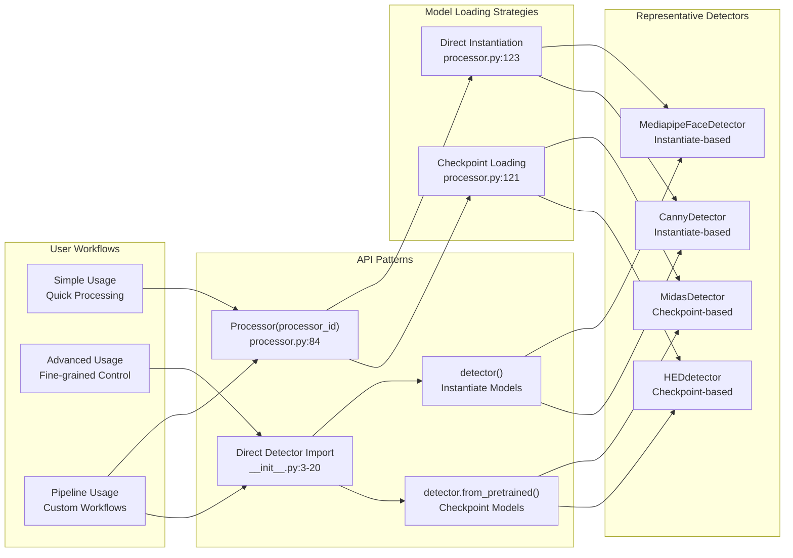

**Usage Pattern Analysis**

The system supports three primary usage patterns: Simple Usage via the `Processor` class for quick access with predefined configurations, Advanced Usage through direct detector imports for fine-grained parameter control, and Pipeline Usage combining both approaches for custom workflows.

Sources: [README.md:35-61](), [README.md:63-131](), [src/controlnet_aux/processor.py:84-149]()

## Detector Categories

The library organizes detectors into five main functional categories:

| Category | Detectors | Purpose | Model Loading |
|----------|-----------|---------|---------------|
| **Edge Detection** | `HEDdetector`, `CannyDetector`, `PidiNetDetector`, `TEEDdetector`, `AnylineDetector` | Extract edges and boundaries for line-based control | Mixed (Checkpoint + Instantiate) |
| **Depth Estimation** | `MidasDetector`, `ZoeDetector`, `LeresDetector`, `NormalBaeDetector` | Generate depth maps and normal maps | Checkpoint-based |
| **Pose Detection** | `DWposeDetector`, `OpenposeDetector` | Detect human body, hand, and face keypoints | Checkpoint-based |
| **Line Art Generation** | `LineartDetector`, `LineartAnimeDetector`, `LineartStandardDetector`, `MLSDdetector` | Generate line art and sketch representations | Mixed (Checkpoint + Instantiate) |
| **Segmentation** | `SamDetector`, `MediapipeFaceDetector`, `ContentShuffleDetector` | Segment objects and detect regions | Mixed (Checkpoint + Instantiate) |

Sources: [src/controlnet_aux/__init__.py:3-21](), [src/controlnet_aux/processor.py:20-49]()

## Model Integration and Dependencies

The package integrates with the broader machine learning ecosystem through several key dependencies and model sources:

### Core Dependencies

The system relies on a carefully curated set of dependencies defined in [setup.py:166-179]():

- **Deep Learning**: `torch`, `torchvision`, `timm`, `einops`
- **Computer Vision**: `opencv-python-headless`, `scikit-image`, `Pillow`
- **Scientific Computing**: `numpy`, `scipy`
- **Model Hub**: `huggingface_hub`, `filelock`

### Model Storage and Loading

Models are primarily stored on the Hugging Face Hub under the `lllyasviel/Annotators` repository, with additional models from specialized repositories like `ybelkada/segment-anything` for SAM models and `fal-ai/teed` for TEED models.

Sources: [setup.py:166-179](), [README.md:78-93]()

## Package Structure

The package follows a standard Python package structure with modular detector implementations:

```
src/controlnet_aux/
├── __init__.py                 # Public API imports
├── processor.py                # Unified Processor interface
├── [detector_name]/            # Individual detector modules
│   ├── __init__.py            # Detector class exports
│   └── [implementation files] # Detector-specific code
└── tests/                     # Package tests
```

Each detector module is self-contained and can be imported directly or accessed through the `Processor` interface, providing flexibility for different integration scenarios.

Sources: [src/controlnet_aux/__init__.py:1-21](), [src/controlnet_aux/processor.py:1-149]()

---

# Page: Getting Started

# Getting Started

<details>
<summary>Relevant source files</summary>

The following files were used as context for generating this wiki page:

- [.gitignore](.gitignore)
- [README.md](README.md)
- [setup.py](setup.py)
- [src/controlnet_aux/__init__.py](src/controlnet_aux/__init__.py)
- [src/controlnet_aux/processor.py](src/controlnet_aux/processor.py)
- [src/controlnet_aux/tests/test_processor_pytest.py](src/controlnet_aux/tests/test_processor_pytest.py)

</details>


This guide covers the essential steps for installing and using controlnet_aux, including installation procedures, basic usage patterns, and available detection models. The controlnet_aux library provides auxiliary models for ControlNet preprocessing tasks such as edge detection, depth estimation, pose detection, and more.

For detailed information about individual detector architectures, see [Detector Categories](#4). For advanced configuration and customization options, see [Advanced Topics](#5).

## Installation

The controlnet_aux package is available on PyPI and can be installed using pip. The package includes all necessary dependencies for running the core detection models.

```bash
pip install -U controlnet-aux
```

### Optional Dependencies

For DWPose functionality, an additional lightweight package is available that uses ONNX models:

```bash
pip install easy-dwpose
```

The package dependencies include core computer vision and machine learning libraries as defined in [setup.py:166-179]():

| Dependency | Purpose |
|------------|---------|
| `torch` | Core deep learning framework |
| `torchvision` | Computer vision utilities |
| `PIL` | Image processing |
| `opencv-python-headless` | Computer vision operations |
| `huggingface_hub` | Model downloading and caching |
| `timm` | Vision transformer models |
| `scipy` | Scientific computing |
| `scikit-image` | Additional image processing |

**Sources:** [setup.py:166-179](), [README.md:11-22]()

## API Overview

The controlnet_aux library provides two main usage patterns for accessing detection models:

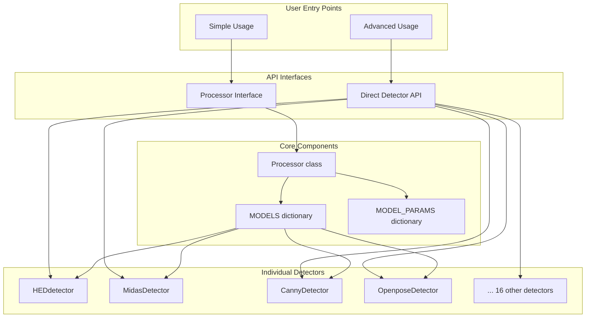

**Sources:** [src/controlnet_aux/processor.py:20-49](), [src/controlnet_aux/__init__.py:1-21]()

## Processor Interface Usage

The `Processor` class provides a unified interface to all detection models through a single API. This is the recommended approach for most users.

### Basic Usage Pattern

```python
from controlnet_aux.processor import Processor

# Initialize processor with model ID
processor = Processor('scribble_hed')

# Process image
processed_image = processor(input_image, to_pil=True)
```

### Available Processor IDs

The following processor IDs are available in the `MODELS` dictionary:

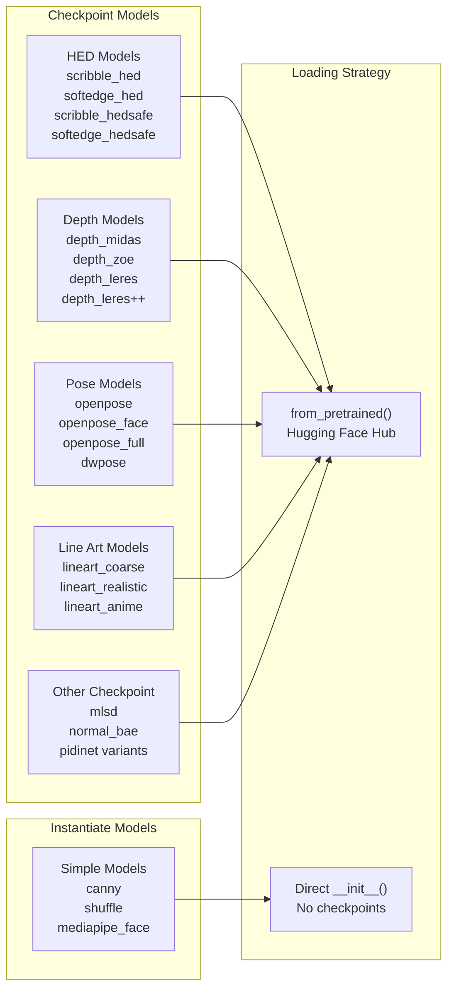

**Sources:** [src/controlnet_aux/processor.py:20-49](), [src/controlnet_aux/processor.py:52-79]()

## Direct Detector Usage

Individual detectors can be imported and used directly for more control over initialization and parameters.

### Checkpoint-based Detectors

Most detectors require downloading pretrained models from Hugging Face Hub:

```python
from controlnet_aux import HEDdetector, MidasDetector, OpenposeDetector

# Load models with checkpoints
hed = HEDdetector.from_pretrained("lllyasviel/Annotators")
midas = MidasDetector.from_pretrained("lllyasviel/Annotators") 
openpose = OpenposeDetector.from_pretrained("lllyasviel/Annotators")

# Process images
edge_image = hed(input_image)
depth_image = midas(input_image)
pose_image = openpose(input_image, hand_and_face=True)
```

### Instantiated Detectors

Some detectors do not require checkpoints and can be used immediately:

```python
from controlnet_aux import CannyDetector, ContentShuffleDetector, MediapipeFaceDetector

# Instantiate directly
canny = CannyDetector()
shuffle = ContentShuffleDetector()
face_detector = MediapipeFaceDetector()

# Process images
canny_image = canny(input_image)
shuffled_image = shuffle(input_image)
face_landmarks = face_detector(input_image)
```

**Sources:** [README.md:63-131](), [src/controlnet_aux/__init__.py:3-20]()

## Detection Model Categories

The library includes 20 different detector classes organized by functionality:

| Category | Detectors | Purpose |
|----------|-----------|---------|
| **Edge Detection** | `HEDdetector`, `CannyDetector`, `PidiNetDetector`, `TEEDdetector`, `AnylineDetector` | Boundary and edge detection |
| **Depth Estimation** | `MidasDetector`, `ZoeDetector`, `LeresDetector`, `NormalBaeDetector` | Monocular depth and normal maps |
| **Pose Detection** | `DWposeDetector`, `OpenposeDetector` | Human pose keypoint detection |
| **Line Art** | `LineartDetector`, `LineartAnimeDetector`, `LineartStandardDetector`, `MLSDdetector` | Line art and sketch generation |
| **Segmentation** | `SamDetector`, `MediapipeFaceDetector`, `ContentShuffleDetector` | Object and face segmentation |

**Sources:** [src/controlnet_aux/__init__.py:3-20](), [src/controlnet_aux/processor.py:20-49]()

## Image Resolution Requirements

All detectors in controlnet_aux require input images with dimensions that are multiples of 64 pixels to maintain aspect ratio during processing.

```python
import numpy as np
from PIL import Image

def prepare_image(image, target_resolution=512):
    W, H = image.size
    k = float(target_resolution) / min(H, W)
    H = int(np.round(H * k / 64.0)) * 64
    W = int(np.round(W * k / 64.0)) * 64
    return image.resize((W, H))
```

This resolution requirement is enforced across all detector implementations and is essential for proper model inference.

**Sources:** [README.md:133-135](), [src/controlnet_aux/tests/test_processor_pytest.py:52-66]()

## Complete Usage Example

Here is a complete example demonstrating both usage patterns:

```python
import requests
from PIL import Image
from io import BytesIO
from controlnet_aux.processor import Processor
from controlnet_aux import HEDdetector

# Load test image
url = "https://huggingface.co/lllyasviel/sd-controlnet-openpose/resolve/main/images/pose.png"
response = requests.get(url)
img = Image.open(BytesIO(response.content)).convert("RGB").resize((512, 512))

# Method 1: Using Processor interface
processor = Processor('scribble_hed')
processed_image_1 = processor(img, to_pil=True)

# Method 2: Using direct detector
hed = HEDdetector.from_pretrained("lllyasviel/Annotators")
processed_image_2 = hed(img, scribble=True)
```

**Sources:** [README.md:37-61](), [README.md:65-131]()

---

# Page: Core Architecture

# Core Architecture

<details>
<summary>Relevant source files</summary>

The following files were used as context for generating this wiki page:

- [.gitignore](.gitignore)
- [README.md](README.md)
- [setup.py](setup.py)
- [src/controlnet_aux/__init__.py](src/controlnet_aux/__init__.py)
- [src/controlnet_aux/processor.py](src/controlnet_aux/processor.py)
- [src/controlnet_aux/tests/test_processor_pytest.py](src/controlnet_aux/tests/test_processor_pytest.py)

</details>


This document explains the fundamental design patterns and architectural components that form the foundation of the controlnet_aux library. It covers the dual API design, model registry system, and loading strategies that enable unified access to diverse computer vision preprocessing models.

For specific details about the unified interface, see [Processor Interface](#3.1). For package organization details, see [Package Structure](#3.2). For implementation details of individual detector categories, see [Detector Categories](#4).

## System Overview

The controlnet_aux library implements a **two-tier architecture** that provides both simplified and advanced access patterns to a collection of computer vision preprocessing models. The system is built around a central registry that maps string identifiers to detector classes and manages their instantiation patterns.

**Core Architecture Components**

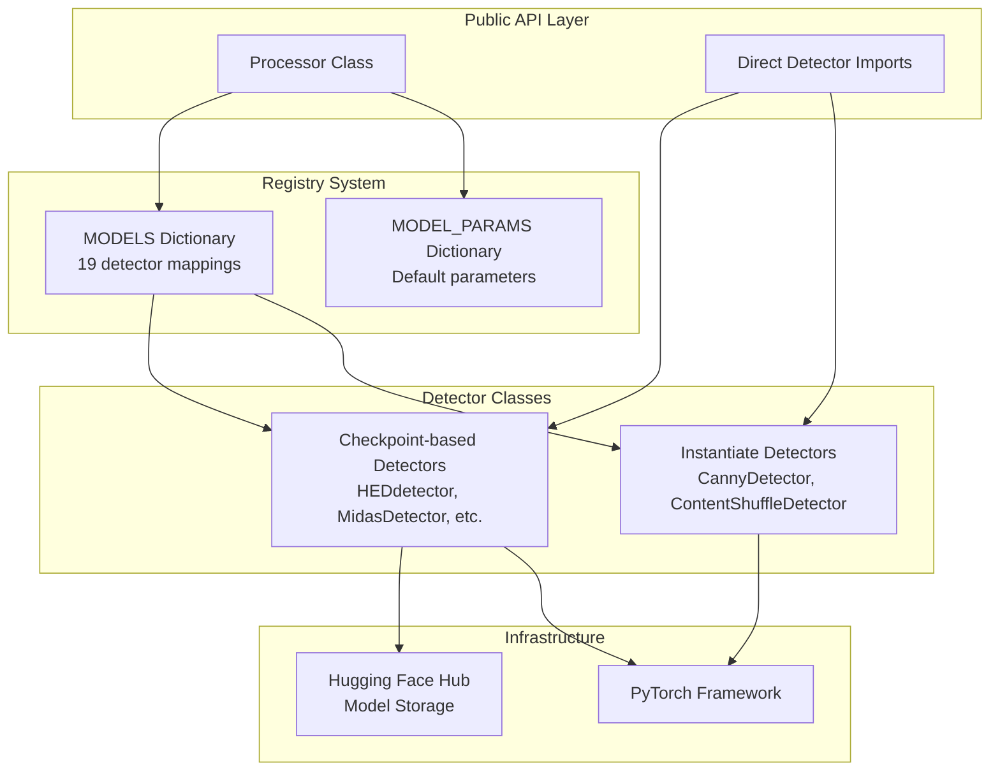

Sources: [src/controlnet_aux/processor.py:1-149](), [src/controlnet_aux/__init__.py:1-21](), [setup.py:70-213]()

## Dual API Design Pattern

The architecture provides two distinct usage patterns that cater to different user needs and complexity requirements.

**API Access Patterns**

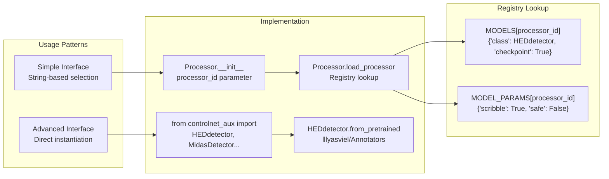

Sources: [src/controlnet_aux/processor.py:84-124](), [src/controlnet_aux/__init__.py:3-20](), [README.md:35-61]()

## Model Loading Strategies

The system implements two distinct loading patterns based on the computational requirements and model architecture of each detector.

| Loading Pattern | Detector Examples | Registry Flag | Instantiation Method |
|----------------|-------------------|---------------|---------------------|
| **Checkpoint-based** | `HEDdetector`, `MidasDetector`, `OpenposeDetector` | `'checkpoint': True` | `DetectorClass.from_pretrained()` |
| **Direct Instantiation** | `CannyDetector`, `ContentShuffleDetector`, `MediapipeFaceDetector` | `'checkpoint': False` | `DetectorClass()` |

**Model Loading Decision Flow**

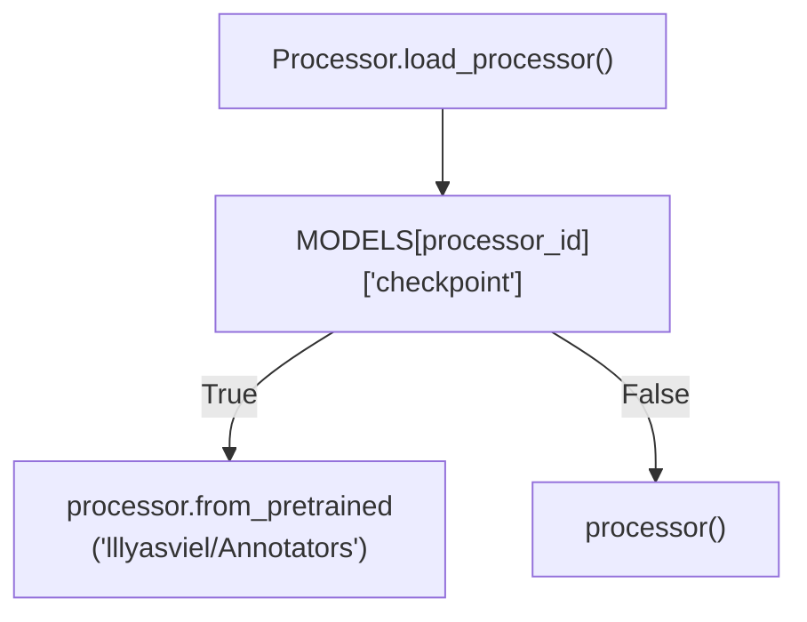

Sources: [src/controlnet_aux/processor.py:108-124](), [src/controlnet_aux/processor.py:20-49]()

## Registry System Architecture

The registry system centralizes detector metadata and configuration through two primary dictionaries that map string identifiers to classes and parameters.

**Registry Structure**

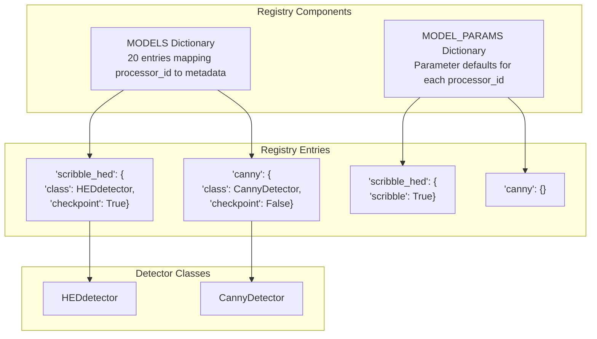

The `MODELS` dictionary contains 20 processor configurations that map string identifiers to detector classes and loading metadata. Key entries include multiple variants for edge detection (`scribble_hed`, `softedge_hed`), pose estimation (`openpose`, `openpose_full`, `dwpose`), and depth estimation (`depth_midas`, `depth_zoe`).

Sources: [src/controlnet_aux/processor.py:20-49](), [src/controlnet_aux/processor.py:52-79]()

## Package Structure Design

The package follows a flat module structure where each detector is implemented in its own module and exposed through centralized imports.

**Package Organization**

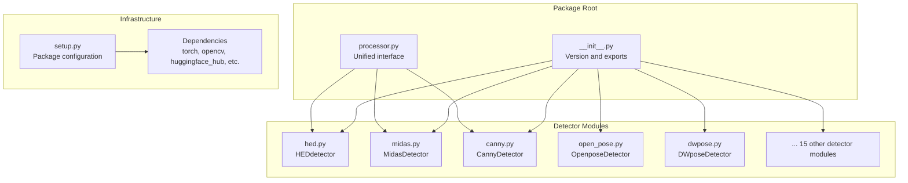

The `__init__.py` file serves as the central export point, importing all 20 detector classes and making them available for direct import. This design enables both the unified `Processor` interface and direct detector access patterns.

Sources: [src/controlnet_aux/__init__.py:1-21](), [setup.py:166-179]()

## Error Handling and Validation

The architecture includes validation mechanisms to ensure robust operation across different usage patterns.

The `Processor` class validates processor IDs against the registry and provides clear error messages when invalid identifiers are used. The validation logic checks against the `MODELS.keys()` and raises `ValueError` with the complete list of valid options.

```python
# Validation implementation from processor.py lines 96-97
if processor_id not in MODELS:
    raise ValueError(f"{processor_id} is not a valid processor id. Please make sure to choose one of {', '.join(MODELS.keys())}")
```

Sources: [src/controlnet_aux/processor.py:96-97](), [src/controlnet_aux/processor.py:81-82]()

---

# Page: Processor Interface

# Processor Interface

<details>
<summary>Relevant source files</summary>

The following files were used as context for generating this wiki page:

- [README.md](README.md)
- [src/controlnet_aux/processor.py](src/controlnet_aux/processor.py)
- [src/controlnet_aux/tests/test_processor_pytest.py](src/controlnet_aux/tests/test_processor_pytest.py)

</details>


The Processor interface provides a unified entry point for accessing all auxiliary models in controlnet_aux through a single, consistent API. This system abstracts the complexity of individual detector instantiation and configuration, allowing users to access any supported detector using a simple string identifier rather than manually importing and configuring specific detector classes.

For information about individual detector implementations, see [Detector Categories](#4). For details about the package structure and direct detector access patterns, see [Package Structure](#3.2).

## Architecture Overview

The Processor interface implements a registry-based architecture that maps string identifiers to detector classes and their associated parameters. This design centralizes model access while maintaining flexibility for both checkpoint-based and direct instantiation models.

**Processor Class Architecture**

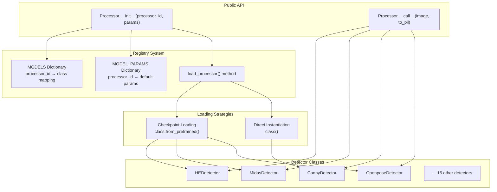

Sources: [src/controlnet_aux/processor.py:1-149]()

## Registry System

The registry system consists of two primary dictionaries that define the available processors and their configurations. This centralized approach ensures consistent access patterns across all supported detectors.

**Registry Components**

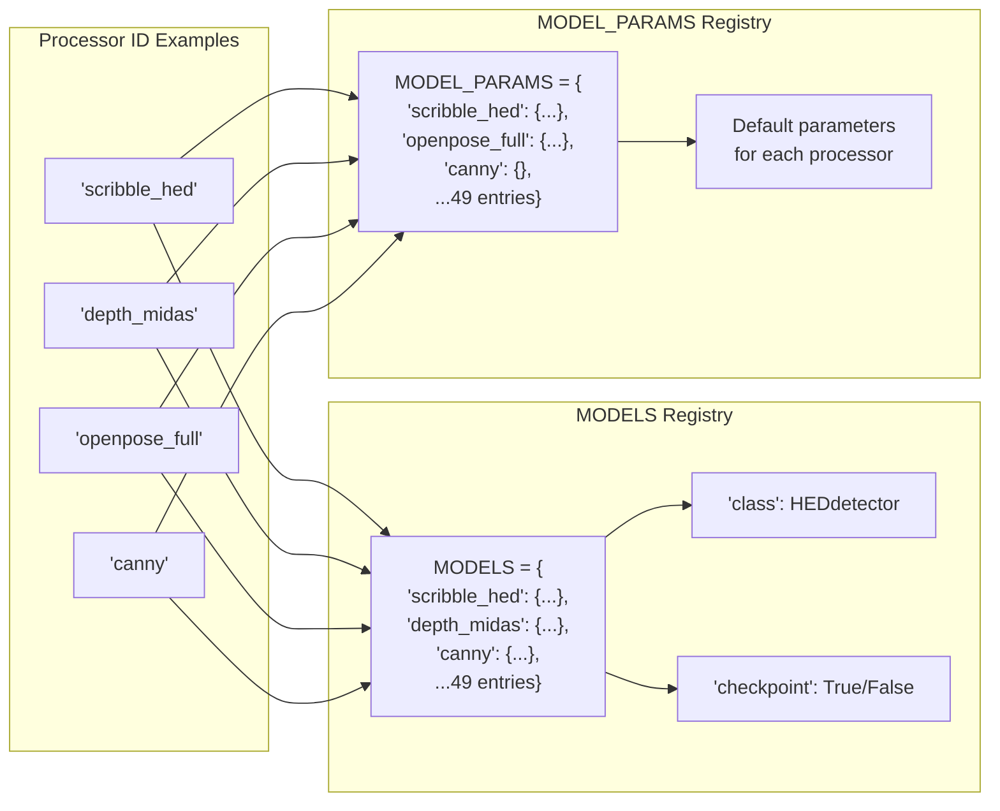

### MODELS Dictionary Structure

The `MODELS` dictionary maps processor IDs to detector class references and loading metadata. Each entry contains:

| Key | Purpose | Values |
|-----|---------|---------|
| `'class'` | Detector class reference | `HEDdetector`, `MidasDetector`, etc. |
| `'checkpoint'` | Loading strategy flag | `True` for checkpoint models, `False` for direct instantiation |

The registry includes 49 processor variants covering checkpoint-based models like `'scribble_hed'` and `'depth_midas'` [src/controlnet_aux/processor.py:22-43](), and direct instantiation models like `'canny'` and `'shuffle'` [src/controlnet_aux/processor.py:46-49]().

### MODEL_PARAMS Dictionary Structure

The `MODEL_PARAMS` dictionary stores default parameters for each processor, enabling specialized behavior without requiring users to understand detector-specific configuration options. Examples include:

- OpenPose variants with different body part configurations [src/controlnet_aux/processor.py:59-63]()
- HED detector safety and scribble mode settings [src/controlnet_aux/processor.py:53-56]()
- PiDiNet safety and scribble combinations [src/controlnet_aux/processor.py:65-68]()

Sources: [src/controlnet_aux/processor.py:20-79]()

## Loading Strategies

The Processor interface supports two distinct loading strategies based on the detector's implementation requirements, determined by the `'checkpoint'` flag in the MODELS registry.

**Loading Strategy Flow**

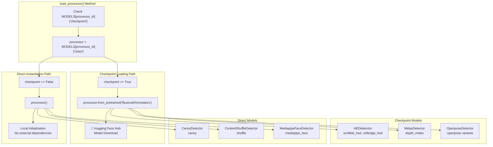

### Checkpoint-Based Loading

Checkpoint models require pre-trained weights downloaded from Hugging Face Hub. The loading process calls `from_pretrained("lllyasviel/Annotators")` [src/controlnet_aux/processor.py:121](), which handles model weight download and initialization automatically.

### Direct Instantiation

Direct instantiation models like `CannyDetector` and `ContentShuffleDetector` require no external checkpoints and initialize with `processor()` [src/controlnet_aux/processor.py:123](). These typically implement classical computer vision algorithms or lightweight processing.

Sources: [src/controlnet_aux/processor.py:108-124]()

## Parameter Management

The Processor interface implements a layered parameter system that combines default configurations with user-provided overrides, ensuring sensible defaults while maintaining customization flexibility.

**Parameter Resolution Flow**

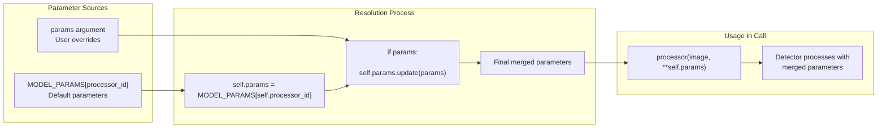

The parameter system supports detector-specific configurations such as:

- **OpenPose body part inclusion**: `include_body`, `include_hand`, `include_face` [src/controlnet_aux/processor.py:59-63]()
- **HED processing modes**: `scribble` and `safe` flags [src/controlnet_aux/processor.py:53-56]()
- **LeRes depth enhancement**: `boost` parameter for `depth_leres++` variant [src/controlnet_aux/processor.py:76-77]()

Sources: [src/controlnet_aux/processor.py:102-106](), [src/controlnet_aux/processor.py:141]()

## Usage Patterns

The Processor interface supports flexible input/output handling with automatic format conversion between PIL Images and bytes, enabling integration with diverse application architectures.

**Input/Output Processing Flow**

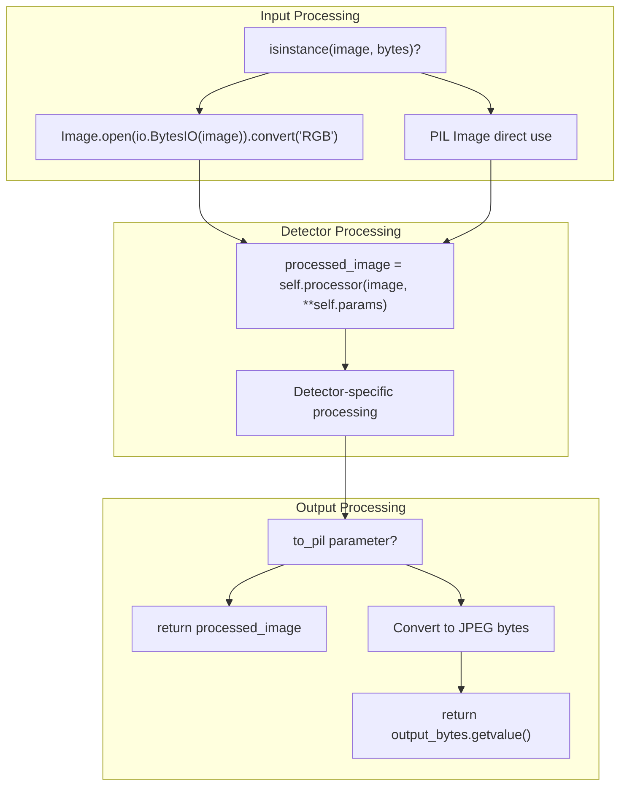

### Basic Usage Pattern

```python
processor = Processor("scribble_hed")
processed_image = processor(input_image, to_pil=True)
```

### Parameter Customization

```python
custom_params = {"scribble": False, "safe": True}
processor = Processor("scribble_hed", params=custom_params)
```

The interface validates processor IDs against the MODELS registry and raises `ValueError` with available options if an invalid ID is provided [src/controlnet_aux/processor.py:96-97]().

Sources: [src/controlnet_aux/processor.py:126-148](), [src/controlnet_aux/processor.py:85-106]()

---

# Page: Package Structure

# Package Structure

<details>
<summary>Relevant source files</summary>

The following files were used as context for generating this wiki page:

- [.gitignore](.gitignore)
- [setup.py](setup.py)
- [src/controlnet_aux/__init__.py](src/controlnet_aux/__init__.py)

</details>


This document explains the organization and design of the controlnet_aux package, covering the public API patterns, detector registration system, and package configuration. For details about the unified Processor interface, see [Processor Interface](#3.1). For information about shared utilities used across detectors, see [Common Utilities](#3.3).

## Package Organization

The controlnet_aux package follows a flat module structure where each detector type is implemented as a separate module within the `src/controlnet_aux/` directory. The package uses a dual API design that supports both direct detector imports and unified access through the Processor interface.

### Directory Structure

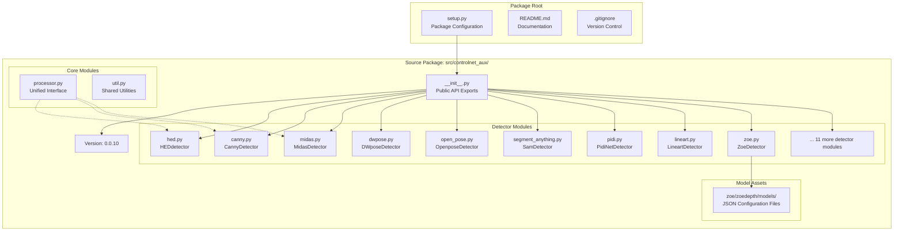

**Package Structure Overview**

Sources: [setup.py:192-194](), [src/controlnet_aux/__init__.py:1-21]()

## Public API Design

The package implements a **dual API pattern** that provides two ways to access detector functionality: direct imports and unified processor access. This design accommodates both simple use cases and advanced customization needs.

### Direct Import Pattern

The primary public API is exposed through direct imports in the package's `__init__.py` file, where each detector class is individually imported and made available at the package level.

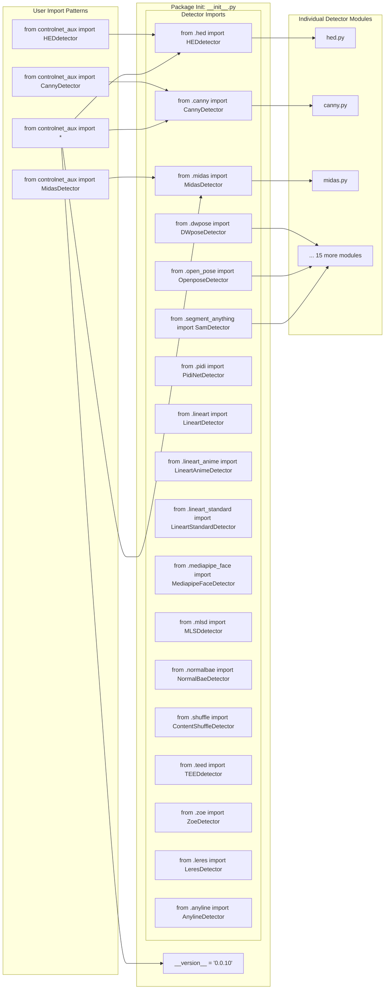

**Direct Import API Structure**

Sources: [src/controlnet_aux/__init__.py:3-20]()

### Detector Naming Conventions

The package follows consistent naming patterns for detector classes to provide predictable import names:

| Pattern | Examples | Purpose |
|---------|----------|---------|
| `*Detector` | `CannyDetector`, `MidasDetector`, `SamDetector` | Standard detector classes |
| `*detector` | `HEDdetector`, `MLSDdetector`, `TEEDdetector` | Legacy naming for specific detectors |
| Descriptive Names | `LineartAnimeDetector`, `ContentShuffleDetector` | Domain-specific functionality |

Sources: [src/controlnet_aux/__init__.py:3-20]()

## Detector Registration System

While the package uses direct imports for its primary API, it also maintains a registration system for the unified Processor interface. This system maps string identifiers to detector classes and their parameters.

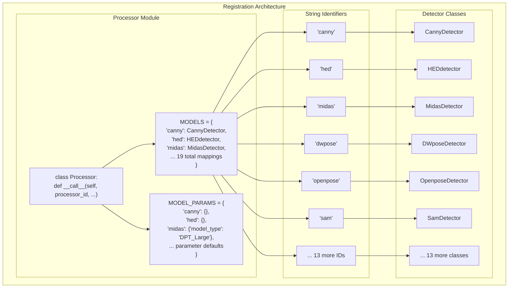

**Detector Registration and Lookup System**

Sources: References to processor.py (implementation details in [Processor Interface](#3.1))

## Package Configuration

The package configuration is defined in `setup.py` and establishes the package metadata, dependencies, and distribution settings.

### Core Dependencies

The package requires several key dependencies for computer vision and machine learning functionality:

| Category | Dependencies | Purpose |
|----------|-------------|---------|
| **Core ML** | `torch`, `torchvision`, `timm` | PyTorch ecosystem and model implementations |
| **Computer Vision** | `opencv-python-headless`, `scikit-image`, `Pillow` | Image processing and manipulation |
| **Scientific Computing** | `numpy`, `scipy`, `einops` | Numerical operations and tensor manipulation |
| **Model Hub** | `huggingface_hub` | Model downloading and caching |
| **Utilities** | `filelock`, `importlib_metadata` | File locking and metadata access |

Sources: [setup.py:79-92](), [setup.py:166-179]()

### Package Metadata

The package is configured with the following key metadata:

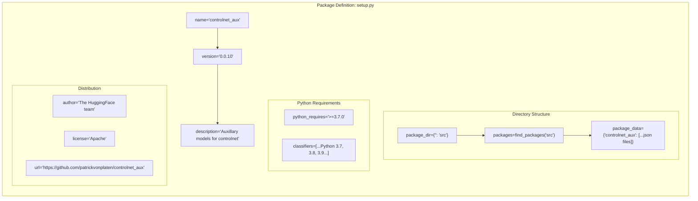

**Package Configuration Structure**

Sources: [setup.py:181-213]()

### Special Package Data

The package includes special configuration files for the ZoeDepth models that are bundled as package data:

```python
package_data={
    'controlnet_aux': [
        'zoe/zoedepth/models/zoedepth/*.json', 
        'zoe/zoedepth/models/zoedepth_nk/*.json'
    ]
}
```

This ensures that the ZoeDepth model configuration files are included in the distributed package and accessible at runtime.

Sources: [setup.py:212]()

## Package Distribution

The package follows standard Python distribution practices with setuptools, supporting both wheel and source distributions for PyPI publication.

### Version Management

Version information is maintained in two locations for consistency:
- Package version in `setup.py`: `version="0.0.10"`
- Module version in `__init__.py`: `__version__ = "0.0.10"`

This dual declaration ensures version consistency between the installed package metadata and runtime version queries.

Sources: [setup.py:183](), [src/controlnet_aux/__init__.py:1]()

### Development and Release Process

The package includes detailed release procedures and dependency management through custom commands:

- **Dependency Table Updates**: Custom `DepsTableUpdateCommand` for maintaining dependency version tables
- **Release Checklist**: Comprehensive steps for version bumping, testing, and PyPI publication
- **Package Discovery**: Automatic discovery of subpackages using `find_packages("src")`

Sources: [setup.py:125-162](), [setup.py:215-233]()

---

# Page: Common Utilities

# Common Utilities

<details>
<summary>Relevant source files</summary>

The following files were used as context for generating this wiki page:

- [src/controlnet_aux/util.py](src/controlnet_aux/util.py)

</details>


This page documents the shared utility functions provided by the `util.py` module that are used across all detector implementations in controlnet_aux. These utilities handle common image processing operations, memory management, and specialized transformations required by the neural network models.

For information about the overall package structure and how these utilities fit into the architecture, see [Package Structure](#3.2). For details on specific detector implementations that use these utilities, see [Detector Categories](#4).

## Overview

The `util.py` module serves as the central repository for cross-cutting concerns that are shared among different detector implementations. These utilities fall into several categories:

- **Image format standardization** - ensuring consistent image formats across detectors
- **Image preprocessing** - resizing, normalization, and filtering operations
- **Memory management** - GPU memory cleanup and optimization
- **Specialized transformations** - noise generation, masking, and color palette operations

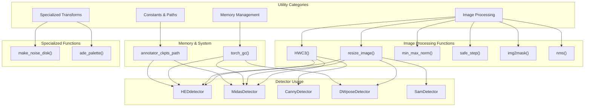

Sources: [src/controlnet_aux/util.py:1-147]()

## Image Format Standardization

### HWC3 Function

The `HWC3` function is the primary image format standardization utility, ensuring all images are converted to a consistent 3-channel (RGB) format with uint8 data type.

| Input Format | Output Behavior |
|-------------|----------------|
| Grayscale (H,W) | Converted to (H,W,1) then replicated to (H,W,3) |
| Single channel (H,W,1) | Replicated across 3 channels |
| RGB (H,W,3) | Returned unchanged |
| RGBA (H,W,4) | Alpha blending applied, converted to RGB |

The function handles alpha channel blending using the standard compositing formula: `color * alpha + 255.0 * (1.0 - alpha)`.

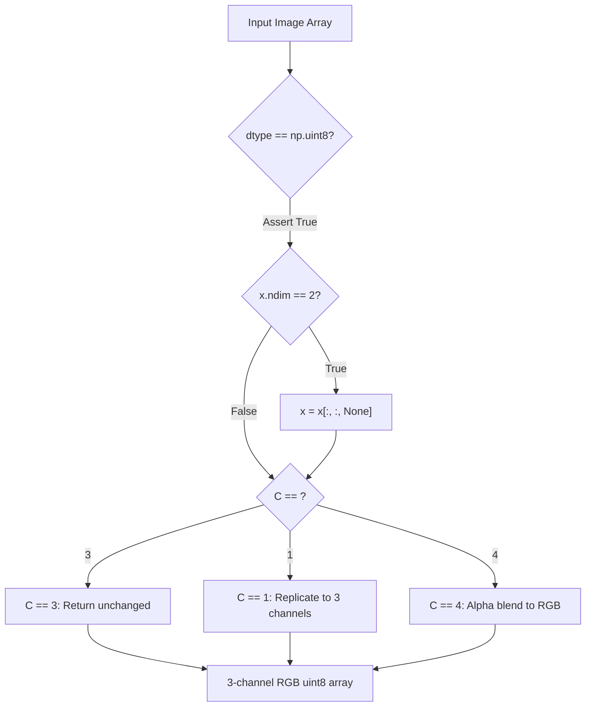

Sources: [src/controlnet_aux/util.py:11-27]()

## Image Preprocessing Utilities

### Resolution and Resizing

The `resize_image` function provides standardized image resizing with 64-pixel alignment, which is required by many neural network architectures that expect input dimensions to be multiples of 64.

**Algorithm:**
1. Calculate scaling factor based on minimum dimension
2. Apply scaling to both dimensions
3. Round to nearest multiple of 64
4. Use appropriate interpolation method based on scaling direction

The function uses LANCZOS4 interpolation for upscaling and AREA interpolation for downscaling to preserve image quality.

### Normalization Functions

**Min-Max Normalization (`min_max_norm`):**
- Scales pixel values to [0, 1] range
- Prevents division by zero with epsilon value of 1e-5
- Used for preparing inputs to neural networks

**Safe Step Function (`safe_step`):**
- Quantizes pixel values to reduce noise
- Default step size of 2 provides 3 quantization levels
- Helps stabilize edge detection and line art generation

Sources: [src/controlnet_aux/util.py:58-67](), [src/controlnet_aux/util.py:87-97]()

## Specialized Image Processing

### Non-Maximum Suppression

The `nms` function implements directional non-maximum suppression for edge detection, using four directional kernels to preserve edge continuity:

| Kernel | Direction | Pattern |
|--------|-----------|---------|
| f1 | Horizontal | `[[0,0,0],[1,1,1],[0,0,0]]` |
| f2 | Vertical | `[[0,1,0],[0,1,0],[0,1,0]]` |
| f3 | Diagonal / | `[[1,0,0],[0,1,0],[0,0,1]]` |
| f4 | Diagonal \ | `[[0,0,1],[0,1,0],[1,0,0]]` |

The algorithm applies Gaussian blur first, then checks if each pixel is a local maximum in any of the four directions.

### Noise Generation

The `make_noise_disk` function creates smooth noise patterns using:
1. Random uniform noise generation at reduced resolution
2. Cubic interpolation upsampling with padding
3. Min-max normalization to [0, 1] range

This is used for texture synthesis and data augmentation in certain detectors.

### Mask Generation

The `img2mask` function converts images to binary masks with random channel selection and intensity inversion, supporting data augmentation for training and scribble mode operations.

Sources: [src/controlnet_aux/util.py:41-56](), [src/controlnet_aux/util.py:30-38](), [src/controlnet_aux/util.py:70-84]()

## Memory Management

### GPU Memory Cleanup

The `torch_gc` function provides centralized GPU memory management:

```python
def torch_gc():
    if torch.cuda.is_available():
        torch.cuda.empty_cache()
        torch.cuda.ipc_collect()
```

This function is called by detectors after processing to free GPU memory and clean up CUDA IPC resources, preventing memory leaks during batch processing or long-running applications.

Sources: [src/controlnet_aux/util.py:100-103]()

## Constants and Configuration

### Checkpoint Path

The `annotator_ckpts_path` variable provides a centralized location for model checkpoints:
```python
annotator_ckpts_path = os.path.join(os.path.dirname(__file__), 'ckpts')
```

This path is used by detectors that require local checkpoint files, providing a consistent storage location within the package structure.

### ADE20K Color Palette

The `ade_palette` function returns the standard ADE20K dataset color mapping, used for semantic segmentation visualization and consistent color coding across different detectors.

```mermaid
graph LR
    subgraph "Configuration Constants"
        CKPT_PATH["annotator_ckpts_path"]
        ADE_COLORS["ade_palette()"]
    end
    
    subgraph "Usage Context"
        MODEL_LOADING["Model Loading"]
        SEGMENTATION["Segmentation Visualization"]
    end
    
    CKPT_PATH --> MODEL_LOADING
    ADE_COLORS --> SEGMENTATION
    
    subgraph "Detector Dependencies"
        HED["HEDdetector"]
        MIDAS["MidasDetector"] 
        SAM["SamDetector"]
    end
    
    MODEL_LOADING --> HED
    MODEL_LOADING --> MIDAS
    SEGMENTATION --> SAM
```

Sources: [src/controlnet_aux/util.py:8](), [src/controlnet_aux/util.py:106-145]()

## Integration with Detector Architecture

The utility functions are designed to be imported and used by individual detector classes, providing consistent preprocessing and postprocessing across the entire library. Most detectors follow this pattern:

1. Import required utilities at the module level
2. Use `HWC3` for input image standardization
3. Apply `resize_image` for resolution normalization
4. Use specialized functions (`nms`, `min_max_norm`) for model-specific preprocessing
5. Call `torch_gc` for memory cleanup after processing

This centralized approach ensures consistency, reduces code duplication, and provides a single point of maintenance for common operations across all detector implementations.

Sources: [src/controlnet_aux/util.py:1-147]()

---

# Page: Detector Categories

# Detector Categories

<details>
<summary>Relevant source files</summary>

The following files were used as context for generating this wiki page:

- [.gitignore](.gitignore)
- [README.md](README.md)
- [setup.py](setup.py)
- [src/controlnet_aux/__init__.py](src/controlnet_aux/__init__.py)
- [src/controlnet_aux/processor.py](src/controlnet_aux/processor.py)
- [src/controlnet_aux/tests/test_processor_pytest.py](src/controlnet_aux/tests/test_processor_pytest.py)

</details>


This document provides a comprehensive overview of the different types of feature detectors available in controlnet_aux, organized by their primary functionality and intended use cases. The categorization system helps users understand which detector to use for specific image preprocessing tasks in ControlNet workflows.

For information about the unified interface to access these detectors, see [Processor Interface](#3.1). For details about the internal neural network architectures powering these detectors, see [Neural Network Architectures](#5.2).

## Detector Classification System

The controlnet_aux library organizes 20 different detector classes into five main functional categories. Each category serves a specific type of image analysis task required for ControlNet conditioning.

### Category-to-Code Mapping

```mermaid
graph TB
    subgraph "Functional Categories"
        EDGE["Edge Detection<br/>Boundary identification"]
        DEPTH["Depth Estimation<br/>3D structure analysis"] 
        POSE["Pose Detection<br/>Human keypoint extraction"]
        LINEART["Line Art Generation<br/>Sketch-style processing"]
        SEGMENT["Segmentation<br/>Region identification"]
    end
    
    subgraph "Edge Detection Classes"
        HED["HEDdetector"]
        CANNY["CannyDetector"] 
        PIDI["PidiNetDetector"]
        TEED["TEEDdetector"]
        ANYLINE["AnylineDetector"]
    end
    
    subgraph "Depth Estimation Classes"
        MIDAS["MidasDetector"]
        ZOE["ZoeDetector"]
        LERES["LeresDetector"] 
        NORMALBAE["NormalBaeDetector"]
    end
    
    subgraph "Pose Detection Classes"
        OPENPOSE["OpenposeDetector"]
        DWPOSE["DWposeDetector"]
    end
    
    subgraph "Line Art Classes"
        LINEART_DET["LineartDetector"]
        LINEART_ANIME["LineartAnimeDetector"]
        LINEART_STD["LineartStandardDetector"]
        MLSD["MLSDdetector"]
    end
    
    subgraph "Segmentation Classes"
        SAM["SamDetector"]
        MEDIAPIPE["MediapipeFaceDetector"]
        SHUFFLE["ContentShuffleDetector"]
    end
    
    EDGE --> HED
    EDGE --> CANNY
    EDGE --> PIDI
    EDGE --> TEED
    EDGE --> ANYLINE
    
    DEPTH --> MIDAS
    DEPTH --> ZOE
    DEPTH --> LERES
    DEPTH --> NORMALBAE
    
    POSE --> OPENPOSE
    POSE --> DWPOSE
    
    LINEART --> LINEART_DET
    LINEART --> LINEART_ANIME
    LINEART --> LINEART_STD
    LINEART --> MLSD
    
    SEGMENT --> SAM
    SEGMENT --> MEDIAPIPE
    SEGMENT --> SHUFFLE
```

**Sources:** [src/controlnet_aux/__init__.py:3-21](), [src/controlnet_aux/processor.py:20-49]()

## Edge Detection

Edge detection detectors identify boundaries and contours in images, producing binary or grayscale edge maps suitable for line-based ControlNet conditioning.

### Edge Detection Architecture

```mermaid
graph LR
    subgraph "Classical Methods"
        CANNY_CLASS["CannyDetector<br/>canny.py"]
    end
    
    subgraph "Neural Network Methods"
        HED_CLASS["HEDdetector<br/>hed.py"]
        PIDI_CLASS["PidiNetDetector<br/>pidi.py"] 
        TEED_CLASS["TEEDdetector<br/>teed.py"]
        ANYLINE_CLASS["AnylineDetector<br/>anyline.py"]
    end
    
    subgraph "Processor Interface Mappings"
        SCRIBBLE_HED["scribble_hed"]
        SOFTEDGE_HED["softedge_hed"]
        SCRIBBLE_PIDI["scribble_pidinet"]
        SOFTEDGE_PIDI["softedge_pidinet"]
        SAFE_VARIANTS["*safe variants"]
    end
    
    CANNY_CLASS --> CANNY_PROC["canny"]
    
    HED_CLASS --> SCRIBBLE_HED
    HED_CLASS --> SOFTEDGE_HED
    HED_CLASS --> SAFE_VARIANTS
    
    PIDI_CLASS --> SCRIBBLE_PIDI
    PIDI_CLASS --> SOFTEDGE_PIDI
    PIDI_CLASS --> SAFE_VARIANTS
    
    TEED_CLASS --> TEED_PROC["teed"]
    ANYLINE_CLASS --> ANYLINE_PROC["anyline"]
```

| Detector Class | Model Type | Key Features | Processor IDs |
|---|---|---|---|
| `CannyDetector` | Classical CV | Threshold-based, fast | `canny` |
| `HEDdetector` | CNN | Multi-scale, scribble mode | `scribble_hed`, `softedge_hed`, `*hedsafe` |
| `PidiNetDetector` | CNN | Safety filtering, scribble mode | `scribble_pidinet`, `softedge_pidinet`, `*pidsafe` |
| `TEEDdetector` | Lightweight CNN | Efficient edge detection | Not in processor |
| `AnylineDetector` | CNN | Combined edge+line detection | Not in processor |

**Sources:** [src/controlnet_aux/processor.py:22-26,34-37,48](), [README.md:105,126]()

## Depth Estimation

Depth estimation detectors perform monocular depth estimation, generating depth maps and normal maps for 3D-aware ControlNet conditioning.

### Depth Estimation Pipeline

```mermaid
graph TB
    subgraph "Input Processing"
        IMG["Input Image<br/>RGB PIL.Image"]
    end
    
    subgraph "Depth Models"
        MIDAS_MODEL["MidasDetector<br/>Dense Prediction Transformer"]
        ZOE_MODEL["ZoeDetector<br/>Metric depth estimation"] 
        LERES_MODEL["LeresDetector<br/>Multi-scale depth"]
    end
    
    subgraph "Normal Map Generation"
        NORMALBAE_MODEL["NormalBaeDetector<br/>Surface normal estimation"]
        MIDAS_NORMAL["MidasDetector<br/>normal_map=True"]
    end
    
    subgraph "Output Types"
        DEPTH_MAP["Depth Map<br/>Grayscale image"]
        NORMAL_MAP["Normal Map<br/>RGB surface normals"]
    end
    
    IMG --> MIDAS_MODEL
    IMG --> ZOE_MODEL
    IMG --> LERES_MODEL
    IMG --> NORMALBAE_MODEL
    
    MIDAS_MODEL --> DEPTH_MAP
    MIDAS_MODEL --> MIDAS_NORMAL
    ZOE_MODEL --> DEPTH_MAP
    LERES_MODEL --> DEPTH_MAP
    NORMALBAE_MODEL --> NORMAL_MAP
    MIDAS_NORMAL --> NORMAL_MAP
```

| Detector Class | Architecture | Processor IDs | Special Features |
|---|---|---|---|
| `MidasDetector` | DPT (Dense Prediction Transformer) | `depth_midas`, `normal_midas` | Optional normal map generation |
| `ZoeDetector` | ZoeDepth | `depth_zoe` | Metric depth, gamma correction |
| `LeresDetector` | LeRes | `depth_leres`, `depth_leres++` | Boost mode available |
| `NormalBaeDetector` | NormalBAE | `normal_bae` | Dedicated normal map generation |

**Sources:** [src/controlnet_aux/processor.py:26,38,42-44](), [README.md:79,86,89,121]()

## Pose Detection

Pose detection detectors extract human keypoints for body, hand, and face landmarks, enabling pose-conditioned image generation.

### Pose Detection Variants

```mermaid
graph TB
    subgraph "Pose Detector Classes"
        OPENPOSE_CLASS["OpenposeDetector<br/>open_pose.py"]
        DWPOSE_CLASS["DWposeDetector<br/>dwpose.py"]
    end
    
    subgraph "OpenPose Configurations"
        OPENPOSE_BASIC["openpose<br/>Body only"]
        OPENPOSE_HAND["openpose_hand<br/>Hands only"]
        OPENPOSE_FACE["openpose_face<br/>Body + Face"]
        OPENPOSE_FACEONLY["openpose_faceonly<br/>Face only"]
        OPENPOSE_FULL["openpose_full<br/>Body + Hands + Face"]
    end
    
    subgraph "DWPose Configuration"
        DWPOSE_FULL["dwpose<br/>Wholebody detection"]
    end
    
    subgraph "Keypoint Output"
        BODY_KEYPOINTS["Body Keypoints<br/>17 points"]
        HAND_KEYPOINTS["Hand Keypoints<br/>21 points each"]
        FACE_KEYPOINTS["Face Keypoints<br/>68 points"]
    end
    
    OPENPOSE_CLASS --> OPENPOSE_BASIC
    OPENPOSE_CLASS --> OPENPOSE_HAND
    OPENPOSE_CLASS --> OPENPOSE_FACE
    OPENPOSE_CLASS --> OPENPOSE_FACEONLY
    OPENPOSE_CLASS --> OPENPOSE_FULL
    
    DWPOSE_CLASS --> DWPOSE_FULL
    
    OPENPOSE_BASIC --> BODY_KEYPOINTS
    OPENPOSE_HAND --> HAND_KEYPOINTS
    OPENPOSE_FACE --> BODY_KEYPOINTS
    OPENPOSE_FACE --> FACE_KEYPOINTS
    OPENPOSE_FACEONLY --> FACE_KEYPOINTS
    OPENPOSE_FULL --> BODY_KEYPOINTS
    OPENPOSE_FULL --> HAND_KEYPOINTS
    OPENPOSE_FULL --> FACE_KEYPOINTS
    
    DWPOSE_FULL --> BODY_KEYPOINTS
    DWPOSE_FULL --> HAND_KEYPOINTS
    DWPOSE_FULL --> FACE_KEYPOINTS
```

**Sources:** [src/controlnet_aux/processor.py:28-33,59-63](), [README.md:81,115,129]()

## Line Art Generation

Line art detectors generate sketch-like representations and line segment detection for artistic and structural line-based conditioning.

### Line Art Processing Types

```mermaid
graph LR
    subgraph "Line Art Detector Classes"
        LINEART_CLASS["LineartDetector<br/>lineart.py"]
        LINEART_ANIME_CLASS["LineartAnimeDetector<br/>lineart_anime.py"]
        LINEART_STD_CLASS["LineartStandardDetector<br/>lineart_standard.py"]
        MLSD_CLASS["MLSDdetector<br/>mlsd.py"]
    end
    
    subgraph "Processing Modes"
        REALISTIC["lineart_realistic<br/>Fine detail preservation"]
        COARSE["lineart_coarse<br/>Simplified lines"]
        ANIME["lineart_anime<br/>Anime-style processing"]
        STANDARD["Standard processing<br/>Direct instantiation"]
        SEGMENTS["mlsd<br/>Line segment detection"]
    end
    
    subgraph "Output Characteristics"
        DETAILED_LINES["Detailed Line Art<br/>Complex scenes"]
        SIMPLE_LINES["Simplified Line Art<br/>Clean sketches"]
        ANIME_STYLE["Anime Line Art<br/>Stylized processing"]
        MOBILE_SEGMENTS["Mobile Line Segments<br/>Structural lines"]
    end
    
    LINEART_CLASS --> REALISTIC
    LINEART_CLASS --> COARSE
    LINEART_ANIME_CLASS --> ANIME
    LINEART_STD_CLASS --> STANDARD
    MLSD_CLASS --> SEGMENTS
    
    REALISTIC --> DETAILED_LINES
    COARSE --> SIMPLE_LINES
    ANIME --> ANIME_STYLE
    STANDARD --> DETAILED_LINES
    SEGMENTS --> MOBILE_SEGMENTS
```

| Detector Class | Architecture | Processor IDs | Specialization |
|---|---|---|---|
| `LineartDetector` | U-Net | `lineart_realistic`, `lineart_coarse` | General line art with quality control |
| `LineartAnimeDetector` | U-Net | `lineart_anime` | Anime/manga style optimization |
| `LineartStandardDetector` | U-Net | Not in processor | Direct instantiation only |
| `MLSDdetector` | Mobile architecture | `mlsd` | Mobile line segment detection |

**Sources:** [src/controlnet_aux/processor.py:27,39-41,70-72](), [src/controlnet_aux/__init__.py:8-10,13](), [README.md:80,84-85,114,130]()

## Segmentation

Segmentation detectors identify and isolate regions, objects, or specific features for mask-based ControlNet conditioning.

### Segmentation Detector Types

```mermaid
graph TB
    subgraph "Segmentation Classes"
        SAM_CLASS["SamDetector<br/>segment_anything.py"]
        MEDIAPIPE_CLASS["MediapipeFaceDetector<br/>mediapipe_face.py"]
        SHUFFLE_CLASS["ContentShuffleDetector<br/>shuffle.py"]
    end
    
    subgraph "SAM Model Variants"
        SAM_VIT_H["ViT-H<br/>Highest accuracy"]
        SAM_VIT_L["ViT-L<br/>Balanced performance"]  
        SAM_VIT_B["ViT-B<br/>Faster inference"]
        MOBILE_SAM["MobileSAM<br/>Mobile deployment"]
    end
    
    subgraph "Specialized Segmentation"
        FACE_LANDMARKS["Face Landmarks<br/>468 facial points"]
        CONTENT_SHUFFLE["Content Shuffle<br/>Region randomization"]
    end
    
    subgraph "Output Types"
        UNIVERSAL_MASKS["Universal Object Masks"]
        FACE_MESH["Face Mesh Annotations"]
        SHUFFLED_REGIONS["Shuffled Content Map"]
    end
    
    SAM_CLASS --> SAM_VIT_H
    SAM_CLASS --> SAM_VIT_L
    SAM_CLASS --> SAM_VIT_B
    SAM_CLASS --> MOBILE_SAM
    
    MEDIAPIPE_CLASS --> FACE_LANDMARKS
    SHUFFLE_CLASS --> CONTENT_SHUFFLE
    
    SAM_VIT_H --> UNIVERSAL_MASKS
    SAM_VIT_L --> UNIVERSAL_MASKS
    SAM_VIT_B --> UNIVERSAL_MASKS
    MOBILE_SAM --> UNIVERSAL_MASKS
    
    FACE_LANDMARKS --> FACE_MESH
    CONTENT_SHUFFLE --> SHUFFLED_REGIONS
```

| Detector Class | Technology | Processor IDs | Use Case |
|---|---|---|---|
| `SamDetector` | Segment Anything Model | Not in processor | Universal object segmentation |
| `MediapipeFaceDetector` | MediaPipe | `mediapipe_face` | Face landmark detection |
| `ContentShuffleDetector` | Algorithmic | `shuffle` | Content region shuffling |

**Sources:** [src/controlnet_aux/processor.py:46-47](), [README.md:87-88,106-107,127-128]()

## Processor Integration

All detector categories integrate with the unified `Processor` interface through the `MODELS` registry system, enabling consistent access patterns across different detector types.

### Processor Registry Mapping

```mermaid
graph TB
    subgraph "Processor Registry"
        MODELS_DICT["MODELS dictionary<br/>processor.py:20-49"]
        PARAMS_DICT["MODEL_PARAMS dictionary<br/>processor.py:52-79"]
    end
    
    subgraph "Loading Strategies"
        CHECKPOINT["checkpoint: True<br/>from_pretrained()"]
        INSTANTIATE["checkpoint: False<br/>direct __init__()"]
    end
    
    subgraph "Checkpoint Models"
        NEURAL_MODELS["Neural Network Detectors<br/>HED, MiDaS, OpenPose, etc."]
    end
    
    subgraph "Instantiate Models"  
        ALGORITHMIC_MODELS["Algorithmic Detectors<br/>Canny, Shuffle, MediaPipe"]
    end
    
    MODELS_DICT --> CHECKPOINT
    MODELS_DICT --> INSTANTIATE
    
    CHECKPOINT --> NEURAL_MODELS
    INSTANTIATE --> ALGORITHMIC_MODELS
    
    PARAMS_DICT --> NEURAL_MODELS
    PARAMS_DICT --> ALGORITHMIC_MODELS
```

The `MODELS` dictionary in [src/controlnet_aux/processor.py:20-49]() maps 25 processor IDs to their corresponding detector classes and loading strategies. Models requiring pretrained weights use `checkpoint: True`, while algorithmic detectors use `checkpoint: False` for direct instantiation.

**Sources:** [src/controlnet_aux/processor.py:20-49,52-79,117-124](), [src/controlnet_aux/__init__.py:1-21]()

---

# Page: Edge Detection

# Edge Detection

<details>
<summary>Relevant source files</summary>

The following files were used as context for generating this wiki page:

- [src/controlnet_aux/canny/__init__.py](src/controlnet_aux/canny/__init__.py)
- [src/controlnet_aux/hed/__init__.py](src/controlnet_aux/hed/__init__.py)
- [src/controlnet_aux/mediapipe_face/__init__.py](src/controlnet_aux/mediapipe_face/__init__.py)
- [src/controlnet_aux/mlsd/__init__.py](src/controlnet_aux/mlsd/__init__.py)
- [src/controlnet_aux/normalbae/__init__.py](src/controlnet_aux/normalbae/__init__.py)
- [src/controlnet_aux/pidi/__init__.py](src/controlnet_aux/pidi/__init__.py)
- [src/controlnet_aux/segment_anything/__init__.py](src/controlnet_aux/segment_anything/__init__.py)

</details>


This document covers the edge detection systems in controlnet_aux, which extract boundary and edge information from images to create line-based control maps for ControlNet. Edge detection is fundamental for applications requiring precise structural guidance, sketch-to-image generation, and boundary-aware image synthesis.

For information about line art generation which produces cleaner artistic lines, see [Line Art Generation](#4.4). For depth-based boundary detection through normal maps, see [Depth Estimation](#4.2).

## Overview

The controlnet_aux library provides four primary edge detection systems, each optimized for different use cases and computational requirements:

| Detector | Type | Model Architecture | Primary Use Case |
|----------|------|-------------------|------------------|
| `HEDdetector` | Neural Network | Custom CNN with 5 blocks | Multi-scale holistic edge detection |
| `CannyDetector` | Classical CV | OpenCV Canny algorithm | Fast, parameter-tunable edge detection |
| `PidiNetDetector` | Neural Network | PiDiNet architecture | Pixel difference-based edge detection |
| `MLSDdetector` | Neural Network | MobileV2-based | Mobile line segment detection |

**Edge Detection System Architecture**
```mermaid
graph TB
    subgraph "Edge Detection Interface"
        API["Processor API<br/>processor_id selection"]
        DIRECT["Direct Detector Access<br/>Manual instantiation"]
    end
    
    subgraph "Neural Network Detectors"
        HED["HEDdetector<br/>ControlNetHED_Apache2"]
        PIDI["PidiNetDetector<br/>pidinet model"]
        MLSD["MLSDdetector<br/>MobileV2_MLSD_Large"]
    end
    
    subgraph "Classical Detectors"
        CANNY["CannyDetector<br/>cv2.Canny"]
    end
    
    subgraph "Model Loading"
        HF_HUB["Hugging Face Hub<br/>Model checkpoints"]
        LOCAL["Local filesystem<br/>Direct instantiation"]
    end
    
    subgraph "Common Processing"
        UTIL_RESIZE["resize_image()<br/>Resolution normalization"]
        UTIL_HWC3["HWC3()<br/>Channel formatting"]
        UTIL_SAFE["safe_step()<br/>Edge smoothing"]
        UTIL_NMS["nms()<br/>Non-maximum suppression"]
    end
    
    subgraph "Output Processing"
        SCRIBBLE["Scribble Mode<br/>Simplified edges"]
        PIL_OUT["PIL Image output"]
        NP_OUT["NumPy array output"]
    end
    
    API --> HED
    API --> PIDI
    API --> MLSD
    API --> CANNY
    DIRECT --> HED
    DIRECT --> PIDI
    DIRECT --> MLSD
    DIRECT --> CANNY
    
    HED --> HF_HUB
    PIDI --> HF_HUB
    MLSD --> HF_HUB
    CANNY --> LOCAL
    
    HED --> UTIL_RESIZE
    PIDI --> UTIL_RESIZE
    MLSD --> UTIL_RESIZE
    CANNY --> UTIL_RESIZE
    
    UTIL_RESIZE --> UTIL_HWC3
    UTIL_HWC3 --> UTIL_SAFE
    UTIL_HWC3 --> UTIL_NMS
    
    UTIL_SAFE --> SCRIBBLE
    UTIL_NMS --> SCRIBBLE
    SCRIBBLE --> PIL_OUT
    SCRIBBLE --> NP_OUT
```

Sources: [src/controlnet_aux/hed/__init__.py:59-129](), [src/controlnet_aux/canny/__init__.py:7-36](), [src/controlnet_aux/pidi/__init__.py:15-84](), [src/controlnet_aux/mlsd/__init__.py:15-79]()

## Common Interface Patterns

All edge detectors implement a standardized interface with consistent parameter handling and processing pipelines. The core `__call__` method signature follows this pattern:

**Standard Parameters**
- `input_image`: Input image as PIL Image or NumPy array
- `detect_resolution`: Resolution for edge detection processing (default: 512)
- `image_resolution`: Output image resolution (default: 512)
- `output_type`: Output format - "pil" or "np" (default: "pil")

**Neural Network Specific Parameters**
- `safe`: Apply safe step smoothing for cleaner edges
- `scribble`: Convert edges to simplified scribble-like lines using NMS

**Processing Pipeline Flow**
```mermaid
graph LR
    INPUT["Input Image<br/>PIL/NumPy"]
    CONVERT["HWC3()<br/>Channel normalization"]
    RESIZE1["resize_image()<br/>detect_resolution"]
    DETECT["Edge Detection<br/>Model-specific"]
    POST["Post-processing<br/>safe/scribble modes"]
    RESIZE2["resize_image()<br/>image_resolution"]
    OUTPUT["Output<br/>PIL/NumPy"]
    
    INPUT --> CONVERT
    CONVERT --> RESIZE1
    RESIZE1 --> DETECT
    DETECT --> POST
    POST --> RESIZE2
    RESIZE2 --> OUTPUT
```

Sources: [src/controlnet_aux/hed/__init__.py:82-129](), [src/controlnet_aux/canny/__init__.py:8-36](), [src/controlnet_aux/pidi/__init__.py:38-84]()

## HED Detector

The `HEDdetector` implements Holistically-nested Edge Detection using a custom `ControlNetHED_Apache2` neural network architecture optimized for ControlNet applications.

**Model Architecture**
```mermaid
graph TD
    INPUT["Input Image<br/>3 channels RGB"]
    NORM["Normalization<br/>self.norm parameter"]
    
    subgraph "ControlNetHED_Apache2"
        BLOCK1["DoubleConvBlock 1<br/>3→64 channels, 2 conv layers"]
        BLOCK2["DoubleConvBlock 2<br/>64→128 channels, 2 conv layers"]
        BLOCK3["DoubleConvBlock 3<br/>128→256 channels, 3 conv layers"]
        BLOCK4["DoubleConvBlock 4<br/>256→512 channels, 3 conv layers"]
        BLOCK5["DoubleConvBlock 5<br/>512→512 channels, 3 conv layers"]
        
        PROJ1["Projection 1<br/>64→1 channel"]
        PROJ2["Projection 2<br/>128→1 channel"] 
        PROJ3["Projection 3<br/>256→1 channel"]
        PROJ4["Projection 4<br/>512→1 channel"]
        PROJ5["Projection 5<br/>512→1 channel"]
    end
    
    FUSION["Multi-scale Fusion<br/>Mean + Sigmoid"]
    OUTPUT["Edge Map<br/>Single channel"]
    
    INPUT --> NORM
    NORM --> BLOCK1
    BLOCK1 --> BLOCK2
    BLOCK2 --> BLOCK3
    BLOCK3 --> BLOCK4
    BLOCK4 --> BLOCK5
    
    BLOCK1 --> PROJ1
    BLOCK2 --> PROJ2
    BLOCK3 --> PROJ3
    BLOCK4 --> PROJ4
    BLOCK5 --> PROJ5
    
    PROJ1 --> FUSION
    PROJ2 --> FUSION
    PROJ3 --> FUSION
    PROJ4 --> FUSION
    PROJ5 --> FUSION
    
    FUSION --> OUTPUT
```

The HED architecture extracts edge features at multiple scales through five `DoubleConvBlock` layers [src/controlnet_aux/hed/__init__.py:21-38](), each producing side outputs that are fused for the final edge map [src/controlnet_aux/hed/__init__.py:104-107]().

**Key Features**
- Multi-scale edge detection with hierarchical feature extraction
- RGB input processing (optimized for Gradio compatibility)
- Scribble mode for simplified line drawings using NMS and Gaussian blur
- Safe mode for smoothed edge outputs

Sources: [src/controlnet_aux/hed/__init__.py:21-58](), [src/controlnet_aux/hed/__init__.py:59-129]()

## Canny Detector

The `CannyDetector` provides classical Canny edge detection using OpenCV's optimized implementation. This detector offers the fastest processing with minimal memory requirements.

**Implementation Details**
- Direct `cv2.Canny()` invocation with configurable thresholds [src/controlnet_aux/canny/__init__.py:25]()
- No model loading required - immediate instantiation
- Threshold parameters: `low_threshold` (default: 100), `high_threshold` (default: 200)

**Usage Pattern**
```python
detector = CannyDetector()
edges = detector(input_image, low_threshold=50, high_threshold=150)
```

Sources: [src/controlnet_aux/canny/__init__.py:7-36]()

## PiDiNet Detector

The `PidiNetDetector` uses the Pixel Difference Network architecture for edge detection with enhanced filtering and safety options.

**Model Characteristics**
- PiDiNet architecture from `pidinet()` model factory [src/controlnet_aux/pidi/__init__.py:28]()
- BGR input processing with channel reversal [src/controlnet_aux/pidi/__init__.py:54]()
- Binary filtering option with 0.5 threshold [src/controlnet_aux/pidi/__init__.py:61-62]()
- Supports both safe mode and scribble mode post-processing

**Configuration Options**
- `apply_filter`: Binary thresholding at 0.5 for cleaner edges
- `safe`: Safe step smoothing for reduced noise
- `scribble`: NMS-based line simplification matching HED behavior

Sources: [src/controlnet_aux/pidi/__init__.py:15-84](), [src/controlnet_aux/pidi/model.py:1-100]()

## MLSD Detector

The `MLSDdetector` implements Mobile Line Segment Detection for efficient line detection on mobile devices using a `MobileV2_MLSD_Large` architecture.

**Line Detection Process**
```mermaid
graph LR
    IMAGE["Input Image"]
    MODEL["MobileV2_MLSD_Large<br/>Line prediction"]
    LINES["Line Segments<br/>x1,y1,x2,y2 coordinates"]
    DRAW["cv2.line()<br/>White lines on black background"]
    OUTPUT["Line Map"]
    
    IMAGE --> MODEL
    MODEL --> LINES
    LINES --> DRAW
    DRAW --> OUTPUT
```

The detector extracts line segments as coordinate pairs and renders them as white lines on a black background [src/controlnet_aux/mlsd/__init__.py:61-64]().

**Parameters**
- `thr_v`: Value threshold for line detection (default: 0.1)
- `thr_d`: Distance threshold for line detection (default: 0.1)

Sources: [src/controlnet_aux/mlsd/__init__.py:15-79](), [src/controlnet_aux/mlsd/models/mbv2_mlsd_large.py:1-100]()

## Scribble Mode Processing

Both HED and PiDiNet detectors support scribble mode, which converts detailed edge maps into simplified line drawings suitable for sketch-based control.

**Scribble Processing Pipeline**
```mermaid
graph LR
    EDGES["Edge Map<br/>Grayscale values"]
    NMS["nms()<br/>Non-maximum suppression<br/>threshold=127, radius=3.0"]
    BLUR["cv2.GaussianBlur()<br/>sigma=3.0"]
    THRESH["Binary Thresholding<br/>>4 → 255, else → 0"]
    SCRIBBLE["Scribble Lines"]
    
    EDGES --> NMS
    NMS --> BLUR
    BLUR --> THRESH
    THRESH --> SCRIBBLE
```

This processing creates clean, sketch-like lines by suppressing weak edges and applying Gaussian smoothing [src/controlnet_aux/hed/__init__.py:121-124](), [src/controlnet_aux/pidi/__init__.py:76-79]().

Sources: [src/controlnet_aux/hed/__init__.py:120-125](), [src/controlnet_aux/pidi/__init__.py:75-80](), [src/controlnet_aux/util.py:1-100]()

---

# Page: HED Detector

# HED Detector

<details>
<summary>Relevant source files</summary>

The following files were used as context for generating this wiki page:

- [src/controlnet_aux/hed/__init__.py](src/controlnet_aux/hed/__init__.py)
- [src/controlnet_aux/mlsd/__init__.py](src/controlnet_aux/mlsd/__init__.py)

</details>


The HED Detector implements Holistically-nested Edge Detection (HED) for multi-scale edge map generation with ControlNet optimizations. This detector is specifically designed for ControlNet applications and image-to-image translation tasks, producing smoother edges than standard implementations while supporting advanced features like scribble mode processing.

This document covers the `HEDdetector` class implementation, neural network architecture, and usage patterns. For other edge detection methods, see [Canny Detector](#4.1.2), [PiDiNet Detector](#4.1.3), and [TEED and Anyline Detectors](#4.1.4). For general edge detection concepts, see [Edge Detection](#4.1).

## Architecture Overview

The HED Detector consists of three main architectural components: the detector interface, the neural network model, and convolutional building blocks.

### Class Hierarchy

```mermaid
graph TD
    HEDdetector["HEDdetector<br/>Main Interface"]
    ControlNetHED_Apache2["ControlNetHED_Apache2<br/>Neural Network Model"]
    DoubleConvBlock["DoubleConvBlock<br/>Convolutional Building Block"]
    
    HEDdetector -->|"contains"| ControlNetHED_Apache2
    ControlNetHED_Apache2 -->|"5 instances"| DoubleConvBlock
    
    subgraph "Model Loading"
        from_pretrained["from_pretrained()<br/>Factory Method"]
        hf_hub_download["hf_hub_download()<br/>Model Download"]
        load_state_dict["load_state_dict()<br/>Weight Loading"]
    end
    
    subgraph "Processing Pipeline"
        __call__["__call__()<br/>Main Processing"]
        resize_image["resize_image()<br/>Input Preprocessing"]
        nms["nms()<br/>Scribble Mode NMS"]
        safe_step["safe_step()<br/>Safe Processing"]
    end
    
    HEDdetector --> from_pretrained
    from_pretrained --> hf_hub_download
    from_pretrained --> load_state_dict
    
    HEDdetector --> __call__
    __call__ --> resize_image
    __call__ --> nms
    __call__ --> safe_step
```

**Sources**: [src/controlnet_aux/hed/__init__.py:59-129]()

### Neural Network Architecture

The `ControlNetHED_Apache2` model implements a VGG-inspired architecture with five hierarchical blocks for multi-scale edge detection:

```mermaid
graph TB
    subgraph "Input Processing"
        input["Input Image<br/>RGB (H×W×3)"]
        norm["Normalization<br/>x - self.norm"]
    end
    
    subgraph "Hierarchical Blocks"
        block1["block1<br/>DoubleConvBlock<br/>3→64, 2 layers"]
        block2["block2<br/>DoubleConvBlock<br/>64→128, 2 layers"]
        block3["block3<br/>DoubleConvBlock<br/>128→256, 3 layers"]
        block4["block4<br/>DoubleConvBlock<br/>256→512, 3 layers"]
        block5["block5<br/>DoubleConvBlock<br/>512→512, 3 layers"]
    end
    
    subgraph "Multi-Scale Outputs"
        proj1["projection1<br/>64→1"]
        proj2["projection2<br/>128→1"]
        proj3["projection3<br/>256→1"]
        proj4["projection4<br/>512→1"]
        proj5["projection5<br/>512→1"]
    end
    
    subgraph "Downsampling"
        ds1["No Downsampling"]
        ds2["2×2 MaxPool"]
        ds3["2×2 MaxPool"]
        ds4["2×2 MaxPool"]
        ds5["2×2 MaxPool"]
    end
    
    input --> norm
    norm --> block1
    block1 --> ds1
    block1 --> proj1
    ds1 --> block2
    block2 --> ds2
    block2 --> proj2
    ds2 --> block3
    block3 --> ds3
    block3 --> proj3
    ds3 --> block4
    block4 --> ds4
    block4 --> proj4
    ds4 --> block5
    block5 --> ds5
    block5 --> proj5
```

**Sources**: [src/controlnet_aux/hed/__init__.py:40-57](), [src/controlnet_aux/hed/__init__.py:21-37]()

## Core Components

### DoubleConvBlock Structure

The `DoubleConvBlock` class implements the fundamental building block used throughout the HED architecture:

| Component | Purpose | Configuration |
|-----------|---------|---------------|
| `convs` Sequential | Main convolution layers | Variable layer count (2-3) |
| `projection` Conv2d | 1×1 conv to single channel | `output_channels → 1` |
| Downsampling | Optional 2×2 max pooling | Applied between blocks |
| Activation | ReLU after each conv | Applied in forward pass |

The block processes features through multiple 3×3 convolutions with padding, followed by a 1×1 projection layer for edge map generation.

**Sources**: [src/controlnet_aux/hed/__init__.py:21-37]()

### HEDdetector Interface

The `HEDdetector` class provides the main user interface with the following key methods:

```mermaid
graph LR
    subgraph "Initialization"
        from_pretrained["from_pretrained()<br/>Load pretrained model"]
        __init__["__init__()<br/>Direct initialization"]
    end
    
    subgraph "Device Management"
        to_device["to()<br/>Move to device"]
    end
    
    subgraph "Processing"
        call_method["__call__()<br/>Main processing method"]
    end
    
    subgraph "Parameters"
        detect_res["detect_resolution<br/>Processing resolution"]
        image_res["image_resolution<br/>Output resolution"]
        safe_mode["safe<br/>Safe step processing"]
        scribble_mode["scribble<br/>NMS processing"]
        output_type["output_type<br/>pil or np"]
    end
    
    from_pretrained --> HEDdetector
    __init__ --> HEDdetector
    HEDdetector --> to_device
    HEDdetector --> call_method
    
    call_method --> detect_res
    call_method --> image_res
    call_method --> safe_mode
    call_method --> scribble_mode
    call_method --> output_type
```

**Sources**: [src/controlnet_aux/hed/__init__.py:59-81](), [src/controlnet_aux/hed/__init__.py:82-129]()

## Processing Pipeline

### Standard Edge Detection Flow

The HED detector processes images through the following pipeline:

1. **Input Preprocessing**: Convert to numpy array and apply `HWC3` formatting
2. **Resolution Scaling**: Resize input to `detect_resolution` 
3. **Neural Network Inference**: Generate 5 multi-scale edge projections
4. **Edge Fusion**: Combine projections using sigmoid-weighted averaging
5. **Post-processing**: Apply optional safe step or scribble mode processing
6. **Output Scaling**: Resize to `image_resolution` and format output

```mermaid
graph TD
    subgraph "Input Stage"
        input_img["Input Image<br/>PIL/numpy"]
        hwc3["HWC3()<br/>Format normalization"]
        resize_detect["resize_image()<br/>detect_resolution"]
    end
    
    subgraph "Neural Processing"
        tensor_conv["Tensor Conversion<br/>torch.from_numpy()"]
        rearrange_input["rearrange()<br/>h w c → 1 c h w"]
        netNetwork["netNetwork()<br/>5 edge projections"]
        edge_fusion["Edge Fusion<br/>sigmoid + mean"]
    end
    
    subgraph "Post-processing"
        safe_check{"safe=True?"}
        safe_step_proc["safe_step()<br/>Safety processing"]
        scribble_check{"scribble=True?"}
        nms_proc["nms()<br/>Non-max suppression"]
        gaussian_blur["GaussianBlur()<br/>Smoothing"]
    end
    
    subgraph "Output Stage"
        resize_output["resize_image()<br/>image_resolution"]
        format_output["Format Output<br/>PIL or numpy"]
    end
    
    input_img --> hwc3
    hwc3 --> resize_detect
    resize_detect --> tensor_conv
    tensor_conv --> rearrange_input
    rearrange_input --> netNetwork
    netNetwork --> edge_fusion
    
    edge_fusion --> safe_check
    safe_check -->|"Yes"| safe_step_proc
    safe_check -->|"No"| scribble_check
    safe_step_proc --> scribble_check
    
    scribble_check -->|"Yes"| nms_proc
    scribble_check -->|"No"| resize_output
    nms_proc --> gaussian_blur
    gaussian_blur --> resize_output
    
    resize_output --> format_output
```

**Sources**: [src/controlnet_aux/hed/__init__.py:82-129]()

### Scribble Mode Processing

When `scribble=True`, the detector applies specialized post-processing for sketch-like output:

| Step | Function | Parameters | Purpose |
|------|----------|------------|---------|
| 1. NMS | `nms()` | `threshold=127, sigma=3.0` | Remove duplicate edges |
| 2. Gaussian Blur | `cv2.GaussianBlur()` | `sigma=3.0` | Smooth edge lines |
| 3. Thresholding | Binary threshold | `>4 → 255, <255 → 0` | Create clean binary edges |

**Sources**: [src/controlnet_aux/hed/__init__.py:120-124]()

## Model Loading and Configuration

### Pretrained Model Loading

The HED detector supports flexible model loading through the `from_pretrained` classmethod:

```mermaid
graph TD
    subgraph "Model Loading Path"
        pretrained_path["pretrained_model_or_path<br/>String parameter"]
        path_check{"Is directory?"}
        local_path["Local file path<br/>join(path, filename)"]
        hf_download["hf_hub_download()<br/>Download from Hub"]
    end
    
    subgraph "Model Initialization"
        create_network["ControlNetHED_Apache2()<br/>Create model instance"]
        load_weights["load_state_dict()<br/>Load checkpoint weights"]
        set_eval["float().eval()<br/>Set evaluation mode"]
    end
    
    subgraph "Default Configuration"
        default_filename["filename = 'ControlNetHED.pth'"]
        cache_dir_param["cache_dir parameter"]
        local_files_param["local_files_only parameter"]
    end
    
    pretrained_path --> path_check
    path_check -->|"Yes"| local_path
    path_check -->|"No"| hf_download
    
    local_path --> create_network
    hf_download --> create_network
    create_network --> load_weights
    load_weights --> set_eval
    
    default_filename --> hf_download
    cache_dir_param --> hf_download
    local_files_param --> hf_download
```

**Sources**: [src/controlnet_aux/hed/__init__.py:63-76]()

### Parameter Configuration

The HED detector accepts the following configuration parameters:

| Parameter | Type | Default | Description |
|-----------|------|---------|-------------|
| `detect_resolution` | int | 512 | Processing resolution for edge detection |
| `image_resolution` | int | 512 | Final output image resolution |
| `safe` | bool | False | Apply safe step processing to reduce noise |
| `scribble` | bool | False | Enable scribble mode with NMS processing |
| `output_type` | str | "pil" | Output format: "pil" or "np" |

**Sources**: [src/controlnet_aux/hed/__init__.py:82]()

## Key Implementation Details

### RGB vs BGR Handling

The HED implementation uses RGB input format, differing from official BGR implementations. This design choice improves compatibility with Gradio's RGB protocol and ControlNet applications.

### Multi-Scale Edge Fusion

The detector combines five different scale edge projections using sigmoid activation and averaging:
- `edge = 1 / (1 + np.exp(-np.mean(edges, axis=2).astype(np.float64)))`

This approach produces smoother, more coherent edge maps compared to single-scale detection.

### Memory and Device Management

The detector automatically detects the device of the neural network parameters and ensures tensor operations occur on the same device, supporting both CPU and GPU inference.

**Sources**: [src/controlnet_aux/hed/__init__.py:91](), [src/controlnet_aux/hed/__init__.py:100-111]()

---

# Page: Canny Detector

# Canny Detector

<details>
<summary>Relevant source files</summary>

The following files were used as context for generating this wiki page:

- [src/controlnet_aux/canny/__init__.py](src/controlnet_aux/canny/__init__.py)
- [src/controlnet_aux/mediapipe_face/__init__.py](src/controlnet_aux/mediapipe_face/__init__.py)
- [src/controlnet_aux/segment_anything/__init__.py](src/controlnet_aux/segment_anything/__init__.py)

</details>


The Canny Detector provides classical edge detection using the Canny edge detection algorithm implemented through OpenCV. This detector offers a lightweight, parameter-driven approach to edge detection without requiring neural network models or checkpoints.

For other edge detection methods, see [HED Detector](#4.1.1) for neural network-based holistic edge detection, [PiDiNet Detector](#4.1.3) for pixel difference networks, and [TEED and Anyline Detectors](#4.1.4) for efficient deep learning approaches.

## Overview

The `CannyDetector` class implements the classical Canny edge detection algorithm, which uses gradient analysis and non-maximum suppression to identify edges in images. Unlike other edge detectors in the controlnet_aux library, the Canny detector operates purely through computer vision techniques without requiring trained model weights.

```mermaid
flowchart TD
    INPUT["Input Image"] --> VALIDATE["Input Validation"]
    VALIDATE --> CONVERT["Convert to numpy array"]
    CONVERT --> HWC3_1["HWC3() normalization"]
    HWC3_1 --> RESIZE_1["resize_image(detect_resolution)"]
    RESIZE_1 --> CANNY["cv2.Canny(low_threshold, high_threshold)"]
    CANNY --> HWC3_2["HWC3() on detected_map"]
    HWC3_2 --> RESIZE_2["resize_image(image_resolution)"]
    RESIZE_2 --> FINAL_RESIZE["cv2.resize() to match input"]
    FINAL_RESIZE --> OUTPUT_FORMAT["Format output (PIL/numpy)"]
    OUTPUT_FORMAT --> RESULT["Edge Map"]
```

Sources: [src/controlnet_aux/canny/__init__.py:1-37]()

## Architecture and Implementation

The Canny detector follows the standard detector pattern established in controlnet_aux, implementing a callable class with parameter validation and flexible input/output handling.

### Class Structure

```mermaid
classDiagram
    class CannyDetector {
        +__call__(input_image, low_threshold, high_threshold, detect_resolution, image_resolution, output_type, **kwargs)
        -_validate_input()
        -_process_image()
        -_format_output()
    }
    
    class OpenCV {
        +cv2.Canny(image, threshold1, threshold2)
    }
    
    class Utils {
        +HWC3(image)
        +resize_image(image, resolution)
    }
    
    CannyDetector --> OpenCV : uses
    CannyDetector --> Utils : imports
```

The detector implements these key processing steps:

1. **Input validation and conversion**: Handles both PIL Image and numpy array inputs
2. **Image preprocessing**: Applies `HWC3` normalization and resolution adjustment  
3. **Edge detection**: Calls `cv2.Canny` with configurable thresholds
4. **Output formatting**: Resizes and formats results as PIL or numpy arrays

Sources: [src/controlnet_aux/canny/__init__.py:7-36]()

## Parameters and Configuration

The Canny detector accepts several parameters for controlling edge detection behavior:

| Parameter | Type | Default | Description |
|-----------|------|---------|-------------|
| `input_image` | Image/ndarray | Required | Input image for edge detection |
| `low_threshold` | int | 100 | Lower threshold for edge linking |
| `high_threshold` | int | 200 | Upper threshold for initial edge detection |
| `detect_resolution` | int | 512 | Resolution for edge detection processing |
| `image_resolution` | int | 512 | Final output image resolution |
| `output_type` | str | "pil"/"np" | Output format (PIL Image or numpy array) |

### Threshold Configuration

```mermaid
graph LR
    subgraph "Canny Algorithm"
        GRADIENT["Gradient Calculation"]
        NMS["Non-Maximum Suppression"]
        DOUBLE["Double Thresholding"]
        HYSTERESIS["Hysteresis Edge Tracking"]
    end
    
    subgraph "Threshold Parameters"
        LOW["low_threshold=100"]
        HIGH["high_threshold=200"]
    end
    
    GRADIENT --> NMS
    NMS --> DOUBLE
    HIGH --> DOUBLE
    LOW --> HYSTERESIS
    DOUBLE --> HYSTERESIS
```

The thresholds control edge sensitivity:
- **High threshold**: Pixels above this value are definitely edges
- **Low threshold**: Pixels below this value are definitely not edges  
- **Between thresholds**: Pixels are edges only if connected to definite edges

Sources: [src/controlnet_aux/canny/__init__.py:8](), [src/controlnet_aux/canny/__init__.py:25]()

## Integration with controlnet_aux Ecosystem

The Canny detector integrates with the broader controlnet_aux system through shared utilities and consistent interfaces:

```mermaid
graph TB
    subgraph "Edge Detection Family"
        CANNY["CannyDetector"]
        HED["HEDdetector"]  
        PIDI["PidiNetDetector"]
        TEED["TEEDdetector"]
    end
    
    subgraph "Shared Infrastructure"
        UTIL["util.py"]
        HWC3["HWC3()"]
        RESIZE["resize_image()"]
    end
    
    subgraph "Common Patterns"
        INPUT_VAL["Input validation"]
        DEPRECATION["Deprecation warnings"]
        OUTPUT_FMT["Output formatting"]
    end
    
    CANNY --> HWC3
    CANNY --> RESIZE
    CANNY --> INPUT_VAL
    CANNY --> DEPRECATION
    CANNY --> OUTPUT_FMT
    
    HED --> HWC3
    HED --> RESIZE
    HED --> INPUT_VAL
    
    UTIL --> HWC3
    UTIL --> RESIZE
```

### Unique Characteristics

Unlike neural network-based edge detectors in the system, the Canny detector:

- **No model loading**: Instantiates directly without checkpoints
- **Pure OpenCV**: Uses `cv2.Canny` for edge detection  
- **Lightweight**: Minimal memory footprint and fast execution
- **Parameter-driven**: Behavior controlled entirely through thresholds

Sources: [src/controlnet_aux/canny/__init__.py:1-5](), [src/controlnet_aux/util.py]()

## Usage Patterns

The Canny detector supports both direct instantiation and integration with the Processor interface:

### Direct Usage
```python
# Direct instantiation - no from_pretrained() needed
detector = CannyDetector()
edge_map = detector(image, low_threshold=50, high_threshold=150)
```

### Processor Integration
```python 
# Via Processor interface
processor = Processor("canny")
edge_map = processor(image, low_threshold=50, high_threshold=150)
```

### Deprecation Handling

The detector includes backward compatibility through deprecation warnings:

```mermaid
flowchart LR
    OLD_IMG["img parameter"] --> WARN1["DeprecationWarning"]
    WARN1 --> NEW_IMG["input_image parameter"]
    
    OLD_RETURN["return_pil parameter"] --> WARN2["DeprecationWarning"] 
    WARN2 --> NEW_OUTPUT["output_type parameter"]
```

Sources: [src/controlnet_aux/canny/__init__.py:9-11]()

## Performance Characteristics

The Canny detector offers distinct performance advantages within the controlnet_aux ecosystem:

| Characteristic | Canny | Neural Network Detectors |
|---------------|-------|-------------------------|
| **Initialization** | Instant | Model loading required |
| **Memory Usage** | Minimal | GPU memory for models |
| **Processing Speed** | Very fast | Depends on model size |
| **Customization** | Threshold tuning | Limited parameters |
| **Dependencies** | OpenCV only | PyTorch + model weights |

This makes the Canny detector particularly suitable for:
- Real-time applications requiring fast edge detection
- Resource-constrained environments  
- Cases where classical edge detection suffices
- Baseline comparisons with neural approaches

Sources: [src/controlnet_aux/canny/__init__.py:25]()

---

# Page: PiDiNet Detector

# PiDiNet Detector

<details>
<summary>Relevant source files</summary>

The following files were used as context for generating this wiki page:

- [src/controlnet_aux/leres/leres/net_tools.py](src/controlnet_aux/leres/leres/net_tools.py)
- [src/controlnet_aux/leres/pix2pix/models/__init__.py](src/controlnet_aux/leres/pix2pix/models/__init__.py)
- [src/controlnet_aux/normalbae/__init__.py](src/controlnet_aux/normalbae/__init__.py)
- [src/controlnet_aux/pidi/__init__.py](src/controlnet_aux/pidi/__init__.py)
- [src/controlnet_aux/pidi/model.py](src/controlnet_aux/pidi/model.py)

</details>


The PiDiNet Detector implements Pixel Difference Network (PiDiNet) for edge detection in images. This detector specializes in generating clean edge maps with configurable safety filtering and scribble mode processing. 

For general edge detection overview, see [Edge Detection](#4.1). For classical edge detection, see [Canny Detector](#4.1.2). For multi-scale edge detection, see [HED Detector](#4.1.1).

## System Architecture

The PiDiNet detector consists of two main components: the detector interface and the underlying neural network model.

```mermaid
graph TB
    subgraph "Public Interface"
        DETECTOR["PidiNetDetector"]
        FROM_PRETRAINED["from_pretrained()"]
        CALL["__call__()"]
        TO_DEVICE["to()"]
    end
    
    subgraph "Model Loading"
        HF_DOWNLOAD["hf_hub_download()"]
        PIDINET_FUNC["pidinet()"]
        LOAD_STATE["load_state_dict()"]
    end
    
    subgraph "Neural Network"
        PIDINET_MODEL["PiDiNet"]
        PDC_BLOCKS["PDCBlock layers"]
        CONV_REDUCES["MapReduce modules"]
        CLASSIFIER["classifier"]
    end
    
    subgraph "Specialized Components"
        CSAM["CSAM<br/>Spatial Attention"]
        CDCM["CDCM<br/>Dilation Convolution"]
        PDC_CONV["Conv2d<br/>Pixel Difference Conv"]
    end
    
    subgraph "Utility Functions"
        HWC3["HWC3()"]
        RESIZE["resize_image()"]
        SAFE_STEP["safe_step()"]
        NMS["nms()"]
    end
    
    DETECTOR --> FROM_PRETRAINED
    FROM_PRETRAINED --> HF_DOWNLOAD
    FROM_PRETRAINED --> PIDINET_FUNC
    FROM_PRETRAINED --> LOAD_STATE
    
    PIDINET_FUNC --> PIDINET_MODEL
    DETECTOR --> CALL
    CALL --> HWC3
    CALL --> RESIZE
    CALL --> SAFE_STEP
    CALL --> NMS
    
    PIDINET_MODEL --> PDC_BLOCKS
    PIDINET_MODEL --> CONV_REDUCES
    PIDINET_MODEL --> CLASSIFIER
    
    PDC_BLOCKS --> PDC_CONV
    PIDINET_MODEL --> CSAM
    PIDINET_MODEL --> CDCM
    
    style DETECTOR fill:#f9f9f9,stroke:#333,stroke-width:2px
    style PIDINET_MODEL fill:#f9f9f9,stroke:#333,stroke-width:2px
```

**Architecture Overview**: The `PidiNetDetector` serves as a wrapper around the `PiDiNet` neural network model, providing model loading through Hugging Face Hub and post-processing utilities for edge map generation.

Sources: [src/controlnet_aux/pidi/__init__.py:15-84](), [src/controlnet_aux/pidi/model.py:493-644]()

## Class Structure and Interface

The detector follows the standard controlnet_aux pattern with class-based instantiation and callable interface.

| Component | Type | Purpose | Key Methods |
|-----------|------|---------|-------------|
| `PidiNetDetector` | Main Class | Edge detection interface | `from_pretrained()`, `__call__()`, `to()` |
| `PiDiNet` | Neural Network | Core edge detection model | `forward()`, `get_weights()` |
| `Conv2d` | Convolution Layer | Pixel difference convolutions | `forward()` with PDC operations |
| `PDCBlock` | Building Block | Residual blocks with PDC | Depthwise separable convolution |
| `CSAM` | Attention Module | Spatial attention mechanism | Compact attention weighting |
| `CDCM` | Dilation Module | Multi-scale feature extraction | Multiple dilation rates |

```mermaid
graph LR
    subgraph "Detector Interface"
        INIT["__init__(netNetwork)"]
        FROM_PRETRAINED["from_pretrained(pretrained_model_or_path)"]
        CALL_METHOD["__call__(input_image, **kwargs)"]
        TO_METHOD["to(device)"]
    end
    
    subgraph "Model Parameters"
        DETECT_RES["detect_resolution=512"]
        IMAGE_RES["image_resolution=512"]
        SAFE["safe=False"]
        SCRIBBLE["scribble=False"]
        APPLY_FILTER["apply_filter=False"]
        OUTPUT_TYPE["output_type='pil'"]
    end
    
    subgraph "Processing Pipeline"
        INPUT_PROC["Image preprocessing<br/>HWC3, resize_image"]
        TENSOR_CONV["Tensor conversion<br/>torch.from_numpy"]
        NETWORK_FORWARD["Network forward pass<br/>netNetwork(image_pidi)"]
        POST_PROC["Post-processing<br/>safe_step, filter, scribble"]
    end
    
    CALL_METHOD --> INPUT_PROC
    INPUT_PROC --> TENSOR_CONV
    TENSOR_CONV --> NETWORK_FORWARD
    NETWORK_FORWARD --> POST_PROC
    
    DETECT_RES --> INPUT_PROC
    IMAGE_RES --> POST_PROC
    SAFE --> POST_PROC
    SCRIBBLE --> POST_PROC
    APPLY_FILTER --> POST_PROC
    OUTPUT_TYPE --> POST_PROC
```

**Class Design**: The `PidiNetDetector` implements a consistent interface pattern where `from_pretrained()` handles model loading and `__call__()` performs inference with extensive parameter control.

Sources: [src/controlnet_aux/pidi/__init__.py:15-37](), [src/controlnet_aux/pidi/__init__.py:38-84]()

## Neural Network Architecture

The PiDiNet model implements a specialized architecture for edge detection using Pixel Difference Convolutions (PDC).

```mermaid
graph TB
    subgraph "Input Processing"
        INPUT["Input Image<br/>3 channels"]
        INIT_BLOCK["init_block<br/>Conv2d with PDC"]
    end
    
    subgraph "Feature Extraction Blocks"
        BLOCK1["Block 1<br/>3 PDCBlock layers<br/>C channels"]
        BLOCK2["Block 2<br/>4 PDCBlock layers<br/>2C channels"]
        BLOCK3["Block 3<br/>4 PDCBlock layers<br/>4C channels"]
        BLOCK4["Block 4<br/>4 PDCBlock layers<br/>4C channels"]
    end
    
    subgraph "Feature Enhancement"
        DILATIONS["dilations<br/>CDCM modules"]
        ATTENTIONS["attentions<br/>CSAM modules"]
    end
    
    subgraph "Edge Map Generation"
        REDUCES["conv_reduces<br/>MapReduce modules"]
        INTERPOLATE["Bilinear interpolation<br/>to input size"]
        CLASSIFIER["classifier<br/>4→1 channels"]
        SIGMOID["torch.sigmoid()"]
    end
    
    INPUT --> INIT_BLOCK
    INIT_BLOCK --> BLOCK1
    BLOCK1 --> BLOCK2
    BLOCK2 --> BLOCK3
    BLOCK3 --> BLOCK4
    
    BLOCK1 --> DILATIONS
    BLOCK2 --> DILATIONS  
    BLOCK3 --> DILATIONS
    BLOCK4 --> DILATIONS
    
    DILATIONS --> ATTENTIONS
    ATTENTIONS --> REDUCES
    REDUCES --> INTERPOLATE
    INTERPOLATE --> CLASSIFIER
    CLASSIFIER --> SIGMOID
```

**Architecture Details**: The model uses a 4-block hierarchical structure with progressive channel doubling, enhanced by dilation convolution (`CDCM`) and spatial attention (`CSAM`) modules for multi-scale feature extraction.

### Pixel Difference Convolutions

The core innovation of PiDiNet lies in its specialized convolution operations defined in the `nets` configuration:

| PDC Type | Code | Operation | Kernel Size |
|----------|------|-----------|-------------|
| Standard | `cv` | `F.conv2d` | 3x3 |
| Center Difference | `cd` | `conv - center_sum` | 3x3 |
| Angular Difference | `ad` | `conv - rotated_weights` | 3x3 |
| Radial Difference | `rd` | `conv with 5x5 buffer` | 5x5 effective |

```mermaid
graph LR
    subgraph "PDC Operations"
        CREATE_CONV["createConvFunc(op_type)"]
        CV["cv: F.conv2d"]
        CD["cd: conv - center_sum"]
        AD["ad: conv - rotated_conv"]
        RD["rd: conv with 5x5 buffer"]
    end
    
    subgraph "Network Configuration"
        NETS["nets['carv4']"]
        LAYER_MAPPING["layer0: 'cd'<br/>layer1: 'ad'<br/>layer2: 'rd'<br/>layer3: 'cv'<br/>..."]
    end
    
    subgraph "Model Instantiation"
        CONFIG_MODEL["config_model('carv4')"]
        PIDINET_FUNC["pidinet()"]
        PDCS_LIST["pdcs = [func0, func1, ...]"]
    end
    
    CREATE_CONV --> CV
    CREATE_CONV --> CD
    CREATE_CONV --> AD
    CREATE_CONV --> RD
    
    NETS --> LAYER_MAPPING
    LAYER_MAPPING --> CONFIG_MODEL
    CONFIG_MODEL --> PDCS_LIST
    PDCS_LIST --> PIDINET_FUNC
```

**PDC Implementation**: Each layer type implements different pixel difference operations, with the `carv4` configuration providing a balanced mix of all four types across 16 layers.

Sources: [src/controlnet_aux/pidi/model.py:298-344](), [src/controlnet_aux/pidi/model.py:43-296](), [src/controlnet_aux/pidi/model.py:661-664]()

## Processing Pipeline and Parameters

The detector provides comprehensive control over edge detection behavior through multiple processing stages.

```mermaid
graph TB
    subgraph "Input Preprocessing"
        INPUT_IMG["input_image"]
        HWC3_NORM["HWC3(input_image)"]
        RESIZE_DETECT["resize_image(detect_resolution)"]
        BGR_TO_RGB["image[:, :, ::-1]"]
        NORMALIZE["/ 255.0"]
        REARRANGE["rearrange('h w c -> 1 c h w')"]
    end
    
    subgraph "Network Inference"
        FORWARD["netNetwork(image_pidi)"]
        GET_EDGE["edge = output[-1]"]
        CPU_NUMPY["edge.cpu().numpy()"]
    end
    
    subgraph "Post-processing Options"
        APPLY_FILTER_CHECK{{"apply_filter?"}}
        FILTER_OP["edge > 0.5"]
        SAFE_CHECK{{"safe?"}}
        SAFE_STEP_OP["safe_step(edge)"]
        CLIP_SCALE["(edge * 255.0).clip(0, 255)"]
    end
    
    subgraph "Output Formatting"
        RESIZE_OUTPUT["resize to image_resolution"]
        SCRIBBLE_CHECK{{"scribble?"}}
        NMS_OP["nms(detected_map, 127, 3.0)"]
        GAUSSIAN_BLUR["GaussianBlur(0, 0, 3.0)"]
        THRESHOLD["threshold 4/255"]
        OUTPUT_TYPE_CHECK{{"output_type == 'pil'?"}}
        PIL_CONVERT["Image.fromarray()"]
    end
    
    INPUT_IMG --> HWC3_NORM
    HWC3_NORM --> RESIZE_DETECT
    RESIZE_DETECT --> BGR_TO_RGB
    BGR_TO_RGB --> NORMALIZE
    NORMALIZE --> REARRANGE
    REARRANGE --> FORWARD
    FORWARD --> GET_EDGE
    GET_EDGE --> CPU_NUMPY
    
    CPU_NUMPY --> APPLY_FILTER_CHECK
    APPLY_FILTER_CHECK -->|Yes| FILTER_OP
    APPLY_FILTER_CHECK -->|No| SAFE_CHECK
    FILTER_OP --> SAFE_CHECK
    SAFE_CHECK -->|Yes| SAFE_STEP_OP
    SAFE_CHECK -->|No| CLIP_SCALE
    SAFE_STEP_OP --> CLIP_SCALE
    
    CLIP_SCALE --> RESIZE_OUTPUT
    RESIZE_OUTPUT --> SCRIBBLE_CHECK
    SCRIBBLE_CHECK -->|Yes| NMS_OP
    SCRIBBLE_CHECK -->|No| OUTPUT_TYPE_CHECK
    NMS_OP --> GAUSSIAN_BLUR
    GAUSSIAN_BLUR --> THRESHOLD
    THRESHOLD --> OUTPUT_TYPE_CHECK
    OUTPUT_TYPE_CHECK -->|Yes| PIL_CONVERT
```

**Parameter Control**: The processing pipeline offers fine-grained control through `apply_filter` for binary thresholding, `safe` for gradient-aware processing, and `scribble` for artistic line extraction.

### Key Processing Parameters

| Parameter | Type | Default | Purpose |
|-----------|------|---------|---------|
| `detect_resolution` | int | 512 | Input resolution for edge detection |
| `image_resolution` | int | 512 | Output resolution for final image |
| `safe` | bool | False | Apply safe_step gradient processing |
| `apply_filter` | bool | False | Apply 0.5 threshold to edge values |
| `scribble` | bool | False | Generate scribble-style line art |
| `output_type` | str | "pil" | Output format ("pil" or "np") |

**Scribble Mode Processing**: When `scribble=True`, the detector applies Non-Maximum Suppression (`nms`) followed by Gaussian blur and binary thresholding to create clean line art suitable for artistic applications.

Sources: [src/controlnet_aux/pidi/__init__.py:38-84](), [src/controlnet_aux/util.py]() (referenced functions)

## Model Loading and Configuration

The detector supports flexible model loading from Hugging Face Hub with automatic checkpoint handling.

```mermaid
graph TB
    subgraph "Model Loading Process"
        FROM_PRETRAINED["from_pretrained(pretrained_model_or_path)"]
        PATH_CHECK{{"os.path.isdir()?"}}
        LOCAL_PATH["os.path.join(path, filename)"]
        HF_DOWNLOAD["hf_hub_download()"]
    end
    
    subgraph "Model Instantiation"
        PIDINET_CALL["pidinet()"]
        DEFAULT_CONFIG["config: 'carv4'<br/>dil: 24<br/>sa: True"]
        PIDINET_MODEL["PiDiNet(60, pdcs, dil=24, sa=True)"]
    end
    
    subgraph "Checkpoint Loading"
        TORCH_LOAD["torch.load(model_path)"]
        STATE_DICT["checkpoint['state_dict']"]
        MODULE_STRIP["{k.replace('module.', ''): v}"]
        LOAD_STATE_DICT["netNetwork.load_state_dict()"]
        SET_EVAL["netNetwork.eval()"]
    end
    
    FROM_PRETRAINED --> PATH_CHECK
    PATH_CHECK -->|Yes| LOCAL_PATH
    PATH_CHECK -->|No| HF_DOWNLOAD
    LOCAL_PATH --> TORCH_LOAD
    HF_DOWNLOAD --> TORCH_LOAD
    
    FROM_PRETRAINED --> PIDINET_CALL
    PIDINET_CALL --> DEFAULT_CONFIG
    DEFAULT_CONFIG --> PIDINET_MODEL
    
    TORCH_LOAD --> STATE_DICT
    STATE_DICT --> MODULE_STRIP
    MODULE_STRIP --> LOAD_STATE_DICT
    LOAD_STATE_DICT --> SET_EVAL
```

**Default Configuration**: The detector uses the `carv4` architecture with 60 input channels, dilation factor of 24, and spatial attention enabled, representing the optimal configuration from the original PiDiNet paper.

**Checkpoint Compatibility**: The loading process automatically strips `module.` prefixes from state dict keys to handle both DataParallel and standard model checkpoints seamlessly.

Sources: [src/controlnet_aux/pidi/__init__.py:19-32](), [src/controlnet_aux/pidi/model.py:661-664](), [src/controlnet_aux/pidi/model.py:646-659]()

---

# Page: TEED and Anyline Detectors

# TEED and Anyline Detectors

<details>
<summary>Relevant source files</summary>

The following files were used as context for generating this wiki page:

- [src/controlnet_aux/anyline/__init__.py](src/controlnet_aux/anyline/__init__.py)
- [src/controlnet_aux/lineart_standard/__init__.py](src/controlnet_aux/lineart_standard/__init__.py)
- [src/controlnet_aux/teed/Fsmish.py](src/controlnet_aux/teed/Fsmish.py)
- [src/controlnet_aux/teed/LICENSE.txt](src/controlnet_aux/teed/LICENSE.txt)
- [src/controlnet_aux/teed/Xsmish.py](src/controlnet_aux/teed/Xsmish.py)
- [src/controlnet_aux/teed/__init__.py](src/controlnet_aux/teed/__init__.py)
- [src/controlnet_aux/teed/ted.py](src/controlnet_aux/teed/ted.py)

</details>


This document covers the Tiny Efficient Edge Detection (TEED) and Anyline detection systems within controlnet_aux. These detectors provide edge detection and combined edge/line art generation capabilities for ControlNet preprocessing.

The TEED detector focuses on efficient neural edge detection, while the Anyline detector combines neural edge detection with classical line art techniques. For broader edge detection options, see [Edge Detection](#4.1). For line art generation, see [Line Art Generation](#4.4).

## Overview

The TEED and Anyline detectors represent hybrid approaches to edge and line detection, combining deep learning models with classical computer vision techniques. Both detectors utilize the same underlying `TED` neural network architecture but apply different post-processing strategies.

```mermaid
graph TB
    subgraph "Detection Systems"
        TEED["TEEDdetector<br/>Pure Edge Detection"]
        ANYLINE["AnylineDetector<br/>Combined Edge+Line"]
        STANDARD["LineartStandardDetector<br/>Classical Processing"]
    end
    
    subgraph "Core Architecture"
        TED_MODEL["TED Neural Network<br/>ted.py"]
        SMISH["Smish Activation<br/>Fsmish.py, Xsmish.py"]
    end
    
    subgraph "Processing Pipeline"
        INPUT["Input Image"]
        RESIZE["Image Preprocessing<br/>HWC3, resize_image"]
        NEURAL["Neural Processing<br/>torch inference"]
        POSTPROC["Post-processing"]
        OUTPUT["Edge Map Output"]
    end
    
    subgraph "Post-processing Methods"
        SAFE_STEP["safe_step()<br/>Edge smoothing"]
        GAUSSIAN["cv2.GaussianBlur<br/>Classical filtering"] 
        MORPHOLOGY["morphology.remove_small_objects<br/>Noise removal"]
        COMBINE["combine_layers()<br/>Layer blending"]
    end
    
    TEED --> TED_MODEL
    ANYLINE --> TED_MODEL
    TED_MODEL --> SMISH
    
    INPUT --> RESIZE
    RESIZE --> NEURAL
    NEURAL --> POSTPROC
    POSTPROC --> OUTPUT
    
    TEED --> SAFE_STEP
    ANYLINE --> GAUSSIAN
    ANYLINE --> MORPHOLOGY
    ANYLINE --> COMBINE
    STANDARD --> GAUSSIAN
```

Sources: [src/controlnet_aux/teed/__init__.py:1-85](), [src/controlnet_aux/anyline/__init__.py:1-119](), [src/controlnet_aux/teed/ted.py:1-333]()

## TEED Detector Architecture

The `TEEDdetector` class provides a streamlined interface to the Tiny Efficient Edge Detector neural network. The detector loads pretrained models and performs inference with configurable safety post-processing.

### Core Components

| Component | File Location | Purpose |
|-----------|---------------|---------|
| `TEEDdetector` | [src/controlnet_aux/teed/__init__.py:14-84]() | Main detector interface |
| `TED` | [src/controlnet_aux/teed/ted.py:215-312]() | Neural network architecture |
| `Smish` | [src/controlnet_aux/teed/Xsmish.py:16-42]() | Custom activation function |
| `smish` | [src/controlnet_aux/teed/Fsmish.py:12-19]() | JIT-compiled activation |

### Neural Network Architecture

The `TED` model implements a compact edge detection architecture with the following structure:

```mermaid
graph TD
    subgraph "TED Architecture"
        INPUT_LAYER["Input<br/>3 channels"]
        
        subgraph "Encoder Blocks"
            BLOCK1["DoubleConvBlock<br/>3→16, stride=2"]
            BLOCK2["DoubleConvBlock<br/>16→32"]
            DBLOCK3["_DenseBlock<br/>32→48, 1 layer"]
        end
        
        subgraph "Skip Connections"
            SIDE1["SingleConvBlock<br/>16→32, stride=2"]
            PRE_DENSE["SingleConvBlock<br/>32→48"]
        end
        
        subgraph "Decoder Blocks"
            UP1["UpConvBlock<br/>16→1, scale=1"]
            UP2["UpConvBlock<br/>32→1, scale=1"]
            UP3["UpConvBlock<br/>48→1, scale=2"]
        end
        
        subgraph "Fusion"
            FUSION["DoubleFusion<br/>3→1 channels"]
        end
        
        MULTI_OUT["Multi-scale Outputs<br/>[out_1, out_2, out_3, fused]"]
    end
    
    INPUT_LAYER --> BLOCK1
    BLOCK1 --> BLOCK2
    BLOCK1 --> SIDE1
    BLOCK2 --> DBLOCK3
    BLOCK2 --> PRE_DENSE
    
    BLOCK1 --> UP1
    BLOCK2 --> UP2
    DBLOCK3 --> UP3
    
    UP1 --> FUSION
    UP2 --> FUSION
    UP3 --> FUSION
    
    FUSION --> MULTI_OUT
```

Sources: [src/controlnet_aux/teed/ted.py:215-312](), [src/controlnet_aux/teed/ted.py:280-311]()

### Processing Pipeline

The TEED detector follows this processing sequence:

1. **Preprocessing**: [src/controlnet_aux/teed/__init__.py:50-54]()
   - Convert input to numpy array
   - Apply `HWC3` normalization
   - Resize to detection resolution

2. **Neural Inference**: [src/controlnet_aux/teed/__init__.py:57-67]()
   - Convert to torch tensor
   - Forward pass through `TED` model
   - Multi-scale edge prediction

3. **Post-processing**: [src/controlnet_aux/teed/__init__.py:67-71]()
   - Sigmoid activation: `1 / (1 + np.exp(-np.mean(edges, axis=2)))`
   - Optional `safe_step` smoothing
   - Resize to original dimensions

Sources: [src/controlnet_aux/teed/__init__.py:36-84]()

## Anyline Detector Architecture

The `AnylineDetector` extends the TEED approach by combining neural edge detection with classical line art processing. This hybrid approach produces more comprehensive line detection suitable for artistic applications.

### Dual Processing Pipeline

```mermaid
graph TB
    subgraph "Input Processing"
        INPUT["Input Image"]
        PREPROCESS["HWC3 + resize_image<br/>detect_resolution=1280"]
    end
    
    subgraph "Neural Edge Detection"
        TED_INFERENCE["TED Model Inference<br/>Same as TEED"]
        TED_EDGES["Neural Edge Map<br/>mteed_result"]
    end
    
    subgraph "Classical Line Art"
        GAUSSIAN_BLUR["cv2.GaussianBlur<br/>guassian_sigma=2.0"]
        INTENSITY_CALC["Intensity Calculation<br/>np.min(g - x, axis=2)"]
        THRESHOLD["Intensity Thresholding<br/>intensity_threshold=3"]
        LINEART_MAP["Classical Line Map<br/>lineart_result"]
    end
    
    subgraph "Combination Processing"
        INTENSITY_MASK["get_intensity_mask()<br/>Bound filtering"]
        MORPHOLOGY_CLEAN["morphology.remove_small_objects<br/>min_size=36"]
        LAYER_COMBINE["combine_layers()<br/>Blend neural + classical"]
    end
    
    FINAL_OUTPUT["Combined Edge+Line Map"]
    
    INPUT --> PREPROCESS
    PREPROCESS --> TED_INFERENCE
    PREPROCESS --> GAUSSIAN_BLUR
    
    TED_INFERENCE --> TED_EDGES
    GAUSSIAN_BLUR --> INTENSITY_CALC
    INTENSITY_CALC --> THRESHOLD
    THRESHOLD --> LINEART_MAP
    
    LINEART_MAP --> INTENSITY_MASK
    INTENSITY_MASK --> MORPHOLOGY_CLEAN
    MORPHOLOGY_CLEAN --> LAYER_COMBINE
    TED_EDGES --> LAYER_COMBINE
    
    LAYER_COMBINE --> FINAL_OUTPUT
```

Sources: [src/controlnet_aux/anyline/__init__.py:38-106]()

### Key Processing Methods

The Anyline detector implements several specialized processing methods:

**Intensity Mask Generation**: [src/controlnet_aux/anyline/__init__.py:108-112]()
```python
def get_intensity_mask(self, image_array, lower_bound, upper_bound):
    mask = image_array[:, :, 0]
    mask = np.where((mask >= lower_bound) & (mask <= upper_bound), mask, 0)
    mask = np.expand_dims(mask, 2).repeat(3, axis=2)
    return mask
```

**Layer Combination**: [src/controlnet_aux/anyline/__init__.py:114-118]()
```python
def combine_layers(self, base_layer, top_layer):
    mask = top_layer.astype(bool)
    temp = 1 - (1 - top_layer) * (1 - base_layer)
    result = base_layer * (~mask) + temp * mask
    return result
```

Sources: [src/controlnet_aux/anyline/__init__.py:108-118]()

## Activation Function System

Both detectors utilize the custom Smish activation function, which combines properties of sigmoid and tanh functions for improved edge detection performance.

### Smish Implementation

```mermaid
graph LR
    subgraph "Smish Activation"
        INPUT_X["Input x"]
        SIGMOID["torch.sigmoid(input)"]
        LOG1P["torch.log(1 + sigmoid_result)"]
        TANH["torch.tanh(log_result)"]
        MULTIPLY["input * tanh_result"]
        OUTPUT_Y["Output y"]
    end
    
    INPUT_X --> SIGMOID
    SIGMOID --> LOG1P
    LOG1P --> TANH
    INPUT_X --> MULTIPLY
    TANH --> MULTIPLY
    MULTIPLY --> OUTPUT_Y
```

The mathematical formula implemented is: `smish(x) = x * tanh(ln(1 + sigmoid(x)))`

Sources: [src/controlnet_aux/teed/Fsmish.py:12-19](), [src/controlnet_aux/teed/Xsmish.py:16-42]()

## Usage Patterns

### TEED Detector Usage

```python
# Via Processor interface
processor = Processor('teed')
result = processor(image, detect_resolution=512, safe_steps=2)

# Direct instantiation
detector = TEEDdetector.from_pretrained('lllyasviel/Annotators')
result = detector(image, detect_resolution=512, safe_steps=2)
```

### Anyline Detector Usage

```python
# Via Processor interface  
processor = Processor('anyline')
result = processor(image, detect_resolution=1280, guassian_sigma=2.0)

# Direct instantiation
detector = AnylineDetector.from_pretrained('TheMistoAI/MistoLine')
result = detector(image, detect_resolution=1280, guassian_sigma=2.0, intensity_threshold=3)
```

### Configuration Parameters

| Parameter | TEED Default | Anyline Default | Purpose |
|-----------|--------------|-----------------|---------|
| `detect_resolution` | 512 | 1280 | Processing resolution |
| `safe_steps` | 2 | N/A | Edge smoothing iterations |
| `guassian_sigma` | N/A | 2.0 | Gaussian blur strength |
| `intensity_threshold` | N/A | 3 | Line art threshold |

Sources: [src/controlnet_aux/teed/__init__.py:36-42](), [src/controlnet_aux/anyline/__init__.py:38-45]()

## Model Loading and Checkpoints

Both detectors support loading from Hugging Face Hub repositories using the `from_pretrained` class method pattern:

```mermaid
graph TD
    subgraph "Model Loading Process"
        PRETRAINED_CALL["from_pretrained(repo, filename, subfolder)"]
        PATH_CHECK["os.path.isdir() check"]
        LOCAL_PATH["Local file path"]
        HF_DOWNLOAD["hf_hub_download()"]
        
        subgraph "Model Instantiation"
            TED_INIT["TED() initialization"]
            STATE_LOAD["torch.load(model_path)"]
            STATE_DICT["model.load_state_dict()"]
        end
        
        DETECTOR_INIT["TEEDdetector(model) or<br/>AnylineDetector(model)"]
    end
    
    PRETRAINED_CALL --> PATH_CHECK
    PATH_CHECK --> LOCAL_PATH
    PATH_CHECK --> HF_DOWNLOAD
    
    LOCAL_PATH --> TED_INIT
    HF_DOWNLOAD --> TED_INIT
    TED_INIT --> STATE_LOAD
    STATE_LOAD --> STATE_DICT
    STATE_DICT --> DETECTOR_INIT
```

Sources: [src/controlnet_aux/teed/__init__.py:18-30](), [src/controlnet_aux/anyline/__init__.py:20-32]()

---

# Page: Depth Estimation

# Depth Estimation

<details>
<summary>Relevant source files</summary>

The following files were used as context for generating this wiki page:

- [src/controlnet_aux/midas/__init__.py](src/controlnet_aux/midas/__init__.py)
- [src/controlnet_aux/zoe/__init__.py](src/controlnet_aux/zoe/__init__.py)

</details>


This document covers the depth estimation subsystem within controlnet_aux, which provides monocular depth estimation capabilities for generating depth maps and normal maps from single RGB images. These detectors are essential for depth-based control in ControlNet pipelines, enabling spatial understanding and 3D-aware image generation.

For pose-based spatial understanding, see [Pose Estimation](#4.3). For edge-based spatial features, see [Edge Detection](#4.1).

## Overview

The depth estimation system in controlnet_aux implements several state-of-the-art monocular depth estimation models that can infer depth information from single RGB images. These detectors serve two primary purposes:

1. **Depth Map Generation**: Creating grayscale depth maps where pixel intensity represents distance from the camera
2. **Normal Map Generation**: Computing surface normal vectors for 3D lighting and shading effects

The depth estimation subsystem follows the standard detector interface pattern established in controlnet_aux, providing both direct instantiation and `Processor`-based access methods.

Sources: [src/controlnet_aux/midas/__init__.py:1-96](), [src/controlnet_aux/zoe/__init__.py:1-94]()

## System Architecture

```mermaid
graph TB
    subgraph "Depth Estimation Subsystem"
        subgraph "MiDaS Family"
            MIDAS_DET["MidasDetector<br/>from midas/__init__.py"]
            MIDAS_API["MiDaSInference<br/>from midas/api.py"]
            MIDAS_MODELS["DPT Models<br/>dpt_hybrid, dpt_large"]
        end
        
        subgraph "ZoeDepth Family"
            ZOE_DET["ZoeDetector<br/>from zoe/__init__.py"]
            ZOE_V1["ZoeDepth<br/>zoedepth_v1"]
            ZOE_NK["ZoeDepthNK<br/>zoedepth_nk_v1"]
            ZOE_CONFIG["get_config()<br/>config system"]
        end
        
        subgraph "Processing Pipeline"
            INPUT["RGB Image Input<br/>PIL or numpy array"]
            PREPROCESS["Preprocessing<br/>HWC3, resize_image"]
            INFERENCE["Model Inference<br/>torch.no_grad()"]  
            POSTPROCESS["Postprocessing<br/>normalization, resize"]
            OUTPUT["Output<br/>depth maps, normal maps"]
        end
        
        subgraph "Common Utilities"
            HWC3_UTIL["HWC3()<br/>from util.py"]
            RESIZE_UTIL["resize_image()<br/>from util.py"]
            HF_HUB["hf_hub_download<br/>model loading"]
        end
    end
    
    MIDAS_DET --> MIDAS_API
    MIDAS_API --> MIDAS_MODELS
    ZOE_DET --> ZOE_V1
    ZOE_DET --> ZOE_NK
    ZOE_DET --> ZOE_CONFIG
    
    INPUT --> PREPROCESS
    PREPROCESS --> INFERENCE
    INFERENCE --> POSTPROCESS
    POSTPROCESS --> OUTPUT
    
    MIDAS_DET --> PREPROCESS
    ZOE_DET --> PREPROCESS
    
    PREPROCESS --> HWC3_UTIL
    PREPROCESS --> RESIZE_UTIL
    POSTPROCESS --> RESIZE_UTIL
    
    MIDAS_DET --> HF_HUB
    ZOE_DET --> HF_HUB
```

This architecture shows how depth estimation detectors integrate with the common processing pipeline and utility functions. Each detector family implements its own model loading and inference logic while sharing preprocessing and postprocessing utilities.

Sources: [src/controlnet_aux/midas/__init__.py:14-32](), [src/controlnet_aux/zoe/__init__.py:16-44]()

## Common Processing Patterns

All depth estimation detectors in controlnet_aux follow consistent patterns for model loading, preprocessing, and output formatting:

### Model Loading Pattern

```mermaid
graph LR
    subgraph "Model Loading Workflow"
        PRETRAINED["from_pretrained()<br/>class method"]
        PATH_CHECK{"Path Check<br/>isdir() or hub"}
        LOCAL_LOAD["Local File<br/>os.path.join()"]
        HF_DOWNLOAD["Hub Download<br/>hf_hub_download()"]
        MODEL_INIT["Model Initialization<br/>specific per detector"]
        DETECTOR_WRAP["Detector Instance<br/>cls(model)"]
    end
    
    PRETRAINED --> PATH_CHECK
    PATH_CHECK -->|"Local Directory"| LOCAL_LOAD
    PATH_CHECK -->|"Hub Repository"| HF_DOWNLOAD
    LOCAL_LOAD --> MODEL_INIT
    HF_DOWNLOAD --> MODEL_INIT
    MODEL_INIT --> DETECTOR_WRAP
```

### Processing Pipeline

| Stage | MidasDetector | ZoeDetector | Common Operations |
|-------|---------------|-------------|-------------------|
| **Input Handling** | `np.array(input_image)` | `np.array(input_image)` | Type conversion, output_type detection |
| **Preprocessing** | `HWC3()`, `resize_image()` | `HWC3()`, `resize_image()` | Standardization to HWC format |
| **Tensor Conversion** | `/127.5 - 1.0` normalization | `/255.0` normalization | Different normalization schemes |
| **Inference** | `self.model(image_depth)[0]` | `self.model.infer(image_depth)` | Model-specific inference calls |
| **Postprocessing** | Min-max normalization | Percentile-based normalization | Depth value scaling |
| **Output Formatting** | PIL/numpy based on input | PIL/numpy based on input | Consistent return type handling |

Sources: [src/controlnet_aux/midas/__init__.py:39-96](), [src/controlnet_aux/zoe/__init__.py:50-94]()

## Available Detectors

The depth estimation subsystem includes several specialized detectors, each optimized for different use cases:

### MidasDetector
- **Purpose**: General-purpose monocular depth estimation with optional normal map generation
- **Model Architecture**: Dense Prediction Transformer (DPT) with hybrid backbone
- **Key Features**: 
  - Dual output mode (`depth_and_normal=True`)
  - Sobel gradient-based normal computation
  - Configurable background threshold (`bg_th`)
- **Default Model**: `dpt_hybrid-midas-501f0c75.pt`

### ZoeDetector  
- **Purpose**: Metric depth estimation with improved accuracy
- **Model Architecture**: ZoeDepth with encoder-decoder structure
- **Key Features**:
  - Gamma correction option (`gamma_corrected`)
  - Percentile-based depth normalization
  - Two model variants (ZoeDepth, ZoeDepthNK)
- **Default Model**: `ZoeD_M12_N.pt`

### Additional Detectors
- **LeresDetector**: Focus on high-resolution depth estimation (see [LeRes and Normal Map Detectors](#4.2.3))
- **NormalBaeDetector**: Specialized normal map generation (see [LeRes and Normal Map Detectors](#4.2.3))

Sources: [src/controlnet_aux/midas/__init__.py:19-23](), [src/controlnet_aux/zoe/__init__.py:21-22]()

## Usage Integration

```mermaid
graph TB
    subgraph "Access Methods"
        DIRECT["Direct Instantiation<br/>MidasDetector.from_pretrained()"]
        PROCESSOR["Processor Interface<br/>Processor('depth_midas')"]
        REGISTRY["MODELS Registry<br/>detector_id mapping"]
    end
    
    subgraph "Common Parameters"
        DETECT_RES["detect_resolution<br/>default: 512"]
        IMAGE_RES["image_resolution<br/>default: 512"] 
        OUTPUT_TYPE["output_type<br/>'pil' or 'np'"]
        DEVICE["Device Placement<br/>.to(device)"]
    end
    
    subgraph "Detector-Specific Options"
        MIDAS_OPTS["MiDaS Options<br/>depth_and_normal, a, bg_th"]
        ZOE_OPTS["ZoeDepth Options<br/>gamma_corrected, model_type"]
    end
    
    DIRECT --> DETECT_RES
    PROCESSOR --> REGISTRY
    REGISTRY --> DIRECT
    
    DETECT_RES --> MIDAS_OPTS
    DETECT_RES --> ZOE_OPTS
    IMAGE_RES --> MIDAS_OPTS
    IMAGE_RES --> ZOE_OPTS
    OUTPUT_TYPE --> MIDAS_OPTS
    OUTPUT_TYPE --> ZOE_OPTS
```

The depth estimation detectors integrate seamlessly with the controlnet_aux ecosystem, supporting both direct instantiation for fine-grained control and `Processor`-based access for simplified usage patterns. All detectors support GPU acceleration through the standard `.to(device)` method and maintain consistent parameter interfaces for resolution control and output formatting.

Sources: [src/controlnet_aux/midas/__init__.py:35-37](), [src/controlnet_aux/zoe/__init__.py:46-48]()

---

# Page: MiDaS Detector

# MiDaS Detector

<details>
<summary>Relevant source files</summary>

The following files were used as context for generating this wiki page:

- [src/controlnet_aux/midas/__init__.py](src/controlnet_aux/midas/__init__.py)
- [src/controlnet_aux/midas/api.py](src/controlnet_aux/midas/api.py)
- [src/controlnet_aux/midas/midas/__init__.py](src/controlnet_aux/midas/midas/__init__.py)
- [src/controlnet_aux/midas/midas/base_model.py](src/controlnet_aux/midas/midas/base_model.py)
- [src/controlnet_aux/midas/midas/blocks.py](src/controlnet_aux/midas/midas/blocks.py)
- [src/controlnet_aux/midas/midas/dpt_depth.py](src/controlnet_aux/midas/midas/dpt_depth.py)
- [src/controlnet_aux/midas/midas/midas_net.py](src/controlnet_aux/midas/midas/midas_net.py)
- [src/controlnet_aux/midas/midas/midas_net_custom.py](src/controlnet_aux/midas/midas/midas_net_custom.py)
- [src/controlnet_aux/midas/midas/transforms.py](src/controlnet_aux/midas/midas/transforms.py)

</details>


The MiDaS Detector provides monocular depth estimation capabilities using the MiDaS (Monocular Depth Estimation) model family. It supports multiple neural network architectures including Dense Prediction Transformers (DPT) and traditional convolutional networks, with optional normal map generation from estimated depth maps.

For pose-based depth estimation, see [DWpose Detector](#4.3.1). For alternative depth estimation methods, see [ZoeDepth Detector](#4.2.2) and [LeRes and Normal Map Detectors](#4.2.3).

## Architecture Overview

The MiDaS detector implements a multi-layered architecture with pluggable model backends and preprocessing pipelines.

**MiDaS Detector Class Structure**
```mermaid
graph TB
    subgraph "Public Interface"
        MidasDetector["`MidasDetector`<br/>Main detector class"]
        from_pretrained["`from_pretrained()`<br/>Class method loader"]
        __call__["`__call__()`<br/>Inference method"]
    end
    
    subgraph "Model Inference Layer"
        MiDaSInference["`MiDaSInference`<br/>nn.Module wrapper"]
        load_model["`load_model()`<br/>Model factory"]
        load_midas_transform["`load_midas_transform()`<br/>Transform factory"]
    end
    
    subgraph "Model Backends"
        DPTDepthModel["`DPTDepthModel`<br/>Dense Prediction Transformer"]
        MidasNet["`MidasNet`<br/>Original MiDaS architecture"]
        MidasNet_small["`MidasNet_small`<br/>Lightweight variant"]
    end
    
    subgraph "Neural Architecture Components"
        _make_encoder["`_make_encoder()`<br/>Backbone factory"]
        FeatureFusionBlock["`FeatureFusionBlock`<br/>Feature integration"]
        Interpolate["`Interpolate`<br/>Upsampling module"]
    end
    
    subgraph "Preprocessing Pipeline"
        Resize["`Resize`<br/>Image resizing"]
        NormalizeImage["`NormalizeImage`<br/>Normalization"]
        PrepareForNet["`PrepareForNet`<br/>Tensor preparation"]
    end
    
    MidasDetector --> from_pretrained
    from_pretrained --> MiDaSInference
    MidasDetector --> __call__
    __call__ --> MiDaSInference
    
    MiDaSInference --> load_model
    load_model --> DPTDepthModel
    load_model --> MidasNet
    load_model --> MidasNet_small
    
    load_model --> load_midas_transform
    load_midas_transform --> Resize
    load_midas_transform --> NormalizeImage
    load_midas_transform --> PrepareForNet
    
    DPTDepthModel --> _make_encoder
    MidasNet --> _make_encoder
    MidasNet_small --> _make_encoder
    
    _make_encoder --> FeatureFusionBlock
    DPTDepthModel --> Interpolate
    MidasNet --> Interpolate
```

Sources: [src/controlnet_aux/midas/__init__.py:14-96](), [src/controlnet_aux/midas/api.py:145-169](), [src/controlnet_aux/midas/midas/dpt_depth.py:88-109]()

## Model Variants and Backends

The MiDaS detector supports four distinct model architectures with different computational requirements and accuracy characteristics.

| Model Type | Architecture | Input Size | Backbone | Features |
|------------|--------------|------------|----------|----------|
| `dpt_large` | Dense Prediction Transformer | 384×384 | ViT-L/16 | 256 |
| `dpt_hybrid` | Dense Prediction Transformer | 384×384 | ViT-B + ResNet50 | 256 |
| `midas_v21` | Traditional MiDaS | 384×384 | ResNeXt-101 | 256 |
| `midas_v21_small` | Lightweight MiDaS | 256×256 | EfficientNet-Lite3 | 64 |

**Model Loading and Configuration Flow**
```mermaid
graph LR
    subgraph "Model Selection"
        model_type["`model_type`<br/>String parameter"]
        ISL_PATHS["`ISL_PATHS`<br/>Checkpoint paths"]
        remote_model_path["`remote_model_path`<br/>HF Hub URL"]
    end
    
    subgraph "Architecture Factory"
        load_model_func["`load_model()`<br/>Factory function"]
        DPTDepthModel_init["`DPTDepthModel()`<br/>path, backbone, non_negative"]
        MidasNet_init["`MidasNet()`<br/>path, features, non_negative"]
        MidasNet_small_init["`MidasNet_small()`<br/>path, features, backbone, blocks"]
    end
    
    subgraph "Backbone Selection"
        vitl16_384["`vitl16_384`<br/>Vision Transformer Large"]
        vitb_rn50_384["`vitb_rn50_384`<br/>ViT-B + ResNet50 hybrid"]
        resnext101_wsl["`resnext101_wsl`<br/>ResNeXt backbone"]
        efficientnet_lite3["`efficientnet_lite3`<br/>Lightweight backbone"]
    end
    
    model_type --> load_model_func
    load_model_func --> DPTDepthModel_init
    load_model_func --> MidasNet_init  
    load_model_func --> MidasNet_small_init
    
    DPTDepthModel_init --> vitl16_384
    DPTDepthModel_init --> vitb_rn50_384
    MidasNet_init --> resnext101_wsl
    MidasNet_small_init --> efficientnet_lite3
    
    ISL_PATHS --> load_model_func
    remote_model_path --> load_model_func
```

Sources: [src/controlnet_aux/midas/api.py:16-24](), [src/controlnet_aux/midas/api.py:77-143](), [src/controlnet_aux/midas/midas/dpt_depth.py:88-105](), [src/controlnet_aux/midas/midas/midas_net_custom.py:12-70]()

## Usage Patterns and Inference Pipeline

The MiDaS detector supports both depth-only estimation and combined depth + normal map generation through configurable parameters.

**Inference Call Flow**
```mermaid
graph TD
    subgraph "Input Processing"
        input_image["`input_image`<br/>PIL/numpy array"]
        HWC3["`HWC3()`<br/>Channel normalization"]
        resize_image["`resize_image()`<br/>Resolution scaling"]
    end
    
    subgraph "Model Inference"
        torch_preprocessing["`torch.from_numpy()`<br/>Tensor conversion"]
        rearrange["`rearrange()`<br/>BHWC → BCHW"]
        model_forward["`self.model()`<br/>Neural network inference"]
        depth_normalization["`depth_pt normalization`<br/>Min-max scaling"]
    end
    
    subgraph "Post-processing Options"
        depth_only["`depth_image`<br/>Grayscale depth map"]
        normal_computation["`normal computation`<br/>Sobel gradients + normalization"]
        cv2_Sobel["`cv2.Sobel()`<br/>x,y gradients"]
        normal_image["`normal_image`<br/>RGB normal map"]
    end
    
    subgraph "Output Formatting"
        resize_to_target["`cv2.resize()`<br/>Match input resolution"]
        output_type_check["`output_type`<br/>PIL vs numpy"]
        Image_fromarray["`Image.fromarray()`<br/>PIL conversion"]
    end
    
    input_image --> HWC3
    HWC3 --> resize_image
    resize_image --> torch_preprocessing
    torch_preprocessing --> rearrange
    rearrange --> model_forward
    model_forward --> depth_normalization
    
    depth_normalization --> depth_only
    depth_normalization --> normal_computation
    normal_computation --> cv2_Sobel
    cv2_Sobel --> normal_image
    
    depth_only --> resize_to_target
    normal_image --> resize_to_target
    resize_to_target --> output_type_check
    output_type_check --> Image_fromarray
```

### Key Parameters

| Parameter | Type | Default | Description |
|-----------|------|---------|-------------|
| `detect_resolution` | int | 512 | Input processing resolution |
| `image_resolution` | int | 512 | Output image resolution |
| `depth_and_normal` | bool | False | Enable normal map generation |
| `a` | float | `np.pi * 2.0` | Normal map z-component scaling |
| `bg_th` | float | 0.1 | Background threshold for normal computation |

Sources: [src/controlnet_aux/midas/__init__.py:39-95](), [src/controlnet_aux/midas/__init__.py:65-74]()

## Neural Network Architecture Components

The MiDaS models utilize sophisticated encoder-decoder architectures with feature fusion mechanisms.

**Dense Prediction Transformer Architecture**
```mermaid
graph TB
    subgraph "Input Processing"
        input_tensor["`x`<br/>Input tensor BCHW"]
    end
    
    subgraph "Vision Transformer Encoder"
        forward_vit["`forward_vit()`<br/>Multi-scale feature extraction"]
        layer_1["`layer_1`<br/>Low-level features"]
        layer_2["`layer_2`<br/>Mid-level features"] 
        layer_3["`layer_3`<br/>High-level features"]
        layer_4["`layer_4`<br/>Semantic features"]
    end
    
    subgraph "Feature Projection"
        layer1_rn["`scratch.layer1_rn`<br/>Conv2d projection"]
        layer2_rn["`scratch.layer2_rn`<br/>Conv2d projection"]
        layer3_rn["`scratch.layer3_rn`<br/>Conv2d projection"]
        layer4_rn["`scratch.layer4_rn`<br/>Conv2d projection"]
    end
    
    subgraph "Decoder with Feature Fusion"
        refinenet4["`scratch.refinenet4`<br/>FeatureFusionBlock"]
        refinenet3["`scratch.refinenet3`<br/>FeatureFusionBlock + skip"]
        refinenet2["`scratch.refinenet2`<br/>FeatureFusionBlock + skip"]
        refinenet1["`scratch.refinenet1`<br/>FeatureFusionBlock + skip"]
    end
    
    subgraph "Output Head"
        output_conv["`scratch.output_conv`<br/>Conv2d + Interpolate + ReLU"]
        depth_output["`depth`<br/>Single channel depth map"]
    end
    
    input_tensor --> forward_vit
    forward_vit --> layer_1
    forward_vit --> layer_2
    forward_vit --> layer_3
    forward_vit --> layer_4
    
    layer_1 --> layer1_rn
    layer_2 --> layer2_rn
    layer_3 --> layer3_rn
    layer_4 --> layer4_rn
    
    layer4_rn --> refinenet4
    refinenet4 --> refinenet3
    layer3_rn --> refinenet3
    refinenet3 --> refinenet2
    layer2_rn --> refinenet2
    refinenet2 --> refinenet1
    layer1_rn --> refinenet1
    
    refinenet1 --> output_conv
    output_conv --> depth_output
```

### Feature Fusion Block Architecture

The `FeatureFusionBlock` implements hierarchical feature integration with residual connections:

- **Residual Convolution Units**: Apply `ResidualConvUnit` for feature refinement [src/controlnet_aux/midas/midas/blocks.py:194-227]()
- **Bilinear Upsampling**: 2× scale factor with `align_corners=True` [src/controlnet_aux/midas/midas/blocks.py:222-224]()
- **Skip Connections**: Additive fusion of multi-scale features [src/controlnet_aux/midas/midas/blocks.py:215-220]()

Sources: [src/controlnet_aux/midas/midas/dpt_depth.py:67-85](), [src/controlnet_aux/midas/midas/blocks.py:194-227](), [src/controlnet_aux/midas/midas/blocks.py:155-192]()

## Implementation Details

### Model Loading Strategy

The detector uses a two-stage loading process with fallback mechanisms:

1. **Local Path Check**: Verify checkpoint exists locally [src/controlnet_aux/midas/api.py:92-94]()
2. **Automatic Download**: Use `basicsr.utils.download_util.load_file_from_url` if missing [src/controlnet_aux/midas/api.py:93-94]()
3. **Hugging Face Integration**: Support for `hf_hub_download` in detector class [src/controlnet_aux/midas/__init__.py:25-28]()

### Normal Map Computation

When `depth_and_normal=True`, the detector computes surface normals using Sobel edge detection:

```python
x = cv2.Sobel(depth_np, cv2.CV_32F, 1, 0, ksize=3)  # x-gradient
y = cv2.Sobel(depth_np, cv2.CV_32F, 0, 1, ksize=3)  # y-gradient  
z = np.ones_like(x) * a                              # z-component
normal = np.stack([x, y, z], axis=2)                 # RGB normal map
```

Background regions below `bg_th` threshold are masked to zero gradients [src/controlnet_aux/midas/__init__.py:70-71]().

### Memory Management

The detector implements several memory optimization strategies:

- **Gradient-free Inference**: All model forward passes use `torch.no_grad()` context [src/controlnet_aux/midas/__init__.py:52](), [src/controlnet_aux/midas/api.py:166]()
- **Disabled Training**: Models use `disabled_train` to prevent accidental mode changes [src/controlnet_aux/midas/api.py:26-29](), [src/controlnet_aux/midas/api.py:163]()
- **Device Management**: Automatic device detection and tensor placement [src/controlnet_aux/midas/__init__.py:40](), [src/controlnet_aux/midas/__init__.py:54]()

Sources: [src/controlnet_aux/midas/__init__.py:65-74](), [src/controlnet_aux/midas/api.py:92-94](), [src/controlnet_aux/midas/api.py:26-29]()

---

# Page: ZoeDepth Detector

# ZoeDepth Detector

<details>
<summary>Relevant source files</summary>

The following files were used as context for generating this wiki page:

- [src/controlnet_aux/zoe/__init__.py](src/controlnet_aux/zoe/__init__.py)
- [src/controlnet_aux/zoe/zoedepth/models/zoedepth_nk/zoedepth_nk_v1.py](src/controlnet_aux/zoe/zoedepth/models/zoedepth_nk/zoedepth_nk_v1.py)

</details>


The ZoeDepth Detector provides monocular depth estimation capabilities using the ZoeDepth neural network architecture. This detector converts RGB images into metric depth maps, offering more accurate depth estimation compared to relative depth approaches. The system supports both standard ZoeDepth and ZoeDepthNK (multi-domain) model variants with optional gamma correction for improved depth visualization.

For general depth estimation concepts and the MiDaS-based approach, see [MiDaS Detector](#4.2.1). For normal map generation from depth, see [LeRes and Normal Map Detectors](#4.2.3).

## Architecture Overview

The ZoeDepth Detector follows a two-layer architecture with a public detector interface wrapping the underlying neural network models.

### System Components

```mermaid
graph TB
    subgraph "Public Interface Layer"
        ZD["ZoeDetector"]
        FP["from_pretrained()"]
        CALL["__call__()"]
        TO["to()"]
    end
    
    subgraph "Model Architecture Layer"
        ZOE["ZoeDepth"]
        ZOENK["ZoeDepthNK"]
        MC["MidasCore"]
    end
    
    subgraph "Configuration System"
        CONF["get_config()"]
        BC["bin_conf"]
        MT["model_type"]
    end
    
    subgraph "Inference Pipeline"
        HF["hf_hub_download()"]
        LOAD["torch.load()"]
        BUILD["build_from_config()"]
        INFER["model.infer()"]
    end
    
    ZD --> FP
    ZD --> CALL
    ZD --> TO
    
    FP --> HF
    FP --> LOAD
    FP --> CONF
    FP --> BUILD
    
    BUILD --> ZOE
    BUILD --> ZOENK
    
    ZOE --> MC
    ZOENK --> MC
    
    CALL --> INFER
    
    MT --> ZOE
    MT --> ZOENK
    
    CONF --> BC
```

**Sources:** [src/controlnet_aux/zoe/__init__.py:16-94](), [src/controlnet_aux/zoe/zoedepth/models/zoedepth_nk/zoedepth_nk_v1.py:40-348]()

### Model Variants

The detector supports two distinct model architectures:

| Model Type | Class | Description |
|------------|-------|-------------|
| `"zoedepth"` | `ZoeDepth` | Standard single-domain depth estimation |
| `"zoedepth_nk"` | `ZoeDepthNK` | Multi-domain model with learned routing between NYU and KITTI domains |

**Sources:** [src/controlnet_aux/zoe/__init__.py:29-31]()

## Model Loading and Initialization

### Loading Pipeline

```mermaid
graph LR
    subgraph "Model Loading Flow"
        START["from_pretrained()"]
        CHECK["os.path.isdir()"]
        LOCAL["Local Path"]
        HF["hf_hub_download()"]
        CONFIG["get_config()"]
        BUILD["build_from_config()"]
        LOAD_STATE["torch.load()"]
        STRICT["load_state_dict(strict=True)"]
        FALLBACK["load_state_dict(strict=False)"]
        EVAL["model.eval()"]
        WRAP["ZoeDetector(model)"]
    end
    
    START --> CHECK
    CHECK -->|"Directory"| LOCAL
    CHECK -->|"HF Model ID"| HF
    LOCAL --> CONFIG
    HF --> CONFIG
    CONFIG --> BUILD
    BUILD --> LOAD_STATE
    LOAD_STATE --> STRICT
    STRICT -->|"RuntimeError"| FALLBACK
    STRICT -->|"Success"| EVAL
    FALLBACK --> EVAL
    EVAL --> WRAP
```

**Sources:** [src/controlnet_aux/zoe/__init__.py:20-44]()

### Default Configuration

The detector uses specific defaults for model loading:

- **Default filename**: `"ZoeD_M12_N.pt"`
- **Default model type**: `"zoedepth"`
- **Fallback loading**: Attempts `strict=False` if strict loading fails

**Sources:** [src/controlnet_aux/zoe/__init__.py:22](), [src/controlnet_aux/zoe/__init__.py:32-40]()

## ZoeDepthNK Architecture Details

The `ZoeDepthNK` model implements a sophisticated multi-domain depth estimation system:

### Core Components

```mermaid
graph TB
    subgraph "Input Processing"
        INPUT["Input Image"]
        CORE["MidasCore"]
        REL_DEPTH["Relative Depth"]
        FEATURES["Feature Maps"]
    end
    
    subgraph "Domain Classification"
        PATCH_TRANS["PatchTransformerEncoder"]
        MLP_CLASS["mlp_classifier"]
        DOMAIN_LOGITS["domain_logits"]
        DOMAIN_VOTE["domain_vote"]
    end
    
    subgraph "Metric Head Selection"
        NYU_HEAD["NYU Head"]
        KITTI_HEAD["KITTI Head"]
        BIN_CONF["bin_conf"]
        SEED_BIN["seed_bin_regressors"]
    end
    
    subgraph "Depth Prediction"
        ATTRACTORS["Attractor Layers"]
        PROJECTORS["Projector Layers"]
        CLB["ConditionalLogBinomial"]
        METRIC_DEPTH["Metric Depth Output"]
    end
    
    INPUT --> CORE
    CORE --> REL_DEPTH
    CORE --> FEATURES
    
    FEATURES --> PATCH_TRANS
    PATCH_TRANS --> MLP_CLASS
    MLP_CLASS --> DOMAIN_LOGITS
    DOMAIN_LOGITS --> DOMAIN_VOTE
    
    DOMAIN_VOTE --> NYU_HEAD
    DOMAIN_VOTE --> KITTI_HEAD
    
    BIN_CONF --> SEED_BIN
    NYU_HEAD --> ATTRACTORS
    KITTI_HEAD --> ATTRACTORS
    SEED_BIN --> ATTRACTORS
    
    ATTRACTORS --> PROJECTORS
    PROJECTORS --> CLB
    CLB --> METRIC_DEPTH
```

**Sources:** [src/controlnet_aux/zoe/zoedepth/models/zoedepth_nk/zoedepth_nk_v1.py:159-243]()

## Inference Pipeline

### Depth Estimation Process

The inference pipeline in `ZoeDetector.__call__()` follows these steps:

1. **Input Processing**
   - Convert input to numpy array if needed
   - Apply `HWC3()` color space normalization
   - Resize to detection resolution

2. **Model Inference**
   - Normalize pixel values to [0,1] range
   - Rearrange dimensions for batch processing
   - Call `model.infer()` for depth prediction

3. **Post-processing**
   - Extract depth from output tensor
   - Apply percentile-based normalization (2nd to 85th percentile)
   - Invert depth values (closer = brighter)
   - Optional gamma correction
   - Convert to uint8 format

**Sources:** [src/controlnet_aux/zoe/__init__.py:50-93]()

### Depth Normalization Algorithm

```mermaid
graph LR
    subgraph "Depth Post-processing"
        RAW["Raw Depth Values"]
        PERCENTILE["vmin = 2nd percentile<br/>vmax = 85th percentile"]
        NORMALIZE["depth = (depth - vmin) / (vmax - vmin)"]
        INVERT["depth = 1.0 - depth"]
        GAMMA["Optional: depth^2.2"]
        SCALE["depth * 255"]
        UINT8["uint8 clipping"]
    end
    
    RAW --> PERCENTILE
    PERCENTILE --> NORMALIZE
    NORMALIZE --> INVERT
    INVERT --> GAMMA
    GAMMA --> SCALE
    SCALE --> UINT8
```

**Sources:** [src/controlnet_aux/zoe/__init__.py:71-80]()

## Configuration Options

### Inference Parameters

The `__call__()` method accepts several configuration parameters:

| Parameter | Type | Default | Description |
|-----------|------|---------|-------------|
| `detect_resolution` | int | 512 | Input resolution for depth estimation |
| `image_resolution` | int | 512 | Output resolution for final depth map |
| `output_type` | str | Auto-detected | `"pil"` or `"np"` for output format |
| `gamma_corrected` | bool | False | Apply gamma correction (power 2.2) to depth values |

**Sources:** [src/controlnet_aux/zoe/__init__.py:50]()

### Model Loading Parameters

The `from_pretrained()` method supports:

| Parameter | Type | Default | Description |
|-----------|------|---------|-------------|
| `model_type` | str | `"zoedepth"` | Model variant: `"zoedepth"` or `"zoedepth_nk"` |
| `filename` | str | `"ZoeD_M12_N.pt"` | Checkpoint filename |
| `cache_dir` | str | None | Local cache directory for models |
| `local_files_only` | bool | False | Disable downloading, use local files only |

**Sources:** [src/controlnet_aux/zoe/__init__.py:21-27]()

## Integration with controlnet_aux

The ZoeDepth Detector integrates with the broader controlnet_aux ecosystem through:

### Device Management
- Supports `.to(device)` method for GPU/CPU placement
- Automatically detects model device for tensor operations

### Output Format Compatibility
- Auto-detects input type (numpy/PIL) and sets appropriate output format
- Uses standard `HWC3()` utility for color space normalization
- Applies `resize_image()` utility for consistent resolutions

### Model Registry Integration
- Can be accessed through the unified `Processor` interface
- Registered in the `MODELS` dictionary for programmatic access

**Sources:** [src/controlnet_aux/zoe/__init__.py:46-48](), [src/controlnet_aux/zoe/__init__.py:58-59](), [src/controlnet_aux/zoe/__init__.py:85-88]()

---

# Page: LeRes and Normal Map Detectors

# LeRes and Normal Map Detectors

<details>
<summary>Relevant source files</summary>

The following files were used as context for generating this wiki page:

- [src/controlnet_aux/leres/__init__.py](src/controlnet_aux/leres/__init__.py)
- [src/controlnet_aux/leres/leres/__init__.py](src/controlnet_aux/leres/leres/__init__.py)
- [src/controlnet_aux/leres/pix2pix/__init__.py](src/controlnet_aux/leres/pix2pix/__init__.py)
- [src/controlnet_aux/lineart/__init__.py](src/controlnet_aux/lineart/__init__.py)
- [src/controlnet_aux/lineart_anime/__init__.py](src/controlnet_aux/lineart_anime/__init__.py)
- [src/controlnet_aux/normalbae/__init__.py](src/controlnet_aux/normalbae/__init__.py)
- [src/controlnet_aux/pidi/__init__.py](src/controlnet_aux/pidi/__init__.py)

</details>


This document covers two specialized depth-related detectors in controlnet_aux: the LeRes depth estimation detector and the NormalBae normal map generator. These detectors provide complementary depth-related preprocessing capabilities for ControlNet applications.

For general depth estimation with MiDaS models, see [MiDaS Detector](#4.2.1). For metric depth estimation, see [ZoeDepth Detector](#4.2.2).

## Overview

The controlnet_aux library provides two distinct approaches to depth-related feature extraction:

| Detector | Purpose | Output | Key Features |
|----------|---------|--------|--------------|
| **LeresDetector** | Monocular depth estimation | Grayscale depth maps | Dual-model architecture, boost mode, threshold controls |
| **NormalBaeDetector** | Surface normal estimation | RGB normal maps | Single NNET model, ScanNet training |

Both detectors follow the standard controlnet_aux interface pattern with `from_pretrained()`, `to()`, and `__call__()` methods, supporting flexible resolution control and output format options.

Sources: [src/controlnet_aux/leres/__init__.py:17-119](), [src/controlnet_aux/normalbae/__init__.py:32-109]()

## LeRes Depth Detector Architecture

```mermaid
graph TB
    subgraph "LeresDetector Class"
        LERES_INIT["`LeresDetector.__init__
        (model, pix2pixmodel)`"]
        LERES_FROM["`from_pretrained()
        Loads dual models`"]
        LERES_CALL["`__call__()
        Main inference`"]
    end
    
    subgraph "Core Models"
        REL_DEPTH["`RelDepthModel
        backbone='resnext101'`"]
        PIX2PIX["`Pix2Pix4DepthModel
        Enhancement model`"]
    end
    
    subgraph "Inference Modes"
        BASIC_MODE["`estimateleres()
        Basic depth estimation`"]
        BOOST_MODE["`estimateboost()
        Enhanced with pix2pix`"]
    end
    
    subgraph "Post-processing"
        DEPTH_NORM["`Depth Normalization
        16-bit to 8-bit conversion`"]
        THR_A["`thr_a parameter
        Near plane clipping`"]
        THR_B["`thr_b parameter
        Far plane clipping`"]
        INVERT["`cv2.bitwise_not()
        Depth inversion`"]
    end
    
    LERES_FROM --> REL_DEPTH
    LERES_FROM --> PIX2PIX
    LERES_INIT --> REL_DEPTH
    LERES_INIT --> PIX2PIX
    
    LERES_CALL --> BASIC_MODE
    LERES_CALL --> BOOST_MODE
    
    BASIC_MODE --> DEPTH_NORM
    BOOST_MODE --> DEPTH_NORM
    
    DEPTH_NORM --> THR_A
    THR_A --> INVERT
    INVERT --> THR_B
```

The `LeresDetector` implements a dual-model architecture combining a ResNext101-based depth estimation model with an optional Pix2Pix enhancement model. The detector supports two inference modes: basic depth estimation using `estimateleres()` and enhanced estimation using `estimateboost()` with the Pix2Pix model.

Sources: [src/controlnet_aux/leres/__init__.py:17-51](), [src/controlnet_aux/leres/__init__.py:59-118]()

## NormalBae Normal Map Generator Architecture  

```mermaid
graph TB
    subgraph "NormalBaeDetector Class"
        NORMAL_INIT["`NormalBaeDetector.__init__
        (model)`"]
        NORMAL_FROM["`from_pretrained()
        Loads NNET model`"]
        NORMAL_CALL["`__call__()
        Normal map inference`"]
    end
    
    subgraph "Model Architecture"
        NNET_MODEL["`NNET
        args.architecture='BN'`"]
        NNET_ARGS["`SimpleNamespace
        mode='client'
        pretrained='scannet'
        sampling_ratio=0.4
        importance_ratio=0.7`"]
    end
    
    subgraph "Processing Pipeline"
        IMG_NORM["`ImageNet Normalization
        mean=[0.485, 0.456, 0.406]
        std=[0.229, 0.224, 0.225]`"]
        FORWARD["`model(image_normal)
        Forward pass`"]
        NORMAL_EXTRACT["`normal[0][-1][:, :3]
        Extract 3-channel normals`"]
        NORMAL_SCALE["`((normal + 1) * 0.5)
        Scale to [0,1] range`"]
    end
    
    NORMAL_FROM --> NNET_ARGS
    NNET_ARGS --> NNET_MODEL
    NORMAL_INIT --> NNET_MODEL
    
    NORMAL_CALL --> IMG_NORM
    IMG_NORM --> FORWARD
    FORWARD --> NORMAL_EXTRACT
    NORMAL_EXTRACT --> NORMAL_SCALE
```

The `NormalBaeDetector` uses a single NNET architecture trained on the ScanNet dataset to generate surface normal maps. The model processes images through standard ImageNet normalization and outputs 3-channel RGB normal maps representing surface orientations.

Sources: [src/controlnet_aux/normalbae/__init__.py:32-56](), [src/controlnet_aux/normalbae/__init__.py:63-108]()

## Model Loading and Initialization

Both detectors implement the standard controlnet_aux loading pattern but with different model requirements:

### LeresDetector Model Loading

```mermaid
graph LR
    subgraph "File Requirements"
        RES101["`res101.pth
        Main depth model`"]
        PIX2PIX_G["`latest_net_G.pth
        Pix2Pix generator`"]
    end
    
    subgraph "Model Instantiation"
        REL_DEPTH_CREATE["`RelDepthModel(backbone='resnext101')
        Depth estimation model`"]
        PIX2PIX_CREATE["`Pix2Pix4DepthModel(opt)
        Enhancement model`"]
    end
    
    subgraph "Loading Process"
        CHECKPOINT_LOAD["`torch.load(model_path)
        Load checkpoint`"]
        STRIP_PREFIX["`strip_prefix_if_present()
        Clean state dict keys`"]
        PIX2PIX_LOAD["`load_networks('latest')
        Load pix2pix weights`"]
    end
    
    RES101 --> CHECKPOINT_LOAD
    CHECKPOINT_LOAD --> STRIP_PREFIX
    STRIP_PREFIX --> REL_DEPTH_CREATE
    
    PIX2PIX_G --> PIX2PIX_LOAD
    PIX2PIX_LOAD --> PIX2PIX_CREATE
```

### NormalBaeDetector Model Loading

```mermaid
graph LR
    subgraph "File Requirements"
        SCANNET["`scannet.pt
        NNET checkpoint`"]
    end
    
    subgraph "Configuration"
        SIMPLE_NS["`types.SimpleNamespace
        Configuration object`"]
        NNET_ARGS["`mode='client'
        architecture='BN'
        pretrained='scannet'`"]
    end
    
    subgraph "Model Creation"
        NNET_CREATE["`NNET(args)
        Model instantiation`"]
        LOAD_CHECKPOINT["`load_checkpoint()
        Custom loading function`"]
    end
    
    SCANNET --> LOAD_CHECKPOINT
    SIMPLE_NS --> NNET_ARGS
    NNET_ARGS --> NNET_CREATE
    LOAD_CHECKPOINT --> NNET_CREATE
```

The LeresDetector requires two separate model files and uses different loading mechanisms for each, while NormalBaeDetector uses a single checkpoint with a custom loading function to handle module prefixes.

Sources: [src/controlnet_aux/leres/__init__.py:22-51](), [src/controlnet_aux/normalbae/__init__.py:18-56]()

## Inference Parameters and Processing

### LeresDetector Parameters

| Parameter | Type | Default | Description |
|-----------|------|---------|-------------|
| `boost` | bool | False | Enable Pix2Pix enhancement |
| `thr_a` | int | 0 | Near plane threshold (0-100%) |
| `thr_b` | int | 0 | Far plane threshold (0-100%) |
| `detect_resolution` | int | 512 | Input processing resolution |
| `image_resolution` | int | 512 | Output image resolution |

### NormalBaeDetector Parameters

The `NormalBaeDetector` uses only the standard resolution parameters (`detect_resolution`, `image_resolution`) and `output_type`, with no model-specific configuration options.

### Processing Flow Comparison

```mermaid
graph TD
    subgraph "LeresDetector Flow"
        L_INPUT["`Input Image
        HWC3 + resize`"]
        L_MODE{"`boost parameter
        True/False`"}
        L_BASIC["`estimateleres()
        Basic depth`"]
        L_BOOST["`estimateboost()
        Enhanced depth`"]
        L_NORM["`Depth normalization
        16-bit to 8-bit`"]
        L_THR_A["`Near threshold
        thr_a clipping`"]
        L_INVERT["`cv2.bitwise_not()
        Invert depth`"]
        L_THR_B["`Far threshold
        thr_b clipping`"]
        L_OUTPUT["`Grayscale depth map
        uint8 output`"]
    end
    
    subgraph "NormalBaeDetector Flow"
        N_INPUT["`Input Image
        HWC3 + resize`"]
        N_NORM["`ImageNet normalization
        Standard preprocessing`"]
        N_FORWARD["`NNET forward pass
        Surface normal prediction`"]
        N_EXTRACT["`Extract normals
        [:, :3] channels`"]  
        N_SCALE["`Scale to [0,1]
        (normal + 1) * 0.5`"]
        N_OUTPUT["`RGB normal map
        3-channel output`"]
    end
    
    L_INPUT --> L_MODE
    L_MODE -->|False| L_BASIC
    L_MODE -->|True| L_BOOST
    L_BASIC --> L_NORM
    L_BOOST --> L_NORM
    L_NORM --> L_THR_A
    L_THR_A --> L_INVERT
    L_INVERT --> L_THR_B
    L_THR_B --> L_OUTPUT
    
    N_INPUT --> N_NORM
    N_NORM --> N_FORWARD
    N_FORWARD --> N_EXTRACT
    N_EXTRACT --> N_SCALE
    N_SCALE --> N_OUTPUT
```

The LeresDetector provides extensive post-processing controls for depth map refinement, while NormalBaeDetector follows a straightforward neural network inference pipeline with minimal post-processing.

Sources: [src/controlnet_aux/leres/__init__.py:59-118](), [src/controlnet_aux/normalbae/__init__.py:63-108]()

---

# Page: Pose Estimation

# Pose Estimation

<details>
<summary>Relevant source files</summary>

The following files were used as context for generating this wiki page:

- [src/controlnet_aux/dwpose/__init__.py](src/controlnet_aux/dwpose/__init__.py)
- [src/controlnet_aux/dwpose/dwpose_config/dwpose-l_384x288.py](src/controlnet_aux/dwpose/dwpose_config/dwpose-l_384x288.py)
- [src/controlnet_aux/dwpose/util.py](src/controlnet_aux/dwpose/util.py)
- [src/controlnet_aux/dwpose/wholebody.py](src/controlnet_aux/dwpose/wholebody.py)
- [src/controlnet_aux/dwpose/yolox_config/yolox_l_8xb8-300e_coco.py](src/controlnet_aux/dwpose/yolox_config/yolox_l_8xb8-300e_coco.py)
- [src/controlnet_aux/open_pose/__init__.py](src/controlnet_aux/open_pose/__init__.py)
- [tests/test_controlnet_aux.py](tests/test_controlnet_aux.py)

</details>


This document covers the pose estimation systems in controlnet_aux, which detect human body keypoints including body pose, hand gestures, and facial landmarks. These detectors generate skeleton representations suitable for pose-based image control tasks.

For information about other feature detection types, see [Edge Detection](#4.1), [Depth Estimation](#4.2), and [Segmentation](#4.5).

## Overview

The pose estimation module provides two main detector implementations:

| Detector | Description | Key Features |
|----------|-------------|--------------|
| `DWposeDetector` | Deep Whole-body pose estimation | YOLOX + MMPose pipeline, unified whole-body detection |
| `OpenposeDetector` | Classic OpenPose implementation | Modular body/hand/face components, flexible configuration |

Both detectors output visual pose representations as RGB images showing skeleton overlays on black backgrounds.

## System Architecture

```mermaid
graph TB
    subgraph "Pose Estimation API"
        DWPOSE["DWposeDetector<br/>Deep Whole-body"]
        OPENPOSE["OpenposeDetector<br/>Classic OpenPose"]
    end
    
    subgraph "DWpose Components"
        WHOLEBODY["Wholebody<br/>Main pipeline"]
        YOLOX["YOLOX Detector<br/>Person detection"]
        MMPOSE["MMPose Estimator<br/>Keypoint estimation"]
        DWCONFIG["dwpose-l_384x288.py<br/>Pose config"]
        YOLOXCONFIG["yolox_l_8xb8-300e_coco.py<br/>Detection config"]
    end
    
    subgraph "OpenPose Components"
        BODY["Body<br/>Body keypoints"]
        HAND["Hand<br/>Hand keypoints"]  
        FACE["Face<br/>Face landmarks"]
        BODYMODEL["body_pose_model.pth"]
        HANDMODEL["hand_pose_model.pth"]
        FACEMODEL["facenet.pth"]
    end
    
    subgraph "Drawing Utilities"
        DRAW_POSE["draw_pose()<br/>DWpose rendering"]
        DRAW_POSES["draw_poses()<br/>OpenPose rendering"]
        DRAW_BODY["util.draw_bodypose()"]
        DRAW_HAND["util.draw_handpose()"]
        DRAW_FACE["util.draw_facepose()"]
    end
    
    DWPOSE --> WHOLEBODY
    WHOLEBODY --> YOLOX
    WHOLEBODY --> MMPOSE
    WHOLEBODY --> DWCONFIG
    WHOLEBODY --> YOLOXCONFIG
    
    OPENPOSE --> BODY
    OPENPOSE --> HAND
    OPENPOSE --> FACE
    BODY --> BODYMODEL
    HAND --> HANDMODEL
    FACE --> FACEMODEL
    
    DWPOSE --> DRAW_POSE
    OPENPOSE --> DRAW_POSES
    DRAW_POSE --> DRAW_BODY
    DRAW_POSE --> DRAW_HAND
    DRAW_POSE --> DRAW_FACE
    DRAW_POSES --> DRAW_BODY
    DRAW_POSES --> DRAW_HAND
    DRAW_POSES --> DRAW_FACE
```

**Sources:** [src/controlnet_aux/dwpose/__init__.py:33-91](), [src/controlnet_aux/open_pose/__init__.py:70-234](), [src/controlnet_aux/dwpose/wholebody.py:32-121]()

## DWpose Detection Pipeline

The `DWposeDetector` implements a two-stage approach combining object detection with pose estimation:

```mermaid
graph LR
    INPUT["Input Image<br/>RGB format"]
    RESIZE["resize_image()<br/>detect_resolution"]
    DETECT["YOLOX Person Detection<br/>confidence > 0.5"]
    NMS["Non-Maximum Suppression<br/>threshold 0.7"]
    POSE["MMPose Keypoint Estimation<br/>133 keypoints total"]
    TRANSFORM["Coordinate Transformation<br/>Normalize & restructure"]
    SPLIT["Split Keypoints<br/>body[18], hands[42], face[68]"]
    DRAW["draw_pose()<br/>Skeleton visualization"]
    FINAL_RESIZE["resize_image()<br/>image_resolution"]
    OUTPUT["Output Image<br/>PIL or numpy"]
    
    INPUT --> RESIZE
    RESIZE --> DETECT
    DETECT --> NMS
    NMS --> POSE
    POSE --> TRANSFORM
    TRANSFORM --> SPLIT
    SPLIT --> DRAW
    DRAW --> FINAL_RESIZE
    FINAL_RESIZE --> OUTPUT
```

### Key Implementation Details

The `DWposeDetector` initialization requires MMPose and MMDetection dependencies:

- **Detection Model**: YOLOX-L trained on COCO dataset for person detection
- **Pose Model**: DWPose-L trained on COCO WholeBody + UBody datasets
- **Output Structure**: 133 keypoints split into body (18), hands (42), and face (68) regions

The keypoint processing includes coordinate normalization and OpenPose-compatible indexing:

[src/controlnet_aux/dwpose/__init__.py:51-78]()

**Sources:** [src/controlnet_aux/dwpose/__init__.py:33-91](), [src/controlnet_aux/dwpose/wholebody.py:65-121]()

## OpenPose Detection Pipeline

The `OpenposeDetector` provides a modular approach with separate components for different body parts:

```mermaid
graph TB
    INPUT["Input Image<br/>RGB format"]
    RESIZE["resize_image()<br/>detect_resolution"]
    
    subgraph "Detection Phase"
        BODY_DET["Body Detection<br/>body_estimation()"]
        HAND_DET["Hand Detection<br/>detect_hands()"]
        FACE_DET["Face Detection<br/>detect_face()"]
    end
    
    subgraph "Processing Phase"
        BODY_PROC["Body Processing<br/>format_body_result()"]
        HAND_PROC["Hand Processing<br/>Region cropping + estimation"]
        FACE_PROC["Face Processing<br/>Region cropping + heatmaps"]
    end
    
    subgraph "Output Assembly"
        POSE_RESULT["PoseResult<br/>body, left_hand, right_hand, face"]
        DRAW_CANVAS["draw_poses()<br/>Selective rendering"]
    end
    
    FINAL_RESIZE["resize_image()<br/>image_resolution"]
    OUTPUT["Output Image<br/>PIL or numpy"]
    
    INPUT --> RESIZE
    RESIZE --> BODY_DET
    BODY_DET --> BODY_PROC
    
    BODY_PROC --> HAND_DET
    BODY_PROC --> FACE_DET
    
    HAND_DET --> HAND_PROC
    FACE_DET --> FACE_PROC
    
    BODY_PROC --> POSE_RESULT
    HAND_PROC --> POSE_RESULT
    FACE_PROC --> POSE_RESULT
    
    POSE_RESULT --> DRAW_CANVAS
    DRAW_CANVAS --> FINAL_RESIZE
    FINAL_RESIZE --> OUTPUT
```

### Modular Component System

The OpenPose detector supports selective component activation:

| Parameter | Type | Description |
|-----------|------|-------------|
| `include_body` | bool | Enable body keypoint detection |
| `include_hand` | bool | Enable hand keypoint detection |
| `include_face` | bool | Enable face landmark detection |

The hand and face detection are dependent on body detection results, using body keypoints to locate regions of interest:

[src/controlnet_aux/open_pose/__init__.py:119-158]()

**Sources:** [src/controlnet_aux/open_pose/__init__.py:70-234](), [src/controlnet_aux/open_pose/__init__.py:160-197]()

## Pose Data Structures

### DWpose Output Format

DWpose uses a dictionary-based structure:

```python
pose = {
    'bodies': {
        'candidate': body_keypoints,  # Shape: (N*18, 3)
        'subset': score_indices      # Shape: (N, 18)
    },
    'hands': hand_keypoints,        # Shape: (42, 2) 
    'faces': face_keypoints         # Shape: (68, 2)
}
```

### OpenPose Output Format

OpenPose uses structured `PoseResult` objects:

```python
PoseResult = NamedTuple(
    body: BodyResult,              # List of Keypoint objects
    left_hand: HandResult,         # List of Keypoint objects or None
    right_hand: HandResult,        # List of Keypoint objects or None  
    face: FaceResult              # List of Keypoint objects or None
)
```

**Sources:** [src/controlnet_aux/dwpose/__init__.py:77-78](), [src/controlnet_aux/open_pose/__init__.py:33-37]()

## Drawing and Visualization

Both detectors share common drawing utilities for consistent visual output:

### Rendering Functions

| Function | Purpose | Key Features |
|----------|---------|--------------|
| `draw_bodypose()` | Body skeleton rendering | 18 keypoints, colored limb connections |
| `draw_handpose()` | Hand skeleton rendering | 21 keypoints per hand, finger connections |
| `draw_facepose()` | Face landmark rendering | 68 facial landmarks as white dots |

### Visual Output Characteristics

- **Canvas**: Black background RGB image
- **Body Lines**: Colored elliptical connections between keypoints
- **Hand Lines**: HSV-colored finger segment connections  
- **Face Points**: White circular markers for landmarks
- **Keypoint Circles**: Colored circles at joint locations

The drawing functions handle coordinate scaling and visibility thresholding automatically:

[src/controlnet_aux/dwpose/util.py:67-156]()

**Sources:** [src/controlnet_aux/dwpose/util.py:67-156](), [src/controlnet_aux/open_pose/__init__.py:39-67]()

## Usage Examples

### Basic Pose Detection

```python
# DWpose detector
dwpose = DWposeDetector()
pose_image = dwpose(input_image)

# OpenPose detector  
openpose = OpenposeDetector.from_pretrained("lllyasviel/Annotators")
pose_image = openpose(input_image, include_hand=True, include_face=True)
```

### Configuration Options

Both detectors support common parameters:

- `detect_resolution`: Input resolution for detection (default: 512)
- `image_resolution`: Output resolution for result image (default: 512)  
- `output_type`: Output format - "pil" for PIL Image or "np" for numpy array

**Sources:** [tests/test_controlnet_aux.py:123-126](), [tests/test_controlnet_aux.py:91-100]()

---

# Page: DWpose Detector

# DWpose Detector

<details>
<summary>Relevant source files</summary>

The following files were used as context for generating this wiki page:

- [src/controlnet_aux/dwpose/__init__.py](src/controlnet_aux/dwpose/__init__.py)
- [src/controlnet_aux/dwpose/dwpose_config/__init__.py](src/controlnet_aux/dwpose/dwpose_config/__init__.py)
- [src/controlnet_aux/dwpose/dwpose_config/dwpose-l_384x288.py](src/controlnet_aux/dwpose/dwpose_config/dwpose-l_384x288.py)
- [src/controlnet_aux/dwpose/util.py](src/controlnet_aux/dwpose/util.py)
- [src/controlnet_aux/dwpose/wholebody.py](src/controlnet_aux/dwpose/wholebody.py)
- [src/controlnet_aux/dwpose/yolox_config/__init__.py](src/controlnet_aux/dwpose/yolox_config/__init__.py)
- [src/controlnet_aux/dwpose/yolox_config/yolox_l_8xb8-300e_coco.py](src/controlnet_aux/dwpose/yolox_config/yolox_l_8xb8-300e_coco.py)
- [tests/test_controlnet_aux.py](tests/test_controlnet_aux.py)

</details>


The DWpose Detector provides wholebody pose estimation capabilities, detecting body, hand, and face keypoints from input images. This detector combines YOLOX person detection with DWpose wholebody pose estimation to produce comprehensive pose maps suitable for ControlNet conditioning.

For general pose estimation concepts, see [Pose Estimation](#4.3). For the alternative OpenPose implementation, see [OpenPose Detector](#4.3.2).

## System Architecture

The DWpose detector implements a two-stage pipeline: person detection followed by pose estimation. The system integrates MMDetection's YOLOX detector with MMPose's DWpose wholebody estimator to provide comprehensive pose detection including body, hands, and facial landmarks.

```mermaid
graph TD
    subgraph "DWposeDetector Interface"
        DWPOSE["DWposeDetector"]
        CALL["__call__()"]
        TO_DEVICE["to()"]
    end
    
    subgraph "Wholebody Pipeline"
        WB["Wholebody"]
        WB_CALL["__call__()"]
        DETECTOR["self.detector"]
        POSE_EST["self.pose_estimator"]
    end
    
    subgraph "MMDetection Components"
        YOLOX["YOLOX Detector"]
        INFERENCE_DET["inference_detector()"]
        BBOX["Bounding Boxes"]
        NMS["nms()"]
    end
    
    subgraph "MMPose Components"
        POSE_MODEL["DWpose Model"]
        INFERENCE_TOP["inference_topdown()"]
        MERGE["merge_data_samples()"]
        KEYPOINTS["Keypoints + Scores"]
    end
    
    subgraph "Post-processing"
        COORD_NORM["Coordinate Normalization"]
        BODY_SPLIT["Body/Hand/Face Split"]
        POSE_DICT["Pose Dictionary"]
        DRAW["draw_pose()"]
    end
    
    DWPOSE --> WB
    CALL --> WB_CALL
    TO_DEVICE --> WB
    
    WB_CALL --> INFERENCE_DET
    INFERENCE_DET --> YOLOX
    YOLOX --> BBOX
    BBOX --> NMS
    
    NMS --> INFERENCE_TOP
    INFERENCE_TOP --> POSE_MODEL
    POSE_MODEL --> MERGE
    MERGE --> KEYPOINTS
    
    KEYPOINTS --> COORD_NORM
    COORD_NORM --> BODY_SPLIT
    BODY_SPLIT --> POSE_DICT
    POSE_DICT --> DRAW
```

**Sources:** [src/controlnet_aux/dwpose/__init__.py:33-91](), [src/controlnet_aux/dwpose/wholebody.py:32-121]()

## Core Components

### DWposeDetector Class

The `DWposeDetector` class serves as the primary interface for wholebody pose estimation. It wraps the `Wholebody` pipeline and provides a consistent API for pose detection.

| Method | Purpose | Parameters |
|--------|---------|------------|
| `__init__()` | Initialize detector with model configs | `det_config`, `det_ckpt`, `pose_config`, `pose_ckpt`, `device` |
| `__call__()` | Process image and return pose visualization | `input_image`, `detect_resolution`, `image_resolution`, `output_type` |
| `to()` | Move models to specified device | `device` |

```mermaid
graph LR
    subgraph "Input Processing"
        INPUT["input_image"]
        RGB2BGR["cv2.cvtColor()"]
        HWC3["HWC3()"]
        RESIZE["resize_image()"]
    end
    
    subgraph "Pose Estimation"
        WHOLEBODY["pose_estimation()"]
        CANDIDATE["candidate"]
        SUBSET["subset"]
    end
    
    subgraph "Coordinate Processing"
        NORMALIZE["Normalize to [0,1]"]
        BODY_EXTRACT["body[:,:18]"]
        FOOT_EXTRACT["foot[18:24]"]
        FACE_EXTRACT["faces[24:92]"]
        HAND_EXTRACT["hands[92:113+113:]"]
    end
    
    subgraph "Output Generation"
        POSE_DICT["pose dict"]
        DRAW_POSE["draw_pose()"]
        OUTPUT_FMT["output_type conversion"]
    end
    
    INPUT --> RGB2BGR
    RGB2BGR --> HWC3
    HWC3 --> RESIZE
    RESIZE --> WHOLEBODY
    
    WHOLEBODY --> CANDIDATE
    WHOLEBODY --> SUBSET
    
    CANDIDATE --> NORMALIZE
    NORMALIZE --> BODY_EXTRACT
    NORMALIZE --> FOOT_EXTRACT
    NORMALIZE --> FACE_EXTRACT
    NORMALIZE --> HAND_EXTRACT
    
    BODY_EXTRACT --> POSE_DICT
    FOOT_EXTRACT --> POSE_DICT
    FACE_EXTRACT --> POSE_DICT
    HAND_EXTRACT --> POSE_DICT
    
    POSE_DICT --> DRAW_POSE
    DRAW_POSE --> OUTPUT_FMT
```

**Sources:** [src/controlnet_aux/dwpose/__init__.py:43-91]()

### Wholebody Pipeline

The `Wholebody` class implements the core pose estimation pipeline using MMDetection and MMPose frameworks. It handles model initialization, person detection, and pose keypoint estimation.

#### Model Configuration

| Component | Default Config | Default Checkpoint |
|-----------|----------------|-------------------|
| Detection | `yolox_l_8xb8-300e_coco.py` | YOLOX-L COCO checkpoint |
| Pose | `dwpose-l_384x288.py` | DW-LL UBody checkpoint |

#### Processing Pipeline

1. **Person Detection**: Uses YOLOX to detect person bounding boxes
2. **NMS Filtering**: Applies Non-Maximum Suppression with IoU threshold 0.7
3. **Pose Estimation**: Runs DWpose on detected persons or full image if no detections
4. **Keypoint Processing**: Extracts and processes wholebody keypoints
5. **Coordinate Mapping**: Converts from MMPose to OpenPose keypoint ordering

**Sources:** [src/controlnet_aux/dwpose/wholebody.py:33-121]()

## Keypoint Structure

The DWpose detector outputs 133 keypoints organized into distinct body regions:

```mermaid
graph TD
    subgraph "Keypoint Organization"
        TOTAL["133 Total Keypoints"]
        
        subgraph "Body Region"
            BODY["Body: 0-17"]
            BODY_DESC["17 body joints + computed neck"]
        end
        
        subgraph "Foot Region"
            FOOT["Foot: 18-23"]
            FOOT_DESC["6 foot keypoints"]
        end
        
        subgraph "Face Region"
            FACE["Face: 24-91"]
            FACE_DESC["68 facial landmarks"]
        end
        
        subgraph "Hand Region"
            HANDS["Hands: 92-132"]
            LEFT_HAND["Left Hand: 92-112"]
            RIGHT_HAND["Right Hand: 113-132"]
        end
        
        TOTAL --> BODY
        TOTAL --> FOOT
        TOTAL --> FACE
        TOTAL --> HANDS
        
        BODY --> BODY_DESC
        FOOT --> FOOT_DESC
        FACE --> FACE_DESC
        HANDS --> LEFT_HAND
        HANDS --> RIGHT_HAND
    end
    
    subgraph "Processing Steps"
        MMPOSE["MMPose Format"]
        NECK_COMP["Neck Computation"]
        REORDER["OpenPose Reordering"]
        SPLIT["Region Splitting"]
        
        MMPOSE --> NECK_COMP
        NECK_COMP --> REORDER
        REORDER --> SPLIT
    end
```

**Sources:** [src/controlnet_aux/dwpose/__init__.py:56-78](), [src/controlnet_aux/dwpose/wholebody.py:100-116]()

## Pose Visualization

The detector includes comprehensive visualization capabilities through drawing utilities that render different pose components with distinct visual styles.

### Drawing Functions

| Function | Purpose | Visual Style |
|----------|---------|--------------|
| `draw_bodypose()` | Render body skeleton | Colored limbs with joint circles |
| `draw_handpose()` | Render hand keypoints | HSV-colored connections |
| `draw_facepose()` | Render facial landmarks | White circles |

```mermaid
graph LR
    subgraph "Pose Data Structure"
        POSE_DICT["pose dict"]
        BODIES["bodies"]
        HANDS["hands"]
        FACES["faces"]
        
        BODIES_SUB["candidate + subset"]
        HANDS_SUB["hand keypoints"]
        FACES_SUB["face landmarks"]
    end
    
    subgraph "Drawing Pipeline"
        CANVAS["np.zeros canvas"]
        DRAW_BODY["draw_bodypose()"]
        DRAW_HAND["draw_handpose()"]
        DRAW_FACE["draw_facepose()"]
    end
    
    subgraph "Visual Elements"
        LIMBS["Colored limb segments"]
        JOINTS["Joint circles"]
        HAND_LINES["Hand connection lines"]
        FACE_DOTS["Facial landmark dots"]
    end
    
    POSE_DICT --> BODIES
    POSE_DICT --> HANDS
    POSE_DICT --> FACES
    
    BODIES --> BODIES_SUB
    HANDS --> HANDS_SUB
    FACES --> FACES_SUB
    
    BODIES_SUB --> DRAW_BODY
    HANDS_SUB --> DRAW_HAND
    FACES_SUB --> DRAW_FACE
    
    DRAW_BODY --> LIMBS
    DRAW_BODY --> JOINTS
    DRAW_HAND --> HAND_LINES
    DRAW_FACE --> FACE_DOTS
```

**Sources:** [src/controlnet_aux/dwpose/__init__.py:19-31](), [src/controlnet_aux/dwpose/util.py:67-156]()

## Usage Patterns

### Basic Usage

```python
# Initialize detector
dwpose = DWposeDetector()

# Process image
pose_map = dwpose(input_image)
```

### Advanced Configuration

The detector supports custom model configurations and checkpoints:

```python
# Custom configuration
dwpose = DWposeDetector(
    det_config="path/to/detection_config.py",
    det_ckpt="path/to/detection_checkpoint.pth",
    pose_config="path/to/pose_config.py", 
    pose_ckpt="path/to/pose_checkpoint.pth",
    device="cuda"
)

# Process with custom resolutions
result = dwpose(
    input_image,
    detect_resolution=640,
    image_resolution=768,
    output_type="np"
)
```

**Sources:** [tests/test_controlnet_aux.py:123-126]()

## Model Dependencies

The DWpose detector requires several MMOpenLab packages:

| Package | Purpose | Version Requirement |
|---------|---------|---------------------|
| `mmcv` | Computer vision foundation | `>=2.0.1` |
| `mmpose` | Pose estimation framework | `>=1.1.0` |
| `mmdet` | Object detection framework | `>=3.1.0` |

The system gracefully handles missing dependencies by issuing warnings and limiting functionality when packages are unavailable.

**Sources:** [src/controlnet_aux/dwpose/wholebody.py:6-30]()

## Configuration Files

### Detection Configuration

The YOLOX detector uses a large model configuration with the following key settings:

- **Architecture**: YOLOX-L with CSPDarknet backbone
- **Input Size**: 640×640 pixels
- **Training**: 300 epochs with mosaic and mixup augmentation
- **NMS Threshold**: 0.65 IoU threshold

### Pose Configuration  

The DWpose model configuration includes:

- **Architecture**: CSPNeXt backbone with RTMCCHead
- **Input Size**: 288×384 pixels
- **Output**: 133 keypoints with SimCC encoding
- **Training**: 270 epochs with cosine annealing schedule

**Sources:** [src/controlnet_aux/dwpose/yolox_config/yolox_l_8xb8-300e_coco.py](), [src/controlnet_aux/dwpose/dwpose_config/dwpose-l_384x288.py]()

---

# Page: OpenPose Detector

# OpenPose Detector

<details>
<summary>Relevant source files</summary>

The following files were used as context for generating this wiki page:

- [src/controlnet_aux/open_pose/__init__.py](src/controlnet_aux/open_pose/__init__.py)
- [src/controlnet_aux/open_pose/body.py](src/controlnet_aux/open_pose/body.py)
- [src/controlnet_aux/open_pose/face.py](src/controlnet_aux/open_pose/face.py)
- [src/controlnet_aux/open_pose/hand.py](src/controlnet_aux/open_pose/hand.py)
- [src/controlnet_aux/open_pose/util.py](src/controlnet_aux/open_pose/util.py)

</details>


The OpenPose Detector provides classic OpenPose implementation for human pose estimation, supporting modular detection of body keypoints, hand landmarks, and facial features. This detector uses separate neural network models for each component and combines them into comprehensive pose results.

For whole-body pose detection with unified processing, see [DWpose Detector](#4.3.1).

## System Architecture

The OpenPose detector follows a modular three-component architecture where each detection type (body, hand, face) operates as an independent subsystem with its own neural network model.

```mermaid
graph TD
    subgraph "OpenposeDetector Class"
        DETECTOR["OpenposeDetector<br/>Main Controller"]
        INIT_METHOD["from_pretrained()<br/>Factory Method"]
        DETECT_METHOD["detect_poses()<br/>Orchestration"]
        CALL_METHOD["__call__()<br/>Public API"]
    end
    
    subgraph "Component Models"
        BODY_EST["Body<br/>body_estimation"]
        HAND_EST["Hand<br/>hand_estimation"] 
        FACE_EST["Face<br/>face_estimation"]
    end
    
    subgraph "Neural Networks"
        BODY_MODEL["bodypose_model()<br/>Body CNN"]
        HAND_MODEL["handpose_model()<br/>Hand CNN"]
        FACE_NET["FaceNet<br/>Face CNN"]
    end
    
    subgraph "Detection Pipeline"
        BODY_DETECT["Body Detection<br/>18 keypoints"]
        HAND_DETECT["Hand Detection<br/>21 landmarks each"]
        FACE_DETECT["Face Detection<br/>70 landmarks"]
    end
    
    subgraph "Results Structure"
        POSE_RESULT["PoseResult<br/>Combined Result"]
        BODY_RESULT["BodyResult<br/>Body keypoints"]
        HAND_RESULT["HandResult<br/>Hand landmarks"]
        FACE_RESULT["FaceResult<br/>Face landmarks"]
    end
    
    DETECTOR --> BODY_EST
    DETECTOR --> HAND_EST
    DETECTOR --> FACE_EST
    
    BODY_EST --> BODY_MODEL
    HAND_EST --> HAND_MODEL
    FACE_EST --> FACE_NET
    
    DETECT_METHOD --> BODY_DETECT
    DETECT_METHOD --> HAND_DETECT
    DETECT_METHOD --> FACE_DETECT
    
    BODY_DETECT --> BODY_RESULT
    HAND_DETECT --> HAND_RESULT
    FACE_DETECT --> FACE_RESULT
    
    BODY_RESULT --> POSE_RESULT
    HAND_RESULT --> POSE_RESULT
    FACE_RESULT --> POSE_RESULT
```

Sources: [src/controlnet_aux/open_pose/__init__.py:70-235](), [src/controlnet_aux/open_pose/body.py:31-261](), [src/controlnet_aux/open_pose/hand.py:11-79](), [src/controlnet_aux/open_pose/face.py:306-364]()

## Core Data Structures

The detector uses structured data types to represent pose information at different levels of granularity.

| Data Structure | Purpose | Key Fields |
|----------------|---------|------------|
| `Keypoint` | Individual landmark | `x`, `y`, `score`, `id` |
| `BodyResult` | Body pose data | `keypoints`, `total_score`, `total_parts` |
| `HandResult` | Hand landmarks | `List[Keypoint]` |
| `FaceResult` | Face landmarks | `List[Keypoint]` |
| `PoseResult` | Complete pose | `body`, `left_hand`, `right_hand`, `face` |

```mermaid
graph LR
    subgraph "Data Structure Hierarchy"
        KEYPOINT["Keypoint<br/>{x, y, score, id}"]
        
        subgraph "Component Results"
            BODY_R["BodyResult<br/>{keypoints: List[Keypoint],<br/>total_score, total_parts}"]
            HAND_R["HandResult<br/>List[Keypoint]"]
            FACE_R["FaceResult<br/>List[Keypoint]"]
        end
        
        POSE_R["PoseResult<br/>{body: BodyResult,<br/>left_hand: HandResult,<br/>right_hand: HandResult,<br/>face: FaceResult}"]
    end
    
    KEYPOINT --> BODY_R
    KEYPOINT --> HAND_R
    KEYPOINT --> FACE_R
    
    BODY_R --> POSE_R
    HAND_R --> POSE_R
    FACE_R --> POSE_R
```

Sources: [src/controlnet_aux/open_pose/body.py:13-29](), [src/controlnet_aux/open_pose/__init__.py:30-37]()

## Detection Pipeline

The detection process follows a hierarchical approach where body detection drives hand and face region detection.

```mermaid
flowchart TD
    INPUT["Input Image<br/>numpy.ndarray"]
    
    subgraph "Body Detection Phase"
        BODY_PROC["Body.__call__()<br/>Multi-scale processing"]
        BODY_PEAKS["Peak Detection<br/>Heatmap analysis"]
        BODY_CONN["Connection Assembly<br/>Limb associations"]
        BODY_FMT["format_body_result()<br/>Structure conversion"]
    end
    
    subgraph "Conditional Detection"
        HAND_CHECK{"include_hand?"}
        FACE_CHECK{"include_face?"}
        
        subgraph "Hand Detection"
            HAND_REGION["handDetect()<br/>Region estimation"]
            HAND_PROC["Hand.__call__()<br/>Landmark detection"]
        end
        
        subgraph "Face Detection"
            FACE_REGION["faceDetect()<br/>Region estimation"]
            FACE_PROC["Face.__call__()<br/>Landmark detection"]
        end
    end
    
    RESULT_ASSEMBLY["PoseResult Assembly<br/>Coordinate normalization"]
    OUTPUT["List[PoseResult]"]
    
    INPUT --> BODY_PROC
    BODY_PROC --> BODY_PEAKS
    BODY_PEAKS --> BODY_CONN
    BODY_CONN --> BODY_FMT
    
    BODY_FMT --> HAND_CHECK
    BODY_FMT --> FACE_CHECK
    
    HAND_CHECK -->|Yes| HAND_REGION
    HAND_REGION --> HAND_PROC
    
    FACE_CHECK -->|Yes| FACE_REGION
    FACE_REGION --> FACE_PROC
    
    BODY_FMT --> RESULT_ASSEMBLY
    HAND_PROC --> RESULT_ASSEMBLY
    FACE_PROC --> RESULT_ASSEMBLY
    
    RESULT_ASSEMBLY --> OUTPUT
```

Sources: [src/controlnet_aux/open_pose/__init__.py:160-197](), [src/controlnet_aux/open_pose/body.py:42-227](), [src/controlnet_aux/open_pose/util.py:202-292](), [src/controlnet_aux/open_pose/util.py:296-374]()

## Model Loading and Configuration

The detector supports flexible model loading from Hugging Face Hub with component-specific checkpoints.

### Model Loading Process

```mermaid
graph TD
    subgraph "from_pretrained() Process"
        INPUT_PATH["pretrained_model_or_path<br/>Repository ID or local path"]
        
        subgraph "Path Resolution"
            CHECK_PATH{"os.path.isdir()?"}
            LOCAL_PATH["Local File Paths<br/>Direct concatenation"]
            HF_DOWNLOAD["hf_hub_download()<br/>Remote retrieval"]
        end
        
        subgraph "Default Configurations"
            CONTROLNET_DEFAULT["lllyasviel/ControlNet<br/>Standard checkpoint paths"]
            CUSTOM_PATHS["Custom filenames<br/>User-specified paths"]
        end
        
        subgraph "Model Instantiation"
            BODY_INIT["Body(body_model_path)"]
            HAND_INIT["Hand(hand_model_path)"]
            FACE_INIT["Face(face_model_path)"]
        end
        
        DETECTOR_INIT["OpenposeDetector()<br/>Component assembly"]
    end
    
    INPUT_PATH --> CHECK_PATH
    CHECK_PATH -->|True| LOCAL_PATH
    CHECK_PATH -->|False| HF_DOWNLOAD
    
    INPUT_PATH --> CONTROLNET_DEFAULT
    INPUT_PATH --> CUSTOM_PATHS
    
    LOCAL_PATH --> BODY_INIT
    HF_DOWNLOAD --> BODY_INIT
    LOCAL_PATH --> HAND_INIT
    HF_DOWNLOAD --> HAND_INIT
    LOCAL_PATH --> FACE_INIT
    HF_DOWNLOAD --> FACE_INIT
    
    BODY_INIT --> DETECTOR_INIT
    HAND_INIT --> DETECTOR_INIT
    FACE_INIT --> DETECTOR_INIT
```

### Default Model Configurations

| Component | Default Filename | Repository |
|-----------|------------------|------------|
| Body | `body_pose_model.pth` | `lllyasviel/ControlNet` |
| Hand | `hand_pose_model.pth` | `lllyasviel/ControlNet` |
| Face | `facenet.pth` | `lllyasviel/Annotators` |

Sources: [src/controlnet_aux/open_pose/__init__.py:82-111]()

## Component Details

### Body Detection

The `Body` class handles 18-keypoint body pose detection using a convolutional neural network with Part Affinity Fields (PAF).

**Key Processing Steps:**
- Multi-scale inference at scale factor 0.5
- Heatmap and PAF generation via `bodypose_model`
- Peak detection with Gaussian filtering
- Limb connection assembly using PAF vectors
- Person grouping with subset formation

**Keypoint Layout:**
```
0: Head, 1: Neck, 2: Right Shoulder, 3: Right Elbow, 4: Right Wrist
5: Left Shoulder, 6: Left Elbow, 7: Left Wrist, 8: Right Hip
9: Right Knee, 10: Right Ankle, 11: Left Hip, 12: Left Knee
13: Left Ankle, 14: Right Eye, 15: Left Eye, 16: Right Ear, 17: Left Ear
```

Sources: [src/controlnet_aux/open_pose/body.py:42-227](), [src/controlnet_aux/open_pose/body.py:229-260]()

### Hand Detection

The `Hand` class processes 21-landmark hand detection within body-derived bounding boxes.

**Processing Pipeline:**
- Multi-scale inference (0.5, 1.0, 1.5, 2.0)
- Gaussian blur preprocessing
- 128x128 normalized output resolution
- Peak detection with connected component analysis

**Region Detection:**
Hand regions are estimated from body keypoints using shoulder-elbow-wrist triangulation with configurable ratio parameters.

Sources: [src/controlnet_aux/open_pose/hand.py:22-79](), [src/controlnet_aux/open_pose/util.py:202-292]()

### Face Detection  

The `Face` class implements 70-landmark facial keypoint detection using a 6-stage convolutional model.

**Architecture Features:**
- `FaceNet` with cascading heatmap refinement
- VGG-style backbone with 6 iterative stages
- 384x384 input resolution with bilinear upsampling
- Configurable inference size and threshold parameters

**Detection Process:**
Face regions are derived from head-eye-ear keypoint relationships with adaptive bounding box sizing.

Sources: [src/controlnet_aux/open_pose/face.py:12-275](), [src/controlnet_aux/open_pose/face.py:306-364](), [src/controlnet_aux/open_pose/util.py:296-374]()

## Visualization System

The detector includes comprehensive drawing utilities for pose visualization.

### Drawing Functions

| Function | Purpose | Key Features |
|----------|---------|--------------|
| `draw_bodypose()` | Body skeleton rendering | Colored limbs, joint circles |
| `draw_handpose()` | Hand connection lines | HSV color coding, finger chains |
| `draw_facepose()` | Face landmark points | White circles, minimal styling |
| `draw_poses()` | Complete pose assembly | Configurable component visibility |

### Rendering Pipeline

```mermaid
graph LR
    subgraph "Visualization Pipeline"
        POSES["List[PoseResult]<br/>Normalized coordinates"]
        CANVAS["np.zeros((H, W, 3))<br/>Black canvas"]
        
        subgraph "Component Rendering"
            BODY_DRAW["draw_bodypose()<br/>Limb + joint rendering"]
            HAND_DRAW["draw_handpose()<br/>Connection lines"]
            FACE_DRAW["draw_facepose()<br/>Landmark points"]
        end
        
        COMPOSITE["Canvas composition<br/>Additive drawing"]
        OUTPUT["Final visualization<br/>RGB numpy array"]
    end
    
    POSES --> CANVAS
    CANVAS --> BODY_DRAW
    CANVAS --> HAND_DRAW  
    CANVAS --> FACE_DRAW
    
    BODY_DRAW --> COMPOSITE
    HAND_DRAW --> COMPOSITE
    FACE_DRAW --> COMPOSITE
    
    COMPOSITE --> OUTPUT
```

Sources: [src/controlnet_aux/open_pose/__init__.py:39-67](), [src/controlnet_aux/open_pose/util.py:69-197]()

## Usage Examples

### Basic Usage

```python
# Initialize detector
detector = OpenposeDetector.from_pretrained("lllyasviel/ControlNet")

# Detect poses with body only
result = detector(image, include_body=True, include_hand=False, include_face=False)

# Full pose detection
result = detector(image, include_hand=True, include_face=True)
```

### Advanced Configuration

```python
# Custom model paths
detector = OpenposeDetector.from_pretrained(
    "custom/repo",
    filename="custom_body.pth",
    hand_filename="custom_hand.pth", 
    face_filename="custom_face.pth"
)

# Device placement
detector = detector.to("cuda")

# Resolution control
result = detector(image, detect_resolution=512, image_resolution=1024)
```

Sources: [src/controlnet_aux/open_pose/__init__.py:199-234]()

## Integration Points

The OpenPose detector integrates with the broader controlnet_aux ecosystem through:

- **Processor Interface**: Registered as `"openpose"` in the `MODELS` registry
- **Common Utilities**: Uses `HWC3()` and `resize_image()` from shared utilities  
- **Hugging Face Hub**: Automatic model downloading and caching
- **Device Management**: Consistent GPU/CPU handling across components

The detector outputs standard PIL Images or numpy arrays compatible with ControlNet preprocessing pipelines.

Sources: [src/controlnet_aux/open_pose/__init__.py:24](), [src/controlnet_aux/open_pose/__init__.py:199-234]()

---

# Page: Line Art Generation

# Line Art Generation

<details>
<summary>Relevant source files</summary>

The following files were used as context for generating this wiki page:

- [src/controlnet_aux/anyline/__init__.py](src/controlnet_aux/anyline/__init__.py)
- [src/controlnet_aux/leres/__init__.py](src/controlnet_aux/leres/__init__.py)
- [src/controlnet_aux/lineart/__init__.py](src/controlnet_aux/lineart/__init__.py)
- [src/controlnet_aux/lineart_anime/__init__.py](src/controlnet_aux/lineart_anime/__init__.py)
- [src/controlnet_aux/lineart_standard/__init__.py](src/controlnet_aux/lineart_standard/__init__.py)
- [src/controlnet_aux/teed/Fsmish.py](src/controlnet_aux/teed/Fsmish.py)
- [src/controlnet_aux/teed/LICENSE.txt](src/controlnet_aux/teed/LICENSE.txt)
- [src/controlnet_aux/teed/Xsmish.py](src/controlnet_aux/teed/Xsmish.py)
- [src/controlnet_aux/teed/__init__.py](src/controlnet_aux/teed/__init__.py)
- [src/controlnet_aux/teed/ted.py](src/controlnet_aux/teed/ted.py)

</details>


Line art generation systems in controlnet_aux convert photographs and images into simplified line drawings suitable for artistic control and sketch-based conditioning. These detectors extract structural outlines, contours, and artistic line representations from input images.

This document covers the architectural patterns and processing approaches used across line art generation systems. For detailed implementation of specific neural network-based detectors, see [LineArt Detectors](#4.4.1). For classical line segment detection approaches, see [Line Segment Detection](#4.4.2).

## System Overview

The line art generation subsystem provides multiple complementary approaches ranging from classical computer vision techniques to specialized neural networks optimized for different artistic styles and use cases.

**Line Art Generation System Architecture**
```mermaid
graph TD
    subgraph "Line Art Generation Systems"
        LINEART["LineartDetector<br/>Dual Model System"]
        LINEART_ANIME["LineartAnimeDetector<br/>U-Net Architecture"]
        LINEART_STANDARD["LineartStandardDetector<br/>Classical Processing"]
        TEED["TEEDdetector<br/>Tiny Efficient Edge"]
        ANYLINE["AnylineDetector<br/>Hybrid Approach"]
    end
    
    subgraph "Processing Approaches"
        NEURAL["Neural Network<br/>Deep Learning"]
        CLASSICAL["Classical CV<br/>Gaussian Blur + Intensity"]
        HYBRID["Hybrid Processing<br/>Neural + Classical"]
    end
    
    subgraph "Output Characteristics"
        GENERAL["General Line Art<br/>Photorealistic"]
        ANIME["Anime Style<br/>Stylized"]
        EDGES["Edge Detection<br/>Boundary Focus"]
        COMBINED["Combined Lines<br/>Edges + Line Art"]
    end
    
    LINEART --> NEURAL
    LINEART_ANIME --> NEURAL
    TEED --> NEURAL
    LINEART_STANDARD --> CLASSICAL
    ANYLINE --> HYBRID
    
    LINEART --> GENERAL
    LINEART_ANIME --> ANIME
    TEED --> EDGES
    LINEART_STANDARD --> GENERAL
    ANYLINE --> COMBINED
    
    NEURAL -.-> "PyTorch Models"
    CLASSICAL -.-> "OpenCV Processing"
    HYBRID -.-> "Mixed Pipeline"
```

Sources: [src/controlnet_aux/lineart/__init__.py:94-167](), [src/controlnet_aux/lineart_anime/__init__.py:116-189](), [src/controlnet_aux/lineart_standard/__init__.py:10-47](), [src/controlnet_aux/teed/__init__.py:14-84](), [src/controlnet_aux/anyline/__init__.py:16-119]()

## Neural Network Architectures

Line art generation employs three distinct neural network architectures, each optimized for different artistic requirements and computational constraints.

**Neural Architecture Comparison**
```mermaid
graph TD
    subgraph "Generator Architecture (LineartDetector)"
        GEN_IN["Input: 3 channels"]
        GEN_CONV1["ReflectionPad2d + Conv2d(3,64,7)"]
        GEN_DOWN["Downsampling: 2x Conv blocks"]
        GEN_RES["Residual Blocks: n_residual_blocks"]
        GEN_UP["Upsampling: 2x ConvTranspose2d"]
        GEN_OUT["Output: Conv2d + Sigmoid"]
        
        GEN_IN --> GEN_CONV1
        GEN_CONV1 --> GEN_DOWN
        GEN_DOWN --> GEN_RES
        GEN_RES --> GEN_UP
        GEN_UP --> GEN_OUT
    end
    
    subgraph "U-Net Architecture (LineartAnimeDetector)"
        UNET_IN["Input: 3 channels"]
        UNET_DOWN["Encoder: Progressive downsampling"]
        UNET_SKIP["Skip Connections"]
        UNET_UP["Decoder: Progressive upsampling"]
        UNET_OUT["Output: 1 channel + Tanh"]
        
        UNET_IN --> UNET_DOWN
        UNET_DOWN --> UNET_UP
        UNET_SKIP -.-> UNET_UP
        UNET_UP --> UNET_OUT
    end
    
    subgraph "TED Architecture (TEEDdetector)"
        TED_IN["Input: 3 channels"]
        TED_BLOCK1["DoubleConvBlock(3,16,16)"]
        TED_BLOCK2["DoubleConvBlock(16,32)"]
        TED_DENSE["_DenseBlock(1,32,48)"]
        TED_UP["UpConvBlocks: Multi-scale"]
        TED_FUSION["DoubleFusion: Feature combination"]
        
        TED_IN --> TED_BLOCK1
        TED_BLOCK1 --> TED_BLOCK2
        TED_BLOCK2 --> TED_DENSE
        TED_DENSE --> TED_UP
        TED_UP --> TED_FUSION
    end
```

Sources: [src/controlnet_aux/lineart/__init__.py:36-92](), [src/controlnet_aux/lineart_anime/__init__.py:16-114](), [src/controlnet_aux/teed/ted.py:215-311]()

### Generator Architecture

The `Generator` class implements a ResNet-style architecture with reflection padding and residual connections. This design excels at preserving fine details while generating clean line art from photorealistic inputs.

| Component | Configuration | Purpose |
|-----------|---------------|---------|
| Initial Block | `ReflectionPad2d(3) + Conv2d(3,64,7)` | Feature extraction |
| Downsampling | 2 blocks, stride=2 | Spatial compression |
| Residual Blocks | Configurable count (default: 9) | Feature refinement |
| Upsampling | 2 `ConvTranspose2d` blocks | Spatial reconstruction |
| Output Layer | `Conv2d(64,1,7) + Sigmoid` | Line map generation |

Sources: [src/controlnet_aux/lineart/__init__.py:36-92]()

### U-Net Architecture

The `UnetGenerator` implements a classic U-Net with skip connections optimized for anime-style line art generation. The architecture uses instance normalization and supports configurable dropout for regularization.

Key architectural features:
- **Skip Connections**: Direct feature routing via `UnetSkipConnectionBlock`
- **Progressive Scaling**: 8 downsampling levels for multi-scale processing
- **Instance Normalization**: `functools.partial(nn.InstanceNorm2d, affine=False)`
- **Activation**: Tanh output activation for symmetric range

Sources: [src/controlnet_aux/lineart_anime/__init__.py:16-114](), [src/controlnet_aux/lineart_anime/__init__.py:129-130]()

### TED Architecture

The Tiny Efficient Edge Detector (`TED`) implements a lightweight architecture using Smish activation functions and dense connections for efficient edge detection suitable for line art generation.

Architecture highlights:
- **Smish Activation**: Custom activation function `smish(x) = x * tanh(ln(1 + sigmoid(x)))`
- **Dense Blocks**: `_DenseBlock` with skip connections for feature reuse
- **Multi-scale Outputs**: `UpConvBlock` generators at different scales
- **Feature Fusion**: `DoubleFusion` for combining multi-scale predictions

Sources: [src/controlnet_aux/teed/ted.py:215-311](), [src/controlnet_aux/teed/Fsmish.py:12-19]()

## Processing Pipelines

Line art generation systems implement different processing strategies depending on their underlying architecture and target output characteristics.

**Processing Pipeline Comparison**
```mermaid
graph LR
    subgraph "Neural Processing Pipeline"
        N_INPUT["Input Image<br/>HWC3 format"]
        N_RESIZE["resize_image()<br/>detect_resolution"]
        N_NORM["Normalization<br/>Range conversion"]
        N_MODEL["Neural Network<br/>Forward pass"]
        N_POST["Post-processing<br/>Clipping + scaling"]
        N_OUTPUT["Output Image<br/>PIL or numpy"]
        
        N_INPUT --> N_RESIZE
        N_RESIZE --> N_NORM
        N_NORM --> N_MODEL
        N_MODEL --> N_POST
        N_POST --> N_OUTPUT
    end
    
    subgraph "Classical Processing Pipeline"
        C_INPUT["Input Image<br/>HWC3 format"]
        C_RESIZE["resize_image()<br/>detect_resolution"]
        C_BLUR["GaussianBlur<br/>guassian_sigma"]
        C_INTENSITY["Intensity Calculation<br/>min(g-x, axis=2)"]
        C_THRESH["Threshold + Scaling<br/>intensity_threshold"]
        C_OUTPUT["Output Image<br/>PIL or numpy"]
        
        C_INPUT --> C_RESIZE
        C_RESIZE --> C_BLUR
        C_BLUR --> C_INTENSITY
        C_INTENSITY --> C_THRESH
        C_THRESH --> C_OUTPUT
    end
    
    subgraph "Hybrid Processing Pipeline"
        H_INPUT["Input Image<br/>HWC3 format"]
        H_NEURAL["TEED Processing<br/>Neural edge detection"]
        H_CLASSICAL["Classical Line Art<br/>Gaussian + intensity"]
        H_MORPH["Morphological Ops<br/>remove_small_objects"]
        H_COMBINE["Layer Combination<br/>combine_layers()"]
        H_OUTPUT["Output Image<br/>PIL or numpy"]
        
        H_INPUT --> H_NEURAL
        H_INPUT --> H_CLASSICAL
        H_NEURAL --> H_COMBINE
        H_CLASSICAL --> H_MORPH
        H_MORPH --> H_COMBINE
        H_COMBINE --> H_OUTPUT
    end
```

Sources: [src/controlnet_aux/lineart/__init__.py:126-167](), [src/controlnet_aux/lineart_anime/__init__.py:145-189](), [src/controlnet_aux/lineart_standard/__init__.py:11-47](), [src/controlnet_aux/anyline/__init__.py:38-106]()

### Neural Processing Pattern

Neural network-based detectors follow a standardized pipeline:

1. **Input Preparation**: Convert to `HWC3` format and resize to `detect_resolution`
2. **Normalization**: Convert pixel values to model-specific ranges
3. **Model Inference**: Forward pass through neural network
4. **Output Processing**: Scale, clip, and convert to target format

Common normalization patterns:
- **LineartDetector**: `image / 255.0` (0-1 range)
- **LineartAnimeDetector**: `(image / 127.5) - 1.0` (-1 to 1 range)
- **TEEDdetector**: Direct float conversion with tensor operations

Sources: [src/controlnet_aux/lineart/__init__.py:145-152](), [src/controlnet_aux/lineart_anime/__init__.py:166-171](), [src/controlnet_aux/teed/__init__.py:57-70]()

### Classical Processing Pattern

The `LineartStandardDetector` implements a classical computer vision approach using Gaussian blur and intensity analysis:

```python
# Core algorithm from lineart_standard
x = input_image.astype(np.float32)
g = cv2.GaussianBlur(x, (0, 0), guassian_sigma)
intensity = np.min(g - x, axis=2).clip(0, 255)
intensity /= max(16, np.median(intensity[intensity > intensity_threshold]))
intensity *= 127
```

This approach excels at detecting fine lines and texture boundaries without requiring trained models.

Sources: [src/controlnet_aux/lineart_standard/__init__.py:29-34]()

### Hybrid Processing Pattern

The `AnylineDetector` combines neural edge detection with classical line art processing, demonstrating advanced pipeline composition:

1. **TEED Processing**: Neural edge detection using TED architecture
2. **Classical Line Art**: Gaussian blur-based intensity calculation
3. **Morphological Filtering**: Remove noise using `morphology.remove_small_objects`
4. **Layer Combination**: Blend results using custom `combine_layers` function

This hybrid approach leverages the strengths of both neural and classical methods for comprehensive line art generation.

Sources: [src/controlnet_aux/anyline/__init__.py:61-95](), [src/controlnet_aux/anyline/__init__.py:114-118]()

## Model Loading and Configuration

Line art detectors implement the standard `from_pretrained` pattern with model-specific configurations and checkpoint management.

**Model Loading Architecture**
```mermaid
graph TD
    subgraph "Model Loading Patterns"
        PRETRAINED["from_pretrained()<br/>Class method"]
        HF_DOWNLOAD["hf_hub_download()<br/>Checkpoint retrieval"]
        LOCAL_PATH["Local path loading<br/>os.path.join()"]
        STATE_DICT["load_state_dict()<br/>Weight loading"]
        EVAL_MODE["model.eval()<br/>Inference mode"]
    end
    
    subgraph "Dual Model System (LineartDetector)"
        FINE_MODEL["Fine Model<br/>sk_model.pth"]
        COARSE_MODEL["Coarse Model<br/>sk_model2.pth"]
        DUAL_INIT["Dual initialization<br/>cls(model, coarse_model)"]
    end
    
    subgraph "Single Model Systems"
        UNET_MODEL["U-Net Model<br/>netG.pth"]
        TED_MODEL["TED Model<br/>Custom filename"]
        STANDARD_MODEL["No Model<br/>Classical processing"]
    end
    
    PRETRAINED --> HF_DOWNLOAD
    PRETRAINED --> LOCAL_PATH
    HF_DOWNLOAD --> STATE_DICT
    LOCAL_PATH --> STATE_DICT
    STATE_DICT --> EVAL_MODE
    
    PRETRAINED --> DUAL_INIT
    PRETRAINED --> UNET_MODEL
    PRETRAINED --> TED_MODEL
    PRETRAINED --> STANDARD_MODEL
```

Sources: [src/controlnet_aux/lineart/__init__.py:99-119](), [src/controlnet_aux/lineart_anime/__init__.py:120-139](), [src/controlnet_aux/teed/__init__.py:18-30]()

### Dual Model Configuration

The `LineartDetector` uniquely implements a dual model system for different quality levels:

| Model | Filename | Purpose | Architecture |
|-------|----------|---------|--------------|
| Fine Model | `sk_model.pth` | High-quality line art | `Generator(3, 1, 3)` |
| Coarse Model | `sk_model2.pth` | Fast processing | `Generator(3, 1, 3)` |

Model selection is controlled via the `coarse` parameter in the `__call__` method.

Sources: [src/controlnet_aux/lineart/__init__.py:100-119](), [src/controlnet_aux/lineart/__init__.py:142]()

### Configuration Parameters

Each detector supports specific configuration parameters for fine-tuning output characteristics:

| Detector | Key Parameters | Default Values | Purpose |
|----------|----------------|----------------|---------|
| `LineartDetector` | `coarse`, `detect_resolution`, `image_resolution` | `False`, `512`, `512` | Quality vs speed trade-off |
| `LineartAnimeDetector` | `detect_resolution`, `image_resolution` | `512`, `512` | Resolution control |
| `LineartStandardDetector` | `guassian_sigma`, `intensity_threshold` | `6.0`, `8` | Blur and sensitivity |
| `TEEDdetector` | `safe_steps`, `detect_resolution` | `2`, `512` | Edge refinement |
| `AnylineDetector` | `guassian_sigma`, `intensity_threshold`, `detect_resolution` | `2.0`, `3`, `1280` | Hybrid processing |

Sources: [src/controlnet_aux/lineart/__init__.py:126](), [src/controlnet_aux/lineart_anime/__init__.py:145](), [src/controlnet_aux/lineart_standard/__init__.py:11-17](), [src/controlnet_aux/teed/__init__.py:36-42](), [src/controlnet_aux/anyline/__init__.py:38-45]()

---

# Page: LineArt Detectors

# LineArt Detectors

<details>
<summary>Relevant source files</summary>

The following files were used as context for generating this wiki page:

- [src/controlnet_aux/leres/__init__.py](src/controlnet_aux/leres/__init__.py)
- [src/controlnet_aux/lineart/__init__.py](src/controlnet_aux/lineart/__init__.py)
- [src/controlnet_aux/lineart_anime/__init__.py](src/controlnet_aux/lineart_anime/__init__.py)

</details>


This page documents the line art generation detectors in controlnet_aux, which convert photographs and complex images into clean line art representations. These detectors use neural networks to extract line-based features suitable for ControlNet conditioning.

For line segment detection (MLSD), see [Line Segment Detection](#4.4.2). For edge detection systems, see [Edge Detection](#4.1).

## Architecture Overview

The line art detection system provides two specialized detectors with different neural network architectures and use cases:

```mermaid
graph TB
    subgraph "LineArt Detection System"
        LA[LineartDetector] 
        LAA[LineartAnimeDetector]
    end
    
    subgraph "LineartDetector Architecture"
        GEN[Generator]
        COARSE[CoarseGenerator] 
        RES[ResidualBlock]
        GEN --> RES
        COARSE --> RES
    end
    
    subgraph "LineartAnimeDetector Architecture"
        UNET[UnetGenerator]
        SKIP[UnetSkipConnectionBlock]
        UNET --> SKIP
    end
    
    subgraph "Model Files"
        SK1["sk_model.pth"]
        SK2["sk_model2.pth"] 
        NETG["netG.pth"]
    end
    
    subgraph "Common Processing"
        HWC3_UTIL[HWC3]
        RESIZE_UTIL[resize_image]
        DEVICE_MGT[Device Management]
    end
    
    LA --> GEN
    LA --> COARSE
    LAA --> UNET
    
    LA --> SK1
    LA --> SK2
    LAA --> NETG
    
    LA --> HWC3_UTIL
    LA --> RESIZE_UTIL
    LAA --> HWC3_UTIL
    LAA --> RESIZE_UTIL
    
    LA --> DEVICE_MGT
    LAA --> DEVICE_MGT
```

Sources: [src/controlnet_aux/lineart/__init__.py:94-119](), [src/controlnet_aux/lineart_anime/__init__.py:116-139]()

## LineartDetector (General Line Art)

The `LineartDetector` implements a dual-model system for general-purpose line art generation using a Generator network with residual blocks.

### Dual Model Architecture

```mermaid
graph TB
    subgraph "LineartDetector Class"
        DETECTOR[LineartDetector]
        MODEL[self.model]
        COARSE_MODEL[self.model_coarse]
    end
    
    subgraph "Generator Architecture"
        subgraph "Initial Block"
            REFLECT1[ReflectionPad2d_3]
            CONV1[Conv2d_7x7]
            NORM1[InstanceNorm2d]
            RELU1[ReLU]
        end
        
        subgraph "Downsampling"
            DOWN1[Conv2d_3x3_stride2]
            DOWN2[Conv2d_3x3_stride2]
        end
        
        subgraph "Residual Blocks"
            RES1[ResidualBlock]
            RES2[ResidualBlock]
            RES3[ResidualBlock]
        end
        
        subgraph "Upsampling"
            UP1[ConvTranspose2d]
            UP2[ConvTranspose2d]
        end
        
        subgraph "Output"
            REFLECT2[ReflectionPad2d_3]
            CONV_OUT[Conv2d_7x7]
            SIGMOID[Sigmoid]
        end
    end
    
    DETECTOR --> MODEL
    DETECTOR --> COARSE_MODEL
    
    MODEL --> REFLECT1
    COARSE_MODEL --> REFLECT1
    
    REFLECT1 --> CONV1 --> NORM1 --> RELU1
    RELU1 --> DOWN1 --> DOWN2
    DOWN2 --> RES1 --> RES2 --> RES3
    RES3 --> UP1 --> UP2
    UP2 --> REFLECT2 --> CONV_OUT --> SIGMOID
```

Sources: [src/controlnet_aux/lineart/__init__.py:36-92](), [src/controlnet_aux/lineart/__init__.py:17-33]()

### Model Loading and Usage

The detector loads two separate models for different levels of detail:

| Model | Filename | Purpose | Parameters |
|-------|----------|---------|------------|
| Fine Model | `sk_model.pth` | Detailed line art | 3 residual blocks |
| Coarse Model | `sk_model2.pth` | Simplified line art | 3 residual blocks |

```python
# Model selection logic
model = self.model_coarse if coarse else self.model
```

Sources: [src/controlnet_aux/lineart/__init__.py:100-119](), [src/controlnet_aux/lineart/__init__.py:142]()

## LineartAnimeDetector (Anime-Specific)

The `LineartAnimeDetector` uses a U-Net architecture optimized for anime and cartoon-style images, producing clean line art with characteristic anime aesthetics.

### U-Net Architecture

```mermaid
graph TB
    subgraph "UnetGenerator Structure"
        INPUT[Input_3_channels]
        
        subgraph "Encoder Path"
            DOWN1[Conv2d_stride2]
            DOWN2[Conv2d_stride2] 
            DOWN3[Conv2d_stride2]
            DOWN4[Conv2d_stride2]
        end
        
        subgraph "Bottleneck"
            INNER[UnetSkipConnectionBlock_innermost]
        end
        
        subgraph "Decoder Path"
            UP1[ConvTranspose2d_stride2]
            UP2[ConvTranspose2d_stride2]
            UP3[ConvTranspose2d_stride2] 
            UP4[ConvTranspose2d_stride2]
        end
        
        subgraph "Skip Connections"
            SKIP1[Skip_Connection_1]
            SKIP2[Skip_Connection_2]
            SKIP3[Skip_Connection_3]
        end
        
        OUTPUT[Output_1_channel]
    end
    
    subgraph "UnetSkipConnectionBlock Details"
        DOWNCONV[Conv2d_4x4_stride2]
        DOWNRELU[LeakyReLU_0.2]
        DOWNNORM[InstanceNorm2d]
        UPRELU[ReLU]
        UPCONV[ConvTranspose2d_4x4_stride2]
        UPNORM[InstanceNorm2d]
        TANH[Tanh]
    end
    
    INPUT --> DOWN1
    DOWN1 --> DOWN2
    DOWN2 --> DOWN3  
    DOWN3 --> DOWN4
    DOWN4 --> INNER
    
    INNER --> UP1
    UP1 --> UP2
    UP2 --> UP3
    UP3 --> UP4
    UP4 --> OUTPUT
    
    DOWN1 -.-> SKIP1 -.-> UP3
    DOWN2 -.-> SKIP2 -.-> UP2  
    DOWN3 -.-> SKIP3 -.-> UP1
    
    DOWNCONV --> DOWNRELU --> DOWNNORM
    UPRELU --> UPCONV --> UPNORM
```

Sources: [src/controlnet_aux/lineart_anime/__init__.py:16-44](), [src/controlnet_aux/lineart_anime/__init__.py:47-113]()

### Skip Connection Mechanism

The U-Net implements skip connections through concatenation:

```python
# Skip connection logic in UnetSkipConnectionBlock
def forward(self, x):
    if self.outermost:
        return self.model(x)
    else:   # add skip connections
        return torch.cat([x, self.model(x)], 1)
```

Sources: [src/controlnet_aux/lineart_anime/__init__.py:109-113]()

## Processing Pipeline

Both detectors follow a similar processing pipeline with detector-specific preprocessing and postprocessing steps:

```mermaid
graph TB
    subgraph "Input Processing"
        INPUT_IMG[input_image]
        NUMPY_CONV[numpy_conversion]
        HWC3_PROC[HWC3_processing]
        RESIZE_DETECT[resize_image_detect_resolution]
    end
    
    subgraph "Detector-Specific Preprocessing"
        subgraph "LineartDetector"
            NORM_01[normalize_0_to_1]
            TENSOR_L[to_tensor_lineart]
        end
        
        subgraph "LineartAnimeDetector"
            PAD_256[pad_to_256_multiple]
            NORM_NEG1_1[normalize_-1_to_1]
            TENSOR_A[to_tensor_anime]
        end
    end
    
    subgraph "Neural Network Processing"
        MODEL_FORWARD[model_forward_pass]
        OUTPUT_TENSOR[output_tensor]
    end
    
    subgraph "Postprocessing"
        DENORM[denormalize]
        RESIZE_FINAL[resize_to_image_resolution]
        INVERT[invert_255_minus_output]
        FORMAT_OUT[format_output_pil_or_np]
    end
    
    INPUT_IMG --> NUMPY_CONV --> HWC3_PROC --> RESIZE_DETECT
    
    RESIZE_DETECT --> NORM_01
    RESIZE_DETECT --> PAD_256
    
    NORM_01 --> TENSOR_L
    PAD_256 --> NORM_NEG1_1 --> TENSOR_A
    
    TENSOR_L --> MODEL_FORWARD
    TENSOR_A --> MODEL_FORWARD
    
    MODEL_FORWARD --> OUTPUT_TENSOR --> DENORM --> RESIZE_FINAL --> INVERT --> FORMAT_OUT
```

Sources: [src/controlnet_aux/lineart/__init__.py:126-167](), [src/controlnet_aux/lineart_anime/__init__.py:145-189]()

### Key Processing Differences

| Aspect | LineartDetector | LineartAnimeDetector |
|--------|-----------------|---------------------|
| Input Normalization | `[0, 1]` | `[-1, 1]` |
| Padding Strategy | None | 256-pixel multiples |
| Model Selection | Coarse/Fine toggle | Single model |
| Output Processing | Direct denormalization | Clipping + denormalization |

Sources: [src/controlnet_aux/lineart/__init__.py:147-148](), [src/controlnet_aux/lineart_anime/__init__.py:167-170]()

## Model Loading and Configuration

Both detectors implement the standard `from_pretrained` pattern for loading models from Hugging Face Hub:

```mermaid
graph TB
    subgraph "Model Loading Flow"
        FROM_PRETRAINED[from_pretrained_classmethod]
        PATH_CHECK[check_local_vs_hub]
        
        subgraph "LineartDetector Loading"
            LOAD_MAIN[load_sk_model.pth]
            LOAD_COARSE[load_sk_model2.pth]
            CREATE_GEN1[create_Generator_3_1_3]
            CREATE_GEN2[create_Generator_3_1_3]
        end
        
        subgraph "LineartAnimeDetector Loading"
            LOAD_NETG[load_netG.pth]
            CREATE_UNET[create_UnetGenerator]
            CLEAN_KEYS[clean_module_keys]
        end
        
        EVAL_MODE[set_eval_mode]
        RETURN_INSTANCE[return_detector_instance]
    end
    
    FROM_PRETRAINED --> PATH_CHECK
    
    PATH_CHECK --> LOAD_MAIN
    PATH_CHECK --> LOAD_NETG
    
    LOAD_MAIN --> CREATE_GEN1
    LOAD_COARSE --> CREATE_GEN2
    LOAD_NETG --> CREATE_UNET --> CLEAN_KEYS
    
    CREATE_GEN1 --> EVAL_MODE
    CREATE_GEN2 --> EVAL_MODE
    CLEAN_KEYS --> EVAL_MODE
    
    EVAL_MODE --> RETURN_INSTANCE
```

Sources: [src/controlnet_aux/lineart/__init__.py:99-119](), [src/controlnet_aux/lineart_anime/__init__.py:120-139]()

### Device Management

Both detectors support device migration through the `.to(device)` method:

```python
def to(self, device):
    self.model.to(device)
    self.model_coarse.to(device)  # LineartDetector only
    return self
```

Sources: [src/controlnet_aux/lineart/__init__.py:121-124](), [src/controlnet_aux/lineart_anime/__init__.py:141-143]()

---

# Page: Line Segment Detection

# Line Segment Detection

<details>
<summary>Relevant source files</summary>

The following files were used as context for generating this wiki page:

- [src/controlnet_aux/anyline/__init__.py](src/controlnet_aux/anyline/__init__.py)
- [src/controlnet_aux/hed/__init__.py](src/controlnet_aux/hed/__init__.py)
- [src/controlnet_aux/lineart_standard/__init__.py](src/controlnet_aux/lineart_standard/__init__.py)
- [src/controlnet_aux/mlsd/__init__.py](src/controlnet_aux/mlsd/__init__.py)
- [src/controlnet_aux/teed/Fsmish.py](src/controlnet_aux/teed/Fsmish.py)
- [src/controlnet_aux/teed/LICENSE.txt](src/controlnet_aux/teed/LICENSE.txt)
- [src/controlnet_aux/teed/Xsmish.py](src/controlnet_aux/teed/Xsmish.py)
- [src/controlnet_aux/teed/__init__.py](src/controlnet_aux/teed/__init__.py)
- [src/controlnet_aux/teed/ted.py](src/controlnet_aux/teed/ted.py)

</details>


This page covers the line segment detection capabilities in controlnet_aux, which include both neural network-based line segment detection and classical computer vision-based line art processing. These systems generate line-based representations of images for ControlNet conditioning.

For general line art generation using neural networks, see [LineArt Detectors](#4.4.1). For edge detection systems, see [Edge Detection](#4.1).

## Overview

The line segment detection category includes two distinct approaches:

| Detector | Approach | Primary Use Case |
|----------|----------|------------------|
| `MLSDdetector` | Neural network (MobileV2) | Mobile line segment detection with precise geometric lines |
| `LineartStandardDetector` | Classical CV (Gaussian blur + intensity) | Standard line art processing without neural networks |

Both detectors output binary line maps suitable for ControlNet conditioning, but use fundamentally different detection strategies.

## System Architecture

The line segment detection systems operate independently but share common preprocessing utilities:

```mermaid
graph TD
    subgraph "Input Processing"
        INPUT["Input Image<br/>PIL/numpy array"]
        HWC3["HWC3()<br/>Channel normalization"]
        RESIZE["resize_image()<br/>Resolution scaling"]
    end
    
    subgraph "MLSD Neural Pipeline"
        MLSD_MODEL["MobileV2_MLSD_Large<br/>Neural network model"]
        PRED_LINES["pred_lines()<br/>Line detection algorithm"]
        LINE_DRAW["cv2.line()<br/>Line rendering"]
    end
    
    subgraph "Standard CV Pipeline"
        GAUSSIAN["cv2.GaussianBlur()<br/>Noise reduction"]
        INTENSITY["Intensity calculation<br/>g - x, min over channels"]
        MEDIAN_NORM["Median normalization<br/>127 * intensity/median"]
    end
    
    subgraph "Output Processing"
        RESIZE_OUT["cv2.resize()<br/>Output resolution"]
        PIL_CONVERT["Image.fromarray()<br/>PIL conversion"]
    end
    
    INPUT --> HWC3
    HWC3 --> RESIZE
    
    RESIZE --> MLSD_MODEL
    MLSD_MODEL --> PRED_LINES
    PRED_LINES --> LINE_DRAW
    LINE_DRAW --> RESIZE_OUT
    
    RESIZE --> GAUSSIAN
    GAUSSIAN --> INTENSITY
    INTENSITY --> MEDIAN_NORM
    MEDIAN_NORM --> RESIZE_OUT
    
    RESIZE_OUT --> PIL_CONVERT
```

Sources: [src/controlnet_aux/mlsd/__init__.py:1-80](), [src/controlnet_aux/lineart_standard/__init__.py:1-48](), [src/controlnet_aux/util.py]()

## MLSD Detector

The `MLSDdetector` implements Mobile Line Segment Detection using a MobileNetV2-based neural network architecture. It detects geometric line segments and renders them as precise white lines on a black background.

### Model Architecture

```mermaid
graph LR
    subgraph "MLSDdetector Class"
        INIT["__init__(model)<br/>Store model reference"]
        FROM_PRETRAINED["from_pretrained()<br/>Load checkpoint"]
        TO_DEVICE["to(device)<br/>Device transfer"]
        CALL["__call__()<br/>Main inference"]
    end
    
    subgraph "MobileV2_MLSD_Large"
        BACKBONE["MobileNetV2 Backbone<br/>Feature extraction"]
        DETECTION_HEAD["Line Detection Head<br/>Line segment prediction"]
    end
    
    subgraph "Post-processing"
        PRED_LINES_FUNC["pred_lines()<br/>src/controlnet_aux/mlsd/utils.py"]
        CV2_LINE["cv2.line()<br/>Geometric line rendering"]
    end
    
    FROM_PRETRAINED --> INIT
    INIT --> CALL
    CALL --> BACKBONE
    BACKBONE --> DETECTION_HEAD
    DETECTION_HEAD --> PRED_LINES_FUNC
    PRED_LINES_FUNC --> CV2_LINE
```

Sources: [src/controlnet_aux/mlsd/__init__.py:15-35](), [src/controlnet_aux/mlsd/models/mbv2_mlsd_large.py]()

### Key Parameters

The `MLSDdetector.__call__` method accepts these parameters:

| Parameter | Type | Default | Description |
|-----------|------|---------|-------------|
| `thr_v` | float | 0.1 | Line detection threshold for validation |
| `thr_d` | float | 0.1 | Line detection threshold for distance |
| `detect_resolution` | int | 512 | Input resolution for line detection |
| `image_resolution` | int | 512 | Output image resolution |
| `output_type` | str | "pil" | Output format ("pil" or "np") |

### Implementation Details

The detection process follows this sequence:

1. **Input preprocessing**: [src/controlnet_aux/mlsd/__init__.py:50-54]()
   - Convert to numpy array if needed
   - Apply `HWC3` channel normalization
   - Resize to `detect_resolution`

2. **Neural inference**: [src/controlnet_aux/mlsd/__init__.py:60-61]()
   - Run `pred_lines` function with model and thresholds
   - Extract line coordinates as `[x_start, y_start, x_end, y_end]`

3. **Line rendering**: [src/controlnet_aux/mlsd/__init__.py:62-64]()
   - Draw each line segment using `cv2.line`
   - Use white color `[255, 255, 255]` with thickness 1
   - Render on black background

4. **Output processing**: [src/controlnet_aux/mlsd/__init__.py:68-77]()
   - Extract single channel from RGB output
   - Apply `HWC3` to ensure 3-channel format
   - Resize to final `image_resolution`

Sources: [src/controlnet_aux/mlsd/__init__.py:41-79]()

## LineArt Standard Detector

The `LineartStandardDetector` uses classical computer vision techniques to generate line art without neural networks. It operates by analyzing intensity differences after Gaussian blurring.

### Algorithm Pipeline

```mermaid
graph TB
    subgraph "LineartStandardDetector.__call__"
        INPUT_CHECK["Input validation<br/>PIL to numpy conversion"]
        RESIZE_INPUT["resize_image()<br/>Scale to detect_resolution"]
        
        subgraph "Core Algorithm"
            FLOAT_CONV["x.astype(np.float32)<br/>Float conversion"]
            GAUSSIAN_BLUR["cv2.GaussianBlur()<br/>sigma = guassian_sigma"]
            INTENSITY_CALC["np.min(g - x, axis=2)<br/>Minimum intensity difference"]
            MEDIAN_NORM["intensity / median(intensity)<br/>Adaptive normalization"]
            SCALE_127["intensity * 127<br/>Scale to output range"]
        end
        
        OUTPUT_RESIZE["cv2.resize()<br/>Restore original dimensions"]
        PIL_OUTPUT["Image.fromarray()<br/>Convert to PIL if needed"]
    end
    
    INPUT_CHECK --> RESIZE_INPUT
    RESIZE_INPUT --> FLOAT_CONV
    FLOAT_CONV --> GAUSSIAN_BLUR
    GAUSSIAN_BLUR --> INTENSITY_CALC
    INTENSITY_CALC --> MEDIAN_NORM
    MEDIAN_NORM --> SCALE_127
    SCALE_127 --> OUTPUT_RESIZE
    OUTPUT_RESIZE --> PIL_OUTPUT
```

Sources: [src/controlnet_aux/lineart_standard/__init__.py:11-47]()

### Parameters

| Parameter | Type | Default | Description |
|-----------|------|---------|-------------|
| `guassian_sigma` | float | 6.0 | Standard deviation for Gaussian blur kernel |
| `intensity_threshold` | int | 8 | Minimum intensity for median calculation |
| `detect_resolution` | int | 512 | Processing resolution |
| `output_type` | str | "pil" | Output format |

### Mathematical Foundation

The core algorithm implements this mathematical operation:

1. **Gaussian smoothing**: `g = GaussianBlur(x, σ=guassian_sigma)`
2. **Intensity difference**: `intensity = min(g - x, axis=channels)`
3. **Adaptive normalization**: `intensity = intensity / max(16, median(intensity[intensity > threshold]))`
4. **Scaling**: `output = clip(intensity * 127, 0, 255)`

This approach detects edges by finding areas where the original image differs significantly from its blurred version, with adaptive normalization based on the median intensity of significant pixels.

Sources: [src/controlnet_aux/lineart_standard/__init__.py:29-34]()

## Integration with ControlNet Pipeline

Both detectors integrate with the broader controlnet_aux ecosystem through standard patterns:

### Model Registry Integration

```mermaid
graph LR
    subgraph "MODELS Registry"
        MLSD_KEY["'mlsd'<br/>Registry key"]
        LINEART_STD_KEY["'lineart_standard'<br/>Registry key"]
    end
    
    subgraph "Detector Classes" 
        MLSD_CLASS["MLSDdetector<br/>Neural line detection"]
        LINEART_STD_CLASS["LineartStandardDetector<br/>Classical CV processing"]
    end
    
    subgraph "Processor Interface"
        PROCESSOR["Processor class<br/>Unified interface"]
        FROM_PRETRAINED_CALL["from_pretrained()<br/>MLSD only"]
        DIRECT_INIT["Direct __init__()<br/>LineartStandard"]
    end
    
    MLSD_KEY --> MLSD_CLASS
    LINEART_STD_KEY --> LINEART_STD_CLASS
    
    PROCESSOR --> FROM_PRETRAINED_CALL
    PROCESSOR --> DIRECT_INIT
    
    FROM_PRETRAINED_CALL --> MLSD_CLASS
    DIRECT_INIT --> LINEART_STD_CLASS
```

Sources: [src/controlnet_aux/__init__.py](), [src/controlnet_aux/processor.py]()

### Usage Patterns

The detectors support both direct instantiation and Processor-mediated access:

**Direct usage:**
```python
# MLSD requires model loading
mlsd = MLSDdetector.from_pretrained("lllyasviel/ControlNet")
result = mlsd(image, thr_v=0.1, thr_d=0.1)

# LineArt Standard instantiates directly
lineart_std = LineartStandardDetector()
result = lineart_std(image, guassian_sigma=6.0)
```

**Processor usage:**
```python
processor = Processor("mlsd")
result = processor(image, thr_v=0.1, thr_d=0.1)
```

Sources: [src/controlnet_aux/mlsd/__init__.py:19-35](), [src/controlnet_aux/lineart_standard/__init__.py:10-17]()

---

# Page: Segmentation

# Segmentation

<details>
<summary>Relevant source files</summary>

The following files were used as context for generating this wiki page:

- [src/controlnet_aux/canny/__init__.py](src/controlnet_aux/canny/__init__.py)
- [src/controlnet_aux/mediapipe_face/__init__.py](src/controlnet_aux/mediapipe_face/__init__.py)
- [src/controlnet_aux/segment_anything/__init__.py](src/controlnet_aux/segment_anything/__init__.py)
- [src/controlnet_aux/segment_anything/build_sam.py](src/controlnet_aux/segment_anything/build_sam.py)
- [src/controlnet_aux/segment_anything/modeling/__init__.py](src/controlnet_aux/segment_anything/modeling/__init__.py)
- [src/controlnet_aux/segment_anything/modeling/sam.py](src/controlnet_aux/segment_anything/modeling/sam.py)
- [src/controlnet_aux/segment_anything/modeling/tiny_vit_sam.py](src/controlnet_aux/segment_anything/modeling/tiny_vit_sam.py)
- [src/controlnet_aux/segment_anything/predictor.py](src/controlnet_aux/segment_anything/predictor.py)

</details>


Segmentation detectors in controlnet_aux provide image segmentation and region detection capabilities for mask-based control in ControlNet applications. These detectors identify and isolate objects, regions, or features within images to generate segmentation masks that can guide image generation processes.

For line-based control methods, see [Edge Detection](#4.1). For depth-based control, see [Depth Estimation](#4.2).

## Overview

The segmentation system consists of two primary detector categories:

| Detector | Purpose | Output |
|----------|---------|---------|
| `SamDetector` | Universal object segmentation using Segment Anything Model | Colored segmentation masks |
| `MediapipeFaceDetector` | Face landmark detection and annotation | Face keypoint annotations |

## SAM Detector Architecture

The `SamDetector` serves as the primary universal segmentation system, built around Meta's Segment Anything Model (SAM). It provides automatic mask generation for arbitrary objects in images without requiring specific prompts.

### SAM System Components

```mermaid
graph TB
    subgraph "Public Interface"
        SD[SamDetector<br/>Main Interface]
        FP[from_pretrained<br/>Class Method]
    end
    
    subgraph "Core SAM Components"
        AMG[SamAutomaticMaskGenerator<br/>Mask Generation Engine]
        SAM_MODEL[Sam<br/>Core Model]
        PREDICTOR[SamPredictor<br/>Interactive Prediction]
    end
    
    subgraph "Model Registry"
        SMR[sam_model_registry<br/>Model Variants]
        VIT_H[build_sam_vit_h<br/>ViT-Huge]
        VIT_L[build_sam_vit_l<br/>ViT-Large] 
        VIT_B[build_sam_vit_b<br/>ViT-Base]
        VIT_T[build_sam_vit_t<br/>TinyViT Mobile]
    end
    
    subgraph "Neural Architecture"
        IE[ImageEncoderViT<br/>Image Encoding]
        TV[TinyViT<br/>Mobile Encoder]
        PE[PromptEncoder<br/>Prompt Processing]
        MD[MaskDecoder<br/>Mask Generation]
        TWT[TwoWayTransformer<br/>Attention Module]
    end
    
    subgraph "Processing Pipeline"
        HF_HUB[Hugging Face Hub<br/>Model Storage]
        IMG_IN[Input Image<br/>HWC3 Format]
        MASKS[Generated Masks<br/>Segmentation Output]
        VIS[show_anns<br/>Visualization]
    end
    
    SD --> FP
    FP --> HF_HUB
    FP --> SMR
    SD --> AMG
    AMG --> SAM_MODEL
    
    SMR --> VIT_H
    SMR --> VIT_L
    SMR --> VIT_B
    SMR --> VIT_T
    
    VIT_H --> IE
    VIT_L --> IE
    VIT_B --> IE
    VIT_T --> TV
    
    SAM_MODEL --> IE
    SAM_MODEL --> PE
    SAM_MODEL --> MD
    MD --> TWT
    
    IMG_IN --> SD
    SD --> VIS
    VIS --> MASKS
    
    style SD fill:#ff9999,stroke:#333,stroke-width:3px
    style SAM_MODEL fill:#99ccff,stroke:#333,stroke-width:2px
    style SMR fill:#ffcc99,stroke:#333,stroke-width:2px
```

**Sources**: [src/controlnet_aux/segment_anything/__init__.py:22-44](), [src/controlnet_aux/segment_anything/build_sam.py:96-102](), [src/controlnet_aux/segment_anything/modeling/sam.py:19-49]()

### Model Variants and Capabilities

SAM supports four distinct model architectures with different computational requirements and performance characteristics:

| Model Type | Architecture | Parameters | Use Case |
|------------|-------------|------------|----------|
| `vit_h` | Vision Transformer Huge | ~630M | Highest accuracy |
| `vit_l` | Vision Transformer Large | ~308M | Balanced performance |
| `vit_b` | Vision Transformer Base | ~91M | Standard deployment |
| `vit_t` | TinyViT Mobile | ~5M | Mobile/edge devices |

```mermaid
graph LR
    subgraph "Model Loading Pipeline"
        FP[from_pretrained<br/>Class Method] --> MODEL_TYPE{model_type<br/>Selection}
        
        MODEL_TYPE --> VIT_H_BUILD[build_sam_vit_h<br/>encoder_embed_dim=1280]
        MODEL_TYPE --> VIT_L_BUILD[build_sam_vit_l<br/>encoder_embed_dim=1024]
        MODEL_TYPE --> VIT_B_BUILD[build_sam_vit_b<br/>encoder_embed_dim=768]
        MODEL_TYPE --> VIT_T_BUILD[build_sam_vit_t<br/>TinyViT Mobile]
        
        VIT_H_BUILD --> SAM_H[Sam Model<br/>32 layers, 16 heads]
        VIT_L_BUILD --> SAM_L[Sam Model<br/>24 layers, 16 heads]
        VIT_B_BUILD --> SAM_B[Sam Model<br/>12 layers, 12 heads]
        VIT_T_BUILD --> SAM_T[Sam Model<br/>TinyViT backbone]
        
        SAM_H --> CUDA_CHECK{CUDA Available?}
        SAM_L --> CUDA_CHECK
        SAM_B --> CUDA_CHECK
        SAM_T --> CUDA_CHECK
        
        CUDA_CHECK -->|Yes| GPU_MODEL[Model on CUDA]
        CUDA_CHECK -->|No| CPU_MODEL[Model on CPU]
    end
    
    subgraph "Automatic Mask Generation"
        GPU_MODEL --> AMG_INIT[SamAutomaticMaskGenerator<br/>Initialization]
        CPU_MODEL --> AMG_INIT
        AMG_INIT --> DETECTOR[SamDetector<br/>Instance]
    end
```

**Sources**: [src/controlnet_aux/segment_anything/__init__.py:27-44](), [src/controlnet_aux/segment_anything/build_sam.py:14-102]()

## SAM Processing Workflow

The `SamDetector` implements a complete processing pipeline from image input to segmentation visualization:

```mermaid
graph TD
    subgraph "Input Processing"
        INPUT[input_image<br/>PIL.Image or np.ndarray] --> TYPE_CHECK{Input Type<br/>Check}
        TYPE_CHECK -->|PIL Image| CONVERT[np.array conversion<br/>dtype=uint8]
        TYPE_CHECK -->|np.ndarray| DIRECT[Direct processing]
        CONVERT --> FORMAT[HWC3 format<br/>util.HWC3]
        DIRECT --> FORMAT
        FORMAT --> RESIZE[resize_image<br/>detect_resolution=512]
    end
    
    subgraph "Mask Generation Core"
        RESIZE --> GENERATE[mask_generator.generate<br/>SamAutomaticMaskGenerator]
        GENERATE --> MASKS_LIST[List of mask dicts<br/>area, segmentation, bbox]
        MASKS_LIST --> SORT[Sort by area<br/>largest first]
        SORT --> VISUALIZE[show_anns<br/>Color visualization]
    end
    
    subgraph "Output Processing"
        VISUALIZE --> COLOR_MAP[Random color mapping<br/>per mask segment]
        COLOR_MAP --> FINAL_RESIZE[cv2.resize<br/>image_resolution]
        FINAL_RESIZE --> OUTPUT_TYPE{output_type<br/>Selection}
        OUTPUT_TYPE -->|pil| PIL_OUT[PIL.Image output]
        OUTPUT_TYPE -->|np| NUMPY_OUT[numpy.ndarray output]
    end
```

**Sources**: [src/controlnet_aux/segment_anything/__init__.py:62-92](), [src/controlnet_aux/segment_anything/__init__.py:47-60]()

### SamPredictor for Interactive Segmentation

The `SamPredictor` class provides fine-grained control for interactive segmentation with user-provided prompts:

```mermaid
graph TB
    subgraph "Interactive Prediction Pipeline"
        PREDICTOR[SamPredictor<br/>Interactive Interface]
        SET_IMAGE[set_image<br/>Image preprocessing]
        IMAGE_EMBED[Image embeddings<br/>Cached for efficiency]
    end
    
    subgraph "Prompt Types"
        POINT_COORDS[point_coords<br/>Click coordinates]
        POINT_LABELS[point_labels<br/>Foreground/background]
        BOX_PROMPT[box<br/>Bounding box XYXY]
        MASK_INPUT[mask_input<br/>Previous iteration mask]
    end
    
    subgraph "Prediction Process"
        TRANSFORM[Transform prompts<br/>ResizeLongestSide]
        EMBED_PROMPTS[Prompt embedding<br/>prompt_encoder]
        DECODE_MASKS[Mask decoding<br/>mask_decoder]
        POSTPROCESS[Postprocess masks<br/>Original resolution]
    end
    
    PREDICTOR --> SET_IMAGE
    SET_IMAGE --> IMAGE_EMBED
    
    POINT_COORDS --> TRANSFORM
    POINT_LABELS --> TRANSFORM
    BOX_PROMPT --> TRANSFORM
    MASK_INPUT --> TRANSFORM
    
    TRANSFORM --> EMBED_PROMPTS
    IMAGE_EMBED --> DECODE_MASKS
    EMBED_PROMPTS --> DECODE_MASKS
    DECODE_MASKS --> POSTPROCESS
```

**Sources**: [src/controlnet_aux/segment_anything/predictor.py:17-243]()

## MediaPipe Face Detection

The `MediapipeFaceDetector` provides specialized face landmark detection and annotation capabilities:

```mermaid
graph LR
    subgraph "Face Detection Pipeline"
        FACE_INPUT[input_image<br/>Face input] --> FACE_PROCESS[Image preprocessing<br/>HWC3, resize]
        FACE_PROCESS --> MEDIAPIPE[generate_annotation<br/>MediaPipe processing]
        MEDIAPIPE --> FACE_LANDMARKS[Face landmarks<br/>Keypoint annotations]
        FACE_LANDMARKS --> FACE_RESIZE[Output resizing<br/>image_resolution]
        FACE_RESIZE --> FACE_OUTPUT[Annotated image<br/>PIL or numpy]
    end
    
    subgraph "Configuration Parameters"
        MAX_FACES[max_faces=1<br/>Detection limit]
        MIN_CONF[min_confidence=0.5<br/>Detection threshold]
        DET_RES[detect_resolution=512<br/>Processing size]
        IMG_RES[image_resolution=512<br/>Output size]
    end
    
    MAX_FACES --> MEDIAPIPE
    MIN_CONF --> MEDIAPIPE
    DET_RES --> FACE_PROCESS
    IMG_RES --> FACE_RESIZE
```

**Sources**: [src/controlnet_aux/mediapipe_face/__init__.py:12-53]()

## Usage Patterns

Both segmentation detectors follow the standard controlnet_aux usage patterns:

### Direct Instantiation
```python
# SAM detector with specific model
sam_detector = SamDetector.from_pretrained("lllyasviel/Annotators", model_type="vit_b")

# MediaPipe face detector  
face_detector = MediapipeFaceDetector()
```

### Processor Interface Integration
The detectors integrate with the unified `Processor` interface through the model registry system, allowing users to access them via processor IDs for consistent API usage across all detector types.

**Sources**: [src/controlnet_aux/segment_anything/__init__.py:22-44](), [src/controlnet_aux/mediapipe_face/__init__.py:12-20]()

---

# Page: SAM Detector

# SAM Detector

<details>
<summary>Relevant source files</summary>

The following files were used as context for generating this wiki page:

- [src/controlnet_aux/canny/__init__.py](src/controlnet_aux/canny/__init__.py)
- [src/controlnet_aux/mediapipe_face/__init__.py](src/controlnet_aux/mediapipe_face/__init__.py)
- [src/controlnet_aux/segment_anything/__init__.py](src/controlnet_aux/segment_anything/__init__.py)
- [src/controlnet_aux/segment_anything/build_sam.py](src/controlnet_aux/segment_anything/build_sam.py)
- [src/controlnet_aux/segment_anything/modeling/__init__.py](src/controlnet_aux/segment_anything/modeling/__init__.py)
- [src/controlnet_aux/segment_anything/modeling/sam.py](src/controlnet_aux/segment_anything/modeling/sam.py)
- [src/controlnet_aux/segment_anything/modeling/tiny_vit_sam.py](src/controlnet_aux/segment_anything/modeling/tiny_vit_sam.py)
- [src/controlnet_aux/segment_anything/predictor.py](src/controlnet_aux/segment_anything/predictor.py)

</details>


## Purpose and Scope

The SAM Detector implements the Segment Anything Model (SAM) for universal object segmentation. It provides automatic mask generation capabilities that can segment any object in an image without requiring specific prompts or training data for particular object categories. This detector is part of the controlnet_aux segmentation systems and generates colored masks representing different segments in the input image.

For face-specific segmentation, see [Face and Content Detectors](#4.5.2). For other segmentation approaches in the codebase, refer to the broader [Segmentation](#4.5) category.

## Architecture Overview

The SAM Detector is built on Meta's Segment Anything Model architecture, consisting of three main components: an image encoder, prompt encoder, and mask decoder working together to produce high-quality segmentation masks.

```mermaid
graph TD
    subgraph "SamDetector Interface"
        DETECTOR["SamDetector"]
        FROM_PRETRAINED["from_pretrained()"]
        CALL_METHOD["__call__()"]
        SHOW_ANNS["show_anns()"]
    end
    
    subgraph "Core SAM Architecture"
        SAM_MODEL["Sam"]
        IMAGE_ENCODER["ImageEncoderViT / TinyViT"]
        PROMPT_ENCODER["PromptEncoder"]
        MASK_DECODER["MaskDecoder"]
    end
    
    subgraph "Mask Generation System"
        MASK_GEN["SamAutomaticMaskGenerator"]
        PREDICTOR["SamPredictor"]
        TRANSFORM["ResizeLongestSide"]
    end
    
    subgraph "Model Variants"
        VIT_H["build_sam_vit_h"]
        VIT_L["build_sam_vit_l"]
        VIT_B["build_sam_vit_b"]
        VIT_T["build_sam_vit_t"]
        REGISTRY["sam_model_registry"]
    end
    
    DETECTOR --> MASK_GEN
    FROM_PRETRAINED --> REGISTRY
    REGISTRY --> VIT_H
    REGISTRY --> VIT_L
    REGISTRY --> VIT_B
    REGISTRY --> VIT_T
    
    VIT_H --> SAM_MODEL
    VIT_L --> SAM_MODEL
    VIT_B --> SAM_MODEL
    VIT_T --> SAM_MODEL
    
    SAM_MODEL --> IMAGE_ENCODER
    SAM_MODEL --> PROMPT_ENCODER
    SAM_MODEL --> MASK_DECODER
    
    MASK_GEN --> SAM_MODEL
    PREDICTOR --> SAM_MODEL
    PREDICTOR --> TRANSFORM
    
    CALL_METHOD --> MASK_GEN
    SHOW_ANNS --> "Colored Mask Output"
```

**Sources:** [src/controlnet_aux/segment_anything/__init__.py:22-44](), [src/controlnet_aux/segment_anything/build_sam.py:96-102](), [src/controlnet_aux/segment_anything/modeling/sam.py:19-49]()

## Processing Pipeline

The SAM detector follows a systematic pipeline from input image to colored segmentation output, involving multiple stages of processing and mask generation.

```mermaid
graph LR
    subgraph "Input Processing"
        INPUT_IMG["input_image"]
        HWC3_FUNC["HWC3()"]
        RESIZE_FUNC["resize_image()"]
    end
    
    subgraph "SAM Model Processing"
        GENERATE["mask_generator.generate()"]
        IMAGE_EMBEDDINGS["Image Embeddings"]
        MASK_PREDICTION["Mask Prediction"]
    end
    
    subgraph "Post-Processing"
        SHOW_ANNS_FUNC["show_anns()"]
        CV2_RESIZE["cv2.resize()"]
        OUTPUT_FORMAT["PIL/numpy output"]
    end
    
    INPUT_IMG --> HWC3_FUNC
    HWC3_FUNC --> RESIZE_FUNC
    RESIZE_FUNC --> GENERATE
    
    GENERATE --> IMAGE_EMBEDDINGS
    IMAGE_EMBEDDINGS --> MASK_PREDICTION
    MASK_PREDICTION --> SHOW_ANNS_FUNC
    
    SHOW_ANNS_FUNC --> CV2_RESIZE
    CV2_RESIZE --> OUTPUT_FORMAT
```

**Sources:** [src/controlnet_aux/segment_anything/__init__.py:62-92](), [src/controlnet_aux/segment_anything/__init__.py:47-60]()

## Model Variants

The SAM Detector supports four different model architectures with varying computational requirements and performance characteristics:

| Model Type | Architecture | Parameters | Image Encoder | Use Case |
|------------|--------------|------------|---------------|----------|
| `vit_h` | ViT-Huge | ~630M | ImageEncoderViT (1280 embed_dim) | Highest accuracy |
| `vit_l` | ViT-Large | ~310M | ImageEncoderViT (1024 embed_dim) | Balanced performance |
| `vit_b` | ViT-Base | ~90M | ImageEncoderViT (768 embed_dim) | Standard usage |
| `vit_t` | TinyViT | ~5-21M | TinyViT | Mobile/edge deployment |

The model registry provides easy access to these variants:

```python
sam_model_registry = {
    "default": build_sam_vit_h,
    "vit_h": build_sam_vit_h,
    "vit_l": build_sam_vit_l,
    "vit_b": build_sam_vit_b,
    "vit_t": build_sam_vit_t,
}
```

**Sources:** [src/controlnet_aux/segment_anything/build_sam.py:96-102](), [src/controlnet_aux/segment_anything/build_sam.py:14-44](), [src/controlnet_aux/segment_anything/build_sam.py:47-93]()

## Key Classes and Methods

### SamDetector Class

The main interface for SAM functionality, providing both model loading and inference capabilities.

**Key Methods:**
- `from_pretrained(pretrained_model_or_path, model_type, filename)` - Loads SAM models from Hugging Face Hub or local paths
- `__call__(input_image, detect_resolution, image_resolution, output_type)` - Main inference method
- `show_anns(anns)` - Converts raw masks to colored visualization

**Sources:** [src/controlnet_aux/segment_anything/__init__.py:22-93]()

### SamAutomaticMaskGenerator

Handles automatic mask generation without requiring specific prompts. This class is instantiated within `SamDetector` and drives the core segmentation functionality.

**Sources:** [src/controlnet_aux/segment_anything/__init__.py:18](), [src/controlnet_aux/segment_anything/__init__.py:42]()

### SamPredictor

Provides prompt-based mask prediction capabilities, supporting point prompts, box prompts, and mask inputs for interactive segmentation.

**Key Methods:**
- `set_image(image, image_format)` - Preprocesses and sets the target image
- `predict(point_coords, point_labels, box, mask_input)` - Generates masks from prompts
- `predict_torch()` - PyTorch tensor-based prediction interface

**Sources:** [src/controlnet_aux/segment_anything/predictor.py:17-270]()

## Implementation Details

### Image Processing Pipeline

The detector follows a standardized image processing approach consistent with other controlnet_aux detectors:

1. **Input Validation**: Ensures `input_image` is provided and handles deprecated parameter names
2. **Format Conversion**: Converts PIL images to numpy arrays using `HWC3()` utility
3. **Resolution Processing**: Applies `resize_image()` for both detection and output resolutions
4. **Mask Generation**: Uses `SamAutomaticMaskGenerator.generate()` for automatic segmentation
5. **Visualization**: Converts masks to colored output via `show_anns()`
6. **Output Formatting**: Returns PIL Image or numpy array based on `output_type` parameter

**Sources:** [src/controlnet_aux/segment_anything/__init__.py:62-92]()

### Model Loading Strategy

The SAM detector implements a flexible model loading system supporting both local and remote checkpoints:

```python
if os.path.isdir(pretrained_model_or_path):
    model_path = os.path.join(pretrained_model_or_path, filename)
else:
    model_path = hf_hub_download(pretrained_model_or_path, filename, subfolder=subfolder, cache_dir=cache_dir)
```

Models are automatically moved to CUDA if available and wrapped in `SamAutomaticMaskGenerator` for immediate use.

**Sources:** [src/controlnet_aux/segment_anything/__init__.py:27-44]()

### Architecture Components

The core SAM model consists of three specialized components:

- **Image Encoder**: Either `ImageEncoderViT` or `TinyViT` depending on model variant, responsible for generating image embeddings
- **Prompt Encoder**: `PromptEncoder` handles various input prompts (points, boxes, masks)
- **Mask Decoder**: `MaskDecoder` with `TwoWayTransformer` generates final segmentation masks

**Sources:** [src/controlnet_aux/segment_anything/modeling/sam.py:23-49](), [src/controlnet_aux/segment_anything/build_sam.py:105-157]()

---

# Page: Face and Content Detectors

# Face and Content Detectors

<details>
<summary>Relevant source files</summary>

The following files were used as context for generating this wiki page:

- [src/controlnet_aux/canny/__init__.py](src/controlnet_aux/canny/__init__.py)
- [src/controlnet_aux/mediapipe_face/__init__.py](src/controlnet_aux/mediapipe_face/__init__.py)
- [src/controlnet_aux/mediapipe_face/mediapipe_face_common.py](src/controlnet_aux/mediapipe_face/mediapipe_face_common.py)
- [src/controlnet_aux/segment_anything/__init__.py](src/controlnet_aux/segment_anything/__init__.py)

</details>


This document covers specialized detectors for facial landmark detection and content manipulation within the controlnet_aux library. The face detector uses MediaPipe to identify and annotate facial features, while content detectors provide image transformation capabilities for preprocessing workflows.

For universal object segmentation capabilities, see [SAM Detector](#4.5.1). For pose estimation including face keypoints, see [Pose Estimation](#4.3).

## MediaPipe Face Detection

The `MediapipeFaceDetector` provides precise facial landmark detection using Google's MediaPipe framework. This detector identifies key facial features including eyes, eyebrows, lips, and face contours, producing detailed annotations suitable for face-aware image processing.

### MediapipeFaceDetector Class

The main detector class implements the standard controlnet_aux interface pattern:

```mermaid
graph TB
    subgraph "MediapipeFaceDetector Interface"
        INIT[MediapipeFaceDetector]
        CALL["__call__()"]
        PARAMS["Parameters:<br/>max_faces: int<br/>min_confidence: float<br/>detect_resolution: int<br/>image_resolution: int"]
    end
    
    subgraph "Core Processing Pipeline"
        PREPROCESS["Image Preprocessing<br/>HWC3, resize_image"]
        GENERATE["generate_annotation()<br/>MediaPipe FaceMesh"]
        POSTPROCESS["Post-processing<br/>Resize, format conversion"]
    end
    
    subgraph "MediaPipe Components"
        FACEMESH["mp_face_mesh.FaceMesh<br/>static_image_mode=True<br/>refine_landmarks=True"]
        LANDMARKS["Face Landmark Detection<br/>468 3D landmarks"]
        FILTER["Face Size Filtering<br/>min_face_size_pixels"]
    end
    
    INIT --> CALL
    CALL --> PARAMS
    CALL --> PREPROCESS
    PREPROCESS --> GENERATE
    GENERATE --> FACEMESH
    FACEMESH --> LANDMARKS
    LANDMARKS --> FILTER
    FILTER --> POSTPROCESS
    
    style INIT fill:#f9f9f9
    style GENERATE fill:#e1f5fe
    style FACEMESH fill:#fff3e0
```

**MediapipeFaceDetector Processing Flow**

Sources: [src/controlnet_aux/mediapipe_face/__init__.py:12-53]()

### Key Parameters

| Parameter | Type | Default | Description |
|-----------|------|---------|-------------|
| `max_faces` | int | 1 | Maximum number of faces to detect |
| `min_confidence` | float | 0.5 | Minimum detection confidence threshold |
| `detect_resolution` | int | 512 | Resolution for face detection processing |
| `image_resolution` | int | 512 | Output image resolution |

The detector accepts both PIL Images and numpy arrays, with automatic format detection and conversion.

Sources: [src/controlnet_aux/mediapipe_face/__init__.py:13-20]()

### Face Mesh Generation

The core facial landmark detection is implemented in the `generate_annotation` function, which orchestrates MediaPipe's FaceMesh processing:

```mermaid
graph TB
    subgraph "generate_annotation Function"
        INPUT["Input Image<br/>RGB format"]
        FACEMESH_INIT["FaceMesh Initialization<br/>max_num_faces<br/>refine_landmarks<br/>min_detection_confidence"]
        PROCESS["facemesh.process()<br/>Extract multi_face_landmarks"]
    end
    
    subgraph "Face Processing Pipeline"
        DETECT["Face Detection<br/>468 landmarks per face"]
        FILTER_SIZE["Size Filtering<br/>Calculate face_rect<br/>Check min_face_size_pixels"]
        FILTER_CONF["Confidence Filtering<br/>visibility > 0.9<br/>presence > 0.5"]
    end
    
    subgraph "Annotation Drawing"
        EMPTY["Create empty canvas<br/>numpy.zeros_like()"]
        DRAW_LANDMARKS["mp_drawing.draw_landmarks()<br/>Face contours, eyes, lips"]
        DRAW_PUPILS["draw_pupils()<br/>Custom iris drawing"]
        CONVERT["BGR to RGB conversion<br/>reverse_channels()"]
    end
    
    INPUT --> FACEMESH_INIT
    FACEMESH_INIT --> PROCESS
    PROCESS --> DETECT
    DETECT --> FILTER_SIZE
    FILTER_SIZE --> FILTER_CONF
    FILTER_CONF --> EMPTY
    EMPTY --> DRAW_LANDMARKS
    DRAW_LANDMARKS --> DRAW_PUPILS
    DRAW_PUPILS --> CONVERT
    
    style FACEMESH_INIT fill:#e8f5e8
    style DRAW_LANDMARKS fill:#fff3e0
    style DRAW_PUPILS fill:#f3e5f5
```

**Face Mesh Annotation Pipeline**

Sources: [src/controlnet_aux/mediapipe_face/mediapipe_face_common.py:96-164]()

### Facial Feature Specifications

The detector uses predefined drawing specifications for different facial components:

```mermaid
graph LR
    subgraph "Drawing Specifications"
        IRIS_R["right_iris_draw<br/>color: (10, 200, 250)<br/>thickness: 2"]
        EYE_R["right_eye_draw<br/>color: (10, 200, 180)<br/>thickness: 2"]
        EYEBROW_R["right_eyebrow_draw<br/>color: (10, 220, 180)<br/>thickness: 2"]
        IRIS_L["left_iris_draw<br/>color: (250, 200, 10)<br/>thickness: 2"]
        EYE_L["left_eye_draw<br/>color: (180, 200, 10)<br/>thickness: 2"]
        EYEBROW_L["left_eyebrow_draw<br/>color: (180, 220, 10)<br/>thickness: 2"]
        MOUTH["mouth_draw<br/>color: (10, 180, 10)<br/>thickness: 2"]
        HEAD["head_draw<br/>color: (10, 200, 10)<br/>thickness: 2"]
    end
    
    subgraph "Face Connection Mapping"
        FACE_OVAL["FACEMESH_FACE_OVAL → head_draw"]
        LEFT_EYE["FACEMESH_LEFT_EYE → left_eye_draw"]
        RIGHT_EYE["FACEMESH_RIGHT_EYE → right_eye_draw"]
        LEFT_BROW["FACEMESH_LEFT_EYEBROW → left_eyebrow_draw"]
        RIGHT_BROW["FACEMESH_RIGHT_EYEBROW → right_eyebrow_draw"]
        LIPS["FACEMESH_LIPS → mouth_draw"]
    end
    
    IRIS_R --> FACE_OVAL
    EYE_R --> RIGHT_EYE
    EYEBROW_R --> RIGHT_BROW
    IRIS_L --> FACE_OVAL
    EYE_L --> LEFT_EYE
    EYEBROW_L --> LEFT_BROW
    MOUTH --> LIPS
    HEAD --> FACE_OVAL
```

**Facial Feature Drawing Configuration**

Sources: [src/controlnet_aux/mediapipe_face/mediapipe_face_common.py:27-58]()

### Face Size Filtering

The detector implements intelligent face filtering based on pixel size to ensure meaningful detection results:

| Filter Stage | Implementation | Purpose |
|--------------|----------------|---------|
| **Bounding Box Calculation** | `face_rect` computation from landmarks | Determine face dimensions |
| **Pixel Size Check** | `face_width_pixels`, `face_height_pixels` | Convert to absolute pixels |
| **Minimum Size Filter** | `face_size >= min_face_size_pixels` | Reject small faces |
| **Confidence Thresholding** | `visibility > 0.9`, `presence > 0.5` | Quality assurance |

Sources: [src/controlnet_aux/mediapipe_face/mediapipe_face_common.py:121-145]()

## Content Processing Detectors

Content processing detectors provide image transformation and manipulation capabilities for preprocessing workflows. These detectors handle content shuffling, rearrangement, and other data augmentation techniques commonly used in computer vision pipelines.

### Integration with Segmentation Framework

Face and content detectors integrate seamlessly with the controlnet_aux segmentation framework:

```mermaid
graph TB
    subgraph "Segmentation Category (4.5)"
        SAM["SAM Detector<br/>Universal Segmentation"]
        FACE["MediapipeFaceDetector<br/>Face Landmarks"]
        CONTENT["Content Detectors<br/>Image Transformation"]
    end
    
    subgraph "Common Processing Pipeline"
        INPUT["Input Image<br/>PIL/numpy array"]
        PREPROCESS["Image Preprocessing<br/>HWC3, resize_image"]
        DETECT["Detection/Processing<br/>Detector-specific logic"]
        POSTPROCESS["Output Formatting<br/>PIL/numpy conversion"]
    end
    
    subgraph "MediaPipe Dependencies"
        MP_IMPORT["mediapipe import<br/>Optional dependency"]
        MP_FACEMESH["mp_face_mesh.FaceMesh<br/>Core detection"]
        MP_DRAWING["mp_drawing utilities<br/>Annotation rendering"]
    end
    
    SAM --> INPUT
    FACE --> INPUT
    CONTENT --> INPUT
    
    INPUT --> PREPROCESS
    PREPROCESS --> DETECT
    DETECT --> POSTPROCESS
    
    FACE --> MP_IMPORT
    MP_IMPORT --> MP_FACEMESH
    MP_FACEMESH --> MP_DRAWING
    
    style FACE fill:#e1f5fe
    style MP_IMPORT fill:#fff3e0
```

**Segmentation Framework Integration**

Sources: [src/controlnet_aux/mediapipe_face/__init__.py:1-54](), [src/controlnet_aux/mediapipe_face/mediapipe_face_common.py:4-11]()

### Error Handling and Dependencies

The MediaPipe face detector implements robust error handling for optional dependencies:

- **MediaPipe Import**: Graceful degradation when MediaPipe is not installed
- **Input Validation**: Comprehensive checks for image format and parameters
- **Face Detection Fallback**: Zero-filled image return when no faces detected
- **Parameter Deprecation**: Backward compatibility with warning messages

Sources: [src/controlnet_aux/mediapipe_face/mediapipe_face_common.py:4-11](), [src/controlnet_aux/mediapipe_face/__init__.py:22-35]()

---

# Page: Advanced Topics

# Advanced Topics

<details>
<summary>Relevant source files</summary>

The following files were used as context for generating this wiki page:

- [src/controlnet_aux/zoe/zoedepth/__init__.py](src/controlnet_aux/zoe/zoedepth/__init__.py)
- [src/controlnet_aux/zoe/zoedepth/models/base_models/midas_repo/__init__.py](src/controlnet_aux/zoe/zoedepth/models/base_models/midas_repo/__init__.py)
- [src/controlnet_aux/zoe/zoedepth/models/base_models/midas_repo/hubconf.py](src/controlnet_aux/zoe/zoedepth/models/base_models/midas_repo/hubconf.py)
- [src/controlnet_aux/zoe/zoedepth/models/base_models/midas_repo/midas/__init__.py](src/controlnet_aux/zoe/zoedepth/models/base_models/midas_repo/midas/__init__.py)
- [src/controlnet_aux/zoe/zoedepth/models/base_models/midas_repo/midas/backbones/__init__.py](src/controlnet_aux/zoe/zoedepth/models/base_models/midas_repo/midas/backbones/__init__.py)
- [src/controlnet_aux/zoe/zoedepth/models/base_models/midas_repo/midas/backbones/beit.py](src/controlnet_aux/zoe/zoedepth/models/base_models/midas_repo/midas/backbones/beit.py)
- [src/controlnet_aux/zoe/zoedepth/models/base_models/midas_repo/midas/backbones/levit.py](src/controlnet_aux/zoe/zoedepth/models/base_models/midas_repo/midas/backbones/levit.py)
- [src/controlnet_aux/zoe/zoedepth/models/base_models/midas_repo/midas/backbones/next_vit.py](src/controlnet_aux/zoe/zoedepth/models/base_models/midas_repo/midas/backbones/next_vit.py)
- [src/controlnet_aux/zoe/zoedepth/models/base_models/midas_repo/midas/backbones/swin.py](src/controlnet_aux/zoe/zoedepth/models/base_models/midas_repo/midas/backbones/swin.py)
- [src/controlnet_aux/zoe/zoedepth/models/base_models/midas_repo/midas/backbones/swin2.py](src/controlnet_aux/zoe/zoedepth/models/base_models/midas_repo/midas/backbones/swin2.py)
- [src/controlnet_aux/zoe/zoedepth/models/base_models/midas_repo/midas/backbones/timm_adapter.py](src/controlnet_aux/zoe/zoedepth/models/base_models/midas_repo/midas/backbones/timm_adapter.py)
- [src/controlnet_aux/zoe/zoedepth/models/base_models/midas_repo/midas/model_loader.py](src/controlnet_aux/zoe/zoedepth/models/base_models/midas_repo/midas/model_loader.py)

</details>


This document covers advanced implementation details of controlnet_aux, including model loading mechanisms, neural network architectures, and customization patterns. This material is intended for developers who need to understand the internal workings of the library, extend it with custom detectors, or debug complex issues.

For basic usage patterns, see [Getting Started](#2). For detector-specific configuration, see [Detector Categories](#4).

## Model Loading and Checkpoints

The controlnet_aux library implements a sophisticated model loading system that handles checkpoint management, version compatibility, and multiple model variants. This system supports both local file loading and automatic downloading from remote repositories.

### Model Registry Pattern

```mermaid
graph TB
    subgraph "Model Configuration System"
        DEFAULT_MODELS["default_models dict<br/>model_type → checkpoint_path"]
        LOAD_MODEL["load_model()<br/>Central loading function"]
        MODEL_FACTORIES["Model Factory Functions<br/>DPT_BEiT_L_512(), DPT_Swin_L_384(), etc."]
    end
    
    subgraph "Model Types"
        DPT_MODELS["DPT Models<br/>dpt_beit_large_512<br/>dpt_swin2_large_384<br/>dpt_next_vit_large_384"]
        MIDAS_MODELS["MiDaS Models<br/>midas_v21_384<br/>midas_v21_small_256"]
        OPENVINO_MODELS["OpenVINO Models<br/>openvino_midas_v21_small_256"]
    end
    
    subgraph "Loading Mechanisms"
        TORCH_HUB["torch.hub.load_state_dict_from_url()<br/>Remote checkpoint loading"]
        STATE_DICT["model.load_state_dict()<br/>Weight loading"]
        DEVICE_OPT["Device Optimization<br/>CUDA half-precision"]
    end
    
    subgraph "Model Classes"
        DPT_DEPTH["DPTDepthModel<br/>Dense Prediction Transformer"]
        MIDAS_NET["MidasNet<br/>Original MiDaS architecture"]
        MIDAS_SMALL["MidasNet_small<br/>Lightweight variant"]
    end
    
    DEFAULT_MODELS --> LOAD_MODEL
    LOAD_MODEL --> DPT_MODELS
    LOAD_MODEL --> MIDAS_MODELS
    LOAD_MODEL --> OPENVINO_MODELS
    
    DPT_MODELS --> DPT_DEPTH
    MIDAS_MODELS --> MIDAS_NET
    MIDAS_MODELS --> MIDAS_SMALL
    
    LOAD_MODEL --> TORCH_HUB
    TORCH_HUB --> STATE_DICT
    STATE_DICT --> DEVICE_OPT
    
    MODEL_FACTORIES --> DPT_DEPTH
    MODEL_FACTORIES --> TORCH_HUB
```

The model registry uses a centralized `default_models` dictionary to map model identifiers to checkpoint paths. Each model type has specific configuration parameters including backbone architecture, input resolution, and normalization settings.

Sources: [src/controlnet_aux/zoe/zoedepth/models/base_models/midas_repo/midas/model_loader.py:11-26](), [src/controlnet_aux/zoe/zoedepth/models/base_models/midas_repo/hubconf.py:9-30]()

### Checkpoint Loading Workflow

```mermaid
sequenceDiagram
    participant CLIENT as "Client Code"
    participant FACTORY as "Model Factory"
    participant LOADER as "load_model()"
    participant HUB as "torch.hub"
    participant MODEL as "Model Instance"
    
    CLIENT->>FACTORY: DPT_BEiT_L_512(pretrained=True)
    FACTORY->>MODEL: DPTDepthModel(backbone="beitl16_512")
    
    alt pretrained=True
        FACTORY->>HUB: load_state_dict_from_url(checkpoint_url)
        HUB-->>FACTORY: state_dict
        FACTORY->>MODEL: load_state_dict(state_dict)
    end
    
    FACTORY-->>CLIENT: configured_model
    
    Note over CLIENT,MODEL: Alternative: Direct load_model() usage
    CLIENT->>LOADER: load_model(device, model_path, model_type)
    LOADER->>MODEL: instantiate with backbone config
    LOADER->>HUB: load checkpoint if needed
    LOADER->>MODEL: apply optimization (half-precision, etc.)
    LOADER-->>CLIENT: (model, transform, width, height)
```

The loading process supports both factory functions (like `DPT_BEiT_L_512()`) and direct calls to `load_model()`. Factory functions provide a simplified interface while `load_model()` offers more control over device placement and optimization.

Sources: [src/controlnet_aux/zoe/zoedepth/models/base_models/midas_repo/hubconf.py:9-53](), [src/controlnet_aux/zoe/zoedepth/models/base_models/midas_repo/midas/model_loader.py:29-242]()

### Model Configuration Patterns

The model loading system uses conditional configuration based on model type:

| Model Type | Backbone | Resolution | Normalization | Keep Aspect Ratio |
|------------|----------|------------|---------------|-------------------|
| `dpt_beit_large_512` | `beitl16_512` | 512×512 | [-1,1] | Yes |
| `dpt_swin2_large_384` | `swin2l24_384` | 384×384 | [-1,1] | No |
| `dpt_levit_224` | `levit_384` | 224×224 | [-1,1] | No |
| `midas_v21_384` | `efficientnet_b5` | 384×384 | ImageNet | Yes |

Each configuration includes specific parameters for head features, resize modes, and optimization flags. The system automatically applies appropriate transformations and normalizations based on the model architecture requirements.

Sources: [src/controlnet_aux/zoe/zoedepth/models/base_models/midas_repo/midas/model_loader.py:49-149]()

## Neural Network Architectures

The controlnet_aux library supports multiple neural network architectures through a backbone abstraction system. This design enables the same detection algorithms to work with different underlying feature extractors.

### Vision Transformer Architectures

```mermaid
graph TB
    subgraph "Vision Transformer Family"
        subgraph "BEiT Models"
            BEIT_BASE["beit_base_patch16_384<br/>_make_pretrained_beitb16_384()"]
            BEIT_LARGE_384["beit_large_patch16_384<br/>_make_pretrained_beitl16_384()"]
            BEIT_LARGE_512["beit_large_patch16_512<br/>_make_pretrained_beitl16_512()"]
        end
        
        subgraph "Swin Transformers"
            SWIN_LARGE["swin_large_patch4_window12_384<br/>_make_pretrained_swinl12_384()"]
            SWIN2_BASE["swinv2_base_window12to24_192to384_22kft1k<br/>_make_pretrained_swin2b24_384()"]
            SWIN2_LARGE["swinv2_large_window12to24_192to384_22kft1k<br/>_make_pretrained_swin2l24_384()"]
            SWIN2_TINY["swinv2_tiny_window16_256<br/>_make_pretrained_swin2t16_256()"]
        end
        
        subgraph "Other Architectures"
            LEVIT["levit_384<br/>_make_pretrained_levit_384()"]
            NEXTVIT["nextvit_large<br/>_make_pretrained_next_vit_large_6m()"]
        end
    end
    
    subgraph "Backbone Creation Pattern"
        TIMM_ADAPTER["create_model_adapter()<br/>Version compatibility layer"]
        BACKBONE_FACTORY["_make_*_backbone()<br/>Feature extraction setup"]
        HOOK_SYSTEM["Forward Hooks<br/>Multi-scale features"]
    end
    
    subgraph "Feature Processing"
        ACTIVATIONS["activations dict<br/>Hooked layer outputs"]
        POSTPROCESS["act_postprocess*<br/>Reshape & transform"]
        MULTI_SCALE["Multi-scale Features<br/>layer_1, layer_2, layer_3, layer_4"]
    end
    
    BEIT_BASE --> TIMM_ADAPTER
    BEIT_LARGE_384 --> TIMM_ADAPTER
    BEIT_LARGE_512 --> TIMM_ADAPTER
    SWIN_LARGE --> TIMM_ADAPTER
    SWIN2_BASE --> TIMM_ADAPTER
    SWIN2_LARGE --> TIMM_ADAPTER
    SWIN2_TINY --> TIMM_ADAPTER
    LEVIT --> TIMM_ADAPTER
    NEXTVIT --> TIMM_ADAPTER
    
    TIMM_ADAPTER --> BACKBONE_FACTORY
    BACKBONE_FACTORY --> HOOK_SYSTEM
    HOOK_SYSTEM --> ACTIVATIONS
    ACTIVATIONS --> POSTPROCESS
    POSTPROCESS --> MULTI_SCALE
```

The architecture system uses a factory pattern where each backbone type has a dedicated creation function. These functions handle model instantiation through the `timm` library and set up feature extraction hooks at specific layer depths.

Sources: [src/controlnet_aux/zoe/zoedepth/models/base_models/midas_repo/midas/backbones/beit.py:170-210](), [src/controlnet_aux/zoe/zoedepth/models/base_models/midas_repo/midas/backbones/swin2.py:5-34]()

### Timm Version Compatibility System

```mermaid
graph LR
    subgraph "Version Detection"
        VERSION_CHECK["importlib.metadata.version('timm')<br/>timm_version >= '1.0.0'"]
        IS_NEW_TIMM["is_new_timm<br/>Boolean flag"]
    end
    
    subgraph "Model Creation Logic"
        CREATE_ADAPTER["create_model_adapter()<br/>Unified interface"]
        OLD_TIMM["timm.create_model()<br/>pretrained=True/False"]
        NEW_TIMM["timm.create_model()<br/>pretrained_cfg='default'/None"]
    end
    
    subgraph "Usage in Backbones"
        BEIT_FACTORY["_make_pretrained_beitl16_384()"]
        SWIN_FACTORY["_make_pretrained_swin2l24_384()"]
        LEVIT_FACTORY["_make_pretrained_levit_384()"]
    end
    
    VERSION_CHECK --> IS_NEW_TIMM
    IS_NEW_TIMM --> CREATE_ADAPTER
    
    CREATE_ADAPTER --> OLD_TIMM
    CREATE_ADAPTER --> NEW_TIMM
    
    CREATE_ADAPTER --> BEIT_FACTORY
    CREATE_ADAPTER --> SWIN_FACTORY
    CREATE_ADAPTER --> LEVIT_FACTORY
```

The `timm_adapter.py` module provides version compatibility between timm 0.6.7 and 1.0+. The key difference is that newer versions deprecated the `pretrained` parameter in favor of `pretrained_cfg`. This adapter ensures consistent behavior across different timm installations.

Sources: [src/controlnet_aux/zoe/zoedepth/models/base_models/midas_repo/midas/backbones/timm_adapter.py:1-20]()

### Feature Extraction Hook System

The backbone architectures use PyTorch's forward hook mechanism to extract multi-scale features. This pattern enables dense prediction tasks by capturing intermediate representations at different spatial resolutions:

```mermaid
graph TB
    subgraph "Hook Registration Process"
        MODEL_BLOCKS["model.blocks[hook_idx]<br/>Target layers"]
        REGISTER_HOOK["register_forward_hook()<br/>Hook attachment"]
        GET_ACTIVATION["get_activation('layer_name')<br/>Callback factory"]
    end
    
    subgraph "Runtime Feature Capture"
        FORWARD_PASS["model.forward_features(x)<br/>Input processing"]
        HOOK_EXECUTION["Hook callbacks triggered<br/>Store in activations dict"]
        ACTIVATIONS_DICT["activations['1'], activations['2']<br/>Multi-scale features"]
    end
    
    subgraph "Post-processing Pipeline"
        ACT_POSTPROCESS1["act_postprocess1<br/>Reshape for scale 1"]
        ACT_POSTPROCESS2["act_postprocess2<br/>Reshape for scale 2"] 
        ACT_POSTPROCESS3["act_postprocess3<br/>Reshape for scale 3"]
        TRANSPOSE["Transpose(1, 2)<br/>Channel reordering"]
        UNFLATTEN["nn.Unflatten(2, patch_grid)<br/>Spatial reconstruction"]
    end
    
    MODEL_BLOCKS --> REGISTER_HOOK
    GET_ACTIVATION --> REGISTER_HOOK
    REGISTER_HOOK --> FORWARD_PASS
    FORWARD_PASS --> HOOK_EXECUTION
    HOOK_EXECUTION --> ACTIVATIONS_DICT
    
    ACTIVATIONS_DICT --> ACT_POSTPROCESS1
    ACTIVATIONS_DICT --> ACT_POSTPROCESS2
    ACTIVATIONS_DICT --> ACT_POSTPROCESS3
    
    ACT_POSTPROCESS1 --> TRANSPOSE
    ACT_POSTPROCESS2 --> TRANSPOSE
    ACT_POSTPROCESS3 --> TRANSPOSE
    TRANSPOSE --> UNFLATTEN
```

Different architectures use different hook positions. For example, BEiT models typically use hooks at layers `[2, 5, 8, 11]` while Swin models use `[1, 1, 17, 1]`. The post-processing steps handle the conversion from flattened patch representations back to spatial feature maps.

Sources: [src/controlnet_aux/zoe/zoedepth/models/base_models/midas_repo/midas/backbones/beit.py:143-167](), [src/controlnet_aux/zoe/zoedepth/models/base_models/midas_repo/midas/backbones/levit.py:23-52]()

### Architecture-Specific Adaptations

Each architecture requires specific modifications to support arbitrary input sizes and feature extraction:

**BEiT Adaptations:**
- Modified `patch_embed_forward()` to support arbitrary window sizes
- Custom `_get_rel_pos_bias()` for relative position bias interpolation
- Enhanced `attention_forward()` with resolution-aware attention computation

**Swin Adaptations:**
- Window size adjustment for different input resolutions
- Hierarchical feature extraction at multiple scales
- Support for both SwinV1 and SwinV2 architectures

**LeViT Adaptations:**
- `ConvTransposeNorm` for upsampling operations
- `stem_b4_transpose()` for stem layer modifications
- Patch grid size calculations for different resolutions

Sources: [src/controlnet_aux/zoe/zoedepth/models/base_models/midas_repo/midas/backbones/beit.py:18-119](), [src/controlnet_aux/zoe/zoedepth/models/base_models/midas_repo/midas/backbones/levit.py:55-96]()

## Configuration and Customization

The controlnet_aux library provides several extension points for customization, including parameter tuning, custom model integration, and detector extension.

### Transform Configuration System

Each model type has an associated transform pipeline that handles input preprocessing:

```mermaid
graph TB
    subgraph "Transform Components"
        RESIZE["Resize()<br/>Resolution adjustment"]
        NORMALIZE["NormalizeImage()<br/>Channel normalization"]
        PREPARE["PrepareForNet()<br/>Format conversion"]
    end
    
    subgraph "Model-Specific Configs"
        DPT_TRANSFORM["dpt_transform<br/>mean=[0.5,0.5,0.5]<br/>std=[0.5,0.5,0.5]"]
        MIDAS_TRANSFORM["default_transform<br/>mean=[0.485,0.456,0.406]<br/>std=[0.229,0.224,0.225]"]
        SWIN_TRANSFORM["swin384_transform<br/>keep_aspect_ratio=False"]
        BEIT_TRANSFORM["beit512_transform<br/>512x512 resolution"]
    end
    
    subgraph "Resize Parameters"
        NET_SIZE["net_w, net_h<br/>Target resolution"]
        KEEP_ASPECT["keep_aspect_ratio<br/>Boolean flag"]
        RESIZE_MODE["resize_method<br/>'minimal' or 'upper_bound'"]
        MULTIPLE_OF["ensure_multiple_of<br/>Typically 32"]
    end
    
    RESIZE --> NET_SIZE
    RESIZE --> KEEP_ASPECT
    RESIZE --> RESIZE_MODE
    RESIZE --> MULTIPLE_OF
    
    NET_SIZE --> DPT_TRANSFORM
    NET_SIZE --> MIDAS_TRANSFORM
    NET_SIZE --> SWIN_TRANSFORM
    NET_SIZE --> BEIT_TRANSFORM
    
    NORMALIZE --> DPT_TRANSFORM
    NORMALIZE --> MIDAS_TRANSFORM
    PREPARE --> DPT_TRANSFORM
    PREPARE --> MIDAS_TRANSFORM
```

Transform configurations are defined in `hubconf.py` and used by the model loading system to ensure proper input preprocessing for each architecture type.

Sources: [src/controlnet_aux/zoe/zoedepth/models/base_models/midas_repo/hubconf.py:303-435]()

### Optimization and Device Management

The loading system includes several optimization strategies:

| Optimization | Condition | Effect |
|--------------|-----------|---------|
| Half-precision | `device == cuda and optimize=True` | Converts model to `float16` |
| Memory format | CUDA devices | Uses `channels_last` memory layout |
| Model evaluation | All non-OpenVINO models | Sets `model.eval()` |
| Device placement | All models | Moves model to target device |

The optimization process is handled automatically during model loading but can be controlled through the `optimize` parameter in `load_model()`.

Sources: [src/controlnet_aux/zoe/zoedepth/models/base_models/midas_repo/midas/model_loader.py:228-241]()

### Custom Detector Integration

To extend controlnet_aux with custom detectors, follow these patterns:

1. **Implement the detector interface:** Create a class with methods matching existing detectors
2. **Register model factory functions:** Add backbone creation functions following the `_make_pretrained_*` pattern  
3. **Configure transforms:** Define appropriate preprocessing pipelines
4. **Handle checkpoints:** Implement loading mechanisms for custom model weights

The modular architecture allows new detectors to leverage existing backbone infrastructures while providing custom preprocessing and post-processing logic.

Sources: [src/controlnet_aux/zoe/zoedepth/models/base_models/midas_repo/midas/backbones/beit.py:170-210](), [src/controlnet_aux/zoe/zoedepth/models/base_models/midas_repo/midas/model_loader.py:29-42]()

---

# Page: Model Loading and Checkpoints

# Model Loading and Checkpoints

<details>
<summary>Relevant source files</summary>

The following files were used as context for generating this wiki page:

- [README.md](README.md)
- [src/controlnet_aux/processor.py](src/controlnet_aux/processor.py)
- [src/controlnet_aux/tests/test_processor_pytest.py](src/controlnet_aux/tests/test_processor_pytest.py)
- [src/controlnet_aux/zoe/zoedepth/__init__.py](src/controlnet_aux/zoe/zoedepth/__init__.py)
- [src/controlnet_aux/zoe/zoedepth/models/base_models/midas_repo/__init__.py](src/controlnet_aux/zoe/zoedepth/models/base_models/midas_repo/__init__.py)
- [src/controlnet_aux/zoe/zoedepth/models/base_models/midas_repo/hubconf.py](src/controlnet_aux/zoe/zoedepth/models/base_models/midas_repo/hubconf.py)
- [src/controlnet_aux/zoe/zoedepth/models/base_models/midas_repo/midas/__init__.py](src/controlnet_aux/zoe/zoedepth/models/base_models/midas_repo/midas/__init__.py)
- [src/controlnet_aux/zoe/zoedepth/models/base_models/midas_repo/midas/backbones/__init__.py](src/controlnet_aux/zoe/zoedepth/models/base_models/midas_repo/midas/backbones/__init__.py)
- [src/controlnet_aux/zoe/zoedepth/models/base_models/midas_repo/midas/model_loader.py](src/controlnet_aux/zoe/zoedepth/models/base_models/midas_repo/midas/model_loader.py)

</details>


This document covers the model loading and checkpoint management systems in controlnet_aux. It explains how models are loaded from Hugging Face Hub, the distinction between checkpoint-based and instantiate models, and the underlying model registry patterns.

For information about the neural network architectures themselves, see [Neural Network Architectures](#5.2). For configuration and customization options, see [Configuration and Customization](#5.3).

## Loading Strategy Overview

The controlnet_aux library implements a two-tier model loading strategy that handles both lightweight models that can be instantiated directly and heavyweight models that require pre-trained checkpoints.

```mermaid
graph TD
    subgraph "User Interface"
        PROC_CALL["Processor(processor_id)"]
        DIRECT_CALL["HEDdetector.from_pretrained()"]
    end
    
    subgraph "Loading Decision Logic"
        MODELS_DICT["MODELS Dictionary<br/>processor.py:20-49"]
        CHECKPOINT_CHECK{"checkpoint: True?"}
    end
    
    subgraph "Checkpoint Models"
        FROM_PRETRAINED["from_pretrained()<br/>HF Hub Download"]
        HF_HUB["Hugging Face Hub<br/>lllyasviel/Annotators"]
        CHECKPOINT_MODELS["HEDdetector<br/>MidasDetector<br/>OpenposeDetector<br/>PidiNetDetector<br/>etc."]
    end
    
    subgraph "Instantiate Models"
        DIRECT_INIT["__init__()<br/>Direct Construction"]
        INSTANT_MODELS["CannyDetector<br/>ContentShuffleDetector<br/>MediapipeFaceDetector"]
    end
    
    PROC_CALL --> MODELS_DICT
    DIRECT_CALL --> FROM_PRETRAINED
    
    MODELS_DICT --> CHECKPOINT_CHECK
    
    CHECKPOINT_CHECK -->|Yes| FROM_PRETRAINED
    CHECKPOINT_CHECK -->|No| DIRECT_INIT
    
    FROM_PRETRAINED --> HF_HUB
    FROM_PRETRAINED --> CHECKPOINT_MODELS
    
    DIRECT_INIT --> INSTANT_MODELS
    
    HF_HUB --> CHECKPOINT_MODELS
```

**Model Loading Architecture**

Sources: [src/controlnet_aux/processor.py:20-49](), [src/controlnet_aux/processor.py:108-124]()

## Model Registry System

The core of the loading system is the `MODELS` dictionary in `processor.py`, which acts as a registry mapping processor IDs to detector classes and loading strategies.

| Processor ID | Detector Class | Checkpoint Required | Repository |
|--------------|----------------|-------------------|------------|
| `scribble_hed` | `HEDdetector` | Yes | `lllyasviel/Annotators` |
| `depth_midas` | `MidasDetector` | Yes | `lllyasviel/Annotators` |
| `openpose` | `OpenposeDetector` | Yes | `lllyasviel/Annotators` |
| `canny` | `CannyDetector` | No | N/A |
| `shuffle` | `ContentShuffleDetector` | No | N/A |
| `mediapipe_face` | `MediapipeFaceDetector` | No | N/A |

The registry structure follows this pattern:

```python
MODELS = {
    'detector_id': {'class': DetectorClass, 'checkpoint': boolean}
}
```

**Checkpoint vs Instantiate Classification**

```mermaid
graph LR
    subgraph "Checkpoint Models (checkpoint: True)"
        CKPT_MODELS["HEDdetector<br/>MidasDetector<br/>MLSDdetector<br/>OpenposeDetector<br/>DWposeDetector<br/>PidiNetDetector<br/>NormalBaeDetector<br/>LineartDetector<br/>LineartAnimeDetector<br/>ZoeDetector<br/>LeresDetector"]
    end
    
    subgraph "Instantiate Models (checkpoint: False)"
        INST_MODELS["CannyDetector<br/>ContentShuffleDetector<br/>MediapipeFaceDetector"]
    end
    
    subgraph "Loading Methods"
        FROM_PRETRAINED["from_pretrained(repo_id)"]
        DIRECT_INIT["__init__()"]
    end
    
    CKPT_MODELS --> FROM_PRETRAINED
    INST_MODELS --> DIRECT_INIT
```

**Model Classification by Loading Strategy**

Sources: [src/controlnet_aux/processor.py:20-49]()

## Checkpoint-based Models

Checkpoint-based models require pre-trained weights downloaded from Hugging Face Hub. These models implement the `from_pretrained()` class method that handles checkpoint loading and model initialization.

### Standard Checkpoint Loading

Most checkpoint models use the default repository `lllyasviel/Annotators`:

```python
# Via Processor class
processor = Processor('scribble_hed')  # Automatically calls from_pretrained()

# Direct instantiation
hed = HEDdetector.from_pretrained("lllyasviel/Annotators")
midas = MidasDetector.from_pretrained("lllyasviel/Annotators")
```

### Custom Repository Models

Some models require specific repositories and configurations:

```python
# SAM with custom repository and subfolder
sam = SamDetector.from_pretrained("ybelkada/segment-anything", subfolder="checkpoints")

# MobileSAM with specific model type and filename
mobile_sam = SamDetector.from_pretrained("dhkim2810/MobileSAM", 
                                        model_type="vit_t", 
                                        filename="mobile_sam.pt")

# TEED with specific filename
teed = TEEDdetector.from_pretrained("fal-ai/teed", filename="5_model.pth")

# Anyline with subfolder specification
anyline = AnylineDetector.from_pretrained("TheMistoAI/MistoLine", 
                                         filename="MTEED.pth", 
                                         subfolder="Anyline")
```

Sources: [README.md:77-93](), [src/controlnet_aux/processor.py:120-121]()

## Instantiate Models

Instantiate models are lightweight detectors that don't require pre-trained checkpoints. They use classical computer vision algorithms or can be initialized with default parameters.

### Classical CV Models

```python
# Direct instantiation - no checkpoints needed
canny = CannyDetector()
content = ContentShuffleDetector() 
face_detector = MediapipeFaceDetector()
lineart_standard = LineartStandardDetector()
```

These models implement their functionality using:
- OpenCV algorithms (`CannyDetector`)
- MediaPipe frameworks (`MediapipeFaceDetector`) 
- Image processing operations (`ContentShuffleDetector`)

Sources: [README.md:105-108](), [src/controlnet_aux/processor.py:122-123]()

## Hugging Face Hub Integration

The checkpoint loading system integrates with Hugging Face Hub for model storage and retrieval. The `from_pretrained()` method leverages HF Hub's caching and download mechanisms.

```mermaid
graph TD
    subgraph "Hugging Face Hub Repositories"
        LLLYASVIEL["lllyasviel/Annotators<br/>Primary model repository"]
        YBELKADA["ybelkada/segment-anything<br/>SAM models"]
        DHKIM["dhkim2810/MobileSAM<br/>Mobile SAM variant"]
        FAL_AI["fal-ai/teed<br/>TEED models"]
        MISTO["TheMistoAI/MistoLine<br/>Anyline models"]
    end
    
    subgraph "Model Loading Paths"
        FROM_PRETRAINED["from_pretrained(repo_id, **kwargs)"]
        HF_CACHE["HF Hub Cache<br/>~/.cache/huggingface"]
        MODEL_INIT["Model Initialization<br/>load_state_dict()"]
    end
    
    subgraph "Detector Classes"
        HED["HEDdetector"]
        MIDAS["MidasDetector"]
        SAM["SamDetector"]
        TEED["TEEDdetector"]
        ANYLINE["AnylineDetector"]
    end
    
    LLLYASVIEL --> FROM_PRETRAINED
    YBELKADA --> FROM_PRETRAINED
    DHKIM --> FROM_PRETRAINED
    FAL_AI --> FROM_PRETRAINED
    MISTO --> FROM_PRETRAINED
    
    FROM_PRETRAINED --> HF_CACHE
    HF_CACHE --> MODEL_INIT
    
    MODEL_INIT --> HED
    MODEL_INIT --> MIDAS
    MODEL_INIT --> SAM
    MODEL_INIT --> TEED
    MODEL_INIT --> ANYLINE
```

**Hugging Face Hub Repository Integration**

### Repository Structure

The primary repository `lllyasviel/Annotators` contains checkpoint files organized by model type:
- Standard model weights (`.pt`, `.pth` files)
- Configuration files where needed
- Model-specific subfolders for organization

### Custom Loading Parameters

Different models support various loading parameters:

| Parameter | Purpose | Example Models |
|-----------|---------|----------------|
| `subfolder` | Specify subdirectory in repo | SAM, Anyline |
| `filename` | Specific checkpoint file | TEED, MobileSAM |
| `model_type` | Model variant selection | SAM variants |

Sources: [README.md:87-93]()

## Model Factory Patterns

The underlying model architectures implement factory patterns for flexible model creation and checkpoint management.

### MiDaS Model Factory

The MiDaS implementation demonstrates a comprehensive model factory pattern with multiple architecture variants:

```mermaid
graph TD
    subgraph "MiDaS Model Factory"
        HUBCONF["hubconf.py<br/>Model factory functions"]
        MODEL_LOADER["model_loader.py<br/>load_model() function"]
        DEFAULT_MODELS["default_models dict<br/>Model path registry"]
    end
    
    subgraph "Model Variants"
        DPT_BEIT_L_512["DPT_BEiT_L_512<br/>BEiT Large 512"]
        DPT_BEIT_L_384["DPT_BEiT_L_384<br/>BEiT Large 384"]
        DPT_SWIN_L["DPT_SwinV2_L_384<br/>Swin Large"]
        DPT_HYBRID["DPT_Hybrid<br/>ViT+ResNet"]
        MIDAS_V21["MiDaS<br/>v2.1"]
        MIDAS_SMALL["MiDaS_small<br/>Lightweight"]
    end
    
    subgraph "Architecture Components"
        DPT_DEPTH["DPTDepthModel<br/>Transformer-based"]
        MIDAS_NET["MidasNet<br/>CNN-based"]
        MIDAS_NET_CUSTOM["MidasNet_small<br/>Mobile optimized"]
    end
    
    HUBCONF --> DPT_BEIT_L_512
    HUBCONF --> DPT_BEIT_L_384
    HUBCONF --> DPT_SWIN_L
    HUBCONF --> DPT_HYBRID
    HUBCONF --> MIDAS_V21
    HUBCONF --> MIDAS_SMALL
    
    MODEL_LOADER --> DEFAULT_MODELS
    
    DPT_BEIT_L_512 --> DPT_DEPTH
    DPT_BEIT_L_384 --> DPT_DEPTH
    DPT_SWIN_L --> DPT_DEPTH
    DPT_HYBRID --> DPT_DEPTH
    MIDAS_V21 --> MIDAS_NET
    MIDAS_SMALL --> MIDAS_NET_CUSTOM
```

**MiDaS Model Factory Architecture**

### Default Models Registry

The `default_models` dictionary maps model identifiers to checkpoint paths:

```python
default_models = {
    "dpt_beit_large_512": "weights/dpt_beit_large_512.pt",
    "dpt_beit_large_384": "weights/dpt_beit_large_384.pt",
    "dpt_swin2_large_384": "weights/dpt_swin2_large_384.pt",
    "midas_v21_384": "weights/midas_v21_384.pt",
    # ... additional models
}
```

### Model-specific Loading Logic

Each model variant has specific configuration requirements handled by the factory:

```python
def load_model(device, model_path, model_type="dpt_large_384", optimize=True):
    if model_type == "dpt_beit_large_512":
        model = DPTDepthModel(path=model_path, backbone="beitl16_512", non_negative=True)
        net_w, net_h = 512, 512
    elif model_type == "dpt_beit_large_384":
        model = DPTDepthModel(path=model_path, backbone="beitl16_384", non_negative=True)  
        net_w, net_h = 384, 384
    # ... additional model types
```

Sources: [src/controlnet_aux/zoe/zoedepth/models/base_models/midas_repo/hubconf.py:9-30](), [src/controlnet_aux/zoe/zoedepth/models/base_models/midas_repo/midas/model_loader.py:11-26](), [src/controlnet_aux/zoe/zoedepth/models/base_models/midas_repo/midas/model_loader.py:29-42]()

## Configuration and Parameters

The model loading system includes parameter management through the `MODEL_PARAMS` dictionary, which provides default configurations for each processor.

```python
MODEL_PARAMS = {
    'scribble_hed': {'scribble': True},
    'softedge_hed': {'scribble': False},
    'openpose_full': {'include_body': True, 'include_hand': True, 'include_face': True},
    'depth_leres++': {'boost': True},
    # ... additional configurations
}
```

### Parameter Inheritance and Override

The `Processor` class loads default parameters and allows user override:

```python
# Default parameters loaded from MODEL_PARAMS
self.params = MODEL_PARAMS[self.processor_id]

# User parameters override defaults  
if params:
    self.params.update(params)
```

This system enables flexible model configuration while maintaining sensible defaults for each detector type.

Sources: [src/controlnet_aux/processor.py:52-79](), [src/controlnet_aux/processor.py:102-106]()

---

# Page: Neural Network Architectures

# Neural Network Architectures

<details>
<summary>Relevant source files</summary>

The following files were used as context for generating this wiki page:

- [src/controlnet_aux/leres/leres/net_tools.py](src/controlnet_aux/leres/leres/net_tools.py)
- [src/controlnet_aux/leres/pix2pix/models/__init__.py](src/controlnet_aux/leres/pix2pix/models/__init__.py)
- [src/controlnet_aux/pidi/model.py](src/controlnet_aux/pidi/model.py)
- [src/controlnet_aux/zoe/zoedepth/models/base_models/midas_repo/midas/backbones/beit.py](src/controlnet_aux/zoe/zoedepth/models/base_models/midas_repo/midas/backbones/beit.py)
- [src/controlnet_aux/zoe/zoedepth/models/base_models/midas_repo/midas/backbones/levit.py](src/controlnet_aux/zoe/zoedepth/models/base_models/midas_repo/midas/backbones/levit.py)
- [src/controlnet_aux/zoe/zoedepth/models/base_models/midas_repo/midas/backbones/next_vit.py](src/controlnet_aux/zoe/zoedepth/models/base_models/midas_repo/midas/backbones/next_vit.py)
- [src/controlnet_aux/zoe/zoedepth/models/base_models/midas_repo/midas/backbones/swin.py](src/controlnet_aux/zoe/zoedepth/models/base_models/midas_repo/midas/backbones/swin.py)
- [src/controlnet_aux/zoe/zoedepth/models/base_models/midas_repo/midas/backbones/swin2.py](src/controlnet_aux/zoe/zoedepth/models/base_models/midas_repo/midas/backbones/swin2.py)
- [src/controlnet_aux/zoe/zoedepth/models/base_models/midas_repo/midas/backbones/timm_adapter.py](src/controlnet_aux/zoe/zoedepth/models/base_models/midas_repo/midas/backbones/timm_adapter.py)

</details>


This document provides a deep dive into the underlying neural network architectures used throughout controlnet_aux. It covers the specialized architectures designed for specific tasks, the adaptation patterns for Vision Transformers, and the model loading mechanisms that enable consistent integration across different detectors.

For information about how these architectures are instantiated and configured, see [Model Loading and Checkpoints](#5.1). For details on extending these architectures with custom implementations, see [Configuration and Customization](#5.3).

## Architecture Categories

The controlnet_aux library implements several categories of neural network architectures, each optimized for specific computer vision tasks. These architectures can be broadly classified into specialized task-specific networks and general-purpose vision backbones that are adapted for various detection tasks.

```mermaid
graph TB
    subgraph "Specialized Architectures"
        PIDINET["PiDiNet<br/>Edge Detection"]
        TEED["TEEDNet<br/>Tiny Efficient Edge"]
        ANYLINE["AnylineNet<br/>Line+Edge Fusion"]
    end
    
    subgraph "Vision Transformer Backbones"
        BEIT["BEiT<br/>Bidirectional Encoder"]
        SWIN["Swin Transformer<br/>Hierarchical Windows"]
        LEVIT["LeViT<br/>Lightweight ViT"]
        NEXTVIT["NextViT<br/>Hybrid CNN-ViT"]
    end
    
    subgraph "Convolutional Backbones"
        RESNET["ResNet<br/>Residual Networks"]
        EFFICIENTNET["EfficientNet<br/>Compound Scaling"]
        MOBILENET["MobileNet<br/>Depthwise Separable"]
    end
    
    subgraph "Adaptation Layers"
        TIMM_ADAPTER["timm_adapter<br/>Version Compatibility"]
        HOOK_SYSTEM["Forward Hook System<br/>Feature Extraction"]
        BACKBONE_FACTORY["Backbone Factory<br/>_make_pretrained_*"]
    end
    
    subgraph "Task-Specific Heads"
        DEPTH_HEAD["Depth Estimation Head<br/>DPT Architecture"]
        EDGE_HEAD["Edge Detection Head<br/>Multi-scale Fusion"]
        POSE_HEAD["Pose Estimation Head<br/>Keypoint Regression"]
        SEG_HEAD["Segmentation Head<br/>Mask Generation"]
    end
    
    TIMM_ADAPTER --> BEIT
    TIMM_ADAPTER --> SWIN
    TIMM_ADAPTER --> LEVIT
    TIMM_ADAPTER --> NEXTVIT
    
    HOOK_SYSTEM --> BEIT
    HOOK_SYSTEM --> SWIN
    HOOK_SYSTEM --> NEXTVIT
    
    BACKBONE_FACTORY --> BEIT
    BACKBONE_FACTORY --> SWIN
    BACKBONE_FACTORY --> LEVIT
    
    BEIT --> DEPTH_HEAD
    SWIN --> DEPTH_HEAD
    LEVIT --> DEPTH_HEAD
    
    PIDINET --> EDGE_HEAD
    TEED --> EDGE_HEAD
    
    RESNET --> POSE_HEAD
    EFFICIENTNET --> SEG_HEAD
```

**Sources:** [src/controlnet_aux/pidi/model.py:43-296](), [src/controlnet_aux/zoe/zoedepth/models/base_models/midas_repo/midas/backbones/timm_adapter.py:8-20]()

## PiDiNet: Pixel Difference Networks

PiDiNet represents a specialized architecture for edge detection that introduces Pixel Difference Convolutions (PDC) as an alternative to standard convolutions. The architecture implements different types of convolutions optimized for edge detection tasks.

### PDC Convolution Types

```mermaid
graph LR
    subgraph "PDC Convolution Types"
        CV["cv: Standard Conv2d<br/>F.conv2d"]
        CD["cd: Central Difference<br/>weights - weights_center"]
        AD["ad: Angular Difference<br/>weights - rotated_weights"]
        RD["rd: Roberts Difference<br/>5x5 cross-pattern"]
    end
    
    subgraph "PiDiNet Architecture Variants"
        BASELINE["baseline: All cv layers"]
        C16["c16: All cd layers"]
        A16["a16: All ad layers"]
        R16["r16: All rd layers"]
        CARV4["carv4: Mixed pattern<br/>cd-ad-rd-cv repeat"]
    end
    
    subgraph "Core Components"
        CSAM["CSAM<br/>Compact Spatial Attention"]
        CDCM["CDCM<br/>Compact Dilation Conv"]
        MAPREDUCE["MapReduce<br/>Feature Fusion"]
        PDCBLOCK["PDCBlock<br/>Basic Building Block"]
    end
    
    CV --> BASELINE
    CD --> C16
    AD --> A16
    RD --> R16
    
    CD --> CARV4
    AD --> CARV4
    RD --> CARV4
    CV --> CARV4
    
    PDCBLOCK --> CSAM
    PDCBLOCK --> CDCM
    CSAM --> MAPREDUCE
    CDCM --> MAPREDUCE
```

The `createConvFunc` function dynamically generates the appropriate convolution operation based on the operation type specified in the network configuration.

**Sources:** [src/controlnet_aux/pidi/model.py:298-344](), [src/controlnet_aux/pidi/model.py:379-424](), [src/controlnet_aux/pidi/model.py:493-644]()

### PiDiNet Network Structure

```mermaid
graph TB
    subgraph "Input Processing"
        INPUT["Input Image<br/>3 channels"]
        INIT_BLOCK["init_block<br/>Conv2d with PDC"]
    end
    
    subgraph "Feature Extraction Blocks"
        BLOCK1["Block 1<br/>3 PDCBlocks<br/>inplane channels"]
        BLOCK2["Block 2<br/>4 PDCBlocks<br/>2*inplane channels<br/>stride=2"]
        BLOCK3["Block 3<br/>4 PDCBlocks<br/>4*inplane channels<br/>stride=2"]
        BLOCK4["Block 4<br/>4 PDCBlocks<br/>4*inplane channels<br/>stride=2"]
    end
    
    subgraph "Feature Enhancement"
        DILATION1["CDCM<br/>Multi-dilation Conv"]
        DILATION2["CDCM<br/>Multi-dilation Conv"]
        DILATION3["CDCM<br/>Multi-dilation Conv"]
        DILATION4["CDCM<br/>Multi-dilation Conv"]
        
        ATTENTION1["CSAM<br/>Spatial Attention"]
        ATTENTION2["CSAM<br/>Spatial Attention"]
        ATTENTION3["CSAM<br/>Spatial Attention"]
        ATTENTION4["CSAM<br/>Spatial Attention"]
    end
    
    subgraph "Output Generation"
        REDUCE1["MapReduce<br/>channels → 1"]
        REDUCE2["MapReduce<br/>channels → 1"]
        REDUCE3["MapReduce<br/>channels → 1"]
        REDUCE4["MapReduce<br/>channels → 1"]
        
        CLASSIFIER["Classifier<br/>4 → 1 channels<br/>weight=0.25"]
    end
    
    INPUT --> INIT_BLOCK
    INIT_BLOCK --> BLOCK1
    BLOCK1 --> BLOCK2
    BLOCK2 --> BLOCK3
    BLOCK3 --> BLOCK4
    
    BLOCK1 --> DILATION1
    BLOCK2 --> DILATION2
    BLOCK3 --> DILATION3
    BLOCK4 --> DILATION4
    
    DILATION1 --> ATTENTION1
    DILATION2 --> ATTENTION2
    DILATION3 --> ATTENTION3
    DILATION4 --> ATTENTION4
    
    ATTENTION1 --> REDUCE1
    ATTENTION2 --> REDUCE2
    ATTENTION3 --> REDUCE3
    ATTENTION4 --> REDUCE4
    
    REDUCE1 --> CLASSIFIER
    REDUCE2 --> CLASSIFIER
    REDUCE3 --> CLASSIFIER
    REDUCE4 --> CLASSIFIER
```

**Sources:** [src/controlnet_aux/pidi/model.py:493-570](), [src/controlnet_aux/pidi/model.py:587-644]()

## Vision Transformer Adaptations

The library implements sophisticated adaptations of Vision Transformers to handle arbitrary input resolutions and extract multi-scale features through forward hooks. These adaptations are primarily used in depth estimation models like MiDaS and ZoeDepth.

### timm Compatibility Layer

```mermaid
graph LR
    subgraph "Version Compatibility"
        TIMM_OLD["timm < 1.0.0<br/>pretrained parameter"]
        TIMM_NEW["timm >= 1.0.0<br/>pretrained_cfg parameter"]
        ADAPTER["create_model_adapter<br/>Version Detection"]
    end
    
    subgraph "Model Creation"
        CREATE_OLD["timm.create_model<br/>pretrained=True/False"]
        CREATE_NEW["timm.create_model<br/>pretrained_cfg='default'/None"]
    end
    
    ADAPTER --> TIMM_OLD
    ADAPTER --> TIMM_NEW
    TIMM_OLD --> CREATE_OLD
    TIMM_NEW --> CREATE_NEW
```

The `timm_adapter` provides version compatibility across different timm releases by detecting the installed version and using the appropriate API.

**Sources:** [src/controlnet_aux/zoe/zoedepth/models/base_models/midas_repo/midas/backbones/timm_adapter.py:1-20]()

### BEiT Architecture Modifications

BEiT (Bidirectional Encoder representation from Image Transformers) requires several modifications to support arbitrary window sizes, which is essential for processing images at different resolutions.

```mermaid
graph TB
    subgraph "BEiT Modifications"
        PATCH_EMBED["patch_embed_forward<br/>Arbitrary window support"]
        REL_POS_BIAS["_get_rel_pos_bias<br/>Dynamic position bias"]
        ATTENTION_FORWARD["attention_forward<br/>Resolution-aware attention"]
        BLOCK_FORWARD["block_forward<br/>Version compatibility"]
        FEATURES_FORWARD["beit_forward_features<br/>Main forward pass"]
    end
    
    subgraph "Hook System"
        HOOK_REGISTRATION["Forward Hook Registration<br/>get_activation()"]
        ACTIVATION_STORAGE["activations dictionary<br/>Layer output storage"]
        FEATURE_EXTRACTION["Multi-scale extraction<br/>hooks=[0,4,8,11]"]
    end
    
    subgraph "Position Handling"
        OLD_POS_TABLE["Original position table<br/>Fixed resolution"]
        INTERPOLATION["F.interpolate<br/>Bilinear upsampling"]
        NEW_POS_TABLE["Adapted position table<br/>Target resolution"]
    end
    
    REL_POS_BIAS --> OLD_POS_TABLE
    OLD_POS_TABLE --> INTERPOLATION
    INTERPOLATION --> NEW_POS_TABLE
    NEW_POS_TABLE --> ATTENTION_FORWARD
    
    PATCH_EMBED --> FEATURES_FORWARD
    ATTENTION_FORWARD --> BLOCK_FORWARD
    BLOCK_FORWARD --> FEATURES_FORWARD
    
    HOOK_REGISTRATION --> ACTIVATION_STORAGE
    ACTIVATION_STORAGE --> FEATURE_EXTRACTION
```

**Sources:** [src/controlnet_aux/zoe/zoedepth/models/base_models/midas_repo/midas/backbones/beit.py:18-27](), [src/controlnet_aux/zoe/zoedepth/models/base_models/midas_repo/midas/backbones/beit.py:29-62](), [src/controlnet_aux/zoe/zoedepth/models/base_models/midas_repo/midas/backbones/beit.py:94-119]()

### Swin Transformer Integration

Swin Transformers use hierarchical windowed attention and are integrated through the common `_make_swin_backbone` factory function.

```mermaid
graph LR
    subgraph "Swin Variants"
        SWIN_L12["swin_large_patch4_window12_384<br/>_make_pretrained_swinl12_384"]
        SWIN2_L24["swinv2_large_window12to24_192to384<br/>_make_pretrained_swin2l24_384"]
        SWIN2_B24["swinv2_base_window12to24_192to384<br/>_make_pretrained_swin2b24_384"]
        SWIN2_T16["swinv2_tiny_window16_256<br/>_make_pretrained_swin2t16_256"]
    end
    
    subgraph "Common Factory"
        SWIN_BACKBONE["_make_swin_backbone<br/>Hook configuration"]
        HOOK_CONFIG["hooks=[1,1,17,1]<br/>Layer selection"]
        PATCH_GRID["patch_grid=[64,64]<br/>Spatial dimensions"]
    end
    
    SWIN_L12 --> SWIN_BACKBONE
    SWIN2_L24 --> SWIN_BACKBONE
    SWIN2_B24 --> SWIN_BACKBONE
    SWIN2_T16 --> SWIN_BACKBONE
    
    SWIN_BACKBONE --> HOOK_CONFIG
    SWIN_BACKBONE --> PATCH_GRID
```

**Sources:** [src/controlnet_aux/zoe/zoedepth/models/base_models/midas_repo/midas/backbones/swin.py:5-12](), [src/controlnet_aux/zoe/zoedepth/models/base_models/midas_repo/midas/backbones/swin2.py:5-33]()

## Model Loading and Adaptation Patterns

The library implements sophisticated model loading patterns that handle checkpoint management, module prefix stripping, and dynamic module resolution.

### Dynamic Module Loading

```mermaid
graph TB
    subgraph "LeRes Model System"
        GET_FUNC["get_func<br/>Dynamic function resolution"]
        MODULE_IMPORT["importlib.import_module<br/>Relative imports"]
        FUNC_LOOKUP["getattr(module, func_name)<br/>Function extraction"]
    end
    
    subgraph "Checkpoint Loading"
        LOAD_CKPT["load_ckpt<br/>Multi-model loading"]
        STRIP_PREFIX["strip_prefix_if_present<br/>module. removal"]
        STATE_DICT["OrderedDict<br/>Clean state dict"]
    end
    
    subgraph "Model Components"
        DEPTH_MODEL["depth_model<br/>Main depth network"]
        SHIFT_MODEL["shift_model<br/>Scale adjustment"]
        FOCAL_MODEL["focal_model<br/>Focal length estimation"]
    end
    
    GET_FUNC --> MODULE_IMPORT
    MODULE_IMPORT --> FUNC_LOOKUP
    
    LOAD_CKPT --> STRIP_PREFIX
    STRIP_PREFIX --> STATE_DICT
    
    STATE_DICT --> DEPTH_MODEL
    STATE_DICT --> SHIFT_MODEL
    STATE_DICT --> FOCAL_MODEL
```

The `get_func` function enables dynamic loading of network architectures based on string identifiers, allowing flexible model configuration without hardcoded imports.

**Sources:** [src/controlnet_aux/leres/leres/net_tools.py:7-29](), [src/controlnet_aux/leres/leres/net_tools.py:31-49](), [src/controlnet_aux/leres/leres/net_tools.py:51-58]()

### Pix2Pix Model Factory

```mermaid
graph LR
    subgraph "Model Discovery"
        FIND_MODEL["find_model_using_name<br/>Dynamic model loading"]
        MODEL_FILENAME["model_filename<br/>.{model_name}_model"]
        IMPORTLIB["importlib.import_module<br/>Runtime import"]
    end
    
    subgraph "Class Resolution"
        MODEL_DICT["modellib.__dict__<br/>Module introspection"]
        TARGET_NAME["target_model_name<br/>name.replace('_', '') + 'model'"]
        ISSUBCLASS["issubclass(cls, BaseModel)<br/>Type validation"]
    end
    
    subgraph "Model Creation"
        CREATE_MODEL["create_model(opt)<br/>Factory function"]
        MODEL_INSTANCE["model(opt)<br/>Instantiation"]
    end
    
    FIND_MODEL --> MODEL_FILENAME
    MODEL_FILENAME --> IMPORTLIB
    IMPORTLIB --> MODEL_DICT
    MODEL_DICT --> TARGET_NAME
    TARGET_NAME --> ISSUBCLASS
    ISSUBCLASS --> CREATE_MODEL
    CREATE_MODEL --> MODEL_INSTANCE
```

**Sources:** [src/controlnet_aux/leres/pix2pix/models/__init__.py:25-49](), [src/controlnet_aux/leres/pix2pix/models/__init__.py:58-71]()

## Architecture Integration Patterns

The neural network architectures in controlnet_aux follow consistent integration patterns that enable modular composition and feature extraction across different scales and modalities.

| Architecture Type | Key Components | Integration Pattern | Use Cases |
|------------------|----------------|-------------------|-----------|
| **PiDiNet** | PDC blocks, CSAM, CDCM | Multi-scale edge fusion | Edge detection, line art |
| **BEiT** | Attention, position bias | Hook-based feature extraction | Depth estimation, normal maps |
| **Swin** | Window attention | Hierarchical features | Multi-scale depth, segmentation |
| **LeViT** | ConvTranspose, stem | Lightweight transformers | Mobile depth estimation |
| **NextViT** | Hybrid CNN-ViT | Feature pyramid | Efficient depth prediction |

### Forward Hook Architecture

The forward hook system enables consistent feature extraction across all Vision Transformer architectures without modifying the original model implementations.

```mermaid
graph TB
    subgraph "Hook Registration"
        MODEL_BLOCKS["model.blocks[hook_idx]<br/>Target layers"]
        REGISTER_HOOK["register_forward_hook<br/>Hook attachment"]
        GET_ACTIVATION["get_activation(layer_name)<br/>Closure factory"]
    end
    
    subgraph "Activation Storage"
        ACTIVATIONS_DICT["activations = {}<br/>Global storage"]
        LAYER_OUTPUT["activations[layer_name] = output<br/>Feature capture"]
    end
    
    subgraph "Feature Processing"
        FORWARD_ADAPTED["forward_adapted_unflatten<br/>Reshape features"]
        MULTI_SCALE["Multi-scale features<br/>[layer_1, layer_2, layer_3]"]
    end
    
    MODEL_BLOCKS --> REGISTER_HOOK
    REGISTER_HOOK --> GET_ACTIVATION
    GET_ACTIVATION --> ACTIVATIONS_DICT
    ACTIVATIONS_DICT --> LAYER_OUTPUT
    LAYER_OUTPUT --> FORWARD_ADAPTED
    FORWARD_ADAPTED --> MULTI_SCALE
```

This pattern is consistently applied across BEiT, Swin, LeViT, and NextViT architectures to extract intermediate features for depth estimation and other tasks.

**Sources:** [src/controlnet_aux/zoe/zoedepth/models/base_models/midas_repo/midas/backbones/beit.py:143-167](), [src/controlnet_aux/zoe/zoedepth/models/base_models/midas_repo/midas/backbones/next_vit.py:14-28]()

---

# Page: Configuration and Customization

# Configuration and Customization

<details>
<summary>Relevant source files</summary>

The following files were used as context for generating this wiki page:

- [README.md](README.md)
- [src/controlnet_aux/dwpose/dwpose_config/__init__.py](src/controlnet_aux/dwpose/dwpose_config/__init__.py)
- [src/controlnet_aux/dwpose/yolox_config/__init__.py](src/controlnet_aux/dwpose/yolox_config/__init__.py)
- [src/controlnet_aux/processor.py](src/controlnet_aux/processor.py)
- [src/controlnet_aux/tests/test_processor_pytest.py](src/controlnet_aux/tests/test_processor_pytest.py)

</details>


This document covers the configuration systems in controlnet_aux, parameter tuning options, and methods for extending the library with custom detectors. It focuses on the flexible configuration patterns that allow users to customize detector behavior and integrate new detection models.

For information about the underlying neural network architectures and model loading mechanisms, see [Neural Network Architectures](#5.2). For details about checkpoint management and model registries, see [Model Loading and Checkpoints](#5.1).

## Configuration Overview

The controlnet_aux library provides multiple configuration layers that allow users to customize detector behavior at various levels. The configuration system is designed around two primary patterns: unified configuration through the `Processor` interface and direct detector configuration through individual class instantiation.

Configuration Flow Diagram
```mermaid
graph TD
    subgraph "User Configuration Input"
        USER_PROC_ID["processor_id"]
        USER_PARAMS["params dict"]
        USER_DIRECT["Direct detector args"]
    end
    
    subgraph "Configuration Registry"
        MODELS["MODELS dict<br/>processor_id → class mapping"]
        MODEL_PARAMS["MODEL_PARAMS dict<br/>default parameters"]
    end
    
    subgraph "Configuration Resolution"
        PARAM_MERGE["Parameter Merging<br/>defaults + user overrides"]
        CLASS_LOOKUP["Class Resolution<br/>checkpoint vs instantiate"]
        LOADING_STRATEGY["Loading Strategy<br/>from_pretrained() vs __init__()"]
    end
    
    subgraph "Detector Instantiation"
        CHECKPOINT_LOAD["Checkpoint Loading<br/>from_pretrained('lllyasviel/Annotators')"]
        DIRECT_INIT["Direct Initialization<br/>Detector()"]
        CONFIGURED_DETECTOR["Configured Detector Instance"]
    end
    
    USER_PROC_ID --> MODELS
    USER_PARAMS --> PARAM_MERGE
    USER_DIRECT --> DIRECT_INIT
    
    MODELS --> CLASS_LOOKUP
    MODEL_PARAMS --> PARAM_MERGE
    
    CLASS_LOOKUP --> LOADING_STRATEGY
    PARAM_MERGE --> CONFIGURED_DETECTOR
    
    LOADING_STRATEGY --> CHECKPOINT_LOAD
    LOADING_STRATEGY --> DIRECT_INIT
    
    CHECKPOINT_LOAD --> CONFIGURED_DETECTOR
    DIRECT_INIT --> CONFIGURED_DETECTOR
```

Sources: [src/controlnet_aux/processor.py:20-49](), [src/controlnet_aux/processor.py:52-79](), [src/controlnet_aux/processor.py:84-107]()

## Processor Configuration System

The `Processor` class provides a unified configuration interface through two key dictionaries that define the available detectors and their default parameters.

### MODELS Registry

The `MODELS` dictionary serves as the central registry for all available detectors, mapping processor IDs to detector classes and loading strategies:

| Category | Processor ID | Detector Class | Checkpoint Required |
|----------|-------------|----------------|-------------------|
| Edge Detection | `scribble_hed`, `softedge_hed` | `HEDdetector` | Yes |
| Depth Estimation | `depth_midas`, `depth_zoe` | `MidasDetector`, `ZoeDetector` | Yes |
| Pose Detection | `openpose`, `dwpose` | `OpenposeDetector`, `DWposeDetector` | Yes |
| Line Art | `lineart_coarse`, `lineart_anime` | `LineartDetector`, `LineartAnimeDetector` | Yes |
| Segmentation | `shuffle`, `mediapipe_face` | `ContentShuffleDetector`, `MediapipeFaceDetector` | No |

### MODEL_PARAMS Configuration

The `MODEL_PARAMS` dictionary defines default parameters for each processor ID, enabling fine-tuned behavior without requiring manual parameter specification:

Processor Parameter Configuration
```mermaid
graph LR
    subgraph "HED Configurations"
        SCRIBBLE_HED["scribble_hed<br/>scribble: True"]
        SOFTEDGE_HED["softedge_hed<br/>scribble: False"]
        HEDSAFE["scribble_hedsafe<br/>scribble: True, safe: True"]
    end
    
    subgraph "OpenPose Configurations"
        OPENPOSE["openpose<br/>body: True, hand: False, face: False"]
        OPENPOSE_FULL["openpose_full<br/>body: True, hand: True, face: True"]
        OPENPOSE_FACE["openpose_faceonly<br/>body: False, hand: False, face: True"]
    end
    
    subgraph "PiDiNet Configurations"
        PIDINET["scribble_pidinet<br/>safe: False, scribble: True"]
        PIDSAFE["scribble_pidsafe<br/>safe: True, scribble: True"]
    end
    
    subgraph "Depth Configurations"
        LERES["depth_leres<br/>boost: False"]
        LERES_PLUS["depth_leres++<br/>boost: True"]
    end
    
    subgraph "LineArt Configurations"
        LINEART_REAL["lineart_realistic<br/>coarse: False"]
        LINEART_COARSE["lineart_coarse<br/>coarse: True"]
    end
```

Sources: [src/controlnet_aux/processor.py:52-79]()

### Configuration Loading Process

The `Processor` class implements a two-stage configuration loading process that combines registry lookup with parameter resolution:

```python
# Stage 1: Registry lookup and class resolution
processor = MODELS[processor_id]['class']
if MODELS[processor_id]['checkpoint']:
    processor = processor.from_pretrained("lllyasviel/Annotators")
else:
    processor = processor()

# Stage 2: Parameter resolution and merging
self.params = MODEL_PARAMS[self.processor_id]
if params:
    self.params.update(params)
```

Sources: [src/controlnet_aux/processor.py:108-124](), [src/controlnet_aux/processor.py:102-106]()

## Parameter Customization

The library supports multiple levels of parameter customization, from global default overrides to per-call parameter specification.

### Processor-Level Customization

Users can override default parameters when instantiating a `Processor` by providing a `params` dictionary:

```python
# Override default parameters for HED detector
custom_params = {'scribble': False, 'safe': True}
processor = Processor('scribble_hed', params=custom_params)
```

The parameter merging follows a precedence hierarchy: user parameters override defaults, maintaining backward compatibility while enabling customization.

### Runtime Parameter Specification

Parameters can be specified at runtime during image processing, allowing dynamic behavior modification:

```python
# Runtime parameter specification through processor call
processed_image = processor(image, **custom_runtime_params)
```

Sources: [src/controlnet_aux/processor.py:141]()

## Direct Detector Configuration

For advanced use cases requiring fine-grained control, detectors can be instantiated and configured directly, bypassing the `Processor` interface entirely.

### Checkpoint-Based Detectors

Detectors requiring pre-trained weights use the `from_pretrained()` pattern with configurable model sources:

```python
# Standard checkpoint loading
hed = HEDdetector.from_pretrained("lllyasviel/Annotators")

# Custom checkpoint sources
sam = SamDetector.from_pretrained("ybelkada/segment-anything", subfolder="checkpoints")
mobile_sam = SamDetector.from_pretrained("dhkim2810/MobileSAM", model_type="vit_t", filename="mobile_sam.pt")
```

### Instantiation-Based Detectors

Detectors that don't require pre-trained weights use direct instantiation with constructor parameters:

```python
# Direct instantiation with custom parameters
canny = CannyDetector(low_threshold=50, high_threshold=150)
content = ContentShuffleDetector(seed=42)
```

Sources: [README.md:77-103](), [README.md:105-108]()

## Extending with Custom Detectors

The library architecture supports extension through custom detector integration, following established patterns for model loading and parameter handling.

Custom Detector Integration Pattern
```mermaid
graph TD
    subgraph "Custom Detector Implementation"
        CUSTOM_CLASS["CustomDetector<br/>class definition"]
        FROM_PRETRAINED["from_pretrained()<br/>class method"]
        CALL_METHOD["__call__()<br/>processing method"]
    end
    
    subgraph "Registry Integration"
        MODELS_UPDATE["MODELS dict<br/>add custom entry"]
        PARAMS_UPDATE["MODEL_PARAMS dict<br/>add default params"]
        PROCESSOR_ID["custom_processor_id<br/>unique identifier"]
    end
    
    subgraph "Loading Strategy"
        CHECKPOINT_CHECK["checkpoint: True/False<br/>loading strategy"]
        HF_INTEGRATION["Hugging Face Hub<br/>model storage"]
        LOCAL_WEIGHTS["Local Weights<br/>file system"]
    end
    
    CUSTOM_CLASS --> MODELS_UPDATE
    FROM_PRETRAINED --> CHECKPOINT_CHECK
    CALL_METHOD --> PROCESSOR_ID
    
    MODELS_UPDATE --> PROCESSOR_ID
    PARAMS_UPDATE --> PROCESSOR_ID
    
    CHECKPOINT_CHECK --> HF_INTEGRATION
    CHECKPOINT_CHECK --> LOCAL_WEIGHTS
```

### Custom Detector Requirements

To integrate a custom detector into the controlnet_aux ecosystem, the detector class must implement the following interface:

1. **Initialization Pattern**: Support both `from_pretrained()` for checkpoint models and direct `__init__()` for parameter-based models
2. **Processing Interface**: Implement `__call__(image, **kwargs)` method that accepts PIL Images and returns processed results
3. **Parameter Compatibility**: Accept and handle parameters consistently with existing detector patterns

### Registry Extension

Custom detectors can be registered by extending the configuration dictionaries:

```python
# Registry extension pattern
MODELS['custom_detector'] = {'class': CustomDetector, 'checkpoint': True}
MODEL_PARAMS['custom_detector'] = {'param1': default_value, 'param2': default_value}
```

Sources: [src/controlnet_aux/processor.py:20-49](), [src/controlnet_aux/processor.py:52-79]()

## Model Loading Configuration

The library implements a dual-strategy model loading system that accommodates different detector requirements and deployment scenarios.

### Checkpoint Loading Strategy

For neural network-based detectors requiring pre-trained weights:

```python
# Automatic checkpoint loading
processor = processor.from_pretrained("lllyasviel/Annotators")
```

This strategy automatically handles:
- Model weight downloading from Hugging Face Hub
- Device placement and optimization
- Architecture-specific loading procedures

### Direct Instantiation Strategy

For classical computer vision algorithms and lightweight detectors:

```python
# Direct instantiation
processor = processor()
```

This strategy provides:
- Immediate availability without network dependencies
- Minimal memory footprint
- Configurable algorithm parameters

Sources: [src/controlnet_aux/processor.py:119-124]()

## Configuration Validation and Error Handling

The library implements comprehensive validation to ensure configuration integrity and provide clear error messages for misconfigurations.

### Processor ID Validation

The system validates processor IDs against the `MODELS` registry and provides detailed error messages:

```python
if processor_id not in MODELS:
    raise ValueError(f"{processor_id} is not a valid processor id. Please make sure to choose one of {', '.join(MODELS.keys())}")
```

### Parameter Validation

Individual detectors implement parameter validation to ensure compatibility and prevent runtime errors. The validation occurs at both instantiation time and processing time.

Sources: [src/controlnet_aux/processor.py:96-97]()