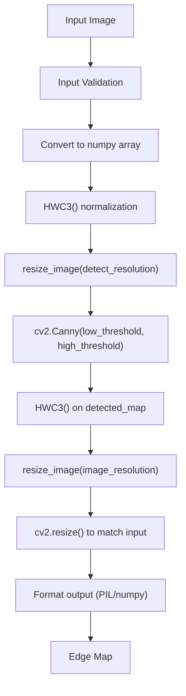
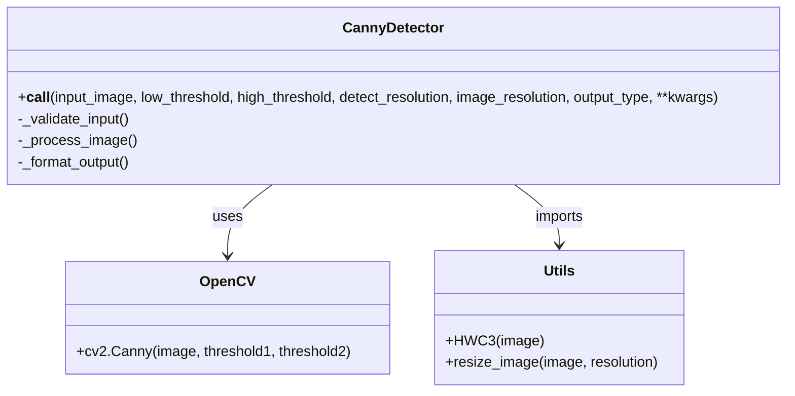
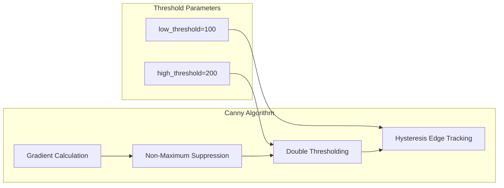
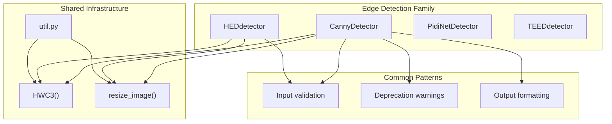
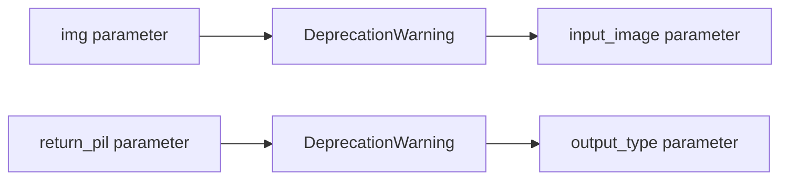

<!-- source: DeepWiki mcp.deepwiki.com · repo huggingface/controlnet_aux · extra page Canny Detector · fetched 2026-10-26 -->

# Canny Detector

<details>
<summary>Relevant source files</summary>

The following files were used as context for generating this wiki page:

- [src/controlnet_aux/canny/__init__.py](src/controlnet_aux/canny/__init__.py)
- [src/controlnet_aux/mediapipe_face/__init__.py](src/controlnet_aux/mediapipe_face/__init__.py)
- [src/controlnet_aux/segment_anything/__init__.py](src/controlnet_aux/segment_anything/__init__.py)

</details>


The Canny Detector provides classical edge detection using the Canny edge detection algorithm implemented through OpenCV. This detector offers a lightweight, parameter-driven approach to edge detection without requiring neural network models or checkpoints.

For other edge detection methods, see [HED Detector](#4.1.1) for neural network-based holistic edge detection, [PiDiNet Detector](#4.1.3) for pixel difference networks, and [TEED and Anyline Detectors](#4.1.4) for efficient deep learning approaches.

## Overview

The `CannyDetector` class implements the classical Canny edge detection algorithm, which uses gradient analysis and non-maximum suppression to identify edges in images. Unlike other edge detectors in the controlnet_aux library, the Canny detector operates purely through computer vision techniques without requiring trained model weights.



Sources: [src/controlnet_aux/canny/__init__.py:1-37]()

## Architecture and Implementation

The Canny detector follows the standard detector pattern established in controlnet_aux, implementing a callable class with parameter validation and flexible input/output handling.

### Class Structure



The detector implements these key processing steps:

1. **Input validation and conversion**: Handles both PIL Image and numpy array inputs
2. **Image preprocessing**: Applies `HWC3` normalization and resolution adjustment  
3. **Edge detection**: Calls `cv2.Canny` with configurable thresholds
4. **Output formatting**: Resizes and formats results as PIL or numpy arrays

Sources: [src/controlnet_aux/canny/__init__.py:7-36]()

## Parameters and Configuration

The Canny detector accepts several parameters for controlling edge detection behavior:

| Parameter | Type | Default | Description |
|-----------|------|---------|-------------|
| `input_image` | Image/ndarray | Required | Input image for edge detection |
| `low_threshold` | int | 100 | Lower threshold for edge linking |
| `high_threshold` | int | 200 | Upper threshold for initial edge detection |
| `detect_resolution` | int | 512 | Resolution for edge detection processing |
| `image_resolution` | int | 512 | Final output image resolution |
| `output_type` | str | "pil"/"np" | Output format (PIL Image or numpy array) |

### Threshold Configuration



The thresholds control edge sensitivity:
- **High threshold**: Pixels above this value are definitely edges
- **Low threshold**: Pixels below this value are definitely not edges  
- **Between thresholds**: Pixels are edges only if connected to definite edges

Sources: [src/controlnet_aux/canny/__init__.py:8](), [src/controlnet_aux/canny/__init__.py:25]()

## Integration with controlnet_aux Ecosystem

The Canny detector integrates with the broader controlnet_aux system through shared utilities and consistent interfaces:



### Unique Characteristics

Unlike neural network-based edge detectors in the system, the Canny detector:

- **No model loading**: Instantiates directly without checkpoints
- **Pure OpenCV**: Uses `cv2.Canny` for edge detection  
- **Lightweight**: Minimal memory footprint and fast execution
- **Parameter-driven**: Behavior controlled entirely through thresholds

Sources: [src/controlnet_aux/canny/__init__.py:1-5](), [src/controlnet_aux/util.py]()

## Usage Patterns

The Canny detector supports both direct instantiation and integration with the Processor interface:

### Direct Usage
```python
# Direct instantiation - no from_pretrained() needed
detector = CannyDetector()
edge_map = detector(image, low_threshold=50, high_threshold=150)
```

### Processor Integration
```python 
# Via Processor interface
processor = Processor("canny")
edge_map = processor(image, low_threshold=50, high_threshold=150)
```

### Deprecation Handling

The detector includes backward compatibility through deprecation warnings:



Sources: [src/controlnet_aux/canny/__init__.py:9-11]()

## Performance Characteristics

The Canny detector offers distinct performance advantages within the controlnet_aux ecosystem:

| Characteristic | Canny | Neural Network Detectors |
|---------------|-------|-------------------------|
| **Initialization** | Instant | Model loading required |
| **Memory Usage** | Minimal | GPU memory for models |
| **Processing Speed** | Very fast | Depends on model size |
| **Customization** | Threshold tuning | Limited parameters |
| **Dependencies** | OpenCV only | PyTorch + model weights |

This makes the Canny detector particularly suitable for:
- Real-time applications requiring fast edge detection
- Resource-constrained environments  
- Cases where classical edge detection suffices
- Baseline comparisons with neural approaches

Sources: [src/controlnet_aux/canny/__init__.py:25]()

---

