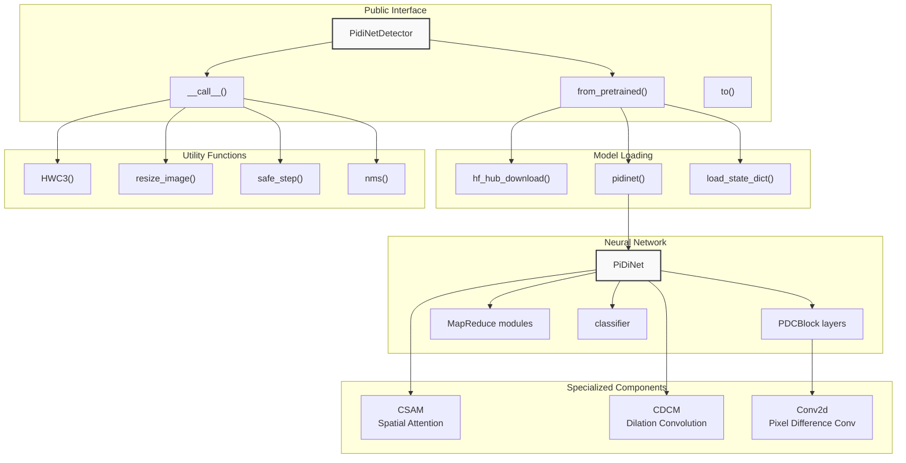
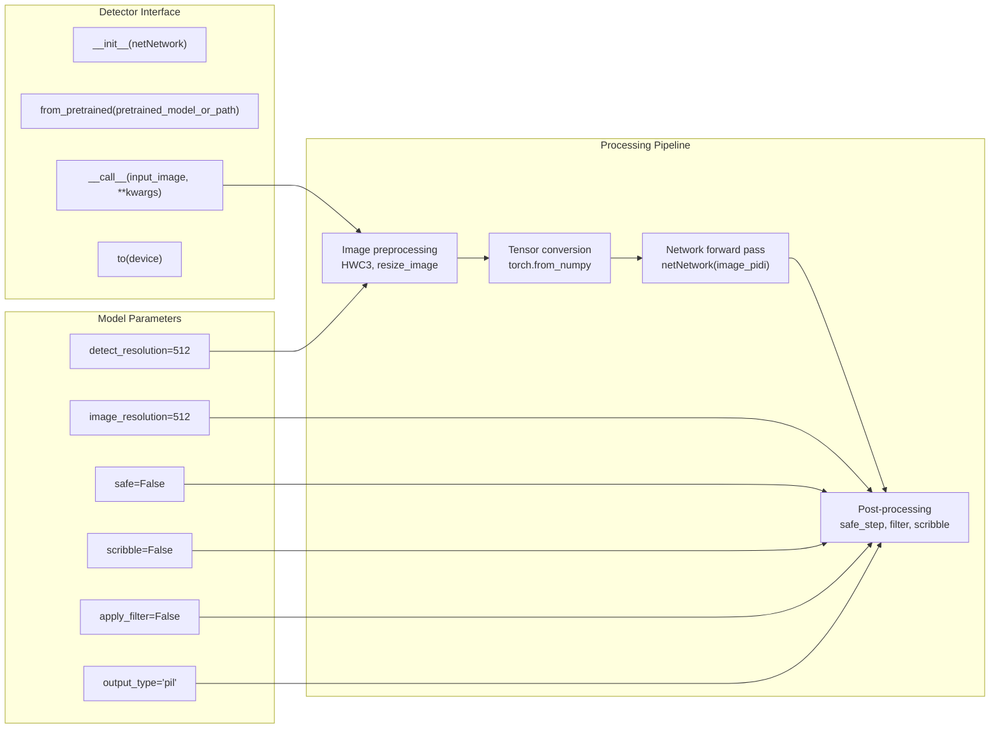
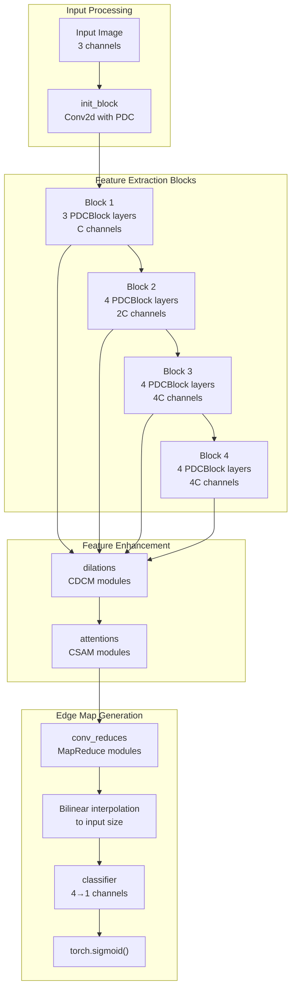
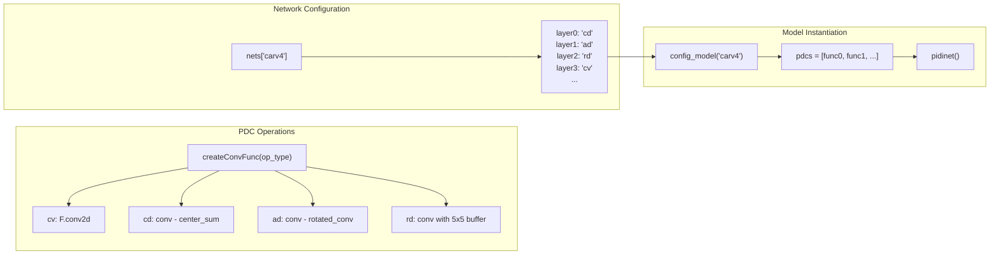
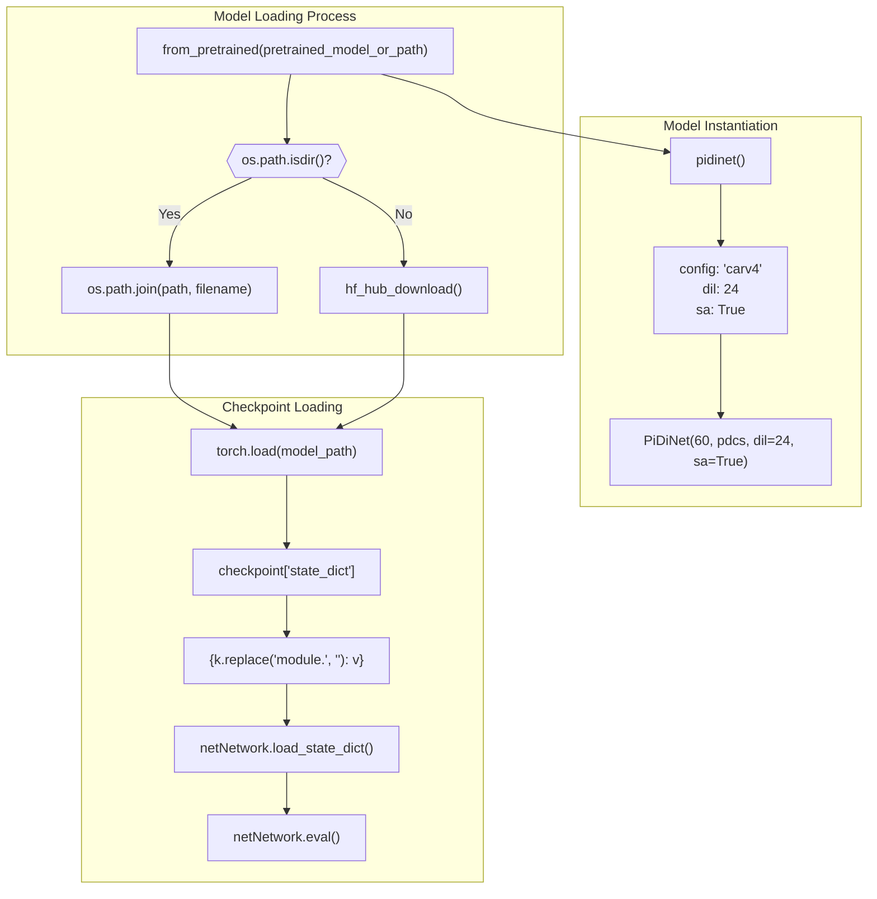

<!-- source: DeepWiki mcp.deepwiki.com · repo huggingface/controlnet_aux · extra page PiDiNet Detector · fetched 2026-10-26 -->

# PiDiNet Detector

Relevant source files

The following files were used as context for generating this wiki page:

- [src/controlnet_aux/leres/leres/net_tools.py](src/controlnet_aux/leres/leres/net_tools.py)
- [src/controlnet_aux/leres/pix2pix/models/__init__.py](src/controlnet_aux/leres/pix2pix/models/__init__.py)
- [src/controlnet_aux/normalbae/__init__.py](src/controlnet_aux/normalbae/__init__.py)
- [src/controlnet_aux/pidi/__init__.py](src/controlnet_aux/pidi/__init__.py)
- [src/controlnet_aux/pidi/model.py](src/controlnet_aux/pidi/model.py)

The PiDiNet Detector implements Pixel Difference Network (PiDiNet) for edge detection in images. This detector specializes in generating clean edge maps with configurable safety filtering and scribble mode processing. 

For general edge detection overview, see [Edge Detection](#4.1). For classical edge detection, see [Canny Detector](#4.1.2). For multi-scale edge detection, see [HED Detector](#4.1.1).

## System Architecture

The PiDiNet detector consists of two main components: the detector interface and the underlying neural network model.

**Architecture Overview**: The `PidiNetDetector` serves as a wrapper around the `PiDiNet` neural network model, providing model loading through Hugging Face Hub and post-processing utilities for edge map generation.

Sources: [src/controlnet_aux/pidi/__init__.py:15-84](), [src/controlnet_aux/pidi/model.py:493-644]()

## Class Structure and Interface

The detector follows the standard controlnet_aux pattern with class-based instantiation and callable interface.

| Component | Type | Purpose | Key Methods |
|-----------|------|---------|-------------|
| `PidiNetDetector` | Main Class | Edge detection interface | `from_pretrained()`, `__call__()`, `to()` |
| `PiDiNet` | Neural Network | Core edge detection model | `forward()`, `get_weights()` |
| `Conv2d` | Convolution Layer | Pixel difference convolutions | `forward()` with PDC operations |
| `PDCBlock` | Building Block | Residual blocks with PDC | Depthwise separable convolution |
| `CSAM` | Attention Module | Spatial attention mechanism | Compact attention weighting |
| `CDCM` | Dilation Module | Multi-scale feature extraction | Multiple dilation rates |

**Class Design**: The `PidiNetDetector` implements a consistent interface pattern where `from_pretrained()` handles model loading and `__call__()` performs inference with extensive parameter control.

Sources: [src/controlnet_aux/pidi/__init__.py:15-37](), [src/controlnet_aux/pidi/__init__.py:38-84]()

## Neural Network Architecture

The PiDiNet model implements a specialized architecture for edge detection using Pixel Difference Convolutions (PDC).

**Architecture Details**: The model uses a 4-block hierarchical structure with progressive channel doubling, enhanced by dilation convolution (`CDCM`) and spatial attention (`CSAM`) modules for multi-scale feature extraction.

### Pixel Difference Convolutions

The core innovation of PiDiNet lies in its specialized convolution operations defined in the `nets` configuration:

| PDC Type | Code | Operation | Kernel Size |
|----------|------|-----------|-------------|
| Standard | `cv` | `F.conv2d` | 3x3 |
| Center Difference | `cd` | `conv - center_sum` | 3x3 |
| Angular Difference | `ad` | `conv - rotated_weights` | 3x3 |
| Radial Difference | `rd` | `conv with 5x5 buffer` | 5x5 effective |

**PDC Implementation**: Each layer type implements different pixel difference operations, with the `carv4` configuration providing a balanced mix of all four types across 16 layers.

Sources: [src/controlnet_aux/pidi/model.py:298-344](), [src/controlnet_aux/pidi/model.py:43-296](), [src/controlnet_aux/pidi/model.py:661-664]()

## Processing Pipeline and Parameters

The detector provides comprehensive control over edge detection behavior through multiple processing stages.

```mermaid
graph TB
    subgraph "Input Preprocessing"
        INPUT_IMG["input_image"]
        HWC3_NORM["HWC3(input_image)"]
        RESIZE_DETECT["resize_image(detect_resolution)"]
        BGR_TO_RGB["image[:, :, ::-1]"]
        NORMALIZE["/ 255.0"]
        REARRANGE["rearrange('h w c -> 1 c h w')"]
    end
    
    subgraph "Network Inference"
        FORWARD["netNetwork(image_pidi)"]
        GET_EDGE["edge = output[-1]"]
        CPU_NUMPY["edge.cpu().numpy()"]
    end
    
    subgraph "Post-processing Options"
        APPLY_FILTER_CHECK{{"apply_filter?"}}
        FILTER_OP["edge > 0.5"]
        SAFE_CHECK{{"safe?"}}
        SAFE_STEP_OP["safe_step(edge)"]
        CLIP_SCALE["(edge * 255.0).clip(0, 255)"]
    end
    
    subgraph "Output Formatting"
        RESIZE_OUTPUT["resize to image_resolution"]
        SCRIBBLE_CHECK{{"scribble?"}}
        NMS_OP["nms(detected_map, 127, 3.0)"]
        GAUSSIAN_BLUR["GaussianBlur(0, 0, 3.0)"]
        THRESHOLD["threshold 4/255"]
        OUTPUT_TYPE_CHECK{{"output_type == 'pil'?"}}
        PIL_CONVERT["Image.fromarray()"]
    end
    
    INPUT_IMG --> HWC3_NORM
    HWC3_NORM --> RESIZE_DETECT
    RESIZE_DETECT --> BGR_TO_RGB
    BGR_TO_RGB --> NORMALIZE
    NORMALIZE --> REARRANGE
    REARRANGE --> FORWARD
    FORWARD --> GET_EDGE
    GET_EDGE --> CPU_NUMPY
    
    CPU_NUMPY --> APPLY_FILTER_CHECK
    APPLY_FILTER_CHECK -->|Yes| FILTER_OP
    APPLY_FILTER_CHECK -->|No| SAFE_CHECK
    FILTER_OP --> SAFE_CHECK
    SAFE_CHECK -->|Yes| SAFE_STEP_OP
    SAFE_CHECK -->|No| CLIP_SCALE
    SAFE_STEP_OP --> CLIP_SCALE
    
    CLIP_SCALE --> RESIZE_OUTPUT
    RESIZE_OUTPUT --> SCRIBBLE_CHECK
    SCRIBBLE_CHECK -->|Yes| NMS_OP
    SCRIBBLE_CHECK -->|No| OUTPUT_TYPE_CHECK
    NMS_OP --> GAUSSIAN_BLUR
    GAUSSIAN_BLUR --> THRESHOLD
    THRESHOLD --> OUTPUT_TYPE_CHECK
    OUTPUT_TYPE_CHECK -->|Yes| PIL_CONVERT
```

**Parameter Control**: The processing pipeline offers fine-grained control through `apply_filter` for binary thresholding, `safe` for gradient-aware processing, and `scribble` for artistic line extraction.

### Key Processing Parameters

| Parameter | Type | Default | Purpose |
|-----------|------|---------|---------|
| `detect_resolution` | int | 512 | Input resolution for edge detection |
| `image_resolution` | int | 512 | Output resolution for final image |
| `safe` | bool | False | Apply safe_step gradient processing |
| `apply_filter` | bool | False | Apply 0.5 threshold to edge values |
| `scribble` | bool | False | Generate scribble-style line art |
| `output_type` | str | "pil" | Output format ("pil" or "np") |

**Scribble Mode Processing**: When `scribble=True`, the detector applies Non-Maximum Suppression (`nms`) followed by Gaussian blur and binary thresholding to create clean line art suitable for artistic applications.

Sources: [src/controlnet_aux/pidi/__init__.py:38-84](), [src/controlnet_aux/util.py]() (referenced functions)

## Model Loading and Configuration

The detector supports flexible model loading from Hugging Face Hub with automatic checkpoint handling.

**Default Configuration**: The detector uses the `carv4` architecture with 60 input channels, dilation factor of 24, and spatial attention enabled, representing the optimal configuration from the original PiDiNet paper.

**Checkpoint Compatibility**: The loading process automatically strips `module.` prefixes from state dict keys to handle both DataParallel and standard model checkpoints seamlessly.

Sources: [src/controlnet_aux/pidi/__init__.py:19-32](), [src/controlnet_aux/pidi/model.py:661-664](), [src/controlnet_aux/pidi/model.py:646-659]()

---

