<!-- source: DeepWiki mcp.deepwiki.com · repo huggingface/controlnet_aux · extra page SAM Detector · fetched 2026-10-26 -->

# SAM Detector

<details>
<summary>Relevant source files</summary>

The following files were used as context for generating this wiki page:

- [src/controlnet_aux/canny/__init__.py](src/controlnet_aux/canny/__init__.py)
- [src/controlnet_aux/mediapipe_face/__init__.py](src/controlnet_aux/mediapipe_face/__init__.py)
- [src/controlnet_aux/segment_anything/__init__.py](src/controlnet_aux/segment_anything/__init__.py)
- [src/controlnet_aux/segment_anything/build_sam.py](src/controlnet_aux/segment_anything/build_sam.py)
- [src/controlnet_aux/segment_anything/modeling/__init__.py](src/controlnet_aux/segment_anything/modeling/__init__.py)
- [src/controlnet_aux/segment_anything/modeling/sam.py](src/controlnet_aux/segment_anything/modeling/sam.py)
- [src/controlnet_aux/segment_anything/modeling/tiny_vit_sam.py](src/controlnet_aux/segment_anything/modeling/tiny_vit_sam.py)
- [src/controlnet_aux/segment_anything/predictor.py](src/controlnet_aux/segment_anything/predictor.py)

</details>


## Purpose and Scope

The SAM Detector implements the Segment Anything Model (SAM) for universal object segmentation. It provides automatic mask generation capabilities that can segment any object in an image without requiring specific prompts or training data for particular object categories. This detector is part of the controlnet_aux segmentation systems and generates colored masks representing different segments in the input image.

For face-specific segmentation, see [Face and Content Detectors](#4.5.2). For other segmentation approaches in the codebase, refer to the broader [Segmentation](#4.5) category.

## Architecture Overview

The SAM Detector is built on Meta's Segment Anything Model architecture, consisting of three main components: an image encoder, prompt encoder, and mask decoder working together to produce high-quality segmentation masks.

```mermaid
graph TD
    subgraph "SamDetector Interface"
        DETECTOR["SamDetector"]
        FROM_PRETRAINED["from_pretrained()"]
        CALL_METHOD["__call__()"]
        SHOW_ANNS["show_anns()"]
    end
    
    subgraph "Core SAM Architecture"
        SAM_MODEL["Sam"]
        IMAGE_ENCODER["ImageEncoderViT / TinyViT"]
        PROMPT_ENCODER["PromptEncoder"]
        MASK_DECODER["MaskDecoder"]
    end
    
    subgraph "Mask Generation System"
        MASK_GEN["SamAutomaticMaskGenerator"]
        PREDICTOR["SamPredictor"]
        TRANSFORM["ResizeLongestSide"]
    end
    
    subgraph "Model Variants"
        VIT_H["build_sam_vit_h"]
        VIT_L["build_sam_vit_l"]
        VIT_B["build_sam_vit_b"]
        VIT_T["build_sam_vit_t"]
        REGISTRY["sam_model_registry"]
    end
    
    DETECTOR --> MASK_GEN
    FROM_PRETRAINED --> REGISTRY
    REGISTRY --> VIT_H
    REGISTRY --> VIT_L
    REGISTRY --> VIT_B
    REGISTRY --> VIT_T
    
    VIT_H --> SAM_MODEL
    VIT_L --> SAM_MODEL
    VIT_B --> SAM_MODEL
    VIT_T --> SAM_MODEL
    
    SAM_MODEL --> IMAGE_ENCODER
    SAM_MODEL --> PROMPT_ENCODER
    SAM_MODEL --> MASK_DECODER
    
    MASK_GEN --> SAM_MODEL
    PREDICTOR --> SAM_MODEL
    PREDICTOR --> TRANSFORM
    
    CALL_METHOD --> MASK_GEN
    SHOW_ANNS --> "Colored Mask Output"
```

**Sources:** [src/controlnet_aux/segment_anything/__init__.py:22-44](), [src/controlnet_aux/segment_anything/build_sam.py:96-102](), [src/controlnet_aux/segment_anything/modeling/sam.py:19-49]()

## Processing Pipeline

The SAM detector follows a systematic pipeline from input image to colored segmentation output, involving multiple stages of processing and mask generation.

```mermaid
graph LR
    subgraph "Input Processing"
        INPUT_IMG["input_image"]
        HWC3_FUNC["HWC3()"]
        RESIZE_FUNC["resize_image()"]
    end
    
    subgraph "SAM Model Processing"
        GENERATE["mask_generator.generate()"]
        IMAGE_EMBEDDINGS["Image Embeddings"]
        MASK_PREDICTION["Mask Prediction"]
    end
    
    subgraph "Post-Processing"
        SHOW_ANNS_FUNC["show_anns()"]
        CV2_RESIZE["cv2.resize()"]
        OUTPUT_FORMAT["PIL/numpy output"]
    end
    
    INPUT_IMG --> HWC3_FUNC
    HWC3_FUNC --> RESIZE_FUNC
    RESIZE_FUNC --> GENERATE
    
    GENERATE --> IMAGE_EMBEDDINGS
    IMAGE_EMBEDDINGS --> MASK_PREDICTION
    MASK_PREDICTION --> SHOW_ANNS_FUNC
    
    SHOW_ANNS_FUNC --> CV2_RESIZE
    CV2_RESIZE --> OUTPUT_FORMAT
```



**Sources:** [src/controlnet_aux/segment_anything/__init__.py:62-92](), [src/controlnet_aux/segment_anything/__init__.py:47-60]()

## Model Variants

The SAM Detector supports four different model architectures with varying computational requirements and performance characteristics:

| Model Type | Architecture | Parameters | Image Encoder | Use Case |
|------------|--------------|------------|---------------|----------|
| `vit_h` | ViT-Huge | ~630M | ImageEncoderViT (1280 embed_dim) | Highest accuracy |
| `vit_l` | ViT-Large | ~310M | ImageEncoderViT (1024 embed_dim) | Balanced performance |
| `vit_b` | ViT-Base | ~90M | ImageEncoderViT (768 embed_dim) | Standard usage |
| `vit_t` | TinyViT | ~5-21M | TinyViT | Mobile/edge deployment |

The model registry provides easy access to these variants:

```python
sam_model_registry = {
    "default": build_sam_vit_h,
    "vit_h": build_sam_vit_h,
    "vit_l": build_sam_vit_l,
    "vit_b": build_sam_vit_b,
    "vit_t": build_sam_vit_t,
}
```

**Sources:** [src/controlnet_aux/segment_anything/build_sam.py:96-102](), [src/controlnet_aux/segment_anything/build_sam.py:14-44](), [src/controlnet_aux/segment_anything/build_sam.py:47-93]()

## Key Classes and Methods

### SamDetector Class

The main interface for SAM functionality, providing both model loading and inference capabilities.

**Key Methods:**
- `from_pretrained(pretrained_model_or_path, model_type, filename)` - Loads SAM models from Hugging Face Hub or local paths
- `__call__(input_image, detect_resolution, image_resolution, output_type)` - Main inference method
- `show_anns(anns)` - Converts raw masks to colored visualization

**Sources:** [src/controlnet_aux/segment_anything/__init__.py:22-93]()

### SamAutomaticMaskGenerator

Handles automatic mask generation without requiring specific prompts. This class is instantiated within `SamDetector` and drives the core segmentation functionality.

**Sources:** [src/controlnet_aux/segment_anything/__init__.py:18](), [src/controlnet_aux/segment_anything/__init__.py:42]()

### SamPredictor

Provides prompt-based mask prediction capabilities, supporting point prompts, box prompts, and mask inputs for interactive segmentation.

**Key Methods:**
- `set_image(image, image_format)` - Preprocesses and sets the target image
- `predict(point_coords, point_labels, box, mask_input)` - Generates masks from prompts
- `predict_torch()` - PyTorch tensor-based prediction interface

**Sources:** [src/controlnet_aux/segment_anything/predictor.py:17-270]()

## Implementation Details

### Image Processing Pipeline

The detector follows a standardized image processing approach consistent with other controlnet_aux detectors:

1. **Input Validation**: Ensures `input_image` is provided and handles deprecated parameter names
2. **Format Conversion**: Converts PIL images to numpy arrays using `HWC3()` utility
3. **Resolution Processing**: Applies `resize_image()` for both detection and output resolutions
4. **Mask Generation**: Uses `SamAutomaticMaskGenerator.generate()` for automatic segmentation
5. **Visualization**: Converts masks to colored output via `show_anns()`
6. **Output Formatting**: Returns PIL Image or numpy array based on `output_type` parameter

**Sources:** [src/controlnet_aux/segment_anything/__init__.py:62-92]()

### Model Loading Strategy

The SAM detector implements a flexible model loading system supporting both local and remote checkpoints:

```python
if os.path.isdir(pretrained_model_or_path):
    model_path = os.path.join(pretrained_model_or_path, filename)
else:
    model_path = hf_hub_download(pretrained_model_or_path, filename, subfolder=subfolder, cache_dir=cache_dir)
```

Models are automatically moved to CUDA if available and wrapped in `SamAutomaticMaskGenerator` for immediate use.

**Sources:** [src/controlnet_aux/segment_anything/__init__.py:27-44]()

### Architecture Components

The core SAM model consists of three specialized components:

- **Image Encoder**: Either `ImageEncoderViT` or `TinyViT` depending on model variant, responsible for generating image embeddings
- **Prompt Encoder**: `PromptEncoder` handles various input prompts (points, boxes, masks)
- **Mask Decoder**: `MaskDecoder` with `TwoWayTransformer` generates final segmentation masks

**Sources:** [src/controlnet_aux/segment_anything/modeling/sam.py:23-49](), [src/controlnet_aux/segment_anything/build_sam.py:105-157]()

---

