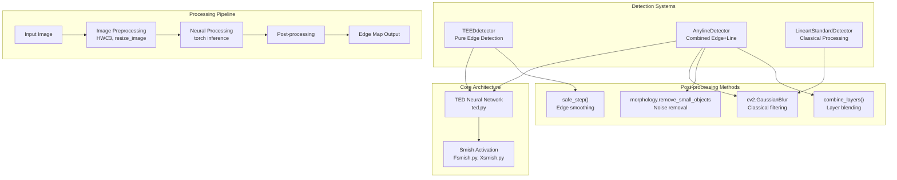
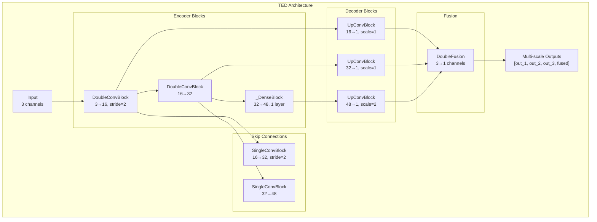
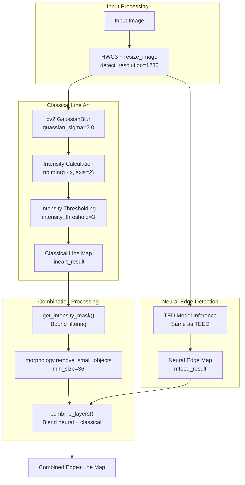
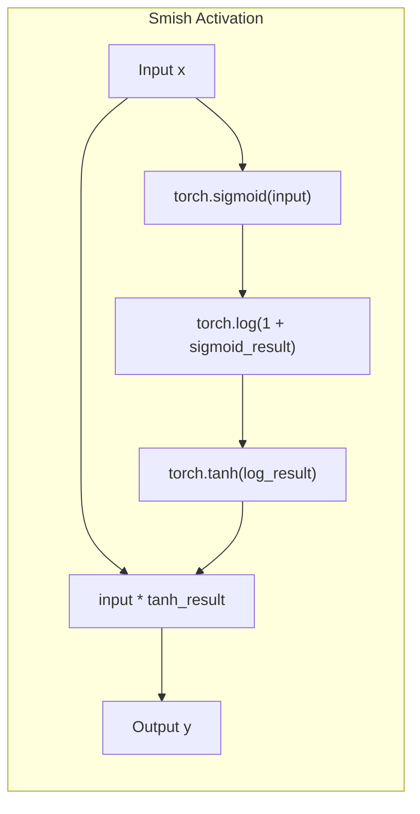
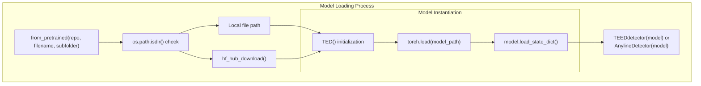

<!-- source: DeepWiki mcp.deepwiki.com · repo huggingface/controlnet_aux · extra page TEED and Anyline Detectors · fetched 2026-10-26 -->

# TEED and Anyline Detectors

<details>
<summary>Relevant source files</summary>

The following files were used as context for generating this wiki page:

- [src/controlnet_aux/anyline/__init__.py](src/controlnet_aux/anyline/__init__.py)
- [src/controlnet_aux/lineart_standard/__init__.py](src/controlnet_aux/lineart_standard/__init__.py)
- [src/controlnet_aux/teed/Fsmish.py](src/controlnet_aux/teed/Fsmish.py)
- [src/controlnet_aux/teed/LICENSE.txt](src/controlnet_aux/teed/LICENSE.txt)
- [src/controlnet_aux/teed/Xsmish.py](src/controlnet_aux/teed/Xsmish.py)
- [src/controlnet_aux/teed/__init__.py](src/controlnet_aux/teed/__init__.py)
- [src/controlnet_aux/teed/ted.py](src/controlnet_aux/teed/ted.py)

</details>


This document covers the Tiny Efficient Edge Detection (TEED) and Anyline detection systems within controlnet_aux. These detectors provide edge detection and combined edge/line art generation capabilities for ControlNet preprocessing.

The TEED detector focuses on efficient neural edge detection, while the Anyline detector combines neural edge detection with classical line art techniques. For broader edge detection options, see [Edge Detection](#4.1). For line art generation, see [Line Art Generation](#4.4).

## Overview

The TEED and Anyline detectors represent hybrid approaches to edge and line detection, combining deep learning models with classical computer vision techniques. Both detectors utilize the same underlying `TED` neural network architecture but apply different post-processing strategies.



Sources: [src/controlnet_aux/teed/__init__.py:1-85](), [src/controlnet_aux/anyline/__init__.py:1-119](), [src/controlnet_aux/teed/ted.py:1-333]()

## TEED Detector Architecture

The `TEEDdetector` class provides a streamlined interface to the Tiny Efficient Edge Detector neural network. The detector loads pretrained models and performs inference with configurable safety post-processing.

### Core Components

| Component | File Location | Purpose |
|-----------|---------------|---------|
| `TEEDdetector` | [src/controlnet_aux/teed/__init__.py:14-84]() | Main detector interface |
| `TED` | [src/controlnet_aux/teed/ted.py:215-312]() | Neural network architecture |
| `Smish` | [src/controlnet_aux/teed/Xsmish.py:16-42]() | Custom activation function |
| `smish` | [src/controlnet_aux/teed/Fsmish.py:12-19]() | JIT-compiled activation |

### Neural Network Architecture

The `TED` model implements a compact edge detection architecture with the following structure:



Sources: [src/controlnet_aux/teed/ted.py:215-312](), [src/controlnet_aux/teed/ted.py:280-311]()

### Processing Pipeline

The TEED detector follows this processing sequence:

1. **Preprocessing**: [src/controlnet_aux/teed/__init__.py:50-54]()
   - Convert input to numpy array
   - Apply `HWC3` normalization
   - Resize to detection resolution

2. **Neural Inference**: [src/controlnet_aux/teed/__init__.py:57-67]()
   - Convert to torch tensor
   - Forward pass through `TED` model
   - Multi-scale edge prediction

3. **Post-processing**: [src/controlnet_aux/teed/__init__.py:67-71]()
   - Sigmoid activation: `1 / (1 + np.exp(-np.mean(edges, axis=2)))`
   - Optional `safe_step` smoothing
   - Resize to original dimensions

Sources: [src/controlnet_aux/teed/__init__.py:36-84]()

## Anyline Detector Architecture

The `AnylineDetector` extends the TEED approach by combining neural edge detection with classical line art processing. This hybrid approach produces more comprehensive line detection suitable for artistic applications.

### Dual Processing Pipeline



Sources: [src/controlnet_aux/anyline/__init__.py:38-106]()

### Key Processing Methods

The Anyline detector implements several specialized processing methods:

**Intensity Mask Generation**: [src/controlnet_aux/anyline/__init__.py:108-112]()
```python
def get_intensity_mask(self, image_array, lower_bound, upper_bound):
    mask = image_array[:, :, 0]
    mask = np.where((mask >= lower_bound) & (mask <= upper_bound), mask, 0)
    mask = np.expand_dims(mask, 2).repeat(3, axis=2)
    return mask
```

**Layer Combination**: [src/controlnet_aux/anyline/__init__.py:114-118]()
```python
def combine_layers(self, base_layer, top_layer):
    mask = top_layer.astype(bool)
    temp = 1 - (1 - top_layer) * (1 - base_layer)
    result = base_layer * (~mask) + temp * mask
    return result
```

Sources: [src/controlnet_aux/anyline/__init__.py:108-118]()

## Activation Function System

Both detectors utilize the custom Smish activation function, which combines properties of sigmoid and tanh functions for improved edge detection performance.

### Smish Implementation



The mathematical formula implemented is: `smish(x) = x * tanh(ln(1 + sigmoid(x)))`

Sources: [src/controlnet_aux/teed/Fsmish.py:12-19](), [src/controlnet_aux/teed/Xsmish.py:16-42]()

## Usage Patterns

### TEED Detector Usage

```python
# Via Processor interface
processor = Processor('teed')
result = processor(image, detect_resolution=512, safe_steps=2)

# Direct instantiation
detector = TEEDdetector.from_pretrained('lllyasviel/Annotators')
result = detector(image, detect_resolution=512, safe_steps=2)
```

### Anyline Detector Usage

```python
# Via Processor interface  
processor = Processor('anyline')
result = processor(image, detect_resolution=1280, guassian_sigma=2.0)

# Direct instantiation
detector = AnylineDetector.from_pretrained('TheMistoAI/MistoLine')
result = detector(image, detect_resolution=1280, guassian_sigma=2.0, intensity_threshold=3)
```

### Configuration Parameters

| Parameter | TEED Default | Anyline Default | Purpose |
|-----------|--------------|-----------------|---------|
| `detect_resolution` | 512 | 1280 | Processing resolution |
| `safe_steps` | 2 | N/A | Edge smoothing iterations |
| `guassian_sigma` | N/A | 2.0 | Gaussian blur strength |
| `intensity_threshold` | N/A | 3 | Line art threshold |

Sources: [src/controlnet_aux/teed/__init__.py:36-42](), [src/controlnet_aux/anyline/__init__.py:38-45]()

## Model Loading and Checkpoints

Both detectors support loading from Hugging Face Hub repositories using the `from_pretrained` class method pattern:



Sources: [src/controlnet_aux/teed/__init__.py:18-30](), [src/controlnet_aux/anyline/__init__.py:20-32]()

---

