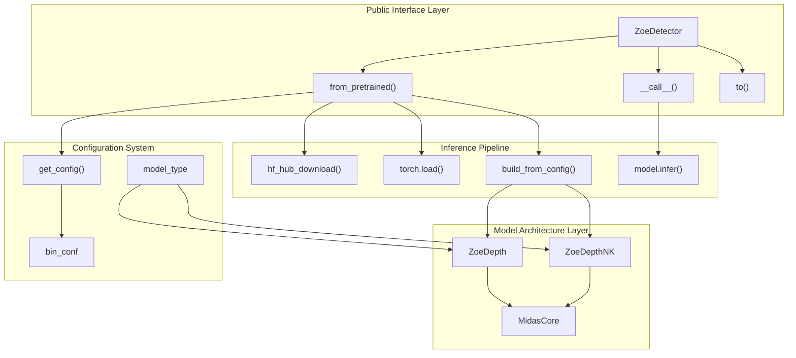
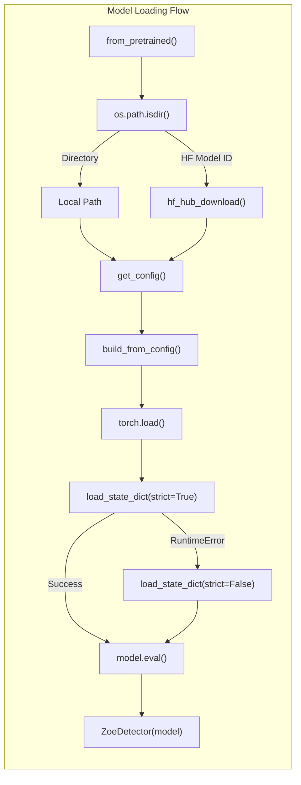
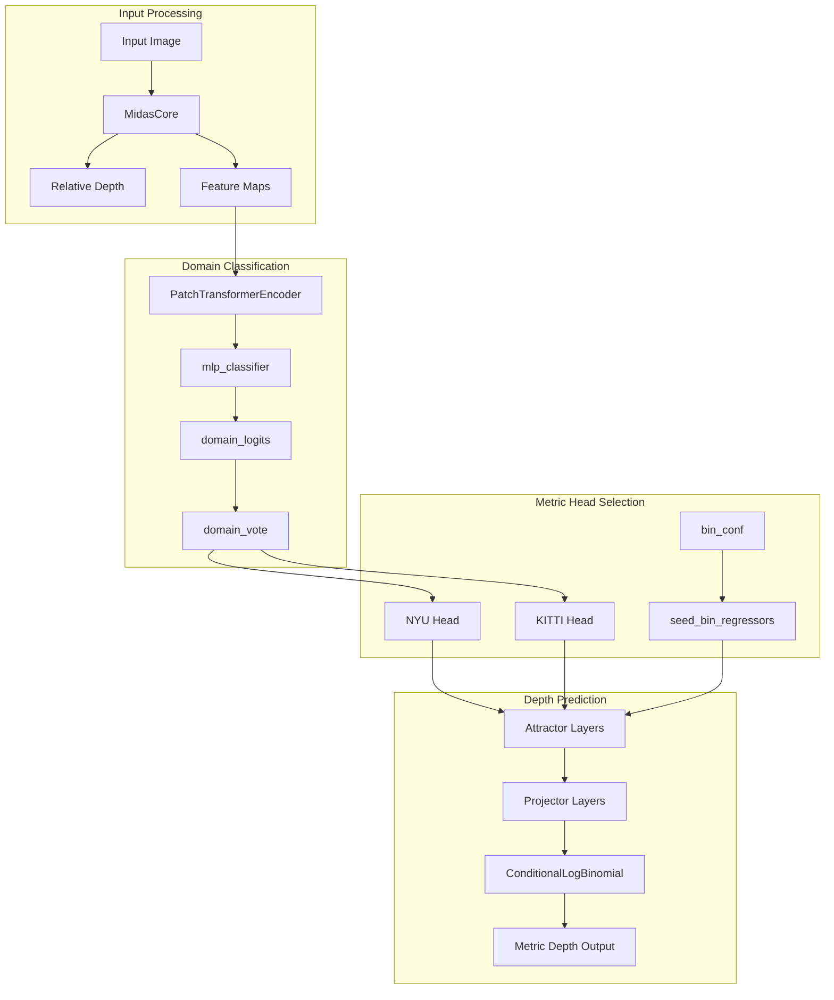
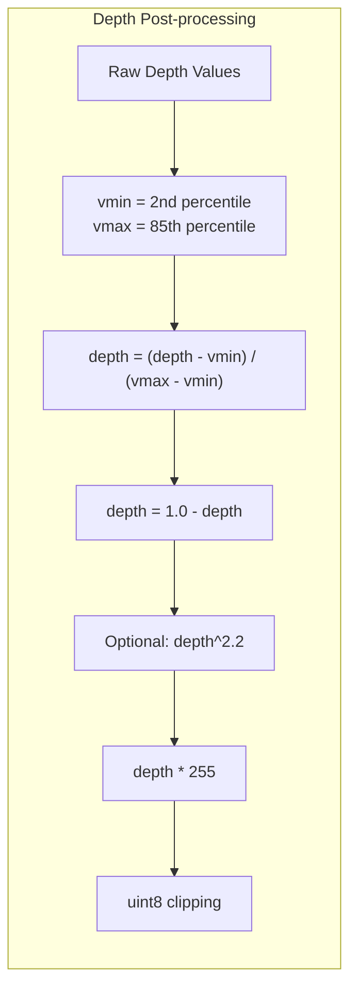

<!-- source: DeepWiki mcp.deepwiki.com · repo huggingface/controlnet_aux · extra page ZoeDepth Detector · fetched 2026-10-26 -->

# ZoeDepth Detector

Relevant source files

The following files were used as context for generating this wiki page:

- [src/controlnet_aux/zoe/__init__.py](src/controlnet_aux/zoe/__init__.py)
- [src/controlnet_aux/zoe/zoedepth/models/zoedepth_nk/zoedepth_nk_v1.py](src/controlnet_aux/zoe/zoedepth/models/zoedepth_nk/zoedepth_nk_v1.py)

The ZoeDepth Detector provides monocular depth estimation capabilities using the ZoeDepth neural network architecture. This detector converts RGB images into metric depth maps, offering more accurate depth estimation compared to relative depth approaches. The system supports both standard ZoeDepth and ZoeDepthNK (multi-domain) model variants with optional gamma correction for improved depth visualization.

For general depth estimation concepts and the MiDaS-based approach, see [MiDaS Detector](#4.2.1). For normal map generation from depth, see [LeRes and Normal Map Detectors](#4.2.3).

## Architecture Overview

The ZoeDepth Detector follows a two-layer architecture with a public detector interface wrapping the underlying neural network models.

### System Components

**Sources:** [src/controlnet_aux/zoe/__init__.py:16-94](), [src/controlnet_aux/zoe/zoedepth/models/zoedepth_nk/zoedepth_nk_v1.py:40-348]()

### Model Variants

The detector supports two distinct model architectures:

| Model Type | Class | Description |
|------------|-------|-------------|
| `"zoedepth"` | `ZoeDepth` | Standard single-domain depth estimation |
| `"zoedepth_nk"` | `ZoeDepthNK` | Multi-domain model with learned routing between NYU and KITTI domains |

**Sources:** [src/controlnet_aux/zoe/__init__.py:29-31]()

## Model Loading and Initialization

### Loading Pipeline

**Sources:** [src/controlnet_aux/zoe/__init__.py:20-44]()

### Default Configuration

The detector uses specific defaults for model loading:

- **Default filename**: `"ZoeD_M12_N.pt"`
- **Default model type**: `"zoedepth"`
- **Fallback loading**: Attempts `strict=False` if strict loading fails

**Sources:** [src/controlnet_aux/zoe/__init__.py:22](), [src/controlnet_aux/zoe/__init__.py:32-40]()

## ZoeDepthNK Architecture Details

The `ZoeDepthNK` model implements a sophisticated multi-domain depth estimation system:

### Core Components

**Sources:** [src/controlnet_aux/zoe/zoedepth/models/zoedepth_nk/zoedepth_nk_v1.py:159-243]()

## Inference Pipeline

### Depth Estimation Process

The inference pipeline in `ZoeDetector.__call__()` follows these steps:

1. **Input Processing**
   - Convert input to numpy array if needed
   - Apply `HWC3()` color space normalization
   - Resize to detection resolution

2. **Model Inference**
   - Normalize pixel values to [0,1] range
   - Rearrange dimensions for batch processing
   - Call `model.infer()` for depth prediction

3. **Post-processing**
   - Extract depth from output tensor
   - Apply percentile-based normalization (2nd to 85th percentile)
   - Invert depth values (closer = brighter)
   - Optional gamma correction
   - Convert to uint8 format

**Sources:** [src/controlnet_aux/zoe/__init__.py:50-93]()

### Depth Normalization Algorithm

**Sources:** [src/controlnet_aux/zoe/__init__.py:71-80]()

## Configuration Options

### Inference Parameters

The `__call__()` method accepts several configuration parameters:

| Parameter | Type | Default | Description |
|-----------|------|---------|-------------|
| `detect_resolution` | int | 512 | Input resolution for depth estimation |
| `image_resolution` | int | 512 | Output resolution for final depth map |
| `output_type` | str | Auto-detected | `"pil"` or `"np"` for output format |
| `gamma_corrected` | bool | False | Apply gamma correction (power 2.2) to depth values |

**Sources:** [src/controlnet_aux/zoe/__init__.py:50]()

### Model Loading Parameters

The `from_pretrained()` method supports:

| Parameter | Type | Default | Description |
|-----------|------|---------|-------------|
| `model_type` | str | `"zoedepth"` | Model variant: `"zoedepth"` or `"zoedepth_nk"` |
| `filename` | str | `"ZoeD_M12_N.pt"` | Checkpoint filename |
| `cache_dir` | str | None | Local cache directory for models |
| `local_files_only` | bool | False | Disable downloading, use local files only |

**Sources:** [src/controlnet_aux/zoe/__init__.py:21-27]()

## Integration with controlnet_aux

The ZoeDepth Detector integrates with the broader controlnet_aux ecosystem through:

### Device Management
- Supports `.to(device)` method for GPU/CPU placement
- Automatically detects model device for tensor operations

### Output Format Compatibility
- Auto-detects input type (numpy/PIL) and sets appropriate output format
- Uses standard `HWC3()` utility for color space normalization
- Applies `resize_image()` utility for consistent resolutions

### Model Registry Integration
- Can be accessed through the unified `Processor` interface
- Registered in the `MODELS` dictionary for programmatic access

**Sources:** [src/controlnet_aux/zoe/__init__.py:46-48](), [src/controlnet_aux/zoe/__init__.py:58-59](), [src/controlnet_aux/zoe/__init__.py:85-88]()

---

