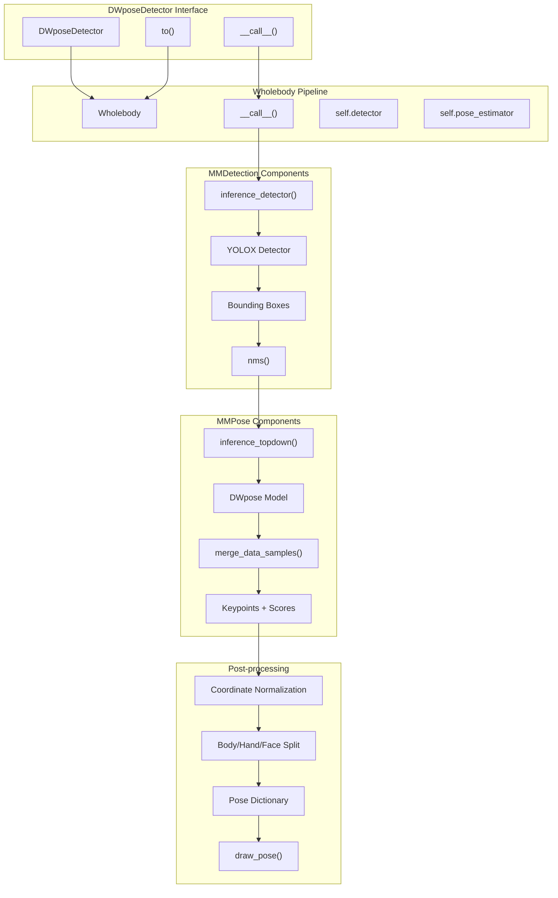
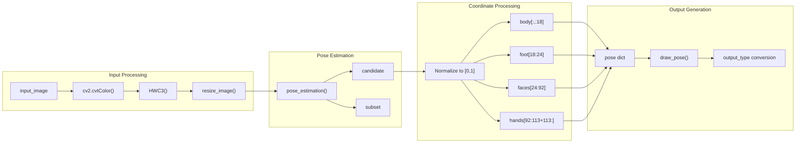
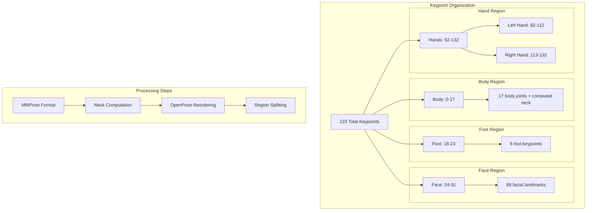
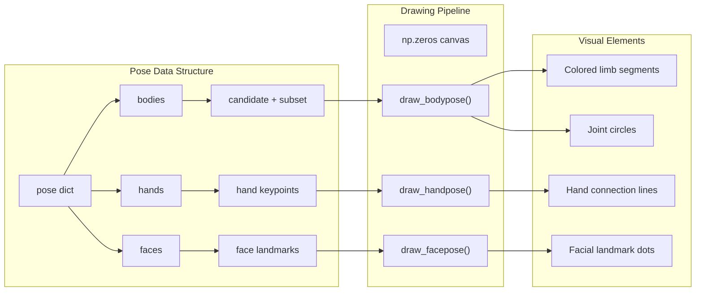

<!-- source: DeepWiki mcp.deepwiki.com · repo huggingface/controlnet_aux · extra page DWpose Detector · fetched 2026-10-26 -->

# DWpose Detector

<details>
<summary>Relevant source files</summary>

The following files were used as context for generating this wiki page:

- [src/controlnet_aux/dwpose/__init__.py](src/controlnet_aux/dwpose/__init__.py)
- [src/controlnet_aux/dwpose/dwpose_config/__init__.py](src/controlnet_aux/dwpose/dwpose_config/__init__.py)
- [src/controlnet_aux/dwpose/dwpose_config/dwpose-l_384x288.py](src/controlnet_aux/dwpose/dwpose_config/dwpose-l_384x288.py)
- [src/controlnet_aux/dwpose/util.py](src/controlnet_aux/dwpose/util.py)
- [src/controlnet_aux/dwpose/wholebody.py](src/controlnet_aux/dwpose/wholebody.py)
- [src/controlnet_aux/dwpose/yolox_config/__init__.py](src/controlnet_aux/dwpose/yolox_config/__init__.py)
- [src/controlnet_aux/dwpose/yolox_config/yolox_l_8xb8-300e_coco.py](src/controlnet_aux/dwpose/yolox_config/yolox_l_8xb8-300e_coco.py)
- [tests/test_controlnet_aux.py](tests/test_controlnet_aux.py)

</details>


The DWpose Detector provides wholebody pose estimation capabilities, detecting body, hand, and face keypoints from input images. This detector combines YOLOX person detection with DWpose wholebody pose estimation to produce comprehensive pose maps suitable for ControlNet conditioning.

For general pose estimation concepts, see [Pose Estimation](#4.3). For the alternative OpenPose implementation, see [OpenPose Detector](#4.3.2).

## System Architecture

The DWpose detector implements a two-stage pipeline: person detection followed by pose estimation. The system integrates MMDetection's YOLOX detector with MMPose's DWpose wholebody estimator to provide comprehensive pose detection including body, hands, and facial landmarks.



**Sources:** [src/controlnet_aux/dwpose/__init__.py:33-91](), [src/controlnet_aux/dwpose/wholebody.py:32-121]()

## Core Components

### DWposeDetector Class

The `DWposeDetector` class serves as the primary interface for wholebody pose estimation. It wraps the `Wholebody` pipeline and provides a consistent API for pose detection.

| Method | Purpose | Parameters |
|--------|---------|------------|
| `__init__()` | Initialize detector with model configs | `det_config`, `det_ckpt`, `pose_config`, `pose_ckpt`, `device` |
| `__call__()` | Process image and return pose visualization | `input_image`, `detect_resolution`, `image_resolution`, `output_type` |
| `to()` | Move models to specified device | `device` |



**Sources:** [src/controlnet_aux/dwpose/__init__.py:43-91]()

### Wholebody Pipeline

The `Wholebody` class implements the core pose estimation pipeline using MMDetection and MMPose frameworks. It handles model initialization, person detection, and pose keypoint estimation.

#### Model Configuration

| Component | Default Config | Default Checkpoint |
|-----------|----------------|-------------------|
| Detection | `yolox_l_8xb8-300e_coco.py` | YOLOX-L COCO checkpoint |
| Pose | `dwpose-l_384x288.py` | DW-LL UBody checkpoint |

#### Processing Pipeline

1. **Person Detection**: Uses YOLOX to detect person bounding boxes
2. **NMS Filtering**: Applies Non-Maximum Suppression with IoU threshold 0.7
3. **Pose Estimation**: Runs DWpose on detected persons or full image if no detections
4. **Keypoint Processing**: Extracts and processes wholebody keypoints
5. **Coordinate Mapping**: Converts from MMPose to OpenPose keypoint ordering

**Sources:** [src/controlnet_aux/dwpose/wholebody.py:33-121]()

## Keypoint Structure

The DWpose detector outputs 133 keypoints organized into distinct body regions:



**Sources:** [src/controlnet_aux/dwpose/__init__.py:56-78](), [src/controlnet_aux/dwpose/wholebody.py:100-116]()

## Pose Visualization

The detector includes comprehensive visualization capabilities through drawing utilities that render different pose components with distinct visual styles.

### Drawing Functions

| Function | Purpose | Visual Style |
|----------|---------|--------------|
| `draw_bodypose()` | Render body skeleton | Colored limbs with joint circles |
| `draw_handpose()` | Render hand keypoints | HSV-colored connections |
| `draw_facepose()` | Render facial landmarks | White circles |



**Sources:** [src/controlnet_aux/dwpose/__init__.py:19-31](), [src/controlnet_aux/dwpose/util.py:67-156]()

## Usage Patterns

### Basic Usage

```python
# Initialize detector
dwpose = DWposeDetector()

# Process image
pose_map = dwpose(input_image)
```

### Advanced Configuration

The detector supports custom model configurations and checkpoints:

```python
# Custom configuration
dwpose = DWposeDetector(
    det_config="path/to/detection_config.py",
    det_ckpt="path/to/detection_checkpoint.pth",
    pose_config="path/to/pose_config.py", 
    pose_ckpt="path/to/pose_checkpoint.pth",
    device="cuda"
)

# Process with custom resolutions
result = dwpose(
    input_image,
    detect_resolution=640,
    image_resolution=768,
    output_type="np"
)
```

**Sources:** [tests/test_controlnet_aux.py:123-126]()

## Model Dependencies

The DWpose detector requires several MMOpenLab packages:

| Package | Purpose | Version Requirement |
|---------|---------|---------------------|
| `mmcv` | Computer vision foundation | `>=2.0.1` |
| `mmpose` | Pose estimation framework | `>=1.1.0` |
| `mmdet` | Object detection framework | `>=3.1.0` |

The system gracefully handles missing dependencies by issuing warnings and limiting functionality when packages are unavailable.

**Sources:** [src/controlnet_aux/dwpose/wholebody.py:6-30]()

## Configuration Files

### Detection Configuration

The YOLOX detector uses a large model configuration with the following key settings:

- **Architecture**: YOLOX-L with CSPDarknet backbone
- **Input Size**: 640×640 pixels
- **Training**: 300 epochs with mosaic and mixup augmentation
- **NMS Threshold**: 0.65 IoU threshold

### Pose Configuration  

The DWpose model configuration includes:

- **Architecture**: CSPNeXt backbone with RTMCCHead
- **Input Size**: 288×384 pixels
- **Output**: 133 keypoints with SimCC encoding
- **Training**: 270 epochs with cosine annealing schedule

**Sources:** [src/controlnet_aux/dwpose/yolox_config/yolox_l_8xb8-300e_coco.py](), [src/controlnet_aux/dwpose/dwpose_config/dwpose-l_384x288.py]()

---

