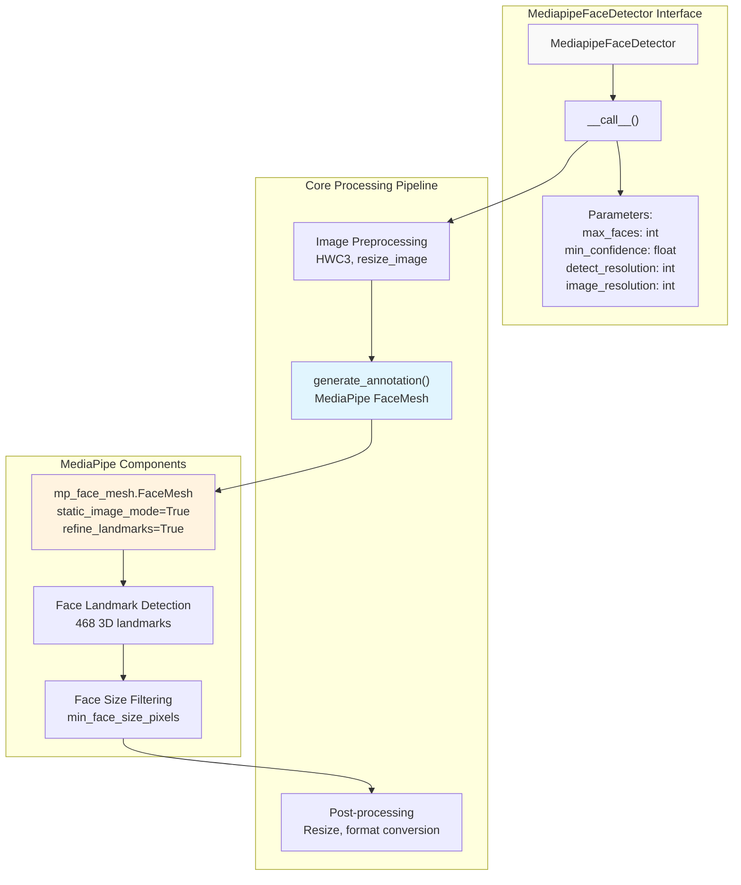
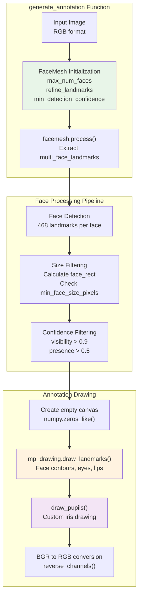
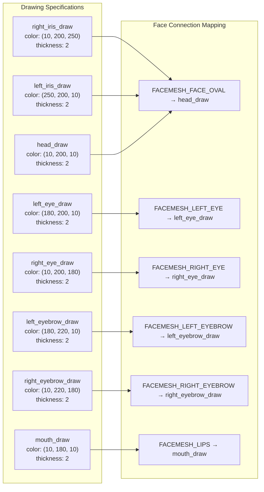
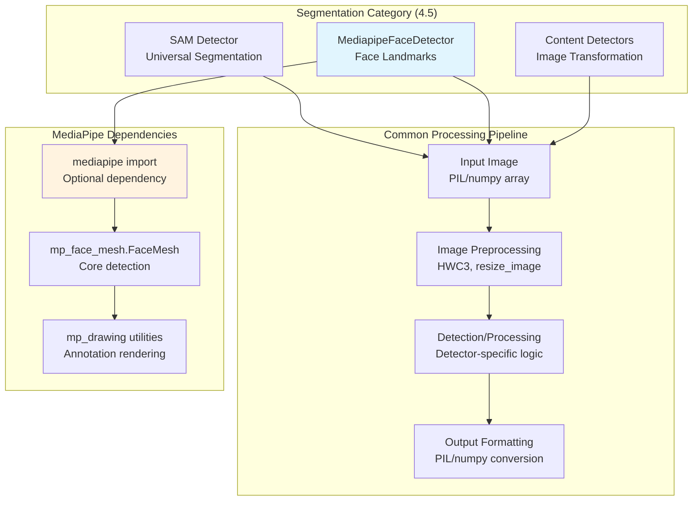

<!-- source: DeepWiki mcp.deepwiki.com · repo huggingface/controlnet_aux · extra page Face and Content Detectors · fetched 2026-10-26 -->

# Face and Content Detectors

Relevant source files

The following files were used as context for generating this wiki page:

- [src/controlnet_aux/canny/__init__.py](src/controlnet_aux/canny/__init__.py)
- [src/controlnet_aux/mediapipe_face/__init__.py](src/controlnet_aux/mediapipe_face/__init__.py)
- [src/controlnet_aux/mediapipe_face/mediapipe_face_common.py](src/controlnet_aux/mediapipe_face/mediapipe_face_common.py)
- [src/controlnet_aux/segment_anything/__init__.py](src/controlnet_aux/segment_anything/__init__.py)

This document covers specialized detectors for facial landmark detection and content manipulation within the controlnet_aux library. The face detector uses MediaPipe to identify and annotate facial features, while content detectors provide image transformation capabilities for preprocessing workflows.

For universal object segmentation capabilities, see [SAM Detector](#4.5.1). For pose estimation including face keypoints, see [Pose Estimation](#4.3).

## MediaPipe Face Detection

The `MediapipeFaceDetector` provides precise facial landmark detection using Google's MediaPipe framework. This detector identifies key facial features including eyes, eyebrows, lips, and face contours, producing detailed annotations suitable for face-aware image processing.

### MediapipeFaceDetector Class

The main detector class implements the standard controlnet_aux interface pattern:

**MediapipeFaceDetector Processing Flow**

Sources: [src/controlnet_aux/mediapipe_face/__init__.py:12-53]()

### Key Parameters

| Parameter | Type | Default | Description |
|-----------|------|---------|-------------|
| `max_faces` | int | 1 | Maximum number of faces to detect |
| `min_confidence` | float | 0.5 | Minimum detection confidence threshold |
| `detect_resolution` | int | 512 | Resolution for face detection processing |
| `image_resolution` | int | 512 | Output image resolution |

The detector accepts both PIL Images and numpy arrays, with automatic format detection and conversion.

Sources: [src/controlnet_aux/mediapipe_face/__init__.py:13-20]()

### Face Mesh Generation

The core facial landmark detection is implemented in the `generate_annotation` function, which orchestrates MediaPipe's FaceMesh processing:

**Face Mesh Annotation Pipeline**

Sources: [src/controlnet_aux/mediapipe_face/mediapipe_face_common.py:96-164]()

### Facial Feature Specifications

The detector uses predefined drawing specifications for different facial components:

**Facial Feature Drawing Configuration**

Sources: [src/controlnet_aux/mediapipe_face/mediapipe_face_common.py:27-58]()

### Face Size Filtering

The detector implements intelligent face filtering based on pixel size to ensure meaningful detection results:

| Filter Stage | Implementation | Purpose |
|--------------|----------------|---------|
| **Bounding Box Calculation** | `face_rect` computation from landmarks | Determine face dimensions |
| **Pixel Size Check** | `face_width_pixels`, `face_height_pixels` | Convert to absolute pixels |
| **Minimum Size Filter** | `face_size >= min_face_size_pixels` | Reject small faces |
| **Confidence Thresholding** | `visibility > 0.9`, `presence > 0.5` | Quality assurance |

Sources: [src/controlnet_aux/mediapipe_face/mediapipe_face_common.py:121-145]()

## Content Processing Detectors

Content processing detectors provide image transformation and manipulation capabilities for preprocessing workflows. These detectors handle content shuffling, rearrangement, and other data augmentation techniques commonly used in computer vision pipelines.

### Integration with Segmentation Framework

Face and content detectors integrate seamlessly with the controlnet_aux segmentation framework:

**Segmentation Framework Integration**

Sources: [src/controlnet_aux/mediapipe_face/__init__.py:1-54](), [src/controlnet_aux/mediapipe_face/mediapipe_face_common.py:4-11]()

### Error Handling and Dependencies

The MediaPipe face detector implements robust error handling for optional dependencies:

- **MediaPipe Import**: Graceful degradation when MediaPipe is not installed
- **Input Validation**: Comprehensive checks for image format and parameters
- **Face Detection Fallback**: Zero-filled image return when no faces detected
- **Parameter Deprecation**: Backward compatibility with warning messages

Sources: [src/controlnet_aux/mediapipe_face/mediapipe_face_common.py:4-11](), [src/controlnet_aux/mediapipe_face/__init__.py:22-35]()

---

