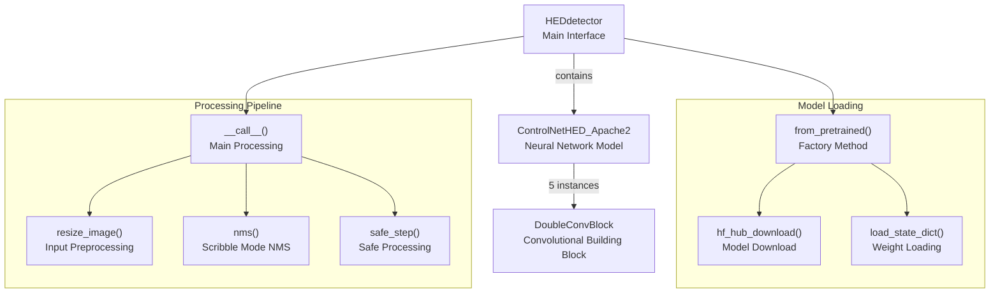
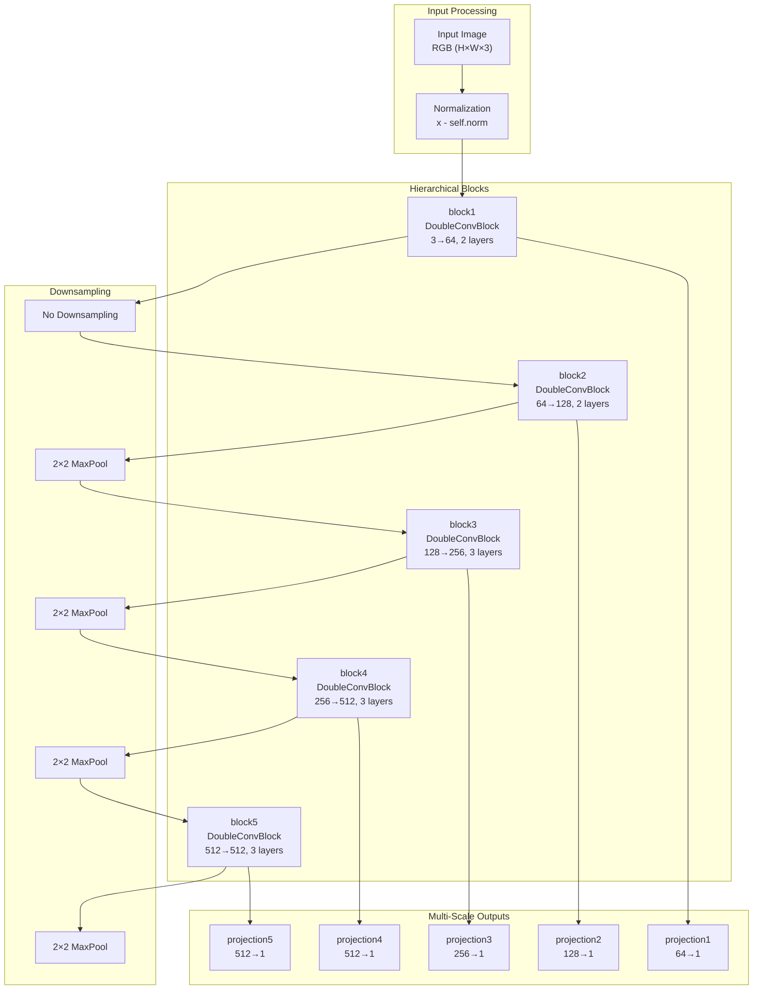
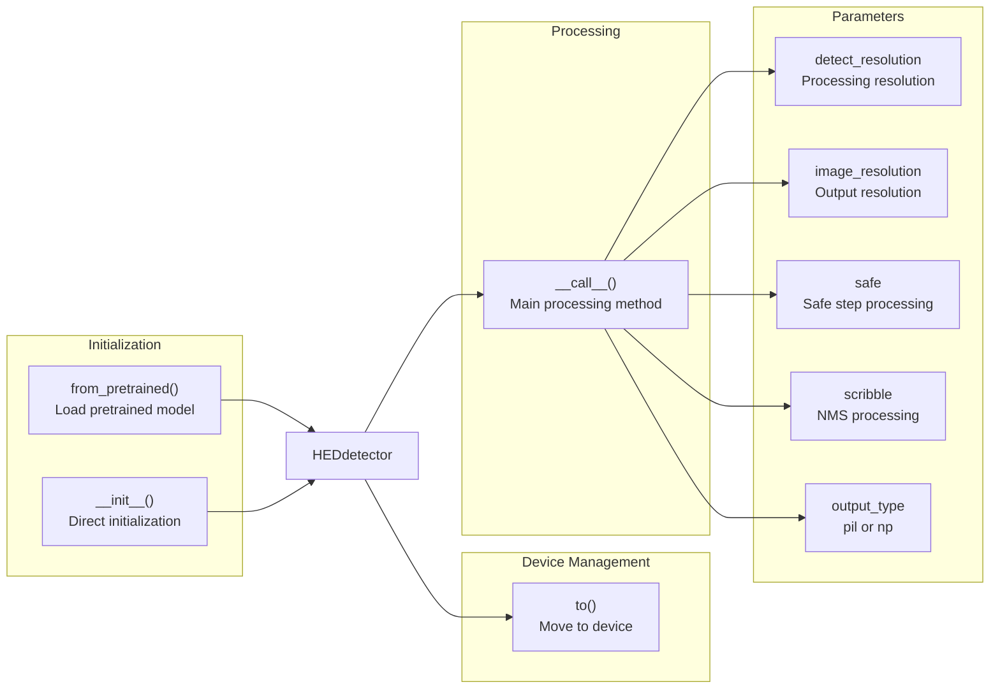
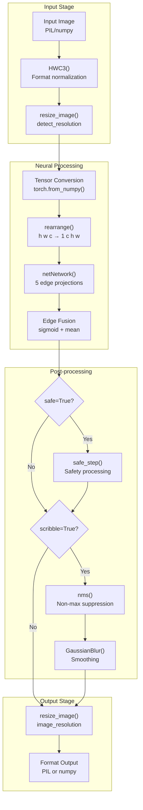
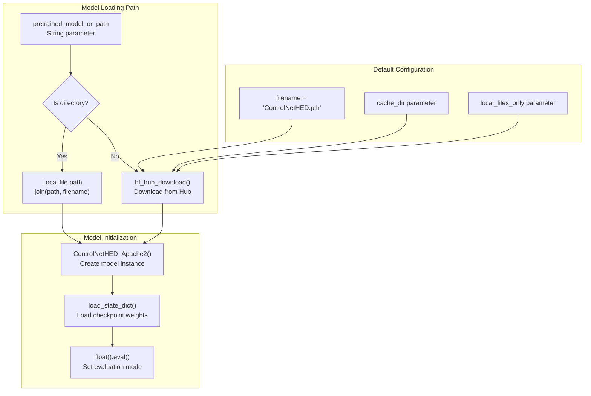

<!-- source: DeepWiki mcp.deepwiki.com · repo huggingface/controlnet_aux · extra page HED Detector · fetched 2026-10-26 -->

# HED Detector

Relevant source files

The following files were used as context for generating this wiki page:

- [src/controlnet_aux/hed/__init__.py](src/controlnet_aux/hed/__init__.py)
- [src/controlnet_aux/mlsd/__init__.py](src/controlnet_aux/mlsd/__init__.py)

The HED Detector implements Holistically-nested Edge Detection (HED) for multi-scale edge map generation with ControlNet optimizations. This detector is specifically designed for ControlNet applications and image-to-image translation tasks, producing smoother edges than standard implementations while supporting advanced features like scribble mode processing.

This document covers the `HEDdetector` class implementation, neural network architecture, and usage patterns. For other edge detection methods, see [Canny Detector](#4.1.2), [PiDiNet Detector](#4.1.3), and [TEED and Anyline Detectors](#4.1.4). For general edge detection concepts, see [Edge Detection](#4.1).

## Architecture Overview

The HED Detector consists of three main architectural components: the detector interface, the neural network model, and convolutional building blocks.

### Class Hierarchy

**Sources**: [src/controlnet_aux/hed/__init__.py:59-129]()

### Neural Network Architecture

The `ControlNetHED_Apache2` model implements a VGG-inspired architecture with five hierarchical blocks for multi-scale edge detection:

**Sources**: [src/controlnet_aux/hed/__init__.py:40-57](), [src/controlnet_aux/hed/__init__.py:21-37]()

## Core Components

### DoubleConvBlock Structure

The `DoubleConvBlock` class implements the fundamental building block used throughout the HED architecture:

| Component | Purpose | Configuration |
|-----------|---------|---------------|
| `convs` Sequential | Main convolution layers | Variable layer count (2-3) |
| `projection` Conv2d | 1×1 conv to single channel | `output_channels → 1` |
| Downsampling | Optional 2×2 max pooling | Applied between blocks |
| Activation | ReLU after each conv | Applied in forward pass |

The block processes features through multiple 3×3 convolutions with padding, followed by a 1×1 projection layer for edge map generation.

**Sources**: [src/controlnet_aux/hed/__init__.py:21-37]()

### HEDdetector Interface

The `HEDdetector` class provides the main user interface with the following key methods:

**Sources**: [src/controlnet_aux/hed/__init__.py:59-81](), [src/controlnet_aux/hed/__init__.py:82-129]()

## Processing Pipeline

### Standard Edge Detection Flow

The HED detector processes images through the following pipeline:

1. **Input Preprocessing**: Convert to numpy array and apply `HWC3` formatting
2. **Resolution Scaling**: Resize input to `detect_resolution` 
3. **Neural Network Inference**: Generate 5 multi-scale edge projections
4. **Edge Fusion**: Combine projections using sigmoid-weighted averaging
5. **Post-processing**: Apply optional safe step or scribble mode processing
6. **Output Scaling**: Resize to `image_resolution` and format output

**Sources**: [src/controlnet_aux/hed/__init__.py:82-129]()

### Scribble Mode Processing

When `scribble=True`, the detector applies specialized post-processing for sketch-like output:

| Step | Function | Parameters | Purpose |
|------|----------|------------|---------|
| 1. NMS | `nms()` | `threshold=127, sigma=3.0` | Remove duplicate edges |
| 2. Gaussian Blur | `cv2.GaussianBlur()` | `sigma=3.0` | Smooth edge lines |
| 3. Thresholding | Binary threshold | `>4 → 255, <255 → 0` | Create clean binary edges |

**Sources**: [src/controlnet_aux/hed/__init__.py:120-124]()

## Model Loading and Configuration

### Pretrained Model Loading

The HED detector supports flexible model loading through the `from_pretrained` classmethod:

**Sources**: [src/controlnet_aux/hed/__init__.py:63-76]()

### Parameter Configuration

The HED detector accepts the following configuration parameters:

| Parameter | Type | Default | Description |
|-----------|------|---------|-------------|
| `detect_resolution` | int | 512 | Processing resolution for edge detection |
| `image_resolution` | int | 512 | Final output image resolution |
| `safe` | bool | False | Apply safe step processing to reduce noise |
| `scribble` | bool | False | Enable scribble mode with NMS processing |
| `output_type` | str | "pil" | Output format: "pil" or "np" |

**Sources**: [src/controlnet_aux/hed/__init__.py:82]()

## Key Implementation Details

### RGB vs BGR Handling

The HED implementation uses RGB input format, differing from official BGR implementations. This design choice improves compatibility with Gradio's RGB protocol and ControlNet applications.

### Multi-Scale Edge Fusion

The detector combines five different scale edge projections using sigmoid activation and averaging:
- `edge = 1 / (1 + np.exp(-np.mean(edges, axis=2).astype(np.float64)))`

This approach produces smoother, more coherent edge maps compared to single-scale detection.

### Memory and Device Management

The detector automatically detects the device of the neural network parameters and ensures tensor operations occur on the same device, supporting both CPU and GPU inference.

**Sources**: [src/controlnet_aux/hed/__init__.py:91](), [src/controlnet_aux/hed/__init__.py:100-111]()

---

