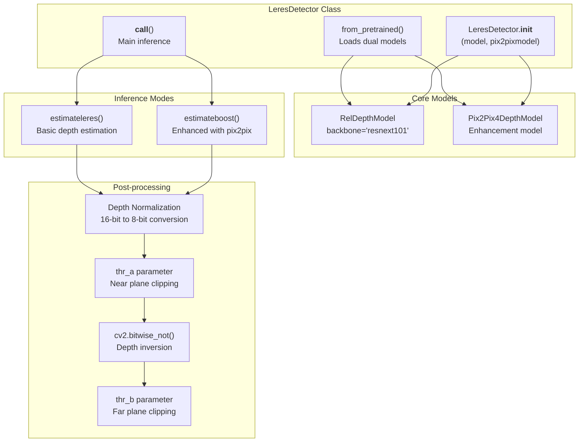
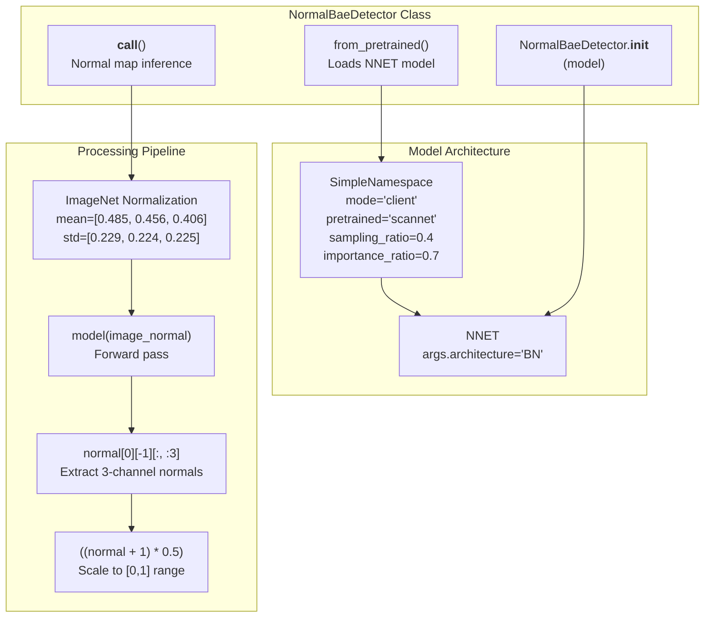
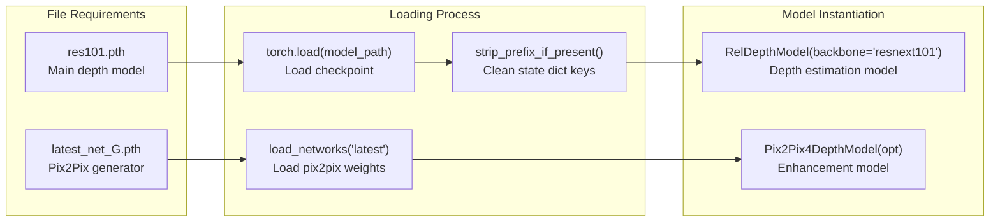
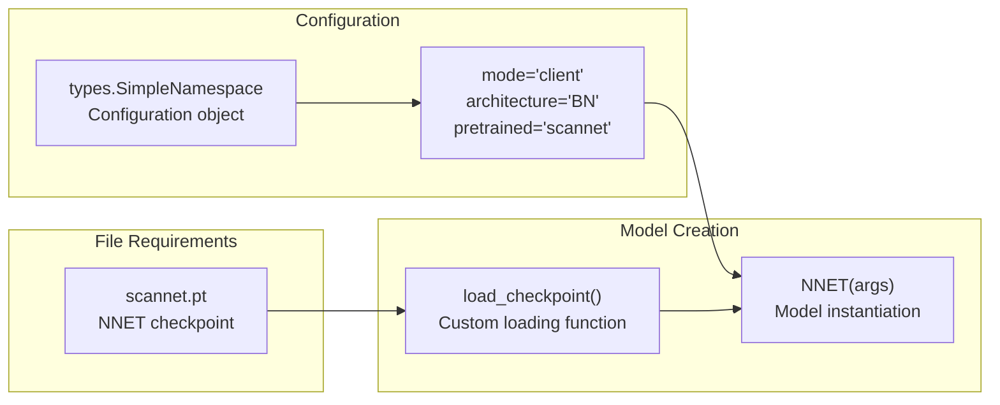

<!-- source: DeepWiki mcp.deepwiki.com · repo huggingface/controlnet_aux · extra page LeRes and Normal Map Detectors · fetched 2026-10-26 -->

# LeRes and Normal Map Detectors

Relevant source files

The following files were used as context for generating this wiki page:

- [src/controlnet_aux/leres/__init__.py](src/controlnet_aux/leres/__init__.py)
- [src/controlnet_aux/leres/leres/__init__.py](src/controlnet_aux/leres/leres/__init__.py)
- [src/controlnet_aux/leres/pix2pix/__init__.py](src/controlnet_aux/leres/pix2pix/__init__.py)
- [src/controlnet_aux/lineart/__init__.py](src/controlnet_aux/lineart/__init__.py)
- [src/controlnet_aux/lineart_anime/__init__.py](src/controlnet_aux/lineart_anime/__init__.py)
- [src/controlnet_aux/normalbae/__init__.py](src/controlnet_aux/normalbae/__init__.py)
- [src/controlnet_aux/pidi/__init__.py](src/controlnet_aux/pidi/__init__.py)

This document covers two specialized depth-related detectors in controlnet_aux: the LeRes depth estimation detector and the NormalBae normal map generator. These detectors provide complementary depth-related preprocessing capabilities for ControlNet applications.

For general depth estimation with MiDaS models, see [MiDaS Detector](#4.2.1). For metric depth estimation, see [ZoeDepth Detector](#4.2.2).

## Overview

The controlnet_aux library provides two distinct approaches to depth-related feature extraction:

| Detector | Purpose | Output | Key Features |
|----------|---------|--------|--------------|
| **LeresDetector** | Monocular depth estimation | Grayscale depth maps | Dual-model architecture, boost mode, threshold controls |
| **NormalBaeDetector** | Surface normal estimation | RGB normal maps | Single NNET model, ScanNet training |

Both detectors follow the standard controlnet_aux interface pattern with `from_pretrained()`, `to()`, and `__call__()` methods, supporting flexible resolution control and output format options.

Sources: [src/controlnet_aux/leres/__init__.py:17-119](), [src/controlnet_aux/normalbae/__init__.py:32-109]()

## LeRes Depth Detector Architecture

The `LeresDetector` implements a dual-model architecture combining a ResNext101-based depth estimation model with an optional Pix2Pix enhancement model. The detector supports two inference modes: basic depth estimation using `estimateleres()` and enhanced estimation using `estimateboost()` with the Pix2Pix model.

Sources: [src/controlnet_aux/leres/__init__.py:17-51](), [src/controlnet_aux/leres/__init__.py:59-118]()

## NormalBae Normal Map Generator Architecture  

The `NormalBaeDetector` uses a single NNET architecture trained on the ScanNet dataset to generate surface normal maps. The model processes images through standard ImageNet normalization and outputs 3-channel RGB normal maps representing surface orientations.

Sources: [src/controlnet_aux/normalbae/__init__.py:32-56](), [src/controlnet_aux/normalbae/__init__.py:63-108]()

## Model Loading and Initialization

Both detectors implement the standard controlnet_aux loading pattern but with different model requirements:

### LeresDetector Model Loading

### NormalBaeDetector Model Loading

The LeresDetector requires two separate model files and uses different loading mechanisms for each, while NormalBaeDetector uses a single checkpoint with a custom loading function to handle module prefixes.

Sources: [src/controlnet_aux/leres/__init__.py:22-51](), [src/controlnet_aux/normalbae/__init__.py:18-56]()

## Inference Parameters and Processing

### LeresDetector Parameters

| Parameter | Type | Default | Description |
|-----------|------|---------|-------------|
| `boost` | bool | False | Enable Pix2Pix enhancement |
| `thr_a` | int | 0 | Near plane threshold (0-100%) |
| `thr_b` | int | 0 | Far plane threshold (0-100%) |
| `detect_resolution` | int | 512 | Input processing resolution |
| `image_resolution` | int | 512 | Output image resolution |

### NormalBaeDetector Parameters

The `NormalBaeDetector` uses only the standard resolution parameters (`detect_resolution`, `image_resolution`) and `output_type`, with no model-specific configuration options.

### Processing Flow Comparison

```mermaid
graph TD
    subgraph "LeresDetector Flow"
        L_INPUT["`Input Image
        HWC3 + resize`"]
        L_MODE{"`boost parameter
        True/False`"}
        L_BASIC["`estimateleres()
        Basic depth`"]
        L_BOOST["`estimateboost()
        Enhanced depth`"]
        L_NORM["`Depth normalization
        16-bit to 8-bit`"]
        L_THR_A["`Near threshold
        thr_a clipping`"]
        L_INVERT["`cv2.bitwise_not()
        Invert depth`"]
        L_THR_B["`Far threshold
        thr_b clipping`"]
        L_OUTPUT["`Grayscale depth map
        uint8 output`"]
    end
    
    subgraph "NormalBaeDetector Flow"
        N_INPUT["`Input Image
        HWC3 + resize`"]
        N_NORM["`ImageNet normalization
        Standard preprocessing`"]
        N_FORWARD["`NNET forward pass
        Surface normal prediction`"]
        N_EXTRACT["`Extract normals
        [:, :3] channels`"]  
        N_SCALE["`Scale to [0,1]
        (normal + 1) * 0.5`"]
        N_OUTPUT["`RGB normal map
        3-channel output`"]
    end
    
    L_INPUT --> L_MODE
    L_MODE -->|False| L_BASIC
    L_MODE -->|True| L_BOOST
    L_BASIC --> L_NORM
    L_BOOST --> L_NORM
    L_NORM --> L_THR_A
    L_THR_A --> L_INVERT
    L_INVERT --> L_THR_B
    L_THR_B --> L_OUTPUT
    
    N_INPUT --> N_NORM
    N_NORM --> N_FORWARD
    N_FORWARD --> N_EXTRACT
    N_EXTRACT --> N_SCALE
    N_SCALE --> N_OUTPUT
```

The LeresDetector provides extensive post-processing controls for depth map refinement, while NormalBaeDetector follows a straightforward neural network inference pipeline with minimal post-processing.

Sources: [src/controlnet_aux/leres/__init__.py:59-118](), [src/controlnet_aux/normalbae/__init__.py:63-108]()

---

