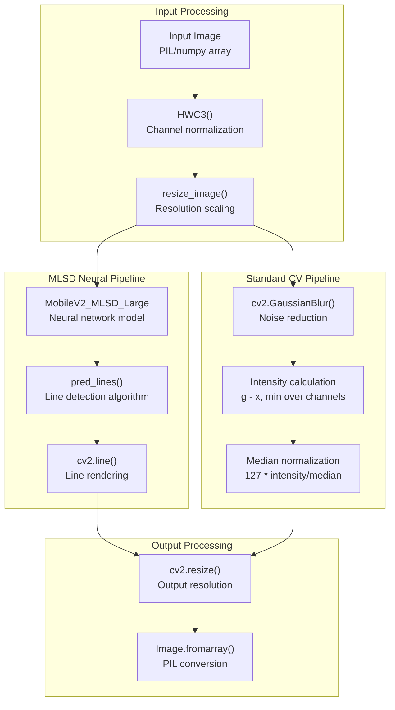
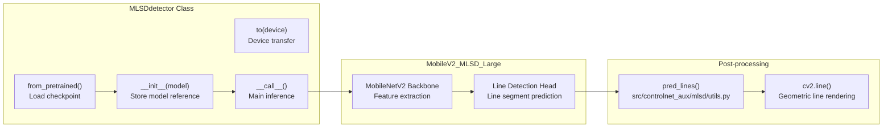
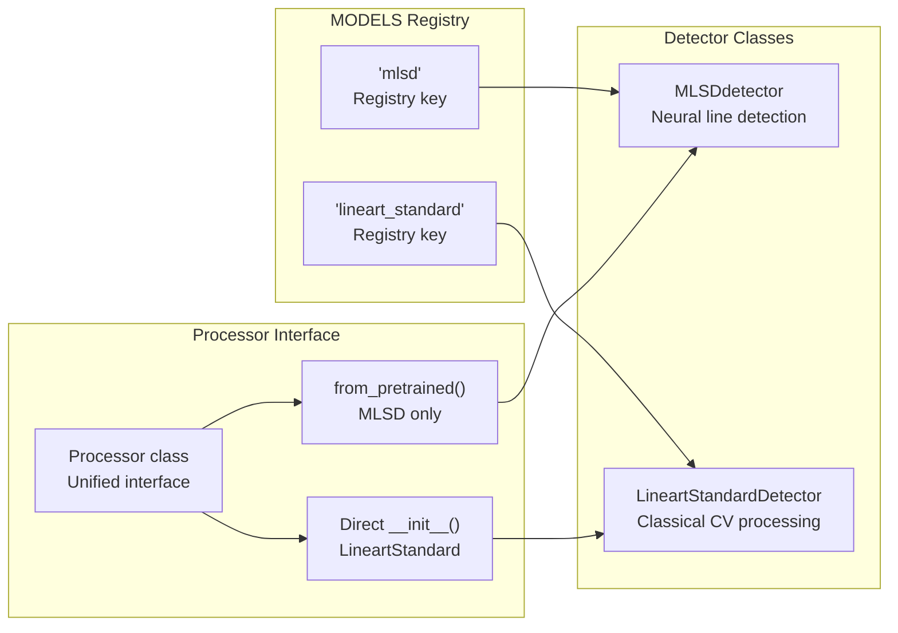

<!-- source: DeepWiki mcp.deepwiki.com · repo huggingface/controlnet_aux · extra page Line Segment Detection · fetched 2026-10-26 -->

# Line Segment Detection

<details>
<summary>Relevant source files</summary>

The following files were used as context for generating this wiki page:

- [src/controlnet_aux/anyline/__init__.py](src/controlnet_aux/anyline/__init__.py)
- [src/controlnet_aux/hed/__init__.py](src/controlnet_aux/hed/__init__.py)
- [src/controlnet_aux/lineart_standard/__init__.py](src/controlnet_aux/lineart_standard/__init__.py)
- [src/controlnet_aux/mlsd/__init__.py](src/controlnet_aux/mlsd/__init__.py)
- [src/controlnet_aux/teed/Fsmish.py](src/controlnet_aux/teed/Fsmish.py)
- [src/controlnet_aux/teed/LICENSE.txt](src/controlnet_aux/teed/LICENSE.txt)
- [src/controlnet_aux/teed/Xsmish.py](src/controlnet_aux/teed/Xsmish.py)
- [src/controlnet_aux/teed/__init__.py](src/controlnet_aux/teed/__init__.py)
- [src/controlnet_aux/teed/ted.py](src/controlnet_aux/teed/ted.py)

</details>


This page covers the line segment detection capabilities in controlnet_aux, which include both neural network-based line segment detection and classical computer vision-based line art processing. These systems generate line-based representations of images for ControlNet conditioning.

For general line art generation using neural networks, see [LineArt Detectors](#4.4.1). For edge detection systems, see [Edge Detection](#4.1).

## Overview

The line segment detection category includes two distinct approaches:

| Detector | Approach | Primary Use Case |
|----------|----------|------------------|
| `MLSDdetector` | Neural network (MobileV2) | Mobile line segment detection with precise geometric lines |
| `LineartStandardDetector` | Classical CV (Gaussian blur + intensity) | Standard line art processing without neural networks |

Both detectors output binary line maps suitable for ControlNet conditioning, but use fundamentally different detection strategies.

## System Architecture

The line segment detection systems operate independently but share common preprocessing utilities:



Sources: [src/controlnet_aux/mlsd/__init__.py:1-80](), [src/controlnet_aux/lineart_standard/__init__.py:1-48](), [src/controlnet_aux/util.py]()

## MLSD Detector

The `MLSDdetector` implements Mobile Line Segment Detection using a MobileNetV2-based neural network architecture. It detects geometric line segments and renders them as precise white lines on a black background.

### Model Architecture



Sources: [src/controlnet_aux/mlsd/__init__.py:15-35](), [src/controlnet_aux/mlsd/models/mbv2_mlsd_large.py]()

### Key Parameters

The `MLSDdetector.__call__` method accepts these parameters:

| Parameter | Type | Default | Description |
|-----------|------|---------|-------------|
| `thr_v` | float | 0.1 | Line detection threshold for validation |
| `thr_d` | float | 0.1 | Line detection threshold for distance |
| `detect_resolution` | int | 512 | Input resolution for line detection |
| `image_resolution` | int | 512 | Output image resolution |
| `output_type` | str | "pil" | Output format ("pil" or "np") |

### Implementation Details

The detection process follows this sequence:

1. **Input preprocessing**: [src/controlnet_aux/mlsd/__init__.py:50-54]()
   - Convert to numpy array if needed
   - Apply `HWC3` channel normalization
   - Resize to `detect_resolution`

2. **Neural inference**: [src/controlnet_aux/mlsd/__init__.py:60-61]()
   - Run `pred_lines` function with model and thresholds
   - Extract line coordinates as `[x_start, y_start, x_end, y_end]`

3. **Line rendering**: [src/controlnet_aux/mlsd/__init__.py:62-64]()
   - Draw each line segment using `cv2.line`
   - Use white color `[255, 255, 255]` with thickness 1
   - Render on black background

4. **Output processing**: [src/controlnet_aux/mlsd/__init__.py:68-77]()
   - Extract single channel from RGB output
   - Apply `HWC3` to ensure 3-channel format
   - Resize to final `image_resolution`

Sources: [src/controlnet_aux/mlsd/__init__.py:41-79]()

## LineArt Standard Detector

The `LineartStandardDetector` uses classical computer vision techniques to generate line art without neural networks. It operates by analyzing intensity differences after Gaussian blurring.

### Algorithm Pipeline

```mermaid
graph TB
    subgraph "LineartStandardDetector.__call__"
        INPUT_CHECK["Input validation<br/>PIL to numpy conversion"]
        RESIZE_INPUT["resize_image()<br/>Scale to detect_resolution"]
        
        subgraph "Core Algorithm"
            FLOAT_CONV["x.astype(np.float32)<br/>Float conversion"]
            GAUSSIAN_BLUR["cv2.GaussianBlur()<br/>sigma = guassian_sigma"]
            INTENSITY_CALC["np.min(g - x, axis=2)<br/>Minimum intensity difference"]
            MEDIAN_NORM["intensity / median(intensity)<br/>Adaptive normalization"]
            SCALE_127["intensity * 127<br/>Scale to output range"]
        end
        
        OUTPUT_RESIZE["cv2.resize()<br/>Restore original dimensions"]
        PIL_OUTPUT["Image.fromarray()<br/>Convert to PIL if needed"]
    end
    
    INPUT_CHECK --> RESIZE_INPUT
    RESIZE_INPUT --> FLOAT_CONV
    FLOAT_CONV --> GAUSSIAN_BLUR
    GAUSSIAN_BLUR --> INTENSITY_CALC
    INTENSITY_CALC --> MEDIAN_NORM
    MEDIAN_NORM --> SCALE_127
    SCALE_127 --> OUTPUT_RESIZE
    OUTPUT_RESIZE --> PIL_OUTPUT
```



Sources: [src/controlnet_aux/lineart_standard/__init__.py:11-47]()

### Parameters

| Parameter | Type | Default | Description |
|-----------|------|---------|-------------|
| `guassian_sigma` | float | 6.0 | Standard deviation for Gaussian blur kernel |
| `intensity_threshold` | int | 8 | Minimum intensity for median calculation |
| `detect_resolution` | int | 512 | Processing resolution |
| `output_type` | str | "pil" | Output format |

### Mathematical Foundation

The core algorithm implements this mathematical operation:

1. **Gaussian smoothing**: `g = GaussianBlur(x, σ=guassian_sigma)`
2. **Intensity difference**: `intensity = min(g - x, axis=channels)`
3. **Adaptive normalization**: `intensity = intensity / max(16, median(intensity[intensity > threshold]))`
4. **Scaling**: `output = clip(intensity * 127, 0, 255)`

This approach detects edges by finding areas where the original image differs significantly from its blurred version, with adaptive normalization based on the median intensity of significant pixels.

Sources: [src/controlnet_aux/lineart_standard/__init__.py:29-34]()

## Integration with ControlNet Pipeline

Both detectors integrate with the broader controlnet_aux ecosystem through standard patterns:

### Model Registry Integration



Sources: [src/controlnet_aux/__init__.py](), [src/controlnet_aux/processor.py]()

### Usage Patterns

The detectors support both direct instantiation and Processor-mediated access:

**Direct usage:**
```python
# MLSD requires model loading
mlsd = MLSDdetector.from_pretrained("lllyasviel/ControlNet")
result = mlsd(image, thr_v=0.1, thr_d=0.1)

# LineArt Standard instantiates directly
lineart_std = LineartStandardDetector()
result = lineart_std(image, guassian_sigma=6.0)
```

**Processor usage:**
```python
processor = Processor("mlsd")
result = processor(image, thr_v=0.1, thr_d=0.1)
```

Sources: [src/controlnet_aux/mlsd/__init__.py:19-35](), [src/controlnet_aux/lineart_standard/__init__.py:10-17]()

---

